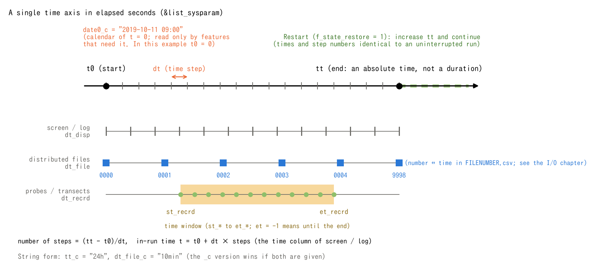

# Time Management

> English mirror of docs/users_guide/time.md. The Japanese file is the master copy.

[Back to the User's Guide index](../users_guide.md)

ENCflow time t is measured in seconds from a common origin t=0. On top
of this axis, a "calendar (date and time)" used only by the features that
need it can be overlaid. All time-related parameters are in
`&list_sysparam`.

## Time axis and time step

| Parameter | Default | Meaning |
|---|---|---|
| t0 | 0 | computation start time (s) |
| tt | 0 | requested end time (s), on the same axis as t0. The requested duration is **tt − t0** |
| dt | 0 | time step (s). Must be specified |

A fresh run starts at step `it=0` and time `t=t0`. The total step count
is `N = ceiling((tt − t0)/dt)`, and each step's time is computed from
`t = t0 + dt×it`, rather than by repeated addition. Since `ceiling`
rounds up, the normal end time `t0 + dt×N` exceeds the requested tt
when the duration is not a multiple of dt. For example,
`t0=0, tt=18.2, dt=1` gives 19 steps and normally ends at `t=19`.
Distinguish the requested end time from the final step when preparing
inputs. An error can terminate the run earlier. The screen/log time
column displays this simulation time.

The time step dt governs the stability and accuracy of the
computation. The guide is the Cn_max column (Courant number) on the
screen; settings that greatly exceed 1 become unstable. For the actual
relationship between accuracy and computational cost, see
[Tutorial Steps 1-2](../../../tutorials/wave/en/README.md#coarsening-the-time-step).
What the Courant number is and how to estimate `dt` from the cell width,
velocity and depth are explained in
[Courant number and how to choose the time step](courant.md) (primer);
why ENCflow fixes `dt` and is mainly explicit, and how that relates to
variable steps and sub-cycling, is in the
[time-step design policy](timestep_policy.md).

## Specifying times as strings (`*_c`)

Instead of seconds, times can also be specified as "number + unit"
strings. The corresponding parameter names end in `_c`, and **if both
are written, the `_c` version takes precedence**.

```
  tt_c = "24h"              ! same as tt = 86400.0
  dt_file_c = "10min"       ! same as dt_file = 600.0
```

The unit is exactly one of `d` (`day`), `h` (`hour`), `m` (`min`),
`s` (`sec`), and decimals such as `"1.5d"` can be used (compound
notation such as `"1h30m"` is not allowed). Since this avoids hand
computation of seconds for long runs, `_c` versions exist for all of
`t0/tt/dt/dt_disp/dt_file/dt_recrd/st_file/et_file/st_recrd/et_recrd`.

## Display and output intervals

| Parameter | Default | Meaning |
|---|---|---|
| dt_disp | 60 | interval of screen and log display (s) |
| dt_file | 3600 | interval of distributed file output (s) |
| dt_recrd | 60 | interval of probe / transect (fn_record) output (s) |
| st_file / et_file | 0 / -1 | window settings for distributed files (s). A negative et is replaced by tt; see the step rules below |
| st_recrd / et_recrd | 0 / -1 | window settings for probes / transects (s). A negative et is replaced by tt |

The implementation converts seconds to **integer steps**. An interval D
(`dt_disp`, `dt_file` or `dt_recrd`) becomes
`I = max(nint(D/dt), 1)` steps, and output is due when `it` is a multiple
of I. `nint` rounds to the nearest integer, with positive half-integers
rounded upward. For example, `dt=1, dt_file=2.5` gives a regular file
interval of three steps. Setting an interval to zero does not disable
output: the minimum interval is one step.

Regular field and recording output must also satisfy `L ≤ it ≤ U`,
where `L=max(nint(st_*/dt),1)` and `U=max(nint(et_*/dt),1)` (a negative
et_* is first replaced by tt). **The interval is anchored to multiples
of the step index; it is not restarted at the window's beginning.**
For example, `dt=1, dt_recrd=3, st_recrd=5, et_recrd=16` records regularly
at `it=6,9,12,15`.

The conversion of `st_*` and `et_*` does not subtract t0. In the current
implementation, explicit non-negative window settings correspond to
**elapsed seconds from t0**. For example,
`t0=100, dt=1, st_recrd=5, et_recrd=16` corresponds to simulation times
`t=105…116`. Window seconds equal simulation time only when t0=0.
Restart mode 1 continues the saved it and does not move the window's
origin to the restart time. Even with the default end setting of −1,
the rounding of tt for the window differs from the ceiling used for the
final step, so regular output is not guaranteed at the last step.

At initialization, screen output, the `0000` field output and enabled
probe/transect records bypass these interval/window tests. Finalization
separately writes `9998` (the last state actually reached) and `9999`
(maxima and other statistics over this run). A regular field output at
the last step does not suppress `9998`. In contrast, finalization does
not unconditionally append a last probe/transect row. Field and statistics
files require their output flags. Check `FILENUMBER.csv` for the mapping
from numbers to times; see [Input and Output Files](io.md).

When you want fine output only during a specific event period in a
long run, combining the st/et windows with split execution via
[the restart feature](restart.md) is practical.



(a) t0 and tt are coordinates on one time axis; the requested duration is
tt−t0. The calendar origin specified by `date0_c` is also at t=0.
(b) shows a fresh 18-step run with `t0=0, tt=18, dt=1`. Screen/log output
occurs every 2 s, regular field output every 4 s (`0001…0004` at
t=4,8,12,16), and probes/transects every 1 s inside the window t=5…16.
The open circle on the recording row marks the initial record, which is
written even outside the window. `0000` is the starting state at t=0;
`9998` is the final state at t=18. `9999` holds period statistics, not
the next instant on the axis. This is an output-procedure schematic,
not a computed time series.

## Calendar (date and time)

For features that depend on the season or the date (monthly
coefficients of evapotranspiration, day-boundary handling of snow
accumulation and snowmelt, temperature correction of water quality,
etc.), the calendar date of simulation time t=0 can be specified.

```
  date0_c = "2019-10-11"          ! or "2019-10-11 09:00"
```

- If a feature that uses the calendar is enabled but date0_c is
  absent, the run stops at initialization with a message to that
  effect. If no feature uses the calendar, it need not be specified.
- The time anchor of time-series inputs such as distributed
  temperature files is the simulation time (elapsed time from t=0).
  date0_c only gives "what calendar time t=0 is" and never shifts the
  interpretation of input series.

## Time on restart

`f_state_restore=1` retains the saved step and regular output numbers
and continues on the same `t = t0 + dt×it` axis. Keep t0 and dt equal
to the saved values and extend tt. `0000` still means the starting state
of this run, so it contains the state at the restored time. Statistics
in `9999` are recomputed over the restarted run. See
[Suspend and Restart](restart.md) for the conditions for matching an
uninterrupted run and for histories that are not saved.
`f_state_restore=2` is a separate mode that uses the saved state as an
initial condition on a new time axis, starting at `it=0` and regular
output number zero.

## Cyclic forcing (for long-term runs)

Specifying a period in `t_cycle_c` (e.g. `"365d"`) repeats the
time-series forcing cyclically, which can be used for
millennium-scale landform development experiments and the like (for
what it applies to, see the developer document
[developer.md Sec. 32.4](../../developer.md) (in Japanese)). It is not
used in ordinary computations.

## Tests and examples

- [test/wave](../../../test/wave/en/README.md): a minimal setup specifying the time step, end time and spatial-output interval.
- [test/nest_identity](../../../test/nest_identity/en/README.md): the `restart` configuration compares save/resume on the same time axis with an uninterrupted run.
- [examples/List_samples/en/list_sysparam.txt](../../../examples/List_samples/en/list_sysparam.txt): annotated settings for time, output intervals, calendar and periodic forcing.
