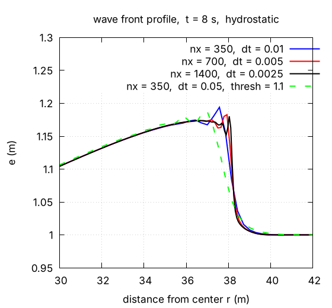
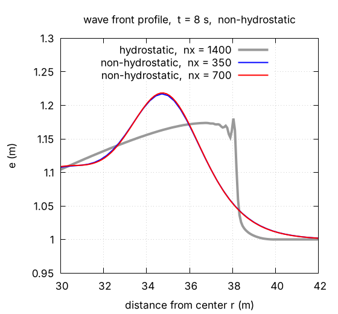

# Time-step design policy -- explicit methods, fixed step, necessary accuracy (supplement to time management)

> English mirror of docs/users_guide/timestep_policy.md. The Japanese file is the master copy.

[Back to Time management](time.md) | [Back to the User's Guide index](../users_guide.md) | [Primer: Courant number and how to choose the time step](courant.md)

This page records how ENCflow designs the time integration of the surface
flow -- why it is mainly explicit, why the base time step `dt` is fixed, how
it relates to variable time steps and sub-cycling, and how much accuracy is
sought -- for intermediate to advanced users and developers interested in
the implementation. The basics of the Courant number and how to choose `dt`
are in the [primer](courant.md); the equations of the time-integration
scheme are in [ENC grid and time integration](encgrid.md) §6–7. This page
fills the gap between them: the design decisions and their reasons.

<a id="design-policy"></a>

## 1. What ENCflow values

ENCflow puts weight on combining a variety of surface processes on the same
computational base and experimenting with them casually (the basic policy
in [developer.md §0](../../developer.md), in Japanese). It therefore does
not push numerical accuracy to the limit in every computation; instead it
**confirms the accuracy the purpose needs and then balances it against
computing speed, clarity of the settings, and ease of adding new
processes.**

This does not mean accuracy can be ignored. That the computation is stable,
that the water and mass balances show no unexplained error, and that the
results and conclusions of interest do not change much when the time step or
grid is varied are still checked. Once the accuracy is sufficient for the
purpose, however, computing resources go to the uncertainty of the inputs,
multiple scenarios and the interaction between processes rather than to
making the computation heavier just to add digits.

**Not discarding accuracy, but deciding first what the accuracy is for.**
That is the basic stance of this document.

<a id="explicit-method"></a>

## 2. Why the method is mainly explicit

The surface-flow computation of ENCflow is based on explicit time stepping.
By default each edge is advanced by an explicit Euler step, and only the
edges whose discharge changed abruptly are re-evaluated in several stages
(adaptive Runge–Kutta). The friction term is treated semi-implicitly, so
"every term is solved purely explicitly" is not the claim. With the
non-hydrostatic correction enabled, the spatially coupled correction is
obtained by iteration (conjugate gradients).[^encgrid][^nh]

The main development reason is that **the implementation is comparatively
easy and the addition and combination of different processes proceeds
smoothly.** In the developers' experience with the surface-flow
computations targeted so far, explicit methods have also made the balance
between accuracy and computing time easy to strike. This is not a claim
that explicit methods are fastest for every phenomenon, grid or duration.

An implicit method relaxes the stability restriction stemming from the
implicitly treated terms and may allow a larger time step. Implicit
computation of spatially coupled unknowns, however, needs linear systems or
iterative solvers and their convergence criteria, and the burden of
implementation and maintenance grows the more strongly many processes are
coupled. Even when the computation is stable at a large step, the time
variation is not necessarily represented well.[^sundials]

ENCflow's position is not to reject implicit methods but to use light
explicit computation for ordinary surface flow and to choose a method suited
to the nature of each part where the need is clear (the semi-implicit
friction, the iterative non-hydrostatic solver and the sub-cycling of the
conduit continuum layer are the examples).

<a id="fixed-time-step"></a>

## 3. The base time step is fixed

### Fixed and variable time steps

**The current ENCflow does not change the base time step `dt` of the
surface flow automatically during a run.** It uses the configured `dt` and
advances the simulation time as[^time]

```math
t_n = t_0 + n\,\Delta t
```

With `dt = 1` (seconds), for example, the base steps are at 0, 1, 2, 3, …
seconds.

A variable time step, by contrast, inspects the state during the run and
chooses the next step each time. A scheme based on the CFL condition, for
example, shrinks the step as the velocity or wave speed grows and enlarges
it when the constraint relaxes. Other schemes estimate the local
time-integration error and adjust. Control by the CFL number and control by
the error are not the same thing.[^sundials][^clawpack]

**"Explicit or implicit" and "fixed or variable step" are separate
choices.** Variable steps can be used with explicit methods, and fixed steps
with implicit ones.[^sundials]

### Advantages and limits of a fixed step

Time management by a fixed step and integer step counts has the following
advantages and limits.

| aspect | easy with a fixed step | limits; what a variable step could improve |
|---|---|---|
| implementation and coupling | one common time sequence makes the order of computation, update periods and exchanged quantities easy to manage | a variable step needs a redesign of time synchronization and of each process's update interval |
| trials, comparison, restart | cases are easy to compare on the same time sequence; the time management of restarts stays simple | a properly implemented variable step is reproducible too; a fixed step alone does not guarantee reproducibility |
| cost estimate | the number of base steps follows from the duration and `dt` | with the adaptive Runge–Kutta and inner sub-cycling, the time per step is not constant anyway |
| calm periods | the same settings and procedure apply throughout | a small fixed step is kept even where a larger one would be allowed, which can be wasteful |
| rapidly changing periods | the rise of `Cn_max` shows how the constraint tightens for the same step | it does not follow a sudden rise in velocity or depth; an inadequate step has to be revised by hand |

A variable step can greatly reduce the total number of steps in computations
where the allowable step differs a lot between calm and flood periods, and
automatic adjustment can relieve the user of tuning the step by hand.[^sundials][^clawpack]

Introducing it into ENCflow, however, would mean more than recomputing
`dt`: processes with different periods, output times (`dt_disp`, `dt_file`,
`dt_recrd` and the time windows are decided in integer steps), the updating
of forcing, and consistency with restart data would all have to be kept in
step. A design that rejects and redoes steps would also have to roll back the
state and accumulated balances of every module. This is not impossible; it
is the development task implied by changing the current fixed-step
structure.[^time][^clawpack]

A fixed step keeps the basic structure simple and makes many processes easy
to handle in the same framework. The speed-up a variable step could give
remains on the table. **A fixed step is not always the fastest.**

### Difference from the adaptive Runge–Kutta and sub-cycling

The "adaptive Runge–Kutta method" of ENCflow is not a feature that enlarges
or shrinks the base step `dt` automatically. Within the same base step it
selects the edges whose discharge changes abruptly and switches them to a
multi-stage computation. The `Runge` column on the screen is the maximum of
that recomputation rate over the display interval.[^encgrid]

Also, **a fixed base step and sub-cycling inside a module are compatible.**
For example, the surface flow advances every 1 s while only the process
that needs a finer step advances ten times at 0.1 s. These numbers are an
illustration, not the actual update periods of every module.

In the current ENCflow, for example, the lateral conveyance of the conduit
continuum layer sub-cycles internally when needed ("subcycles = N" is
printed at initialization; the upper limit is `gwc_nsubmax`). Not every
module and not every exchange term is subdivided automatically.[^gwflow]

Sub-cycling has the advantage that the whole computation, surface flow
included, need not be refined for one fast process. But if the inner
computation is refined while the exchange interval with the surface flow
stays coarse, the coupling error remains. In cases with strong interaction,
the base step and the exchange interval between modules also have to be
checked.

<a id="courant-health"></a>

## 4. Precisely because the step is fixed, Cn_max is monitored

Under the default CFL monitoring, the Courant number of each cell in ENCflow
is defined as[^encgrid]

```math
C_n = \frac{\left(|\mathbf{V}| + \sqrt{g h}\right)\,\Delta t}{\min(\Delta x, \Delta y)}
```

`Cn_max` in the log is the maximum over the cells, further maximized over
the interval from the previous display to the current one. At the start it
shows the value of the initial state. The aggregation corresponds to
`m_state_calcstat` (domain maximum each step) and `m_state_printstate`
(output and reset of the display-interval maximum) in `src/m_state.f90`.[^state]
Even with a fixed base step, `Cn_max` grows when the velocity or depth
grows. A small value at the start does not mean the run stays safe. In a
rainfall-runoff computation that starts dry, for example, evaluate it
including the state after the flood and ponding have developed.

The default `f_check_cfl = 1` is a monitor that stops the run when the
Courant number exceeds 1. It is not a feature that shrinks `dt` and
recomputes automatically. Nor is it a guarantee that anything below 1 is
stable and accurate in every configuration. The current guide gives 0.5 or
less as a guideline for computations with wet/dry fronts, bores and steep
slopes.[^encgrid]

`Cn_max` is a useful health check, but not a certificate on its own. Check
`Runge`, `ex_flux`, the distributions of depth and velocity, the water and
mass balances, and comparisons with a different time step as well. The
logged `Runge` and `ex_flux` are also maxima over the display interval
(`ex_flux` is the maximum per-step count of detections).[^encgrid][^state]

With a fixed step, a rise of `Cn_max` can be read as the flow conditions
tightening for the same step. With a variable-step scheme the same
diagnosis is possible if `Cn_max` is reported alongside the actual `dt`,
velocity and depth.

<a id="accuracy-and-purpose"></a>

## 5. Solving the equations accurately versus reproducing reality accurately

### The two kinds of "accuracy" are not the same

A numerical simulation does not put the real phenomenon into the computer as
it is. First the equations or model that represent the phenomenon are
chosen, the input conditions such as terrain, rainfall and roughness are
given, and that model is solved numerically on a grid with a time step.

The following two therefore have to be distinguished.[^verif][^valid]

| what is checked | the concrete question |
|---|---|
| are the equations solved accurately enough? | is the error from the time step and grid small? is the implementation correct? |
| do the equations, model and inputs represent the phenomenon appropriately? | is the necessary physics included? do they agree with observation or experiment to the extent the purpose needs? |

Refining the time step or grid mainly improves the former. By itself it
neither adds omitted physics nor corrects errors in the input data.

### The example of the wave tutorial

The [supplement of the wave tutorial](../../../tutorials/wave/en/README.md#refining-the-grid)
shows that solving the hydrostatic shallow water equations on a finer grid
with a finer time step shrinks the numerical oscillation and approaches the
bore solution those equations describe.[^wave]



*Figure 1. Result from the wave tutorial (reproduced). It examines how the numerical solution of the same equations changes with the grid and time step.*

Where the physical dispersion due to vertical acceleration matters, on the
other hand, the effect the hydrostatic model omits has to be considered. The
difference from a computation with the non-hydrostatic correction is not a
difference in numerical accuracy but **a difference in the model being
solved**.[^wave]



*Figure 2. Result from the wave tutorial (reproduced). The waveform changes with the physical model. The non-hydrostatic computation is also the numerical solution of an approximate model; this comparison is not a validation against experiment or observation.*

What matters is not to judge a result whose front has been smeared by
numerical damping as a physically correct reproduction, even if it happens
to resemble another model or an observation. The principle **never to use
numerical error as a substitute for missing physics** does not
change.[^wave][^verif][^valid]

### Stop at the accuracy that is needed

ENCflow does not make running every computation on the finest possible grid
and time step the standard. First make clear what the computation is meant
to tell you: for example the discharge peak and its arrival time, the
maximum inundation depth, the inundated area, the sediment budget, or the
difference made by adding a process.

Then, for a representative case, compare runs with `dt` halved and so on,
and examine the effect on the quantities and conclusions of interest. Do the
same for the grid and the coupling interval if needed. A single comparison
does not prove sufficient convergence, but it is the entry point for not
overlooking a large error.[^verif]

Once the difference is confirmed to be small enough for the purpose,
examining the uncertainty of the inputs, the choice of model and multiple
scenarios can take priority over further refinement. Conversely, if the
conclusion changes with the time step or grid, the numerical accuracy has
not been checked enough. Do not leave the numerical error unevaluated just
because the uncertainty of the inputs is large.

The tolerable difference depends on the purpose. A trial to grasp the
picture and a study of inundation near a threshold or of wave phase do not
need the same accuracy. There is no uniform rule such as "a few percent is
fine".[^valid]

**A stable computation, equations solved accurately enough, and a
phenomenon reproduced to the extent the purpose needs: distinguish the
three, and aim to reconcile the necessary accuracy with speed and
convenience.**

<a id="practical-notes"></a>

## 6. Checks when running a computation

Estimate the time step from a target Courant number suited to the method and
phenomenon, and confirm it with trial runs. For surface flow with wet/dry
fronts, bores or steep slopes, take a Courant number of 0.5 or less as a
guideline and go smaller if needed. The initial estimate is no guarantee of
stability or accuracy. The concrete procedure and worked example are in
[Courant number and how to choose the time step](courant.md#choose-dt).[^encgrid]

If an abnormal depth, velocity or waveform does not improve when the time
step is reduced, review the boundary conditions, terrain, inputs, physical
model and the stability conditions of other processes as well. Shrinking
`dt` alone in a case where water is pooling abnormally does not remove the
cause of the pooling (the chain "depth grows → wave speed grows → stability
condition breaks" in
[chichibu tutorial Step 1](../../../tutorials/chichibu/en/README.md#why-depression-filling-is-necessary)).

A strict continuation restart `f_state_restore = 1` requires the same `t0`
and `dt` as at the time of saving. Trials that change the time step should,
as a rule, start from the same initial conditions. When using a saved state
as the initial condition of another computation, check
[Suspend and restart](restart.md), including the handling of time, forcing
and balances.[^time]

## References

[^encgrid]: ENCflow, [ENC grid and time integration](encgrid.md) §6–7. Explicit Euler, semi-implicit friction, adaptive Runge–Kutta, CFL monitoring.
[^nh]: ENCflow, [Non-hydrostatic correction](nonhydrostatic.md) §3. End-of-step projection and conjugate gradients.
[^time]: ENCflow, [Time management](time.md). Integer-step time, output decisions, restart constraints.
[^state]: ENCflow, `src/m_state.f90` (`m_state_calcstat`, `m_state_printstate`).
[^gwflow]: ENCflow, [Groundwater](gwflow.md), conduit continuum layer. Automatic sub-cycling of lateral conveyance.
[^wave]: ENCflow, [wave tutorial](../../../tutorials/wave/en/README.md), Step 2 and supplement. Figures 1 and 2 are the results shown in that tutorial.
[^sundials]: xSDK / ATPESC, [Time Integration with SUNDIALS](https://xsdk-project.github.io/MathPackagesTraining2020/lessons/time_integrators_sundials/). Explicit, implicit and IMEX; fixed and variable steps; accuracy versus cost.
[^clawpack]: Clawpack, [Specifying classic run-time parameters in setrun.py](https://www.clawpack.org/setrun.html). CFL-controlled variable step, `dt_max`, rejection and retry of steps.
[^verif]: NASA Glenn / NPARC Alliance, [Verification Assessment](https://www.grc.nasa.gov/www/wind/valid/tutorial/verassess.html). Checking the error of the implementation and the numerical solution.
[^valid]: NASA Glenn / NPARC Alliance, [Validation Assessment](https://www.grc.nasa.gov/www/wind/valid/tutorial/valassess.html). Fitness for purpose and comparison with observation and experiment.
