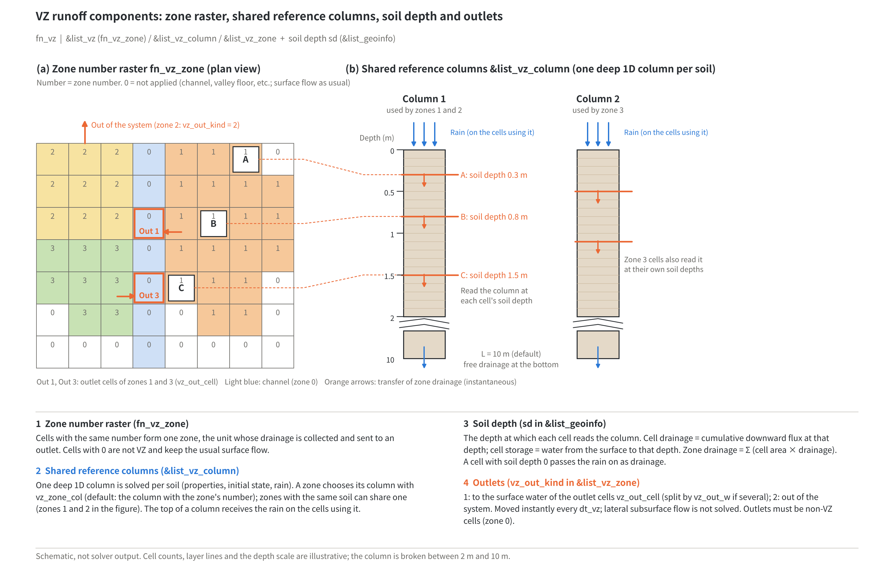

# Vertical unsaturated flow (VZ) runoff (fn_vz)

> English mirror of docs/users_guide/vz.md. The Japanese file is the master copy.

[Back to the User's Guide index](../users_guide.md)

This feature computes the rainfall-runoff response of mountain hillslopes from
**vertical unsaturated infiltration** (how the pressure of water infiltrating
vertically through the soil propagates). The VZ runoff model of Tani (2023)[^tani2023]
is handled on the ENCflow grid as the following three parts.

- **Shared reference column**: one sufficiently deep soil column (by default
  10 m deep with 2.5 cm layers) on which the one-dimensional Richards equation
  with the water retention and conductivity of the Kosugi model[^kosugi1996] is
  solved. The solution is per unit area, and several cells refer to the same
  column (no vertical grid is held per cell).
- **VZ zone**: the set of cells with the same number in the zone number raster.
  At each cell the **downward flux of the reference column is read at the depth
  of the soil depth**, and its area integral over the zone is the drainage of the
  zone (the distribution of soil depth produces the differences in response).
- **Outlet**: whether the drainage of a zone is moved to surface cells (channel,
  valley floor, etc.) or out of the system is specified explicitly. The delay of
  the transfer from a zone to its outlet is not solved (**instantaneous direct
  drainage**).

The figure below shows how these relate to the soil depth. Each cell of the zone
number raster (a) reads a shared reference column (b) at the depth of its own soil
depth, and the drainage collected per zone is sent to an outlet. Zones 1 and 2 have
the same soil, so they share column 1 (`vz_zone_col`) and differ only in the outlet
(zone 1 to an outlet cell, zone 2 out of the system). Cells A, B and C of zone 1
read the same column 1 at their soil depths of 0.3, 0.8 and 1.5 m, so the
differences in soil depth become differences in response.



This direct drainage is an approximation that **omits** the delay and the change
of waveform by lateral subsurface flow. It does not mean that rainwater particles
reach the outlet at once (a fast response of the runoff rate and a fast movement
of water are different things). The idea of the original model is that efficient
drainage through water pathways near the boundary between soil and bedrock
suppresses changes of the groundwater level, so that vertical unsaturated
infiltration governs the runoff response[^tani2023]. Where this premise does not
hold (large lateral delays or deep losses), the results cannot be used as they are.

The feature is connected with the shallow water flow and the channels, so that
mountains can be VZ zones while channels and floodplains are solved as surface
flow. Cells not in a zone (zone number 0) behave as before. The background and
the decisions on the ENCflow side are in developer.md §87 and docs/vz_plan.md.

## Enabling and settings

Specify `fn_vz` in `&list_sysparam` (`"-"` for the same parameter file). The
settings consist of three groups.

```
&list_vz                    ! common settings
  fn_vz_zone = 'zone.asc'   ! zone number raster (integer. 0 = not applied)
  dt_vz = 60.0              ! synchronisation interval for advancing the columns (s. 0 = every step)
/
&list_vz_column             ! shared reference columns (indexed by column number. If omitted, trial defaults)
  vz_ks_mmh(1) = 180.0      ! saturated hydraulic conductivity (mm/h)
  vz_thetas(1) = 0.370      ! saturated water content
  vz_thetar(1) = 0.230      ! residual water content
  vz_psim(1) = -0.200       ! Kosugi psi_m (m. Negative)
  vz_sigma(1) = 1.60        ! Kosugi sigma
  vz_q0_mmh(1) = 0.1        ! initial condition: flux of steady gravity drainage (mm/h)
/
&list_vz_zone               ! zones (indexed by zone number)
  vz_zone_col(1) = 1        ! column referred to (default: same as the zone number)
  vz_out_kind(1) = 1        ! outlet 1: move to surface cells / 2: out of the system
  vz_out_cell(:,1,1) = 120, 80   ! outlet cell (i, j)
/
```

The column values of the example are the same as the trial defaults (the soil of
Tatsunokuchi-yama in Tani (2023); see [Parameters and the basis of their
defaults](#parameters-and-the-basis-of-their-defaults) below). Replace them with the
values of the site for real studies. `f_vz = 0` deactivates the feature
temporarily while it stays written. The zone
numbers are consecutive 1, 2, …; even without per-zone settings, `vz_zone_col`
is the column with the same number as the zone. `vz_out_kind` must be given for
every zone.

## Getting started (minimum input)

Three things are needed.

1. **Zone number raster** `fn_vz_zone` (under `dir_data`, on the same grid as the
   topography). A number of 1 or more for VZ cells and 0 elsewhere.
2. **Soil depth** — `f_sdtype` / `sd0` / `fn_sd` in `&list_geoinfo`
   ([geographic information](geoinfo.md)). The soil depth of a VZ cell is the
   depth at which the flux of the reference column is read. **There is no
   default** (it is site data). Convert a soil depth measured normal to the slope
   into a vertical depth in preprocessing.
3. **Outlet** `vz_out_kind` (and `vz_out_cell`).

**The column settings (`&list_vz_column`) can be omitted.** If they are omitted,
trial defaults are used and the adopted values are displayed on the screen with
`(default)`. The Kosugi parameters (`vz_ks_mmh`, `vz_thetas`, `vz_thetar`,
`vz_psim`, `vz_sigma`) are the set of the soil of Tatsunokuchi-yama in Tani (2023),
and the initial condition is steady gravity drainage at a pre-rain runoff rate of
0.1 mm/h (`vz_q0_mmh`). The trial values do not represent the soil of your site, so
give the values of the site for real studies (see [Parameters and the basis of
their defaults](#parameters-and-the-basis-of-their-defaults) below). Give all five
Kosugi parameters or omit all of them (giving only some of them stops the run, to
prevent mixing values of different soils). A column referred to by a zone whose
settings are omitted also gets the trial defaults.

Give the rainfall as in [rainfall and weather](forcing.md). To see only the
runoff of a small catchment, make all cells of the catchment one zone with
`vz_out_kind = 2` (outflow from the system); the drainage of the zone is then
the runoff (`vz_zone.csv`).

**Usage patterns**

| Pattern | Configuration | What to look at |
|---|---|---|
| Reproducing the original model (runoff of a small mountain catchment) | whole catchment as one zone, one column, `vz_out_kind = 2`, `dt_vz = 60` | time difference of vdrain in `vz_zone.csv` = runoff. Handle observed baseflow on the side of the comparison plot (do not add it to the model) |
| VZ for mountains, shallow water flow for channels | split zones by tributary valley and place the outlets at the channel cells at the valley outlets (`vz_out_kind = 1`) | channel discharge (measurement transects). The shallow water flow solves the propagation delay in the channels |
| Effect of the distribution of soil depth | several zones share the same column (same number in `vz_zone_col`) | differences in response between zones = differences in the distribution of soil depth |
| Rain with a spatial distribution | `f_vz_rain = 1` (area average within a column) | the input of a zone is the mean rainfall within the column ([Handling of rain](#handling-of-rain) below) |

## How it works

### Shared reference column (one-dimensional Richards equation)

With the depth ζ measured vertically downward from the surface and the flux f
positive downward, the equations

```math
\frac{\partial \theta(\psi)}{\partial t} = -\frac{\partial f}{\partial \zeta},
\qquad
f = K(\psi)\left(1 - \frac{\partial \psi}{\partial \zeta}\right)
```

are solved (ψ is the pressure head [m], negative when unsaturated). The water
retention and conductivity follow the Kosugi model[^kosugi1996]:

```math
x = \frac{\ln|\psi| - \ln|\psi_m|}{\sigma},\quad
Q(x) = \tfrac12\mathrm{erfc}\!\left(\frac{x}{\sqrt2}\right),\quad
\theta = \theta_r + (\theta_s - \theta_r)\,Q(x),\quad
K = K_s\,Q(x)^{1/2}\,Q(x+\sigma)^2
```

(θ = θs and K = Ks for ψ ≥ 0). These are equations (14) and (20) of Kosugi (1996)
(the two-parameter form saturated at ψ = 0; the conductivity follows Mualem's model
in the S_e^{1/2} form). ψm is the pressure head at which the effective saturation
S_e = (θ − θr)/(θs − θr) is 0.5 (corresponding to the median of the pore radius
distribution), and σ is the standard deviation of the distribution of ln|ψ|. At the
top **the ground rainfall is given as the
flux**, and the bottom is **free drainage** (unit hydraulic gradient f = K(ψ)).

The discretisation is finite volume (layer-mean water content and interface
fluxes) with backward Euler. The conservative residual written with differences
of water content is used for the convergence test (the mixed form of Celia et al.
1990[^celia1990]; the finite-volume development is ENCflow's own), and the system
is solved by modified Picard iteration and a tridiagonal solver. The internal time
step is adjusted automatically by solving "one step of δt" and "two steps of δt/2"
from the same state and adopting the finer one when the differences in water
content, pressure head and the **cumulative fluxes at all interfaces** are within
tolerance (step doubling). That the water balance closes and that the fluxes are
accurate in time are checked separately ([Verification](#verification-and-examples)).

### Read-out and drainage of a zone

When the soil depth d_i of cell i lies between the interfaces ζ_j and ζ_{j+1},
with α = (d_i − ζ_j)/Δζ, both

- the drainage (cumulative water amount) D_i = (1−α) F_j + α F_{j+1}
- the storage S_i = (1−α) B_j + α B_{j+1} (B_j is the integral of θ down to ζ_j)

are read with **the same coefficients**. Hence ΔS_i = F_0 − D_i (F_0 is the rain
at the top) holds structurally at every cell. The drainage of a zone is the area
integral Σ A_i D_i; depth weights built at initialisation are used, so the cells
are not scanned in the time loop.

The reference column is "the per-unit-area solution representing the zone". The
water of the column deeper than d_i is not counted as storage of the catchment.
Cells with different soil depths can share one column because the difference in
depth is expressed by "where the same solution is read". Conversely, places with
different soil properties, initial states or rain histories get separate columns.

### Handling of rain

Rain falling on a VZ cell is first put on the surface by the shallow water flow as
usual and is then recovered by VZ within the same step as the top flux of the
column (the processing of the shallow water flow and the rainfall is unchanged;
features that read the ground rainfall, such as the soil water index, work as
before). Only the rain of that step is removed, so the surface water on a VZ cell
is **only what flows in from upstream**, and it is not recovered (re-infiltration
into VZ cells is not solved; it flows on as surface flow. Without inflow from
upstream, VZ cells stay dry).

The top flux of a column is chosen from two options by `f_vz_rain`.

- `f_vz_rain = 0` (default): checks every time that the ground rainfall of the
  cells referring to the column is **identical**, and uses that value. If it
  differs, the run stops (with a rain distribution, choose 1 or split zones and
  columns into ranges of uniform rain).
- `f_vz_rain = 1`: uses the **area average** over all cells referring to the
  column. The total amount of rain is conserved, but this is the approximation
  "replacing the input by its mean" (the response to the mean rainfall and the
  mean of the responses of the cells generally differ). It is the same idea as the
  original model driving the reference column by the catchment-mean rainfall.

### Outlets

`vz_out_kind = 1` moves the drainage of the zone to the cells `vz_out_cell` (added
to the surface water depth with the same conversion as rain and boundary
injections). With several cells it is split by the ratios `vz_out_w` (sum 1; may
be omitted for one cell; no implicit equal split). Several zones may use the same
cell as an outlet; the addition is made once. Outlets cannot be placed on VZ
cells, sea cells or water level boundary cells.

When the drainage is split among several outlets by fixed ratios, the waveforms
of the outlets have the same shape with different amplitudes. To see differences
in the response of tributary valleys, split the zones (they may share a column).

`vz_out_kind = 2` is outflow from the system (no receiving cell needed). Sending
the drainage directly to the end of a large catchment also omits the delay in the
channels, so in large computations place the outlets of the mountain zones at the
channel cells at the valley outlets and leave the rest to the shallow water flow.

### Synchronisation and time step

Every `dt_vz` the columns are advanced with the rain of each step of the interval
as a piecewise-constant input, and the drainage of the interval is passed to the
outlets at the end of the interval (the same thinning as `dt_gwflow` of the
groundwater; future rain is not used). With `dt_vz = 60` s or so, the cost of
advancing the columns is small compared with the shallow water flow, and the
coarseness of the transfer to the outlets is negligible compared with the
response time of mountains (tens of minutes to hours). `dt_vz = 0` means every
step, at a cost of three or more backward Euler steps per column per step.

## Output and checks

**Ledger and log**

- The **VZ storage is counted in S_grnd** of the Log (Σ A_i S_i of the zones
  divided by the number of cells, as a column-equivalent depth, including the rain
  recovered and waiting for the next synchronisation). Watching the conservation
  of S_total checks the water balance including VZ. S_total decreases by the
  outflow from the system (`vz_out_kind = 2`). The VZ storage is a different
  quantity from the groundwater `hg` and is not in the Hg distribution output.

**Time series** (`result/`, at `dt_recrd` intervals)

| File | Contents |
|---|---|
| vz_zone.csv | cumulative water volumes per zone (m³): vin (top input of the column × zone area), vstore (current VZ storage), vdrain (drainage of the zone), vsurface (transfer to surface cells), vexternal (outflow from the system), vcorr (correction setting rounding-size negative drainage to 0), residual (balance residual = vstore − vstore₀ − vin + vdrain − vcorr) |
| vz_column.csv | per column: latest top flux (m/s), cumulative top input F0 and bottom flux (m), cumulative drainage D and storage S at each depth of `vz_out_depth` (m), diagnostics of the internal steps (accepted, rejected, iterations, latest step) |
| vzprof_<column>_<number>.csv | with `f_vz_outprof = 1`, the vertical profile of each column at the distribution output times (`dt_file`) (ψ, θ, K at layer centres and the cumulative flux at the bottom of each layer) |

The runoff of a zone [m³/s] is the time difference of vdrain divided by the
recording interval. The residual is the accumulation of the residuals of the
nonlinear iteration; check that it is well below `vz_mb_rate` × elapsed time ×
area.

**Screen**: at initialisation a zone table is shown (number of cells, area,
minimum/mean/maximum soil depth, outlets and ratios of each zone).

**Restart**: the column states (ψ), the internal step, the cumulative diagnostics
and the carry-over of the outlets are saved to and restored from `vzflow.dat`.
When saved at a synchronisation time (a step that is a multiple of `dt_vz`), the
computation after the restart is bit-identical to the continuous run. When a run
ending in the middle of an interval is saved, the rest is synchronised before
saving (the recovered rain is not discarded). If fn_vz is removed at restart while
`vzflow.dat` remains, the run stops (so as not to discard the VZ storage
silently). It also stops when the configuration of columns, zones, soil depth or
outlets differs from the saved one.

## Scope and restrictions on combinations

**Features that cannot be combined** in the first version (the run stops at
initialisation): groundwater (`fn_gwflow`), snow (`fn_snow`), glaciers
(`fn_glacier`), landform evolution (`fn_geomorph`; the soil depth would change),
water quality (`fn_wq`), the fresh/salt two-layer model (`fn_salt`), nesting and
the STG grid. Coexistence of VZ and groundwater (splitting ownership by zone) is a
future extension.

**What cannot be on VZ cells**: channel (fn_rw), sea (fn_sw), boundary condition,
injection and structure cells. The soil depth must be 0 or more and not greater
than the column depth `vz_depth`. A cell with soil depth 0 is treated as a class
whose rain drains as it is (it is read at the surface, so drainage = rain and
storage = 0; places with exposed bedrock, or the 0 cm class of the linear
distribution of soil depth in Tani (2023)).

**States that stop the computation** (shown with the reason as out of scope)

- **Ponding is needed**: the rain is so intense that the soil cannot accept it
  without positive pressure at the surface (switching the boundary condition on
  ponding is a future extension).
- **Significant upward flux at a depth read out**: direct drainage does not handle
  upward drainage.
- **The time step falls below `vz_dt_min`**: review the properties, the initial
  condition and how the rain is given.

Also note: water ponded on the surface does not return to VZ (one way).
Evapotranspiration and root uptake do not act on the VZ storage (intended for
event computations). Flooding of an outlet does not hinder the drainage
(backwater is not solved).

## Parameters and the basis of their defaults

The labels in the Basis column are explained in [How to read the basis of a default](../users_guide.md#how-to-read-the-basis-of-a-default).

**&list_vz**

| Parameter | Default | Meaning | Basis |
|---|---:|---|---|
| f_vz | 1 | 0 deactivates temporarily | **method** |
| fn_vz_zone | — | zone number raster (integer. 0 = not applied) | **given** required |
| dt_vz | 60 s | synchronisation interval for advancing the columns (0 = every step) | **numerical** sufficiently short compared with mountain response times and cheap (checked with [test/vzcol](../../../test/vzcol/)) |
| f_vz_rain | 0 | 0: require identical rainfall within a column / 1: area average within a column | **method** the side that stops and tells is the default |
| f_vz_kface | 1 | interface conductivity 1: arithmetic mean / 2: harmonic mean | **method** the arithmetic mean, as in HYDRUS-1D used by the original paper, is the default (harmonic mean for comparison) |
| vz_dt_init | 1 s | initial internal time step | **numerical** |
| vz_dt_min | 0.001 s | lower limit of the internal time step (stops below it) | **numerical** |
| vz_dt_max | 3600 s | upper limit of the internal time step | **numerical** |
| vz_tol_theta | 1e-3 | θ scale of the time error (ratio to θs − θr) | **numerical** 0.03% difference from a rerun with tolerances divided by 4 in [test/vzcol](../../../test/vzcol/) |
| vz_tol_psi | 1e-3 | ψ scale of the time error (common value for absolute m and relative) | **numerical** same |
| vz_tol_q | 1e-2 | relative scale of the time error of the cumulative interface fluxes | **numerical** 0.05% difference from 1e-3 in the cumulative fluxes at depths, at 1/7 of the cost (developer.md §87) |
| vz_mb_rate | 1e-11 m/s | budget of the water balance error of the nonlinear iteration of a column | **numerical** at most 0.3 mm per year |
| vz_maxit | 25 | upper limit of the Picard iterations | **numerical** |
| vz_out_depth | none | depths written to vz_column.csv (m. Up to 20) | **given** |
| f_vz_outprof | 0 | 1: write the vertical profiles of the columns | **method** |

**&list_vz_column** (indexed by the column number c. Up to 50 columns)

| Parameter | Default | Meaning | Basis |
|---|---:|---|---|
| vz_ks_mmh(c) | 180 mm/h | saturated hydraulic conductivity (mm/h) | **literature value** for trials. Soil of Tatsunokuchi-yama in Table 2 of Tani (2023)[^tani2023] (5.0×10⁻³ cm/s). Used when all five are omitted (see the hints below) |
| vz_thetas(c) | 0.370 | saturated water content | **literature value** same[^tani2023] |
| vz_thetar(c) | 0.230 | residual water content | **literature value** same[^tani2023] |
| vz_psim(c) | −0.200 m | Kosugi median pressure head ψm (m. Negative) | **literature value** same[^tani2023] |
| vz_sigma(c) | 1.60 | Kosugi log standard deviation σ | **literature value** same[^tani2023] |
| vz_depth(c) | 10 m | depth L of the computational column | **literature value** standard reference column of the original paper[^tani2023]. Take it deeper than the largest soil depth read out |
| vz_dz(c) | 0.025 m | layer thickness (an integer fraction of vz_depth) | **literature value** same[^tani2023] |
| vz_q0_mmh(c) | 0.1 mm/h | initial condition: flux of steady gravity drainage (mm/h). Uniform ψ0 with K(ψ0) = q0 | **empirical** for trials. A guide to the pre-rain runoff rate (e.g., the observed runoff before the rain of KI2 at Kiryu in Tani (2023) is about 0.1 mm/h[^tani2023]). Used when vz_psi0 and vz_wt0 are not given either. Give only one of the three |
| vz_psi0(c) | none | initial condition: uniform pressure head (m. Negative) | **given** |
| vz_wt0(c) | none | initial condition: depth of a hydrostatic water table (m. 0 or more). ψ(ζ) = ζ − vz_wt0 (saturated below the water table) | **given** in a column whose bottom has a fixed pressure ψ_b, vz_wt0 = vz_depth − ψ_b gives a state at rest with zero flux |
| f_vz_bottom(c) | 1 | bottom 1: free drainage / 2: fixed pressure (for verification) | **method** |
| vz_psibot(c) | none | ψ at a fixed-pressure bottom (m. f_vz_bottom = 2) | **given** |

**&list_vz_zone** (indexed by the zone number z. Up to 50 zones)

| Parameter | Default | Meaning | Basis |
|---|---:|---|---|
| vz_zone_col(z) | z | column referred to | **method** normally one column per zone |
| vz_out_kind(z) | none | outlet 1: surface cells / 2: out of the system | **given** required |
| vz_out_cell(1:2, k, z) | none | outlet cells (i, j) (up to 99) | **given** required for vz_out_kind = 1 |
| vz_out_w(k, z) | 1 (one cell) | distribution ratios of the outlets (sum 1) | **given** required for several cells |

**Hints for revisiting the defaults**

- **The defaults of the Kosugi parameters are for trials.** The values of the
  original paper[^tani2023] are values of the field soils of each study site
  (Table 2; they differ greatly between Tatsunokuchi-yama, Kiryu and Mettman Ridge)
  and are not universal. As the default we chose the set of Tatsunokuchi-yama (TY),
  the soil of the main events of the paper (TY1, TY2) and the most moderate of the
  three in permeability (table below). These are values for running the model first
  and seeing its behaviour. For real studies, give values obtained by fitting the
  Kosugi model to water retention and conductivity tests of the soil (Kosugi
  1996[^kosugi1996]). Some
  fitted values in the literature give the pressure head at the inflection point of
  the retention curve (ψ₀ in the notation of Kosugi 1996; not the initial ψ0 used
  here), as in Table 1 of that paper; then convert with vz_psim = ψ₀ exp(σ²)
  (equation (12) of that paper) and give it in m. The values
  and settings of the original paper for Tatsunokuchi-yama are in
  [examples/vz_tani2023](../../../examples/vz_tani2023/en/README.md). Forest soils often have a large Ks at the
  surface, well above the rainfall intensity, while σ and ψm strongly affect the
  speed of the response and the shape of the recession.
- The initial condition `vz_q0_mmh` corresponds to "the runoff rate before the
  rain" (with a free-drainage bottom, a uniform ψ0 is an exact steady solution).
  The default of 0.1 mm/h is a guide for trials. The initial condition strongly
  affects the response to the first rain. For the TY set, q0 = 0.1 mm/h corresponds
  to a uniform ψ ≈ −0.31 m and 0.01 mm/h to ψ ≈ −0.62 m; ψ = −1 m corresponds to
  q0 ≈ 0.0015 mm/h and the initial value ψ = −4 m of the original paper for
  Tatsunokuchi-yama to q0 ≈ 2×10⁻⁶ mm/h (the adopted ψ is displayed on the screen).
  Another way is a long spin-up that is saved and restarted as the initial state
  ([interruption and restart](restart.md)).
- Take `vz_depth` sufficiently deeper than the largest soil depth read out. It is
  reassuring to check that deepening the column does not change the fluxes at the
  depths read out.
- Checking that the results do not change when the time error tolerances
  (`vz_tol_*`) are divided by 4 is a simple check of the numerical accuracy.

**Sets of Kosugi parameters for trials** (Table 2 of Tani (2023)[^tani2023]. To try
a soil with other properties, give all five)

| Set | vz_ks_mmh | vz_thetas | vz_thetar | vz_psim (m) | vz_sigma | Features |
|---|---:|---:|---:|---:|---:|---|
| TY (Tatsunokuchi-yama; default) | 180 | 0.370 | 0.230 | −0.200 | 1.60 | the smallest Ks of the three, and a small θs − θr (range that can be stored) |
| KI (Kiryu) | 6840 | 0.507 | 0.212 | −0.094 | 1.34 | catchment on weathered granite; extremely large Ks |
| MR (Mettman Ridge) | 1224 | 0.500 | 0.180 | −0.250 | 0.80 | zero-order catchment in Oregon, USA; small σ (steep retention curve) |

The settings of the paper and the results of the reproduction for each are in
[examples/vz_tani2023](../../../examples/vz_tani2023/en/README.md).

**Conversion from van Genuchten parameters**: when only α and n of the van
Genuchten model are at hand, σ and ψm of the Kosugi model can be obtained by the
correspondence that makes both the inflection points of the retention curves and
the medians (ψ at S_e = 0.5) of the two models equal (equations (24) to (26) of
Kosugi 1996[^kosugi1996]; based on fits to 50 soils in which the inflection points
of the two models nearly agreed). θs, θr and Ks are used as they are.

```math
m = 1 - \frac{1}{n},\quad
\sigma^2 = (1 - m)\,\ln\frac{2^{1/m} - 1}{m},\quad
\psi_m = -\frac{(2^{1/m} - 1)^{1-m}}{\alpha}
```

The unit of ψm is that of 1/α (cm if α is in 1/cm, so convert it to m). The curves
of the two models are similar but not the same (Figures 3 to 8 of that paper).

**Trial values by soil texture class**: as a guide for trying textures other than
forest soils, the means of the US soil texture classes (12 classes) of Carsel and
Parrish (1988)[^carsel1988] were converted to the Kosugi model with the equations
above. Ks is Table 4 of that paper (cm/h) converted to mm/h. The rightmost column
is the size of the difference caused by the conversion: the largest difference of
S_e for ψ = −1 cm to −100 m, and the largest ratio of K where K_r ≥ 10⁻³.

| Texture | vz_ks_mmh | vz_thetas | vz_thetar | vz_psim (m) | vz_sigma | Conversion difference (S_e / K) |
|---|---:|---:|---:|---:|---:|---|
| sand | 297 | 0.43 | 0.045 | −0.0897 | 0.661 | 0.05 / ×1.3 |
| loamy sand | 145.9 | 0.41 | 0.057 | −0.119 | 0.802 | 0.06 / ×1.4 |
| sandy loam | 44.2 | 0.41 | 0.065 | −0.253 | 1.02 | 0.08 / ×1.8 |
| loam | 10.4 | 0.43 | 0.078 | −0.866 | 1.34 | 0.10 / ×2.7 |
| sandy clay loam | 13.1 | 0.39 | 0.100 | −0.660 | 1.46 | 0.12 / ×3.3 |
| silt loam | 4.5 | 0.45 | 0.067 | −2.53 | 1.58 | 0.13 / ×4.2 |
| silt | 2.5 | 0.46 | 0.034 | −3.84 | 1.66 | 0.14 / ×5.1 |
| clay loam | 2.6 | 0.41 | 0.095 | −4.72 | 1.81 | 0.15 / ×7.2 |
| silty clay loam | 0.7 | 0.43 | 0.089 | −20.0 | 2.09 | 0.13 / ×15 |
| sandy clay | 1.2 | 0.38 | 0.100 | −7.39 | 2.09 | 0.17 / ×15 |
| silty clay | 0.2 | 0.36 | 0.070 | −4420 | 3.16 | 0.18 / ×400 |
| clay | 2.0 | 0.38 | 0.068 | −2760 | 3.16 | 0.18 / ×400 |

- The original values are not fits to measured retention curves. They are class
  means of values estimated by a regression (Rawls and Brakensiek 1985) from the
  sand and clay fractions and the bulk density in US soil survey reports (42
  states) (agricultural soils; the clay class is limited to less than 60 % clay).
- The coefficient of variation of Ks within a class is large, 52 to 453 % (Table 4
  of that paper), and the mean is larger than a typical value (the median).
- The conversion is better for coarser textures (K within a factor of 3 from sand
  to loam) and worse for finer textures with N close to 1. The values for silty
  clay and clay (N = 1.09) are not usable.
- The first version of VZ stops as ponding when the soil surface cannot accept the
  rain (roughly rain > Ks; see [Scope and restrictions on combinations](#scope-and-restrictions-on-combinations) above).
  Fine textures with a small Ks can be computed only with weak rain (all 12
  classes were confirmed to compute with rain = 0.5 Ks).
- Forest soils often have a much larger Ks at the surface than these, and the three
  sets of Tani (2023) above are more suitable for trying forested mountain
  catchments.

## Verification and examples

- [test/vzcol](../../../test/vzcol/): one column and one zone. `Check_vzcol.py`
  tests steady gravity drainage (F = q0·t at all depths), depth-wise conservation
  ΔS = F0 − D, the values of the Kosugi model, agreement of the aggregation by
  zone weights with the cell-by-cell read-out, the balance of rainfall and
  S_total, agreement of the steady solution with a fixed-pressure bottom with
  quadrature, the difference from tolerances divided by 4, agreement of the
  area-average mode, and the trial defaults (a run with the column settings omitted
  agrees bit for bit with the same values given explicitly and displays the adopted
  values; a partial set stops).
- [test/vzzone](../../../test/vzzone/): two columns, three zones (a shared
  column), several outlets with a shared receiving cell and outflow from the
  system. `Check_vzzone.py` tests receiving-cell depth = transfer by the ratios +
  rain, the total amount of surface water, the S_total balance, bit-identical
  responses whether a column is shared or duplicated, a rain distribution with
  area averaging, the stop of the strict mode, and agreement of save → restart.
- [examples/vz_tani2023](../../../examples/vz_tani2023/en/README.md): an example
  that recomputes with the same settings all seven computations of Tani (2023)
  (HYDRUS-1D) and compares them with the calculated runoff rates of the paper
  (sprinkling on a small hillslope, a zero-order catchment, Tatsunokuchi-yama and
  Kiryu; including the linear distribution of soil depth, a shared column and the
  post-processing of the paper such as deep percolation). For KIEX, MREX, MR1 and TY2,
  90 % of the points in the range of large runoff are within 5 to 22 % of the values
  calculated in the paper, and the peaks differ by at most 2.3 %. Pressure heads are
  also compared: for TY2, KI1 and KI2 the arrival times of the wetting front agree
  within ±0.8 h at all depths from 0.1 to 3 m (+1.5 h at 2 and 3 m of KI2). The
  numbers of the paper are extracted from the figures of the PDF obtained by the user
  (not shipped).
- The results are bit-identical regardless of the number of MPI processes (every
  rank computes the columns identically, and only the owning rank adds to an
  outlet).

## References

[^tani2023]: Tani, M. (2023): Reevaluating the runoff mechanisms of small mountainous catchments by applying a new storm-runoff model based on the vertical unsaturated flow (in Japanese with English abstract). *Journal of Japan Society of Hydrology and Water Resources*, 36(1), 20–51. doi:10.3178/jjshwr.36.1741 (the VZ runoff model; the standard reference column is 10 m deep with 2.5 cm layers and free drainage at the bottom (II.2), and the Kosugi values are per study site (Table 2). Checked against the original paper on 2026-10-26)
[^kosugi1996]: Kosugi, K. (1996): Lognormal distribution model for unsaturated soil hydraulic properties. *Water Resources Research*, 32(9), 2697–2703. doi:10.1029/96WR01776 (equations (7), (8), (12) to (14), (20) and (24) to (26); checked against the original paper on 2026-10-26)
[^carsel1988]: Carsel, R. F. and Parrish, R. S. (1988): Developing joint probability distributions of soil water retention characteristics. *Water Resources Research*, 24(5), 755–769. doi:10.1029/WR024i005p00755 (means of the van Genuchten parameters and Ks by soil texture class: Tables 2 to 5; checked against the original paper on 2026-10-27)
[^celia1990]: Celia, M. A., Bouloutas, E. T. and Zarba, R. L. (1990): A general mass-conservative numerical solution for the unsaturated flow equation. *Water Resources Research*, 26(7), 1483–1496. doi:10.1029/WR026i007p01483
