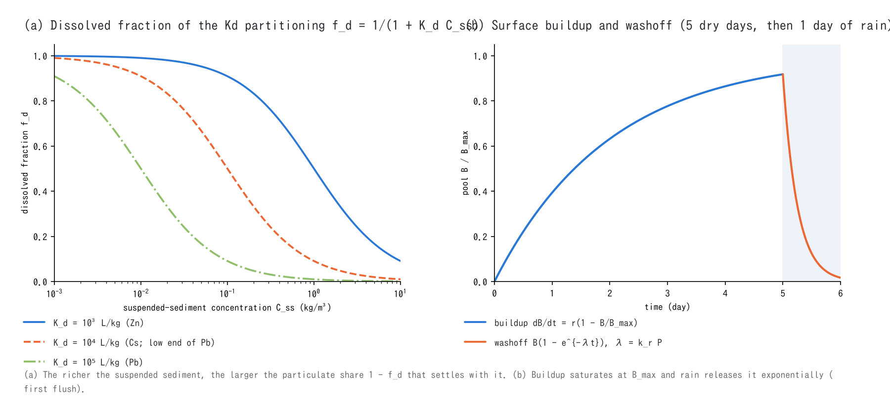

# Water-quality models (supplement to the water-quality chapter)

> English mirror of docs/users_guide/wq_models.md. The Japanese file is the master copy.

[Back to the water-quality chapter](wq.md) | [Back to the user's guide index](../users_guide.md)

This page gives the equations and the sources of the representative values
for the processes of the [water-quality chapter](wq.md): transport,
sources, first-order decay, settling, Kd two-phase partitioning,
infiltration and transport through groundwater, surface buildup and
washoff, reservoirs, sewer surcharge, horizontal mixing, and concentration
by evaporation with precipitation and dissolution. The implementation is in
`src/m_wq.f90` (sources, vertical exchange, ledger), with the transport in
`src/m_swflow_enc.f90` (`advect_scalar`) and `src/m_gwflow_lateral.f90`
(accompanying transport underground); the design history is in
developer.md §30, §139 and docs/wq_metal_plan.md.

## 1. State variables and transport

The substance in the surface water is a **column mass** $`c_q`$ (g/m²; mass
in the cell = $`c_q\,g_v\,w\,A`$) and the concentration is $`C = c_q/v_h`$
(mg/L = g/m³; $`v_h`$ is the rectangular-equivalent depth that accounts for
the cross-section shape σ). The horizontal transport uses the same
conservative kernel as suspended sediment, upwind with the same edge
fluxes as the water inside the shallow water step
([ENC grid](encgrid.md) §3): a uniform concentration stays uniform and the
mass is conserved to machine precision. Being first-order upwind it has
numerical diffusion: longitudinally $`D \approx u\,\Delta x\,(1 - Cr)/2`$
(with the shallow-water dt, Cr = uΔt/Δx is 0.1–0.2, so effectively
$`u\Delta x/2`$: 4 m²/s for u = 1 m/s and Δx = 10 m), and laterally, even
without any lateral flow, $`D_y \approx 0.29\,u\,\Delta y`$ from the diagonal
shares of the eight-direction links (measured in
[test/tracer](../../../test/tracer/en/README.md), within 5 % of the theory).
The default `f_scalar_scheme = 3` (link-wise MUSCL; [Advection](advection.md)
§7) reduces this to 1/3–1/5 longitudinally and 1/14 laterally; where the
arrival time or the peak of a concentration front still matters, refine the
grid. Integrated quantities are unaffected. A groundwater mass pool $`c_g`$
(geometric-area basis), a surface buildup pool $`B`$ (g/m²), reservoir
pools and retention-pond pools exchange with the surface water. All
sources (point g/s, areal and distributed kg/ha/day, rain concentration
mg/L, boundary inflow concentration) are additive and can be superposed.
The sea cells of the sea mask (fn_sw) hold no mass (a sea area with the
initial concentration is zeroed) and the inflow from the sea onto land is
clean water by default (with `wq_sea_conc`, the concentration of faces whose
donor is a sea cell is set to that value; first-order upwind; the amount that
entered is the `in_sea_g` column of the ledger). Sea cells are not receivers of the transport, so mass that
flows into a sea cell leaves the system as it is. The transport kernel counts
the outflow to sea cells and the exchange through open edges face by face,
with the same flux times donor concentration that updates the concentration,
and adds them to the `out_sea_g`, `out_edge_g` and `in_edge_g` columns of the
ledger (so the ledger closes; other transported quantities such as suspended
sediment have no such column and treat it as the budget residual;
[Sediment and morphology](geomorph.md)). Water-level cells
([Boundary conditions](boundary.md)) are outside water too: every step their
column mass is reset to the boundary concentration (`wq_stage_conc`; 0 by
default) times the rectangular-equivalent depth, and the mass exchanged by the
reset is added to the `out_stage_g` and `in_stage_g` columns.

## 2. First-order decay

```math
c^{\,n+1} = c^{\,n}\,e^{-k\,\Delta t},
\qquad
k = \frac{\ln 2}{T_{1/2}}\ (\texttt{wq\_thalf})
\quad\text{or}\quad
k = \texttt{wq\_k20}
```

The exact exponential factor is applied every step to the surface $`c_q`$,
the groundwater $`c_g`$, the surface pool $`B`$, the reservoirs and the
ponds (unconditionally stable). The temperature correction
$`k(T) = k_{20}\,\theta^{T-20}`$ is not implemented; give the value at
20 °C. Basis of the representative values: the BOD deoxygenation
coefficient 0.1–0.5 /day is of the Streeter–Phelps family
[^streeter25][^chapra97], coliform die-off is $`k = \ln 10/T_{90}`$ with
$`T_{90}`$ of 0.5–2 days (depending on sunlight and temperature), the
half-life of Cs-137 is 30.17 years and pesticide half-lives come from the
pesticide properties database[^wauchope92].

## 3. Settling

**Single phase (wq_vs).** The whole substance in the surface water settles
at the speed $`v_s`$:

```math
\Delta c_q = -\,c_q\,\min\!\left(\frac{v_s\,\Delta t}{v_h},\ 1\right),
\qquad v_s = \frac{\texttt{wq\_vs}}{86400}
```

Nothing settles in cells with $`v_h \le d_d`$ (dry). The destination is
`f_wq_settle` (0: lost to the bed, 1: to the surface buildup pool); both are
counted in the ledger column `settle_g`. Representative values of particles
follow Stokes' law $`v_s = (\rho_s - \rho)g d^2/(18\mu)`$ (clay 2 µm
0.3 m/day, silt 10 µm 8 m/day).

**Kd two-phase partitioning (wq_kd).** The dissolved fraction is computed
every step from the mass concentration of the suspended sediment
(`f_suspend`) $`C_{ss} = \rho_s h_s/v_h`$ (kg/m³) and the partition
coefficient $`K_d`$, and only the particulate part settles at the settling
velocity $`w_f`$ of the sediment:

```math
f_d = \frac{1}{1 + K_d\,C_{ss}},
\qquad K_d\,[\mathrm{m^3/kg}] = 10^{-3}\,\texttt{wq\_kd}\,[\mathrm{L/kg}],
\qquad
\Delta c_q = -\,(1 - f_d)\,c_q\,\min\!\left(\frac{w_f\,\Delta t}{v_h},\ 1\right)
```

The transported state stays the single $`c_q`$ (both phases move with the
water; the difference appears only in the vertical exchange), the minimal
configuration. $`(1 - f_d)c_q w_f/v_h`$ is identical to "metal/sand mass
ratio × sand deposition flux $`w_f C_{ss}`$", the gross deposition of the
particulate phase. Resuspension from the bed is left to the surface pool
plus shear washoff (§5), so `f_wq_settle = 1` is recommended. The published
$`K_d`$ ranges (Pb 10⁴–10⁶, Cu, Zn, Cd 10³–10⁵, As 10¹–10³ L/kg, Cs 10³–10⁴)
are the compilations of Sheppard & Thibault[^sheppard90], IAEA
TRS-472[^iaea10] and US EPA[^epa99]; back-calculating from the measured
particulate/dissolved ratio of the catchment is the reliable way.



## 4. Infiltration and transport through groundwater

**Accompanying infiltration (f_wq_infil = 1).** The infiltrated amount
$`f_x`$ of the groundwater model carries the column mass at the same rate
(the dissolved part $`f_d`$ only when Kd is active):

```math
\Delta c_q = -\,f_d\,c_q\,\frac{f_x}{h + f_x},
\qquad c_g \mathrel{+}= -\Delta c_q\,g_v\,w
```

**Underground transport and seepage (automatic with f_gwlateral = 1).** The
mass flux, the upwind volumetric concentration times the lateral
groundwater flux $`q`$, is carried together with the water, and the
exfiltration $`f_s`$ of the saturation excess returns mass to the surface
at the same rate. The retardation factor $`R`$ (`wq_rg`) lumps the delay by
equilibrium sorption in the soil: the substance moves at $`1/R`$ of the
groundwater speed.

```math
q_m = \frac{1}{R}\,\frac{c_{g,up}}{h_{g,up}}\,q,
\qquad
\Delta c_g^{\,seep} = -\frac{1}{R}\,c_g\,\frac{f_s}{h_g + f_s},
\qquad
R = 1 + \frac{\rho_b K_d}{\theta}
```

The expression of $`R`$ is the standard retardation factor of linear
equilibrium sorption[^freeze79], estimated in pre-processing from the dry
bulk density $`\rho_b`$ and the effective porosity $`\theta`$ (10²–10⁴ for
heavy metals and Cs). Decay also acts on the groundwater pool. Only the
lateral flow and the saturation-excess seepage of layer 1 and pumping (out of
the system in the same form as seepage; §6) carry mass; percolation into the
weathered bedrock layer and infiltration water into the conduit layer move
water only and the mass stays in layer 1 (the layer-1 concentration becomes
apparently higher, and the return water through layer 2 or the conduits is
clean water).
Verification: [test/gwseep](../../../test/gwseep/en/README.md) (the cycle
infiltration → lateral flow → seepage → re-infiltration closes the ledger
to_gw − seep = mass_gw; $`R`$ = 1e12 immobilises the mass).

## 5. Surface buildup and washoff

Dry-weather accumulation and rain washoff represent mechanistically the
nonlinear load–discharge relation and the first flush (the same framework
as the buildup–washoff of the urban drainage model SWMM[^rossman15]).

```math
\frac{dB}{dt} = r\left(1 - \frac{B}{B_{\max}}\right)
\quad(dB/dt = r\ \text{when}\ \texttt{wq\_bd\_max}\ \text{is omitted}),
\qquad
\lambda = k_r\,P + k_f\,\max\!\left(\frac{\tau}{\tau_c} - 1,\ 0\right),
\qquad
\Delta B = B\left(1 - e^{-\lambda\Delta t}\right) \to c_q
```

$`r`$ is the buildup rate (`wq_bd_rate` or the map `fn_wq_map` with
`f_wq_map = 1`), $`P`$ the rainfall intensity reaching the ground and
$`\tau = \rho g n^2 |\mathbf{V}|^2/h^{1/3}`$ the bed shear stress closed with
the Manning law (N/m²). The buildup update is the exact exponential form
(unconditionally stable) and the washoff acts on wet cells only. The
raindrop term is compatible with the exponential washoff of SWMM
(exponent 1) through $`k_r\,[1/\mathrm{m}] = 1000\,c_1\,[1/\mathrm{mm}]`$; the
super-linearity (exponent > 1) is carried by the shear term. A deposition
map of radionuclides is represented as "rate 0 + initial pool `fn_wq_bd0` +
washoff + decay".

## 6. Reservoirs, ponds and sewer surcharge

**Reservoirs (completely mixed).** The mass $`M`$ captured by a dam or lake
of the [structures](structure.md) enters a completely mixed pool of volume
$`V`$ and the released water (spill included) carries the concentration
$`M/V`$. Settling inside the pool is not implemented. Mass entering a
fixed-level lake leaves the system like the water (ledger `to_dam_g`).
Mass absorbed by a retention pond (`rscap`) accumulates in a cell-wise pool
with no return path (evaporation removes only water, concentrating the
pool). Verification: [test/damwq](../../../test/damwq/en/README.md) (all
digits of the analytical solution).

**Sewer surcharge (wq_gwc_conc).** The surcharge and land-side outfall
discharge $`q_{out}`$ of the
[conduit continuum layer](gwflow_models.md#6-conduit-continuum-layer-f_gwconduit--1)
is multiplied by a fixed concentration $`C_{sew}`$ and the load
$`q_{out}C_{sew}`$ is injected on the surface: a **supply-side fixed
concentration approximation** that does not solve the budget or the
dilution inside the pipes. Loads swallowed by inlets are removed to the
sewer side with `f_wq_gwc_in = 1` (ledger `to_gwc_g`). For coliforms read
"g = 10⁶ CFU", so $`C`$ [units/m³] × 100 = CFU/100 mL. Sewage coliforms
10⁵–10⁷ CFU/100 mL, one order lower for combined-sewer overflows, and
$`T_{90}`$ of hours to days are in the
[representative table of the chapter](wq.md#representative-values-a-starting-point);
the die-off rates of faecal indicators are within the range of standard
water-quality textbooks[^chapra97]. Verification:
[test/sewer_wq](../../../test/sewer_wq/en/README.md).

**Structures and withdrawals (proportional transfer).** When a pump, culvert
or diversion of [structures](structure.md) or the sink of an internal source
takes $`\Delta h`$ from a cell with depth $`h`$, the same fraction of the
column mass (only the dissolved part $`f_d`$ with Kd) is taken out, and that
mass is added to the column mass of the destination, split equally over the
cells like the water (a withdrawal without a destination leaves the system =
ledger column `out_intake_g`).

```math
\Delta c_q = -\,f_d\,c_q\,\frac{\Delta h}{h},
\qquad m = -\Delta c_q\,g_v\,w\,A
```

What is pumped from a pond comes from the pond pool, a pump drawing from the
conduit layer (`f_pump_src = 1`) moves water at the fixed concentration
`wq_gwc_conc`, and well pumping leaves the system in the same form as the
seepage of §4, $`\Delta c_g = -(1/R)\,c_g\,f/h_g`$ ($`f`$ is the pumped
depth). This is our own simplification assuming complete mixing within the
intake cell (the same proportional transfer as for infiltration); travel
time, mixing and settling inside the pipe are not represented. The
particulate part stays on the intake side with the suspended sediment
(structures carry no sediment). The substance of the water a pond absorbed
and of the rain that fell in the same step is added after the step, so it is
not in that step's withdrawal (a relative bias of one step's inflow /
storage). Verification: [test/wqstruct](../../../test/wqstruct/en/README.md).

## 7. Horizontal mixing

With `wq_diff` (mixing coefficient $`D`$ [m²/s]), a diffusive flux proportional to the gradient
of the concentration, integrated over the depth, is added to the advection.

```math
\frac{\partial (v_h C)}{\partial t} + \nabla\!\cdot(\boldsymbol{q}\,C)
 = \nabla\!\cdot\left(D\,v_h\,\nabla C\right)
```

The discretization uses the same 8-neighbour links as the advection: the flux of link $`k`$
(passing width $`l_k`$, centre distance $`\Delta r_k`$) is
$`D\,h_e\,(C_i - C_n)\,l_k/\Delta r_k`$. The interface depth $`h_e`$ is the shallower of the
rectangular-equivalent depths of the two sides, the passing-width factors are those of the
advection (the virtual walls of levees and closed openings pass nothing), and the flux acts
only between land cells that both hold water. The flux is counted with the same value from
both cells, so mass is conserved and a uniform concentration stays uniform. Whatever the
distribution of the passing widths over the 8 neighbours (the diagonal share $`d`$), the
variance of a distribution in still water grows by $`2Dt`$ in each direction and the covariance
does not grow ([test/wqsalt](../../../test/wqsalt/en/README.md), case mix; agreement to rounding).
The stability condition of the explicit scheme is

```math
D\,\Delta t \sum_{k=1}^{8} \frac{l_k}{\Delta r_k} \le \Delta x\,\Delta y
```

(on a square grid $`\sum l_k/\Delta r_k = 4 - 2d`$; with $`d`$ = 0.59, $`D \le 0.35\,\Delta x^2/\Delta t`$),
and a larger value stops at initialization. In cells with a subgrid channel width or a
cross-section shape, and in cells whose building porosity is below 1, the area of the link is
multiplied by the smaller of the plan-area fractions and porosities of the two sides (a guide
to the open fraction of the link; our own simplification, and the stability condition above
is still sufficient. Conservation of mass and the approach to a uniform concentration are
checked by the cases mixgv and mixwd of [test/wqsalt](../../../test/wqsalt/en/README.md)).

$`D`$ is a calibrated quantity that represents the mixing by wind, eddies, secondary flow and
the non-uniformity of the velocity with one coefficient. As a guide, transverse mixing in
rivers is $`\varepsilon_t \approx 0.15\,h\,u_*`$ (straight channels) to $`0.6\,h\,u_*`$ (gently
meandering natural rivers, ±50 %; $`u_*`$ is the shear velocity)[^fischer79], and horizontal mixing in
lakes and the sea grows with the size of the patch $`\ell`$: the empirical law compiled from dye
diffusion experiments, $`K_a = 0.0103\,\ell^{1.15}`$ (cm²/s, $`\ell`$ in cm)[^okubo71], gives
about 0.6 m²/s at 1 km, 8 m²/s at 10 km and 100 m²/s at 100 km. Values smaller than the
numerical diffusion (§1) have no effect. Wind-driven currents and density-driven circulation
are not solved, so the speed at which a whole lake mixes is set by the choice of $`D`$.

## 8. Concentration by evaporation, precipitation and dissolution

Evapotranspiration removes water only (from the surface water, ponds and groundwater alike).
The substance stays, so the concentration of a water column of depth $`h`$ rises as
$`C = c_q/h`$. With `wq_csat` (solubility $`C_s`$), the following is done cell by cell every
step (the precipitate is kept in the surface buildup pool $`B`$).

```math
\text{precipitation:}\quad c_q > C_s v_h \ \Rightarrow\ B \leftarrow B + (c_q - C_s v_h),\quad c_q \leftarrow C_s v_h
```

```math
\text{dissolution:}\quad c_q < C_s v_h,\ B > 0 \ \Rightarrow\
\Delta c_q = \min\!\left[(C_s v_h - c_q)\left(1 - e^{-k\,\Delta t/v_h}\right),\ B\right]
```

In a cell that has dried up ($`v_h \le`$ the limit depth dd), all the substance of the water
column moves to $`B`$. The dissolution formula is the exact solution, within the step, of the
first-order dissolution $`dC/dt = (k/v_h)(C_s - C)`$ with the mass-transfer coefficient $`k`$
(`wq_kdis`; without `wq_kdis`, $`k \to \infty`$ = instantly up to saturation. Expressing the
dissolution from a solid surface by a flux proportional to the difference from the saturation
concentration is the standard treatment of dissolution[^noyes1897]). With a constant depth and
precipitate, $`C(t) = C_s(1 - e^{-kt/h})`$, and the numerical solution agrees with it whatever
the time step ([test/wqsalt](../../../test/wqsalt/en/README.md), case disk).

Water soaking into the ground dissolves, on its way through the precipitate, as much as the
room up to saturation allows and carries it to the subsurface mass pool.

```math
\Delta c_g = \min\!\left[(C_s - C_{inf})\,f_x\left(1 - e^{-k\,\Delta t/f_x}\right),\ B\right]
```

$`f_x`$ is the infiltration of the step and $`C_{inf}`$ the concentration of the infiltrating
water (the surface water before the infiltration; 0 for rain soaking into dry ground).
Underground, the concentration that moves with the water (lateral flow, seepage and well
pumping; §4) is $`\min(c_g/h_g,\ C_s)`$ (the part above the solubility, left when evaporation
removed water only, stays in the soil).

Judging precipitation only by comparing the concentration of the water column with the
solubility, using the limit depth to judge drying up, and assuming that infiltrating water
dissolves up to saturation are simplifications of this model (our own). Representative
solubilities are about 360 g per kg of water for sodium chloride (25 °C; it changes little
with temperature)[^haynes14] and roughly 2-2.6 g per litre of water for gypsum (calcium sulfate
dihydrate; 25 °C; the value varies between sources). The concentration is the mass per volume of water, and the volume
added by the dissolved substance is not counted. In a lake that dries up, salts precipitate in
the order of increasing solubility, carbonates → gypsum → mirabilite → halite, and the
precipitate on the bed of the Aral Sea is estimated to be mostly gypsum and
mirabilite[^zavialov10]. This order and the interactions between substances are not
represented, so run a separate calculation for each substance with its own solubility.

## 9. Parameters and the basis of their defaults

The labels in the Basis column are explained in [How to read the basis of a default](../users_guide.md#how-to-read-the-basis-of-a-default). Water quality has **no defaults for the substance
properties** because they differ by orders of magnitude between substances
(without decay, settling or partitioning the substance is a conservative
tracer). For rows with default "—" the basis column gives the sources of
representative values.

| Parameter | Default | Meaning | Basis |
|---|---:|---|---|
| wq_c0 / fn_wq_c0 | 0 / — | initial concentration (mg/L); a uniform value or a map | **given** |
| wq_thalf / wq_k20 | — | half-life (day) / first-order decay coefficient (1/day) (§2) | **literature value** BOD 0.1–0.5 /day[^streeter25][^chapra97], coliforms $`\ln 10/T_{90}`$, Cs-137 11019 day, pesticides 10–60 day[^wauchope92] |
| wq_vs | — | single-phase settling velocity (m/day) (§3) | **derived** Stokes' law: clay 2 µm 0.3, silt 10 µm 8 m/day |
| wq_kd | — | partition coefficient (L/kg) (§3; needs f_suspend) | **literature value** Pb 10⁴–10⁶, Cu, Zn, Cd 10³–10⁵, Cs 10³–10⁴[^sheppard90][^iaea10][^epa99] |
| f_wq_settle | 0 | destination of settling. 0: lost, 1: surface pool | **method** 1 when combining Kd with washoff |
| f_wq_infil | 1 | accompanying infiltration. 1: dissolved, 0: stays on the surface (§4) | **method** 0 for particulates and pathogen indicators |
| wq_rg | 1 | retardation factor $`R`$ of the underground transport (§4) | **derived** $`1 + \rho_b K_d/\theta`$[^freeze79]; heavy metals and Cs 10²–10⁴ |
| wq_bd_rate / wq_bd_max / wq_bd0 | — | buildup rate (kg/ha/day), cap and initial pool (kg/ha) (§5) | **literature value** ranges of the SWMM buildup[^rossman15]; a radionuclide deposition map goes in bd0 |
| wq_wash_kr | — | raindrop washoff coefficient (1/m) | **literature value** SWMM exponential washoff $`c_1`$ [1/mm] × 1000[^rossman15] |
| wq_wash_kf / wq_wash_tauc | — | shear washoff coefficient (1/s) and critical shear stress (N/m²) | **calibration** no universal value |
| wq_gwc_conc / f_wq_gwc_in | — / 1 | fixed concentration of surcharge water (mg/L), removal at inlets (§6) | **customary value** sewage 10⁵–10⁷ CFU/100 mL (table of the chapter) / **method** |
| wq_rain_conc / wq_in_conc | — | rain and boundary-inflow concentrations (mg/L) | **given** |
| wq_sea_conc | — | concentration of water entering the land from the sea (mg/L) | **given** the salinity of seawater is about 35 g/L |
| wq_diff | — | horizontal mixing coefficient $`D`$ (m²/s) (§7) | **calibration** transverse mixing in rivers 0.15–0.6 $`h u_*`$[^fischer79]; lakes and the sea 0.6–100 m²/s for patch sizes of 1–100 km[^okubo71] |
| wq_csat | — | solubility (mg/L) (§8) | **literature value** sodium chloride 3.6×10⁵[^haynes14], gypsum 2–2.6×10³ |
| wq_kdis | — (instant) | mass-transfer coefficient of the dissolution of the precipitate (m/day) (§8) | **calibration** no universal value; give it to slow down hardened or covered precipitate |

**Where to look when revising the defaults**

- Take decay and partition coefficients from substance databases:
  pesticides from Wauchope et al.[^wauchope92], radionuclide Kd from the
  IAEA technical report[^iaea10] and Sheppard & Thibault[^sheppard90],
  heavy metals from the EPA review[^epa99]. Kd varies by 1–2 orders of
  magnitude with soil pH, organic matter and clay content, so pick values
  for soils like those of your basin and bracket with a low and a high
  case.
- For buildup and washoff start from the land-use examples of the SWMM
  user manual[^rossman15] and calibrate on local L-Q observations (event
  loads vs. discharge).
- Representative sewage concentrations and T90 values, with the unit
  conversion, are tabulated in the chapter (sewer surcharge section).

## 10. Verification cases

| Case | Content | Point |
|---|---|---|
| [test/damwq](../../../test/damwq/en/README.md) | reservoir (completely mixed) and pond | ledger agrees with the analytical solution to all digits |
| [test/kdpart](../../../test/kdpart/en/README.md) | Kd partitioning and particulate settling | ledger closure and monotonicity with increasing Kd |
| [test/gwseep](../../../test/gwseep/en/README.md) | infiltration → lateral flow → seepage | to_gw − seep = mass_gw; immobile at $`R`$ = 1e12 |
| [test/sewer_wq](../../../test/sewer_wq/en/README.md) | sanitary risk of sewer surcharge | ledger check of surcharge → inundation → spreading → decay |
| [test/tracer](../../../test/tracer/en/README.md) | Numerical diffusion of the first-order upwind transport | Spreading of a clean-water front D = u·Δx·(1−Cr)/2 and lateral variance of a steady plume Dy = 0.29·u·Δy, both within 5 % of the theory |
| [test/wqstruct](../../../test/wqstruct/en/README.md) | Proportional transfer by structures and withdrawals | Water at 1 mg/L stays at 1 in every compartment, closure of the ledger, out_intake_g = volume of water leaving the system × concentration |
| [test/wqsalt](../../../test/wqsalt/en/README.md) | Horizontal mixing, precipitation and dissolution, sea concentration, map of the initial concentration | Variance increment = 2·D·t, precipitation by evaporation agrees with the formula, dissolution agrees with $`C_s(1 - e^{-kt/h})`$, dissolution by infiltrating water and the cap on the subsurface concentration, closure of the ledger |

## References

[^streeter25]: Streeter, H. W. and Phelps, E. B. (1925): A study of the pollution and natural purification of the Ohio River. *Public Health Bulletin*, 146, U.S. Public Health Service.
[^chapra97]: Chapra, S. C. (1997): *Surface Water-Quality Modeling*. McGraw-Hill. (standard textbook for decay, die-off and settling)
[^wauchope92]: Wauchope, R. D., Buttler, T. M., Hornsby, A. G., Augustijn-Beckers, P. W. M. and Burt, J. P. (1992): The SCS/ARS/CES pesticide properties database for environmental decision-making. *Rev. Environ. Contam. Toxicol.*, 123, 1–155.
[^sheppard90]: Sheppard, M. I. and Thibault, D. H. (1990): Default soil solid/liquid partition coefficients, Kds, for four major soil types: a compendium. *Health Phys.*, 59, 471–482.
[^iaea10]: IAEA (2010): Handbook of Parameter Values for the Prediction of Radionuclide Transfer in Terrestrial and Freshwater Environments. *Technical Reports Series*, 472.
[^epa99]: US EPA (1999): Understanding Variation in Partition Coefficient, Kd, Values. EPA 402-R-99-004A.
[^freeze79]: Freeze, R. A. and Cherry, J. A. (1979): *Groundwater*. Prentice-Hall. (retardation factor of linear equilibrium sorption)
[^rossman15]: Rossman, L. A. (2015): Storm Water Management Model User's Manual Version 5.1. US EPA, EPA/600/R-14/413b. (buildup–washoff)
[^fischer79]: Fischer, H. B., List, E. J., Koh, R. C. Y., Imberger, J. and Brooks, N. H. (1979): *Mixing in Inland and Coastal Waters*. Academic Press. (transverse mixing coefficient of rivers)
[^okubo71]: Okubo, A. (1971): Oceanic diffusion diagrams. *Deep-Sea Res.*, 18, 789–802. (empirical law between the size of the patch and the apparent diffusivity)
[^noyes1897]: Noyes, A. A. and Whitney, W. R. (1897): The rate of solution of solid substances in their own solutions. *J. Am. Chem. Soc.*, 19, 930–934. (the rate of dissolution is proportional to the difference from the saturation concentration)
[^haynes14]: Haynes, W. M. (ed.) (2014): *CRC Handbook of Chemistry and Physics*, 95th ed. CRC Press. (solubility of inorganic compounds in water; sodium chloride 36.0 g per 100 g of water at 25 °C)
[^zavialov10]: Zavialov and Zavialov (2010): estimate of the amount of precipitate on the bed of the Aral Sea. Abstract EGU2010-15141 of the EGU General Assembly 2010 (<https://meetingorganizer.copernicus.org/EGU2010/EGU2010-15141.pdf>; checked on 2026-11-28 through the summary of a web search result; the text itself was not read).
