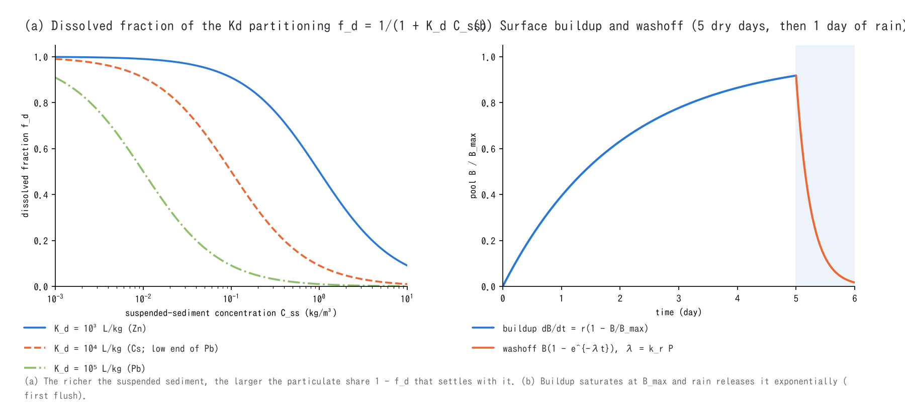

# Water-quality models (supplement to the water-quality chapter)

> English mirror of docs/users_guide/wq_models.md. The Japanese file is the master copy.

[Back to the water-quality chapter](wq.md) | [Back to the user's guide index](../users_guide.md)

This page gives the equations and the sources of the representative values
for the processes of the [water-quality chapter](wq.md): transport,
sources, first-order decay, settling, Kd two-phase partitioning,
infiltration and transport through groundwater, surface buildup and
washoff, reservoirs and sewer surcharge. The implementation is in
`src/m_wq.f90` (sources, vertical exchange, ledger), with the transport in
`src/m_swflow_enc.f90` (`advect_scalar`) and `src/m_gwflow_lateral.f90`
(accompanying transport underground); the design history is in
developer.md §30 and docs/wq_metal_plan.md.

The figures are generated by `python3 docs/figs/make_guide_figs.py wq_models`
(`docs/figs/guide/fig_wq_models.py`), as PNG and SVG in Japanese and English.

## 1. State variables and transport

The substance in the surface water is a **column mass** $`c_q`$ (g/m²; mass
in the cell = $`c_q\,g_v\,w\,A`$) and the concentration is $`C = c_q/v_h`$
(mg/L = g/m³; $`v_h`$ is the rectangular-equivalent depth that accounts for
the cross-section shape σ). The horizontal transport uses the same
conservative kernel as suspended sediment, upwind with the same edge
fluxes as the water inside the shallow water step
([ENC grid](encgrid.md) §3): a uniform concentration stays uniform and the
mass is conserved to machine precision. Being first-order upwind it has
numerical diffusion: longitudinally $`D \approx u\,\Delta x\,(1 - Cr)/2`$
(with the shallow-water dt, Cr = uΔt/Δx is 0.1–0.2, so effectively
$`u\Delta x/2`$: 4 m²/s for u = 1 m/s and Δx = 10 m), and laterally, even
without any lateral flow, $`D_y \approx 0.29\,u\,\Delta y`$ from the diagonal
shares of the eight-direction links (measured in
[test/tracer](../../../test/tracer/README.md), within 5 % of the theory).
Where the arrival time or the peak of a concentration front matters, use
`f_scalar_scheme = 3` (link-wise MUSCL: longitudinal numerical diffusion
1/3–1/5, lateral 1/14; [Advection](advection.md) §7) or refine the grid;
integrated quantities are unaffected. A groundwater mass pool $`c_g`$
(geometric-area basis), a surface buildup pool $`B`$ (g/m²), reservoir
pools and retention-pond pools exchange with the surface water. All
sources (point g/s, areal and distributed kg/ha/day, rain concentration
mg/L, boundary inflow concentration) are additive and can be superposed.

## 2. First-order decay

```math
c^{\,n+1} = c^{\,n}\,e^{-k\,\Delta t},
\qquad
k = \frac{\ln 2}{T_{1/2}}\ (\texttt{wq\_thalf})
\quad\text{or}\quad
k = \texttt{wq\_k20}
```

The exact exponential factor is applied every step to the surface $`c_q`$,
the groundwater $`c_g`$, the surface pool $`B`$, the reservoirs and the
ponds (unconditionally stable). The temperature correction
$`k(T) = k_{20}\,\theta^{T-20}`$ is not implemented; give the value at
20 °C. Basis of the representative values: the BOD deoxygenation
coefficient 0.1–0.5 /day is of the Streeter–Phelps family
[^streeter25][^chapra97], coliform die-off is $`k = \ln 10/T_{90}`$ with
$`T_{90}`$ of 0.5–2 days (depending on sunlight and temperature), the
half-life of Cs-137 is 30.17 years and pesticide half-lives come from the
pesticide properties database[^wauchope92].

## 3. Settling

**Single phase (wq_vs).** The whole substance in the surface water settles
at the speed $`v_s`$:

```math
\Delta c_q = -\,c_q\,\min\!\left(\frac{v_s\,\Delta t}{v_h},\ 1\right),
\qquad v_s = \frac{\texttt{wq\_vs}}{86400}
```

Nothing settles in cells with $`v_h \le d_d`$ (dry). The destination is
`f_wq_settle` (0: lost to the bed, 1: to the surface buildup pool); both are
counted in the ledger column `settle_g`. Representative values of particles
follow Stokes' law $`v_s = (\rho_s - \rho)g d^2/(18\mu)`$ (clay 2 µm
0.3 m/day, silt 10 µm 8 m/day).

**Kd two-phase partitioning (wq_kd).** The dissolved fraction is computed
every step from the mass concentration of the suspended sediment
(`f_suspend`) $`C_{ss} = \rho_s h_s/v_h`$ (kg/m³) and the partition
coefficient $`K_d`$, and only the particulate part settles at the settling
velocity $`w_f`$ of the sediment:

```math
f_d = \frac{1}{1 + K_d\,C_{ss}},
\qquad K_d\,[\mathrm{m^3/kg}] = 10^{-3}\,\texttt{wq\_kd}\,[\mathrm{L/kg}],
\qquad
\Delta c_q = -\,(1 - f_d)\,c_q\,\min\!\left(\frac{w_f\,\Delta t}{v_h},\ 1\right)
```

The transported state stays the single $`c_q`$ (both phases move with the
water; the difference appears only in the vertical exchange), the minimal
configuration. $`(1 - f_d)c_q w_f/v_h`$ is identical to "metal/sand mass
ratio × sand deposition flux $`w_f C_{ss}`$", the gross deposition of the
particulate phase. Resuspension from the bed is left to the surface pool
plus shear washoff (§5), so `f_wq_settle = 1` is recommended. The published
$`K_d`$ ranges (Pb 10⁴–10⁶, Cu, Zn, Cd 10³–10⁵, As 10¹–10³ L/kg, Cs 10³–10⁴)
are the compilations of Sheppard & Thibault[^sheppard90], IAEA
TRS-472[^iaea10] and US EPA[^epa99]; back-calculating from the measured
particulate/dissolved ratio of the catchment is the reliable way.



## 4. Infiltration and transport through groundwater

**Accompanying infiltration (f_wq_infil = 1).** The infiltrated amount
$`f_x`$ of the groundwater model carries the column mass at the same rate
(the dissolved part $`f_d`$ only when Kd is active):

```math
\Delta c_q = -\,f_d\,c_q\,\frac{f_x}{h + f_x},
\qquad c_g \mathrel{+}= -\Delta c_q\,g_v\,w
```

**Underground transport and seepage (automatic with f_gwlateral = 1).** The
mass flux, the upwind volumetric concentration times the lateral
groundwater flux $`q`$, is carried together with the water, and the
exfiltration $`f_s`$ of the saturation excess returns mass to the surface
at the same rate. The retardation factor $`R`$ (`wq_rg`) lumps the delay by
equilibrium sorption in the soil: the substance moves at $`1/R`$ of the
groundwater speed.

```math
q_m = \frac{1}{R}\,\frac{c_{g,up}}{h_{g,up}}\,q,
\qquad
\Delta c_g^{\,seep} = -\frac{1}{R}\,c_g\,\frac{f_s}{h_g + f_s},
\qquad
R = 1 + \frac{\rho_b K_d}{\theta}
```

The expression of $`R`$ is the standard retardation factor of linear
equilibrium sorption[^freeze79], estimated in pre-processing from the dry
bulk density $`\rho_b`$ and the effective porosity $`\theta`$ (10²–10⁴ for
heavy metals and Cs). Decay also acts on the groundwater pool. Transport
inside the weathered bedrock layer and the conduit layer is not supported.
Verification: [test/gwseep](../../../test/gwseep/README.md) (the cycle
infiltration → lateral flow → seepage → re-infiltration closes the ledger
to_gw − seep = mass_gw; $`R`$ = 1e12 immobilises the mass).

## 5. Surface buildup and washoff

Dry-weather accumulation and rain washoff represent mechanistically the
nonlinear load–discharge relation and the first flush (the same framework
as the buildup–washoff of the urban drainage model SWMM[^rossman15]).

```math
\frac{dB}{dt} = r\left(1 - \frac{B}{B_{\max}}\right)
\quad(dB/dt = r\ \text{when}\ \texttt{wq\_bd\_max}\ \text{is omitted}),
\qquad
\lambda = k_r\,P + k_f\,\max\!\left(\frac{\tau}{\tau_c} - 1,\ 0\right),
\qquad
\Delta B = B\left(1 - e^{-\lambda\Delta t}\right) \to c_q
```

$`r`$ is the buildup rate (`wq_bd_rate` or the map `fn_wq_map` with
`f_wq_map = 1`), $`P`$ the rainfall intensity reaching the ground and
$`\tau = \rho g n^2 |\mathbf{V}|^2/h^{1/3}`$ the bed shear stress closed with
the Manning law (N/m²). The buildup update is the exact exponential form
(unconditionally stable) and the washoff acts on wet cells only. The
raindrop term is compatible with the exponential washoff of SWMM
(exponent 1) through $`k_r\,[1/\mathrm{m}] = 1000\,c_1\,[1/\mathrm{mm}]`$; the
super-linearity (exponent > 1) is carried by the shear term. A deposition
map of radionuclides is represented as "rate 0 + initial pool `fn_wq_bd0` +
washoff + decay".

## 6. Reservoirs, ponds and sewer surcharge

**Reservoirs (completely mixed).** The mass $`M`$ captured by a dam or lake
of the [structures](structure.md) enters a completely mixed pool of volume
$`V`$ and the released water (spill included) carries the concentration
$`M/V`$. Settling inside the pool is not implemented. Mass entering a
fixed-level lake leaves the system like the water (ledger `to_dam_g`).
Mass absorbed by a retention pond (`rscap`) accumulates in a cell-wise pool
with no return path (evaporation removes only water, concentrating the
pool). Verification: [test/damwq](../../../test/damwq/README.md) (all
digits of the analytical solution).

**Sewer surcharge (wq_gwc_conc).** The surcharge and land-side outfall
discharge $`q_{out}`$ of the
[conduit continuum layer](gwflow_models.md#6-conduit-continuum-layer-f_gwconduit--1)
is multiplied by a fixed concentration $`C_{sew}`$ and the load
$`q_{out}C_{sew}`$ is injected on the surface: a **supply-side fixed
concentration approximation** that does not solve the budget or the
dilution inside the pipes. Loads swallowed by inlets are removed to the
sewer side with `f_wq_gwc_in = 1` (ledger `to_gwc_g`). For coliforms read
"g = 10⁶ CFU", so $`C`$ [units/m³] × 100 = CFU/100 mL. Sewage coliforms
10⁵–10⁷ CFU/100 mL, one order lower for combined-sewer overflows, and
$`T_{90}`$ of hours to days are in the
[representative table of the chapter](wq.md#representative-values-a-starting-point);
the die-off rates of faecal indicators are within the range of standard
water-quality textbooks[^chapra97]. Verification:
[test/sewer_wq](../../../test/sewer_wq/README.md).

## 7. Parameters and basis of the representative values

Water quality has **no defaults** because the properties differ by orders
of magnitude between substances (without decay, settling or partitioning
the substance is a conservative tracer). The basis column gives the
sources of the representative values.

| Parameter | Default | Meaning | Basis |
|---|---:|---|---|
| wq_c0 | 0 | initial concentration (mg/L) | given |
| wq_thalf / wq_k20 | — | half-life (day) / first-order decay coefficient (1/day) (§2) | BOD 0.1–0.5 /day[^streeter25][^chapra97], coliforms $`\ln 10/T_{90}`$, Cs-137 11019 day, pesticides 10–60 day[^wauchope92] |
| wq_vs | — | single-phase settling velocity (m/day) (§3) | Stokes' law: clay 2 µm 0.3, silt 10 µm 8 m/day |
| wq_kd | — | partition coefficient (L/kg) (§3; needs f_suspend) | Pb 10⁴–10⁶, Cu, Zn, Cd 10³–10⁵, Cs 10³–10⁴[^sheppard90][^iaea10][^epa99] |
| f_wq_settle | 0 | destination of settling. 0: lost, 1: surface pool | 1 when combining Kd with washoff |
| f_wq_infil | 1 | accompanying infiltration. 1: dissolved, 0: stays on the surface (§4) | 0 for particulates and pathogen indicators |
| wq_rg | 1 | retardation factor $`R`$ of the underground transport (§4) | $`1 + \rho_b K_d/\theta`$[^freeze79]; heavy metals and Cs 10²–10⁴ |
| wq_bd_rate / wq_bd_max / wq_bd0 | — | buildup rate (kg/ha/day), cap and initial pool (kg/ha) (§5) | SWMM buildup[^rossman15]; a radionuclide deposition map goes in bd0 |
| wq_wash_kr | — | raindrop washoff coefficient (1/m) | SWMM exponential washoff $`c_1`$ [1/mm] × 1000[^rossman15] |
| wq_wash_kf / wq_wash_tauc | — | shear washoff coefficient (1/s) and critical shear stress (N/m²) | empirical (calibration) |
| wq_gwc_conc / f_wq_gwc_in | — / 1 | fixed concentration of surcharge water (mg/L), removal at inlets (§6) | sewage 10⁵–10⁷ CFU/100 mL (table of the chapter) |
| wq_rain_conc / wq_in_conc | — | rain and boundary-inflow concentrations (mg/L) | given |

## 8. Verification cases

| Case | Content | Point |
|---|---|---|
| [test/damwq](../../../test/damwq/README.md) | reservoir (completely mixed) and pond | ledger agrees with the analytical solution to all digits |
| [test/kdpart](../../../test/kdpart/README.md) | Kd partitioning and particulate settling | ledger closure and monotonicity with increasing Kd |
| [test/gwseep](../../../test/gwseep/README.md) | infiltration → lateral flow → seepage | to_gw − seep = mass_gw; immobile at $`R`$ = 1e12 |
| [test/sewer_wq](../../../test/sewer_wq/README.md) | sanitary risk of sewer surcharge | ledger check of surcharge → inundation → spreading → decay |
| [test/tracer](../../../test/tracer/README.md) | Numerical diffusion of the first-order upwind transport | Spreading of a clean-water front D = u·Δx·(1−Cr)/2 and lateral variance of a steady plume Dy = 0.29·u·Δy, both within 5 % of the theory |

## References

[^streeter25]: Streeter, H. W. and Phelps, E. B. (1925): A study of the pollution and natural purification of the Ohio River. *Public Health Bulletin*, 146, U.S. Public Health Service.
[^chapra97]: Chapra, S. C. (1997): *Surface Water-Quality Modeling*. McGraw-Hill. (standard textbook for decay, die-off and settling)
[^wauchope92]: Wauchope, R. D., Buttler, T. M., Hornsby, A. G., Augustijn-Beckers, P. W. M. and Burt, J. P. (1992): The SCS/ARS/CES pesticide properties database for environmental decision-making. *Rev. Environ. Contam. Toxicol.*, 123, 1–155.
[^sheppard90]: Sheppard, M. I. and Thibault, D. H. (1990): Default soil solid/liquid partition coefficients, Kds, for four major soil types: a compendium. *Health Phys.*, 59, 471–482.
[^iaea10]: IAEA (2010): Handbook of Parameter Values for the Prediction of Radionuclide Transfer in Terrestrial and Freshwater Environments. *Technical Reports Series*, 472.
[^epa99]: US EPA (1999): Understanding Variation in Partition Coefficient, Kd, Values. EPA 402-R-99-004A.
[^freeze79]: Freeze, R. A. and Cherry, J. A. (1979): *Groundwater*. Prentice-Hall. (retardation factor of linear equilibrium sorption)
[^rossman15]: Rossman, L. A. (2015): Storm Water Management Model User's Manual Version 5.1. US EPA, EPA/600/R-14/413b. (buildup–washoff)
