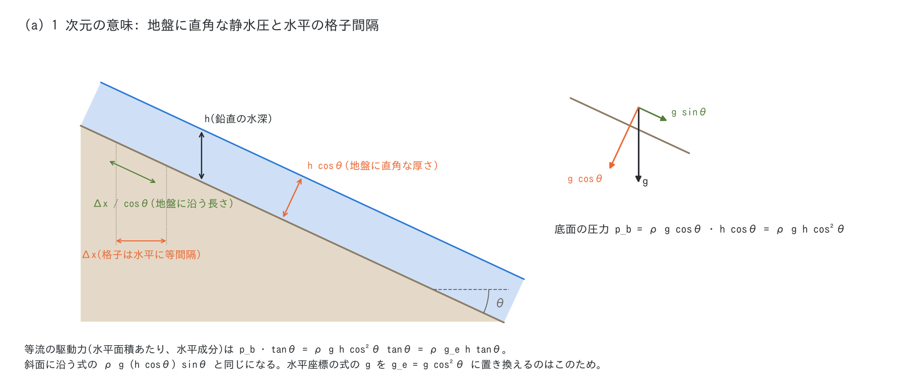
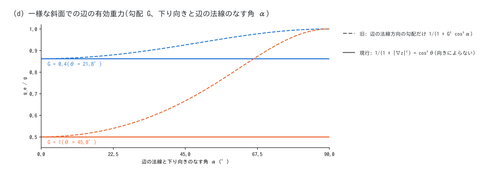
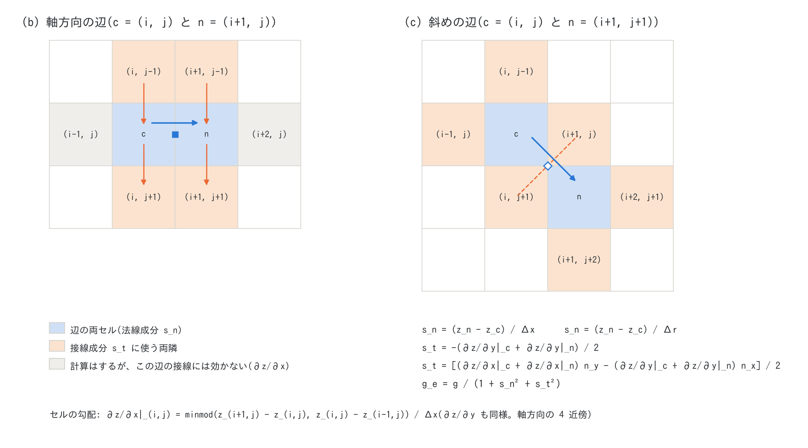

# 急勾配の重力補正(有効重力 $`g_e`$)の定式化と実装(解説)

**位置づけ**: [developer.md §91](developer.md) は 2026-11-04 の修正の判断と検証の記録、
[users_guide/encgrid.md](users_guide/encgrid.md) §5 は利用者向けの要点です。本書はその中間に立ち、
ENCflow の急勾配の重力補正(`f_gravity_correction = 1`、既定)を、**意図 → 定式化 → 離散化(どの
ステンシルで勾配を求め、どの辺の式でどの勾配を使うか)→ 検証 → 既往研究での扱い → 限界と今後の
課題**の順に、一つの筋でまとめます。対象は 2026-11-04 のコード(`src/m_swflow_enc.f90` の
`gravity_prepare`・`zdiff_minmod`・`calc_kth_flux` 内の `correct_ge`)です。式の導出のうち文献に
ないものは「本書の導出」と明記します。

図は `python3 docs/figs/make_guide_figs.py steepslope`(`docs/figs/guide/fig_steepslope.py`)で
生成します(結果ファイル不要の模式図と閉じた式)。

---

## 1. 何を補正するか

ENCflow は**水平座標** $`(x, y)`$ の等間隔ラスタで、**鉛直に測った水深** $`h`$ と、水平面の単位幅
あたりの流量 $`(m, n) = h\,(u, v)`$($`(u, v)`$ は水平流速)を解きます。地盤に沿う座標を使わない
のは、ラスタのまま任意の地形(谷・尾根・堤)を扱うためです(方針 §0)。この水平投影の浅水方程式を
急斜面の薄い流れに使うと、古典的な(緩勾配の)式の前提が 2 点で崩れます。

1. **静水圧の向き**: 地盤に平行な薄い流れでは、静水圧は鉛直ではなく地盤に直角な方向に分布する。
   地盤に直角な重力成分は $`g\cos\theta`$、地盤に直角な厚さは $`h\cos\theta`$ なので、底面の圧力は
   $`p_b = \rho g \cos\theta \cdot h\cos\theta = \rho g h\cos^2\theta`$($`\theta`$ は地盤の傾斜角)。
2. **格子の間隔**: 格子は水平に等間隔で、地盤に沿う長さは $`\Delta x/\cos\theta`$。



底面の圧力は地盤に直角に働くので、水平面積あたりの水平成分は $`p_b\tan\theta = \rho g h\cos^2\theta\,\tan\theta`$
です。これは斜面に沿う式の駆動力 $`\rho g\,(h\cos\theta)\sin\theta`$(地盤に沿う面積あたりの重力の
斜面方向成分)を、水平面積あたりの水平成分に直したものと同じです。古典的な水平投影の式の勾配項は
$`\rho g h\tan\theta`$ なので、その $`g`$ を

```math
g_e = g\cos^2\theta = \frac{g}{1 + \tan^2\theta}
```

に置き換えれば一致します。これが「見かけの重力」による補正です。1 次元では、斜面に沿う座標
(流下方向の座標軸)で成り立つ見慣れた浅水方程式を、水平軸の式へ写す変換を、重力加速度の置き換えで
表したものに当たります(§2.1 で式を追います)。同じ置き換えで、斜面上の剛体の滑りの加速度
(水平成分 $`g\sin\theta\cos\theta - \mu g\cos^2\theta = g_e(\tan\theta - \mu)`$)も正確に表せます
(§4 の検定 test/dbonset)。

古典的な式(補正なし)は駆動力を $`1/\cos^2\theta = 1 + \tan^2\theta`$ 倍に過大評価します
(10° で 3 %、20° で 13 %、30° で 33 %)。

## 2. 定式化

### 2.1 1 次元: 斜面に沿う座標の式と水平座標の式

勾配が一定の斜面(傾斜角 $`\theta`$)で、地盤に直角な静水圧を仮定した薄層の式(Savage–Hutter 型。
地盤に直角な厚さ $`h_n`$、斜面方向の水深平均流速 $`u_s`$、斜面に沿う座標 $`s`$)は

```math
\frac{\partial u_s}{\partial t} + u_s\frac{\partial u_s}{\partial s}
= g\sin\theta - g\cos\theta\,\frac{\partial h_n}{\partial s} - \frac{\tau_b}{\rho h_n}
```

です($`\tau_b`$ は地盤に沿う面積あたりの底面せん断応力)。地表面が地盤にほぼ平行なら
$`h_n = h\cos\theta`$、$`u_s = u/\cos\theta`$、$`\partial/\partial s = \cos\theta\,\partial/\partial x`$
で水平座標へ写せて(本書の導出)、

```math
\frac{\partial u}{\partial t} + u\frac{\partial u}{\partial x}
= -\,g\cos^2\theta\,\frac{\partial z}{\partial x}
  - g\cos^4\theta\,\frac{\partial h}{\partial x}
  - \frac{\tau_b}{\rho h}
```

になります($`\partial z/\partial x = -\tan\theta`$)。読み取れることは次の 3 点です。

- **勾配の項(駆動力)は $`g_e = g\cos^2\theta`$ で正確**。水深が一様な流れ・滑り・等流の駆動力は、
  有効重力の置き換えで斜面に沿う式と一致する。
- **水深の勾配の項(圧力)の係数は $`g\cos^4\theta`$** で、$`g_e`$ よりさらに $`\cos^2\theta`$ 小さい。
  水平座標で鉛直の断面に掛かる圧力から組み立てても、底面の圧力を地盤に直角な厚さで評価すれば同じ
  係数になる(本書の導出)。
- **摩擦は $`\tau_b/(\rho h)`$**(鉛直の水深で割る)。$`\tau_b`$ を斜面方向の速さ $`u/\cos\theta`$ と
  地盤に直角な水深 $`h\cos\theta`$ で評価するのが斜面に沿う式との対応(§6)。

ENCflow を含む多くの水平座標の急勾配モデルは、勾配の項と圧力の項の**両方**に $`g_e = g\cos^2\theta`$ を
掛けた形

```math
\frac{\partial u}{\partial t} + u\frac{\partial u}{\partial x}
= -\,g_e\,\frac{\partial (z + h)}{\partial x} - (\text{摩擦})
```

を使います(Ni ら 2019 の CAR、Van Emelen ら 2014 の MSW-GC の印刷された式、Juez ら 2013 と
Denlinger & Iverson 2004 の一様な水深の場合。§5)。上の薄層の式と比べると、駆動力は同じで、水深の
勾配の項が $`1/\cos^2\theta`$ 倍大きい形です。その代わり、**水面が水平な静水(湖)が厳密に釣り合う**
(勾配の項と圧力の項に同じ $`g_e`$ が掛かるので、水面の勾配が 0 なら力が 0)。薄層の式の
$`\cos^4\theta`$ は「地表面が地盤にほぼ平行」という前提の上の係数で、水面が水平な湖には当てはまり
ません。Yuan ら (2016) は $`g'`$ を水深と地盤の勾配の内積 $`\nabla h\cdot\nabla b`$ で修正し、一様な
水深では $`g\cos^2\theta`$、水平な水面では $`g`$ に戻る形を導いています(1 次の項まで展開すると
上の $`\cos^4\theta`$ と一致する。本書の検算)。

このため、利用者の見立てどおり**1 次元の駆動力(勾配の項)はどの急勾配の定式化でも同じ内容に帰着**
しますが、**圧力の項の係数と摩擦の評価は定式化によって違います**。Maranzoni & Tomirotti (2022) も、
1 次元では斜面に沿う座標の定式化で一致しており、2 次元の違いは主に勾配の効果を圧力にどう入れるかに
ある、とまとめています。違いは波速に現れ、下り向きの水平方向の波速は、薄層の式で
$`\cos^2\theta\sqrt{gh}`$(斜面に沿って $`\sqrt{g\cos\theta\,h_n}`$)、有効重力の形で $`\cos\theta\sqrt{gh}`$、
古典的な式で $`\sqrt{gh}`$ です(流速を地盤の接平面の成分で持つ Maranzoni & Tomirotti の式は薄層の式と
同じ波速になる)。

2 次元では、薄層の式の圧力の項の係数は向きで違います。等高線の向き(斜面を横切る水平の向き)には
座標の伸びも鉛直方向の運動もないので、係数は $`g\cos^2\theta`$ で、波速は $`\cos\theta\sqrt{gh}`$ です
(本書の導出)。ENCflow の向きによらない $`g_e`$ は、斜面を横切る向きでは薄層の式と一致し、下り向き
では $`1/\cos^2\theta`$ 倍大きい、という関係です。

### 2.2 ENCflow の辺の運動方程式と $`g_e`$ の掛かる項

ENCflow は辺 $`k`$(中心セル $`c`$ と近傍セル $`n`$ を結ぶ。8 近傍)の法線流速 $`u_k`$ を解きます
([encgrid.md](users_guide/encgrid.md) §5)。$`g_e`$ は辺ごとに求め(§3)、次の項に掛かります。

| 項 | 式(辺 $`k`$、$`\Delta s_k`$ は両セル中心の距離) | $`g_e`$ |
|---|---|---|
| 勾配・圧力(水面の勾配) | $`-\,g_e\,g_v\,(\eta_n - \eta_c)/\Delta s_k`$、$`\eta = z + h`$ | 掛かる |
| マニングの摩擦(半陰) | $`-\,g_e\,g_v\,n^2\,|\mathbf V|_e\,u_k/h_f^{4/3}`$ | 掛かる |
| 混合体流動の降伏(クーロン)・Voellmy の乱流項 | $`a_y = g_e\tan\phi\,sC/(1+sC)`$、$`g_e V^2/(\xi h)`$ | 掛かる |
| 曲率項(遠心加速度。f_dbcurv) | 地盤に直角な重力 $`g_n = \sqrt{g\,g_e} = g\cos\theta`$ | 掛かる |
| 混合体の土砂柱の圧力 | $`-\,g_e\,g_v\,(h_{s,n} - h_{s,c})/\Delta s_k`$ | 掛かる |
| 移流・拡散・家屋の抗力・波の外力 | — | 掛からない |

$`g_e`$ はステップの頭の地盤 $`z`$ から求め、ルンゲクッタの段の間は変えません($`z`$ は地形変化の
更新でだけ変わる)。

### 2.3 等流では $`g_e`$ が相殺する

**摩擦にも $`g_e`$ が掛かる**ので、定常の等流の釣り合い $`g_e h S = g_e n^2 u^2/h^{1/3}`$
($`S = \tan\theta`$)から $`g_e`$ が消え、

```math
u = \frac{1}{n}\,h^{2/3}\,S^{1/2}\qquad(h:\ \text{鉛直の水深},\ u:\ \text{水平流速},\ S = \tan\theta)
```

という古典的な水平投影のマニング式になります(補正なしと同じ)。つまり ENCflow の重力補正は、
**等流の水深・流速を変えず、非定常の部分(加速・動き出し、波速 $`\sqrt{g_e h}`$、斜面を横切る向きの
圧力による広がり)を変えます**。式で見ると、勾配・圧力・摩擦の全部に $`g_e/g`$ が掛かるのは、
慣性(局所加速度と移流)を $`1 + |\nabla z|^2`$ 倍にしたのと同じで、斜面に沿って下る水の鉛直方向の
運動の慣性を数えた形です(下り向きの速さの 2 乗は $`|\mathbf V|^2(1 + |\nabla z|^2)`$)。
$`g_e`$ に比例しない抵抗則(高橋・中川のダイラタント項、江頭の構成則、一定の停止応力)の定常の
速さは $`g_e`$ で変わります(developer.md §91 の影響の範囲)。

§1 の 2 点の補正が等流で効くのは駆動力までで、**摩擦をどう評価するか(水平流速か斜面方向の
流速か、鉛直か地盤に直角な水深か)で等流の水深は変わります**。ENCflow はここを水平流速と鉛直の
水深のまま、摩擦にも $`g_e`$ を掛けています。この点は既往の Cartesian 座標の急勾配モデルと違い(§5)、
§6 で今後の課題として整理します。(2026-11-05 追記)`f_gravity_correction = 2` では、摩擦と流砂の
せん断を斜面に沿う速さと地盤に直角な水深で $`g`$ を使って評価し、等流が斜面に沿う式
$`h\cos\theta = (n^2q^2/\sin\theta)^{3/10}`$ になります(§6.3、developer.md §93)。

### 2.4 2 次元: $`\theta`$ は地盤の傾斜角(場の量)

2 次元の $`\theta`$ は**地盤の法線と鉛直のなす角**、すなわち最急勾配の向きの傾斜角で、
$`\tan\theta = |\nabla z|`$ です。底面の圧力 $`p_b = \rho g h\cos^2\theta`$ は地盤の傾きだけで決まり、
地盤に直角な力の水平成分は水平面積あたり $`-\,p_b\,\nabla z`$ で、その辺 $`k`$ の向き $`\mathbf e_k`$ の
成分は $`-\,\rho\,g\cos^2\theta\,h\,(\nabla z\cdot\mathbf e_k)`$ です。どの向きの辺でも
同じ $`g_e = g/(1 + |\nabla z|^2)`$ が古典的な勾配項に掛かる形で、**$`g_e`$ は辺の向きによらない**
量です。

```math
g_e = g\cos^2\theta = \frac{g}{1 + |\nabla z|^2}
```

2026-11-04 まで ENCflow は、辺の法線方向の勾配だけで $`g/(1 + (\Delta z/\Delta s_k)^2)`$ を求めていました。
勾配 $`G`$ の一様な斜面で、下り向きと角 $`\alpha`$ をなす辺では $`g/(1 + G^2\cos^2\alpha)`$ になり、
斜面に斜めの辺ほど補正が弱く、斜面を横切る辺($`\alpha = 90°`$)では補正がかかりません(図 d)。
辺の向きは格子の向きで決まるので、**同じ斜面でも格子の向きで有効重力が変わる偏り**でした
(勾配 0.4 で 45° の辺 +7.4 %、横切る辺 +16 %)。



## 3. 離散化: どの辺の式でどの勾配を使うか

### 3.1 ENC 格子の辺

各セルは 8 近傍と辺で結ばれます(軸方向 4 本、斜め 4 本)。辺 $`k`$ の長さ(両セル中心の距離)は
軸方向で $`\Delta x`$ または $`\Delta y`$、斜めで $`\Delta r = \sqrt{\Delta x^2 + \Delta y^2}`$、単位
法線ベクトルは $`\mathbf e_k = (n_x, n_y)`$(コードの `geo%n8x`・`n8y`。斜めは
$`(\pm\Delta x, \pm\Delta y)/\Delta r`$)、接線は $`\mathbf t_k = (n_y, -n_x)`$ です。

### 3.2 セルの地盤の勾配(`gravity_prepare`・`zdiff_minmod`)

ステップごとに、各セルの地盤の勾配 $`(\partial z/\partial x, \partial z/\partial y)`$ を、**軸方向の
両隣との差の minmod**(4 近傍)で求めます(`sx%gzx`・`gzy`)。

```math
\left.\frac{\partial z}{\partial x}\right|_{i,j}
= \frac{1}{\Delta x}\,\mathrm{minmod}\left(z_{i+1,j} - z_{i,j},\ z_{i,j} - z_{i-1,j}\right),
\qquad
\mathrm{minmod}(a, b) =
\begin{cases}
a & ab > 0,\ |a| < |b| \\
b & ab > 0,\ |b| \le |a| \\
0 & ab \le 0
\end{cases}
```

$`\partial z/\partial y`$ も同様です。両隣のうち計算領域(マスク `g%x` > 0)にあるのが片側だけなら
片側差分、どちらもなければ 0。海域セルの地盤も含めます(水底は連続)。

### 3.3 辺の勾配の大きさと $`g_e`$(`correct_ge`)

辺 $`k`$ の $`|\nabla z|^2`$ を、**辺の法線成分**と**接線成分**の二乗和で求めます。

```math
s_n = \frac{z_n - z_c}{\Delta s_k},\qquad
s_t = \tfrac12\left(\nabla z|_c + \nabla z|_n\right)\cdot\mathbf t_k,\qquad
g_e = \frac{g}{1 + s_n^2 + s_t^2}
```

- **法線成分 $`s_n`$** は、その辺自身の差分(軸方向の辺は軸方向の隣、斜めの辺は斜めの隣との差)。
  運動方程式の勾配項に使う差分と同じで、2026-11-04 より前の定義と同じ項です。
- **接線成分 $`s_t`$** は、辺の両セルの勾配(§3.2 の minmod)の平均を辺の接線へ射影したもの。辺は接線
  方向の差分を持たないので、セルの勾配から補います。



**どの辺にどのセルを使うか**(図 b・c。$`c = (i, j)`$):

| 辺 | 法線成分 $`s_n`$ | 接線成分 $`s_t`$ が読むセル | 合計 |
|---|---|---|---|
| 軸方向(x)$`c`$–$`(i{+}1, j)`$ | $`z_{i+1,j} - z_{i,j}`$ を $`\Delta x`$ で | 両セルの $`\partial z/\partial y`$: $`(i, j{\pm}1)`$、$`(i{+}1, j{\pm}1)`$ | 6 セル |
| 軸方向(y)$`c`$–$`(i, j{+}1)`$ | $`z_{i,j+1} - z_{i,j}`$ を $`\Delta y`$ で | 両セルの $`\partial z/\partial x`$: $`(i{\pm}1, j)`$、$`(i{\pm}1, j{+}1)`$ | 6 セル |
| 斜め $`c`$–$`(i{+}1, j{+}1)`$ | $`z_{i+1,j+1} - z_{i,j}`$ を $`\Delta r`$ で | 両セルの $`\partial z/\partial x`$・$`\partial z/\partial y`$: $`(i{\pm}1, j)`$、$`(i, j{\pm}1)`$、$`(i{+}2, j{+}1)`$、$`(i{+}1, j{+}2)`$ | 8 セル |

軸方向の辺では、両セルの辺の向きの勾配(x の辺なら $`\partial z/\partial x`$)も計算されますが、接線への
射影で 0 倍になり使われません。**場の勾配は、セルの勾配としては軸方向の 4 近傍から求め、辺の法線
成分はその辺自身(軸方向または斜めの 8 方向)の差分から取っています。**

### 3.4 なぜこの組み合わせか

- **法線成分は辺の差分のまま**: 運動方程式の勾配項と同じ差分で、局所的。地盤が軸方向にだけ傾く
  1 次元の斜面では、軸方向の辺の $`s_t`$ が 0 になり、2026-11-04 より前と同じ値になる(斜めの辺は
  旧定義の $`G^2/2`$ から $`G^2`$ になる)。
- **接線成分は minmod**: 平面では正確で、谷底と谷壁・堤の肩のような折れでは緩い側を取るので、谷壁の
  勾配が谷底のセルに入らない。中心差分だと谷底のセルに谷壁の勾配が半分入り、粗い格子(谷底が
  1〜2 セル)では谷底の有効重力が下がる(35° の谷壁で約 1 割)。尾根や谷底のように両側の差の符号が
  違うセルでは接線成分が 0 になり、法線成分だけが効く。
- **最急勾配(D∞。§92)は使わない**: D∞ はそのセルから下る最急の勾配を選ぶので、堤の頂部のような
  尾根で下りの片側の急な勾配を拾う。重力補正の $`\cos^2\theta`$ は地盤の傾き(法線の向き)の量で、
  折れで片側の急な勾配を拾うと有効重力が下がりすぎる。混合体流動の安全率・平衡濃度・停止判定に使う
  最急勾配 $`\tan\theta`$ は「下る最急の勾配」が意味を持つので D∞(developer.md §92)。

### 3.5 性質

- **平面で厳密**: minmod は平面で正確な勾配を返し、平均と射影も正確なので、どの向きの辺でも
  $`s_n^2 + s_t^2 = |\nabla z|^2`$。
- **静水の釣り合い(well-balanced)**: $`g_e`$ は水面の勾配 $`\eta_n - \eta_c`$ 全体に掛かるので、
  水面が水平な静水は $`g_e`$ の値によらず力 0 のまま。
- **境界**: 片側差分・0 の扱い(§3.2)。壁の辺は流量を持たない。
- **並列**: $`z`$ はステップの頭で幅 2 のハロを交換済みで、`gravity_prepare` は帯の
  `js−1..je+1` 行の勾配を `js−2..je+2` の $`z`$ から求める。帯の界面の辺は両ランクが同じ入力から
  同じ式で冗長に計算するので、MPI の np = 1・2・4 が逐次とビット一致する。
- **費用**: 有効時は帯の大きさの実数配列 2 つと、ステップごとに 1 回の前計算。無効時
  (`f_gravity_correction = 0`)は確保も計算もしない(方針 §0)。
- **流速 0 の分岐**: `correct_ge` は辺の速さが正のときだけ補正する分岐を持つが、速さは摩擦用の下限
  `vv`(既定 0.01 m/s、0 指定でも表現できる最小の正の値)で底上げされた後なので、常に補正される
  (この分岐は実際には働かない)。文献には流速で補正を切り替える形があり、Ni ら (2019) の式 (6) は
  流速 0 で $`g' = 0`$、Maranzoni & Tomirotti (2022) の式 (15) は静止で $`k = 1`$ とする。
- **ほかの使い道**: 土石流による岩盤侵食の駆動応力の $`g_e`$ も、同じセルの勾配で
  $`g/(1 + (\partial z/\partial x)^2 + (\partial z/\partial y)^2)`$ とする(セル中心の量なので法線成分は
  ない。developer.md §91)。

## 4. 検証

- **test/dbonset**(一様な斜面の全面の層の剛体の滑り。勾配 $`G`$ = 1.1 $`\mu`$・1.3 $`\mu`$、斜面の向き
  0°・22.5°・45°、8 近傍・4 近傍、重力補正あり): 解析解 $`V(T) = g_e(G - \mu)T`$、
  $`g_e = g/(1 + G^2)`$ に対し、1.1 $`\mu`$ で 1.0016〜1.0017 倍、1.3 $`\mu`$ で 0.9976〜0.9977 倍で、向き・
  近傍の組によらない。旧定義では 12 ケース中 10 ケースが FAIL(4 近傍の 0° だけが通った。旧定義が
  正しいのは軸に沿う斜面の軸方向の辺だけ)。
- **回帰の変化**(勾配のある濡れた辺では式の計算順が変わり、最終桁は必ず動く): 急な山地の流域
  test/chichibu で最大単位幅流量 $`Q_{max}`$ が出水の立ち上がりで +0.72 %、緩勾配の水質・地下水の
  ケースで相対 6e-4 以下(developer.md §91)。
- **例題**: examples/debris_fan で、4 近傍の扇頂への到達が格子によらず 39 s と 8 近傍より早かったのが
  41〜42 s になって 8 近傍(43〜44 s)とそろい、8 近傍の 5 m の格子の谷の向きによる地図の差は
  10 → 9 %(examples/debris_fan の README)。

## 5. 既往研究での扱い

手元の 5 文献(2026-11-04 に利用者から提供)を、本書の論点(座標と変数、重力の扱い、2 次元の
$`\theta`$、離散化、摩擦)で比べます。

| 文献 | 座標・変数 | 重力の扱い | 2 次元の $`\theta`$ | 離散化 | 摩擦の速さ・水深 |
|---|---|---|---|---|---|
| Ni, Cao & Liu (2019) の CAR | 水平座標、鉛直の水深 $`h`$、水平流速 $`(u, v)`$ | 圧力の流束と勾配の項の両方に $`g' = g\cos^2\theta`$(式 5・6) | セル中心の中心差分の勾配の大きさ(式 8)。x・y の運動方程式と摩擦に同じ $`\theta`$ | 有限体積、MUSCL、勾配の項を流束に変える Hou ら (2013) の方式(C-property)、セルごとに $`g'`$ が違うので中心型の FORCE 流束 | マニング、$`g`$(補正なし)、地盤に直角な水深 $`h\cos\theta`$、$`1/\cos\theta`$ の係数(式 7) |
| Van Emelen, Zech & Soares-Frazão (2014) | 1 次元。斜面座標(LC)と水平座標(GC) | MSW-GC: 圧力と勾配の項に $`g\cos^2\alpha`$(式 10。印刷のとおり) | (1 次元) | 1 次の有限体積、HLL、勾配の項の側方化 | 地盤に直角な水深 $`H\cos\alpha`$ のマニング × $`\cos\alpha`$(式 10・11) |
| Hergarten & Robl (2015) | 水平座標、鉛直の水深 $`h_v`$、水平流速 $`\mathbf v_h`$ | 勾配・圧力は $`g`$ のまま、流向の加速だけを $`\cos^2\varphi`$ に減らす摩擦様の項(式 9〜13・19〜21) | 水面または地盤の勾配の大きさ $`\tan\varphi = |\mathbf s|`$(式 7) | GERRIS(セル中心の対称差分の勾配)、補正はセルごとの点的な操作 | Voellmy、垂直応力 $`\rho g h_v\cos^2\varphi`$、乱流項は斜面に沿う速さ $`|\mathbf v_h|/\cos\psi`$(式 18) |
| Yuan ら (2016) | 水平座標、鉛直の水深、水平流速。非静水圧の補正つき | 圧力の流束・勾配・摩擦に可変の $`g'`$(式 42。一様な水深で $`g\cos^2\theta`$、水平な水面で $`g`$) | $`\tan\theta = |\nabla b|`$、法線ベクトル | 有限体積(Godunov 型、MUSCL、HLL)、源項は点的 | クーロン、斜面に沿う滑り速さ $`\sqrt{u^2 + v^2 + (u b_x + v b_y)^2}`$ |
| Maranzoni & Tomirotti (2022) | 水平座標 $`(x, y)`$ と鉛直の水深 $`h`$。流速は地盤の接平面の(非直交の)$`\xi`$・$`\eta`$ 方向の成分 | 圧力の流束に $`k = \cos^2\psi = 1/(1 + \tan^2\theta_x + \tan^2\theta_y)`$(流れているとき。静止で $`k = 1`$)、勾配の項は $`gh\sin\theta_x`$(正接でなく正弦)(式 11〜15) | 方向ごとの $`\theta_x`$・$`\theta_y`$ を持つが、補正係数 $`k`$ は法線ベクトルから求める方向によらない量。方向ごとに違う補正係数の定式化を批判 | Part I では扱わない(続編 Part II は MUSCL 型の有限体積・FORCE 流束) | 2 次元マニング、地盤に沿う真の速さ $`\lVert\mathbf v\rVert`$、鉛直の水深、斜面の面積の係数 $`\sqrt{1 + \tan^2\theta_x + \tan^2\theta_y}`$(式 14) |
| **ENCflow**(本書) | 水平座標、鉛直の水深、水平流量 | 勾配・圧力・摩擦に $`g_e = g\cos^2\theta`$ | 辺ごとに $`|\nabla z|^2 = s_n^2 + s_t^2`$(§3) | 辺の運動方程式(ENC 格子)。法線成分は辺の差分、接線成分は minmod のセルの勾配 | マニング、$`g_e`$、水平流速、鉛直の水深 |

各文献の要点(式番号・頁は原文):

- **Ni, Cao & Liu (2019)**: 水平座標の 2 次元モデル CAR を、斜面座標の 1 次元の SWE と古典的な SVE と
  比べる。CAR は「地盤に直角な静水圧」を仮定し、幾何の関係から圧力を $`p = \rho g\cos^2\theta\,(z_s - z)`$
  (式 2)とする。$`\cos\theta`$ はセル中心の中心差分の勾配の大きさ(式 8)で、方向ごとの角は使わない。
  30° の摩擦なしのダム崩壊で SVE は先端が 1.32〜1.35 倍速く(図の読み取り。$`1/\cos^2 30° = 1.33`$)、
  CAR と SWE は解析解とよく合う。12° の水路実験では差が校正した粗度にしか現れない。勾配 22 % の天然
  ダム決壊では CAR の洪水が遅く深く、SVE の粗度を上げても同じにならない(勾配の効果は抵抗の増加
  では代えられない)。**摩擦に勾配を入れている**(式 7)のが ENCflow との違い。
- **Van Emelen, Zech & Soares-Frazão (2014)**: 1 次元で、古典(CSW)と修正(MSW、Savage–Hutter 型)を
  斜面座標と水平座標で比べる。ダム崩壊のような急な非定常では差は小さいが、**等流では 10° を超えると
  差が見え**、水平座標の古典の式(CSW-GC。ENCflow の等流と同じ $`H = (n^2q^2/\tan\alpha)^{3/10}`$)の
  鉛直の水深の誤差は 10°・15°・20°・30° で −2・−4.4・−7.8・−17 %(式 21・22 からの計算。図 7 と合う)。
  掃流砂は 10° を超えると地盤に直角な水深でシールズ数を評価すべきで、CSW-GC は 15° を超えると流砂量を
  過大評価する。式 (8)・(9) から代入すると MSW-GC の圧力の流束は $`g\cos^4\alpha H^2/2`$ になり、印刷
  された $`g\cos^2\alpha`$ とは違う(読んだ範囲の検算。§2.1 の薄層の式と同じ係数)。
- **Hergarten & Robl (2015)**: 水平座標の浅水方程式を雪崩・岩屑なだれに使うための補正。(i) 実際の加速は
  水面に平行で式は水平成分しか持たない、(ii) $`|\mathbf s| = \tan\varphi`$ だが斜面の加速は $`\sin\varphi`$
  に比例する、の 2 つが $`\cos\varphi`$ ずつで、合わせて $`\cos^2\varphi`$(本書 §1 の 2 点と同じ内容の
  言い換え)。実装は勾配の項を $`g`$ のまま、流向の加速だけを摩擦様の項で減らし、流向に直角な加速は
  補正しない(著者は Cartesian 座標で流向に逆向きの摩擦だけを使う限り避けられない小さな限界とする)。
  $`\varphi`$ は勾配の大きさ(場の量)で、水面から取る版と地盤から取る版を比べ、有限体積や
  スタッガード格子では内部の離散化と違う勾配を使うと人工的な振る舞いが出うるとして地盤から取る版を
  勧める。**水平流速だけを持つことの誤差**(力がなければ水平流速が保存され、凸の斜面で斜面方向の
  速さが人工的に増え、凹で減る)を明記している。
- **Yuan ら (2016)**: 水平座標の非静水圧の粒状体流れのモデル。地盤に直角な静水圧と Taylor 展開から
  $`g'`$ を導き(式 42)、一様な水深で $`g\cos^2\theta`$(Denlinger & Iverson 2004、Juez ら 2013 と同じ)、
  水平な水面の湖では $`g`$ に戻る(Juez らの $`h_n = h\cos\theta`$ では湖の底面の圧力が
  $`\rho g h\cos^2\theta`$ になり正しくない、と指摘)。$`\theta`$ は勾配の大きさ。摩擦は斜面に沿う滑りの
  速さで評価する。古典の式(モデル C)は急斜面で最も速く、ずれが最も大きい。
- **Maranzoni & Tomirotti (2022)**: 水平座標を独立変数にしたまま、流速を地盤の接平面の成分で持つ
  2 次元の急勾配の浅水方程式。圧力は鉛直に線形とし、「斜面の平行流では鉛直断面の圧力水頭は鉛直の
  水深の $`\cos^2\theta`$ 倍」(Chow 1959、Henderson 1966)を 2 次元に一般化して、圧力の項に方向に
  よらない係数 $`k = \cos^2\psi`$($`\psi`$ は地盤の法線と鉛直のなす角。Juez ら 2013・Xia & Liang 2018・
  Ni ら 2019 の係数と同じ)を掛ける。静止では $`k = 1`$ に切り替えて水平な水面を保つ。勾配の項は
  正弦、摩擦は斜面の面積で効く。1 次元では斜面に沿う座標の急勾配の式と同値で、**2 次元の定式化の
  違いは主に「勾配の効果を圧力にどう入れるか」**だとする。既往の定式化のうち、**x と y で違う圧力の
  補正係数を使うもの**(Chaudhry 1993 の式、中川・高橋 1997(高橋 2007 所収)の $`gh\cos\theta_x\,\partial h/\partial x`$
  と $`gh\cos\theta_y\,\partial h/\partial y`$)を、補正係数は地盤の傾き($`\theta_x`$ と $`\theta_y`$ の
  対称な関数)で決まるべきだとして批判し、流向で補正係数が変わる FLATModel(Medina ら 2008)を
  「物理的でない」とする。小さい勾配の目安は 1:10(約 6°。Chow 1959)。摩擦なしのダム崩壊の時間
  尺度の差は $`1 - \cos\theta`$ で、45° で約 30 %。波速は地盤に沿って $`\sqrt{gh}\cos\theta = \sqrt{g\cos\theta\,h_n}`$
  で、§2.1 の薄層の式と同じ(流速を地盤の接平面の成分で持つため。水平流速で持つ ENCflow・Ni らの
  形は $`1/\cos\theta`$ 倍になる)。

**本書の論点への答え**:

1. **定式化の時点で場の勾配か**: 2 次元を扱う 4 文献(Ni ら、Hergarten & Robl、Yuan ら、
   Maranzoni & Tomirotti)はいずれも補正係数を勾配の大きさ(または法線ベクトル)という**場の量**で
   定義している。一方で、方向ごとに違う係数を使う定式化も実在し(Chaudhry 1993、中川・高橋 1997)、
   Maranzoni & Tomirotti はそれを「補正係数は地盤の傾きで決まり、x と y の入れ替えに対して対称で
   あるべき」として批判している。ENCflow の旧定義(辺の法線方向の勾配だけ)は、この方向ごとの補正を
   辺ごとに行った形に当たり、同じ批判が当てはまる(格子の向きで有効重力が変わる)。修正後は辺ごとに
   $`|\nabla z|`$ を組み立てるので、補正係数は辺の向きによらない。
2. **離散化**: 数値解法を示す文献はどれもセル中心の有限体積で(Maranzoni & Tomirotti の Part I は
   離散化を扱わない)、補正係数をセル中心の勾配から求め(Ni らと Hergarten & Robl は中心差分と明記)、
   源項を点的に、または流束に変えて扱う。辺(スタッガード)で運動量を解く ENCflow は、
   セル中心の値を辺に持ってくる必要があり、法線成分は辺の差分、接線成分は両セルの勾配の平均とした
   (C 格子で摩擦の速さに直交成分を辺へ平均して使うのと同じ考え方)。接線成分に中心差分ではなく
   minmod を使うのは ENCflow の選択で、谷底と谷壁の折れを粗い格子で扱うため(§3.4)。
3. **重力補正の形**: 流れの向きの駆動力が斜面に沿って $`g\sin\theta`$(水平成分
   $`g\sin\theta\cos\theta = g\cos^2\theta\tan\theta`$)になることは全文献で共通で、表し方が、勾配の項に
   $`g\cos^2\theta`$ を掛ける(Ni ら、Van Emelen ら、Yuan ら、ENCflow)、正弦で書く(Maranzoni &
   Tomirotti。流速が地盤の接平面の成分)、流向の加速を摩擦様の項で減らす(Hergarten & Robl)、と分かれる。
   圧力の項は、$`g\cos^2\theta`$(Ni ら、Van Emelen らの印刷された式、ENCflow)、$`g`$(Hergarten &
   Robl)、可変の $`g'`$(Yuan ら)、地盤の接平面の流速と組の $`k = \cos^2\psi`$(Maranzoni & Tomirotti)
   と分かれる(§2.1)。
4. **摩擦**: 比べた 5 文献はすべて、摩擦に斜面の効果(地盤に直角な水深、斜面に沿う速さ、斜面の
   面積、または垂直応力の $`\cos^2\theta`$)を入れている。ENCflow は水平流速・鉛直の水深のまま摩擦に
   $`g_e`$ を掛けるので、等流は古典の式(Van Emelen らの CSW-GC)と同じになる(§2.3)。ENCflow が
   出典として引く Ni ら (2019) とも、ここが違う(Ni らの摩擦は $`g`$ と地盤に直角な水深)。

## 6. 水平流速と斜面方向の流速: 考慮していないことと今後の課題

### 6.1 ENCflow の変数の意味

ENCflow の流速 $`\mathbf V = (u, v)`$ は**水平流速**、水深 $`h`$ は**鉛直の水深**です。質量保存は水平
面積で厳密に成り立ちます($`h`$ と水平流量 $`h\mathbf V`$ の組は、斜面に沿う流量と同じ量を表す)。
斜面に沿う実際の速さは、下り向きの成分が引き伸ばされた

```math
|\mathbf V_s| = \sqrt{|\mathbf V|^2 + (\mathbf V\cdot\nabla z)^2}
\qquad(\text{最急勾配の向きに流れるとき } |\mathbf V|/\cos\theta)
```

で、地盤に直角な水深は $`h\cos\theta`$ です。出力の流速(最大流速 V9999 などを含む)は水平流速
なので、斜面に沿う速さと比べるときは換算が要ります。

### 6.2 違いが効くところ

**(a) 摩擦(等流の水深と流速)**。マニング則を斜面方向の速さと地盤に直角な水深で評価する(斜面に
沿う式の等流 $`u_s = h_n^{2/3}\sin^{1/2}\theta/n`$)と、同じ単位幅流量 $`q`$ で、ENCflow(古典の
水平投影の式と同じ)の鉛直の水深は $`\cos^{13/10}\theta`$ 倍、水平流速は $`\cos^{-13/10}\theta`$ 倍に
なります(本書の導出。Van Emelen ら 2014 の図 7 の値と一致)。

| 傾斜角 | 5° | 10° | 15° | 20° | 25° | 30° | 35° | 40° | 45° |
|---|---|---|---|---|---|---|---|---|---|
| 勾配 $`\tan\theta`$ | 0.087 | 0.176 | 0.268 | 0.364 | 0.466 | 0.577 | 0.700 | 0.839 | 1.000 |
| 古典の式の駆動力の過大 $`1/\cos^2\theta`$ | 1.008 | 1.031 | 1.072 | 1.132 | 1.217 | 1.333 | 1.490 | 1.704 | 2.000 |
| 等流の鉛直の水深(同じ $`q`$)ENCflow / 斜面に沿う式 | 0.995 | 0.980 | 0.956 | 0.922 | 0.880 | 0.829 | 0.772 | 0.707 | 0.637 |
| 等流の水平流速(同じ $`q`$)ENCflow / 斜面に沿う式 | 1.005 | 1.020 | 1.046 | 1.084 | 1.136 | 1.206 | 1.296 | 1.414 | 1.569 |
| 底面せん断(同じ $`q`$)ENCflow / 斜面に沿う式 | 1.003 | 1.011 | 1.025 | 1.045 | 1.071 | 1.106 | 1.150 | 1.205 | 1.275 |
| 下り向きの水平方向の波速 ENCflow / 薄層の式 $`1/\cos\theta`$ | 1.004 | 1.015 | 1.035 | 1.064 | 1.103 | 1.155 | 1.221 | 1.305 | 1.414 |

ただし、マニングの $`n`$ を水平投影のモデルで校正している場合は、この差の一部は $`n`$ に吸収されて
います(Ni ら 2019 の 12° の水路実験では、差が校正した粗度にしか現れなかった)。文献値の $`n`$
(緩勾配の水路の実測)をそのまま急斜面に使う場合に、上の表の差が出ます。

**(b) 侵食・流砂の底面せん断**。掃流砂・浮遊砂・斜面浸食のシールズ数は、水平流速と鉛直の水深の
マニングのせん断 $`n^2|\mathbf V|^2/(s\,d\,h^{1/3})`$ で評価しています。Van Emelen ら (2014) は、
10° を超えると地盤に直角な水深でシールズ数を評価すべきで、水平座標の古典の式は 15° を超えると流砂量
を過大評価するとしています。上の表の底面せん断の行がその大きさです(流砂量はせん断の 1.5 乗程度で
効くので、さらに大きい)。

**(c) 圧力の項の係数(波速)**。§2.1 のとおり、ENCflow の圧力の項は下り向きで薄層の式より
$`1/\cos^2\theta`$ 倍大きく、下り向きの水平方向の波速は $`1/\cos\theta`$ 倍です(表の最下行。斜面を
横切る向きは一致)。Van Emelen らは
30° のダム崩壊で古典と修正の式の差を「大きくない」とし、Ni らは CAR(圧力にも $`g\cos^2\theta`$)が
解析解と合うとしているので、優先度は (a)(b) より低いと考えます。

**(d) 凸・凹の斜面(曲率)**。水平流速だけを持つ式では、力がなければ水平流速が保存されるので、
凸の斜面(勾配が増える)で斜面方向の速さが人工的に増え、凹で減ります(Hergarten & Robl 2015)。
遠心加速度による垂直応力の増減(曲率項)は、混合体流動の降伏摩擦にだけ入れています
(`f_dbcurv`。developer.md §28.10。Fischer ら 2012 が RAMMS に入れたもの)。水の流れ(堤の越流、
余水吐の曲面)には入っていません。

**(e) 急な地盤の上の深い水**。$`g_e`$ は地盤の勾配から求めるので、水深によらず掛かります。急な
湖岸・ダム湖の斜面・急な海岸の上の深い水では、水面はほぼ水平で圧力は鉛直の静水圧(Yuan らの
$`g' = g`$)が正しいのに、ENCflow は $`g_e < g`$ で波速を $`\cos\theta`$ 倍に遅くします。津波の例題
(examples/tsunami_coast・tsunami_fault)は `f_gravity_correction = 0` にしています。斜面崩壊が湖に
突入する examples/landslide_tsunami は既定(1)のままで、湖岸 0.4 の斜面の辺の補正で先頭波が
+1.37 → +1.41 m に変わりました(developer.md §91)。崩壊土砂の流れには補正が要り、湖の波には要らない
という、一つの計算の中で両方の状態がある例です。

### 6.3 今後の課題(議論のための選択肢)

(2026-11-05 追記)B と C は選択式 `f_gravity_correction = 2` として実装した(developer.md §93、検定
test/slopefric)。既定は 1 のままで、2 を既定にするかは例題への影響を見て議論する。D〜F は未実装。

| 案 | 内容 | 効くところ | 論点 |
|---|---|---|---|
| A | 現状のまま、限界を文書に明記する(本書と利用者ガイド) | — | 等流は古典の水平投影の式。$`n`$ を水平投影で校正するならこれで足りる |
| B(実装済み。`f_gravity_correction = 2`) | 摩擦を斜面方向の速さ $`|\mathbf V_s|`$ と地盤に直角な水深 $`h\cos\theta`$ で評価し、摩擦の $`g_e`$ を $`g`$ にする | 等流の水深・流速(表の (a))、到達時間 | 斜面に沿う式・Ni ら・Van Emelen らの MSW と整合。辺で $`\mathbf V\cdot\nabla z`$ が要る(§3 のセルの勾配がそのまま使える)。15° を超える斜面で結果が数 % 以上変わる。既定にするか(挙動変更)、選択式にするか |
| C(実装済み。同上) | 流砂・侵食のシールズ数を地盤に直角な水深と斜面方向の速さで評価する | 流砂量・侵食量(表の (b)) | Van Emelen らが 10° 超で必要とする。B と組にするのが自然 |
| D | 急な地盤の上の深い水で $`g_e`$ を $`g`$ に戻す(水面の勾配から取る、または Yuan らの $`g'`$) | 湖・ダム湖・急な海岸の波、土砂の湖への突入 | 薄い流れと深い水の切り替えの基準。Yuan らの形は 1 次まで薄層の式と一致し、湖で $`g`$ に戻る |
| E | 圧力の項の係数を薄層の式の $`\cos^4\theta`$ に近づける | 波速・急斜面のダム崩壊の先端 | 静水の釣り合いとの両立(D と同じ形で両立できる) |
| F | 水の流れにも曲率項を入れる | 堤の越流・余水吐・凸凹の斜面 | 地形の 2 階微分の扱い(§28.10 の土石流の曲率項の流用) |

**推奨する順序**(案として): まず A(本書)で現状と限界を明示し、B と C を一組で、選択式(たとえば
`f_gravity_correction = 2`)として試作して、斜面の等流の解析解(斜面に沿う式のマニングの等流)と
Van Emelen らの等流の構成で検定する。結果が既存の例題・検定をどれだけ変えるかを見てから、既定の
扱いを議論する。(2026-11-05)この順で B・C を実装し、test/slopefric で、30° の斜面の雨の定常の
薄層流の水深が向き・近傍によらず斜面に沿う式に 0.4 % 以内で合うこと(1 は古典の式に合う)と、掃流砂の
動き出しの位置が斜面に沿う底面せん断の解析解に合うことを確かめた。D は landslide_tsunami のような「崩壊+湖」の構成で効くので、B・C とは独立に検討
する。E・F は現時点の優先度は低い。いずれも方針 §0(無効時は追加の計算もメモリもなし、出典の明記、
解析解での検定)に沿って進める。

## 参考文献

- Chaudhry, M. H. (1993): *Open-Channel Flow*. Prentice-Hall, Englewood Cliffs, NJ.
  (Maranzoni & Tomirotti の引用による)
- Chow, V. T. (1959): *Open-Channel Hydraulics*. McGraw-Hill, New York.(Maranzoni & Tomirotti の
  引用による。p. 33)
- Denlinger, R. P. and Iverson, R. M. (2004): Granular avalanches across irregular three-dimensional
  terrain: 1. Theory and computation. *J. Geophys. Res.*, 109, F01014. doi:10.1029/2003JF000085.
  (Yuan ら・Ni らの引用による)
- Fischer, J.-T., Kowalski, J. and Pudasaini, S. P. (2012): Topographic curvature effects in applied
  avalanche modeling. *Cold Reg. Sci. Technol.*, 74–75, 21–30. doi:10.1016/j.coldregions.2012.01.005.
- Henderson, F. M. (1966): *Open Channel Flow*. Macmillan, New York.(Maranzoni & Tomirotti の引用に
  よる。p. 28)
- Hergarten, S. and Robl, J. (2015): Modelling rapid mass movements using the shallow water equations
  in Cartesian coordinates. *Nat. Hazards Earth Syst. Sci.*, 15, 671–685. doi:10.5194/nhess-15-671-2015.
- Hou, J., Liang, Q., Simons, F. and Hinkelmann, R. (2013): A 2D well-balanced shallow flow model for
  unstructured grids with novel slope source term treatment. *Adv. Water Resour.*, 52, 107–131.
  (Ni らの引用による)
- Juez, C., Murillo, J. and García-Navarro, P. (2013): 2D simulation of granular flow over irregular
  steep slopes using global and local coordinates. *J. Comput. Phys.*, 255, 166–204.(Yuan ら・Ni ら・
  Van Emelen らの引用による)
- Maranzoni, A. and Tomirotti, M. (2022): New formulation of the two-dimensional steep-slope shallow
  water equations. Part I: Theory and analysis. *Adv. Water Resour.*, 166, 104255.
  doi:10.1016/j.advwatres.2022.104255.
- Medina, V., Hürlimann, M. and Bateman, A. (2008): Application of FLATModel, a 2D finite volume code,
  to debris flows in the northeastern part of the Iberian Peninsula. *Landslides*, 5(1), 127–142.
  (Maranzoni & Tomirotti の引用による)
- Ni, Y., Cao, Z. and Liu, Q. (2019): Mathematical modeling of shallow-water flows on steep slopes.
  *J. Hydrol. Hydromech.*, 67(3), 252–259. doi:10.2478/johh-2019-0012.
- Savage, S. B. and Hutter, K. (1989): The motion of a finite mass of granular material down a rough
  incline. *J. Fluid Mech.*, 199, 177–215.(各文献の引用による)
- Takahashi, T. (2007): *Debris Flow: Mechanics, Prediction and Countermeasures*. Taylor & Francis,
  London.(中川・高橋 1997 の式の出典として。Maranzoni & Tomirotti の引用による)
- Tarboton, D. G. (1997): A new method for the determination of flow directions and upslope areas in
  grid digital elevation models. *Water Resour. Res.*, 33(2), 309–319.
- Van Emelen, S., Zech, Y. and Soares-Frazão, S. (2014): Limitations of the shallow water assumptions
  for problems involving steep slopes: Application to a dike overtopping test case. In: Schleiss et al.
  (Eds.), *River Flow 2014*, Taylor & Francis, London, 1669–1677. ISBN 978-1-138-02674-2.
- Xia, X. and Liang, Q. (2018): A new depth-averaged model for flow-like landslides over complex
  terrains with curvatures and steep slopes. *Eng. Geol.*, 234, 174–191.(Maranzoni & Tomirotti の
  引用による)
- Yuan, L., Liu, W., Zhai, J., Wu, S. F., Patra, A. K. and Pitman, E. B. (2016): Refinement on
  non-hydrostatic shallow granular flow model in a global Cartesian coordinate system.
  arXiv:1602.03299v2 [physics.geo-ph].(雑誌版 *Comput. Geosci.*, 22, 2018 は本書では未確認)
