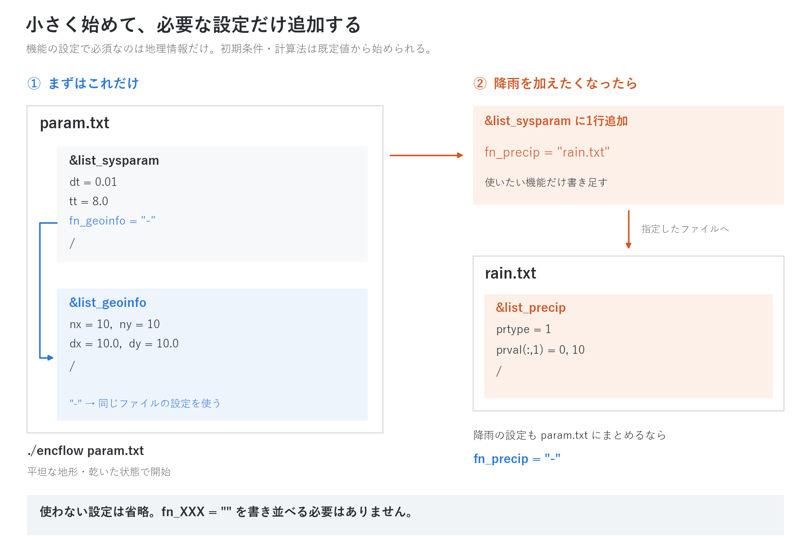

# ENCflow ユーザーガイド

ENCflow の設定と実行のリファレンスです。初めての方はまず
[チュートリアル](tutorial.md) で一度動かしてから戻ってくることを
勧めます(何をどの順で読むかは[チュートリアル](tutorial.md)の
「学習の道筋」)。このページ(第I部)で ENCflow の全体像と入力の作法を
説明し、個別のテーマは章別のページへ分かれています。章ページは
「とりあえず(気軽に)動かすための説明」を優先し、「概要 → とりあえず
動かしてみる(最小入力)→ パターン別の推奨値 → 必要な節」の順に読めば
動かせます。理論・式・既定値の根拠・詳細な設定は、章の下にぶら下がる
詳説ページ(目次で字下げした「…の解説」)にあります。全分野を読む必要は
なく、興味のある分野の章だけで構いません。

検証の内容と実行手順は [testの一覧](../test/README.md)、
現象別の設定例は [examplesの一覧](../examples/README.md) を参照してください。
各章にも、その機能に対応する検証ケース・例題へのリンクを掲載しています。

## 目次

**第I部 全体像**(このページ)
- [ENCflow の骨格](#encflow-の骨格)
- [機能の有効化 — fn_\* の原則](#機能の有効化--fn_-の原則)
- [パラメータファイルの読み方](#パラメータファイルの読み方)
- [実行の流れ](#実行の流れ)
- [ユーザールーチン](#ユーザールーチン)
- [やりたいことから引く](#やりたいことから引く)

**第II部 横断機能**
- [時刻の管理](users_guide/time.md) — 時間軸・時間刻み・出力間隔・暦
  - [クーラン数と時間刻みの決め方](users_guide/courant.md) — 数値計算が初めての人向けの入門: 格子と刻み・クーラン数・流速と波速・陽解法と陰解法・Cn_max の読み方・dt を見積もる手順(時刻の管理の入門)
  - [時間刻みの設計方針](users_guide/timestep_policy.md) — 陽解法主体と固定刻みの理由・可変刻みとサブサイクルとの関係・方程式の精度と現象の再現の区別(時刻の管理の補足。中級〜上級)
- [座標系の管理](users_guide/coordinates.md) — 絶対座標とローカル座標・EPSG・経緯度格子
- [入出力の形式](users_guide/io.md) — テキスト/bil/GeoTIFF・出力ファイル体系
- [ユーザールーチンの作り方](users_guide/user_routines.md) — 地形・初期条件をコードで与える(手順・添字の契約・落とし穴)
- [中断と再開](users_guide/restart.md) — 状態保存・時刻継続・初期条件としての利用
- [ネスティング(多段格子)](users_guide/nest.md)(fn_nest、&list_nest)— 親格子の中の子格子を同時に解く(多段・双方向・Flather 放射・非静水圧の帯)
  - [ネスティングの解説](users_guide/nest_models.md) — 時間補間・境界帯の方式・Flather 条件・スポンジ・子→親の置換と保存修正の定式と既定値の根拠(ネスティングの補足)
- [並列実行](users_guide/parallel.md) — OpenMP・MPI・結果の再現性

**第III部 機能別リファレンス**
- [浅水流計算](users_guide/swflow.md)(&list_enc、数値パラメータ)— 方式選択・適応的ルンゲクッタ・数値定数
  - [ENC 格子と時間積分の解説](users_guide/encgrid.md) — 8 方向格子の通過幅・連続式・セル流速の再構成・圧力/摩擦/抗力項・適応的ルンゲクッタ・クーラン数・パラメータと既定値の根拠(浅水流計算の補足)
  - [移流項のスキーム](users_guide/advection.md) — 方程式・運動量保存形の検査体積・ステンシル・限定器(浅水流計算の補足)
  - [非静水圧補正の解説](users_guide/nonhydrostatic.md) — 1 層モデルの方程式・射影アルゴリズム・活性集合・砕波・動く底面・参考にした他モデル(浅水流計算の補足)
  - [拡散項の解説](users_guide/diffusion.md) — 渦動粘性モデル(定数・ゼロ方程式)・9 点ラプラシアン・安定条件(浅水流計算の補足)
- [地理情報](users_guide/geoinfo.md)(&list_geoinfo)— 格子・地形・粗度・マスク・海岸堤防
- [初期条件](users_guide/initial.md)(&list_initial)— 水深・水位・窪地充填
- [境界条件](users_guide/boundary.md)(&list_bound_edge/source/stage/inflow)— 辺境界・ソース・水位規定・区間流入
- [潮位・海面](users_guide/tide.md)(&list_tide)— 高潮・上げ潮浸水・排水
- [沿岸の波浪場](users_guide/wavefield.md)(&list_wavefield)— 沖の波の浅水変形・屈折・砕波・防波堤の陰(位相平均・代表周期・方向ビン。段 W1 は流れ・地形に作用しない)
- [内部水理構造物](users_guide/structure.md)(&list_struct_pump/culvert/diversion/dam)— ポンプ・カルバート・分水・ダム・湖沼
  - [構造物と境界の水理則の解説](users_guide/hydraulics.md) — 本間公式・カルバートの 3 レジーム・ダム運転則・自由流出と放射境界・区間流入の配分の式と係数の根拠(構造物・境界条件・河道の補足)
- [河道](users_guide/channel.md)(&list_channel)— 堤防・河道幅・断面形・破堤
  - [河道の解説](users_guide/channel_models.md) — 仮想壁面の天端と開口補正・サブグリッド幅の平面積率・断面形 σ の矩形換算水深・破堤の天端と既定値の根拠(河道の補足)
- [降雨・気象](users_guide/forcing.md)(&list_precip / intercept / meteo / evap / snow)— 降水・遮断・気温・蒸発散・積雪融雪
  - [降雨・気象のモデルの解説](users_guide/forcing_models.md) — 遮断モデル・標高補正・Hamon/Thornthwaite の PET・度日法の式と既定値の根拠(降雨・気象の補足)
- [地下水](users_guide/gwflow.md)(&list_gwflow とモデル固有設定)— 浸透・側方流動・風化基岩層・管路連続体層(下水道網・岩盤亀裂網)
  - [地下水モデルの解説](users_guide/gwflow_models.md) — バケツ・Green-Ampt・Boussinesq 側方流・風化基岩層・管路連続体層・揚水・凍土の式と既定値の根拠(地下水の補足)
- [淡塩2層](users_guide/salt.md)(&list_salt)— 塩水くさび・海水浸入・淡水レンズ(鋭利界面近似)
- [土砂・地形変化](users_guide/geomorph.md)(&list_geomorph)— 掃流砂・浮遊砂・斜面浸食・土石流・長期地形発達・蛇行河道の発達(側岸侵食・定着・頸部短絡)
  - [土砂輸送と斜面・長期地形過程の解説](users_guide/sediment.md) — クリープ・流砂量式・Exner・浮遊砂の E-D・斜面浸食・乾式侵食・風化隆起・MORFAC の式と既定値の根拠(土砂・地形変化の補足)
  - [土石流・斜面崩壊・動く底層の解説](users_guide/massflow.md) — 単層混合体・5 つの抵抗則・侵食堆積則・曲率項・安全率・動く底層の式と参考にした他モデル(土砂・地形変化の補足)
- [流木](users_guide/driftwood.md)(&list_driftwood)— 流木化(水理的流失・侵食連行)・輸送・堆積(ラスタ場の概算)
  - [流木モデルの解説](users_guide/driftwood_models.md) — 3 台帳の移送則・喫水・面積基準と材積収支・実務値の出典・既定値の根拠(流木の補足)
- [家屋破壊・瓦礫](users_guide/bldgdebris.md)(&list_bldgdebris)— 氾濫流・流木による木造家屋の破壊・瓦礫の輸送・堆積・空隙率への帰還(ラスタ場の概算)
  - [家屋破壊・瓦礫モデルの解説](users_guide/bldgdebris_models.md) — 破壊判定量とランプ・破壊レート・空隙率への帰還・材積収支・閾値の文献対応と既定値の根拠(家屋破壊・瓦礫の補足)
- [氷河](users_guide/glacier.md)(&list_glacier)— 涵養・融解・氷体流動・氷河侵食・雪崩再配分
- [溶岩流](users_guide/lavaflow.md)(&list_lavaflow)— 噴火口からの湧き出し・Bingham 粘性流動・停止・固化(溶岩原の地形化)
- [規定底面運動](users_guide/bedmotion.md)(&list_bedmotion)— 地盤変位の時刻歴で z を強制(断層津波の発生・沿岸の隆起沈降・解像堤防の破堤)
  - [規定底面運動の解説](users_guide/bedmotion_models.md) — 変位の時間補間・断層変位場と初期水面・非静水圧との関係・再開と MPI の契約(規定底面運動の補足)
- [水質](users_guide/wq.md)(&list_wq)— 負荷投入・輸送・減衰・洗い出し・Kd 二相分配・地下水経由・貯水池
  - [水質モデルの解説](users_guide/wq_models.md) — 減衰・沈降・Kd 分配・浸透同伴と地下輸送・蓄積洗い出し・貯水池・下水噴出の式と代表値の出典(水質の補足)
- [土壌雨量指数](users_guide/swi.md)(&list_swi)— 土砂災害警戒の実務指標(気象庁3段タンク。専用ラン)
- [鉛直不飽和浸透(VZ)流出](users_guide/vz.md)(&list_vz / &list_vz_column / &list_vz_zone)— 山地斜面の降雨流出応答を共有参照柱の 1 次元 Richards 式から求める(谷 2023 の VZ モデル。区画の直接排水を出口セルへ)
- [計測](users_guide/record.md)(&list_record)— プローブ・フラックス測線
- [用途集](users_guide/usecases.md)— 現象名から機能の組み合わせを引く(未対応の現象も明示)

**付録**
- [全パラメータ索引](users_guide/params_index.md) — 全 726 パラメータの名前→章の逆引き

---

## ENCflow の骨格

ENCflow は地表の水の流れを計算するモデルです。必要に応じて、降雨・
地下水・土砂などの計算を同じ格子上に追加できます。

## 機能の有効化 — fn_\* の原則

**必要な設定だけ書けば始められます。** 機能の設定で必須なのは
[地理情報](users_guide/geoinfo.md)（`fn_geoinfo`）だけです。それ以外は
書かなければ既定の動作になるか、その機能を使わない状態になります。
**`fn_XXX=""` を書き並べる必要はありません。**

初期条件や計算法を変えたいとき、降雨などの機能を追加したいときに、
その `fn_XXX` を `&list_sysparam` に書き足します。

- 設定を **同じファイル**に書くなら `fn_XXX="-"`
- **別ファイル**に書くなら `fn_XXX="ファイル名"`



*左は平坦な地形で始める最小例。右は降雨を追加する例。使わない機能の設定は書かなくてよい。*

**指定しないときの動作**

| 設定 | 書かなかった場合 |
|---|---|
| 地理情報 `fn_geoinfo` | 同じファイルの `&list_geoinfo` を読む（地理情報の準備は必須） |
| [初期条件](users_guide/initial.md) `fn_initial` | 乾いた状態から開始 |
| [浅水流計算](users_guide/swflow.md) `fn_enc` | 既定の計算法で水の流れを計算 |
| [境界条件](users_guide/boundary.md) `fn_boundary` | 計算領域の4辺は不透過（水を通さない壁） |

これ以外の下表の追加機能は、`fn_XXX` を書かなければ有効になりません。

<details>
<summary>追加できる機能の一覧</summary>

| 機能 | 設定ファイルの指定 | namelist グループ |
|---|---|---|
| 潮位・海面 | `fn_tide` | &list_tide |
| 沿岸の波浪場(波高・波向の分布) | `fn_wavefield` | &list_wavefield |
| 波浪による沿岸漂砂(弧状・カスプ状デルタ、汀線の均し) | `fn_wave` | &list_wave([土砂・地形変化](users_guide/geomorph.md)の「波浪による沿岸漂砂」。fn_geomorph の f_fluvial=1 が必須) |
| 内部水理構造物 | `fn_structure` | &list_struct_pump / culvert / diversion / dam |
| ため池 | `fn_reservoir` | (地理情報と併用) |
| 河道 | `fn_channel` | &list_channel(+ breach) |
| [降水](users_guide/forcing.md) | `fn_precip` | &list_precip |
| 降雨遮断 | `fn_intercept` | &list_intercept(+ モデル固有) |
| 気象強制場(気温ほか) | `fn_meteo` | &list_meteo |
| 蒸発散 | `fn_evap` | &list_evap |
| 積雪・融雪 | `fn_snow` | &list_snow |
| 氷河 | `fn_glacier` | &list_glacier |
| 溶岩流 | `fn_lavaflow` | &list_lavaflow |
| 規定底面運動 | `fn_bedmotion` | &list_bedmotion |
| 地下水 | `fn_gwflow` | &list_gwflow(+ モデル固有) |
| 淡塩2層 | `fn_salt` | &list_salt |
| 土砂・地形変化 | `fn_geomorph` | &list_geomorph |
| 流木 | `fn_driftwood` | &list_driftwood |
| 家屋破壊・瓦礫 | `fn_bldgdebris` | &list_bldgdebris |
| 水質(負荷流出) | `fn_wq` | &list_wq |
| 土壌雨量指数 | `fn_swi` | &list_swi |
| 計測(プローブ・測線) | `fn_record` | &list_record |

</details>

書き方に迷ったら、[動く設定例（test/wave）](../test/wave/) や
[全設定の記述例](../examples/List_samples/list_sysparam.txt) を参考にしてください。

## パラメータファイルの読み方

パラメータファイルは Fortran の **namelist 形式**のテキストです。

```
&list_sysparam            ! グループの開始
  dt = 0.01               ! 「名前 = 値」を並べる。! 以降はコメント
  tt = 8.0
  fn_geoinfo = "-"        ! 文字列は引用符で囲む
/                         ! グループの終了
```

- 書く順序は自由で、書かなかったパラメータは既定値になります。
- 配列は `prval(:,1) = 0, 15` のように添字を付けて行ごとに書けます。
- **存在しない(綴りを間違えた)パラメータ名はエラーで停止します**。
  バージョン更新でパラメータが改名された場合も同じ仕組みで検出され、
  エラーメッセージが移行先を案内します。
- エラーメッセージ・実行時表示は英語です(世界中の利用者が検索・質問
  できることを優先しています。日本語の解説はドキュメントが担います)。

### 既定値の根拠の読み方

各章の解説ページ(解説ページがない章は章ページ)に
「**パラメータと既定値の根拠**」の節があり、表の「根拠」欄は次の分類語で
始まります。既定値をそのまま使ってよいか、校正すべきかの判断に使って
ください。文献値には脚注で出典を添え、各ページ末尾の「参考文献」に
書誌を置いています。

| 分類 | 意味 | 扱い |
|---|---|---|
| **文献値** | 文献・他モデルの値(脚注で出典) | そのまま使える。対象が文献の条件と違えば出典の表で置き換える |
| **慣用値** | 実務・教科書で広く使われる標準値(特定の出典に依らない) | そのまま使える。実測があれば置き換える |
| **検証ケース** | 本モデルの test / examples で選んだ値(リンク) | 数値的な性質の選択。通常は変えない |
| **導出** | 他のパラメータや理論から導かれる値(式を示す) | 元の量を変えれば追随する |
| **方式** | モデルの選択肢(フラグ)。推奨の方式を既定にしたもの | 章の「パターン別の推奨値」で用途に合う方式を選ぶ |
| **経験値** | 根拠が弱い、開発時の置き値 | 校正前提。感度を確認する |
| **校正量** | 普遍値がなく対象ごとに校正する量 | 既定は出発点にすぎない |
| **数値設定** | 安定化・正則化・反復上限など数値計算上の設定 | 物理的意味はない。通常変更不要 |
| **与件** | 利用者が対象に合わせて与える量(既定は 0 や「なし」) | 必ず与える |
| **互換** | 従来の挙動を保つための既定 | 新規の計算では推奨値を見る |

既定値を見直すときの調べ方(土性から透水係数を引く表、土地利用から
粗度を引く表、など)は、各節の表の直後に「既定値を見直すときの手がかり」
として置いています。

## 実行の流れ

```bash
./encflow param.txt
```

パラメータファイルを1つ与えて実行します。実行ファイルは計算したい
ディレクトリに `bin/encflow` へのリンクを張る(またはコピーする)
だけで、どこでも動きます
([インストールガイド 3.4 節](install.md#34-自分の計算はどこで実行してもよい))。画面には設定の読み込み
状況に続いて、時刻・保存量 S・ルンゲクッタ適用率・クーラン数などの
監視列が表示されます(列の読み方は
[チュートリアル Step 1](../tutorials/wave/README.md#実行)、
列の選択は f_disp_\* — [入出力の章](users_guide/io.md) 参照)。

結果は出力ディレクトリ(既定 `result/`)に、分布ファイル
(`H0001.txt` など)・計算ログ `Log.txt`・使用パラメータの控えとして
書き出されます。ファイル名の体系と形式は
[入出力の章](users_guide/io.md) にまとめてあります。

計算が途中で止まるときは、原因を特定したうえで**明示的にエラー停止**
します(黙って不正な値のまま進めることはしません)。メッセージには
原因のパラメータ名・ファイル名が含まれるので、まずそれを確認して
ください。

## ユーザールーチン

地形や初期条件を数式・コードで与えたいとき(理想化実験・ベンチマーク)
のために、名前で呼び出すユーザールーチンの仕組みがあります。

```
&list_initial
  f_user_routine = "wave_hump"   ! 登録済みルーチンの識別名
/
```

登録済みの識別名は `src/user_geoinfo.f90`(地形)・
`src/user_initial.f90`(初期条件)の冒頭に一覧があります。自作する
ときは各ファイル末尾の `template` を複製し、識別名を登録して
リビルドします。手順・使える変数・**添字の契約**(配列は領域マスクの
窓の範囲だけ確保されるので、ループは `lbound`/`ubound` で回す)は
[ユーザールーチンの作り方](users_guide/user_routines.md) に丁寧に
まとめています。実データを使う通常の計算では使いません。

## やりたいことから引く

より詳しい一覧(現象名 → 機能の組み合わせ → 設定の要点。未対応の
現象も含む)は [用途集](users_guide/usecases.md) へ。

| やりたいこと | 使う機能(章) |
|---|---|
| 洪水氾濫の計算 | [地理情報](users_guide/geoinfo.md)+[境界条件](users_guide/boundary.md)(+河道・構造物) |
| ダム・ため池の決壊氾濫 | [河道](users_guide/channel.md)(堤防+破堤)+[用途集](users_guide/usecases.md) |
| 河川堤防の破堤氾濫 | [河道](users_guide/channel.md)(仮想壁面の破堤)または[規定底面運動](users_guide/bedmotion.md)(解像堤防の破堤) |
| 霞堤・遊水地・二線堤の治水効果 | [河道](users_guide/channel.md)(堤防・開口)+[構造物](users_guide/structure.md) |
| 干拓地・低平地の機場排水 | [構造物](users_guide/structure.md)(ポンプ)+[潮位・海面](users_guide/tide.md) |
| 高潮・津波の遡上 | [潮位・海面](users_guide/tide.md)+[境界条件](users_guide/boundary.md) |
| 海岸の波高・波向の分布(浅水変形・屈折・砕波・防波堤の陰) | [沿岸の波浪場](users_guide/wavefield.md) |
| 地震(断層)による津波の発生〜伝播〜遡上、沿岸の隆起・沈降 | [規定底面運動](users_guide/bedmotion.md)(+utils/fault2disp)+[境界条件](users_guide/boundary.md)(放射) |
| 地滑り・山体崩壊・海底地滑りによる津波 | [土砂・地形変化](users_guide/geomorph.md)(動く底層)(+[浅水流計算](users_guide/swflow.md)の非静水圧補正) |
| 分散性のある津波・波(河川遡上津波のソリトン分裂・undular bore・孤立波) | [浅水流計算](users_guide/swflow.md)(非静水圧補正 f_nonhydrostatic) |
| 降雨流出(流域水文) | [降雨・気象](users_guide/forcing.md)(+地下水) |
| 山地斜面の降雨流出を鉛直不飽和浸透から求める(谷の VZ モデル) | [鉛直不飽和浸透(VZ)流出](users_guide/vz.md)+[降雨・気象](users_guide/forcing.md) |
| 都市の内水氾濫(下水道の排水・噴出) | [地下水](users_guide/gwflow.md)(管路連続体層)+[降雨・気象](users_guide/forcing.md) |
| 海水浸入・塩水くさび・淡水レンズ | [淡塩2層](users_guide/salt.md)+[潮位・海面](users_guide/tide.md) |
| 土砂輸送・土石流 | [土砂・地形変化](users_guide/geomorph.md) |
| 蛇行河道の発達(外岸の後退・内岸砂州の陸地化・頸部短絡) | [土砂・地形変化](users_guide/geomorph.md)(掃流砂の方向補正・側岸侵食・安息角崩落・定着。例題 examples/meander・meander_cutoff) |
| 流木を伴う洪水・土石流 | [流木](users_guide/driftwood.md)(+土砂・地形変化) |
| 津波・高潮による家屋の破壊と瓦礫の流動・堆積 | [家屋破壊・瓦礫](users_guide/bldgdebris.md)(+流木・潮位) |
| 降雨で誘発される斜面崩壊・土石流 | [土砂・地形変化](users_guide/geomorph.md)+[地下水](users_guide/gwflow.md)(浸透→間隙水圧) |
| 貯水池の堆砂・排砂 | [土砂・地形変化](users_guide/geomorph.md)+[構造物](users_guide/structure.md) |
| 汚濁負荷・物質輸送 | [水質](users_guide/wq.md) |
| 融雪を含む計算 | [降雨・気象](users_guide/forcing.md)(積雪・融雪+気温減率) |
| 氷河の融解水・カール地形の形成 | [氷河](users_guide/glacier.md)(+降雨・気象、長期は中断と再開) |
| 氷河湖決壊洪水(GLOF) | [氷河](users_guide/glacier.md)+[河道](users_guide/channel.md)(破堤) |
| 観測点との比較・流量測線 | [計測](users_guide/record.md) |
| 長時間計算の分割・シナリオ分岐 | [中断と再開](users_guide/restart.md) |
| GIS データ(GeoTIFF 等)の入出力 | [座標系](users_guide/coordinates.md)+[入出力](users_guide/io.md) |
| 大規模計算・クラスタ実行 | [並列実行](users_guide/parallel.md) |
