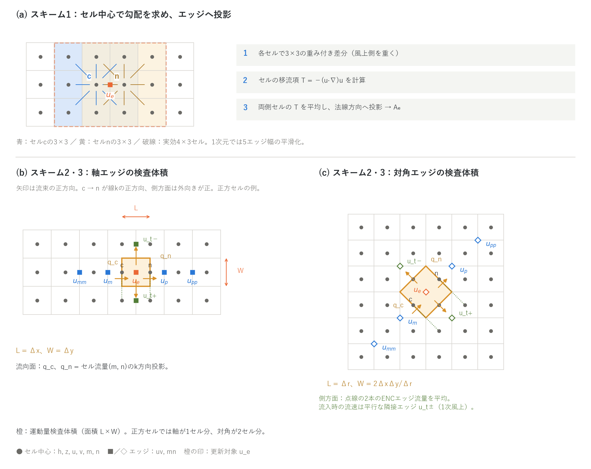
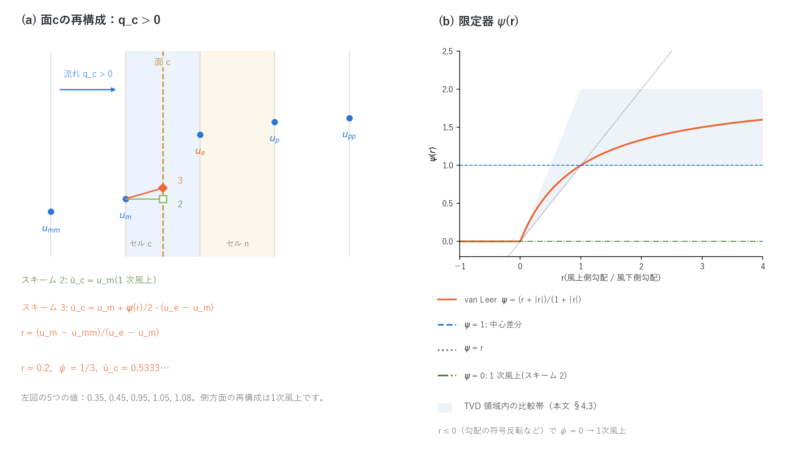

# 移流項のスキーム(浅水流計算の補足)

[浅水流計算の章へ](swflow.md) | [ユーザーガイド目次へ](../users_guide.md)

浅水流計算の運動方程式のうち、移流項(慣性項)をどう離散化して
いるかの解説です。[浅水流計算の章](swflow.md)の `f_advection_scheme`・
`p_adv_upwind_index`・`f_advection_donor` の背後にある方程式・スキーム・
ステンシルを、設定の意味がわかる程度に説明します。設計の経緯と数値
実験の記録(開発者向け)は docs/developer.md §68 にあります。

定式化の詳説(検査体積の幾何、1 次元の整合性、斜め副格子モードと側方面の
改定、検証と未解決点)は [advection_design.md](../advection_design.md) に
まとめています。

## 1. 方程式と移流項の位置づけ

ENCflow が解く平面 2 次元の浅水方程式は、連続式と運動方程式です
($`h`$: 水深、$`z`$: 地盤高、$`\mathbf{u} = (u, v)`$: 水深平均流速、
$`n`$: Manning の粗度係数)。

```math
\frac{\partial h}{\partial t} + \nabla\cdot(h\mathbf{u}) = 0
```

```math
\frac{\partial \mathbf{u}}{\partial t}
+ \underbrace{(\mathbf{u}\cdot\nabla)\,\mathbf{u}}_{\text{移流項}}
= -\,g\,\nabla(z + h)
\;-\; \frac{g\,n^2\,|\mathbf{u}|}{h^{4/3}}\,\mathbf{u}
\;+\;\cdots
```

右辺は圧力(水面勾配)項と摩擦項で、ほかに抗力・拡散・非静水圧などの
項が設定に応じて加わります。移流項は「流れが自分自身の運動量を運ぶ」
項で、段波・跳水・急縮急拡・屈曲・合流など、流速が空間的に変わる場所で
効きます。緩やかな斜面流や広域の氾濫では寄与が小さく、拡散波近似
(`f_govequation = 1`)ではこの項を落とします。

同じ運動方程式は、連続式と組み合わせると**保存形**(運動量流束の形)
にも書けます。

```math
\frac{\partial (h\mathbf{u})}{\partial t}
+ \nabla\cdot(h\,\mathbf{u}\otimes\mathbf{u})
= -\,g\,h\,\nabla(z + h) \;-\;\cdots
```

滑らかな流れでは両者は同じものですが、**不連続(段波・跳水)では
保存形だけが正しい跳びの条件(Rankine–Hugoniot 条件)を与えます**。
移流項を非保存形 $`(\mathbf{u}\cdot\nabla)\mathbf{u}`$ のまま差分化すると
不連続を横切るときに運動量が失われ、段波が遅れて背後に振動が出ます。
これがスキーム 1 と 2・3 の違いの本質です(§3、§4)。

**ENC 格子での更新式。** ENC 格子はエッジの法線流速 $`u_e`$ を未知数に
します。基準セル $`c`$ から $`k`$ 近傍セル $`n`$ へ向かうエッジ $`e`$(法線
$`\mathbf{n}_k`$、セル中心間距離 $`L_k`$)の更新は、摩擦項を半陰的に扱う
次の形です。

```math
u_e^{\,n+1} = \frac{u_e^{\,n} + \left(A_e + G_e\right)\Delta t}{1 - F_e\,\Delta t},
\qquad
G_e = -\,g\,\frac{\eta_n - \eta_c}{L_k}
```

$`G_e`$ は水面 $`\eta = z + h`$ の勾配による圧力項、$`F_e \le 0`$ は摩擦・
抗力の係数、そして $`A_e`$ が**本書の主題である移流項**
$`-\left[(\mathbf{u}\cdot\nabla)\mathbf{u}\right]\cdot\mathbf{n}_k`$ の
エッジ $`e`$ での離散値です。$`A_e`$ は時刻 $`n`$ の量だけからステップの
先頭で全エッジぶんを前計算し、適応的ルンゲクッタの再計算段でもその
値に固定します(流速比で縮尺する方式・アフィン更新は試行のうえ不採用。
developer.md §68.19, §68.23)。

## 2. ENC 格子の配置(復習)

[浅水流計算の章](swflow.md)の図 (a) のとおり、セル中心に水深 $`h`$ と
地盤高 $`z`$、周囲 8 セル(軸 4 方向・対角 4 方向)へのエッジに法線流速
$`uv`$ と単位幅流量 $`mn`$ を置きます。移流項の説明に使う量は次の 3 つです。

| 記号 | 位置 | 意味 |
|---|---|---|
| $`u_e`$(配列 uv) | エッジ | 法線流速。基準セルから近傍へ向かう向きが正 |
| $`q_c = (m_c, n_c)`$(配列 m, n) | セル中心 | セル平均の単位幅流量。連続式が見る流量と同じ定義で、エッジ流量 $`mn`$ を幾何重みで合成したもの |
| $`\mathbf{u}_c = (u_c, v_c)`$(配列 u, v) | セル中心 | セル流速。エッジ流速を幾何重みで合成して再構成したもの |

エッジ $`k`$ の幾何は、セル中心間距離 $`L_k`$(軸: $`\Delta x`$ または
$`\Delta y`$、対角: $`\Delta r = \sqrt{\Delta x^2 + \Delta y^2}`$)と単位法線
$`\mathbf{n}_k = (n^x_k, n^y_k)`$ で表します。1 次元に落とすと、再構成した
セル流速は `p_diagratio` によらず厳密に両側エッジの平均
$`u_c = (u_{i-1/2} + u_{i+1/2})/2`$ になります。スキーム 1 の性質
(§3)はこの事実から出ます。

## 3. スキーム 1: セル中心勾配(非保存形。旧既定)



**図：移流項のステンシルと検査体積。** (a) はスキーム1のセル中心勾配とエッジへの投影、(b)(c) はスキーム2・3の軸・対角エッジです。橙の領域が運動量検査体積、橙の印が更新対象です。矢印は流束の正方向を表し、流向面は c → n、側方面は外向きを正とします。点線は側方流束の平均に使う2本のENCエッジで、緑の印は流入時の供給元となる平行エッジです。正方セルでは検査体積の面積はそれぞれ1セル分、2セル分です。

**(a)** がスキーム 1 のステンシルです。3 段階で計算します。

**(1) セル中心の勾配。** 湿潤な各セル $`c`$ で、8 近傍との差分を重み付き
平均して $`\nabla u`$ と $`\nabla v`$ を作ります($`x`$ 微分の例。$`\delta i_k \in \{-1, 0, 1\}`$ は近傍 $`k`$ の $`i`$ 方向オフセット)。

```math
\left.\frac{\partial u}{\partial x}\right|_c
\approx \frac{\displaystyle\sum_{k=1}^{8} w_k\,(u_k - u_c)\,\frac{\delta i_k}{\Delta x}}
{\displaystyle\sum_{k=1}^{8} w_k},
\qquad
w_k = w^{x}_k\;\omega_k\;\chi_k
```

$`w^x_k`$ は軸・対角の幾何重み(通過幅シェア)、$`\chi_k`$ は近傍が有効かつ
湿潤なら 1、さもなければ 0(乾燥セル・領域外は差分から外す)、
$`\omega_k`$ が**風上化の重み**です。

```math
\omega_k = \max\!\left(1 - \frac{p}{2}\,\bigl(1 - \hat w_k\bigr),\; 0\right),
\qquad
\hat w_k = -\,\frac{\mathbf{u}_c\cdot\mathbf{n}_k}{|\mathbf{u}_c|}\in[-1, 1]
```

$`p`$ が `p_adv_upwind_index` です。風上側の近傍($`\hat w_k = 1`$)は常に
重み 1、風下側($`\hat w_k = -1`$)は重み $`1 - p`$ になります。$`p = 0`$ で
対称な中心差分、$`p = 1`$ で風下側を使わない片側(1 次風上)差分です
(既定 0.5 はその中間)。流速には有効慣性係数 $`\ell_m`$(建物空隙率
`gv` から導く係数。[地理情報](geoinfo.md))を乗じた $`u\,\ell_m`$ を使います。

**(2) セルの移流項。**

```math
\mathbf{T}_c = -\left(
u_c\frac{\partial u}{\partial x} + v_c\frac{\partial u}{\partial y},\;
u_c\frac{\partial v}{\partial x} + v_c\frac{\partial v}{\partial y}
\right)
```

**(3) エッジへの投影。** 両側セルの平均を法線方向に投影します。

```math
A_e = \tfrac{1}{2}\left(\mathbf{T}_c + \mathbf{T}_n\right)\cdot\mathbf{n}_k
```

**性質。**

- **非保存形。** 運動量流束として書かれていないため、不連続で運動量を
  失います。湿潤床のダム破壊(Stoker の解析解[^stoker57]。[test/dambreak](../../test/dambreak/README.md))で段波
  位置が 15% 遅れ、段波背後に 3 m の過剰(2Δx の振動)と、ダム位置に
  静止したこぶが出ます。風上化を強める($`p \to 1`$)ほど遅れは増えます。
- **5 エッジ幅の平滑化。** セル流速は両側エッジの平均なので、
  「中心 → 勾配 → 両側平均」の連鎖は、エッジ上のコンパクトな中心差分
  $`(u_{e+1} - u_{e-1})/2L`$ に比べて $`\cos^2(\kappa L/2)`$ 倍だけ余計に
  減衰した微分になります(波長 $`4L`$ で 0.5、$`8L`$ で 0.85)。短波の移流項が
  半減するため、風上化の有無によらず波形は鈍ります。実効ステンシルは
  図 (a) の破線 4×3 セルです。
- **実地形で格子に収束しない。** 段差の連なる河床では段差ごとの散逸が
  不足し、格子を細かくするほど流出が速く大きくなります(§5 の表)。
- 旧版で校正したケースの再現用に残してあります。新しい計算では既定の
  スキーム 3 を使ってください。

## 4. スキーム 2・3: 運動量保存形

### 4.1 考え方 — エッジ周りの運動量検査体積

スタガード配置でも、エッジ $`e`$ の周りに検査体積 $`\Omega_e`$ を取り、
保存形の運動方程式をその上で積分すれば、移流項を「面を通る運動量流束」
として書けます(Stelling & Duinmeijer のスタガード保存形スキーム[^sd03]を
ENC の 8 方向に拡張したものです)。

```math
\frac{d}{dt}\int_{\Omega_e} h\,u\;dA
\;+\;\oint_{\partial\Omega_e} u\,\bigl(h\mathbf{u}\cdot\mathbf{n}\bigr)\,ds
\;=\;\cdots
```

ここから、同じ検査体積での連続式に $`u_e`$ を掛けたもの

```math
u_e\left[\frac{d}{dt}\int_{\Omega_e} h\;dA
+ \oint_{\partial\Omega_e}\bigl(h\mathbf{u}\cdot\mathbf{n}\bigr)\,ds\right] = 0
```

を引くと、面 $`f`$ を通る質量流束 $`Q_f`$(外向き正)と、その面を運ばれる
流速 $`\bar u_f`$ による非保存形の等価な表現が得られます。

```math
\boxed{\;
A_e = -\,\frac{1}{\bar h_e\,L_k\,W_k}\,\sum_{f}\,Q_f\,\bigl(\bar u_f - u_e\bigr)
\;}
```

$`\bar h_e`$ は検査体積の水深、$`L_k W_k`$ はその面積です。この形には
2 つの利点があります。

- **離散的に運動量が保存する。** 連続式と同じ質量流束 $`Q_f`$ を使うので、
  全エッジで足し上げると面の流束が打ち消し合い、不連続を横切っても
  運動量を失いません。Riemann 解法なしに、全フルード数で段波・跳水の
  速度が正しく出ます(SWASH・D-Flow FM・3Di が採用)[^sd03]。
- **向きが直感的。** 1 次風上($`\bar u_f`$ = 流入側の流速)では、流出面は
  $`\bar u_f = u_e`$ で寄与 0、流入面だけが「流入してくる水の流速との差」
  の分だけ $`u_e`$ を引き寄せます。壁や乾いた床からは何も流入しない
  (§4.4)ので、そこからの寄与も 0 です。

### 4.2 検査体積と面(図 (b)(c))

検査体積は、エッジ $`e`$ を中心に、線 $`k`$ 方向の長さ $`L_k`$(セル $`c`$ の
中心から $`n`$ の中心まで)、横断方向の幅 $`W_k`$(平行な隣接リンクとの
垂直距離)の長方形です。

| エッジ | $`L_k`$ | $`W_k`$ | 面積 $`L_k W_k`$(正方セル) |
|---|---|---|---|
| 軸($`x`$ 法線) | $`\Delta x`$ | $`\Delta y`$ | セル 1 個分 |
| 軸($`y`$ 法線) | $`\Delta y`$ | $`\Delta x`$ | セル 1 個分 |
| 対角 | $`\Delta r`$ | $`\Delta x\Delta y/\Delta r`$ | セル 1 個分(c, n は流向面の中央) |

対角エッジに平行な斜めリンクは、横断方向に $`\Delta x\Delta y/\Delta r`$
(正方セルで $`\Delta x/\sqrt2`$)間隔で、$`i+j`$ の偶奇が交互に並びます。
幅 $`W_k`$ はこの間隔です(2026-10-17 まで同じ偶奇のリンクまでの距離
$`2\Delta x\Delta y/\Delta r`$ を幅にしていました。§5 の既知の性質を参照)。

面は 4 つで、それぞれの質量流束は次のように取ります(単位幅流量 $`q`$ に
面の長さを掛けたものが $`Q_f`$)。

- **流向面 $`c`$, $`n`$**(セル中心を通り、法線 $`\mathbf{n}_k`$ の面):
  セル流量を線 $`k`$ 方向に投影した
  $`q_c = m_c\,n^x_k + n_c\,n^y_k`$、$`q_n`$ も同様。$`Q = q\,W_k`$。
  ENC の連続式が見るセル平均流量そのものなので、1 次元では S&D の
  「線上 2 エッジの平均」に一致します。
- **側方面 $`\pm t`$**(線 $`k`$ に平行な面):
  面を横切る 2 本の ENC エッジ(c → c+δ、n → n+δ。図 (c) の点線)の
  実流量 $`mn`$ の平均 $`q_{t\pm}`$(流出が正)。$`Q = q_{t\pm}\,L_k`$。
  流入面の風上流速 $`\bar u_{t\pm}`$ は、軸エッジでは平行な隣接エッジの値、
  対角エッジでは面の前後にある反対偶奇の平行リンク 2 本の平均です
  (2 本揃わない面は壁面と同じ扱い $`\bar u_t = u_e`$)。
  面中心のセル流量を投影する方式は、地形で遮られて実際には水が通らない
  面でも非ゼロになり、薄い検査体積で $`1/\bar h_e`$ 倍に増幅された移流項が
  発散を起こしたため、実流量に改めてあります(developer.md §68.21)。

実装している式はこれを展開した次の形です($`q_c`$ は $`c \to n`$ 向きが正、
$`q_{t\pm}`$ は流出が正)。

```math
A_e = -\,\frac{\ell_m}{\bar h_e}\left[
\frac{q_n\,(\bar u_n - u_e) - q_c\,(\bar u_c - u_e)}{L_k}
+ \frac{q_{t+}\,(\bar u_{t+} - u_e) + q_{t-}\,(\bar u_{t-} - u_e)}{W_k}
\right],
\qquad
\bar h_e = \max\!\left(\frac{h_c + h_n}{2},\;\frac{dd}{2}\right)
```

$`\bar h_e`$ は時刻 $`n`$ の値です(ENC は「運動方程式 → 連続式」の順で
解くため $`h^{n+1}`$ は未知。前ステップ流量で外挿した $`\bar h^{n+1}`$ で
割る案は段波速度を却って悪化させました)。サブグリッド河道
([河道](channel.md))では $`h`$ の代わりにセルの単位面積あたり水量
($`h \times`$ 河道幅率、断面形 σ 有効時は換算水深)を使い、$`q`$ との
整合を保ちます。$`\ell_m`$ はスキーム 1 と同じ有効慣性係数です。

### 4.3 面の流速 — 1 次風上(スキーム 2)と MUSCL(スキーム 3)



**図：流向面の再構成と限定器。** (a) は面cへ流入する場合の1次風上（2）とMUSCL（3）です。5つのエッジ値は 0.35, 0.45, 0.95, 1.05, 1.08 で、面cでは r = 0.2、ψ = 1/3 となります。(b) は van Leer 限定器と比較用の ψ = 0, 1, r。薄青は r ≥ 0 における min(r, 1) と min(2r, 2) の間の比較帯です。側方面には1次風上を使います。

流向面の $`\bar u`$ は、線 $`k`$ 上に並ぶ 5 本のエッジ流速
$`u_{mm}, u_m, u_e, u_p, u_{pp}`$(検査体積図 (b)(c) の線k上の印)から、面を
横切る向きの**風上側**を取ります。面 $`c`$ を例にすると:

| 面 $`c`$ の流れ | 風上値 $`u_\mathrm{up}`$ | 風下値 $`u_\mathrm{dn}`$ | さらに風上 $`u_\mathrm{upup}`$ |
|---|---|---|---|
| $`q_c \ge 0`$(検査体積へ流入) | $`u_m`$ | $`u_e`$ | $`u_{mm}`$ |
| $`q_c < 0`$(検査体積から流出) | $`u_e`$ | $`u_m`$ | $`u_p`$ |

面 $`n`$ も対称です。これら 3 値から面値を再構成します。

```math
\bar u =
\begin{cases}
u_\mathrm{up} & \text{スキーム 2(1 次風上)}\\[4pt]
u_\mathrm{up} + \dfrac{\psi(r)}{2}\,\bigl(u_\mathrm{dn} - u_\mathrm{up}\bigr),
\quad r = \dfrac{u_\mathrm{up} - u_\mathrm{upup}}{u_\mathrm{dn} - u_\mathrm{up}}
& \text{スキーム 3(MUSCL)}
\end{cases}
```

```math
\psi(r) = \frac{r + |r|}{1 + |r|}\quad\text{(van Leer)}
```

限定器 $`\psi`$ は van Leer のもの[^vanleer79]で、図 (b) の曲線です。$`r = 1`$(勾配が一様)で $`\psi = 1`$
となり $`\bar u = (u_\mathrm{up} + u_\mathrm{dn})/2`$ の中心差分(2 次精度)、
$`r \le 0`$(勾配の符号反転など)で $`\psi = 0`$ となり 1 次風上に退化します。
曲線は Sweby の TVD 領域[^sweby84]内にあり、1次元TVDスキームの設計に沿って
極値付近の勾配を抑えます。図の薄青はその領域内の比較帯です。スキーム 2 と 3 は面値の 1 行だけが
違い、他の経路は共通です。

側方面の $`\bar u`$ は 1 次風上です。流入($`q_t < 0`$)なら平行な隣接
エッジの流速 $`u_{t\pm}`$(検査体積図の緑)、流出なら $`u_e`$(寄与 0)。

### 4.4 壁・乾燥セル・境界の扱い

- **壁・乾床は運動量を供給しない。** 風上側の供給元セルが領域外・無効
  (マスク外)または乾燥($`h < dd`$)なら、その面の $`\bar u = u_e`$ とし
  寄与 0 にします。格納値の 0 をそのまま読むと「壁側から流速 0 の水が
  流入する」扱いになり、1 セル幅のラスタ河道では屈曲 1 回あたり約
  0.55 m の人工的な損失水頭が生じます(developer.md §68.8、[test/bendloss](../../test/bendloss/README.md) の屈曲ケース)。
- **海セル(潮位規定境界)も運動量を供給しない。** 海域マスク(fn_sw)の
  セルは水位を強制される側で、見かけ水柱 hsea0 と流束 0 は実際の水柱・
  流束と無関係です。海セルに接するエッジは規定境界と同じく側方の運動量
  供給なし、海セルは供給元にも MUSCL の遠い供給元にも使いません
  (developer.md §68.35。hsea0 が沖の水深と大きく違う構成で海陸エッジの
  流速が陸側の数倍になり正帰還で発散した実バグの修正)。
- **区間流入の面を持つ外縁セルから区間の内側へ向かうエッジも移流項を持たない。**
  [区間流入](boundary.md#区間流入list_bound_inflow)の法線面を持つセル
  (閉じた角セルを含む)は、規定面が通過幅 0.414 dx の法線面に区間の全量を
  通す(単位幅流量がセル平均の 2.4 倍)うえに枠外の斜めリンクを欠くので、
  そのセル平均流量は検査体積の面流束として整合しません。このセルから区間の
  内側へ向かうエッジ(流入面から内側への法線エッジと、区間の幅の中の斜め
  エッジ)は移流項を 0 にします(developer.md §68.40。壁に挟まれた奇数幅の
  直線河道で、角セルの閉鎖により中央に集中した流入が境界行の移流項と結合して
  5 分周期の流量振動を自励した実挙動の修正)。流入面に沿うエッジ(両端とも
  流入セル)と、区間の両端から区間の外へ出るエッジは移流項を残します。
  移流項のないエッジの流速は水面勾配と摩擦の釣り合いに向かうので、区間の
  端から横の低いセルへ落ちる流れがエネルギー保存の許す流速を超えるためです
  (2026-10-24〜29 は流入セルに接するエッジをすべて 0 にしていて、容量給砂で
  流入セルの河床を固定した examples/meander の param_feed が、横の外縁セルの
  掘れと噴流の正帰還で止まりました。[test/inflowadv](../../test/inflowadv/README.md))。
  まっすぐな流入面に一様に流れ込む構成では面に沿うエッジの流速が 0 なので、
  等流・洪水波の結果はほとんど変わりません。
- **区間の内側へ向かうエッジの流速はエネルギー水頭で頭打ちする。** 移流項の
  ないこのエッジの流速は、上流側セルのエネルギー水頭から許される速さ
  $`\sqrt{2g\max(E_\mathrm{up} - \eta_\mathrm{dn}, 0)}`$($`E_\mathrm{up} = \eta + V^2/2g`$、
  $`V`$ は上流側セルの速さ、$`\eta`$ は水位。土石流では $`z + h + h_s`$)を
  超えないようにし、流量も同じ比で縮めます(損失を入れない Bernoulli の上限。
  developer.md §68.40 の改定 2)。これがないと緩勾配の河道で流入直下に射流の
  ジェットが立ち、エネルギー水頭を作ります(壁に挟まれた幅 3 列の河道で水深
  1.0〜1.3 m・13 m/s。等流は 4.7 m・3.0 m/s)。流入面の流量の等流が射流になる
  急勾配の流入セル(Manning の等流水深が限界水深を下回る)では、供給流速
  (流入面の流量をセル幅・水深あたりにした値)も上流側の速さに数え、射流の
  流入を絞りにくくします。供給流量のない流入セル(nodata・壁の角に接して閉じた
  セル)はセルの速さだけで頭打ちするので、急勾配の流入口の近くが 1 割ほど深く
  出ることがあります。上限は流入口の近くでほぼ常に効くので、区間流入のある
  計算の流入口付近の結果はこの規則に依ります。流入は区間に入る最初のエッジで勢いを
  持たないため、横へ広がる傾向も残ります。調べたい区間は流入区間から離して
  置くのが安全です([test/inflowadv](../../test/inflowadv/README.md))。
- **MUSCL の遠い供給元。** $`u_\mathrm{upup}`$ のエッジの向こうのセルが
  領域外・無効なら、その面は 1 次風上に退化します(0 を読むと
  $`r \gg 1 \to \psi = 2`$ の反拡散になり、規定境界から流れ出す最初の
  エッジが発散する。§69.9)。
- **河道セルへの供給元の限定(`f_advection_donor = 1`)。** 河道マスク
  (`fn_rw`)の河道セル同士のエッジでは、流向面の供給元を河道セルに
  限ります(非河道セルが供給元になる面は $`\bar u = u_e`$)。屈曲・合流・
  不規則な 2 セル幅で線 $`k`$ 上の風上エッジが浸水した谷底・斜面セルに
  落ち、その遅い水が供給元になって減速が積み重なる人工損失を防ぎます。
  側方面は対象外(斜面からの横流入による減速は物理なので残す)。
  本流と浸水谷底の運動量交換を切る操作でもあるため、既定 0 で、妥当性は
  実測との照合で判断してください(§68.18)。
- **除外するエッジ。** 運動方程式と同じ条件(近傍が無効・通過幅ゼロ・
  両側乾燥)のエッジは $`A_e = 0`$。`f_channel_advection = 0` なら河道
  セルを含むエッジでも落とします([河道](channel.md))。

### 4.5 時間積分・ステンシル・並列

- 入力はすべて時刻 $`n`$ の値(エッジ流速 $`uv`$、セル流量 $`m, n`$、水深
  $`h`$)。ステップ先頭で全エッジぶんを配列に前計算し、運動方程式は読む
  だけです。
- ステンシルは線 $`k`$ 方向に ±2 エッジ、横断方向に ±1 エッジ。MPI の
  帯分割では、ステップ先頭の交換を $`uv`$ はエッジ幅 2、$`m, n`$ はセル幅 2
  で行います(スキーム 1 では行わず、通信・メモリの追加はゼロ)。
  ランク数によらず結果はビット単位で同一です([並列実行](parallel.md))。
- 対角エッジも軸エッジと同じ式です。1 次元・一様流の極限で両者の
  更新式は同形になり、対角エッジ流速が軸エッジ流速の投影
  $`u_d = u_a\,n^x_k`$ である関係を保ちます。
- 計算コストはスキーム 1 に対して 2 が +12〜20%、3 が +19〜27%
  (エッジごとに線上 5 本+側方 2 本の読み出しと、ステップ先頭の交換。
  [test/dambreak](../../test/dambreak/README.md)・[test/wave](../../test/wave/README.md)・[test/chichibu](../../test/chichibu/README.md) の壁時計)。
  メモリは同程度です。

## 5. 性質の比較と使い分け

developer.md §68 の数値実験(2026-10)の要点です。

| | スキーム 1 | スキーム 2 | スキーム 3(既定) |
|---|---|---|---|
| 定式化 | セル中心 $`(\mathbf{u}\cdot\nabla)\mathbf{u}`$(非保存形)。両側平均 | 運動量保存形、面値 1 次風上 | 運動量保存形+MUSCL(van Leer) |
| 風上化 | `p_adv_upwind_index`(弱い風上化。鈍りの主因は両側平均) | 完全 1 次風上 | 滑らかな所は中心差分相当、極値・不連続で風上 |
| 段波(Stoker)の位置誤差 / 背後の過剰 | −15.5% / 3.2 m | +0.5% / 0.8 m | +1.1% / 0.04 m |
| 滑らかな洪水波(1 セル水路、3.8 km ピーク) | 176.5 | 176.5 | 176.5(3 者同一) |
| 横流入のある空間変化流(物理解との水深比) | 1.7〜2.0(運動量の吸い込みがなく超臨界が亜臨界化) | 3 とほぼ同じ | 0.992 |
| 実地形(chichibu)の格子収束 500 → 50 m | 流出が増え続け、50 m で発散 | 3 とほぼ同じ | 収束 |
| 安定性 | 50 m 実 DEM・掘込 1〜2 セル水路で発散 | 風上化が安定性を担う | 同左 |
| コスト | 1.00 | 1.19 | 1.27 |
| 位置づけ | 旧互換・既存校正の再現用 | 3 の退避先(段波先端の過剰を許容できる粗い問題) | **既定**。段波・跳水・横流入・収束性・安定性のすべてで最良 |

表の数値の出典: 段波は [test/dambreak](../../test/dambreak/README.md)、滑らかな洪水波・横流入・
階段状河床は [test/bendloss](../../test/bendloss/README.md)、実地形の格子収束・安定性・コストは
[test/chichibu](../../test/chichibu/README.md)、斜面流での一致は [test/hillslope](../../test/hillslope/README.md)(いずれも
README に図表と派生ケースの一覧)。

**使い分けの目安。**

- 段波・跳水・津波の遡上、不連続を含む流れ: 既定(3)。
- 実 DEM の流域降雨流出(河道マスクあり): 3 + `f_opening_dynamic = 2`
  + `f_dry_head_cap = 1`(既定)。観測より遅い・小さいなら
  `f_advection_donor = 1` を試す。スキーム 1 で校正した粗度は再校正。
- 河道マスクのない氾濫・掘込地形・ダム破壊: 既定のまま(3 +
  `f_opening_dynamic = 2`。2026-10-18 までは 2 の明示が必要だった)。
  湿潤床の段波先端を鋭く出したいときだけ `f_hcap_upwind = 2`。
- 滑らかな斜面流・運動学的波、粗い格子(≥ 500 m): 1 と 3 は数 % 以内で
  一致。一貫性のため 3。
- 旧版で校正したケースの再現: `f_advection_scheme = 1`、
  `f_opening_dynamic = 0`、`f_dry_head_cap = 0`(2026-10-03 以前の既定)。

**移流項と組み合わせて効く周辺のスイッチ。** いずれも
[浅水流計算の章](swflow.md)に一覧があります。

- `f_opening_dynamic`: 1 セル幅河道や壁沿いでは、塞がれた斜め方向の
  通過幅のぶん軸エッジの流速がセル流速の約 2.4 倍になり、移流項の
  加減速(特にスキーム 3)が増幅されます。塞がれた配分を開いたエッジへ
  振り替えて、これを除きます。急勾配・浅い流れでは、既定の 2 が一様な
  斜面の上流側の地盤も塞がりと数えて流れを速くするので、3(塞がりを
  局所の平面から測る)を使います。
- `f_dry_head_cap`: 圧力項は「水面より高い乾いた地盤へ水が登る」ことを
  止めますが、移流項が勝つと段波先端や掘込水路で水が堤内地へ漏れる
  ことがあります。乾燥セルへ向かうエッジ水深をエネルギー頭で頭打ちして
  防ぎます。
- `f_hcap_upwind = 2`: スキーム 2・3 では、連続式のエッジ水深
  $`h_e = (h_c + h_n)/2`$ が段波先端で小さくなり、前線の 1 セルに水が
  積み上がるスパイクが出ることがあります。エッジ水深を風上側水深に
  すると消えますが、乾床への前縁流出が増えます。

**斜め副格子モード(2026-10-13 発見、10-17 解消。developer.md §68.36)。**
ENC の斜めリンクは $`i+j`$ の偶奇が同じセル同士だけを結びます。保存形
スキームの対角エッジの側方面を同じ偶奇の平行リンク(距離 $`\sqrt2\Delta x`$)
で評価していた間は、偶数・奇数の副格子で逆回転する斜め循環(発散ゼロで
圧力項も効かない)に移流項が作用せず、深くて遅い滞留域に流速の市松模様
(相対振幅 0.4〜0.6)が残って、閾値型の堆積判定(瓦礫・流木の `vstop`)や
最大流体力に転写されていました。側方面の幅を反対偶奇のリンクまでの
$`\Delta x/\sqrt2`$ にし、その 2 本の平均を風上値にした現行では、このモードは
背景流の流束で減衰します([test/sublattice](../../test/sublattice/README.md):
背景の渦に重ねた副格子モードの e-folding 時間が 1094 s → 88 s、
tsunami_town 沖合の市松 0.43 → 0.01)。滑らかな場では主要項が変わらない
ため、段波(Stoker)・等流・屈曲損失の検証値は不変です。

### パラメータと既定値の根拠

根拠欄の分類語の意味は[既定値の根拠の読み方](../users_guide.md#既定値の根拠の読み方)を参照してください。

| パラメータ | 既定 | 意味 | 根拠 |
|---|---:|---|---|
| f_advection_scheme | 3 | 移流項のスキーム(1: セル中心勾配、2: 保存形+1 次風上、3: 保存形+MUSCL) | **検証ケース** [test/dambreak](../../test/dambreak/README.md) の段波位置誤差 +1.1%、[test/bendloss](../../test/bendloss/README.md) の横流入の水深比 0.992、[test/chichibu](../../test/chichibu/README.md) の格子収束(上の表) |
| p_adv_upwind_index | 0.5 | スキーム 1 の風上化指数(0: 中心差分、1: 1 次風上) | **経験値** 中心差分と 1 次風上の中間。段波の遅れは $`p`$ とともに増える(§3) |
| f_advection_donor | 0 | 河道セル同士のエッジで流向面の供給元を河道セルに限る | **方式** 既定は無効。本流と浸水谷底の運動量交換を切るため、実測との照合で判断する(§4.4) |
| 限定器 $`\psi`$(固定) | van Leer | スキーム 3 の流束限定器 | **文献値** van Leer[^vanleer79]。Sweby の TVD 領域内(§4.3)[^sweby84] |
| f_scalar_scheme | 3 | スカラー輸送(浮遊砂・水質・塩水層・流木・瓦礫)の面値(1: 1 次風上、3: リンクごとの MUSCL) | **検証ケース** [test/tracer](../../test/tracer/README.md) の数値拡散の計測(縦断 D が 1/3〜1/5、横断 Dy が 1/14。§7)。1 次の数値拡散は格子幅に比例するため既定にしない |

## 6. 検証ケース

- **[test/dambreak](../../test/dambreak/README.md)** — Stoker の湿潤床ダム破壊(平坦・無摩擦。
  $`h_l = 10`$ m、$`h_r = 1`$ m)。段波位置・中間状態の水深と流速・L1 誤差を
  解析解と比較します(`Check_stoker.py`)。§5 の段波の行の出典。
- **[test/bendloss](../../test/bendloss/README.md)** — 1 セル幅水路の直線 vs 折れ線(屈曲損失)、階段状
  河床(段差での散逸)、横流入(空間変化流の物理解)。README にケース
  一覧があります。
- **[test/hillslope](../../test/hillslope/README.md)** — 滑らかな斜面・V 字集水域。スキーム 1 と 3 が
  一致することの確認。
- **[test/chichibu](../../test/chichibu/README.md)** — 実地形(100 m)。格子収束と実測との照合の場。
- **[test/wave](../../test/wave/README.md)** — 静水に立てた水の山の拡がり(無摩擦の閉水槽)。
  回帰テストの基準ケースで、スキームを変えたときの最大水深・最大流速の
  感度(0.1〜0.5%)と 4 回対称の維持を見ます。

**参考になる例題・チュートリアル**

- [tutorials/wave](../../tutorials/wave/README.md) / [tutorials/chichibu](../../tutorials/chichibu/README.md) — 利用者向けの
  手順。時間刻み・適応的ルンゲクッタの感度の見方と、実地形ケースの
  組み立て方。
- [examples/List_samples/list_enc.txt](../../examples/List_samples/list_enc.txt) —
  `&list_enc` の全パラメータの注釈付き一覧(既定値の明示)。

## 7. スカラー輸送の移流スキーム(f_scalar_scheme)

浮遊砂・水質・塩水層・流木・瓦礫の柱状量は、流れの移流項とは別の
保存輸送カーネル(`advect_scalar`)で運ばれます。各ステップの連続式と
同じエッジ流量 $`m_e`$ に面の体積濃度 $`c_{face}`$ を掛けた流束形式で、
質量は機械精度で保存され、一様濃度は一様のままです。面値の取り方が
スキームです。

- **f_scalar_scheme = 1(旧既定)**: 1 次風上。$`c_{face} = c_{up}`$(風上
  セルの体積濃度)。縦断の数値拡散 $`D \approx u\,\Delta x\,(1 - Cr)/2`$
  (浅水流の dt では Cr = uΔt/Δx が 0.1〜0.2 なので実質 $`u\Delta x/2`$)に
  加え、横断方向にも、流れがなくても 8 方向リンクの斜め配分(各 0.293)が
  両斜めの供給元の平均 = 3 点平滑化を生むため $`D_y \approx 0.29\,u\,\Delta y`$
  の数値拡散があります。
- **f_scalar_scheme = 3(既定。2026-10-13 に 1 から昇格)**: リンクごとの
  MUSCL。各リンクの向きに沿って
  風上 $`c_{up}`$・風下 $`c_{dn}`$・さらに風上 $`c_{uu}`$ の 3 点から
  $`c_{face} = c_{up} + \tfrac{1}{2}\psi(r)\,(c_{dn} - c_{up})`$、
  $`r = (c_{up} - c_{uu})/(c_{dn} - c_{up})`$、ψ = van Leer(§4.3 と同じ式)で
  再構成します。斜めリンクでも斜め方向に沿って再構成するので、横断に
  線形な濃度場では面値がリンク中点の値になり、受け手の 0.414/0.293/0.293 の
  重み付き和が中央の値に一致して横断の数値拡散の主要項も消えます。
  風下が領域外・海セル・乾燥、さらに風上のセルが無効・乾燥、境界面からの
  流入(濃度テーブル)では 1 次に退化します(壁・乾床・規定境界は濃度勾配を
  供給しない。§4.4 と同じ考え方)。

[test/tracer](../../test/tracer/README.md)(u ≈ 0.9 m/s)の計測:

| 量 | 1 次風上 | MUSCL | 比 |
|---|---:|---:|---:|
| 縦断 D(Δx 10 m、dt 1 s、Cr 0.09) | 4.3 m²/s | 1.2 m²/s | 0.28 |
| 縦断 D(Δx 10 m、dt 2 s、Cr 0.18) | 3.9 | 0.8 | 0.20 |
| 縦断 D(Δx 20 m、dt 2 s、Cr 0.09) | 8.7 | 2.6 | 0.30 |
| 横断 Dy(点源プルーム、Δy 10 m) | 2.7 | 0.19 | 0.07 |
| プルームの σy(3 km 下流) | 129 m | 38 m | |

残る縦断の拡散は、前線の両端(極値)で限定器が 1 次に退化する分です。
濃度に負値や 100 % 超えは出ません(同ケースで確認)。計算コストは
スカラー 1 種あたりカーネルが 2〜3 倍、ステップ全体では数 % です。
既定を 3 にしたのは、1 次風上の数値拡散が格子幅に比例し(横断は斜め
配分の産物)、格子を変えると答えが変わる既定は校正の土台にならない
ためです。濃度が流れに戻るプロセス(流木・瓦礫の荷重判定、土石流の
濃度依存レオロジー、水質のピーク)はピークが高く出る方向に変わるので、
既存の校正値を 1 次風上の鈍った濃度場で合わせてある場合は
`f_scalar_scheme = 1` で従来の結果に戻せます(比較・退避用。設計の
経緯と検証は developer.md §78)。地下水の同伴輸送は対象外(1 次風上の
まま)です。

## 参考文献

[^sd03]: Stelling, G. S. and Duinmeijer, S. P. A. (2003): A staggered conservative scheme for every Froude number in rapidly varied shallow water flows. *Int. J. Numer. Meth. Fluids*, 43, 1329–1354.(運動量保存形移流。SWASH・D-Flow FM・3Di が採用)
[^vanleer79]: van Leer, B. (1979): Towards the ultimate conservative difference scheme V. A second-order sequel to Godunov's method. *J. Comput. Phys.*, 32, 101–136.(MUSCL と限定器)
[^sweby84]: Sweby, P. K. (1984): High resolution schemes using flux limiters for hyperbolic conservation laws. *SIAM J. Numer. Anal.*, 21, 995–1011.(TVD 領域)
[^stoker57]: Stoker, J. J. (1957): *Water Waves*. Interscience, New York.(湿潤床ダム破壊の解析解)
