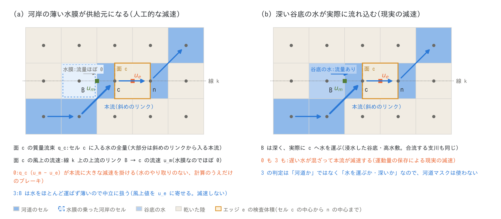
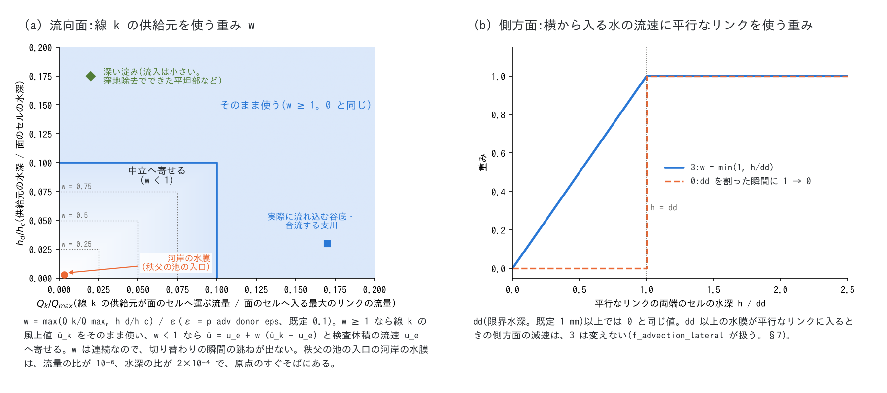
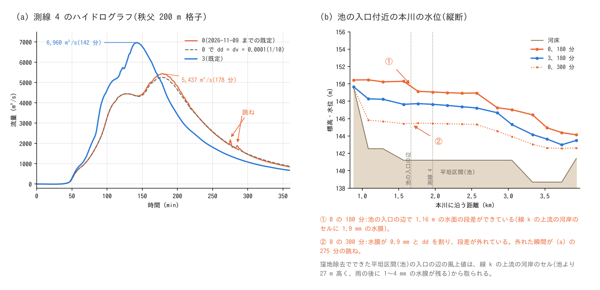
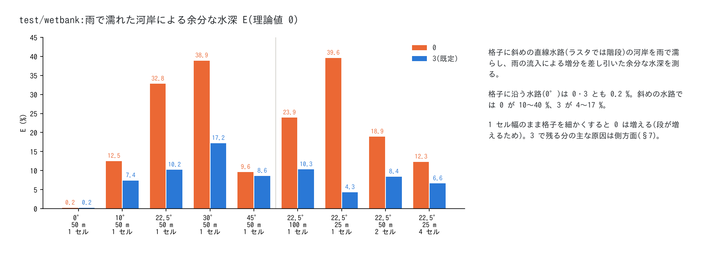

# 1 セル幅の河道と移流項の風上供給元(f_advection_donor)

[移流項のスキームへ](advection.md) | [浅水流計算の章へ](swflow.md) | [ユーザーガイド目次へ](../users_guide.md)

細い河道(幅 1 セル前後)を平面 2 次元の格子で流すときの、移流項の運動量の収支の扱いの
解説です。`&list_enc` の `f_advection_donor`(既定 3)が何をしているか、なぜ必要か、
どう確かめているかを説明します。移流項の方程式と検査体積は[移流項のスキーム](advection.md)
§4、設計と数値実験の記録(開発者向け)は docs/developer.md §102 にあります。

**要点**

- 移流項は、エッジ(セルとセルの境界)のまわりの検査体積に出入りする水が運ぶ運動量を
  数えます。遅い水が実際に本流に混ざれば、本流は減速します(合流・横流入・浸水した谷底から
  戻る水)。これは現実の減速で、ENCflow の移流項はこれを表します。
- 河道が格子に対して曲がる場所では、上流側の流速を読むリンクが、ほとんど水を運ばない河岸の
  薄い水膜に当たることがあります。対策がないと、その遅い流速が本流の全流量に掛けられて、
  実際には起きない減速(計算のうえだけのブレーキ)になります。
- 既定の `f_advection_donor = 3` は、上流側のリンクが「実際に水を運んでいるか、深いか」で
  両者を切り分け、薄くて水を運ばない供給元だけを中立に扱います。判定に河道マスクは使いません。
- 2026-11-09 より前の既定(0)で計算した結果を再現するときは、`f_advection_donor = 0` を
  明示します(§7)。

## 1. この文書の位置づけ — なぜ細い河道で問題になるか

移流項の離散化は、流れの上流側にある近くのエッジの流速(風上値)を使います。河道が格子に
沿って真っすぐ流れていれば、上流側のエッジも河道の中にあります。ところが河道が格子に対して
曲がったり斜めに走ったりすると(ラスタでは階段になる)、上流側のエッジが河岸に当たることが
あります。

この問題は ENC 格子の 8 近傍に限りません。4 近傍の構造格子や非構造格子でも、移流項が近くの
エッジやセルの流速を使う以上、同じ形で起こりえます(個々のモデルでは確かめていません)。
地形の複雑さに対して十分に細かい格子、つまり河道の幅を多くのセルで表す格子なら、上流側の
エッジが河岸に当たる場所が相対的に減り、影響は小さくなります。ただし減り方はゆっくりです。
格子に斜めの直線水路の検定(§6)では、幅 100 m の河道を 1・2・4 セルで表すと、雨で濡れた
河岸による余分な水深は 24・19・12 %(対策なしの 0)でした。

対策がないと、移流項から見た河道の解像度は、地形データの解像度(1 セル)ではなく、移流項が
値を読む範囲(ステンシル。流れの方向に 5 本、横に 3 列のエッジ)の大きさになります。1 セル幅の
河道の運動量の収支が、その範囲にある河岸のセルの流れと混ざってしまうためです。

ENCflow は、1 次元の河道モデルを別に結合する代わりに、1 セル幅の河道をそのまま移流項つきの
2 次元計算で流します([ENC 格子](encgrid.md))。そのため、ステンシルの中で水が実際にどの
セルからどのセルへ流れているかを移流項に反映する仕組みを組み込んでいます。壁や乾いたセルは
運動量を供給しない、側方面の流束は実際にその面を通るリンクの流量で数える([移流項のスキーム](advection.md)
§4.2・§4.4)、塞がれた開口の振り替え([通過幅の調整](passage_width.md))、そして本書の
`f_advection_donor` です。1 セル幅の河道の通水能を合わせる通過幅の調整と組み合わせて、
地形データの解像度をできるだけそのまま生かした計算に近づけています。ただし、取り除けて
いない人工的な減速もあります(§7)。

## 2. 現実の減速と人工的な減速

移流項(運動量保存形。[移流項のスキーム](advection.md) §4)は、エッジ e のまわりに短冊形の
検査体積を取り、その面を通って出入りする水が運ぶ運動量を数えます。面から入ってくる水の流速
(風上値)がエッジ自身の流速 $`u_e`$ より遅ければ、e の流れは減速します。

**現実の減速。** 合流部で支川の水(本川の方向の運動量をほとんど持たない)が混ざる、斜面の
雨水が横から入る、浸水した谷底や高水敷の水が本流へ戻る、といった場面で遅い水が実際に本流に
入ると、本流は減速します。運動量の保存そのもので、ENCflow の移流項はこれを含みます(横から
流入する水路で、空間変化流の解析解と 1〜2 % で一致。test/bendloss)。なお、複断面の境界で
水の出入りを伴わずに乱れのせん断で運動量が交換される分は、移流項ではなく拡散項
(`f_diffusion_term`。既定は無効。[拡散項](diffusion.md))の領分です。

**人工的な減速。** 図 1 (a) は、格子に斜めに走る 1 セル幅の河道(ラスタでは階段)です。エッジ e
(セル c と n の間)の検査体積の上流側の面 c を通る質量流束 $`q_c`$ は、セル c に入る水の全量で
数えます。大部分は、左下のセルから斜めのリンクで入る本流です。一方、その水が運ぶ流速
(風上値)は、e と同じ向きの線 k 上の上流のリンク B → c の流速 $`u_m`$ から取ります。階段の角
では B が河岸のセルになり、雨の後に残る薄い水膜の遅い流速(ほぼ 0)が、本流の全流量に掛け
られます。B からはほとんど水が入っていないのに、本流が強く減速されます。水のやり取りのない、
計算のうえだけのブレーキです。



**図 1:** (a) 河岸の水膜が線 k の供給元になる場合(人工的な減速)。(b) 同じ位置の B が深い
谷底の水で、実際に c へ流れ込む場合(現実の減速)。橙の枠はエッジ e の検査体積、緑の印は線 k の
上流のリンクの流速 $`u_m`$、橙の印はエッジの流速 $`u_e`$ です。

実地形での例は §5 の秩父です。窪地除去でできた平坦な区間(池)の入口で、河岸のセル(池より
27 m 高く、雨の後に 1〜4 mm の水膜が残る)が風上値を与え、池の水面の勾配による駆動とほぼ同じ
大きさの減速(約 0.03 m/s²)で、池の中に 1 セルで 0.6〜1.2 m の水面の段差を作っていました。

## 3. 乾湿の切り替わりで出る跳ね

河岸の水膜は雨の後ゆっくり減り、ある時点で限界水深 dd(既定 1 mm)を割ります。対策なしの 0
では、dd を割った水膜は「乾いた」扱いになって供給元から外れ、ブレーキが一度に外れて、
堰き止められていた水が放たれます。これがハイドログラフの逓減部の跳ねです(秩父の 200 m 格子の
測線 4 で、276 分に 1 分で +147 m³/s、286 分に +205 m³/s)。逓減期に多いのは、雨の後に斜面や河岸の水膜が一斉に
ゆっくり減って、あちこちで次々に dd を割るからです。

dd を小さくすると跳ねは消えますが、外れる時刻が計算の後へ延びるだけで、ブレーキは残った
ままです(ピークも堰き止められたままの値)。薄い水の乾湿の判定が隣の深い流れの計算の
スイッチになるこの構造は、乾湿のしきい値が風上値の選び方に入る 2 次元モデル一般に起こり
うるものです(一般論。個々のモデルでは確かめていません)。

## 4. `f_advection_donor = 3` の切り分け

**流向面。** 線 k の上流のリンクについて、次の 2 つの比を見ます。

- そのリンクが面のセルへ実際に運ぶ流量 $`Q_k`$ と、面のセルへ入るリンクのうち最大の流量
  $`Q_\mathrm{max}`$ の比
- 供給元のセルの水深 $`h_d`$ と、面のセルの水深 $`h_c`$ の比

どちらかが ε(`p_adv_donor_eps`。既定 0.1)以上なら、現実の供給元として線 k の風上値
$`\bar u_k`$ をそのまま使います(0 と同じ値)。どちらも ε に満たない(水をほとんど運ばず、薄い)
ときだけ、風上値をエッジ自身の流速 $`u_e`$ へ寄せます。

```math
\bar u = u_e + w\,(\bar u_k - u_e),\qquad
w = \min\!\left(1,\ \frac{\max(Q_k/Q_\mathrm{max},\ h_d/h_c)}{\varepsilon}\right)
```

w = 0 は「入ってくる水は検査体積と同じ速さ」とみなす中立の扱いで、減速も加速もしません。
他のリンクの水の流速そのものを持ち込むことはしません。w は流量と水深とともに連続に変わるので、
切り替わりの瞬間の跳ねも出ません。

既定の `f_advection_bend = 1` では、寄せる先は $`u_e`$ そのものでなく、面のセルへ実際に流入する
水がこのエッジの幅・流入時の水深で流れたときの流速から作る値 $`\bar u_p`$ です
($`\bar u = \bar u_p + w\,(\bar u_k - \bar u_p)`$。[移流項の解説](advection.md) §4.4)。経路に沿って
水深が変わらなければ $`\bar u_p = u_e`$ で、上の式と同じです。水深が変わる屈曲(池の出口、段落ちの
足元)でだけ、その分の加減速が入ります。面のセルの流出の一部しか担わないエッジ(本流の横から河岸へ
あふれるエッジ)は $`\bar u_p \approx u_e`$ のままです。`f_advection_bend = 0` は $`u_e`$ へ寄せます。

**水深の条件の理由。** 流量の割合だけで判定すると、窪地除去でできた平坦部の淀み(深いが
流入が小さい)で、割合が ε の境目を行き来して重みが 0 と 1 の間で切り替わり、区間が 2〜3 分
周期で振動しました(秩父の 100 m 格子に幅 50 m のサブグリッド河道を与えた計算)。深い淀みは
現実の供給元として扱います。

**側方面。** 横から入る水の流速には、平行な隣のリンクの値を使います。そのリンクの両端のセルが
濡れているか(水深 dd 以上か)の判定を、dd 未満では水深に比例して効き方を弱める重み
min(1, h/dd) にします。0 では水膜が dd を割った瞬間に 1 から 0 へ切り替わって跳ねるのに対し、
3 では水膜が薄くなるにつれて徐々に外れます。dd 以上の水深では 0 と同じ値です。



**図 2:** (a) 流向面の重み w。白に近いほど中立へ寄せ、青の線より外側(どちらかの比が ε 以上)
では線 k の風上値をそのまま使います。(b) 側方面の平行リンクの重み。破線は 0(dd で 1 から 0 へ
切り替わる)、実線は 3 です。

判定は「河道か否か」ではなく「水を運ぶか・深いか」なので、河道マスクは使いません。図 1 (b) の
ように、谷底や高水敷の水でも、深い、または実際に流れ込むなら、現実の供給元として残ります。
手法は ENCflow の**独自**のものです(developer.md §102)。

## 5. 実例: 秩父の流域(200 m 格子)

[チュートリアル chichibu](../../tutorials/chichibu/README.md) の Step 3 の設定(荒川上流の
秩父流域、200 m 格子、総雨量 100 mm(ピーク 200 mm/h、1 時間)の雨、損失なし)の、地盤高を
窪地除去済みの標高(`Chichibu_200m_filled.tif`)に、河道の粗度を 0.02 に替えた設定で、0 と 3 を
比べます(窪地除去でできた平坦区間があり、河岸の水膜の影響がはっきり出る設定です)。



**図 3:** (a) 測線 4(流域出口に近い本川)のハイドログラフ。(b) 測線 4 のすぐ上流の、窪地除去で
できた平坦区間(池)の入口付近の本川の水位。

- 0 では、逓減部の 275 分と 285 分に跳ねが出ます。池の入口で河岸の水膜(180 分に 1.9 mm)が
  線 k の供給元になり、池の中に 1.16 m の水面の段差を作って水を堰き止めています。水膜が dd を
  割った後(300 分に 0.9 mm)は段差が外れます。この外れる瞬間が 275 分の跳ねです。
- dd と dv を 1/10(0.0001 m)にした 0 では跳ねは出ませんが、ピークは 5,264 m³/s で、
  堰き止めは残ったままです。
- 3 では跳ねがなく、段差もできません。本川の各所の人工的な減速が外れるため、ピークは
  6,960 m³/s と 0 の 5,437 m³/s より 28 % 大きく、36 分早くなります(100 m 格子では +26 %。
  test/chichibu)。dd を 1/10 にしたときのピークの差は、0 の 173 m³/s に対して 3 では
  1 m³/s 未満です。時間刻みを 6 s から 3 s にしても、3 のピークは 0.1 % 以内で同じです。
- 0 と 3 の差には、3 のときだけ働く既定の `f_advection_lateral = 1` が、濡れた河岸による側方面の
  減速を外す分(§7)も入っています。3 に `f_advection_lateral = 0` を組み合わせた計算のピークは
  6,339 m³/s(154 分)で、0 より 17 % 大きく、24 分早くなります。既定の `f_advection_bend = 1` が
  3 の中立の扱いに経路の値を使う分(§4)は小さく、`f_advection_bend = 0` どうしでは、3 が
  6,876 m³/s、0 が 5,439 m³/s(+26 %)です。

再現するには、tutorials/chichibu の `param_step3.txt` の `fn_z` を `"Chichibu_200m_filled.tif"` に、
`rn0_rw` を 0.02 に替え、`&list_sysparam` に `fn_enc = "-"` を加え、次の `&list_enc` を足して
実行します(dd の比較は、さらに `&list_sysparam` に `dd = 0.0001` と `dv = 0.0001` を加える)。

```
&list_enc
  f_advection_donor = 0      ! 2026-11-09 までの既定
/
```

この流域には観測との照合がなく、3 の結果が現実に近いかどうかは確かめていません。3 で外れる
のは、正解のある検定(§6)で人工的とわかっている型の減速です。

## 6. どう確かめているか

- **正解のある検定(test/wetbank)。** 格子に斜めの直線水路(ラスタでは 1 セル幅の階段)の
  河岸を雨で濡らします。物理的には、河岸に降った雨は河道の流量を少し増やすだけで、河道の
  水深はその分しか変わらないはずです。雨の流入による増分を差し引いた余分な水深 E(理論値 0)は、
  格子に沿う水路ではどの構成も 0.2 %、斜めの水路では 0 が 10〜40 %、3 に `f_advection_lateral = 0` を
  組み合わせると 4〜17 %、既定の組み合わせ(3 と `f_advection_lateral = 1`)が −0.4〜3.7 % でした
  (図 4)。3 はどの形でも 0 と同じか、0 より理論値に近い値です。
- **現実の減速が残ることの確認。** test/bendloss の横から流入する水路(空間変化流の解析解と
  1〜2 % で一致)・屈曲・ジグザグの水路と、test/dambreak(ダム破壊の Stoker の解析解。3 は 0 と
  全桁一致)。湿潤前線や本流の供給元は水を運ぶか深いので、3 でも 0 と同じ値を使います。
- **副作用がないことの確認。** test/sublattice・test/uniflow・test/inflowadv・test/dbonset・
  test/sedfeed が 0 と同じく合格し、判定に使う値も 0 と同じ水準です。
- **回帰と並列。** 0 を明示すると、2026-11-09 より前の結果とビット単位で一致します。逐次と
  MPI(np = 1・2・4)の結果もビット単位で一致します。
- **実地形。** 秩父の 200・100・50 m 格子で、逓減部の跳ねが消え、dd への依存がほぼなくなる
  ことを確かめました(§5)。既定を 3 にした後、値を README に載せる例題(meander ほか 5 例題)を
  回し直しています。



**図 4:** test/wetbank の余分な水深 E。左の 5 組は 1 セル幅の水路の向き、右の 4 組は格子幅と
河道を表すセル数を変えたものです。3 本の棒は、0、3 と `f_advection_lateral = 0`、既定の組み合わせ
(3 と `f_advection_lateral = 1`)です。

## 7. 使い方と限界

- **既定のまま使えます。** 設定は不要です。しきい値 `p_adv_donor_eps`(既定 0.1)は経験値です。
  秩父の 200 m 格子の測線 4 のピークは、0.05 にすると 1.4 % 小さく、0.2 にすると 0.6 % 大きく
  なります(測線 1〜3 のピークの違いは 0.6 % 以内)。0.05〜0.2 の外は確かめていません。
- **以前の結果の再現。** 2026-11-09 より前の既定(0)で計算した結果(0 で粗度を校正したケースを
  含む)を再現するときは、`&list_sysparam` に `fn_enc = "-"` を加え、`&list_enc` で
  `f_advection_donor = 0` を明示します。
- **流れが速くなる。** 0 に比べて洪水波が速く大きくなり、Courant 数も上がります。0 で完走した
  時間刻みを下げる必要が出ることがあります(秩父の 200 m 格子に幅 50 m のサブグリッド河道を
  与えた計算は dt 6 s → 4 s)。画面の Cn_max で確かめられます。計算時間は 0 より 3 割ほど
  長くなります(秩父の 200 m 格子。3 のときだけ働く既定の `f_advection_lateral = 1` の分を含む。
  `f_advection_lateral = 0` と組み合わせた 3 は、0 より 1 割ほど長い)。
- **側方面の減速は、`f_advection_lateral` が扱う。** 横から検査体積へ入る水の流速には、面の向こうの平行な
  リンクの値を使います([移流項のスキーム](advection.md) §4.2・§4.3)。河岸のセルが dd 以上の水膜で濡れていると、
  水膜のリンクの遅い流速(ほぼ 0)が、面を横切って入る水の全量に掛かります。`f_advection_donor = 3` が側方面で
  変えるのは dd 未満の水膜の重みだけなので、`f_advection_lateral = 0`(2026-11-16 までの既定)では、この減速は
  3 でも 0 と同じに残ります(test/wetbank の 4〜17 % の主な原因)。この減速には、性質の違う 2 つが混ざっています。
  - **人工的な分。** 曲がって進む本流や、池の縁を通る本流に、水の出入りと関係のない水膜の流速が
    掛かる分です。岸が濡れているかどうかで、斜めの河道や池の水深が変わります(格子に斜めの 1 セル幅の
    水路で 4〜17 %。落差から流れ込む池では、岸のセル 1 つが薄く濡れるだけで、池の水深が 2.6 → 2.8 m
    (test/brink の合流部の池の形)、2.4 → 3.3 m(秩父の池を切り出した計算)に増えた例があります)。
    同じ地形と粗度でも、雨のある計算と、雨のない計算(上流からの流入だけ)とで、河道の抵抗が違う
    ことになります。
  - **合流で運動量が薄まる分。** 支川の水は本川の向きの運動量を持たないので、合流の上流は現実にも
    堰き上げられます。`f_advection_lateral = 0` は、岸が濡れているときだけ、この堰上げを数えます(水膜の
    リンクの流速ほぼ 0 が、「横から入る水は本川の向きの運動量を持たない」という扱いの代わりになるためで、
    意図した規則ではありません)。1 セル幅の T 字の合流(格子幅 50 m、勾配 1/500、粗度 0.03、合流後
    1,000 m³/s、本川と支川の流量比 3 通り)で、合流のすぐ上流の本川の水深は、岸が濡れていると
    運動量の理論の +0.00〜+0.21 m、岸が乾いていると −0.34〜−0.41 m(6〜7 % 浅く、損失のない流れに
    近い)でした。**0 では、岸が乾いている合流(雨のない計算など)で、合流による堰上げがほとんど出ません。**

  **既定の `f_advection_lateral = 1` は、この 2 つを分けて扱います**([移流項のスキーム](advection.md) §4.4)。
  平行なリンクが、面を横切って入る水に比べて薄い水膜のときは、その流速を使わず(人工的な分を外す)、辺の線に
  沿う流れへ別の向きから入る水には、辺の向きの運動量の不足を数えます(合流の分を、岸の濡れによらずに数える)。
  雨で濡れた岸による水深の増加(test/wetbank)は −0.4〜3.7 % になり(0 は 0.2〜17.2 %)、直角の合流の堰上げは、
  岸の濡れによらず、運動量の理論の 6〜8 割になります(test/tjunction。濡れた岸と乾いた岸の差は 0.01 m 未満。
  0 は 0.14〜1.09 m)。合流部の池の水面は定常のままです。2026-11-16 までの既定(`f_advection_lateral = 0` と
  `f_dry_head_cap = 2`)に比べて、秩父の測線 3・4 のピークは、200 m 格子で +3.3・+5.3 %(10・9 分早い)、100 m
  格子で +11.7・+9.4 %(8・16 分早い)、50 m 格子で +13.0・+14.1 %(3・15 分早い)上がり、格子による差は
  広がります(岸の水膜のブレーキは、階段の段数が多い細かい格子ほど強く効いていたため。測線 4 のピークの時刻は、
  142・143・145 分に揃う)。合流の堰上げが理論より小さく、格子の向きで変わること(8 近傍の格子が、直角の合流を
  「直交するリンク + 斜めのリンク」の組で表すため)と、屈曲の形状損失を数えないことは、1 でも残る限界です。
  0 では、合流の上流の水位や、池・斜めの河道の水深を細かく読む計算で、岸の濡れ方(雨の有無、dd)で結果が
  変わります。

  この減速は、池の水が低い谷壁を越え始める・越えなくなるときに入り切りして、流量に凹みや山を作る
  ことがあります(`f_advection_lateral = 0` と `f_dry_head_cap = 2` を組み合わせた秩父の 50 m 格子の
  測線 3 で、ピークの手前に、1 分で 180〜210 m³/s 減ってすぐ戻る小さな凹み。さらに
  `f_advection_bend = 0` を組み合わせると、屈曲の直後のエッジの加速しすぎ([移流項の解説](advection.md)
  §4.4)がこの減速と入れ替わって、1 分で ±1,200 m³/s の凹みと山になります)。既定の組み合わせ
  (`f_advection_lateral = 1` と `f_dry_head_cap = 3`)の同じ計算では、ピークの手前の凹みは出ませんが、
  逓減部に、池の出口の流れが、深く遅い状態から浅く速い状態へ切り替わるときの揺れが出ます
  ([移流項の解説](advection.md) §4.4 の 1 の限界。[チュートリアル chichibu の補足](../../tutorials/chichibu/README.md)の
  「ハイドログラフの細かい振動について」の 3)。
- **dd 未満の水膜も厚さに応じて数える。** そのため、雨で河岸が湿る屈曲水路では、屈曲セルの
  水位が 0 と少し変わります(test/bendloss の折れ線の水路で堤内地に 2 mm/h の雨を与えると、
  屈曲 1 は 1.46 → 1.64 m、屈曲 2〜4 は 1.73 → 1.65 m。0 で dd を 1/10 にすると 2.02 m。区間の
  平均水深は変わりません)。
- **斜めから入る本流の流速そのものは使わない。** 3 は薄い供給元を中立に扱うだけで、斜めのリンクから
  入る本流の流速そのものを流向面の風上値に使うことはしません。中立の分には、`f_advection_bend = 1`
  (既定)が、面のセルへ流入する水がこのエッジの幅・流入時の水深で流れたときの流速を使い、経路に沿う
  水深の変化の分の加減速を数えます(`f_advection_bend = 0` では数えません。
  [移流項の解説](advection.md) §4.4)。
- **地形が原因の揺れ。** 窪地除去でできた平坦な区間や、幅をセル幅より狭くしたサブグリッド
  河道では、跳水や静振による細かな揺れが出ることがあります。0 でも出るものと、3 の小さな散逸で
  見えやすくなるものがあります。秩父の 200 m 格子に幅 50 m のサブグリッド河道を与えた計算の
  測線 3 では、逓減部(100〜130 分)の 1 分の流量が、11 分移動平均から最大 31 m³/s ずれます
  (幅なしは 9 m³/s 以内)。乾湿の切り替わりではなく地形が原因なので、地形の手当てが先です
  ([チュートリアル chichibu の補足](../../tutorials/chichibu/README.md))。
- **適用しない面。** 側方 Neumann の辺の境界面には適用しません(0 と同じ値)。局所慣性の設定
  (`f_govequation = 1`。従来の表記は「拡散波」)には移流項がないので関係しません。
- **廃止した選択肢。** 1(河道セル同士のエッジで供給元を河道セルに限る)と 2(全流入リンクの
  流量で重み付けした平均)は 2026-11-07 に廃止しました。指定すると計算を止めます。1 は効果の
  大部分が 3 に含まれ、2 には通過する流れの運動量を別の場所へ持ち込む副作用がありました
  (developer.md §102)。

## 関連文書

- [移流項のスキーム](advection.md) — 検査体積・面の流束・限定器(§4)
- [通過幅の調整](passage_width.md) — 1 セル幅の河道の通水能
- [ENC 格子](encgrid.md)
- 検定: [test/wetbank](../../test/wetbank/README.md)、[test/bendloss](../../test/bendloss/README.md)、
  [test/chichibu](../../test/chichibu/README.md)
- docs/developer.md §102(設計・試作・検証の記録)

## 参考文献

- Stelling, G. S. and Duinmeijer, S. P. A. (2003): A staggered conservative scheme for every
  Froude number in rapidly varied shallow water flows. *Int. J. Numer. Meth. Fluids*, 43,
  1329–1354.(運動量保存形の移流項の基礎。風上供給元の扱いは ENCflow の独自)
