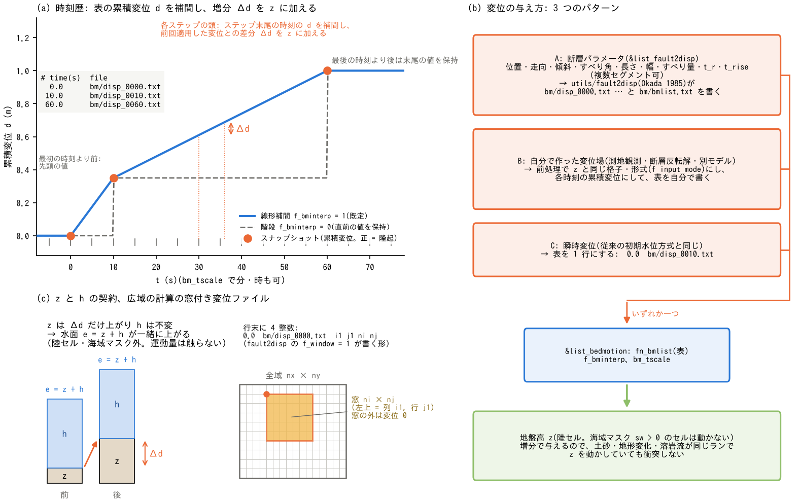

# 規定底面運動(&list_bedmotion)

[ユーザーガイド目次へ](../users_guide.md)

地盤変位の**時刻歴**を与えて地盤高 z を強制的に動かします。用途は
3 つあります。(A) 断層パラメータから求めた海底・沿岸の変位で津波を
発生させ、発生 → 伝播 → 遡上 → 氾濫を 1 ランで追う。(B) 沿岸の地震性
隆起・沈降(沈降した低地の浸水、隆起域から広がる波)や、測地観測・
別モデルで得た地盤変位場を与える。(C) 高解像度 DEM に標高として
入っている堤防(**解像堤防**)を、決めた時刻・幅・深さで下げて
**破堤**を表す。変位を適用する局所更新では水柱 h を変えずに z を
動かすので、水面 e = z + h も同じ量だけ上下します。その後の流れの
計算で水深・流速が変化します(地形変化モジュールと同じ契約)。設計の
全文は [docs/bedmotion_plan.md](../bedmotion_plan.md)、実装記録は
developer.md §70、断層パラメータからの前処理は
[fault2disp の断層形状図と設定方法](../../utils/fault2disp/README.md#2-断層パラメータの約束)。
変位の時間補間・断層変位場・非静水圧との関係・動作の契約は
[規定底面運動の解説](bedmotion_models.md)にあります。

## 1. とりあえず動かしてみる(最小入力)

地形の一部を 10 秒で 0.5 m 持ち上げるだけの例です。用意するのは
**スナップショット表 1 枚と変位ファイル 2 枚**で、変位ファイルは
地盤高 z と同じ並びの行列です(行 1 が北端)。

```
# bm/bmlist.txt(時刻 s、ファイル名は dir_data 相対)
  0.0   bm/d0.txt      ! 変位 0(全セル 0)
 10.0   bm/d1.txt      ! 10 s 後の累積変位(持ち上げる範囲だけ 0.5、他は 0)
```

変位ファイルは手で書くか、例えば次のように作ります(nx = 100、
ny = 60 の格子で、中央の 10 × 10 セルを 0.5 m 隆起):

```python
import numpy as np
nx, ny = 100, 60
d = np.zeros((ny, nx)); np.savetxt('bm/d0.txt', d, fmt='%.3f')
d[25:35, 45:55] = 0.5;   np.savetxt('bm/d1.txt', d, fmt='%.3f')
```

本体のパラメータは `fn_bedmotion` と `&list_bedmotion` の 2 行だけです
(地形・初期水位・境界はいつもどおり)。

```
&list_sysparam
  fn_bedmotion = '-'        ! 同じファイルの &list_bedmotion を読む
  f_out_z = 1               ! 変位後の地盤高 Z0001… も出力
  ...
/
&list_bedmotion
  fn_bmlist = 'bm/bmlist.txt'
/
```

`./encflow param.txt` で実行すると、開始時にスナップショットの枚数と
時刻範囲、終了時に適用した変位の最大・最小(この例では +0.5 m と 0)が
表示されます。Z0001… で地形が 10 秒かけて線形に上がり、水のある
セルでは水面も同じだけ上がる(水深は変わらない)ことを確かめて
ください。表の最後の時刻より後は最後の変位が保たれます。
変位を負にすれば沈降です。

## 2. 入力の約束(スナップショット表と変位ファイル)

**表**は 1 行に「時刻 ファイル名」(空行と `#`・`!` で始まる行は無視)。
時刻は計算開始 t0 からの相対値で**狭義単調増加**、ファイル名は
dir_data 相対です。内部で使う時刻は `t0 + 表の時刻 × bm_tscale` です。

```
# time(s)  file
  0.0      bm/disp_0000.txt
 10.0      bm/disp_0010.txt
 60.0      bm/disp_0060.txt
```

**変位ファイル**は各時刻の**累積変位** d [m](計算開始時の地形からの
変位。前の時刻からの増分ではない)で、地盤高 z と同じ形式・同じ行順
(テキスト行列 / bil / GeoTIFF。f_input_mode に従う。行 1 が北端)です。
正が隆起、負が沈降。

- 表の最初の時刻より前は先頭の値、最後の時刻より後は末尾の値が保たれ
  ます。t = 0 に変位ゼロの行を置くのが普通です(fault2disp はそう書く)。
- スナップショットの間は線形補間(f_bminterp=1。既定)または階段
  (f_bminterp=0。直前の値を保持)。
- 時刻の単位は秒。分や時で書いた表は bm_tscale(60、3600)で換算します。
- 前後2枚のスナップショットと適用済み変位を保持し、時刻が進むと次の
  ファイルを読みます。ラスタの保持枚数は表の長さに依存しませんが、
  時刻・ファイル名・窓指定の一覧はスナップショット数に応じて増えます。
- 適用対象は `x > 0` かつ `sw = 0` の計算対象セルです。陸のセルも、
  乾いているセルも、初期に水没している海底も同じ変位場で動きます。
  海域マスク(sw > 0)のセルは水位を規定される側なので動きません。

### 窓付きの変位ファイル(変位域が一部のとき)

全域格子が大きく変位域が一部なら、行の末尾に 4 つの整数 `i1 j1 ni nj`
を付けます。そのファイルは全域の列 i1〜i1+ni−1・行 j1〜j1+nj−1 の
**窓だけ**を持つ ni × nj の行列として読まれ、窓の外は変位 0 です。
列・行は北西から1スタートです。窓の大きさと配置は整数のセル境界に
合わせ、ファイルの行数・列数を `nj`・`ni` に揃えます。
本体の z・e 更新ループは、**全スナップショットの窓を包む外接矩形**を
走査します。離れた窓の間も含み、各窓の厳密な和集合だけを走査するわけでは
ありません。窓外を0とした各時刻のラスタを時間補間します。

窓は入力ファイルと読込バッファを小さくしますが、保持する変位配列と
時間補間の作業範囲は各MPI帯全体です。全処理量・メモリが窓の面積だけに
比例するわけではありません。fault2disp の `f_window=1` はこの形式を
出力し、`d_min` を閾値として切り捨てる範囲を決めます。§5 の破堤では
破堤口の数セルだけの窓で済みます。

```
# time(s)  file               i1  j1  ni  nj
  0.0      bm/disp_0000.txt   90  40  80  70
 30.0      bm/disp_0010.txt   90  40  80  70
```



図: (a) 1セルの累積変位 d と補間方式の例。階段補間のステップ境界での
厳密な扱いは§7を参照してください。
(b) 断層パラメータから作るA(§3)、自作ラスタを整えるB、最終変位を1行で
与えるC(§4)を、`fn_bmlist` に渡す表へまとめます。CはA・Bの出力も利用できます。
(c) `Δd = d(tₙ₊₁) − d_prev` を地盤高へ加える局所更新を示します。
更新直前・直後の水深は等しく、地盤と水面は同じΔdだけ動きます。
右の窓は `nx=16, ny=10, i1=5, j1=2, ni=7, nj=5` の配置例で、
列5〜11・行2〜6の35セルです。本文の入力例とは別の模式図です。
[SVG版](../figs/bedmotion_patterns.svg)もあります。
`python docs/figs/make_guide_figs.py bedmotion` でこの図だけを再生成できます。

## 3. 応用 A: 断層による津波(utils/fault2disp)

地震の津波はこのパターンです。断層の位置・走向・傾斜・すべり角・長さ・
幅・すべり量・破壊開始時刻・立ち上がり時間から弾性半無限体の解(Okada の式)で
変位場を作り、表まで書き出します。複数セグメント(破壊の時間差つき)と、
地盤高を与えたときの水平変位の寄与に対応します([解説](bedmotion_models.md) §2)。
逆断層 1 枚の津波を理想化した海域(地理参照なし)で発生させる手順は
次のとおりです。

**(1) 断層パラメータ → 変位の時刻歴**(utils/fault2disp)

```
&list_fault2disp
  nx = 200                  ! 格子(ENCflow の list_geoinfo と同じ)
  ny = 150
  dx = 1000.0
  dy = 1000.0
  dir_out = 'bm'            ! bm/disp_0000.txt … と bm/bmlist.txt を書く
  nout = 10
  nseg = 1
  x_top(1) = 120000.0       ! 上端中心(格子の左下隅から東 120 km・北 75 km)
  y_top(1) = 75000.0
  d_top(1) = 5000.0         ! 上端深さ 5 km
  strike(1) = 0.0           ! 走向 N。断層は走向の右手(東)へ下がる
  dip(1) = 15.0
  rake(1) = 90.0            ! 逆断層
  flength(1) = 60000.0
  fwidth(1) = 30000.0
  slip(1) = 5.0
  t_r(1) = 0.0              ! 破壊開始 (s)
  t_rise(1) = 30.0          ! 立ち上がり 30 s
/
```

```
cd utils/fault2disp && make          # 初回のみ(src が未ビルドなら先に src で make)
cd <ケースの dir_data> && <path>/fault2disp fault2disp.txt
```

**(2) 本体のパラメータ**(抜粋。津波計算に固有の設定だけ示します)

```
&list_sysparam
  fn_bedmotion = '-'        ! 同じファイルの &list_bedmotion を読む
  f_out_z = 1               ! 変位後の地盤高も出力
  ...
/
&list_initial
  f_htype = 2               ! 初期水位固定(静水面 e0 = 0。z < 0 が海)
  e0 = 0.0
/
&list_bound_edge
  f_bc_w = 0                ! 陸側は壁
  f_bc_e = 2                ! 海側の辺は長波放射(反射を返さない)
  f_bc_n = 2
  f_bc_s = 2
/
&list_bedmotion
  fn_bmlist = 'bm/bmlist.txt'   ! (1) が書いた表(dir_data 相対)
/
```

**(3) 実行**は通常どおり `./encflow param.txt`(MPI 版も同じ)。
完全な例は [examples/tsunami_fault](../../examples/tsunami_fault/README.md)
(この設定そのもの)です。水域と境界の与え方は §6 を参照してください。

座標の与え方は 3 通りあり、どれも fault2disp 側で吸収するので本体の
設定は変わりません(詳細は fault2disp README §3)。

| 座標の持ち方 | fault2disp の指定 |
|---|---|
| 理想化実験(地理参照なし) | x_top, y_top を格子の左下隅からの距離 (m) で(上の例) |
| 投影座標系で地理参照がある解析 | bil+hdr / GeoTIFF の地盤高を fn_z に与える → 格子と原点をファイルから取り、x_top, y_top はその座標系の絶対座標。平面直角座標系の並び(X 北距, Y 東距)は f_jpr=1 |
| 経緯度 | f_lonlat=1 で lon_top, lat_top と格子の投影(proj_lon0 等。UTM・平面直角座標系)を与える。走向は子午線収差で補正 |

## 4. 応用 B: 沿岸の隆起・沈降と自作の変位場

陸のセルも同じ変位場で動くので、断層の変位が海岸や陸に及ぶ場合
(沈降した低地の浸水、隆起域から広がる波、湾内での重なり)は、§3 の
設定のままで同じランに入ります。実例は
[examples/tsunami_coast](../../examples/tsunami_coast/README.md)
(海岸直下の深部断層で沿岸が 0.6 m 沈降し、沖の断層の津波より 10 分
早く擾乱が海岸に現れる)。

**自分で作った変位場**(測地観測・断層反転解・別モデル)を使うときは、
断層モデルを経由せず §2 の約束に合わせて自分で表を書きます。z と
同じ格子・同じ形式に前処理で揃え(ENCflow は内挿しません)、各時刻の
累積変位にします。§1 の最小例がこの形です。地盤沈下のような
ゆっくりした変動は、表の時刻を分・時で書いて bm_tscale で換算すると
扱いやすくなります。

**瞬時変位(1 時刻しかない変位場)**は、表を 1 行にします。破壊過程を
省いて最終変位を与える使い方で、A・B で用意した最終変位ラスタを
使えます。表の `0.0` は `t0` に対応します。

```
# instantaneous: final displacement at t = 0
0.0  bm/disp_0010.txt
```

新規ランでは**最初の時間ステップの頭**、流れを解く前に最終変位が
適用されます。初期出力 `0000` はその前なので、変位前の地形・水面です。
地形を固定して水深だけを変更する初期水面変位と、常に同じ計算結果に
なるわけではありません。bedmotion は地形も動かし、適用時の水深を
保持します。時刻歴ありとの差は震源近傍の到達時刻と波高に現れます
(例題での大きさは[解説](bedmotion_models.md) §2)。

## 5. 応用 C: 解像堤防の破堤

堤防の表し方は 2 つあります。河道セルと堤内地セルの境界に立てる
[仮想壁面](channel.md)(セルを太らせない堤防。破堤は
`&list_channel_breach` の天端時系列)と、高解像度 DEM(セル 5〜10 m)に
**標高そのものとして入っている堤防**(本書では**解像堤防**と呼びます。
解像河道と同じ言い方)です。解像堤防には仮想壁面がないので
`&list_channel_breach` は使えません。代わりに規定底面運動で
**破堤口のセルの地盤高を所定の時刻・幅・深さで下げる**のが破堤モデルに
なります。天端セルは乾いていても動く(h = 0 のまま z が下がる)ので、
下がった天端を越えて川の水が堤内地へ流れ出します。

**手順**(前処理スクリプト
[examples/levee_breach/make_breach.py](../../examples/levee_breach/make_breach.py)
が表と窓付き変位ファイルを書きます):

1. **破堤口を決める**: 堤防を構成するセルの矩形(列 i1〜i2 × 行 j1〜j2。
   堤防の幅が 2 セルなら 2 列とも)。最終の破堤幅は矩形の長辺の
   セル数で与えます。セル番号は 1 スタート([座標系の章](coordinates.md))。
2. **堤底の標高を決める**: 一定値(`--floor`)か、各行で堤内地側の
   法尻の列の地盤高(`--floor-col`。南北に走る堤防)、各列で法尻の行の
   地盤高(`--floor-row`。東西の堤防)。堤内地の地盤高まで下げるのが
   普通で、河床まで下げる(洗掘)なら低い値を与えます。
3. **スケジュールを決める**: 開始 t0、全幅・全深に達する t1(分)、
   1 セルが堤底に達するまでの時間 tdeep。tdeep < t1 − t0 なら中央の
   セルが先に深くなり、外側のセルは遅れて始まる(拡幅)過程になります。
   開始時刻は河川水位が天端に近づく時刻(前のランのプローブ出力や
   観測水位)に合わせます。
4. **生成して設定する**:

```
python3 make_breach.py --z z.txt --cols 21 22 --rows 48 52 --floor-col 23 \
    --t0 70 --t1 90 --tdeep 10 --out bm
```

```
&list_sysparam
  fn_bedmotion = '-'
  f_out_z = 1               ! 破堤後の地形を確認する
  ...
/
&list_bedmotion
  fn_bmlist = 'bm/bmlist.txt'   ! 表の時刻は秒(bm_tscale 既定 1)
/
```

スクリプトは各セルの累積変位 $`d(t) = -(z_0 - z_{floor})\,p(t)`$
(進行率 p は 0 → 1 の折れ線)を折れ点の時刻ごとに書き出すので、
線形補間(f_bminterp = 1)で表のとおりに動きます。表の各行には
破堤口の矩形の窓 `i1 j1 ni nj` が付き、ファイルはその矩形だけです。
河道・堤防の章の設定(fn_rw、bank0)は要りません。

5. **確かめる**: 終了時に表示される適用変位の最小が「天端 − 堤底」に
   一致すること、Z0001… で破堤口が下がっていること、破堤口の
   堤内地側に引いた[流量測線](record.md)で破堤流量が出ること、
   河道の下流の測線で流量が減ることを見ます。

完全な例は [examples/levee_breach](../../examples/levee_breach/README.md)
(直線河道 + 幅 20 m・高さ 3 m の解像堤防。同じ破堤スケジュールを
仮想壁面の `&list_channel_breach` で与えた比較ケース付き)。

注意:

- 規定底面運動は**規定の形状変化**です。堤体の侵食による自然な拡幅や
  堤体材料の堤内地への堆積は表しません(土層厚 sd は変えない)。
  決壊口の幅・深さの進行は入力で与えます(実績の破堤形状や経験式から)。
- 破堤口を土砂・地形変化(geomorph)が同じランで動かしていても、増分で
  適用するので衝突しません。河床の洗掘と破堤を同時に扱えます。
- 解像堤防の破堤口の実効幅はセル数 × dx にほぼ等しく、広頂堰の目安
  1.7·B·H^1.5 に合います。仮想壁面の破堤は f_br_diag = 1(斜めエッジも
  下げる)で幅 2〜3 セルのときほぼ同じ流量になります(幅 1 セルで 1.5 倍、
  5 セルで 0.85 倍。examples/levee_breach の計測)。
- セル幅より狭い破堤口は表せません(解像堤防の分解能はセル)。
  解像度が粗い場合は仮想壁面(サブグリッド)の破堤を使います。

## 6. 水域と境界の与え方(津波計算)

- 津波計算は**海域マスクを使わず**、初期水位 f_htype=2(静水面 e0。
  z < e0 のセルが海)で水域を表す「解く海」の型で行います
  ([examples/landslide_tsunami](../../examples/landslide_tsunami/) と同じ)。海域マスク(sw > 0)のセルは
  水位を規定される側なので、変位を与えても動きません。
- 外洋に接する辺は長波放射(f_bc_* = 2)で反射を抑えます。
  あらゆる波に対する無反射を保証する境界ではありません。
  陸に接する辺は壁(0)。
- 沈降による浸水や隆起による干出は、その後の流れと通常の乾湿処理で
  決まります。

## 7. 時間の扱いと静水圧・非静水圧

各ステップの頭で、そのステップ末尾の時刻の変位をスナップショットから
補間し、前回適用した変位との**差分**を z に加えます(水柱 h は不変。式は
[解説](bedmotion_models.md) §1)。静水圧計算では底面の持ち上げがそのまま
水面に写り、震源の幅が水深に比べて十分広い海溝型地震はこれで十分です。
震源の幅が水深と同程度の短い変位(分岐断層、深海の狭い滑り、海底地滑り)
では、[非静水圧補正](swflow.md)の f_nonhydrostatic=1 と f_nh_bottom=1 を
使い、スナップショットを細かく(fault2disp の nout を増やす)出してください
(理由と効果の大きさは[解説](bedmotion_models.md) §3)。破堤(§5)や
地盤沈下のようにゆっくりした変位では静水圧で十分です。

## 8. パラメータ一覧

メインパラメータで `fn_bedmotion = "-"`(同じファイルから読む)または
設定ファイル名を指定し、`&list_bedmotion` を書きます。未指定なら
メモリ・CPU の追加はありません。

| 項目 | 既定 | 意味 |
|---|---|---|
| f_bedmotion | 1 | 0 でファイルを残したまま一時無効化 |
| fn_bmlist | (必須) | スナップショット表のファイル名(dir_data 相対) |
| f_bminterp | 1 | スナップショット間の時間補間。1: 線形、0: 階段(直前のスナップショットを保持) |
| bm_tscale | 1.0 | 表の時刻の単位(秒)。60 で分、3600 で時 |

変位ファイルの形式は地盤高と同じ f_input_mode(&list_geoinfo)に従います。

## 9. 動作の契約と併用関係

- 計算対象セル(x > 0、sw = 0)の z に増分を加え、h は変えず e = z + h を
  回復します。運動量と土層厚 sd は触りません。
- 増分で与えるので、土砂・地形変化(f_bedslide を含む)・溶岩流が同じ
  ランで z を動かしていても衝突しません。
- 再開は同じ表から再開時刻の変位を「適用済み」として続けます(階段補間の
  切替時刻ちょうどでの保存・再開の注意は[解説](bedmotion_models.md) §4)。
- ENC専用です。ライブラリ API の set_value('z') は fn_bedmotion 有効時に
  拒否されます(z の生産者は一人)。
- 出力: 地盤高 Z(f_out_z)に変位後の地形が出ます。終了時に適用した
  変位の最大・最小を表示します。

## 10. 検証・例題

- [test/nhbottom](../../test/nhbottom/) 構成 3: Hammack 型の隆起を毎ステップの
  スナップショット表で与え、ライブラリ API による同じ運動・再開・海底地滑りとの
  同居を検定(内容は[解説](bedmotion_models.md) §5)。

- [examples/tsunami_fault](../../examples/tsunami_fault/README.md):
  理想化した逆断層(走向 N-S、傾斜 15°、60 km × 30 km、すべり 5 m、
  30 s 立ち上がり)。静水圧 / 瞬時変位 / 非静水圧 + 加速度項の比較と、
  fault2disp の座標パターン(bil・GeoTIFF の地理参照、平面直角座標系、
  経緯度)の設定例。
- [examples/tsunami_coast](../../examples/tsunami_coast/README.md):
  海岸直下の深部断層(沿岸 0.6 m 沈降)、沖の浅部断層(30 s 遅れて主津波)、
  湾口の分岐断層(岬が 0.8 m 隆起)の 3 セグメント。沿岸の地盤変動が
  起こす擾乱が沖の津波より 10 分早く海岸に現れ、沈降した湾奥の平野の
  浸水が早まる。
- [examples/levee_breach](../../examples/levee_breach/README.md):
  直線河道と幅 20 m・高さ 3 m の解像堤防。洪水のピークで 5 行 × 2 列の
  堤防セルを 20 分かけて堤内地の地盤高まで下げる(中央が先に深くなり
  拡幅)。同じスケジュールを仮想壁面の &list_channel_breach で与えた
  比較ケース付き。
