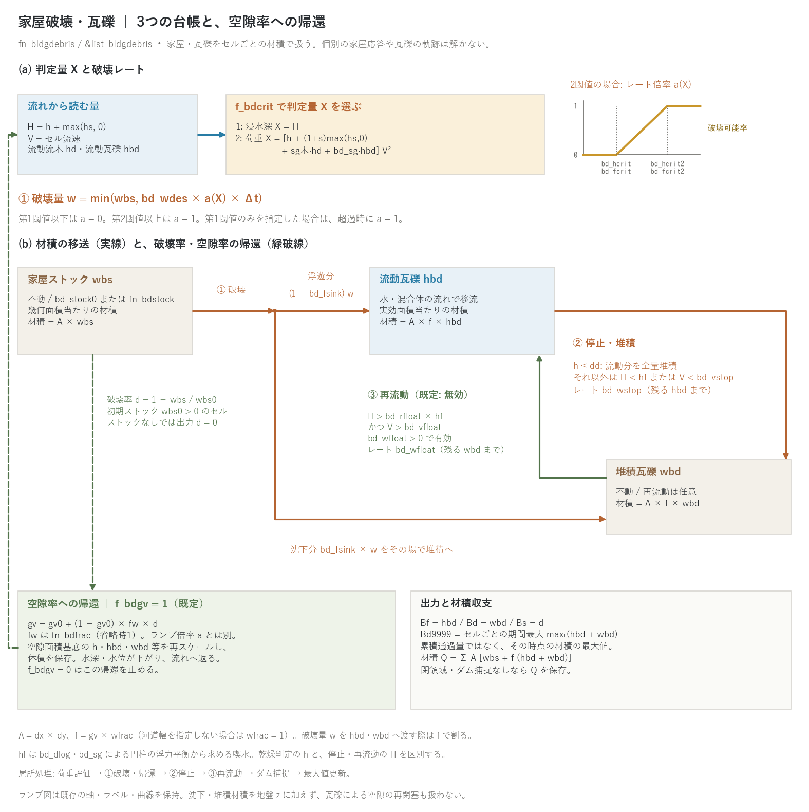

# 家屋破壊・瓦礫(fn_bldgdebris)

[ユーザーガイド目次へ](../users_guide.md)

津波・高潮・洪水の氾濫流による**木造家屋群の破壊**と、生じた**瓦礫**の
流動・堆積を、セルごとの柱状材積(m³/m²)の**ラスタ場**として概算します。
個々の家屋の構造応答や個々の瓦礫の軌跡を追う方式ではなく、「どこの
家屋がどの程度壊れ、瓦礫がどこまで届き、どこに残るか」の面的な
ポテンシャル評価が目的です。流木モジュール([流木](driftwood.md))と
同じ型の別モジュールで、同時に有効化すると**流木を含む流れによる
家屋破壊**が表現できます。

瓦礫は3つの台帳を移動します:

```
家屋ストック wbs ──破壊──> 流動瓦礫 hbd ──接地・低速──> 堆積瓦礫 wbd
 (不動・入力)            (水と同速で移流)            (再流動も可)
                 └──沈下分(bd_fsink)──────────────────┘
```

判定に使う混合流動深を `H = h + max(hs, 0)`、セル流速を `V`、
喫水を `hf` とします。喫水は `bd_dlog`・`bd_sg` による横向き円柱の
浮力平衡から求めます([流木の喫水図](driftwood.md)参照)。

- **① 破壊**: `f_bdcrit=1` は浸水深 `X = H`、`f_bdcrit=2` は荷重
  `X = [h + (1+s)max(hs,0) + sg木·hd + bd_sg·hbd] V²` を判定量に
  使います。`s` は土砂の水中比重、`sg木` は流木の比重で、流木項は
  流木モジュール有効時だけ加えます。荷重は Fd9999 と同じ定義で、
  清水規格化した m³/s² です。F9999 は水・土砂だけを含む従来の定義です。
- **② 停止・堆積 (`hbd → wbd`)**: 乾燥判定 `h ≤ dd` なら流動瓦礫を
  全量堆積へ移します。それ以外では `H < hf` または `V < bd_vstop`
  のとき、レート `bd_wstop` で、残る hbd の量まで移します。
- **③ 再流動 (`wbd → hbd`)**: `bd_wfloat > 0` で有効です。
  `H > bd_rfloat × hf` かつ `V > bd_vfloat` のとき、レート
  `bd_wfloat` で、残る wbd の量まで移します。既定は無効です。
- **輸送**: hbd は水(土石流時は水・土砂の混合体)と同じ流れで移流し、
  wbs・wbd は移流しません。沈下・堆積した瓦礫を地盤高 z に加えたり、
  瓦礫で空隙を再閉塞させたりする処理はありません。

### 破壊レート、沈下分、空隙率への帰還

第1閾値と第2閾値の間で線形に増える倍率 a(X)(被害関数の折れ線近似)に
破壊レート bd_wdes を掛けた量が 1 ステップの破壊量で、残ストックが上限
です。破壊量のうち bd_fsink の割合はその場で wbd へ、残りは hbd へ移します。
`f_bdgv=1` のとき破壊率 d = 1 − wbs/wbs0 に応じて空隙率を gv0 から
gv0 + (1−gv0)·fw·d へ上げ(fw は `fn_bdfrac` の破壊可能割合。省略時 1)、
空隙面積基準の柱状量を体積保存で読み替えて次の流れの計算へ返します。
`f_bdgv=0` はこの帰還を止めます。局所処理の順序は 荷重評価 → ①破壊・帰還
→ ②停止 → ③再流動 → ダム捕捉 → 最大値更新です(式と被害関数との対応は
[家屋破壊・瓦礫モデルの解説](bldgdebris_models.md) §1〜§2)。



(a) 流れから破壊判定量 X を評価し、ランプ倍率 a とレート bd_wdes から
破壊量 w を求めます。既存のランプ図は軸・閾値名・曲線を画素単位で
保持しています。(b) 橙実線はストックからの浮遊分・沈下分と停止、
緑実線は再流動、緑破線は破壊率から空隙率・流れへの帰還です。
条件を各経路の近くに置き、3台帳の面積基準も併記しました。模式図で
あり、計算結果ではありません。

結果の見方(分布・台帳・計測列・再開)は、このページの[出力・確認](#出力確認)にまとめています。

## 有効化と設定

`&list_sysparam` で `fn_bldgdebris` を指定します。

**「とりあえず瓦礫を動かしてみる」最小入力は、建物の空隙率 `fn_gv`
のある地形で `&list_bldgdebris` を空のまま置くだけです**(全項目が既定)。
家屋ストックは建物のあるセル(gv < 1)に一様 0.3 m³/m² が置かれ、瓦礫の
諸元・破壊判定(浸水深 1 m から 3 m の線形ランプ)・レートはすべて既定値で
動きます。採用された既定値は実行開始時に
`bldgdebris: bd_hcrit = 1.0000 m (default)` のように **(default)** 印付きで
表示されるので、値を見ずに済ませることはできません。事例に合わせて必ず
見直してください(型ごとの目安は本章末尾の「パターン別の推奨値」)。

```
&list_bldgdebris
/
```

実務では家屋ストックの分布と判定の閾値を与えます:

```
&list_bldgdebris
  fn_bdstock = 'bdstock.txt' ! 家屋ストック (m3/m2。瓦礫化可能材積。木造率込み)
  bd_dlog = 0.3             ! 瓦礫の代表寸法 (m)
  bd_sg = 0.5               ! 瓦礫の見かけ比重(0〜1。喫水は浮力平衡から自動導出)
  f_bdcrit = 1              ! 判定量(1:浸水深、2:荷重)
  bd_hcrit = 1.0            ! 浸水深閾値 (m。破壊の開始)
  bd_hcrit2 = 3.0           ! 第2閾値 (m。破壊可能率 1)
  bd_wdes = 5.0e-4          ! 破壊レート (m/s)
  bd_wstop = 0.01           ! 接地堆積レート (m/s)
/
```

## パラメータ

| パラメータ | 既定値 | 意味 |
|---|---|---|
| f_bd | 1 | 0 でファイルを残したまま一時無効化 |
| bd_stock0 | (0.3 を建物セルに) | 一様な家屋ストック (m³/m²。海域マスクと領域外を除く全セル)。fn_bdstock と排他。**両方未指定なら建物のあるセル(gv < 1)にだけ 0.3 m³/m²** を置く(fn_gv がなく建物セルが無ければ停止) |
| fn_bdstock | — | 家屋ストック(瓦礫化可能材積)の分布ファイル (m³/m²。地形と同じ行列形式)。木造率はここに織り込む(木造率 30 % のセルは 100 % のセルの 30 %) |
| fn_bdfrac | — | 建物占有のうち破壊可能な割合 fw(0〜1)の分布ファイル。省略時 1。空隙率帰還の上限 gv0 + (1−gv0)·fw を決める。ストック・破壊レートには直接掛けない |
| bd_dlog | 0.3 | 瓦礫の代表寸法 (m)。既定は木造の構造材(柱・梁)の寸法級(経験値) |
| bd_sg | 0.5 | 瓦礫の見かけ比重(0 < bd_sg < 1)。喫水は流木と同じ円柱の浮力平衡の厳密解([流木](driftwood.md)の式。0.5 × 0.3 m で 0.15 m) |
| f_bdcrit | 1 | 破壊判定量。1 = 浸水深 h+hs、2 = 荷重 (h+(1+s)hs+sg木·hd+sg瓦礫·hbd)·V² |
| bd_hcrit | 1.0 | 浸水深閾値 (m。f_bdcrit=1)。既定 1.0〜3.0 m のランプは木造家屋の津波被害の経験則に基づく |
| bd_hcrit2 | 3.0 | 浸水深の第2閾値 (m。閾値1で 0、閾値2で 1 になる線形の破壊可能率をレートに掛ける = 被害関数の幅の近似)。**両方未指定なら 1.0〜3.0 のランプ、bd_hcrit だけを指定するとランプなし(単一閾値)** |
| bd_fcrit | 2.0 | 荷重閾値 (m³/s²。f_bdcrit=2)。既定 2.0〜6.0 は浸水深 2 m・流速 1〜1.7 m/s の hV² に相当する校正値 |
| bd_fcrit2 | 6.0 | 荷重の第2閾値 (m³/s²。同上。bd_fcrit だけを指定するとランプなし) |
| bd_wdes | 5.0e-4 | 破壊レート (m/s = m³/m²/s)。倍率 a=1 が続くと所要時間 = ストック ÷ レート(既定の 0.3 m³/m² はこの条件で10分)。a<1 なら遅くなる |
| bd_fsink | 0 | 沈下率(0〜1)。破壊量のうちこの比率をその場で堆積に移す(瓦・基礎など沈む瓦礫の抽象化。0 = 全量浮遊 = 到達範囲の上限側) |
| bd_wstop | 0.01 | 接地堆積レート (m/s) |
| bd_vstop | 0.05 | 低速堆積の流速閾値 (m/s。0 = 水深(喫水)判定のみ。既定は湛水して流れが止まったら堆積) |
| bd_wfloat | 0 | 再流動レート (m/s。0 = 再流動なし。正値では bd_fsink 由来の堆積分も対象) |
| bd_rfloat | 1.5 | 再流動の浮遊余裕率(H > bd_rfloat×喫水 かつ流速条件で再流動。1 より大) |
| bd_vfloat | — | 再流動の流速閾値 (m/s。bd_wfloat > 0 のとき必須。bd_vstop 以上) |
| f_bdgv | 1 | 1 = 破壊率に応じて空隙率を上げる(帰還あり)、0 = 片方向結合 |

**閾値の当たり**(いずれも校正パラメータ。文献との対応と既定値の根拠は
[解説](bldgdebris_models.md) §4〜§5):

- **浸水深閾値(f_bdcrit=1)**: 木造家屋は浸水深 2 m 超で全壊、1 m 程度で
  部分破壊という津波被害の経験則と、東北地方太平洋沖地震津波の被害関数
  (木造の流失確率は 2 m 前後で急増)に基づき、既定は 1.0〜3.0 m のランプ
  です。RC 造は同じ浸水深でも流失しにくいため、fn_bdstock(木造率)と
  fn_bdfrac で表します。
- **荷重閾値(f_bdcrit=2)**: 単位は F9999 と同じ m³/s²(清水規格化)。
  流体力ベースの被害関数から換算するか、水のみの F9999 の分布と被害実績を
  突き合わせて決めます。浮遊物を含む流れの平均的な破壊力であり、個別の
  材の衝撃荷重の置き換えではありません。
- **家屋ストック**: 延床面積 × 構造材積原単位 × 木造率をセルで集計して
  与えます(前処理)。棟数・金額への換算は後処理です。

## パターン別の推奨値

既定値は「動く」ための中庸です。現象の型が決まっているときは次を
出発点にしてください(校正で変わる量です。出典は[解説](bldgdebris_models.md) §4)。

| 型 | 判定 | 閾値 | ストック・諸元 | レート・堆積 | 備考 |
|---|---|---|---|---|---|
| 津波の市街地遡上(木造密集地) | f_bdcrit=1 | bd_hcrit 1.0 / bd_hcrit2 3.0 m(2 m 超で全壊の経験則と木造流失曲線の幅) | 0.2〜0.4 m³/m² × 木造率。bd_dlog 0.3、bd_sg 0.5 | bd_wdes 5e-4(押し波 10 分で全壊)、bd_fsink 0.2〜0.4、bd_vstop 0.05 | 空隙率帰還あり。例題 tsunami_town |
| 津波(流木・瓦礫の連鎖を見る) | f_bdcrit=2 | bd_fcrit 2 / bd_fcrit2 6 m³/s²(浸水深 2 m・流速 1〜1.7 m/s 相当。流体力曲線で換算) | 同上。流木は fn_driftwood と同時有効化 | 同上 | 水のみの F9999 の分布を見て閾値を置き直す |
| 高潮・河川氾濫(低平地の住宅地。流速小) | f_bdcrit=1 | bd_hcrit 2.0 / bd_hcrit2 4.0 m(浸水は深くても流速が小さく、津波より壊れにくい側) | 0.2〜0.3 × 木造率 | bd_wdes 1e-4(数十分〜時間の冠水で徐々に)、bd_vstop 0.02 | 床上浸水の損傷(非破壊)は対象外 = 全壊・流失だけを数える |
| 土石流・氾濫流の集落直撃(山地渓流) | f_bdcrit=2 | bd_fcrit 1 / bd_fcrit2 4 m³/s²(混合流動深 h+hs と混合密度 1+sC が荷重に入る) | 0.2〜0.3 × 木造率。bd_sg 0.5 | bd_wdes 1e-3(数分で全壊)、bd_fsink 0.5(土砂に埋まる分) | f_debris と同時有効化。瓦礫は混合体と同速 |
| 到達範囲の上限側評価(ハザードマップ) | 事例の判定 | 事例の閾値 | 同上 | bd_fsink 0、bd_vstop 0、bd_wfloat 0 | Bd9999 を使う。残留量は bd_vstop・bd_wfloat に敏感(例題 README) |
| 耐津波化・都市化のシナリオ比較 | 事例の判定 | 事例の閾値 | fn_bdstock(木造率込み)と fn_bdfrac を差し替え | 同上 | 2 ケース比較。コード側の追加なし |

## 出力・確認

分布出力の 3 通りの有効化(自動 / 指定 / 共用)と柱状量の面積基底の読み方は[入出力の形式](io.md#状態量の分布出力の考え方)に、確認したい量から出力を逆引きする早見表は同じ節の末尾にあります。

**分布**(`result/` のラスタ。`dt_file` 間隔)

| ファイル | 出し方 | 内容 |
|---|---|---|
| Bf0001… | f_out_hbd = 1 | 流動瓦礫の柱状材積 (m³/m²。実効面積当たり) |
| Bd0001… | f_out_wbd = 1 | 堆積瓦礫 (m³/m²。実効面積当たり) |
| Bd9999 | f_out_wbd = 1 | 期間最大の到達量 `maxₜ(hbd + wbd)`(瓦礫ハザードマップの本体) |
| Bs0001… | f_out_bds = 1 | 家屋の破壊率 1 − 残ストック/初期ストック(0〜1)。最終フレームが被害率マップ |
| Fd9999 | f_out_fdmax = 1 | 流木・瓦礫込みの最大流体力 (h + (1+s)hs + sg木·hd + sg瓦礫·hbd)·V²(既存の F9999 は水と土砂のみで定義不変) |

`Bd9999` はセルごとの `maxₜ(hbd + wbd)` で、その時点の材積の期間最大値
です。累積通過量でも、流動最大値と堆積最大値を別々に足した値でも
ありません。

**台帳・ログ**(収支の検算)

- `result/bldgdebris.csv` に `dt_recrd` 間隔で、累積の `destroy_float_m3`・
  `destroy_sink_m3`(破壊で浮遊・沈下した材積)・`deposit_m3`・`refloat_m3`・
  `to_dam_m3` と、現在の `vol_stock_m3`(残ストック)・`vol_float_m3`・
  `vol_deposit_m3` を記録します。いずれも面積換算済みの m³ です。
- Log.txt に瓦礫の列はありません。破壊で空隙率が変わった分は水の
  貯留(S)に反映されます(f_bdgv = 1)。

**計測**(プローブ・測線の列)

- 瓦礫の列はありません。地点の値は `Bf0001…`・`Bs0001…` の同一セルから
  拾います。

**再開**

- 私有ファイル `bldgdebris.dat` で自動的に扱われます(保存時に
  fn_bldgdebris が有効だったことが必要)。

**読み方と検算のコツ**

- `wbs`(家屋ストック)は**幾何セル面積**当たり、`hbd`・`wbd` は**実効
  面積**当たりの柱状材積です(換算式は[解説](bldgdebris_models.md) §3)。
- 閉領域・ダム捕捉なしなら現在貯留の和 `vol_stock + vol_float +
  vol_deposit` が初期材積を保存します(数値誤差を除く)。海域マスク
  (fn_sw)の海セルや辺境界へ流出した瓦礫は系外へ消え、`bldgdebris.csv` に
  列を持たないので、初期材積 − 現在貯留の和 − `to_dam_m3` の残差として
  求めます(津波の例題では引き波で沖へ運ばれた瓦礫がこの経路で系から
  除かれます)。破壊・堆積・再流動は内部移送なので、その累積値を現在貯留に
  加えると二重計上になります。
- 被害率マップは `Bs9998`(最終フレーム)、瓦礫の到達範囲は `Bd9999`、
  被害の判定指標は `Fd9999`(瓦礫込み)と `F9999`(水と土砂のみ)を
  並べて読みます。

## 併用関係・制約

- ENC 格子のみ。地形時間の加速(morfac ≠ 1)とは併用できません。
- [流木](driftwood.md)との併用は自由で、荷重判定(f_bdcrit=2)のとき
  流動流木が破壊力に算入されます。流木モジュール側は瓦礫を知りません
  (一方向)。[土砂・地形変化](geomorph.md)・地下水とも併用可。
- **空隙率への帰還**(f_bdgv=1)では、破壊したセルの水深が体積保存の
  もとで縮み(h × gv が不変)、地下貯留は変わりません。家屋の平均サイズ
  bb は変えません(fw=1 のセルが全壊した場合は空隙率1となり、建物なしの扱いに移ります。fw<1 では占有が残ります)。
- **ダムの捕捉帯**に入った流動瓦礫はダムに捕捉されます。**カルバート・
  ポンプ**は水だけを送るため、瓦礫は施設の上流に滞留します。
- 中断・再開(save/restore)では hbd・wbd・wbs・wbs0・gv0・gv の6成分を
  `bldgdebris.dat` に保存・復元し、破壊率 d は再構成します。**Bd9999・
  Fd9999 の最大値統計とCSVの累積過程量は引き継ぎません**。分割前後の
  出力を区別し、全期間の統計・収支は別途集計してください。

## 検証ケース

[test/bldgdebris](../../test/bldgdebris/) は、材積保存、流木との片方向結合、
空隙率帰還時の水体積保存、分割継続を検定します。空隙率を変更する手続き
単体の検定は [test/gvchange](../../test/gvchange/) にあります。

## 例題: 津波の市街地遡上と家屋破壊・瓦礫

沿岸市街地への津波遡上で木造家屋が破壊され、瓦礫が内陸へ運ばれて堆積する
理想化実験を [examples/tsunami_town](../../examples/tsunami_town/) に
収録しています(津波の高さ・防潮堤のかさ上げ・開口部の閉鎖の 4 ケースで
被害と瓦礫の行き先を比べ、補足で流木なし/あり、浸水深判定/荷重判定、
空隙率帰還あり/なしを比較。解説は README)。

## モデル化していないもの

個別家屋の構造応答、個別瓦礫の軌跡・向き・回転・相互作用、瓦礫・流木の
個別衝突力、瓦礫による閉塞の幾何判定、火災、堆積瓦礫の地形 z への算入と
空隙の再閉塞は対象外です(ラスタ表現の方針による明示的な適用限界)。
RC 造・鉄骨造は「破壊されない占有」として fn_bdfrac で表し、構造種別
ごとに閾値を変える多クラス化は将来課題です。実装仕様は developer.md §63。

## 参考文献

この章で使うモデル・式・既定値の出典は、[家屋破壊・瓦礫モデルの解説](bldgdebris_models.md#参考文献)の参考文献にまとめています。
