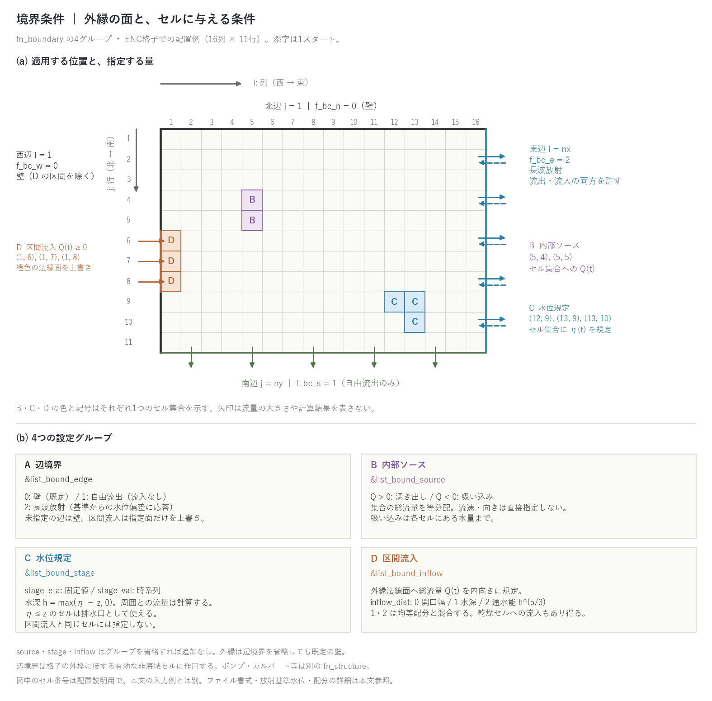

# 境界条件(&list_bound_edge / source / stage / inflow)

[ユーザーガイド目次へ](../users_guide.md)

計算領域と外界の水のやり取りを定義します。本章は ENC 格子での
境界条件を説明します。`fn_boundary` に指定したファイルで、次の
**4つのグループ**を必要に応じて組み合わせます。

| 族 | グループ | 適用先と指定する量 |
|---|---|---|
| A 辺境界 | &list_bound_edge | 格子外縁4辺の基本型(0 壁 / 1 自由流出 / 2 長波放射) |
| B 内部ソース | &list_bound_source | 有効セル集合への総流量 Q(t)。正は湧き出し、負は吸い込み |
| C 水位規定 | &list_bound_stage | 有効セル集合の水深を規定水位 η から設定 |
| D 区間流入 | &list_bound_inflow | 外縁に接するセルの法線面へ、非負の総流入量 Q(t) を規定 |

内部ソース・水位規定・区間流入は、そのグループを省略すれば追加
されません。辺境界は省略しても**既定の壁が残ります**。区間流入は
指定した外縁法線面の条件を上書きするので、西辺全体が `f_bc_w = 0`
でも、一部だけを流入口にできます。ポンプ・カルバートなどの内部構造物は
別の `fn_structure` で設定します([構造物](structure.md))。自由流出・
長波放射・区間流入の配分の式は[構造物と境界の水理則の解説](hydraulics.md) §5 に
あります。

B・C・D のセル集合と時系列は namelist に直接記入するほか、
`fn_*` でファイル指定できます(`dir_data` 起点の相対パス)。ファイルを
指定すると対応する直接記入値より優先されます。時系列の入力時刻は分、
流量は m³/s、水位は `z` と同じ標高基準の m です。時系列は線形補間し、
範囲外は端の値を保持します。辺境界 A は `f_bc_*` と必要に応じた
`bc_eta_*` で指定します。

セル座標 `(i, j)` は**1スタート**で、`i` は西→東、`j` は北→南です
(GIS の0スタートの行列番号から拾う場合は +1。
[座標系の章](coordinates.md))。



(a) 16列×11行の配置例。北・西の基本型は壁、南は自由流出、東は長波放射です。
西の `(1, 6)`〜`(1, 8)` の法線面だけを D の区間流入で上書きし、壁を
重ねて描いていません。B は `(5, 4), (5, 5)` の内部ソース、C は
`(12, 9), (13, 9), (13, 10)` の水位規定セルです。(b) 各グループが
指定する量と主な条件。矢印は流れの許される向きを示し、流量の大きさ・
計算結果や ENC の離散化面を表すものではありません。図中の添字は説明用で、
以下の入力例とは別です。

結果の見方(分布・台帳・計測列・再開)は、このページの[出力・確認](#出力確認)にまとめています。各機能の節末にも、その機能に関係する出力だけを短く記しています。

## とりあえず動かしてみる(最小入力)

閉じた流域の降雨流出なら **fn_boundary は不要**です(4 辺とも既定の壁面)。
外へ水を出す最小入力は次の1グループです(型1は流入を許しません):

```
&list_bound_edge
  f_bc_w = 1, f_bc_e = 1, f_bc_n = 1, f_bc_s = 1   ! 4 辺とも自由流出
/
```

**パターン別の構成**(流量・水位は与件ですが、目安を添えます)

| 型 | 辺境界 | 入れ方 | 出し方 | 目安・備考 |
|---|---|---|---|---|
| 流域の降雨流出 | 0(既定) | 降雨 | 出口セルに stage_eta = −999(完全排水口) | 周囲が nodata の流域地形では辺境界は効かない |
| 河川洪水の氾濫 | 0(下流辺だけ 1 でも可) | 区間流入 Q(t)。inflow_dist=2 | 下流端を水位規定(時系列)か自由流出 | 比流量の目安: 年最大洪水 1〜5、計画規模 5〜20 m³/s/km²(流域 10〜100 km²) |
| 津波 | 海側の辺 2(長波放射) | 初期水位 e0 + 海側辺の水位規定 stage_val(入射波形) | 2 | 内陸側の辺は 0 か 1 |
| 高潮 | — | 海域は fn_tide([潮位](tide.md)) | 同左 | 辺境界は海域マスクの内側では不要 |
| 内水氾濫 | 0 | 降雨 | 排水ポンプ([構造物](structure.md))、下水道は[管路連続体層](gwflow.md) | 吐口省略で域外排水 |
| ダム崩壊・段波 | 0 | 初期水位(fn_hinit) | 下流辺 1 | 初期の Cn_max を確認 |

## 辺境界(&list_bound_edge)

自由流出(限界流の段落ち)と長波放射(Sommerfeld・Flather)の式: [解説](hydraulics.md#5-辺境界)。

領域外縁の4辺(西=i=1、東=i=nx、北=j=1、南=j=ny。行順は北→南)に
それぞれ境界条件型を指定します。

```
&list_bound_edge
  f_bc_w = 2                ! 西辺
  f_bc_e = 2                ! 東辺
  f_bc_n = 2                ! 北辺
  f_bc_s = 2                ! 南辺
/
```

| 型 | 意味 | 向く用途 |
|---|---|---|
| 0(既定) | 不透過(壁面) | 水槽・閉流域 |
| 1 | 自由流出。前進してきた流れはそのまま通過し、滞留水は段落ち(自由越流)で抜ける。段落ちは流向(静止水は辺の外向き)に沿って立ち、合計は自然幅あたり。サブグリッド河道幅の終端セルは上流の河道流速と河道の流向で出口流束を決める。流入なし | 乾いた地表を進む氾濫流の流出 |
| 2 | 長波放射(辺の外向きに沿って立ち、合計は自然幅あたり)。静水面では流出せず、境界に達した波の水位偏差だけを透過(引き波の流入も許す) | 津波・高潮・波動の伝搬 |

- 型 2 の基準水位は、未指定なら初期条件から自動導出されます(初期
  水位一定なら t=0 の放射フラックスが厳密にゼロ)。固定したい場合は
  `bc_eta_w/e/n/s` に一様値を明示します(z と同じ標高基準)。
- 通常の型2は `h < dd` の乾燥セルで流束を0にします。放射境界だけで
  乾いた境界セルを再湿潤させるものではありません。
- 型 2 は、ネスティングの子格子(nest_bc = 3)では親の水位と法線流速を
  境界セルごとに受ける Flather 放射 u_n = u_n,e + √(g/h)(η − η_e) に
  一般化されます(基準水位 = 親の水位、外向き法線流速 = 親の流速)。設定は
  子の `&list_nest`([ネスティング](nest.md))。
- 辺境界が実効するのは、**有効な非海域セルが格子の枠に接している辺**だけ
  です。周囲を nodata(マスク外)の縁が囲む流域地形では作用しません
  (その場合の排水には水位規定セルを使います)。
- 動く例は[チュートリアル Step 3](../../tutorials/wave/README.md#step-3-境界条件の設定)。

**この節に関係する出力**: 流出量の台帳はなく、Log の S の減少と、辺に沿った測線の Q で読みます。放射境界の反射はプローブの水位で確認します([出力・確認](#出力確認))。

## 内部ソース(&list_bound_source)

任意のセル集合への湧き出し(Q > 0)・吸い込み(Q < 0)です。
第3添字がソース番号です(1 から連続)。

```
&list_bound_source
  src_cell(:,1,1) = 10, 10       ! ソース1のセル(i, j)
  src_cell(:,2,1) = 10, 11
  src_val(:,1,1) =   0,   0.0    ! (時刻(min), 流量(m3/s))
  src_val(:,2,1) =  60, 100.0
/
```

- 流量はセル集合**全体の総量**で、各セルへ均等分配されます。
- 吸い込みは各セルの水深0で打ち止めです。不足分を他セルへ再配分しないため、
  実際に取り除く総量が指定量を下回ることがあります。
- 指向性(運動量)を持たない注入です。河川の流入には区間流入を
  使ってください。

**この節に関係する出力**: 投入量は Log の S の増分(Σ q × Δt / 領域面積)で検算し、下流の測線 Q で流下を確認します([出力・確認](#出力確認))。

## 水位規定セル群(&list_bound_stage)

セル集合の水位を固定値 `stage_eta(n)` または時系列 `stage_val` に
強制します。時系列ファイル、namelist 時系列、固定値の順に優先します。
水深は毎ステップ h = max(η − z, 0) に置かれ、周囲との
流出入は規定水位が作る勾配から運動方程式で計算されます(流速・流量の
出力や測線計測にも乗ります)。サブグリッド断面を使う場合は、規定水深を
内部の矩形換算水深へ変換して適用します。水位規定は内部ソース・構造物
転送より後に水深を設定するため、同じセルではそれまでの水深を上書きします。
**区間流入と水位規定を同じセルに重ねないでください**。流量を与えても、
水位規定がそのセルの水量を増減するため、指定した流入量の収支が保たれません。

```
&list_bound_stage
  stage_cell(:,1,1) = 100, 200
  stage_eta(1) = -999.0          ! 河床より低い水位 → 完全排水口
/
```

- **流域抽出計算の出口**(流域外への排水)には η を河床より低く
  します — セルは常に空の完全排水口になります。
- **感潮域・背水**には水位時系列 `stage_val(:,k,n) = t, η` を使います。
- 規定セルと周囲の水位差が大きいと局所的なダム崩壊流が生じます。
  初期の Cn_max が大きいときは dt を見直してください。

**この節に関係する出力**: 規定セルに置いたプローブの `h`・`z + h` が与えた水位に一致すること、規定セルから出た水が周囲の `H0001…` に広がることを確認します([出力・確認](#出力確認))。

## 区間流入(&list_bound_inflow)

配分の重みとフルード数によるブレンドの式: [解説](hydraulics.md#5-辺境界)。

河川などが領域外縁から流入する境界です。外縁に接するセル区間の
外縁法線面に、区間**全体の総流量** Q(t) を規定します。湧き出しと
違って運動量を持つ指向性の流入です。

```
&list_bound_inflow
  inflow_cell(:,1,1) = 1, 100    ! 西辺の j=100..102 の区間
  inflow_cell(:,2,1) = 1, 101
  inflow_cell(:,3,1) = 1, 102
  inflow_val(:,1,1) =   0,   0.0 ! (時刻(min), 総流量(m3/s))
  inflow_val(:,2,1) =  60, 500.0
  inflow_dist(1) = 2             ! 区間内の配分モード
/
```

**配分モード(inflow_dist)** — 開いている流入面の配分流量の和が
総流量 Q(t) となるように正規化します。

| 値 | 配分 | 特徴 |
|---|---|---|
| 0(既定) | 均等(開口幅按分) | 単位幅流量が区間一様 |
| 1 | 水深按分 | 水深重みの成分では単位幅流量が h に比例。h < dd のセルの重みは0 |
| 2 | 通水能按分(h^(5/3)) | Manning 則の等勾配断面と同じ。河道横断面らしい配分 |

モード1・2は、重み配分から見積もる最深セルのフルード数に応じて、
開口幅による均等配分と連続的に混合します。`h < dd` のセルは重み配分の
成分が0でも、均等配分の成分から流入を受けます。したがって、乾いた
河川敷へ常に流入しない設定ではありません。乾いた断面などでは均等配分側に
寄せ、薄い水深への流量集中を緩和します。

- 区間の端のセルが壁の角や nodata に接して流入方向へ水を渡す内部エッジが
  欠ける場合、そのセルの流入面は自動的に閉じられ、総流入量は残りのセルに
  配分されます(直線区間の内部は従来と同じ)。角セルに直線部と同じ単位幅
  流量を押し込むと渡しきれずに溜めて吐く振動が成長するためです
  (developer.md §69.9)。区間の全セルが同じ条件なら何も閉じません。
- 流量は非負のみです(流出には水位規定か吸い込みを使います)。
- 土砂計算(浮遊砂)と併用する場合は、流入土砂を濃度時系列
  `inflow_cs` または流砂量時系列 `inflow_qs`(排他)で与えられます
  ([土砂・地形変化の章](geomorph.md))。未指定なら清水流入です。

**この節に関係する出力**: 直下流の測線 Q が与えた流量と一致すること(配分方式の確認)、`summary.csv` の Qmax で流入のピークを確認します([出力・確認](#出力確認))。

## 出力・確認

分布出力の 3 通りの有効化(自動 / 指定 / 共用)と柱状量の面積基底の読み方は[入出力の形式](io.md#状態量の分布出力の考え方)に、確認したい量から出力を逆引きする早見表は同じ節の末尾にあります。

**分布**(`result/` のラスタ)

| ファイル | 出し方 | 内容 |
|---|---|---|
| H0001… / E0001… / Q0001… | f_out_h / f_out_e / f_out_qq | 境界からの流入・流出は地表の水深・水位・流量に現れる。境界条件そのものの分布出力はない |

**台帳・ログ**(収支の検算)

- Log.txt の S 列(領域平均の貯留高)は、辺境界からの流出で減り、
  内部ソース・区間流入で増えます。閉じた壁境界(既定)だけなら S は
  降水・蒸発以外で変わりません。
- `ex_flux` 列は過大な流出フラックスを検出・抑制した回数で、境界からの
  流出量ではありません。

**計測**(プローブ・測線の列)

- 区間流入・内部ソースの直下流に[測線](record.md)を置くと、与えた
  流量が Q として戻ってきます(配分方式の確認)。辺境界の流出量は、辺に
  沿って置いた測線の Q で測ります。
- 水位規定セル群はプローブの `h`・`z + h` が規定値に一致します。

**再開**

- 境界条件の時系列は再開時刻から読み直され、保存する状態はありません。
  放射境界の基準水位は初期条件から再導出されます。

**読み方と検算のコツ**

- 流入量の検算: 区間流入の総量 Σ(q × Δt) と、下流測線の Q の積分
  (`summary.csv` の集計も使える)を比べます。
- 放射境界(型 2)の反射は、境界近くのプローブで水位の戻りがないかを
  見ます。自由流出(型 1)で滞留水が抜けないときは、辺に向かう地形勾配と
  dd を確認してください。

## 検証・例題

- [test/sedinflow](../../test/sedinflow/): 区間流入の土砂濃度・流砂量指定と、流入総量に対する土砂台帳の検定。
- [test/nhcurrent](../../test/nhcurrent/): 水位規定で一様流と正弦波を与える設定例。
- [test/nest_identity](../../test/nest_identity/): `flather` 構成で、静水の親格子を使ったネスト境界と単独の放射境界を比較。
- 全パラメータの注釈付き実例: [examples/List_samples/list_boundary.txt](../../examples/List_samples/list_boundary.txt)
- 辺境界(放射): [tutorials/wave](../../tutorials/wave/) Step 3
- 排水ポンプ・樋門などの構造物は fn_structure 側です([構造物の章](structure.md))。
