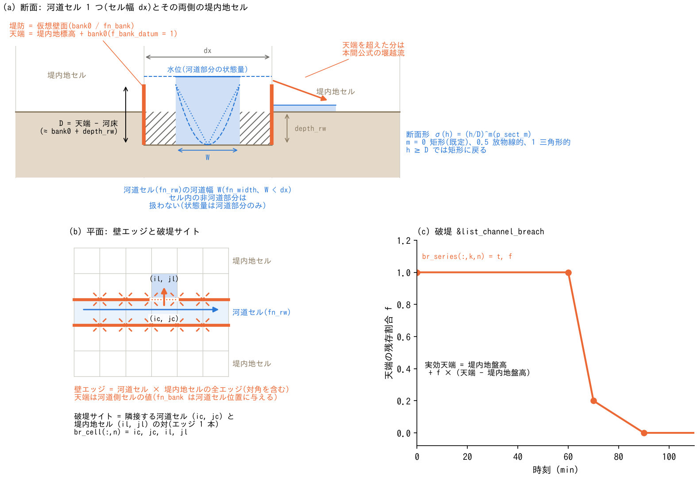

# 河道(&list_channel / channel_breach)

[ユーザーガイド目次へ](../users_guide.md)

セルサイズで解像しきれない河道の水理構造 — 堤防・サブグリッド河道幅・
断面形・破堤 — を扱います。`fn_channel` で有効化します。

**前提と役割分担**: 河道セルの指定(河道マスク `fn_rw`)と、セルの
地形・物性(河床の掘り込み `depth_rw`、河道粗度 `rn0_rw`)は
[地理情報の章](geoinfo.md)の設定です。本章はセル間の**通水構造**
(堤防=仮想壁面、河道幅、水理モード)を扱います。堤防の指定には
fn_rw が必須です。



(a) 河道セルの状態量はセル内の幅 W(fn_width)の河道部分だけを表し、
堤防はセル面に立つ仮想壁面(天端 = 堤内地標高 + bank0。f_bank_datum = 1)で、
天端を超えた分が本間公式の堰越流([水理則の解説](hydraulics.md) §1)で堤内地セルへあふれます。断面形
σ(h) = (h/D)^m(p_sect_m)は遷移深さ D = 天端 − 河床 より浅い水深の
通水率を決めます。(b) 壁エッジは河道セルと堤内地セルの間の全エッジ
(対角を含む)で、破堤サイトは河道セルと堤内地セルの対(エッジ 1 本)、
(c) その実効天端を br_series の残存割合で下げます。図は
docs/figs/make_guide_figs.py で生成します。各仕組みの定式と既定値の根拠は
[河道の解説](channel_models.md)にあります。

## とりあえず動かしてみる(最小入力)

河道は[地理情報](geoinfo.md)の河道マスク fn_rw と掘り込み depth_rw
だけで「解像河道」として動きます(fn_channel は不要)。堤防を足す
最小入力は一律高さの 1 行です:

```
&list_channel
  bank0 = 2.0                   ! 堤内地セル標高基準の堤防高 (m)
/
```

## 堤防(仮想壁面)

河道セルと堤内地セルの境界に、セルを太らせない仮想の壁を立てます。
天端を超えた分は本間公式の堰越流で堤内地へあふれます。

分布ファイル `fn_bank` で高さを与えるときの注意:

- 高さは**河道セル**の位置に与えます(壁エッジは河道セルと堤内地
  セルの間の全エッジ — **対角を含む** — に立ち、天端には河道側セルの
  値が使われます)。海岸堤防 `fn_seawall` が陸側セル持ちなのと
  逆なので注意してください([地理情報の章](geoinfo.md))。
  エッジごとの実効天端は、堤内地側の地盤高と河道側の河床高を下回り
  ません(天端がそれより低いエッジでは地盤そのものが壁になるためで、
  越流水深に地盤差が乗ることはありません。V 字谷の自然河岸や、天端を
  絶対標高で与えたときに効きます)。
- **堤内地セルと角(対角)だけで接する河道セルにも高さを与えて
  ください**。値のない(−900 以下)河道セルのエッジには壁が立たず、
  ENC 格子は対角リンクでも水をやり取りするため、そこから堤内地へ
  漏水します。一律値 `bank0` は全河道セルに付与されるため、この
  心配はありません。
- 逆に、**余分に与えるのは無害**です。堤内地と接していない河道セルの
  値は使われず(壁は立たない)、河道外セルの値も無視されます。
  したがって河道沿いに**バッファ状に広く塗っておく**のが安全側で、
  上記の角接触の漏れも自動的に防げます。

```
&list_channel
  bank0 = 1.0                   ! 堤防高さの一律値(fn_bank と排他)
  f_bank_datum = 1              ! 高さの基準(下表)
/
```

| パラメータ | 既定値 | 意味 |
|---|---|---|
| fn_bank / bank0 | "" / — | 堤防高さ(分布 / 一律値。どちらか一方。分布の −900 以下は堤防なし) |
| f_bank_datum | 1 | 高さの基準。0: 河床(掘り込み後)基準、1: 堤内地セル標高基準(推奨)、2: 絶対標高 |
| f_bank_aggr | 0 | datum=1 での天端の集約。0: 隣接堤内地の平均(ノイズ抑制)、1: 最小(越流開始に忠実)、2: 最大(安全側) |
| f_bank_mode | 0 | 水理モード。0: 越流のみ(双方向とも天端まで不透過)、1: 樋門(逆止弁。堤内→河道のみ通す)、2: 強制排水(互換・実験用。実務の排水機場は [構造物の章](structure.md)のポンプを使用) |
| f_bank_opening | 1 | 堤防壁で塞がれた開口の通過幅を、同じ横断面の開いた河道—河道エッジへ振り替える開口補正(幅 1 セル河道の過小通水を向きによらず補正。0 は旧挙動との比較用。[解説](channel_models.md) §1) |

## サブグリッド河道幅

セルサイズ未満の川幅の通水能と貯留を、矩形断面のサブグリッド河道と
して表現します。`fn_width` の指定で有効化します。

**モデルの要点**: 幅を有効にしたセルの水深・水位・流量・貯留は、**セル内の
河道部分だけ**を表します。セル内の堤内地は存在しないものとして扱い、
河道と堤内地の水のやり取り(越流氾濫・氾濫水の戻り)は**隣接する堤内地
セルとの間で直接**行います。川幅がセルサイズを跨いでもモデルの切替は
なく、上流端の細流から下流端の大河まで 1 枚の幅データでつながります
(定式・設計の経緯・精度の限界は[解説](channel_models.md) §2)。

```
  fn_width = "channel_width.txt"  ! 河道幅分布 (m。河道セルのみ有効。
                                  !   0 以下は幅情報なし=解像扱い)
```

- 堤防未指定なら**壁なし(自然河岸)**です。築堤河道は bank0 / fn_bank を
  明示してください(`bank0 = 0` は堤防なしと同じです)。
- 幅がセルサイズ以上のセルは自動的に解像河道(掘り込み+壁)と同じ扱いに
  なり、**幅の値そのものは結果に影響しません**。解像扱いにしたい区間には
  大きめの値(例: 9999)を一括で与えて構いません。
- **適用条件**: 実河道がラスタより滑らかに走る解像度で使ってください。
  1 セルの中で蛇行する細かい川に使うと、河道長の過小評価で流量・流速が
  過大になります。河道網の位相が結果を支配する用途では、ラスタ表現の
  接続の曖昧さが精度の限界になります(疑わしい箇所はセルを細かく)。

## 断面形(σ 則)

低水路の水位低下・逓減の再現を改善する断面形の一般化です。

```
  p_sect_m = 0.5                ! 断面の形状指数(既定 0 = 矩形)
```

通水率を σ(h) = (h/D)^m とする単パラメータの断面形で、m = 0 が矩形、
0.5 が放物線的、1 が三角形的な断面に相当します。遷移深さ D は直接
指定せず、堤防が有効なセルでは「天端 − 河床」(≈ bank0 + depth_rw)、
堤防のないセルでは掘り込み深さ depth_rw が D になります(どちらも無いと
p_sect_m > 0 はエラー)。h ≥ D では矩形に退化します。河道幅(fn_width)は
必須ではなく、幅のないセルではセル全幅の断面に適用されます。幅データを
作らずに σ だけを有効化するのが最簡構成で、幅が不正確でも大きくは破綻
しません(式・河床が動く場合の D の追従・幅の不正確さの解釈は
[解説](channel_models.md) §3)。

## 破堤(&list_channel_breach)

堤防の実効天端を時系列で下げ、決壊を表現します(堤防の有効化が
前提)。

```
&list_channel_breach
  br_cell(:,1) = 120, 45, 120, 44   ! サイト1: 河道セル ic,jc と堤内地セル il,jl
  br_series(:,1,1) = 0.0,  1.0      ! (時刻 min, 天端の残存割合 0〜1)
  br_series(:,2,1) = 60.0, 1.0      !   60 分までは無破堤
  br_series(:,3,1) = 70.0, 0.2      !   60〜70 分で 2 割まで決壊
  br_series(:,4,1) = 90.0, 0.0      !   90 分で堤内地盤高まで全壊
/
```

- サイトは「隣接する河道セルと堤内地セルの対」で、その境界エッジ
  1本の天端が 実効天端 = 堤内地盤高 + 割合×(天端 − 堤内地盤高) と
  変化します。幅1セルの河道でも堤内地セル側の指定で左右岸を区別
  できます。セル座標は**1 スタート**です(GIS の 0 スタートに注意。
  [座標系の章](coordinates.md))。
- 複数セル区間の決壊は複数サイトで指定します(決壊幅はエッジ単位)。
  サイト 1 本の実効通水幅は約 dx/4 です(法線エッジだけが通水し、
  隣り合うサイトの間の斜めリンクは壁のまま。セル幅 10 m・越流水深
  1.7〜1.9 m の [examples/levee_breach](../../examples/levee_breach/README.md)
  で 1〜5 サイトの計測値 2.6 m/サイト)。実幅 W の決壊は
  サイト数 ≈ W ÷ (dx/4) を目安にしてください。
- **堤防が DEM の標高そのものとして入っている場合(解像堤防)**には
  仮想壁面がないので、この破堤は使えません。破堤口のセルの地盤高を
  時刻歴で下げる[規定底面運動](bedmotion.md) §5 の手順を使って
  ください(両方式の比較は [examples/levee_breach](../../examples/levee_breach/README.md))。

## パターン別の推奨値

| 型 | 構成 | depth_rw (m) | bank0 (m) | rn0_rw | 幅・断面 | 備考 |
|---|---|---|---|---|---|---|
| 山地渓流(川幅 < セル) | fn_rw + fn_width + p_sect_m | 0.5〜1 | 不要(壁なし=自然河岸) | 0.04〜0.06 | 幅 2〜10 m、m 0.5 | 1 セル内で蛇行する川には不向き |
| 中小河川(川幅 10〜50 m、セル 10〜25 m) | fn_rw + depth_rw + bank0 | 1〜3 | 1〜3(f_bank_datum=1) | 0.03〜0.04 | 幅 ≥ セルなら fn_width 不要 | 越流は本間公式 |
| 大河川(川幅 > 100 m) | 解像河道 + 堤防 | 3〜6 | 3〜8 | 0.025〜0.035 | p_sect_m 0.3〜0.5 で低水路の逓減 | 氾濫原の粗度は fn_rn で |
| 都市の掘込河道・コンクリート水路 | fn_rw + depth_rw | 2〜4 | なし | 0.015〜0.025 | — | 樋門・排水機場は[構造物](structure.md) |
| 破堤シナリオ | 上記 + &list_channel_breach | 同上 | 同上 | 同上 | — | br_series は 10〜30 分で残存割合 0 へ |

粗度の目安は Manning の n の慣用値(河川砂防技術基準と Chow の表。出典は
[解説](channel_models.md) §5):
コンクリート 0.015〜0.02、砂床の低水路 0.025〜0.035、礫床 0.035〜0.05、
植生のある高水敷 0.05〜0.1。

**上流の渓流から河口まで、複数の型の河道を 1 つの計算に含めるとき**は、
表の値から 1 つを選ぶ必要はありません。rn0_rw・depth_rw・bank0 は
全河道セルに同じ値を与える簡便法なので、型が混在する大スケールの計算
では rn0_rw を指定せず(負のまま)、[地理情報](geoinfo.md)の粗度分布
fn_rn(f_rntype=1)に河道セルごとの n を入れてください(掘り込みと
堤防高も同様に fn_depth_rw・fn_bank の分布で)。区間ごとに表の値を
塗り分けた分布を GIS 等の前処理で作るのが、方針「変換は前処理で」の
流儀です。

**断面形 σ(p_sect_m)の目安** — 遷移深さ D より浅い水深での通水率
σ = (h/D)^m を決めます。m が大きいほど低水時の水位が高く・逓減が遅く
なります。D は直接指定する値ではなく、堤防が有効なセルでは
「天端 − 河床」(≈ bank0 + depth_rw)、堤防のないセルでは depth_rw が
そのまま D です。表の「D を決める設定」は、その D を実現する
[地理情報](geoinfo.md)の depth_rw と本章の bank0 の組です。

| 河道の型 | p_sect_m | D を決める設定 | 備考 |
|---|---|---|---|
| コンクリート水路・矩形断面 | 0(既定) | — | 従来どおりの矩形(D は使われない) |
| 複断面の大河川(低水路+高水敷) | 0.3〜0.5 | 堤防あり: bank0 + depth_rw が 3〜8 m(例: bank0 3 + depth_rw 3) | 低水路幅/全幅が小さいほど大きめ |
| 単断面の自然河道(砂礫床の緩勾配) | 0.5 | 堤防なし: depth_rw 1〜3 m がそのまま D | 放物線的。幅データなしの最簡構成でも可 |
| V 字の渓流・切り立った谷 | 0.7〜1 | 堤防なし: depth_rw 0.5〜1 m がそのまま D | 三角形的。fn_width と併用して澪筋を細く |
| 低水の水位を観測に合わせる校正 | 0.3〜1 で振る | 変えない | 平水位が高すぎれば m を上げる(σ が小さくなり同じ流量で水位が上がる) |

## 検証・例題

- [test/bendloss](../../test/bendloss/): 直線・屈曲・対角河道、サブグリッド幅、開口補正を、Manning等流解や直線水路との比較で検証。
- [test/chichibu](../../test/chichibu/): 実地形の河道マスク・粗度・河道幅・堤防設定と洪水波の比較例。
- 書式の実例: [examples/List_samples/list_channel.txt](../../examples/List_samples/list_channel.txt)
- 海岸堤防(fn_seawall)は同じ仮想壁面機構の海岸応用で、
  [地理情報の章](geoinfo.md)の設定です。
- 樋管・樋門を管路(断面・敷高・ゲート)として精緻に扱うなら
  [構造物の章](structure.md)のカルバートを使います(f_bank_mode=1 の
  逆止弁は簡便法)。
