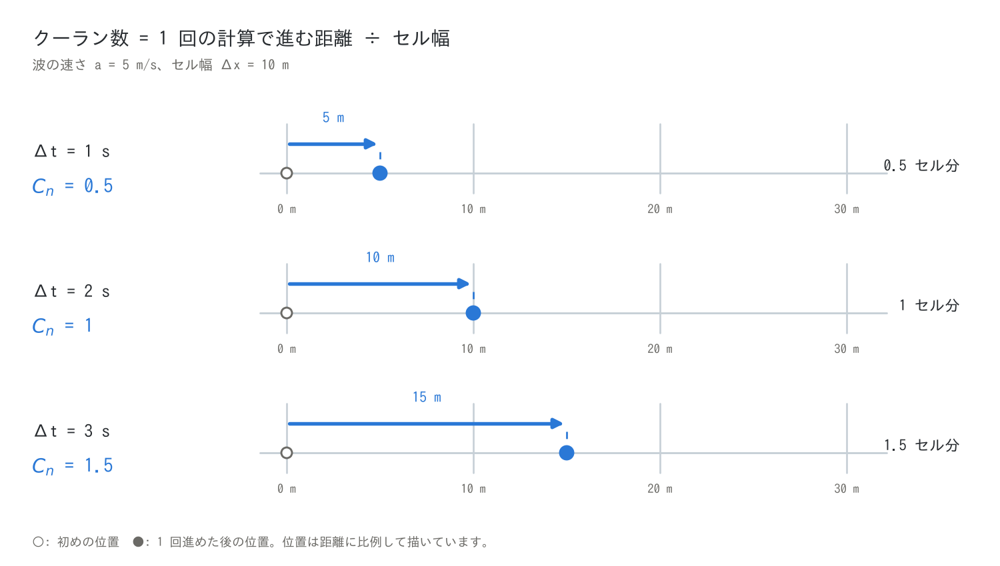
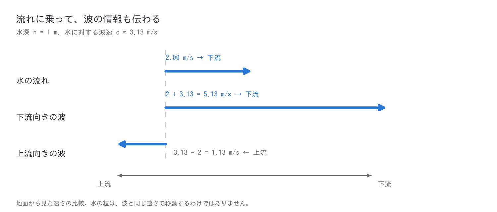
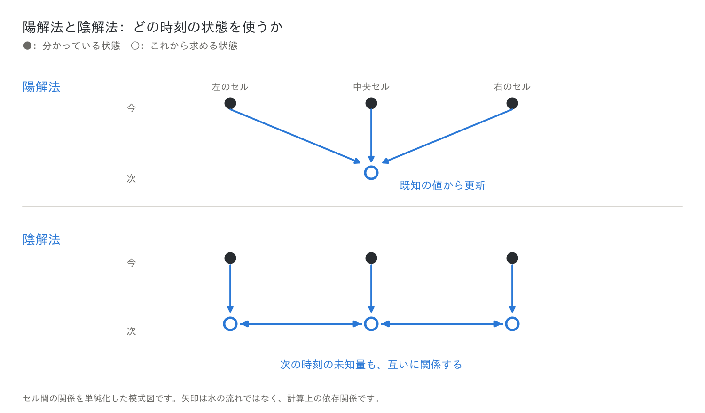
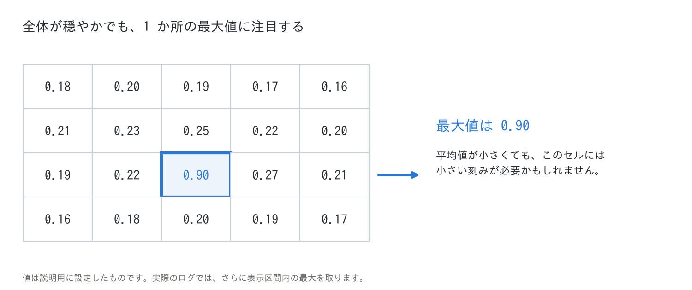
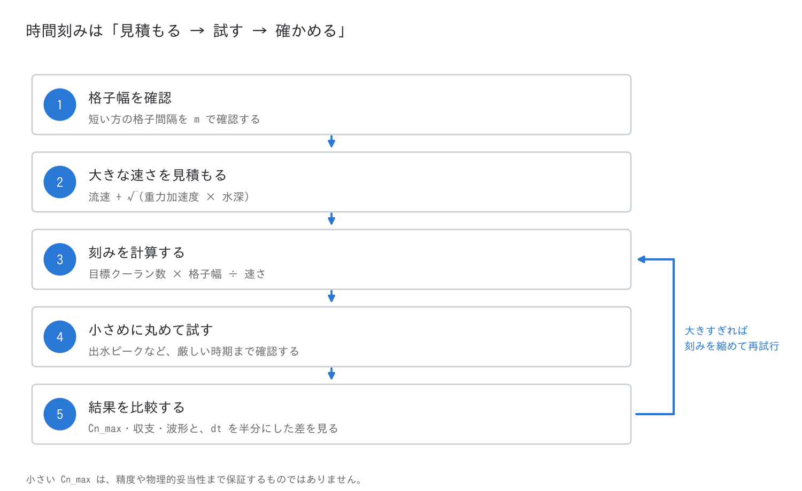
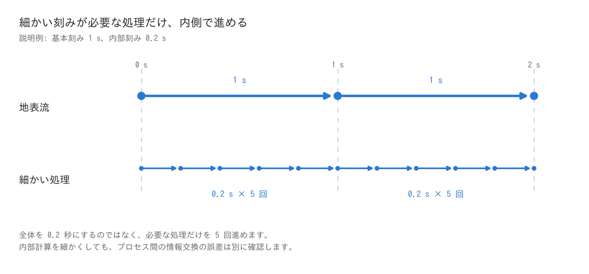

# クーラン数と時間刻みの決め方(時刻の管理の入門)

[時刻の管理へ戻る](time.md) | [ユーザーガイド目次へ](../users_guide.md) | [設計方針(中級〜上級)](timestep_policy.md)

**「何秒ずつ計算を進めればよいか」を、格子の大きさと波の速さから考えます。**

このページは、流れの数値計算(CFD)に初めて触れる人のための入門です。
[wave チュートリアル](../../tutorials/wave/README.md)の画面に出てくる
`Cn_max` 列と、パラメータ `dt` の決め方を、式を一つずつ追いながら説明します。
微積分や流体力学の知識は前提にしません。ENCflow がなぜこの方式を採って
いるかは、別ページの[時間刻みの設計方針](timestep_policy.md)に
まとめてあります。

水の流れを計算するとき、一度に時間を大きく進めると計算回数を減らせます。
しかし、進めすぎると結果が不自然になったり、計算が止まったりします。
その判断に役立つのが、**クーラン数**です。

[クーラン数の意味](#courant-number) · [時間刻みの設定手順](#choose-dt) · [流速・波速の概算表](#speed-table) · [Cn_max の読み方](#cn-max)

<a id="grid-and-time"></a>

## 1. 空間は「格子」、時間は「刻み」に分ける

コンピューターで川や水面を計算するとき、領域を小さな区画に分けます。この
区画を**セル**、その並びを**格子**と呼び、各セルに水深や流速の値を持たせます。

時間も、0 秒の状態から 1 秒後、2 秒後、3 秒後へと少しずつ進めます。この
**1 回に進める時間が「時間刻み」**です。

| 記号 | 意味 | 例 |
|---|---|---|
| $`\Delta x`$ | セルの幅(格子間隔) | 10 m |
| $`\Delta t`$ | 時間刻み | 1 s |
| $`a`$ | 変化が伝わる速さ | 5 m/s |

$`\Delta`$(デルタ)は間隔を表す記号です。ENCflow では、時間刻み
$`\Delta t`$ を `dt` で指定します([時刻の管理](time.md))。

**計算の刻みと、結果の保存間隔は別です。** `dt = 1`(秒)で保存間隔
`dt_file` が 60 秒なら、60 回計算するごとに保存します。保存だけを細かく
しても、計算そのものの精度は上がりません。[^time]

<a id="courant-number"></a>

## 2. クーラン数は「1 回で何セル分進むか」

波が毎秒 5 m で進むなら、1 秒後には 5 m、2 秒後には 10 m、3 秒後には
15 m 先にあります。セル幅が 10 m なら、それぞれ **0.5 セル分、1 セル分、
1.5 セル分**です。

この「何セル分」を表す数がクーラン数 $`C_n`$ です(ENCflow の画面の
`Cn_max` 列はこの最大値)。

```math
C_n = \frac{a\,\Delta t}{\Delta x}
```

分子の $`a\Delta t`$ は、1 回の計算中に変化が伝わる距離です。距離をセル幅で
割るので、クーラン数には単位がありません。



同じ流れなら、**時間刻みを半分にするとクーラン数も半分**になります。逆に、
格子幅だけを半分にすると、クーラン数は 2 倍になります。

### なぜ「進みすぎ」が問題になるのか

隣のセルの情報から次の状態を求める計算法を考えます。実際の波が 1 回の
計算中に何セル分も進むと、必要な遠方の情報を計算に取り込めないことが
あります。

**現象の情報が伝わる範囲を、計算法が扱える範囲に収める。** これが
**CFL 条件**(Courant–Friedrichs–Lewy 条件)の考え方です。近隣セルを使う
代表的な陽解法では、$`C_n \le 1`$ が目安になります。[^cfl]

ただし、上限は方程式や計算法によって異なります。**「どの方法でも 1 が
上限」「1 以下なら必ず正しい」という意味ではありません。**

<a id="wave-speed"></a>

## 3. 水の流速だけでなく、波の速さも必要

水の**流速**と、水位の変化が伝わる**波速**は別です。流れのない水面でも
波は広がるので、流速が 0 でも、時間刻みをいくらでも大きくできるわけでは
ありません。

水深に比べて波長が十分長い波では、水に対する波速は次の式で見積もれます。[^swe]

```math
c = \sqrt{g h}
```

$`h`$ は水深(m)、$`g`$ は重力加速度で、ここでは
$`9.81\ \mathrm{m/s^2}`$ とします。水深 1 m なら、
$`c = \sqrt{9.81 \times 1} \simeq 3.13`$ m/s です。**使うのは水底から
水面までの水深で、波の高さではありません。**

深い海でも、波長が十分長い津波にはこの式を使えます。一方、短い風波など
には、そのまま使えません。

### 流れがあると、波は流れにも運ばれる

流速 2 m/s、水に対する波速 3.13 m/s なら、下流向きの波は地面から見て
約 $`2 + 3.13 = 5.13`$ m/s で進みます。上流向きの波は、約
$`3.13 - 2 = 1.13`$ m/s で上流へ進みます。



時間刻みを決めるときには、**流速と波速を足した速さ**に注目します。
ENCflow の既定の監視(`f_check_cfl = 1`)では、次のクーラン数を
使います。[^encgrid][^state]

```math
C_n = \frac{\left(V + \sqrt{g h}\right)\,\Delta t}{\min(\Delta x, \Delta y)}
```

$`V = \sqrt{u^2 + v^2}`$ は平面内の流速の大きさです。$`\min`$ は小さい方を
選ぶ操作で、例えばセルの縦横が 20 m と 10 m なら 10 m を使います。

<a id="explicit-implicit"></a>

## 4. 陽解法と陰解法 — 「次の状態」をどう求めるか

セル内の水量は、「今の水量」に「入った水量」を足し、「出た水量」を引いて
更新します。その流入・流出を、どの時刻の状態から求めるかで計算法が
分かれます。

**陽解法**は、今分かっている水位や流速から、次の状態を求めます。
**陰解法**は、次の時刻の水位や流速も使います。その値はまだ未知なので、
関係するセルどうしでつじつまが合うように、連立方程式などを解きます。[^sundials]



| | 陽解法 | 陰解法 |
|---|---|---|
| 1 回の計算 | 比較的単純・軽量にしやすい | 連立方程式や反復計算が必要になることが多い |
| 時間刻み | 安定性の制約を受ける | 陰的に扱う部分の制約を緩められる場合がある |
| 大きすぎる刻み | 不安定化や精度低下につながる | 安定でも、急な変化や波形を十分に表せない場合がある |

**陰解法でも、大きな時間刻みで正確に計算できるとは限りません。**
「計算が続くこと」と「変化を正しく捉えること」は別です。

ENCflow の地表流は**陽解法を主体**としています。異なる物理プロセスを
実装・組み合わせやすく、これまでの地表流計算で精度と計算時間のバランスを
取りやすかったためです。したがって、クーラン数による時間刻みの確認が
大切です。

なお、摩擦は半陰的に扱い、非静水圧補正では反復計算も使います。すべての
処理が完全な陽解法というわけではありません。詳しくは
[時間刻みの設計方針](timestep_policy.md)を参照してください。[^encgrid][^nh]

<a id="cn-max"></a>

## 5. Cn_max は、計算の「健康診断」の一つ

水深や流速は場所によって違うので、クーラン数もセルごとに異なります。
平均が小さくても、1 か所で大きくなれば、そこが計算の問題を引き起こす
ことがあります。



ログの **`Cn_max` は、各セルのクーラン数の最大値を、さらに表示区間内で
最大にした値**です(海域マスクのセルは流れを解かないため含みません)。例えば 60 秒ごとに表示するなら、その間のピークが
記録されます。計算開始からの全期間最大ではありません(開始時の表示は
初期状態の値です)。[^state]

既定の設定 `f_check_cfl = 1` では、クーラン数が 1 を超えると停止します。
ただし、**1 は「ぎりぎりまで使う目標」ではありません。** 乾いた地面へ
広がる水や急勾配の流れでは、より小さな値が必要になります。[^encgrid]

`Cn_max` だけでなく、水深・流速の分布、流量の時間変化、水の収支も確認
します。`Runge` や `ex_flux` は、局所的な再計算や過大流出の抑制が
どの程度必要になっているかを知る手掛かりです
(列の意味は [wave チュートリアル Step 1](../../tutorials/wave/README.md#実行))。

> **小さい `Cn_max` は、正しい結果の保証ではありません。** また、監視を
> 解除したり(`f_check_cfl = 0`)、波速を除く設定(`f_check_cfl = 2`)に
> 変えたりしても、時間刻みの問題は解決しません。入門計算では既定の
> 監視設定を使います。

<a id="choose-dt"></a>

## 6. 時間刻みを決める手順

**格子幅と速さから見積もり、試行して確かめます。**



### 手順1: 短い方の格子間隔を確認する

必要なのは領域全体の幅ではなく、**1 セルの幅**です。縦横で異なるときは
短い方を使い、$`\Delta_{\min} = \min(\Delta x, \Delta y)`$ とします。
単位は m です。

### 手順2: 計算中に生じそうな大きな流速と水深を見積もる

観測、地形、類似ケースなどから、大きめの流速 $`V_{\mathrm{est}}`$ と
水深 $`h_{\mathrm{est}}`$ を見積もり、次の速さを計算します。

```math
a_{\mathrm{est}} = V_{\mathrm{est}} + \sqrt{g h_{\mathrm{est}}}
```

**平均値や開始時の値ではなく、出水時や深く水が溜まる場所も考えます。**
初めが乾いた地面でも、水深・流速を 0 として時間刻みを決めてはいけません。

最大流速と最大水深が別の場所に現れる場合、この足し算は大きめの見積もりに
なりますが、最初はそれで構いません。

<a id="speed-table"></a>

### 流速・波速の概算表

次の表は、現象ごとの速さの桁をつかむための例です。**水深・流速は仮定値で
あり、各現象に共通する最大値ではありません。** 自分の対象領域に合わせて
置き換えます。波速は $`c = \sqrt{9.81 h}`$ で計算しています。

| 想定する場面 | 仮定した水深 | 仮定した流速 | 波速 $`c`$ | 足した速さ $`a`$ |
|---|---:|---:|---:|---:|
| 斜面上の薄い表面流 | 0.05 m | 1 m/s | 0.70 m/s | 1.70 m/s |
| 氾濫原・市街地の浸水 | 1 m | 2 m/s | 3.13 m/s | 5.13 m/s |
| 河川の洪水流 | 5 m | 5 m/s | 7.00 m/s | 12.0 m/s |
| 急勾配の速い地表流 | 2 m | 10 m/s | 4.43 m/s | 14.4 m/s |
| 湾・湖の長波や水位変化 | 20 m | 2 m/s | 14.0 m/s | 16.0 m/s |
| 深い外洋の津波伝播 | 4,000 m | 1 m/s | 198 m/s | 199 m/s |

流域全体の計算では、薄い斜面流だけでなく、深く速い河道の流れも考えます
([chichibu チュートリアルの補足](../../tutorials/chichibu/README.md#時間刻みと計算量)では、
格子を細かくすると谷筋の最大流速が増え、格子比どおりに縮めた `dt` では
足りなかった例を示しています)。土石流・地下水などを加える場合は、
この清水の表だけでなく、[各プロセスの制約](#other-limits)も確認します。

### 手順3: $`C_n = 1`$ になる刻みを計算する

```math
\Delta t_{C_n=1} = \frac{\Delta_{\min}}{a_{\mathrm{est}}}
```

これは「見積もった速さで 1 セル分進む時間」です。安定性が保証された上限
ではありません。

例えば、**セル幅 20 m、最大水深 4 m、最大流速 3 m/s** と見積もった場合は、

```math
\begin{aligned}
c &= \sqrt{9.81 \times 4} \simeq 6.26\ \mathrm{m/s}\\
a_{\mathrm{est}} &= 3 + 6.26 = 9.26\ \mathrm{m/s}\\
\Delta t_{C_n=1} &= 20 / 9.26 \simeq 2.16\ \mathrm{s}
\end{aligned}
```

となります。

### 手順4: 余裕を持たせ、小さめの扱いやすい刻みにする

初めて組むケースでは、**目標クーラン数を 0.5 程度**として始めます。
乾湿前縁や急勾配などでは、0.4 程度や、さらに小さい値が必要な場合も
あります。[^encgrid]

```math
\Delta t_{\mathrm{start}} \ \le\ C_{n,\mathrm{target}}\,\frac{\Delta_{\min}}{a_{\mathrm{est}}}
```

先ほどの例で目標を 0.5 とすれば、$`0.5 \times 2.16 \simeq 1.08`$ 秒なので、
**`dt = 1.0`** から試します。推定クーラン数は約 0.46 です。扱いやすい値に
するときは、大きい方へ切り上げず、小さい方を選びます。

流れが滑らかで、結果への影響が小さいと確認できれば、目標を 0.8 程度に
して計算量を減らす検討もできます。0.5 や 0.8 は試行の目安であり、万能の
安定限界ではありません。

*設定に `dt_c`(文字列指定)も書いてある場合は、そちらが優先されます。
時間刻みは `dt` と `dt_c` のどちらか一方で指定すると、変更の取り違えを
防げます。[^time]*

<a id="check-results"></a>

### 手順5: ピークまで計算し、刻みを変えて比較する

開始直後だけでなく、**出水ピークや水が深く溜まる時期まで**、`Cn_max` と
結果を確認します。

| 見るもの | 確認すること |
|---|---|
| `Cn_max` | 目標より大きくなっていないか |
| 水深・流速・流量 | 不自然な急増や振動がないか |
| 水の収支 | 貯留量の変化が、降雨・流入・流出などとつり合うか |
| `dt` を半分にした結果 | 最大浸水深、流量ピーク、到達時刻などが大きく変わらないか |

クーラン数が大きすぎる場合は、同程度の流れになると仮定して、

```math
\Delta t_{\mathrm{new}} \simeq \Delta t_{\mathrm{old}}\,\frac{C_{n,\mathrm{target}}}{C_{n,\mathrm{obs}}}
```

で変更の目安を求められます。例えば `dt = 2`(秒)で `Cn_max = 0.9`、
目標が 0.5 なら、$`2 \times 0.5 / 0.9 \simeq 1.11`$ 秒なので、1 秒などへ
変更します。

ただし、水深や流速が不自然に増えているなら、刻みだけでなく地形・境界・
入力も調べます。問題の場所を探すには、`f_out_cn = 1` によるクーラン数の
分布出力(`Cn0001` など)も役立ちます([入出力の形式](io.md))。[^state]

最後に、代表ケースで **`dt` を半分にして、知りたい結果を同じ時刻で比較**
します。結論が変わるほど差があれば、さらに小さくして確認します。一度の
比較で誤差のすべてが分かるわけではありませんが、時間刻みが適切かを判断
する大切な手掛かりです。[^nasa]

<a id="fixed-step"></a>

## 7. ENCflow の基本時間刻みは固定

ENCflow は、指定した `dt` を計算中に自動変更しません。水深や流速が増えても
同じ刻みなので、`Cn_max` を確認する必要があります。[^state][^time]

固定刻みは時刻や複数プロセスの更新を管理しやすい一方、穏やかな期間にも
小さい刻みを使い続けることがあります。可変刻みなら、条件に応じて刻みを
増減し、計算回数を減らせる場合があります。**固定刻みが常に最速という
わけではありません。** 陽解法でも可変刻みは使えます。[^sundials][^clawpack]

また、ENCflow の**適応的ルンゲクッタ法は `dt` を変える機能ではありません。**
同じ刻みの中で、流量が急変したエッジだけを多段で再計算します
([wave チュートリアル Step 2](../../tutorials/wave/README.md#step-2-enc-パラメータの設定))。[^encgrid]

<a id="other-limits"></a>

## 8. 他の制約と、サブサイクル

### 波のクーラン数だけでは決まらない

物質や運動量が周囲へ広がる**拡散**には、波の伝播とは別の時間刻みの制約が
あります。基本的な陽解法では、格子幅を半分にすると、拡散の制約から
許される刻みはおおむね 1/4 になります。水の移動が遅くても、小さい刻みが
必要な場合があるのです。[^diffusion]

地下水・管路・土砂・反応などを加えるときは、**地表流の `Cn_max` に加えて、
各モジュールの安定条件や警告も確認**します。

### 細かい刻みが必要な処理だけ、内側で進める

地表流は 1 秒刻みでよくても、別の処理には 0.2 秒以下が必要だとします。
全部を 0.2 秒にすると、地表流まで 5 回計算することになります。

そこで、地表流は 1 秒ずつ進め、必要な処理だけをその内側で 0.2 秒ずつ 5 回
進めます。これが**サブサイクル**です。



ENCflow では、例えば管路連続体層の側方通水で自動サブサイクルを使います。
ただし、すべてのモジュールが自動で細分されるわけではありません。また、
プロセス間の相互作用が強い場合は、内部だけ細かくしても不十分で、基本刻みや
情報交換の間隔も見直します。[^gwflow]

<a id="accuracy"></a>

## 9. どこまで細かくすればよいか

同じ面積を二次元で計算するとき、格子幅を半分にするとセル数は約 4 倍です。
同じ速さ・同じクーラン数を保つには時間刻みも半分なので、ステップ数は
約 2 倍。計算量は**およそ $`4 \times 2 = 8`$ 倍**になります。これは、各セルの
処理量などが同程度の場合の目安です。

一方、刻みを小さくしても、地形データの誤りや、モデルが省略した物理は
直りません。静水圧の浅水方程式を正確に解いても、鉛直加速度による波の
分散が重要なら、別の物理モデルが必要です。
[wave チュートリアルの補足](../../tutorials/wave/README.md#補足-波面の振動の正体--格子の細分と物理分散)で、
その違いを見られます。

**「計算が続く」「方程式を十分な精度で解く」「現象を適切に再現する」は、
別の確認事項です。**[^nasa]

ENCflow では、知りたい量や結論が時間刻みに左右されないかを確かめ、
**目的に必要な精度と計算の速さを両立**させます。十分な精度に達した後は、
さらに刻みを細かくするより、降雨や粗度などの条件を変えて試す方が有用な
こともあります。ただし、数値的な波のなまりを、省略した物理の代わりには
しません。この考え方の背景は[時間刻みの設計方針](timestep_policy.md)に
あります。

---

**クーラン数は「1 回に何セル分進むか」。水面の計算では「流速+波速」を
使い、時間刻みは式で見積もって、`Cn_max` と結果の比較で確かめます。**

[設定手順へ戻る](#choose-dt) · [wave チュートリアル](../../tutorials/wave/README.md) · [chichibu チュートリアル](../../tutorials/chichibu/README.md) · [時間刻みの設計方針](timestep_policy.md)

## 参考文献

[^cfl]: Driscoll, T. A. and Braun, R. J.: [Upwinding and stability](https://fncbook.com/upwind/), *Fundamentals of Numerical Computation*. CFL 条件の入門的な説明。原論文は Courant, R., Friedrichs, K. and Lewy, H. (1928): Über die partiellen Differenzengleichungen der mathematischen Physik. *Math. Ann.*, 100, 32–74.
[^swe]: Ketcheson, D. I., LeVeque, R. J. and del Razo, M. J.: [The shallow water equations](https://www.clawpack.org/riemann_book/html/Shallow_water.html), *Riemann Problems and Jupyter Solutions*. 長波近似と波速。
[^encgrid]: ENCflow, [ENC 格子と時間積分の解説](encgrid.md) §6–7。時間積分・適応的ルンゲクッタ・CFL 監視と目安 0.5。
[^state]: ENCflow, `src/m_state.f90`(`m_state_calcstat`・`m_state_printstate`)。クーラン数と表示区間内最大の集計、`f_out_cn` の出力。
[^time]: ENCflow, [時刻の管理](time.md)。基本時間刻み・`_c` 指定・表示間隔・保存間隔。
[^sundials]: xSDK / ATPESC, [Time Integration with SUNDIALS](https://xsdk-project.github.io/MathPackagesTraining2020/lessons/time_integrators_sundials/)。陽・陰・固定・可変刻み。
[^nh]: ENCflow, [非静水圧補正の解説](nonhydrostatic.md) §3。静水圧計算を予測子とした反復補正。
[^nasa]: NASA Glenn / NPARC Alliance, [Verification Assessment](https://www.grc.nasa.gov/www/wind/valid/tutorial/verassess.html)、[Validation Assessment](https://www.grc.nasa.gov/www/wind/valid/tutorial/valassess.html)。数値誤差と物理的妥当性。
[^clawpack]: Clawpack, [Specifying classic run-time parameters](https://www.clawpack.org/setrun.html)。CFL に応じた可変刻み。
[^diffusion]: ENCflow, [拡散項の解説](diffusion.md) §4。拡散の安定条件。
[^gwflow]: ENCflow, [地下水](gwflow.md)、管路連続体層。側方通水のサブサイクル。
