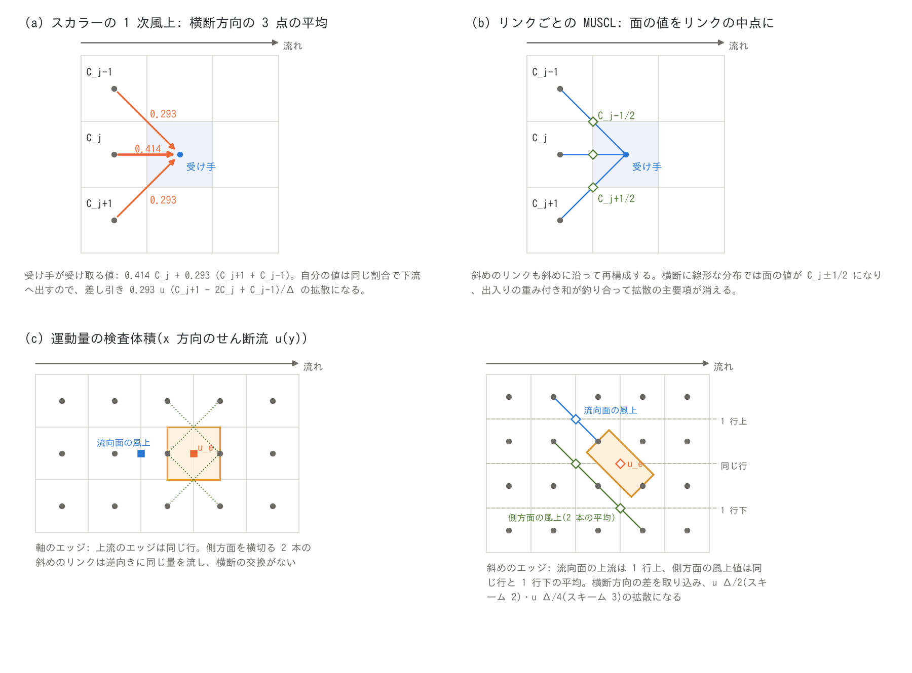
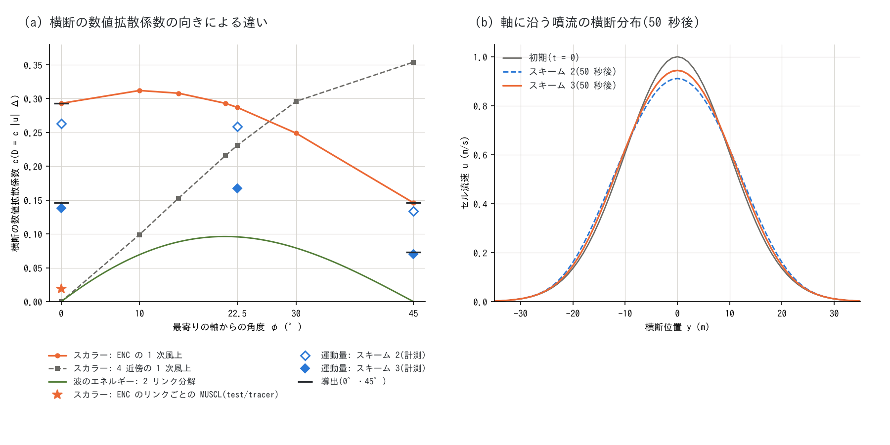
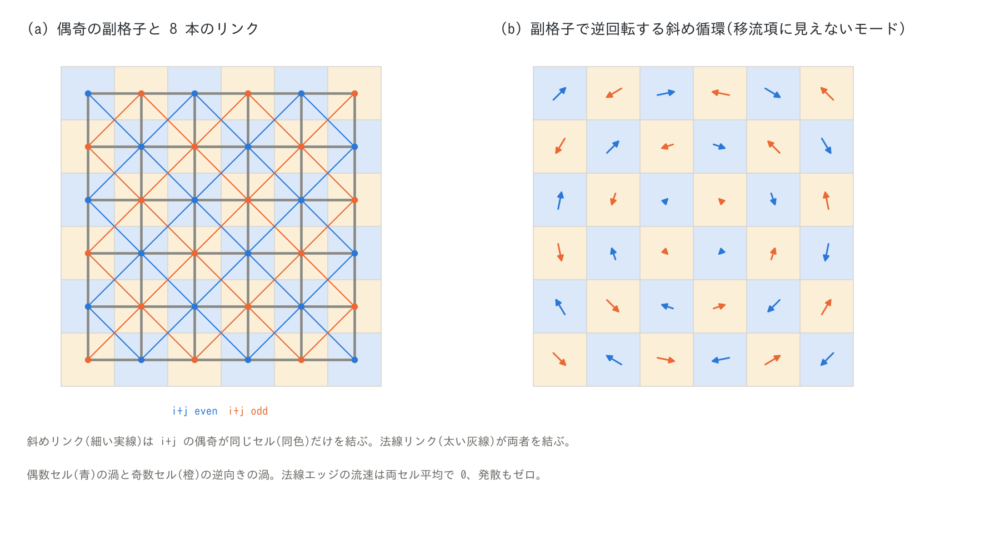

# 斜めエッジの流束による数値拡散 — 8 方向のリンクが流れを横へならす量と対策(浅水流計算の補足)

[浅水流計算の章へ](swflow.md) | [ユーザーガイド目次へ](../users_guide.md) | [移流項のスキーム](advection.md)

ENC 格子は、水・運動量・運ばれる物質を、各セルの軸方向 4 本と斜め方向 4 本の
エッジ(リンク)で隣へ運びます。$`x`$ 方向の一様な流れでも、流量の 0.414 は軸の
リンクを、0.293 ずつは左右の斜めのリンクを通ります。斜めのリンクの上流側は
**1 行横のセル**なので、風上の値をそのまま運ぶ(1 次風上)と、受け手は横断方向に
並んだ 3 つのセルの値の平均を受け取ります。横断方向の流速がまったくなくても、
濃度や流速の横断分布がならされる — これが本書の主題の**斜めエッジの流束による
数値拡散**です。4 近傍格子では軸に沿う流れでこの拡散は出ませんが、斜めの流れで
出ます(§2.3)。

このページは、この数値拡散が**スカラー輸送**(浮遊砂・水質・塩水層・流木・瓦礫の
濃度)と**運動量**(流速)のそれぞれで何を起こし、どの程度の大きさで、どのような
場合にどのような対策が実装されているか(採らなかった案を含む)、何が限界として
残るかをまとめます。運動量では、拡散が「多すぎる」だけでなく、斜めのリンクの
並び方のために「足りない」所(斜め副格子モード)と、側方面の流束が質量と食い違うと
「負になる」所(反減衰)があり、どちらも斜めエッジの検査体積の側方面の扱いの
問題として直してきました(§4.4・§4.5)。

式の詳細は[ENC 格子と時間積分の解説](encgrid.md) §2・§4 と[移流項のスキーム](advection.md)
§4・§7、運動量保存形の定式化の詳説は [advection_design.md](../advection_design.md)
にあります。設計と検証の記録の正本は developer.md(§68.36〜§68.45、§78、§90.2、
§90.13)と [test/tracer](../../test/tracer/README.md)・
[test/sublattice](../../test/sublattice/README.md) の README です。運動量の
横断方向の数値拡散の式(§2.4)は本書での導出(独自)で、その数値の確認は
developer.md §68.45 に記録しています。中級〜上級の利用者と開発者向けで、既定のまま
計算するなら §1 と §6 だけで足ります。

<a id="summary"></a>

## 1. 要点

- **しくみ**: 8 方向のリンクは軸に沿う流れの流量の 58.6 % を斜めへ配るので、
  1 次風上の受け手は横断方向の 3 点の重み付き平均を受け取ります。正方セルでは
  横断の数値拡散係数が $`D_\perp = (p_d/2)\,u\Delta \approx 0.293\,u\Delta`$ に
  なります($`p_d`$ = `p_diagratio`。§2.2)。流れの向きによって変わり、45° では
  その半分です(§2.3)。
- **スカラー輸送**: 1 次風上(`f_scalar_scheme = 1`)では、この横断の拡散と縦断の
  $`u\Delta(1 - Cr)/2`$ が物理の分散を 1〜2 桁上回り、格子幅に比例します。既定の
  **リンクごとの MUSCL(`f_scalar_scheme = 3`。2026-10-13 から)** は斜めのリンクも
  斜めに沿って再構成するので横断の主要項が消え、[test/tracer](../../test/tracer/README.md)
  で横断が 1/14 になります。総量・堆積量などの積分量には、どちらのスキームでも
  効きません(§3)。
- **運動量**: 流れに斜めのリンクの族だけが横断方向にならされ、セル流速の横断分布は
  スキーム 2(1 次風上)で $`\approx 0.29\,u\Delta`$(スカラーの 1 次風上と同じ)、
  既定のスキーム 3 で $`\approx 0.15\,u\Delta`$ の拡散係数で広がります(軸に沿う流れ。
  §2.4)。スキーム 3 の MUSCL は流向面だけで、側方面は 1 次風上のままだからです。
  実用の格子では渦動粘性(ゼロ方程式モデルの既定)を 1〜2 桁上回るので、噴流・
  せん断層・沿岸流の横断分布の広がりは格子に依ります(§4.1・§4.2)。
- **足りない拡散と負の拡散**: 斜めのリンクは $`i + j`$ の偶奇が同じセルどうしを結ぶため、
  2026-10-17 までは偶奇の副格子で逆回りの斜め循環(市松模様)を移流項がならしません
  でした(§4.4)。側方面の流束が連続式の流量より大きいと、運動量の交換が運動
  エネルギーを作り、深い湛水の縁などで有限時間で発散しました(§4.5)。どちらも
  側方面の定式化で直してあり、滑らかな場の主要項と段波の検定値は変えていません。
- **沿岸の波浪場**は、波のエネルギーを伝播方向を挟む 2 本の格子方向に分ける
  **2 リンク分解**で運ぶので、軸・対角の向きの伝播では横断の数値拡散がありません
  (§5)。
- 場合ごとの対策と既定、利用者がとれる対処は §6 の表にあります。

<a id="mechanism"></a>

## 2. しくみ — 斜めのリンクは流れを横へ配る



*(a) スカラーの 1 次風上: $`x`$ 方向の流れでも、受け手(中央)は真上流から 0.414、斜め上流の 2 セルから 0.293 ずつを受け取る。横断方向の 3 点の平均になり、分布がならされる。(b) リンクごとの MUSCL: 斜めのリンクでも斜めに沿って再構成し、面の値をリンクの中点(◇)の値にする。横断に線形な分布では受け取る値の重み付き和が中央の値に一致し、ならしの主要項が消える。(c) 運動量の検査体積(橙): 軸のエッジ(左)は流向面の上流のエッジが同じ行にあり、側方面を横切る斜めのリンク 2 本(点線)の流量が打ち消し合うので横断方向の交換がない。斜めのエッジ(右)は流向面の上流のエッジが 1 行横に、流入側の側方面の風上値(反対偶奇の平行リンク 2 本の平均)が同じ行と反対側の行にあり、横断方向の差を取り込む。*

<a id="partition"></a>

### 2.1 一様流の配分

ENC 格子はセルの各辺を 3 つに分け、中央の $`(1 - p_d)\Delta`$ を法線(軸)エッジに、
両端の $`(p_d/2)\Delta`$ ずつを角を回り込む斜めエッジに通過幅として割り当てます
([ENC 格子の解説](encgrid.md) §2、[通過幅の調整](passage_width.md) §2)。既定の
$`p_d = 2/(2+\sqrt2) \approx 0.586`$ では 8 本の通過幅がすべて $`0.414\Delta`$ です。
$`x`$ 方向の一様流 $`(u, 0)`$ では、軸のリンクの法線流速は $`u`$、斜めのリンクは
$`u/\sqrt2`$ なので、1 セルから $`+x`$ 側へ出る流量は

```math
\underbrace{(1 - p_d)\,\Delta\,u h}_{\text{軸: } 0.414}
\;+\; 2 \times \underbrace{\frac{p_d}{2}\sqrt2\,\Delta \cdot \frac{u}{\sqrt2}\,h}_{\text{斜め: } 0.293}
\;=\; \Delta\,u h
```

に分かれます。合計は正しく $`\Delta u h`$ ですが、**流量の 58.6 % は 1 行横の
セルへ向かいます**。斜めに出た分と斜めから入る分は打ち消し合うので、一様な流れの
水の収支には何の影響もありません。影響が出るのは、運ばれる量(濃度・流速)が
横断方向に変わるときです。

<a id="scalar-mechanism"></a>

### 2.2 1 次風上のスカラー: 横断方向の 3 点の平均

体積濃度 $`C`$ が $`x`$ 方向に一様で、横断方向 $`y`$ にだけ変わる場を、1 次風上
(面の値 = 風上セルの値)で運ぶとします。セル $`(i, j)`$ は真上流
$`(i-1, j)`$ から 0.414、斜め上流 $`(i-1, j\pm1)`$ から 0.293 ずつを受け取り、
自分の値 $`C_j`$ を同じ割合で下流へ出すので(図 (a))、正方セル($`\Delta x = \Delta y = \Delta`$)では

```math
\frac{\partial C_j}{\partial t}
= \frac{u}{\Delta}\cdot\frac{p_d}{2}\,\bigl(C_{j+1} - 2C_j + C_{j-1}\bigr)
\;\approx\; \frac{p_d}{2}\,u\,\Delta\;\frac{\partial^2 C}{\partial y^2},
\qquad
D_\perp = \frac{p_d}{2}\,u\,\Delta \approx 0.293\,u\,\Delta
```

になります。横断方向の流速はゼロでも、横断の拡散係数 $`0.293\,u\Delta`$ の拡散が
働きます。流れ方向には、どの格子の 1 次風上にもある縦断の数値拡散
$`D \approx u\Delta(1 - Cr)/2`$($`Cr = u\Delta t/\Delta`$)が加わります。浅水流の
時間刻みは重力波のクーラン条件で決まるのでスカラーの $`Cr`$ は 0.1〜0.2 程度で、
縦断・横断とも実質的に**格子幅に比例**します。[test/tracer](../../test/tracer/README.md)
は一様流の直線水路で両者を計測し、修正方程式の理論値と一致することを確かめて
います(u = 1.0 m/s・Δ = 10 m で縦断 4.7 m²/s、横断 2.7 m²/s。理論値 4.5、2.9。
理論値との比は 0.93〜1.05)。

<a id="orientation"></a>

### 2.3 向きによる違い(4 近傍格子・2 リンク分解との比較)



*(a) 一様な速度で運ぶ 1 次風上の横断の数値拡散係数(単位 $`u\Delta`$)。φ は最寄りの軸からの角度。スカラーの 3 方式は [wavefield_plan.md](../wavefield_plan.md) §6.1 のガウス塊の移流による数値、運動量の点は本書の噴流の計測(developer.md §68.45。$`D = c\,|u|\Delta`$ の $`c`$ に換算)。(b) 軸に沿う噴流(初期の中心流速 1 m/s、幅 σ = 10 m、Δ = 1 m、無摩擦)の 50 秒後の横断分布。*

1 次風上の横断の数値拡散は、流れの向きと格子の関係で決まります。正方格子・一様な
速度で測った係数(単位 $`u\Delta`$。[wavefield_plan.md](../wavefield_plan.md) §6.1 の
数値計算)は次のとおりです。

| 最寄りの軸からの角度 φ | 0° | 10° | 15° | 21° | 22.5° | 30° | 45° |
|---|---:|---:|---:|---:|---:|---:|---:|
| ENC(8 リンクの有限体積)の 1 次風上 | 0.293 | 0.312 | 0.308 | 0.293 | 0.287 | 0.249 | 0.146 |
| 4 近傍格子の 1 次風上 | 0 | 0.099 | 0.153 | 0.216 | 0.231 | 0.296 | 0.354 |
| 2 リンク分解の 1 次風上(§5) | 0 | 0.069 | 0.088 | 0.096 | 0.096 | 0.079 | 0 |

4 近傍格子は軸に沿う流れで横断の拡散がなく、45° で最大になります(よく知られた
「格子の向き」の誤差)。ENC は軸に沿う流れでも 0.29 前後を持ち、45° では半分に
なります。向きによる違い(最大と最小の比)は 4 近傍より小さいものの、**どの向きでも
ゼロにはなりません**。ENC の斜めのリンクは 1 セル幅の斜めの谷をつなぎ、斜めの流れの
通水能を正しく表すためのものですが([通過幅の調整](passage_width.md) §6)、その代わりに
軸に沿う流れでも運ぶ量を斜めへ配るのが、この拡散の由来です。

<a id="momentum-mechanism"></a>

### 2.4 運動量: 流れに斜めのリンクの族だけがならされる

ENC の運動方程式はエッジの法線流速 $`u_e`$ を未知数にし、運動量保存形の移流項
(スキーム 2・3)はエッジごとの運動量検査体積の面を通る流束で評価します
([移流項のスキーム](advection.md) §4)。$`x`$ 方向の流れ $`u(y)`$(横断方向に変わる
せん断流)で、各族のエッジが何を受け取るかを見ます(図 (c))。

- **軸のエッジ(法線 $`x`$)**: 線 $`k`$ が $`x`$ 方向なので、流向面の風上のエッジは
  同じ行にあります。側方面は、面を横切る斜めのリンク 2 本(単位正方形の 2 本の
  対角)が逆向きに同じ量を流すので、面の正味の流量がゼロになり、横断方向の交換が
  ありません。この族は横断方向にならされません。
- **斜めのエッジ**: 線 $`k`$ が斜めなので、流向面の風上のエッジは 1 行横にあります。
  流入側の側方面の風上値は、面の前後にある反対偶奇の平行リンク 2 本(同じ行と
  反対側の 1 行横)の平均です(§4.4)。どちらも横断方向に位置がずれた値で、
  **流向面と側方面の 1 次の項が打ち消し合ったあと、2 次の項が保存形の拡散として残ります**。

斜めのエッジの流速 $`u_d`$ について、移流項は次の数値拡散を含みます。

```math
\frac{\partial u_d}{\partial t}\bigg|_{\text{数値}}
\approx \frac{\partial}{\partial y}\!\left(D_d\,\frac{\partial u_d}{\partial y}\right),
\qquad
D_d =
\begin{cases}
u\Delta/2 & \text{スキーム 2(流向面・側方面とも 1 次風上)}\\[2pt]
u\Delta/4 & \text{スキーム 3(流向面は MUSCL。滑らかで単調な所)}
\end{cases}
```

(正方セル。本書での導出)。スキーム 3 は流向面の値を MUSCL で再構成する
ので(滑らかな所では面の値が両側のエッジの中間になる)流向面の分が消え、側方面の
1 次風上の分だけが残って半分になります。極値(噴流の中心軸など)では限定器が
1 次風上に戻るので、そこではスキーム 2 と同じ $`u\Delta/2`$ です。

セル流速は軸の族と斜めの族の重み付き和($`(1 - p_d)`$ と $`p_d`$。
[ENC 格子の解説](encgrid.md) §4)なので、出力のセル流速の横断分布は
$`p_d D_d`$、すなわち

- スキーム 2 で $`\approx 0.293\,u\Delta`$ — **スカラーの 1 次風上と同じ値**
- スキーム 3(既定)で $`\approx 0.146\,u\Delta`$

の係数で広がります。45° の流れでは役割が入れ替わり、流れに沿う斜めの族は交換を
持たず、流れに斜めの軸の族がならされます(係数はスキーム 2 で $`\approx 0.146\,u\Delta`$、
スキーム 3 で $`\approx 0.073\,u\Delta`$。スカラーの 1 次風上の 45° と同じく半分)。

**計測(developer.md §68.45)**: 平坦・無摩擦の閉じた水路(Δ = 1 m、水深 1 m)に
中心流速 1 m/s・幅 σ = 10 m のガウス形の噴流を置き、50 秒のあいだの横断分布の広がり
($`\sigma^2`$ の増え方)を測りました。物理の粘性も摩擦もないので、広がりはすべて
数値的なものです。拡散係数が局所の流速に比例する($`D = c\,u\Delta`$)として
$`c`$ に換算すると次のとおりで、導出の値より 4〜10 % 低く出ます(当てはめの
40 秒のあいだに噴流が減衰し、流速に比例する係数が下がる分)。

| 噴流の向き | スキーム 2 の $`c`$ | スキーム 3 の $`c`$ | (参考)スカラーの 1 次風上 |
|---|---:|---:|---:|
| 0°(軸に沿う) | 0.26(導出 0.293) | 0.14(導出 0.146) | 0.293 |
| 22.5° | 0.26 | 0.17 | 0.287 |
| 45°(対角に沿う) | 0.13(導出 0.146) | 0.070(導出 0.073) | 0.146 |

中心流速は 50 秒で、0° のスキーム 2 で 1.00 → 0.91、スキーム 3 で 0.94 に下がりました
(図 (b))。0° では、2 つの族の更新式を横断方向の 1 次元に落とした計算が、ENCflow の
中心流速を 0.1 %、$`\sigma^2`$ を 0.3 % 以内で再現します(どちらの族がならされるかの
説明が正しいことの確認)。格子を Δ = 0.5 m に細かくすると(時間刻みも半分)、
拡散係数はスキーム 2 で 0.52 倍、スキーム 3 で 0.51 倍になり、格子幅に比例します。

<a id="scalar"></a>

## 3. スカラー輸送での影響と対策

<a id="scalar-targets"></a>

### 3.1 対象

地表の柱状量は、浅水流計算のステップ内で連続式と同じエッジ流量を使う保存輸送
カーネル(`advect_scalar`)で運びます([移流項のスキーム](advection.md) §7)。対象は
浮遊砂・土石流の土砂 $`h_s`$、水質の物質 $`c_q`$、淡塩 2 層の塩水層 $`h_{ss}`$、
流木 $`h_d`$、瓦礫 $`h_{bd}`$ で、`f_scalar_scheme` は全部に一括で効きます。
質量は機械精度で保存され、一様な濃度は一様のままです。

<a id="scalar-impact"></a>

### 3.2 影響

- **局所のピークが下がり、前線とプルームが太くなる。** 1 次風上では、清水の前線は
  1 時間で幅 370 m(37 セル)まで広がり、点源のプルームは 3 km 下流で
  $`\sigma_y \approx 130`$ m に広がります(test/tracer、Δ = 10 m)。物理の分散
  (Elder 型の縦断 $`5.9\,h u_* \approx 0.3`$ m²/s、横断 $`0.15\,h u_* \approx 0.01`$ m²/s。
  $`h`$ = 1 m・$`u_*`$ = 0.05 m/s)を 1〜2 桁上回ります。
- **ピークや密度で判定する過程に効く。** 流木・瓦礫を含めた流体力と家屋破壊の判定、
  土石流の濃度に依存する抵抗則、水質のピーク濃度、塩水くさびの先端位置など、
  局所の濃度が結果を左右する量が、1 次風上では鈍った濃度場で決まります(MUSCL に
  するとピークが高く出る向きに変わる。developer.md §78)。
- **答えが格子で変わる。** 数値拡散は格子幅に比例するので、格子を変えると結果が
  変わり、校正の土台になりません。これが既定を MUSCL にした主な理由です。
- **積分量には効かない。** 総量・堆積量の合計・流出の総量は保存則で決まり、数値拡散の
  影響を受けません。乾いた地盤へ進む前線は供給元の濃度をそのまま持ち込むので、
  縦断の拡散が効くのは湿った領域の中の濃度差(清水との混合、点源、合流)です。

<a id="scalar-muscl"></a>

### 3.3 対策: リンクごとの MUSCL(既定)

`f_scalar_scheme = 3`(既定。2026-10-13 に 1 から変更)は、各リンクの向きに沿って
風上 $`c_{up}`$・風下 $`c_{dn}`$・さらに風上 $`c_{uu}`$ の 3 点から、van Leer の
限定器[^vanleer79]で面の値を再構成します。

```math
c_{face} = c_{up} + \tfrac12\,\psi(r)\,(c_{dn} - c_{up}),
\qquad
r = \frac{c_{up} - c_{uu}}{c_{dn} - c_{up}},
\qquad
\psi(r) = \frac{r + |r|}{1 + |r|}
```

**斜めのリンクでも斜めの向きに沿って**再構成するのが要点です(図 (b))。横断方向に
線形な分布では、斜め上流からの面の値がリンクの中点 $`C_{j\pm1/2}`$ になり、受け手が
受け取る値の重み付き和が中央の値に一致するので、横断の数値拡散の主要項が消えます。
同じ式は流れの移流項(スキーム 3)の面の値と共通です。

test/tracer の計測(u = 1.0 m/s、Δ = 10 m。README の表)で、1 次風上に対する比は
縦断が 1/5〜1/14、横断の $`D_y`$ が 1/14(2.7 → 0.19 m²/s、3 km 下流の
$`\sigma_y`$ 129 → 38 m)です。濃度に負値や初期濃度を超える値は出ません。
カーネルの計算量はスカラー 1 種あたり 2〜3 倍で、ステップ全体では数 % です。
限定器の性質として、極値(前線の両端・プルームの中心)では 1 次風上に戻るので、
そこに残る拡散が縦断の残りの大半です。

<a id="scalar-fallback"></a>

### 3.4 1 次風上に戻る所と、1 次風上のままの輸送

**MUSCL が 1 次に退化する所。** 境界面からの流入(区間流入などの濃度表)、
風下のセルが領域外・海セル・乾燥、さらに風上のセルが無効・海セル・乾燥の面は
1 次風上のままです(壁・乾いた床・規定境界は濃度の勾配を供給しない。流れの移流項の
供給元の規則と同じ考え方。[移流項のスキーム](advection.md) §4.4)。したがって
壁際・乾湿の前縁・海岸・流入口の近くでは、実質的に 1 次風上の拡散が残ります。

**1 次風上のままの輸送(`f_scalar_scheme` の対象外)。**

- **地下水の同伴輸送 $`c_g`$**(水質の地下の質量)は、意図して 1 次風上のままです
  (2026-10-22 の判断。[docs/handoff.md](../handoff.md) 1l)。地下の間隙流速は遅く、
  1 次の数値拡散 $`D \approx u\Delta x/2`$ と物理の縦断分散 $`D_L = \alpha_L u`$ の比
  $`\Delta x/(2\alpha_L)`$ が同じ桁に収まること、$`c_g`$ には物理の分散項がなく、
  1 次の数値拡散がその代役を務めていること(MUSCL だけを入れると分散ゼロの
  地下水になり、湧出点の破過が現実より急になる)が理由です。必要になったら、
  分散度を直接与えるパラメータと MUSCL を同じ作業で入れる計画です。
- **溶岩の温度**(`f_lvtemp = 1`)の熱の流量は、溶岩のエッジ流量 × 面の温度で、既定では
  送り手の温度(1 次風上)です。溶岩流は溶岩厚の非線形拡散方程式で、氷河の SIA と同じ 4 近傍の
  保存形の離散化を踏襲しているので([溶岩流](lavaflow.md)、
  [lava_plan.md](../lava_plan.md) §1・§3)、斜めのエッジによる横断の拡散はなく、
  4 近傍の 1 次風上の性質(軸の向きでゼロ、45° で最大。§2.3)を持ちます。1 次風上と
  送り手律速の流量の組み合わせで、新しい温度は前の時刻の近傍の温度の凸結合になり、
  温度の新しい最大・最小が生まれません(lava_plan.md §8.7)。粘度・降伏応力が温度の
  指数関数で、固化を温度のしきい値で判定するので、行き過ぎが判定を狂わせないことを
  この性質が保証します。数値拡散を計測すると([test/lava](../../test/lava/README.md) 構成 10)、
  格子軸に沿う流れでは横断の拡散がなく、45° では修正方程式どおり $`0.357\,u\Delta`$(理論
  $`0.354\,u\Delta`$)でした。流れに沿う向きの拡散は、冷えて止まる流れの長さと堆積の形を格子幅に
  依存させます(Δ = 5 m の 1 次風上で、堆積の最大厚が細かい格子より 3〜6 % 薄い)。
  `f_lvtemp_scheme = 3` で地表のスカラーと同じ van Leer のリンクごとの MUSCL にでき、45° の横断の
  拡散係数が $`0.034\,u\Delta`$(1 次の 0.09 倍)になります。新しい温度は近傍の温度の範囲に
  収めるので、新しい極値を作らない性質は保ちます(既定は 1。2026-11-05。
  [溶岩流](lavaflow.md)の「熱の移流の数値拡散」、developer.md §94)。

<a id="scalar-limits"></a>

### 3.5 残る限界と使い方

- 既定(3)のまま使ってください。`f_scalar_scheme = 1` は、1 次風上の鈍った濃度場で
  合わせた既存の校正を再現するとき・比較するときのためのものです(1 に戻すと、
  濃度が流れに戻る過程はピークが下がる向きに変わります)。
- 多次元では厳密な TVD ではなく、極値のわずかな切り詰めや行き過ぎがありえます
  (計測では出ていません)。
- 数セル幅のプルームや細い濃度前線の形を議論するなら、格子を細かくして結果の
  変化を確かめてください。物理の分散項は地表のスカラーにもありません(水平の分散は
  数値拡散と、流れの場の不均一による移流の分散だけです)。
- 土石流の扇状地のように、堆積の横への広がりが流れ(運動量と圧力)で決まる場合は、
  スカラーの数値拡散は広がりをほとんど変えません。[examples/debris_fan](../../examples/debris_fan/README.md)
  では `f_scalar_scheme = 1` に戻しても扇状地の広がりは 0.8 % しか変わらず(変わるのは
  濃度の鋭さで、最大堆積厚が 1 割下がる)、8 近傍の広がりは格子によらないので数値拡散では
  ありません。

<a id="momentum"></a>

## 4. 運動量(流速)での影響と対策

<a id="momentum-size"></a>

### 4.1 大きさ — 渦動粘性との比較

既定のスキーム 3 の横断の数値拡散は、セル流速の分布で $`D \approx 0.15\,|u|\Delta`$
(軸に沿う流れ。向きにより 0.07〜0.17。§2.4)です。これを、運動方程式に足せる
物理の渦動粘性([拡散項の解説](diffusion.md))と比べます。ゼロ方程式モデルの
$`\nu = \alpha u_* h`$($`u_* = \sqrt g\,n|u|h^{-1/6}`$、既定
$`\alpha = \kappa/6 \approx 0.068`$[^elder59])との比は

```math
\frac{D_{\text{数値}}}{\nu}
\approx \frac{0.15\,\Delta}{\alpha\sqrt g\,n\,h^{5/6}}
```

で、流速によりません。$`n = 0.03`$ では、水深 1 m で約 $`23\,\Delta`$[m]、5 m で
約 $`6\,\Delta`$[m] です。格子幅 1 m でも数倍〜数十倍、10 m では数十〜数百倍に
なります。横断混合の実測レンジの上限 $`\alpha = 0.8`$[^fischer79] でも、10 m の格子では
数値拡散の方が大きくなります。つまり**実用の格子では、運動量の横断方向の混合は
ほとんど数値拡散で決まっています**。実例の大きさとして、examples/tsunami_town の
沖(水深 5 m・0.1 m/s)でのゼロ方程式モデルの ν は約 0.003 m²/s でした
(市松模様の調査。developer.md §68.36)。

<a id="momentum-impact"></a>

### 4.2 影響 — どのような流れで効くか

横断方向に流速が変わる流れの、分布の幅と最大値に効きます。

- **噴流**(河口・カルバートや破堤口の出口・開口部のジェット)の広がりと減速
- **せん断層**(河道と氾濫原の境、構造物の背後の循環域の縁)
- **沿岸流の岸沖分布**: 砕波による混合を入れない既定では、沿岸流の分布は斜めの面の
  移流による数値的な横混合でならされ、砕波の始まりの外縁に最大の数 % の流れが出ます
  ([沿岸の波浪場](wavefield.md)、developer.md §90.5・§90.13)。
  [test/wfcurrent](../../test/wfcurrent/README.md)(Δ = 10 m、最大流速 0.22 m/s)では
  数値拡散の見積りが $`\approx 0.3`$ m²/s で、砕波の渦動粘性(最大 0.54 m²/s。
  `wf_break_visc = 1`)を足したときの変化は最大流速 −3.3 %、分布の広がり +3.8 % でした。
  両者が同じ桁であることと整合します。

効き方の目安(本書の見積り): 横断方向に幅 $`B`$ の分布が数値拡散でならされる時間
$`T_d = B^2/D`$ と、底面摩擦が流速を局所の釣り合いへ戻す時間
$`T_f = h^{4/3}/(g n^2 |u|)`$ を比べます。$`T_f \ll T_d`$ なら流速は局所の勾配と
摩擦で決まり、数値拡散の影響は小さくなります。

- 浅い氾濫流(h = 1 m、n = 0.04、u = 1 m/s、Δ = 10 m、B = 50 m): $`T_f \approx 64`$ s、
  $`T_d \approx 1{,}700`$ s。摩擦が支配し、影響は小さい。
- 深い河口・沿岸の噴流(h = 5 m、n = 0.025、u = 0.5 m/s、Δ = 20 m、B = 100 m):
  $`T_f \approx 2{,}800`$ s、$`T_d \approx 6{,}800`$ s。同じ桁で、噴流の広がりに効く。

洪水の流出・氾濫の範囲・ピーク流量のような量は前者の性格で、横断の数値拡散の影響を
受けにくい量です。深くて摩擦の小さい水域(湖・貯水池・沿岸・深い河道)の噴流や循環の
形を見るときは、格子の依存性を確かめてください。

<a id="momentum-countermeasures"></a>

### 4.3 対策と、その範囲

- **スキーム 3(既定。2026-10-03 から)**: 流向面を MUSCL で再構成するので、横断の
  数値拡散はスキーム 2 の約半分になります(§2.4)。保存形なので段波・跳水の速さも
  正しく出ます([移流項のスキーム](advection.md) §5)。
- **側方面は両スキームとも 1 次風上**です([移流項のスキーム](advection.md) §4.3)。
  横断の数値拡散の残りの半分はこの面から来ます。側方面は、§4.4・§4.5 のとおり
  斜め副格子の結合と質量との整合の両方を担う面で、側方面を高次化する試みは
  記録にありません。
- **物理の粘性を足す**: 横断混合を物理として扱いたいときは、拡散項
  (`f_diffusion_term`。[拡散項の解説](diffusion.md))や砕波による混合
  (`wf_break_visc`。[沿岸の波浪場](wavefield.md))を足します。ただし §4.1 のとおり、
  足す粘性が数値拡散より小さいと結果はほとんど変わりません。粘性で混合を決めたい
  ときは、粘性が数値拡散 $`0.15\,|u|\Delta`$ を十分に上回る格子幅を選んでください。
- **格子を細かくする**: 数値拡散は格子幅に比例します。噴流の広がりなどを議論する
  ときは、2 つ以上の格子幅で結果を比べてください。

<a id="sublattice"></a>

### 4.4 足りない拡散 — 斜め副格子(市松)モード(2026-10-13 発見、10-17 修正)



*偶奇の副格子([advection_design.md](../advection_design.md) §6 の図)。(a) 斜めのリンク(細い線)は $`i + j`$ の偶奇が同じセル(同じ色)だけを結び、法線のリンク(太い灰線)が両者を結ぶ。(b) 偶数セル(青)と奇数セル(橙)で逆回りの斜め循環。法線エッジの流速は両側平均でゼロ、発散もゼロ。*

斜めのリンクは $`i + j`$ の偶奇が同じセルどうしだけを結びます。偶数セルだけの斜めの
循環と奇数セルだけの逆向きの循環を重ねた場は、法線エッジの流速が両側平均でゼロ、
発散もゼロで水位を変えないので、圧力項が作用せず、底面摩擦しか減衰源がありません。
2026-10-17 までは、斜めのエッジの検査体積の流向面・側方面がすべて同じ偶奇のセルと
リンクで組まれていたため、移流項もこのモードに作用しませんでした。深くて遅い
滞留域(津波の引き波の後の沖など)で流速の市松模様(相対振幅 0.4〜0.6)が残り、
閾値で堆積を決める瓦礫・流木の堆積や最大流体力に市松が写りました
(examples/tsunami_town・timberyard。developer.md §68.36)。

**対策**: 斜めのエッジの側方面の幅を、平行な斜めリンクの実際の間隔
$`\Delta x\Delta y/\Delta r`$(正方で $`\Delta/\sqrt2`$)にし、流入側の風上値を面の前後に
ある**反対偶奇**の平行リンク 2 本の平均にしました(図は
[advection_design.md](../advection_design.md) §6.1)。滑らかな場では、風上値の位置が
半分になるのと同時に幅も半分になるので、主要項 $`(\bar u_t - u_e)/W`$ は以前と
同じです。§2.4 の横断の数値拡散($`u\Delta/2`$・$`u\Delta/4`$)も、この修正の前後で
変わりません。変わったのは副格子モードだけで、反対偶奇のリンクが逆符号の値を持つ
ので $`|q_t|\cdot 2u_e/W`$ の減衰が働きます。

- [test/sublattice](../../test/sublattice/README.md)(背景の渦に重ねた副格子モード): 減衰の
  e-folding 時間 1,094 s → 87 s。tsunami_town の沖の流速の市松 0.43 → 0.01、瓦礫の
  堆積 0.47 → 0.08、timberyard の壁の背後の流木の堆積 0.22 → 0.04。
- Stoker の段波・等流・屈曲損失の検定値は不変(滑らかな場の主要項が同じため)。
- 採らなかった案: 拡散項の定数粘性 ν = 0.2 m²/s でも市松は消えますが、校正量が増え、
  流れの止まった滞留域には届きません。風上値だけを反対偶奇に替えて幅を残す案は、主要項が
  半分になって段波の検定が壊れました(段波位置 −2.95 %)。

これは「横へならしすぎる」問題とは逆向きで、**必要な所にだけ横方向の結合を足し、
滑らかな場の拡散は増やさない**修正です。

<a id="anti-diffusion"></a>

### 4.5 負の拡散 — 質量と食い違う側方面の流束

側方面の 1 次風上の交換が拡散(減衰)として働くのは、面の質量流束が、連続式が
その面を横切るリンクに実際に通す流量と一致しているときだけです。運動量保存形の
移流項を非保存形に書き直した形 $`du_e/dt = -\sum_f Q_f(\bar u_f - u_e)/(A\bar h)`$
で、面の流束を実際の流量の $`f`$ 倍として交換すると、受け手は $`f`$ 倍の運動量を
受け取り、与え手の質量は 1 倍しか減りません。流速の比を $`s`$(> 1)とすると、
この対の運動エネルギーは

```math
\Delta K \propto (s - 1)\left[f - \frac{s + 1}{2}\right] Q\,u_e^2
```

だけ変わります(developer.md §68.42)。$`f = 1`$ なら常に $`-\tfrac12 Q(\Delta u)^2 \le 0`$ の
散逸ですが、$`f = 2.4`$ では $`s < 3.8`$ の対のすべてで運動エネルギーが**生まれます**。
斜めのリンクが壁・乾いた地盤・池の縁で塞がれる所では、側方面の流束と実際の流量が
食い違いやすく、次の順に直してきました。

| 時期 | 場所と症状 | 対策(現行) |
|---|---|---|
| 2026-10-03(§68.21) | 側方面の流束を面の中心のセル流量の投影で与えていたため、地形で塞がれて水が通らない面でも流束が非ゼロになり、薄い検査体積で $`1/\bar h`$ 倍に増幅されて発散 | 面を横切る ENC リンクの実流量にする |
| 2026-10-17(§68.37) | 反対偶奇の平行リンクが片側しか有効でない面で、浅い岸のリンクの流速が深い横断流量に乗って注入され、深い湛水の縁で有限時間発散 | 片側の面は壁と同じ扱い($`\bar u_t = u_e`$) |
| 2026-10-18(§68.39) | その扱いで、乾いた河岸に挟まれた水路の壁沿いの行が内側との交換を失い、15 分で 6 m/s に加速 | 片側のリンクの水深が面の水深の 1/2〜2 倍のときだけその値を使う(両側の水深の窓) |
| 2026-10-31(§68.42) | 軸のエッジの側方面で、斜めのリンクが塞がれると単位幅流量 × 面の長さが実際の流量の最大 2.4 倍になり、湛水に開く支谷の口の振動を反減衰にして発散 | 面を横切るリンクの実流量の和を面の長さで割る(一様流では従来式と厳密に一致) |
| 2026-11-01(§68.43) | 斜めのエッジの側方面で、横切る軸リンクが塞がれると同じ過大評価(最大 2.4 倍)が残る | 横切る軸リンクの開口率 $`\varphi = 1 - 0.293 \times`$(塞がれた本数)を掛ける |

斜めのエッジの側方面を、軸のエッジと同じ「横切るリンクの実流量」に置き換える案は、
どの定式でも Stoker の段波を 1.5〜5 % 遅らせ、格子を細かくしても直らないので採って
いません(斜めのリンクの族への運動量の流入が軸のリンクの位置で評価され、族ごとに
流速が分かれる。developer.md §68.43)。現行の式は同じ族の流量で標本するので段波の
速さを保ちますが、流量の符号が実際と食い違う面や、斜めが塞がれて軸が開いた面の
過小評価(散逸側)は残ります。§68.42 以降、この経路で発散した例はありません。

<a id="momentum-limits"></a>

### 4.6 残る性質

- 横断の数値拡散(§2.4)は、側方面が 1 次風上である限り残ります。分布の幅は格子に
  依ります。
- 段波の非定常期には、軸と斜めの族の流速がわずかに分かれます(Stoker の台地で
  7.36 と 7.45 m/s)。格子に沿う壁の隣の行は、斜めのリンクの欠けを軸へ振り替える
  ことと組み合わさって段波が 1 セル遅れ、幅が数セルの水路では全行がこの行になって
  段波が 0.25 % ほど遅く出ます(developer.md §68.43)。
- 斜めのエッジの側方面の風上の間隔は $`\Delta/\sqrt2`$ なので、横断流速のクーラン数は
  $`\sqrt2\,|v_t|\Delta t/\Delta`$ です。通常の Cn ≤ 0.5 では問題になりませんが、強い
  横断流では拘束条件になりえます([advection_design.md](../advection_design.md) §7)。
- 出力・プローブのセル流速は、斜めのエッジが隣の行の値を拾う再構成の平滑化
  $`u_c = u + (p_d/4)\Delta^2\,\partial^2 u/\partial y^2`$ を含みます([ENC 格子の解説](encgrid.md)
  §4)。これは時間とともに積み重ならない静的な平滑化で、上の数値拡散とは別のものです
  ([test/diffusion](../../test/diffusion/README.md) のガウス形の噴流で、Δ = 1 m のとき中心が
  0.14 % 小さく見える)。
- スキーム 1(旧既定。非保存形)は 3×3 の重み付き差分で別の機構を持ち、§2.4 の式は
  当てはまりません(同じ噴流の計測では運動量の積分が 40 秒で 1 % 減る。developer.md §68.45)。

<a id="wavefield"></a>

## 5. 沿岸の波浪場のエネルギー — 2 リンク分解

沿岸の波浪場([沿岸の波浪場の解説](wavefield_models.md) §3)は、方向ビンごとの波の
エネルギーを、伝播方向を挟む 2 本の格子方向(軸と対角)に非負に分けて風上で運びます
(D∞[^tarboton97] と同じ発想の独自の離散化)。横断の数値拡散は

```math
D_\perp = \frac{c\,\Delta}{2}\,(\cos\varphi - \sin\varphi)\sin\varphi\cos\varphi
```

で、**軸・対角の向き(φ = 0°・45°)の伝播ではゼロ**、最大は φ ≈ 21° の $`0.096\,c\Delta`$ です
(§2.3 の表)。通過幅で 8 リンクに配る有限体積で運ぶと、軸の向きでも $`0.293\,c\Delta`$ に
なり、防波堤の陰の縁がぼけます。

この選択は試作の比較で決めました(developer.md §90.2)。一様な媒質で半平面を照らした
定常解の陰の縁の幅(10〜90 %)は、2 リンク分解の 1 次で軸・対角の向き 0.8〜0.9 セル
(実質的に鋭い)、間の向き 9.7〜11.8 セル、ENC の有限体積に MUSCL を組んだ形は軸・対角で
4.6〜6.0 セルでした。2 リンク分解に高次の補正を足すと斜めで約 3 セルまで鋭くなりますが、
回折を持たないモデルで陰の縁だけを鋭くすると実際の回折のぼけ(周期 8 s・水深 10 m・
距離 1 km で約 220 m)より鋭い陰になるので採っていません。陰の縁のぼけは数値拡散で、
回折ではありません([沿岸の波浪場](wavefield.md))。方向空間の屈折の数値拡散は別の
問題で、制限関数による 2 次の補正で抑えています。

<a id="usage"></a>

## 6. 場合別の対策と使い分け

| 場合 | 起きること | 実装している対策(既定) | 残る限界と利用者の対処 |
|---|---|---|---|
| 水質・浮遊砂・塩水層・流木・瓦礫の前線・プルーム・ピーク | 1 次風上で横断 $`0.293\,u\Delta`$・縦断 $`u\Delta/2`$ の拡散。ピークが下がり格子で答えが変わる | リンクごとの MUSCL(`f_scalar_scheme = 3`。§3.3) | 極値・境界・乾湿の前縁・海岸では 1 次。細い構造は格子を細かくして確認 |
| 1 次風上で校正した既存の計算の再現 | — | `f_scalar_scheme = 1` で従来の結果 | 濃度に依存する過程はピークが下がる向きに変わる |
| 地下水の同伴輸送 $`c_g`$ | 1 次風上の拡散 | 意図して 1 次のまま(物理の分散の代役。§3.4) | 分散度の明示と MUSCL は将来の同じ作業で |
| 溶岩の温度 | 4 近傍の 1 次風上の拡散(斜めのエッジの拡散はない。横断は軸の向きで 0、45° で $`0.354\,u\Delta`$) | 既定は 1 次風上(温度の新しい極値を作らない)。`f_lvtemp_scheme = 3` で MUSCL(45° の横断が 1 次の 0.09 倍。§3.4) | 既定の 1 次では格子に斜めの流れの温度の横断の構造がにじみ、冷えて止まる流れが格子幅に依存する。MUSCL を選ぶ。8 近傍は設計中 |
| 噴流・せん断層・沿岸流の横断分布(運動量) | 斜めの族が横断にならされ、セル流速で $`\approx 0.15\,u\Delta`$(スキーム 3) | 流向面の MUSCL(スキーム 3。スキーム 2 の約半分。§4.3) | 側方面は 1 次。物理の粘性は数値拡散を上回るときだけ効く。格子を細かくして比較 |
| 深くて遅い滞留域の市松模様 | 偶奇の副格子で逆回りの循環が減衰しない | 反対偶奇の平行リンクで側方面を組む(§4.4。常に有効) | — |
| 壁・池の縁・棚・斜めに塞がれた開口の側方面 | 質量と食い違う流束で運動エネルギーが生まれ、有限時間で発散 | 実流量の流束(軸)、開口率(斜め)、片側リンクの水深の窓(§4.5。常に有効) | 流量の符号の食い違い、壁際の行の段波の遅れ |
| 波と流れの連成(`f_wf_current = 1` と `wf_flow = 2`)の沖の格子規模の縞 | 屈折と外力の格子規模の正帰還(斜めの数値拡散とは別の機構) | 小さな背景粘性を設定で足す(`f_diffusion_term = 2`、`p_diffusion_nu` ≈ 0.05 m²/s。developer.md §90.20) | 利用者の設定。[沿岸の波浪場](wavefield.md) |
| 波のエネルギーの陰の縁 | 1 次の 2 リンク分解の、間の向きの横断の拡散 | 2 リンク分解(§5。格子方向でゼロ) | 回折はない。陰の縁のぼけを回折と読まない |

**使い分けの目安。**

- 既定(`f_advection_scheme = 3`、`f_scalar_scheme = 3`)のまま使ってください。これより
  横断の数値拡散を小さくする設定はなく、効くのは格子幅だけです(`p_diagratio = 0` の
  4 近傍は軸の向きの拡散をなくしますが、斜めの向きで大きくなり、斜めの流れの通水能を
  失います。§2.3、[通過幅の調整](passage_width.md))。
- 洪水の流出量・氾濫の範囲・総量のような量は、横断の数値拡散の影響を受けにくい量です。
- 濃度のピーク・前線の到達時刻・プルームの幅・噴流の広がり・沿岸流の分布を議論するとき
  は、格子幅を変えた計算で結果の依存性を確かめてください。数値拡散は格子幅に比例します。
- 運動量に物理の渦動粘性を足すときは、§4.1 の比で数値拡散と比べてから大きさを決めて
  ください。既定の係数のゼロ方程式モデルは、実用の格子では結果をほとんど変えません。

<a id="related"></a>

## 7. 関連するが別の現象

- **格子の向きによる判定・勾配の偏り**: 降伏の静止判定(developer.md §28.16)、氷河の
  SIA の拡散係数(§45.1)、雪崩の再配分の送り先(§45.2)、溶岩の降伏と停止(§51.4)、
  急勾配の重力補正(§91)、斜面の最急勾配(§92)は、8 方向のエッジごとの量で判定・評価
  していたための偏りで、数値拡散ではありません。いずれも勾配の大きさや D∞ で評価する
  形に直してあります。
- **拡散型プロセスの 4 近傍の 5 点**: クリープと乾式斜面侵食の曲率は既定で 5 点ラプラシアンで、
  格子幅に近い短い波長で格子の向きに偏ります(数値拡散ではなく、離散化誤差の向きの偏り)。
  `creep_diagratio`・`spl_diagratio` を 1/3 にすると等方な 9 点にできます
  ([土砂・地形変化の解説](sediment.md) §2・§6、developer.md §93)。氷河の SIA と溶岩流は
  4 近傍のままです(8 近傍化は設計中。landslide_tsunami_plan.md §11.1)。過程ごとの斜めの
  配分 d の選び方は[斜めの配分比 d の決め方](diagratio.md)にまとめています。
- **8 近傍と 4 近傍の広がりの違い**: 土石流の扇状地の横への広がりは 8 近傍の方が大きく
  出ますが、格子によらず、谷の向きにもよらないので数値拡散ではありません
  ([examples/debris_fan](../../examples/debris_fan/README.md))。
- **通過幅の振り替え**: 壁や乾いた河岸で塞がれた斜めの通過幅を開いた方向へ返す規則は
  通水能の問題で、[通過幅の調整](passage_width.md) にあります。ただし側方面の流束
  (§4.5)は、同じ「塞がれた斜めのリンク」の幾何から問題が生じたものです。
- **セル流速の再構成の平滑化**(§4.6)は時間とともに積み重ならない、出力上の平滑化です。

<a id="verification"></a>

## 8. 検証と記録の所在

| ケース・記録 | 内容 | 要点 |
|---|---|---|
| [test/tracer](../../test/tracer/README.md) | 一様流の直線水路の清水前線と点源プルーム | 1 次風上の縦断 $`u\Delta(1 - Cr)/2`$・横断 $`0.293\,u\Delta`$ が理論値と一致(比 0.93〜1.05)。MUSCL で横断 1/14 |
| [test/sublattice](../../test/sublattice/README.md) | 無摩擦の閉じた水槽の 1 セル渦と副格子モード | 副格子モードの e-folding 時間 1,094 s → 87 s |
| [test/dambreak](../../test/dambreak/README.md) | Stoker の湿潤床ダム破壊 | 側方面の改定(§4.4・§4.5)で段波の検定値が不変 |
| [test/diffusion](../../test/diffusion/README.md) | ガウス形の噴流の拡散項の解析解 | 再構成の平滑化の大きさ(§4.6) |
| [test/wfcurrent](../../test/wfcurrent/README.md) | 一様勾配の海浜の沿岸流 | 砕波の混合なしの分布は数値的な横混合でならされる(§4.2) |
| [test/wfshadow](../../test/wfshadow/README.md) | 防波堤の陰 | 2 リンク分解は格子方向の陰が鋭い(§5) |
| developer.md §68.45 | 運動量の横断の数値拡散の導出と噴流の計測 | 0°・22.5°・45°、Δ = 1・0.5 m、スキーム 2・3 |
| [test/lava](../../test/lava/README.md) 構成 10・developer.md §94 | 溶岩の温度の境目を運ぶ 0° と 45° のシート流 | 1 次風上の横断は 0° で 0、45° で $`0.357\,u\Delta`$(理論 0.354)。MUSCL で 1 次の 0.09 倍 |
| developer.md §68.36〜§68.43、§78、§90.2、§90.13 | 副格子モード・側方面の流束・スカラーの MUSCL・2 リンク分解・沿岸流の横混合 | 経緯と検証の正本 |

## 参考文献

[^vanleer79]: van Leer, B. (1979): Towards the ultimate conservative difference scheme V. A second-order sequel to Godunov's method. *J. Comput. Phys.*, 32, 101–136.(MUSCL と限定器)
[^elder59]: Elder, J. W. (1959): The dispersion of marked fluid in turbulent shear flow. *J. Fluid Mech.*, 5, 544–560.(鉛直平均の渦粘性 $`\kappa u_* h/6`$)
[^fischer79]: Fischer, H. B., List, E. J., Koh, R. C. Y., Imberger, J. and Brooks, N. H. (1979): *Mixing in Inland and Coastal Waters*. Academic Press.(横断混合係数の実測レンジ)
[^tarboton97]: Tarboton, D. G. (1997): A new method for the determination of flow directions and upslope areas in grid digital elevation models. *Water Resour. Res.*, 33(2), 309–319.(D∞)
