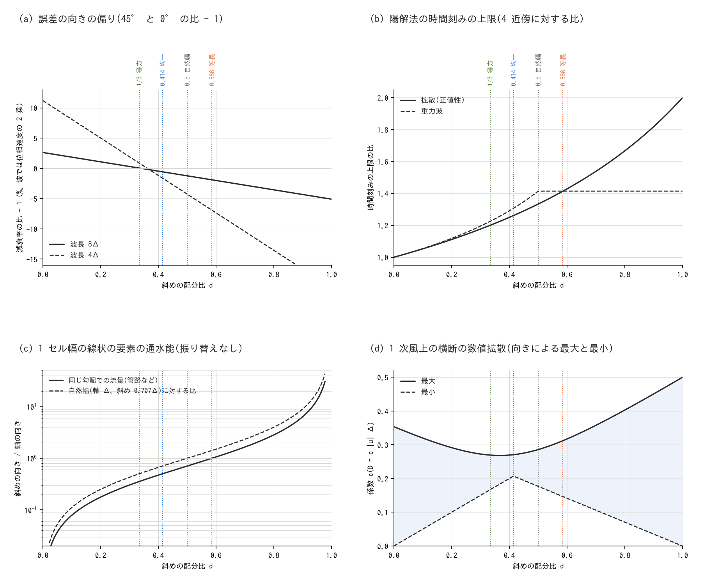

# 斜めの配分比 d の決め方 — 8 方向の通過幅の配り方の基準と、過程ごとの選び方(補足)

[ユーザーガイド目次へ](../users_guide.md) | [ENC 格子と時間積分の解説](encgrid.md) | [通過幅の調整](passage_width.md) | [斜めエッジの流束による数値拡散](diagonal_diffusion.md)

ENCflow は、セルとその 8 近傍の間で水・土砂・地下水などをやり取りします。セルの各辺の
中央 $`(1 - d)`$ を軸のエッジに、両端の $`d/2`$ ずつをその角を回り込む斜めのエッジに
貸し出す配分の比 $`d`$ は、浅水流の `p_diagratio` のほか、いくつかの過程に別々の
パラメータとして現れます。このページは、$`d`$ が何を変えるのか、基準ごとにどの $`d`$ が
最適か、過程ごとにどの値を使っているのか(と推奨値)をまとめます。

## 1. 要点

- $`d`$ は格子の規模の振る舞いだけを変えます。格子より十分長い波長では、どの $`d`$ でも
  同じ式(ラプラシアンの係数は厳密に 1)を解きます。
- 変わるのは、(1) 1 セル幅の河道・管路の通水能の向きによる偏り、(2) 拡散・波の離散化誤差の
  向きによる偏り(等方性)、(3) 陽解法の時間刻みの上限、(4) 1 次風上の横断の数値拡散の
  向きによる違い、の 4 つです。最適な $`d`$ は基準ごとに違い、すべてを満たす値はありません(§2)。

  | 基準 | 最適な d |
  |---|---|
  | 振り替えなしで、1 セル幅の線状の要素(管路、物理の幅が向きによらない河道)の通水能が軸と斜めで等しい | $`2/(2+\sqrt2) \approx 0.586`$(8 本の通過幅が等しい) |
  | 振り替えなしの通水能が自然幅(軸 Δ、斜め 0.707Δ)に比例する | 0.5 |
  | 拡散・波の離散化誤差の主要項が等方 | 1/3 |
  | 重力波の陽解法の時間刻みの上限が最大 | 0.5 以上 |
  | 1 次風上の横断の数値拡散が向きによらず最も均一 | $`\sqrt2 - 1 \approx 0.414`$ |

- 過程ごとの値(§3): 浅水流は 0.586 のまま(時間刻みが最大の範囲で、振り替えの規則と検証が
  この値)。拡散だけの過程(斜面クリープ、乾式斜面侵食の曲率、地下水の側方流)は 1/3 が等方で
  推奨。ラスタを 1 セル幅でたどる管路層は 0.586。
- 既定のままで困ることはほとんどありません。変えるのは、格子幅に近い規模の形(数セルの丘、
  井戸の水位低下の円錐)の向きの偏りが問題になるときです(§4)。

## 2. d が変えるもの — 基準ごとの最適値

*斜めの配分比 d と 4 つの性質(閉じた式からの計算)。縦の点線は 1/3(等方)・0.414(横断の数値拡散が均一)・0.5(自然幅に比例)・0.586(等長。浅水流の既定)。(a) 同じ波数の 45° と 0° の減衰率の比 − 1(拡散。重力波では位相速度の 2 乗の比)、(b) 陽解法の時間刻みの上限(4 近傍格子 = 1)、(c) 振り替えなしの 1 セル幅の線状の要素の通水能の斜め/軸の比(実線: 同じ勾配での流量、破線: 自然幅に対する比)、(d) 1 次風上の横断の数値拡散係数の、流れの向きによる最大と最小。*

### 2.1 通過幅の配分

正方セル(格子幅 Δ)では、軸のエッジの通過幅が $`(1 - d)\Delta`$、斜めのエッジの通過幅が
$`(d/2)\sqrt2\,\Delta`$ です([ENC 格子の解説](encgrid.md) §2、[通過幅の調整](passage_width.md) §2)。
拡散の流束(通過幅 / 中心間距離)の重みは、軸 $`(1 - d)`$、斜め $`d/2`$ になります。どの $`d`$ でも
重みの和がラプラシアンの係数 1 を与えるので、格子より十分長い波長の振る舞いは $`d`$ によりません。
$`d = 0`$ は 4 近傍格子(斜めのエッジを使わない)です。

### 2.2 1 セル幅の線状の要素の通水能

両側が塞がれた 1 セル幅の河道や管路では、軸の向きなら軸のエッジだけが、斜めの向き(角で
つながるセルの列)なら斜めのエッジだけが流れを運びます。振り替えをしないとき、同じ勾配での
流量の斜め/軸の比は $`(d/\sqrt2)/(1 - d)`$ で、$`d = 2/(2+\sqrt2)`$ で 1 になります(図 (c) の実線)。
この値は 8 本の通過幅がすべて等しくなる値(仮想の八角形が正八角形)で、浅水流の既定は、ENC の
原著[^tada26]で八角形の辺を等しくとったこの値です。物理の幅や能力が向きによらない線状の要素
(管路、セルより狭い河道)には、この「素の通水能が向きによらない」基準が当てはまります。

一方、セルを満たす河道の自然な通水能は通過の幅(自然幅。軸 Δ、斜め 0.707Δ)に比例します。
これに比例させる値は $`d = 0.5`$ です(図 (c) の破線)。0.586 では斜めが 1.41 倍、1/3 では軸が 2 倍
有利になります。

ただし浅水流と地下水の側方流には、塞がれた斜めの配分を開いた方向へ返す**振り替え**があり
(浅水流の `f_opening_dynamic`、地下水の `f_gw_opening`、斜面クリープの壁際の振り替え)、
両側が塞がれた 1 セル幅の河道はどの $`d`$ でも自然幅に戻ります([通過幅の調整](passage_width.md) §4)。
この基準が効くのは、振り替えのない過程(管路層)と、部分的に塞がれた所です。

### 2.3 誤差の向きの偏り(等方性)

拡散項と重力波の伝播は、どちらもこの重みの 9 点のラプラシアンで離散化されます。修正方程式の
次の項は $`(\Delta^2/12)(f_{xxxx} + 6d\,f_{xxyy} + f_{yyyy})`$ で、$`d = 1/3`$ のとき
$`\nabla^4 f`$ に比例して向きによらなくなります(離散化誤差の最低次が等方なステンシル[^patra06]。
ENC の配分則で $`d = 1/3`$ になることは本書の導出。developer.md §93)。同じ波数の 45° と 0° の
減衰率の比(拡散)は次のとおりで、重力波の位相速度の向きの差はこのおよそ半分です。

| d | 波長 16Δ | 8Δ | 4Δ |
|---|---:|---:|---:|
| 0(4 近傍の 5 点) | +0.65 % | +2.62 % | +11.2 % |
| 1/3 | +0.00 % | +0.05 % | +0.89 % |
| 0.586 | −0.48 % | −1.89 % | −6.91 % |

格子の向きの偏りは計測でも確かめています。σ = 2Δ の丘で中心から同じ距離の格子軸寄りと
斜めのセルの差(r² = 50)は、斜面クリープで 5 点 −1.92 %、1/3 で −0.03 %、0.586 で +1.46 %
([test/stencil9](../../test/stencil9/README.md))、地下水のマウンドで −1.77 %・+0.01 %・+1.42 %、
井戸の水位低下の円錐で −1.1〜−0.6 %・0.02 % 以下・+0.8〜+0.5 %(developer.md §95)です。
0.586 は 5 点と逆向きに、その 7〜8 割の偏りを残します。

重力波の位相速度の誤差そのもの(格子軸の向きで波長 8Δ なら −2.6 %。$`d`$ によらない)は向きの
差より大きいので、波の計算では、$`d`$ を変えるより格子を細かくする方が効きます。

### 2.4 陽解法の時間刻み

拡散の陽解法を正値に保つ時間刻みの上限は $`\Delta^2/(D(4 - 2d))`$ で、4 近傍格子(0.25 Δ²/D)の
1.2 倍(1/3)・1.41 倍(0.586)です。重力波の上限は $`d \ge 0.5`$ で最大(4 近傍の 1.41 倍)になり、
1/3 ではその 0.87 倍です(図 (b))。8 近傍は 1 回の更新でエッジの数が 2 倍なので、4 近傍と比べた
拡散の計算量は 1/3 で 1.67 倍、0.586 で 1.41 倍です。

### 2.5 1 次風上の横断の数値拡散

1 次風上で運ぶと、流れを横切る向きに数値拡散が生じます([斜めエッジの流束による数値拡散](diagonal_diffusion.md) §2.3)。
軸のエッジの族と斜めのエッジの族の寄与を配分で重み付けると
$`D_\perp = [(1 - d)F(\varphi) + d\sqrt2\,F(\varphi - 45°)]\,u\Delta`$
($`F`$ は 4 近傍の 1 次風上の係数、$`\varphi`$ は流れの向き)で、$`d = 0.586`$ の計測値の表を再現します。
流れの向きによる最大と最小は、0.586 で 0.146〜0.312(2.1 倍)、1/3 で 0.167〜0.269(1.6 倍)、
0.414 で 0.207〜0.271(1.3 倍)です(図 (d))。地表のスカラーの既定(リンクごとの MUSCL)では
この主要項が消えるので、浅水流の結果への影響は小さくなります。

## 3. 過程ごとの d

| 過程 | パラメータ | 既定 | 推奨 | 理由 |
|---|---|---|---|---|
| 浅水流 | `p_diagratio` | 0.586 | 0.586(変更不要) | 重力波の時間刻みが最大の範囲。振り替えの規則と全 test・例題の検証がこの値。1/3 の利点(短い波の等方性)は位相の誤差そのものより小さい |
| 掃流砂の配分 | `fluv_diagratio` | 0.586 | `p_diagratio` と同じ | 水の振り替えの表をそのまま使う(違うと 1 セル幅の水路で掃流砂の能力が 2.41 倍。[通過幅の調整](passage_width.md) §7) |
| 河床すべり | `bs_diagratio` | 0.5858 | `p_diagratio` と同じ | ENC 本体と同じ「射影速度 × 通過幅」の配分。0 は解析解との比較用 |
| 斜面クリープ | `creep_diagratio` | 0(4 近傍の 5 点) | 1/3 | 拡散だけの過程で、等方性が基準。壁際の振り替えあり。既定の変更は検討中 |
| 乾式斜面侵食の曲率 | `spl_diagratio` | 0(5 点) | 1/3 | 曲率はその場のラプラシアンの値。等方性が基準。既定の変更は検討中 |
| 地下水の側方流(土層・層2) | `gw_diagratio` | 0.586 | 1/3(既定の変更は検討中) | 拡散だけの過程(§2.3 の計測)。代わりに陽解法の時間刻みの上限が 15 % 下がり、河床交換能(`f_gwbed`)の上限が 1 セル幅の河道で 8 % 下がる |
| 淡塩2層の塩水 zone | `salt_diagratio` | 0.586 | `gw_diagratio` と同じ | 土層の側方流と通過幅を共有する(違えば停止) |
| 管路層 | `gwc_diagratio` | 0.586 | 0.586 | ラスタを 1 セル幅でたどる管路の能力は向きによらない(§2.2)。管路層には振り替えがない。側方流の d とは独立 |
| 氷河・溶岩流 | (4 近傍。8 近傍化は設計中) | — | 振り替えを入れるなら 1/3、入れないなら 0.586 | 谷を流れる過程で通水能と等方性の両方が効く([landslide_tsunami_plan.md](../landslide_tsunami_plan.md) §11.1) |

## 4. 使い方

- 通常は既定のまま使ってください。test の reference と例題の結果、既存の校正は既定の値によります。
- 斜面クリープ・乾式斜面侵食の曲率で、数セル規模の丘や谷の形を議論する計算では、
  `creep_diagratio`・`spl_diagratio` を 1/3 にすると格子の向きの偏りがほぼ消えます
  ([土砂・地形変化の解説](sediment.md) §2・§6)。
- 地下水で、井戸の水位低下の円錐や涵養のマウンドのような格子規模の形を議論するなら、
  `gw_diagratio = 1/3` が等方です。`salt_diagratio` を使う計算では同じ値にしてください。
  時間刻みの上限が下がるので、初期化時の表示(`gwflow_lateral: dt limit`)を確かめてください。
- 組で決まる値があります: `fluv_diagratio` と `bs_diagratio` は `p_diagratio` と同じ値、
  `salt_diagratio` は `gw_diagratio` と同じ値です。管路層の `gwc_diagratio` は独立です。
- 浅水流の `p_diagratio` を変えるのは、4 近傍格子(0)と比べるときくらいです
  ([通過幅の調整](passage_width.md) §8.1)。

## 5. できないことと精度の限界

- 1/3 で等方になるのは、係数が一定の線形の拡散演算子の誤差の主要項です。氷河の流動則や溶岩の
  降伏応力のような非線形の流れ、厚さが 0 になる前縁で同じになるかは確かめていません。
- 等方になるのは誤差の向きで、大きさではありません。よく解像した丘では、9 点の方が中心の
  誤差が大きく出ることがあります([test/stencil9](../../test/stencil9/README.md))。
- §2.5 の 0.586 以外の値の横断の数値拡散は、0.586 の計測値の表を再現する式からの計算で、
  計測していません。
- 振り替えは両側が塞がれた所で通水能を自然幅に戻しますが、部分的に塞がれた所の通水能は
  $`d`$ と塞がりの測り方に依存します([通過幅の調整](passage_width.md) §5)。

## 6. 検証と記録の所在

| ケース・記録 | 内容 |
|---|---|
| [test/stencil9](../../test/stencil9/README.md) | 9 点の斜面クリープ・曲率の等方性、壁際の振り替え(d = 0・1/3) |
| [test/conduit](../../test/conduit/README.md) 模式実験 C | 土層の側方流の d を変えても管路層の通過幅が変わらないこと |
| [test/salt](../../test/salt/README.md) `Run_sea.sh` | `salt_diagratio` と `gw_diagratio` の不一致で停止すること |
| developer.md §93 | 5 点・9 点の等方性の解析(d = 1/3 の導出)、斜面クリープ・曲率の実装 |
| developer.md §95 | 地下水の側方流の等方性の計測、層が共有する通過幅、管路層を 0.586 にした理由、d = 1/3 にしたときの影響 |
| [斜めエッジの流束による数値拡散](diagonal_diffusion.md) | 横断の数値拡散の向きによる違い(d = 0.586 の計測) |
| [通過幅の調整](passage_width.md) | 振り替えの規則と、`f_opening_dynamic` の既定が 3 になるまでの経緯 |

## 参考文献

[^tada26]: Tada, T. (2026): An eight-neighborhood connected collocated grid scheme for overland flow simulation. *Hydrological Research Letters*, 20(2), 113–118. doi:10.3178/hrl.25-00052.(ENC 格子の原論文: 八近傍連結コロケート格子と通過幅の配分)
[^patra06]: Patra, M. and Karttunen, M. (2006): Stencils with isotropic discretization error for differential operators. *Numer. Methods Partial Differ. Equ.*, 22(4), 936–953. doi:10.1002/num.20129(離散化誤差の最低次が等方なステンシル。書誌と要旨で確認)
