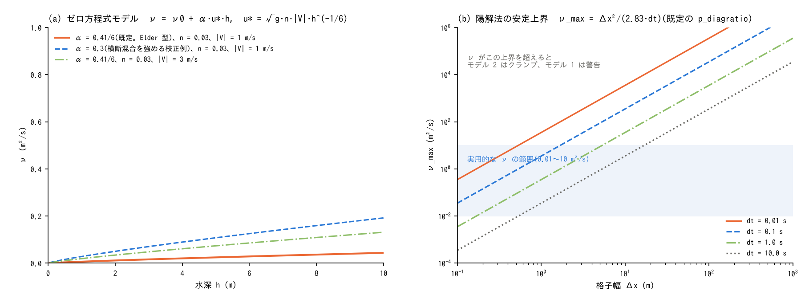
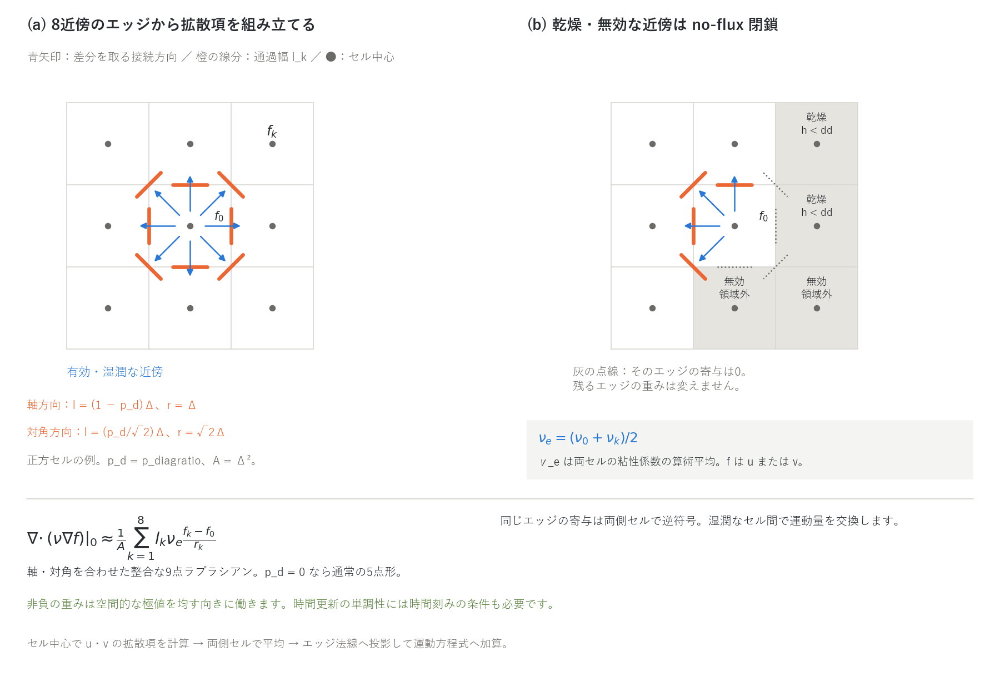

# 運動方程式の拡散項の解説(浅水流計算の補足)

[浅水流計算の章へ](swflow.md) | [ユーザーガイド目次へ](../users_guide.md)

浅水流計算の運動方程式に加算できる拡散項(渦動粘性による運動量の水平
拡散)の解説です。[浅水流計算の章](swflow.md)の `f_diffusion_term`・
`p_diffusion_nu`・`p_diffusion_alpha` の背後にある方程式・渦動粘性モデル・
離散化・安定条件を、設定の意味がわかる程度に説明します。設計の経緯と
検証の記録(開発者向け)は docs/developer.md §20 にあります。

## 1. 方程式と拡散項の位置づけ

水深平均の運動方程式に、乱流による運動量の水平交換を表す拡散項を加えます
($`\mathbf{u} = (u, v)`$: 水深平均流速、$`\nu`$: 渦動粘性係数 m²/s)。

```math
\frac{\partial \mathbf{u}}{\partial t}
+ (\mathbf{u}\cdot\nabla)\,\mathbf{u}
= -\,g\,\nabla(z + h)
\;-\;\frac{g\,n^2\,|\mathbf{u}|}{h^{4/3}}\,\mathbf{u}
\;+\;\underbrace{\nabla\cdot\bigl(\nu\,\nabla\mathbf{u}\bigr)}_{\text{拡散項}}
```

拡散項は、格子で解像できない渦(乱流)が運動量を運ぶ効果を、流速の
2 階微分に比例する「粘性」で代表させたものです。流速の空間的な差を
均す向きにしか働かず(エネルギーを散逸させる)、流れを駆動しません。
効くのは流速分布の勾配が大きい場所で、

- 河道の横断方向の流速分布(岸近くの減速と中央の加速のなだらかな接続)
- 湾内・貯水池の循環流、死水域への運動量の染み込み
- 急縮・急拡・構造物の背後の剥離域

などです。一方、降雨流出・洪水氾濫・津波の伝播では摩擦項と圧力項が
支配的で、拡散項の寄与は小さく、既定では無効です(無効時は配列を
確保せず演算もなく、既存の計算結果とビット単位で一致します)。

ENCflow の方針では、水平方向のプロセスは「浅水方程式+1 方程式の
拡散まで」を上限としています(developer.md §0)。この拡散項は移流項・
圧力項と独立に重ね合わせる加算的オプションで、有効化は `f_diffusion_term`
だけです。

**数値の安定化のためには要りません。** ENC の移流項(既定の運動量保存形
+MUSCL。[移流項のスキーム](advection.md))は限定器による風上化で安定
しており、振動を止める目的で拡散項を入れる必要はありません。振動や
発散が出るときは、時間刻み・移流スキーム・乾湿の保護機構を先に見直して
ください。

## 2. 渦動粘性のモデル(`f_diffusion_term`)



**図：渦動粘性と陽解法の安定上界。** (a) は背景粘性 ν₀ = 0、重力加速度 g = 9.81 m/s² としたゼロ方程式モデルの比較です。(b) は正方セル・既定の p_diagratio に対する近似係数2.83を用いた上界で、両軸を対数表示しています。薄青は粘性係数 0.01〜10 m²/s の比較範囲です。モデル1は上界超過を警告し、モデル2はクランプします。砕波粘性を加える場合の扱いは§5を参照してください。

**モデル 1: 定数粘性。** $`\nu = \nu_0`$(`p_diffusion_nu`。正値の明示が
必須で、未指定は初期化時にエラー停止します)。格子幅と流れの規模に
依存するため普遍的な推奨値がなく、校正量として扱います。

**モデル 2: ゼロ方程式モデル(Elder 型)。** 乱流の強さを底面摩擦から
決めます(水深平均モデルの乱流モデルの分類ではゼロ方程式モデルに
当たります[^rodi93])。Manning 則の底面せん断応力 $`\tau_b/\rho = g\,n^2\,|\mathbf{u}|^2 / h^{1/3}`$
から摩擦速度 $`u_* = \sqrt{\tau_b/\rho}`$ を作り、鉛直平均の渦動粘性を
$`u_* h`$ に比例させます。

```math
\nu = \nu_0 + \alpha\,u_*\,h,
\qquad
u_* = \sqrt{g}\;n\;|\mathbf{u}|\;h^{-1/6}
\;\;\Longrightarrow\;\;
\nu = \nu_0 + \alpha\sqrt{g}\;n\;|\mathbf{u}|\;h^{5/6}
```

$`n`$ は各セルの Manning 粗度(`fn_rn` または `rn0`。[地理情報](geoinfo.md))、
$`|\mathbf{u}|`$ はセル流速の大きさ、$`h`$ は水深です。係数 $`\alpha`$
(`p_diffusion_alpha`)の既定 $`\kappa/6 = 0.41/6 \approx 0.068`$ は、
対数則の流速分布と放物線形の渦粘性分布を鉛直平均した Elder の値[^elder59]で、
iRIC Nays2DH などのゼロ方程式モデルと同じ流儀です。横断方向の混合を
強く表したい場合は、直線水路の実測 $`0.15\,u_* h`$ から自然河川の
$`0.4`$〜$`0.8\,u_* h`$ までの実測レンジ[^fischer79]で校正します。
$`\nu_0`$(`p_diffusion_nu`)は加算のバックグラウンド粘性で、既定 0
(純粋なゼロ方程式)。静穏域で $`\nu`$ が消えるのを避けたい湾内流動などで
使います。粗度 $`n = 0`$ のケースでは $`\alpha`$ の項が恒等的に 0 になります。

図 (a) が典型値です。$`n = 0.03`$、$`|\mathbf{u}| = 1`$ m/s では $`h = 1`$ m で
$`\nu \approx 0.006`$、$`h = 5`$ m で $`0.025`$ m²/s と小さく、流速 3 m/s・
$`\alpha = 0.3`$ でも 1 m²/s 以下です。「とりあえず拡散項を入れてみたい」
ときは、係数を指定せずに流れに応じてスケールするモデル 2 を推奨します。

### パラメータと既定値の根拠

根拠欄の分類語の意味は[既定値の根拠の読み方](../users_guide.md#既定値の根拠の読み方)を参照してください。

| パラメータ | 既定 | 意味 | 根拠 |
|---|---:|---|---|
| f_diffusion_term | 0 | 拡散項(0: なし、1: 定数粘性、2: ゼロ方程式モデル) | **互換** 既定は無効(無効時は既存結果とビット一致)。有効にするならモデル 2 を推奨(§6) |
| p_diffusion_nu | — | 定数粘性 $`\nu_0`$、またはモデル 2 のバックグラウンド粘性 (m²/s) | **校正量** 格子幅・流れの規模に依存し普遍値がない。§4 の上界を確認 |
| p_diffusion_alpha | $`\kappa/6 \approx 0.068`$ | ゼロ方程式モデルの係数 $`\alpha`$($`\nu = \alpha u_* h`$) | **文献値** 対数則+放物線形渦粘性の鉛直平均[^elder59]。横断混合を強めるなら実測レンジ 0.15〜0.8[^fischer79]で校正 |

**既定値を見直すときの手がかり**

- 横断混合係数の実測値は Fischer ら[^fischer79]に河川別の集計があり、
  直線水路で 0.15、蛇行河川で 0.4〜0.8 が目安です。トレーサ実験の
  プルーム幅の成長 $`\sigma^2 = 2\nu t`$ から直接求められます。

## 3. 離散化 — エッジフラックス発散形の 9 点ラプラシアン



**図：拡散項の8近傍ステンシルと no-flux 閉鎖。** 正方セルの例で、青矢印は差分を取る接続方向、橙の線分は通過幅です。(b) の灰点線は乾燥・無効な近傍への寄与0を表し、残る重みを再正規化しません。粘性係数は両セルの算術平均です。この図の添字0は中心セルを表します。非負の空間重みと時間更新の安定条件（§4）を区別してください。

セル $`0`$ の拡散項は、8 近傍 $`k`$ へのエッジを通る拡散フラックス
(2 点勾配 × 通過幅)をセル面積 $`A = \Delta x\,\Delta y`$ で発散した
有限体積形で評価します(図 (a))。

```math
\left.\nabla\cdot(\nu\nabla f)\right|_0
\approx \frac{1}{A}\sum_{k=1}^{8} l_k\;\nu_e\;\frac{f_k - f_0}{r_k},
\qquad
\nu_e = \frac{\nu_0 + \nu_k}{2}
```

$`l_k`$ はエッジ $`k`$ の通過幅(連続式の質量流束と同じ配分。軸方向
$`(1 - p_d)\Delta`$、対角方向 $`(p_d/\sqrt 2)\,\Delta`$。$`p_d`$ = `p_diagratio`、
正方セルの場合)、$`r_k`$ はセル中心間距離(軸 $`\Delta`$、対角
$`\sqrt 2\,\Delta`$)です。この重みの組には次の性質があります。

- **整合な 9 点ラプラシアン。** 対向する近傍の対 $`(k, 9-k)`$ ごとに
  $`f_k + f_{9-k} - 2f_0 = r_k^2\,\partial^2 f/\partial s_k^2 + O(r^4)`$ を使うと、
  軸の 2 対から $`f_{xx}, f_{yy}`$ にそれぞれ $`(1 - p_d)`$、対角の 2 対から
  $`p_d`$ が寄与し(交差項 $`f_{xy}`$ は 2 つの対角で相殺)、**係数の和が
  $`p_d`$ によらず厳密に 1** になります。$`\Delta x \ne \Delta y`$ でも同様です
  (証明は developer.md §20)。定数 $`\nu`$ では $`\nu\nabla^2 f`$ に厳密に
  退化し、$`p_d = 0`$ なら通常の 5 点ラプラシアンです。
- **保存形。** 1 本のエッジのフラックスは両側セルで符号が反対なので、
  拡散で運動量の総和が変わりません(変係数でも)。
- **単調性。** 非負の空間重みは極大を下げ、極小を上げる向きに働きます。
  陽的な時間更新で新しい極値を作らないためには、時間刻みの条件も必要です
  (§4)。

同じ重み $`l_k/(A\,r_k)`$ は、[非静水圧補正](nonhydrostatic.md)のポテンシャル
方程式の離散ラプラシアンにも使っています。

**乾燥・無効な近傍(図 (b))。** 近傍セルが無効(領域外・マスク外)か
移動限界未満($`h < dd`$)なら、そのエッジは和から欠落させ、**残りの
重みで再正規化しません**。有限体積形では欠けたエッジ = 拡散フラックス 0
(no-flux 閉鎖)で、それが物理的に正しく保存的です(セル中心の勾配
$`\nabla u`$ の計算では残りの重みで正規化するのと対照的です)。海域マスク
(`sw > 0`)のセルではセル中心の拡散項を計算しません。
ゼロ方程式モデル（モデル2）ではそのセルの $`\nu = 0`$ とし、
定数モデル（モデル1）の粘性場は一様値を保持します。
格子の枠に接するセルでもセル中心の拡散項は計算しません(0)。ただし
側方 Neumann([境界条件](boundary.md)の型 3)の辺に接するセルは、枠外の
近傍を辺の法線方向に枠内へ寄せた鏡像セルとして和に入れ(外に同じ流れが
続く = 勾配 0)、その辺の境界面にも自セルと鏡像セルの平均を加えます
(developer.md §88.12)。

**運動方程式への組み込み。** セル中心で
$`\mathbf{T}^d_0 = \bigl(\nabla\cdot(\nu\nabla u),\;\nabla\cdot(\nu\nabla v)\bigr)_0`$
をステップ先頭に前計算し、エッジでは両側セルの平均を法線方向に投影して
移流項に加算します([移流項のスキーム](advection.md)のスキーム 1 と
同じ投影)。

```math
D_e = \tfrac{1}{2}\bigl(\mathbf{T}^d_c + \mathbf{T}^d_n\bigr)\cdot\mathbf{n}_k,
\qquad
u_e^{\,n+1} = \frac{u_e^{\,n} + \left(A_e + D_e + G_e\right)\Delta t}{1 - F_e\,\Delta t}
```

拡散項は粘性力なので、建物空隙率から導く有効慣性係数 $`\ell_m`$ は乗じず
(移流項は輸送項として乗じる)、重力項と同じ扱いで付加質量による減衰を
受けます。並列計算では $`\mathbf{T}^d`$ をハロ行でも再計算し、モデル 2 の
$`\nu`$ 場はハロ幅 2 まで作るので、ステップ先頭のハロ交換に項目は増えません。

## 4. 安定条件

拡散項は陽解法で進めるため、時間刻みに上限があります。Gershgorin の
評価から

```math
\nu \;\le\; \nu_{\max} = \frac{1}{\Delta t\,\displaystyle\sum_{k=1}^{8}\frac{l_k}{A\,r_k}}
= \frac{\Delta x^2}{(4 - 2p_d)\,\Delta t}
\;\approx\;\frac{\Delta x^2}{2.83\,\Delta t}
\quad(\text{正方セル、既定の } p_d)
```

5 点ラプラシアン($`p_d = 0`$)なら $`\Delta x^2/(4\Delta t)`$ です。渦動粘性・安定上界図 (b) の
とおり、氾濫解析の格子($`\Delta x`$ = 10〜100 m、$`\Delta t`$ = 0.1〜1 s)では
$`\nu_{\max}`$ が $`10^2`$〜$`10^4`$ m²/s と大きく、実用的な $`\nu`$(0.01〜10 m²/s)
では重力波の CFL 条件のほうが先に効きます。細かい格子(例: $`\Delta x`$ =
0.25 m、$`\Delta t`$ = 0.02 s で $`\nu_{\max} \approx 1.1`$ m²/s)では砕波域の
渦粘性(§5)が上界に掛かることがあります。

- モデル 1 は初期化時に $`\nu_0 > \nu_{\max}`$ なら警告を表示します(停止は
  しません。発散は運動方程式の流速上限の検査が捕捉します)。
- モデル 2 は $`\nu`$ が時空間で変わるため、セルごとに $`\nu_{\max}`$ で
  クランプし、初回だけ警告を表示します。

## 5. 砕波域の渦粘性との共用

[非静水圧補正](nonhydrostatic.md)の砕波スイッチと組み合わせる渦粘性
`nh_break_visc` は、砕波と判定したセルの $`\nu_b`$(Kennedy 型の砕波
渦粘性[^kennedy00]を局所・状態なしにした形)をこの拡散項の $`\nu`$ に
加えて($`\nu = \nu_{\rm model} + \nu_b`$)同じ経路で散逸させます。
`f_diffusion_term = 0` でも `nh_break_visc > 0` なら拡散項が計算されます。
クランプと警告は §4 と共通です。

[沿岸の波浪場](wavefield.md)の砕波による水平混合 `wf_break_visc`(&list_enc)も
同じ経路です。波浪場が更新ごとに求める $`\nu_w = M\,h\,(D/\rho)^{1/3}`$
(Battjes 1975[^battjes75]。$`M`$ = `wf_break_visc`、$`D`$ はローラーの散逸)を
$`\nu`$ に加え($`\nu = \nu_{\rm model} + \nu_b + \nu_w`$)、`f_diffusion_term = 0`
でも `wf_break_visc > 0` なら拡散項が計算されます(`fn_wavefield` が必須)。

## 6. 使いどころと注意

| 目的 | 設定 | 補足 |
|---|---|---|
| 河川の低水・緩流の横断流速分布を滑らかにする | `f_diffusion_term = 2`(係数指定なし) | [浅水流計算の章](swflow.md)のパターン別推奨。粗度 $`n`$ が $`\nu`$ の大きさを決める |
| 湾内・貯水池の循環流 | `f_diffusion_term = 2` + `p_diffusion_nu`(小さな $`\nu_0`$) | 静穏域で $`\nu`$ が消えないようにする |
| 既往モデルとの比較で定数粘性を合わせる | `f_diffusion_term = 1` + `p_diffusion_nu` | 格子幅に依存する校正量。§4 の上界を確認 |
| 砕波性の波の遡上 | `nh_break_visc`(§5) | 非静水圧補正の章 |
| 波による沿岸流の岸沖分布をならす | `wf_break_visc = 1`(§5) | [沿岸の波浪場](wavefield.md)の章。$`M`$ = 1 は XBeach の nuhfac の既定 |

- 質量は拡散項の有無によらずビット単位で保存されます(運動方程式にしか
  作用しない)。対称な問題の対称性も保たれます。
- 拡散項は流速のピークを均し、到達を遅らせる向きに働きます。移流
  スキーム 1(旧既定)の数値的な鈍りとは別物で、重ねると二重に鈍ります。
- 格子を細かくすると、同じ $`\nu`$ でも解像される渦が増えて実効的な混合が
  変わります。モデル 2 の $`\alpha`$ は格子幅ごとに校正し直すのが安全です。
- 河道の幅を 1〜2 セルで表す計算では、横断方向の勾配がセル幅で決まるため
  拡散項の効果は格子依存です。横断流速分布を論じるなら幅 10 セル以上を
  目安にしてください。

## 7. 検証ケース

- [test/diffusion](../../test/diffusion/README.md) — **拡散項の解析解
  ベンチマーク**。平坦・無摩擦の水路に x 方向に一様なガウス形ジェット
  $`u(y) = U_0\exp(-(y - y_c)^2/2\sigma^2)`$ を置き、定数 $`\nu`$ = 4 m²/s
  で 12.5 s 拡散させて解析解 $`u = U_0\,\sigma/\sqrt{\sigma^2 + 2\nu t}\,\exp(-r^2/2(\sigma^2 + 2\nu t))`$
  と比べます。最大誤差は $`U_0`$ の 0.14%($`\Delta x`$ = 1 m)、0.05%
  (0.5 m)で、いずれもセル流速の再構成の平滑化 $`(p_d/4)\Delta^2 u''`$ の
  大きさ(拡散項の離散化誤差はそれ以下)。MPI 2・4 ランクで逐次とビット一致。
- 実装時の検証記録(developer.md §20): 無効時に全 reference とビット一致、
  [test/wave](../../test/wave/README.md) のモデル 1($`\nu_0`$ = 0.1 m²/s)・
  モデル 2($`n`$ = 0.02、$`\alpha`$ 既定)と
  [test/chichibu](../../test/chichibu/README.md) のモデル 2 でランク数・
  スレッド数によらずビット一致、質量の厳密保存、円形初期水位の 4 回対称の
  維持、流速・水深ピークの平滑化。
- [test/creep](../../test/creep/README.md) — 地形変化モジュールの斜面
  クリープ(等方線形拡散 $`\partial z/\partial t = D\nabla^2 z`$)をガウス丘の
  解析解で検定します。拡散方程式の陽解法の時間刻み条件と、拡散が極値を
  作らないことの実例(5 点ラプラシアン。本章の 9 点重みの対角成分を 0 に
  した形)。
- [test/nhbreak](../../test/nhbreak/README.md) — 砕波域の渦粘性
  `nh_break_visc` がこの拡散項を通して遡上高を下げる検定(§5)。
- [test/wfcurrent](../../test/wfcurrent/README.md) の diff・mix — 海浜の
  沿岸流に定数粘性(diff)と砕波による水平混合 `wf_break_visc`(mix。§5)を
  加え、側方 Neumann の辺を含む岸沿いの一様性・運動量の積分の釣り合い・
  沿岸流のならしと、$`\nu_w`$ の式との一致を確かめる検定。
- [test/nhbottom](../../test/nhbottom/README.md) の `param_ls_bd.txt` —
  海底地滑り津波に定数粘性 $`\nu`$ = 0.3 m²/s を加えた試行(斜面下端の
  自励振動が運動量拡散では減衰しないことの確認)。
- [examples/List_samples/list_enc.txt](../../examples/List_samples/list_enc.txt) —
  `&list_enc` の全パラメータの注釈付き一覧(既定値の明示)。

## 参考文献

[^elder59]: Elder, J. W. (1959): The dispersion of marked fluid in turbulent shear flow. *J. Fluid Mech.*, 5, 544–560.(鉛直平均の渦粘性 $`\kappa u_* h/6`$)
[^fischer79]: Fischer, H. B., List, E. J., Koh, R. C. Y., Imberger, J. and Brooks, N. H. (1979): *Mixing in Inland and Coastal Waters*. Academic Press.(横断混合係数の実測レンジ)
[^rodi93]: Rodi, W. (1993): *Turbulence Models and Their Application in Hydraulics*, 3rd ed. IAHR Monograph, Balkema.(水深平均モデルのゼロ方程式・$`k`$–$`\varepsilon`$ の位置づけ)
[^kennedy00]: Kennedy, A. B., Chen, Q., Kirby, J. T. and Dalrymple, R. A. (2000): Boussinesq modeling of wave transformation, breaking, and runup. I: 1D. *J. Waterw. Port Coast. Ocean Eng.*, 126, 39–47.(砕波域の渦粘性。§5)
[^battjes75]: Battjes, J. A. (1975): Modeling of turbulence in the surf zone. *Proc. Symposium on Modeling Techniques*, ASCE, San Francisco, 1050–1061.(砕波の渦動粘性。§5。式の形は XBeach の nuhfac の実装による。原論文は未照合)
