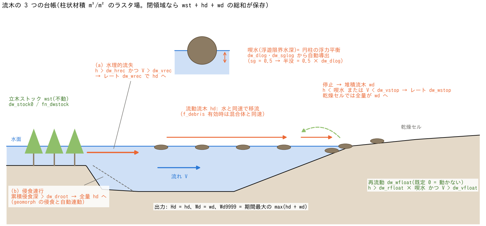

# 流木(fn_driftwood)

[ユーザーガイド目次へ](../users_guide.md)

洪水・氾濫・土石流に同伴する**流木**の発生・輸送・堆積を、セルごとの
柱状材積(m³/m²)の**ラスタ場**として概算します。1本1本の流木を追跡
する方式(個別要素モデル)ではなく、「どこの立木がどれだけ流木化し、
どこへどれだけ到達・堆積するか」の面的なポテンシャル評価が目的です。

流木は、**立木ストック `wst`・流動流木 `hd`・堆積流木 `wd`** の
3つの台帳で扱います。`wst` と `wd` は移流せず、`hd` が水
(土石流時は水・土砂の混合体)とともに保存的に輸送されます。
堆積した材積 `wd` は地盤標高 `z` に加えません。

- **① 水理的流失 (`wst → hd`)**: `H > dw_hrec` かつ
  `V > dw_vrec` のとき、レート `dw_wrec` で残る立木から流木化します。
- **② 侵食連行 (`wst → hd`)**: `zref − z > dw_droot` のとき、
  残る立木を全量流木化します。`zref` は初期化時の基準標高
  (再開時は保存値)、`z` は現在の標高です。判定量は**基準からの
  正味の地盤低下**で、侵食増分だけを足し続けた量ではありません。
  水深・流速の条件はなく、侵食の原因を区別せず `z` の低下を見ます。
- **③ 停止・堆積 (`hd → wd`)**: 乾燥判定 `h ≤ dd` なら全量を堆積へ
  移します。それ以外は、`H < hf` または `V < dw_vstop` のとき、
  レート `dw_wstop` で堆積します。`hf` は代表材の喫水です。
- **④ 再流動 (`wd → hd`)**: `dw_wfloat > 0` の場合に限り、
  `H > dw_rfloat × hf` かつ `V > dw_vfloat` のとき、レート
  `dw_wfloat` で流動へ戻します。既定値 0 では無効です。

ここで `H = h + max(hs, 0)`、`V` はセル流速です(土砂がなければ `H = h`)。
各レートによる 1 ステップの移送量は移送元台帳の残量が上限で、代表材の
喫水 `hf` は直径 `dw_dlog` と材比重 `dw_sglog` の円柱の浮力平衡から自動で
求めます(sg = 0.5 で半没)。番号は図中の経路を示し、実装では
**② → ① → ③ → ④ → ダム捕捉 → 期間最大値の更新**の順に処理します。
移送則・喫水・面積換算の式と既定値の根拠は[流木モデルの解説](driftwood_models.md)に
あります。

橋や透過型堰堤などの構造物に流木が掛かって溜まり、流れを堰き上げる現象は、捕捉率の分布
`fn_dwtrap` を与えたとき(または[カルバート](structure.md)に `culv_jam = 1` を付けたとき)だけ働く
4 つ目の台帳(**集積流木 `wj`**)で扱います
([構造物での捕捉と集積](#構造物での捕捉と集積fn_dwtrap))。どちらも与えなければ、流木は流れに
作用しません。



(a) 不動の立木・堆積台帳と、流れで輸送する流動台帳。破線は基準地盤、
実線は現在の地盤で、河岸の標高差が②の判定量です。(b) 4経路の条件。
(c) 横向き円柱の水没断面積比が材比重 `sg` に等しくなる喫水 `hf` を
`dw_dlog`・`dw_sglog` から求めます。図は `sg = 0.5` の半没例で、
一般に `hf = sg × 直径` ではありません。(d) 出力と面積を換算した
材積収支。断面・樹木・丸太は説明用で、計算結果や個別丸太の軌跡では
ありません。

結果の見方(分布・台帳・計測列・再開)は、このページの[出力・確認](#出力確認)にまとめています。

## 有効化と設定

`&list_sysparam` で `fn_driftwood` を指定します。

**「とりあえず流木を動かしてみる」最小入力は `&list_driftwood` を空のまま
置くだけです**(全項目が既定)。立木ストックは陸のセル一様に
0.001 m³/m²(針葉樹渓流の発生流木量の実績包絡値)、代表諸元・発生
(水理的流失と侵食連行の両方)・停止はすべて既定値で動きます。採用された
既定値は実行開始時に `driftwood: dw_hrec = 0.5000 m (default)` のように
**(default)** 印付きで表示されるので、値を見ずに済ませることはできません。
事例に合わせて必ず見直してください(型ごとの目安は本章末尾の
「パターン別の推奨値」。既定値の根拠は[解説](driftwood_models.md) §5)。

```
&list_driftwood
/
```

実務では立木ストックの分布と発生・停止のパラメータを与えます:

```
&list_driftwood
  dw_stock0 = 0.01          ! 立木ストック (m3/m2。一様値)
  dw_dlog = 0.3             ! 流木の代表直径 (m)
  dw_sglog = 0.5            ! 材比重(0〜1。喫水は浮力平衡から自動導出)
  dw_wrec = 1.0e-5          ! 水理的流失レート (m/s)
  dw_hrec = 0.5             ! 流失の浸水深閾値 (m)
  dw_vrec = 1.0             ! 流失の流速閾値 (m/s)
  dw_droot = 0.5            ! 根系深 (m。侵食連行の閾値)
  dw_wstop = 0.01           ! 接地堆積レート (m/s)
/
```

## パラメータ

| パラメータ | 既定値 | 意味 |
|---|---|---|
| f_dw | 1 | 0 でファイルを残したまま一時無効化 |
| dw_stock0 | (0.001 を陸のセルに) | 一様な立木ストック (m³/m²)。fn_dwstock と排他。**両方未指定なら陸(海でない)のセル一様に 0.001 m³/m²** |
| fn_dwstock | — | 立木ストックの分布ファイル (m³/m²。地形と同じ行列形式) |
| dw_dlog | 0.3 | 流木の代表直径 (m)。目安は上流立木の平均胸高直径 |
| dw_sglog | 0.5 | 材比重 ρ木/ρ水(0 < sg < 1)。喫水は円柱の浮力平衡から自動導出(sg=0.5 でちょうど半没 = 0.5×dw_dlog) |
| dw_wrec | 1e-5 | 水理的流失レート (m/s = m³/m²/s)。指定で水理的流失が有効。閾値・レートとも校正値(感度解析を推奨) |
| dw_hrec | 0.5 | 水理的流失の深さ閾値 (m。H = h + max(hs, 0) で判定) |
| dw_vrec | 1.0 | 水理的流失の流速閾値 (m/s) |
| dw_droot | 0.5 | 根系深 (m)。指定で侵食連行が有効(基準からの標高低下 zref − z > dw_droot で残る立木を全量流木化) |
| dw_wstop | 0.01 | 接地堆積レート (m/s) |
| dw_vstop | 0 | 低速堆積の流速閾値 (m/s。0 = 水深(喫水)判定のみ) |
| dw_wfloat | 0 | 再流動レート (m/s。0 = 堆積した流木は動かない(安全側)) |
| dw_rfloat | 1.5 | 再流動の浮遊余裕率(H > rfloat×喫水 かつ V > dw_vfloat で再流動。1 より大) |
| dw_vfloat | — | 再流動の流速閾値 (m/s。dw_wfloat > 0 のとき必須。dw_vstop 以上) |
| fn_dwtrap | — | 捕捉率 E の分布ファイル(0〜1。地形と同じ行列形式。0 = 捕捉しない)。指定で[構造物での捕捉と集積](#構造物での捕捉と集積fn_dwtrap)が有効 |
| f_dwjam | 1 | 集積の流れへの作用。0: 台帳だけ(流れに作用しない)、1: 集積したセルの抵抗 |
| dw_jamcd | 1.0 | 集積体の抗力係数 C_D(校正値) |
| dw_jamphi | 0.3 | 集積体の充填率 φ(実材積 / 見かけの体積。0 < φ < 1。校正値) |
| dw_jamgrow | — | 集積量 (m³/m²) がこれを超えたセルは捕捉率 1(未指定 = 捕捉率は一定) |

カルバートの流入口の集積は、カルバートごとの選択子 `culv_jam`(`&list_struct_culvert`。
[内部水理構造物](structure.md#カルバートlist_struct_culvert))で有効にします。

発生の 2 経路(dw_wrec / dw_droot)は、**両方未指定なら両方に既定が入り
(侵食連行は地形が動かなければ発火しないので無害)、片方だけを指定すると
他方は無効**になります(明示の尊重)。dw_wrec を指定して dw_hrec / dw_vrec
を省くと閾値だけ既定になります。

## 構造物での捕捉と集積(fn_dwtrap)

橋・透過型堰堤・流木捕捉工に流木が掛かって溜まり、通水を妨げて上流を堰き上げる現象を、
**捕捉セル**と**集積流木の台帳 `wj`** で概算します。丸太が掛かるかどうかは判定せず、
捕捉率は利用者が与えます。開口がセルより狭い構造物(カルバートで表したスリット堰堤の抜き口・
暗渠・樋管)は、捕捉セルではなく、カルバートの `culv_jam = 1` で扱います
(下の「カルバートの流入口の集積」)。

- **⑤ 捕捉 (`hd → wj`)**: 捕捉率 E(0〜1)を与えたセルでは、そのセルを通る流動流木のうち
  E の割合が集積流木 `wj` に移ります。`wj` は動きません(増える向きだけ)。
- **集積の抵抗**: `f_dwjam = 1`(既定)では、集積を多孔質の障害物として、集積したセルの辺に
  抗力を足します。集積が増えるほど流れが遅くなり、上流の水位が上がります。`f_dwjam = 0` に
  すると集積は台帳だけになり、流れは流木を使わない計算と同じになります。

```
&list_driftwood
  fn_dwstock = 'stock.txt'
  dw_dlog = 0.3
  fn_dwtrap = 'trap.txt'    ! 捕捉率 E の分布(橋のセルの列に 0.3、ほかは 0)
  dw_jamgrow = 0.05         ! 集積が 0.05 m3/m2 を超えたセルは、届いた流木をすべて止める(任意)
/
```

**捕捉セルの置き方**

| 構造物 | 地形・構造の与え方 | 捕捉セル | 捕捉率の目安 |
|---|---|---|---|
| 橋(河道がセルで解像されている、または河道幅 `fn_width`) | 橋台・取付道路・堤防は地形と堤防で。桁は持たない | 橋の位置で河道を横断するセルの列 | 利用者が与える(下の注) |
| 格子型(鋼製)の透過型堰堤、流木捕捉工 | 袖部は地形 | 透過部のセルの列 | 流木を止める目的の施設なので 1 に近い値(与件) |
| スリット堰堤(スリットをセルで解像) | 堤体は地形、スリットは 1〜2 セルの切れ目 | スリットのセル | 利用者が与える |
| スリット堰堤・カルバート・樋管(開口がセルより狭い) | 堤体は地形、開口は[カルバート](structure.md) | 不要。`culv_jam = 1` のカルバートが取水している側のセル群(下の「カルバートの流入口の集積」) | 全量(固定) |

- 捕捉セルの列は、斜めに抜ける道ができないよう 4 近傍でつないでください(ダムの捕捉帯と同じ注意)。
  海域マスク(`fn_sw`)のセルと領域の外のセルに与えた捕捉率は使いません。
- **捕捉率 E は与件です。** E は「捕捉セルを 1 回通過する流木のうち捕捉される割合」で、実際には
  流木の長さと開口の幅(橋の径間、堰堤の部材の純間隔)の比、桁下の余裕、流れの速さで決まります。
  このモジュールは流木の長さを持たないので、E を計算で決めることはできません。実績や実験の知見
  から与えるか、E を変えた複数のケース(例えば 0.1・0.3・1)で幅を示してください。
- `dw_jamgrow` は「溜まり始めると後続の流木が次々に掛かる」効果の近似です。集積量がこの値を
  超えたセルは、届いた流木をすべて止めます。
- 構造物そのものの抵抗(橋脚、堰堤の部材)は、粗度 `fn_rn`・地形・河道幅で与えます。

**集積の抵抗の式と係数**

集積したセルの辺では、摩擦と同じ半陰形の抗力

```math
F_{\text{jam}} = -\,\kappa_0 \min\!\left(\frac{w_e}{h_f},\ \varphi\right)|\mathbf{V}|_e,
\qquad \kappa_0 = \frac{2\,C_D}{\pi\,d\,(1-\varphi)^3}
```

を足します。$`w_e`$ は辺の両側のセルの集積流木の平均、$`h_f`$ は辺の水深、$`d`$ は代表直径
`dw_dlog`、$`\varphi`$ は充填率 `dw_jamphi`、$`C_D`$ は抗力係数 `dw_jamcd` です。
$`\min`$ は、水柱に入りきらない分(水面より上に積み上がる分)が抵抗を増やさないことを表します。
式の導出と出典は[流木モデルの解説](driftwood_models.md) §6 にあります。

- 抵抗は集積の実材積で決まります。水路の幅あたりの実材積が同じなら、1 セルに溜めても 2 セルに
  分けても、格子幅を変えても、堰上げはほぼ同じです。
- **係数は校正値です。** φ は (1 − φ)³ で効くので感度が大きく、φ = 0.2・0.3・0.4・0.5 で
  κ₀ = 4.1・6.2・9.8・17 m⁻¹(d = 0.3 m、C_D = 1)になります。枝葉や細かい有機物が詰まると
  損失が大きく増えることが報告されています([解説](driftwood_models.md) §6)。C_D と φ は、合わせて
  1 つの校正値として扱ってください。既定の 1.0・0.3 は仮の置き値で、実測の堰上げとの照合は
  まだありません。
- 「流木なし」「運ぶが流れに作用させない(`f_dwjam = 0`)」「閉塞が成長する(`f_dwjam = 1`)」の
  3 ケースを同じ設定で比べると、閉塞の効果を切り分けられます。閉塞の開始時刻・橋の上流の水位・
  橋を迂回する流量は、`driftwood.csv`・プローブ・測線の出力から読めます。

**カルバートの流入口の集積(culv_jam)**

[カルバート](structure.md#カルバートlist_struct_culvert)の開口はセルより狭く、流入口へ集まる
セルの流れは開口の中の流れよりずっと遅いので(10 m 格子と 1 m × 1 m の開口の試算で、セルの辺の
0.1 m/s 程度に対して開口の中は数 m/s)、上のセルの抵抗では開口の閉塞を表せません。カルバートごとに
`culv_jam = 1` を付けると、流入口に溜まった流木の損失を、カルバートの流量則に入れます。

```
&list_struct_culvert
  culv_in_cell(:,1,1)  = 150, 60
  culv_out_cell(:,1,1) = 152, 60
  culv_width(1)  = 1.0
  culv_height(1) = 1.0
  culv_zin(1)  = 12.50
  culv_zout(1) = 12.30
  culv_jam(1) = 1          ! 流入口の集積流木の損失を流量則に入れる(流木モジュールが必要)
/
```

- **捕捉**: カルバートは流木を通しません。`culv_jam = 1` のカルバートが取水している側のセル群
  (順流なら `culv_in_cell`、逆流なら `culv_out_cell`)に届いた流動流木は、全量が集積流木 `wj` に
  移ります。カルバートの流量が 0 の間は捕捉しません。`fn_dwtrap` は要りません(併用もできます)。
- **損失**: 水位の高い側のセル群の集積の実材積 $`V_j`$ (m³) から、開口の流速に対する損失係数

  ```math
  C_A = 2\,\kappa_0\,\frac{V_j}{B\,D}
  ```

  を作ります($`\kappa_0`$ は上の式と同じ、$`B`$・$`D`$ は断面の幅と高さ)。自由水面(堰)の流量は
  $`(1 + C_A/3)^{-3/2}`$ 倍になり、満管の流量は損失の和 $`1 + c_e + f_L`$ に $`C_A`$ を足した
  管路の式になります(導出は[解説](driftwood_models.md) §6。独自の定式です)。
- **大きさの目安**(既定の係数 d = 0.3 m、φ = 0.3、C_D = 1、流入損失 c_e = 0.5、管路長 0):

  | 開口 B × D | 集積の実材積 V_j | C_A | 堰の流量 | 満管の流量 |
  |---|---:|---:|---:|---:|
  | 1 m × 1 m | 0.06 m³ | 0.74 | 0.72 倍 | 0.82 倍 |
  | 1 m × 1 m | 0.5 m³ | 6.2 | 0.19 倍 | 0.44 倍 |
  | 2 m × 2 m | 0.5 m³ | 1.5 | 0.54 倍 | 0.70 倍 |

  損失は $`V_j/(B D)`$ で決まるので、小さい開口ほど少ない流木で大きく塞がります。
- `f_dwjam = 0` では、流入口の集積も台帳だけになり、流量則には入りません。
- 流入口のセルにも上のセルの抵抗が掛かりますが、流入口へ集まる流れは遅いので、ほとんど
  効きません。
- **取水セル群は、流れの全量がカルバートへ向かうセルにしてください**(スリット堰堤の抜き口の
  直上流、道路盛土を横断する暗渠の呑口など)。取水セル群に入った流木は、カルバートへ向かう
  流れの割合によらず、全量が流入口に集積します。河道の本流のセルを取水セル群にした樋管・
  取水口に付けると、本流を通過するだけの流木まで流入口に溜まり、閉塞を過大に見積もります。

**できないこと**

- 丸太が掛かるかどうかの判定。捕捉率は与件です。
- 集積の形(上流へ伸びる、水面に浮く、桁の下へ潜る)。台帳は捕捉セルの材積だけで、水柱に
  入りきらない分は抵抗を増やしません。
- 集積の崩壊・再放出、橋の流失。集積は動きません。
- 桁による圧力流れと、桁の上の越流。橋は桁を持ちません。
- 流木が水の体積を押しのける効果。
- セルより小さい開口(カルバートで表したスリット・樋管)の閉塞は、`culv_jam = 1` を付けた
  カルバートだけが扱います。捕捉セルの抵抗はセルの辺の流れに掛かり、カルバートの流量則には
  入りません。`culv_jam` を付けないカルバートの流入口の前に溜まった流木は、流れに作用しません。
- カルバートの流入口の損失は、集積の実材積と開口の断面積だけで決まります。流木の長さと開口の
  寸法の比、集積の形、水位と集積の位置の関係は見ません。集積は減らないので、損失は増える
  向きだけです。流量は 0 にはなりません(完全な閉塞は表しません)。堰のレジームの倍率は、
  限界流の断面の流速で損失を見積もる独自の仮定によるもので、照合できる実測がまだありません。
  流れが逆転すると、水位の高い側のセル群の集積だけを読みます(反対側に溜まった流木が逆流で
  外れることは表しません)。
- 集積の上流の淀みで止まった流木(`dw_vstop`)は堆積 `wd` に入り、抵抗には数えません。
- 底面せん断(流砂)には集積の抵抗を入れません。流速が落ちる分だけ、集積の上流で土砂が
  堆積しやすくなります。

## パターン別の推奨値

既定値は「動く」ための中庸です。現象の型が決まっているときは次を
出発点にしてください(校正で変わる量です。実務値の出典は
[解説](driftwood_models.md) §4)。

| 型 | 発生 | ストック・諸元 | 閾値・レート | 停止 | 備考 |
|---|---|---|---|---|---|
| 渓流の土石流流木(砂防計画) | 侵食連行(dw_droot 0.3〜1.0 m)+水理的流失 | 針葉樹 1e-3、広葉樹 1e-4 m³/m²(指針の実績包絡)。dw_dlog = 平均胸高直径(0.2〜0.4 m)、sg 0.5 | dw_hrec 0.3〜0.5 m、dw_vrec 1〜2 m/s、dw_wrec 1e-5 | dw_wstop 0.01、dw_vstop 0.02〜0.05(遷緩点で止める) | f_debris と同時有効化。流木流出率 0.8〜0.9 で検証 |
| 洪水氾濫の河畔林・氾濫原 | 水理的流失のみ | 河畔林帯に fn_dwstock(1e-3〜1e-2)。dlog 0.3、sg 0.5 | dw_hrec 1.0 m、dw_vrec 1.0〜1.5 m/s、dw_wrec 1e-5〜1e-4 | dw_wstop 0.01、dw_vstop 0.02 | 根系が水に抉られる効果を侵食連行で加えるなら f_fluvial |
| 高潮の貯木場(伊勢湾台風型) | 水理的流失を「係留切れ」として使う | 貯木場セルに 0.5 m³/m²。dlog 0.6(原木)、sg 0.5 | dw_hrec = 平常水深 + 1 m、dw_vrec 0、dw_wrec 2e-4(高潮の継続時間で全量) | dw_wstop 0.005、dw_vstop 0.02 | 例題 timberyard |
| 津波の海岸林・貯木場 | 同上 | 海岸林 1e-3〜1e-2、貯木場 0.5〜1.0 m³/m² | dw_hrec = 平常水深 + 1〜2 m、dw_vrec 0、dw_wrec 5e-4(押し波の間に全量) | dw_wstop 0.005、dw_vstop 0.05 | 例題 tsunami_town(家屋破壊との連鎖) |
| 到達範囲の上限側評価(ハザードマップ) | 事例の発生 | 同上 | 同上 | dw_vstop 0、dw_wfloat 0 | Wd9999 を使う。残留は dw_vstop・dw_wfloat に敏感(timberyard README) |
| 施設の捕捉効果(2ケース比較) | 事例の発生 | 同上 | 同上 | 同上 | ダム・遊砂地・カルバートあり/なしで Wd9999 の差分 |
| 橋・透過型堰堤の閉塞と堰上げ | 事例の発生 | 同上 | 同上 | dw_vstop 0(集積の上流の淀みで止めない)か、事例の値 | `fn_dwtrap` に捕捉率(与件)。`f_dwjam` 0 と 1、流木なしの 3 ケース比較。Wj と上流の水位を見る |
| スリット堰堤の抜き口・暗渠の呑口の閉塞 | 事例の発生 | 同上 | 同上 | 同上 | 開口は[カルバート](structure.md)で表し `culv_jam = 1`。`f_dwjam` 0 と 1 の比較。`vol_jam_m3` と上流の水位を見る |

**実務値の目安**(砂防計画の指針より。出典と換算式は[解説](driftwood_models.md) §4):

- **dw_dlog**: 流木の平均直径は上流立木の平均胸高直径とほぼ等しい。
  胸高直径の調査値をそのまま使えます。
- **立木ストック**: 単木材積 × 本数密度で m³/m² に換算します(前処理)。
  渓流での発生流木量の実績包絡は針葉樹 0.001 m³/m²、広葉樹 0.0001 m³/m²。
- **検証指標**: 施設がない渓流では発生流木の 8〜9 割が谷出口へ流出
  (流木流出率 0.8〜0.9)。
- 水理的流失(dw_wrec/hrec/vrec)の閾値・レートは実務標準のない校正
  パラメータです(感度解析を推奨)。

## 出力・確認

分布出力の 3 通りの有効化(自動 / 指定 / 共用)と柱状量の面積基底の読み方は[入出力の形式](io.md#状態量の分布出力の考え方)に、確認したい量から出力を逆引きする早見表は同じ節の末尾にあります。

**分布**(`result/` のラスタ。`dt_file` 間隔)

| ファイル | 出し方 | 内容 |
|---|---|---|
| Hd0001… | f_out_hd = 1 | 流動流木 `hd`(実効面積当たり m³/m²) |
| Wd0001… | f_out_wd = 1 | 堆積流木 `wd`(実効面積当たり m³/m²) |
| Wd9999 | f_out_wd = 1 | 各セルの期間最大 `maxₜ(hd + wd)`(流木ハザードマップの本体) |
| Wj0001… | f_out_wj = 1 | 集積流木 `wj`(実効面積当たり m³/m²。`fn_dwtrap` か、`culv_jam = 1` のカルバートが必要) |

`Wd9999` は、局所処理とダム捕捉が終わった時点の `hd + wd` の最大値です。
累積通過材積ではなく、異なる時刻の `hd` の最大値と `wd` の最大値を
足したものでもありません。集積流木 `wj` は `Wd9999` に含みません(別の図)。立木ストック `wst` の
分布出力はありません。

**台帳・ログ**(収支の検算)

- `result/driftwood.csv` に `dt_recrd` 間隔で、累積の `rec_hyd_m3`(水理的
  流失)・`rec_ero_m3`(侵食連行)・`deposit_m3`・`refloat_m3`・`to_dam_m3`
  (ダム捕捉)と、現在貯留の `vol_stock_m3`(立木)・`vol_float_m3`(流動)・
  `vol_deposit_m3`(堆積)を記録します。いずれも面積換算済みの m³ です。
  `fn_dwtrap` を与えたとき(または `culv_jam = 1` のカルバートがあるとき)だけ、末尾に累積の
  `trap_m3`(構造物での捕捉)と現在貯留の `vol_jam_m3`(集積)の 2 列が増えます。カルバートごとの
  内訳はありません(流入口のセルの `Wj0001…` から拾います)。
- Log.txt に流木の列はありません。

**計測**(プローブ・測線の列)

- 流木の列はありません。地点・断面の通過材積は `Hd0001…` の同一セルから
  拾うか、`driftwood.csv` の累積で見ます。

**再開**

- 私有ファイル `driftwood.dat` で自動的に扱われます(保存時に fn_driftwood
  が有効だったことが必要)。集積流木 `wj` は、`fn_dwtrap` を与えた計算(または `culv_jam = 1` の
  カルバートがある計算)の保存にだけ入ります。どちらもなしで保存した状態を、どちらかを足して
  再開すると、集積は 0 から始まります。

**読み方と検算のコツ**

- `wst` はセルの**幾何面積**当たり、`hd`・`wd` は水と同じ**実効面積**
  当たりの柱状材積です。単純な `wst + hd + wd` の和で収支を確認できるのは
  面積係数が 1 の場合に限られます(換算式は[解説](driftwood_models.md) §3)。
- 閉領域・ダム捕捉なしなら現在貯留の和 `vol_stock + vol_float +
  vol_deposit`(集積の列があるときは `+ vol_jam`)が初期材積を保存します(数値誤差を除く)。海域マスク
  (fn_sw)の海セルや辺境界へ流出した流木は系外へ消え、`driftwood.csv` に
  列を持たないので、初期材積 − 現在貯留の和 − `to_dam_m3` の残差として
  求めます(高潮の貯木場の例題では沖へ流れ出た材木がこの経路で系から
  除かれます)。発生・堆積・再流動は内部移送なので、それらの累積値を
  現在貯留に足すと二重計上になります。

## 併用関係・制約

- ENC 格子のみ。地形時間の加速(morfac ≠ 1)とは併用できません
  (流木はイベント量のため)。
- [土砂・地形変化](geomorph.md)との併用は自由です(f_debris との
  同時有効化で土石流+流木の混合流れ)。geomorph なしでも水理的
  流失で動作します。侵食連行は z が基準から低下しなければ発火しません。
- **ダムの捕捉帯**に入った流動流木はダムに捕捉されます(放流には
  流木は含まれません)。**カルバート・ポンプ**は水だけを送るため、
  流木は施設の上流に滞留します(= 捕捉の上限側評価。
  [砂防施設の表し方](geomorph_applications.md#6-砂防施設遊砂地砂防堰堤)と同じ流儀で「施設あり/なし」の
  2ケース比較に使えます)。滞留した流木は、既定ではカルバートの通水を妨げません。`culv_jam = 1` を
  付けたカルバートでは、流入口に溜まった流木が流量を減らします
  ([カルバートの流入口の集積](#構造物での捕捉と集積fn_dwtrap))。`culv_jam = 1` は流木モジュールが
  有効でないと使えません(起動時にエラーで停止)。
- 流木が流れに作用するのは、[構造物での捕捉と集積](#構造物での捕捉と集積fn_dwtrap)の集積流木だけです
  (`f_dwjam = 1` のとき。`fn_dwtrap` の捕捉セルの抵抗と、`culv_jam = 1` のカルバートの流入口の損失)。
  流動流木 `hd` と堆積流木 `wd` は流れに作用しません。
- 中断・再開(save/restore)では `hd`・`wd`・`wst`・`zref`(と、集積流木があるときは `wj`)を
  `driftwood.dat` に保存・復元します。**`Wd9999` の最大値統計と CSV の
  累積過程量は引き継ぎません**。再開後の出力だけで全期間の統計・収支を
  読まず、分割前後の結果を区別して集計してください。

## 検証ケース

[test/driftwood](../../test/driftwood/) は、侵食連行・水理的流失の両経路について
材積保存・輸送・堆積を検定し、分割継続と通し計算の保存状態も比較します。構造物での捕捉と集積は、
直線水路の構成で、材積保存、集積の抵抗による堰上げ(漸変流の式の解との一致)、捕捉率、
`f_dwjam = 0` の流れが流木なしの計算とバイト一致することを検定します。カルバートの流入口の集積は、
上流槽を 1 本のカルバートで排水する構成で、流量が集積の損失を入れた流量則に一致すること
(堰と満管の両方のレジーム)、`culv_jam = 0` と `f_dwjam = 0` の流れが流木なしの計算とバイト一致する
ことを検定します。

## 例題: 高潮による貯木場からの材木流入(伊勢湾台風型)

海岸の貯木場に浮かぶ材木が高潮で流出し、防潮壁を越えた氾濫流に
乗って市街地へ流入・堆積する現象の理想化実験を
[examples/timberyard](../../examples/timberyard/) に収録しています
(`make && make run` で 4 ケース。1 ケース約 1 分)。伊勢湾台風型の配置と、
材木の流出を遅らせる、貯木場を市街地から離す、防潮壁を高くする(陸閘は
開いたまま)の 3 つの対策を比べます。組み方の要点(貯木場・港湾を海域マスクに
しない、材木ストックは `fn_dwstock` で貯木場のセルにだけ、水理的流失を
「高潮による係留切れ・浮上」として使う = `dw_hrec` を平常水深より高く、
防潮壁・開口部は地形、建物は `fn_gv`)、Wd9999(各セルの期間最大 hd+wd)と
最終フレーム Wd9998 の使い分け、堆積パラメータ(`dw_vstop`・`dw_wfloat`)の
比較(補足)、材木の衝突力の後処理評価は
[examples/timberyard/README.md](../../examples/timberyard/README.md)
に解説しています。

## モデル化していないもの

個別の流木の軌跡・向き・回転、橋脚やスリット堰堤の部材間隔と流木長の
幾何的な引っ掛かり(掛かるかどうかの判定)、流木の衝突力は対象外です(ラスタ表現の
方針による明示的な適用限界)。閉塞の**効果**は、捕捉率を与件として
[構造物での捕捉と集積](#構造物での捕捉と集積fn_dwtrap)で概算します(限界は同じ節の
「できないこと」)。セルより小さい開口(カルバート)の閉塞は、カルバートの `culv_jam = 1` で
概算します。**衝突力**は後処理で評価します: 最大流速 V9999(または流速フレーム)と
代表材の諸元を実務の衝撃力算定式に与えれば指針整合の衝突力マップを
作れます(式の出典と手順は[解説](driftwood_models.md) §4 と例題 README)。
水そのものの流体力は F9999(= u²h)で評価します。実装仕様は developer.md §50。

## 参考文献

この章で使うモデル・式・既定値の出典は、[流木モデルの解説](driftwood_models.md#参考文献)の参考文献にまとめています。
