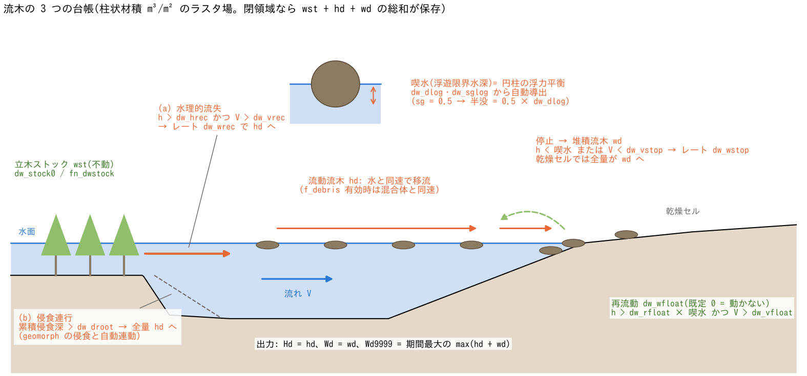

# 流木(fn_driftwood)

[ユーザーガイド目次へ](../users_guide.md)

洪水・氾濫・土石流に同伴する**流木**の発生・輸送・堆積を、セルごとの
柱状材積(m³/m²)の**ラスタ場**として概算します。1本1本の流木を追跡
する方式(個別要素モデル)ではなく、「どこの立木がどれだけ流木化し、
どこへどれだけ到達・堆積するか」の面的なポテンシャル評価が目的です。

流木は、**立木ストック `wst`・流動流木 `hd`・堆積流木 `wd`** の
3つの台帳で扱います。`wst` と `wd` は移流せず、`hd` が水
(土石流時は水・土砂の混合体)とともに保存的に輸送されます。
堆積した材積 `wd` は地盤標高 `z` に加えません。

- **① 水理的流失 (`wst → hd`)**: `H > dw_hrec` かつ
  `V > dw_vrec` のとき、レート `dw_wrec` で残る立木から流木化します。
- **② 侵食連行 (`wst → hd`)**: `zref − z > dw_droot` のとき、
  残る立木を全量流木化します。`zref` は初期化時の基準標高
  (再開時は保存値)、`z` は現在の標高です。判定量は**基準からの
  正味の地盤低下**で、侵食増分だけを足し続けた量ではありません。
  水深・流速の条件はなく、侵食の原因を区別せず `z` の低下を見ます。
- **③ 停止・堆積 (`hd → wd`)**: 乾燥判定 `h ≤ dd` なら全量を堆積へ
  移します。それ以外は、`H < hf` または `V < dw_vstop` のとき、
  レート `dw_wstop` で堆積します。`hf` は代表材の喫水です。
- **④ 再流動 (`wd → hd`)**: `dw_wfloat > 0` の場合に限り、
  `H > dw_rfloat × hf` かつ `V > dw_vfloat` のとき、レート
  `dw_wfloat` で流動へ戻します。既定値 0 では無効です。

ここで `H = h + max(hs, 0)`、`V` はセル流速です。閾値判定の `H` と、
水だけの乾燥判定 `h ≤ dd` を区別してください。土砂がなければ `H = h`。
各レートによる移送量は `レート × dt` と移送元の残量の小さい方です。
`wst` から `hd` への移送には、後述の面積換算も適用します。

番号は図中の経路を示します。実装では移流・地形更新後に
**② → ① → ③ → ④ → ダム捕捉 → 期間最大値の更新**の順で処理します。
乾燥判定を通ったセルでも、再流動を有効にして `H`・`V` の条件を
満たせば、その後の④で再判定されます。



(a) 不動の立木・堆積台帳と、流れで輸送する流動台帳。破線は基準地盤、
実線は現在の地盤で、河岸の標高差が②の判定量です。(b) 4経路の条件。
(c) 横向き円柱の水没断面積比が材比重 `sg` に等しくなる喫水 `hf` を
`dw_dlog`・`dw_sglog` から求めます。図は `sg = 0.5` の半没例で、
一般に `hf = sg × 直径` ではありません。(d) 出力と面積を換算した
材積収支。断面・樹木・丸太は説明用で、計算結果や個別丸太の軌跡では
ありません。生成: `python docs/figs/make_guide_figs.py driftwood`。

## 有効化と設定

`&list_sysparam` で `fn_driftwood` を指定します。

**「とりあえず流木を動かしてみる」最小入力は `&list_driftwood` を空のまま
置くだけです**(全項目が既定)。立木ストックは陸のセル一様に
0.001 m³/m²(針葉樹渓流の発生流木量の実績包絡値)、代表諸元・発生
(水理的流失と侵食連行の両方)・停止はすべて既定値で動きます。採用された
既定値は実行開始時に `driftwood: dw_hrec = 0.5000 m (default)` のように
**(default)** 印付きで表示されるので、値を見ずに済ませることはできません。
事例に合わせて必ず見直してください(型ごとの目安は本章末尾の
「パターン別の推奨値」。既定値の根拠は developer.md §50.6)。

```
&list_driftwood
/
```

実務では立木ストックの分布と発生・停止のパラメータを与えます:

```
&list_driftwood
  dw_stock0 = 0.01          ! 立木ストック (m3/m2。一様値)
  dw_dlog = 0.3             ! 流木の代表直径 (m)
  dw_sglog = 0.5            ! 材比重(0〜1。喫水は浮力平衡から自動導出)
  dw_wrec = 1.0e-5          ! 水理的流失レート (m/s)
  dw_hrec = 0.5             ! 流失の浸水深閾値 (m)
  dw_vrec = 1.0             ! 流失の流速閾値 (m/s)
  dw_droot = 0.5            ! 根系深 (m。侵食連行の閾値)
  dw_wstop = 0.01           ! 接地堆積レート (m/s)
/
```

## パラメータ

| パラメータ | 既定値 | 意味 |
|---|---|---|
| f_dw | 1 | 0 でファイルを残したまま一時無効化 |
| dw_stock0 | (0.001 を陸のセルに) | 一様な立木ストック (m³/m²)。fn_dwstock と排他。**両方未指定なら陸(海でない)のセル一様に 0.001 m³/m²** |
| fn_dwstock | — | 立木ストックの分布ファイル (m³/m²。地形と同じ行列形式) |
| dw_dlog | 0.3 | 流木の代表直径 (m) |
| dw_sglog | 0.5 | 材比重 ρ木/ρ水(0 < sg < 1)。喫水(浮遊限界水深)は円柱の浮力平衡の厳密解として自動導出(Braudrick & Grant, 2000。sg=0.5 でちょうど半没 = 0.5×dw_dlog) |
| dw_wrec | 1e-5 | 水理的流失レート (m/s = m³/m²/s)。指定で水理的流失が有効 |
| dw_hrec | 0.5 | 水理的流失の深さ閾値 (m。H = h + max(hs, 0) で判定) |
| dw_vrec | 1.0 | 水理的流失の流速閾値 (m/s) |
| dw_droot | 0.5 | 根系深 (m)。指定で侵食連行が有効(基準からの標高低下 zref − z > dw_droot で残る立木を全量流木化) |
| dw_wstop | 0.01 | 接地堆積レート (m/s) |
| dw_vstop | 0 | 低速堆積の流速閾値 (m/s。0 = 水深(喫水)判定のみ) |
| dw_wfloat | 0 | 再流動レート (m/s。0 = 堆積した流木は動かない(安全側)) |
| dw_rfloat | 1.5 | 再流動の浮遊余裕率(H > rfloat×喫水 かつ V > dw_vfloat で再流動。1 より大) |
| dw_vfloat | — | 再流動の流速閾値 (m/s。dw_wfloat > 0 のとき必須。dw_vstop 以上) |

発生の 2 経路(dw_wrec / dw_droot)は、**両方未指定なら両方に既定が入り
(侵食連行は地形が動かなければ発火しないので無害)、片方だけを指定すると
他方は無効**になります(明示の尊重)。dw_wrec を指定して dw_hrec / dw_vrec
を省くと閾値だけ既定になります。

## パターン別の推奨値

既定値は「動く」ための中庸です。現象の型が決まっているときは次を
出発点にしてください(校正で変わる量です。出典は developer.md §50.4・§50.5)。

| 型 | 発生 | ストック・諸元 | 閾値・レート | 停止 | 備考 |
|---|---|---|---|---|---|
| 渓流の土石流流木(砂防計画) | 侵食連行(dw_droot 0.3〜1.0 m)+水理的流失 | 針葉樹 1e-3、広葉樹 1e-4 m³/m²(指針の実績包絡)。dw_dlog = 平均胸高直径(0.2〜0.4 m)、sg 0.5 | dw_hrec 0.3〜0.5 m、dw_vrec 1〜2 m/s、dw_wrec 1e-5 | dw_wstop 0.01、dw_vstop 0.02〜0.05(遷緩点で止める) | f_debris と同時有効化。流木流出率 0.8〜0.9 で検証 |
| 洪水氾濫の河畔林・氾濫原 | 水理的流失のみ | 河畔林帯に fn_dwstock(1e-3〜1e-2)。dlog 0.3、sg 0.5 | dw_hrec 1.0 m、dw_vrec 1.0〜1.5 m/s、dw_wrec 1e-5〜1e-4 | dw_wstop 0.01、dw_vstop 0.02 | 根系が水に抉られる効果を侵食連行で加えるなら f_fluvial |
| 高潮の貯木場(伊勢湾台風型) | 水理的流失を「係留切れ」として使う | 貯木場セルに 0.5 m³/m²。dlog 0.6(原木)、sg 0.5 | dw_hrec = 平常水深 + 1 m、dw_vrec 0、dw_wrec 2e-4(高潮の継続時間で全量) | dw_wstop 0.005、dw_vstop 0.02 | 例題 timberyard |
| 津波の海岸林・貯木場 | 同上 | 海岸林 1e-3〜1e-2、貯木場 0.5〜1.0 m³/m² | dw_hrec = 平常水深 + 1〜2 m、dw_vrec 0、dw_wrec 5e-4(押し波の間に全量) | dw_wstop 0.005、dw_vstop 0.05 | 例題 tsunami_town(家屋破壊との連鎖) |
| 到達範囲の上限側評価(ハザードマップ) | 事例の発生 | 同上 | 同上 | dw_vstop 0、dw_wfloat 0 | Wd9999 を使う。残留は dw_vstop・dw_wfloat に敏感(timberyard README) |
| 施設の捕捉効果(2ケース比較) | 事例の発生 | 同上 | 同上 | 同上 | ダム・遊砂地・カルバートあり/なしで Wd9999 の差分 |

**実務値の目安**(国総研資料 904「砂防基本計画策定指針(土石流・
流木対策編)解説」2016 より):

- **dw_dlog**: 流木の平均直径は上流立木の**平均胸高直径**とほぼ
  等しい、が指針の推定法です。胸高直径の調査値をそのまま使えます。
- **立木ストック**: 単木材積 = (π/4)×樹高×胸高直径²×胸高係数
  (0.3〜0.7)× 本数密度で材積 (m³/m²) へ換算します(換算は前処理
  で)。渓流での発生流木量の実績包絡値は針葉樹で概ね 1,000 m³/km²
  (= 0.001 m³/m²)、広葉樹で概ね 100 m³/km²(= 0.0001 m³/m²)です
  (流域一様ストックの目安・結果の量水準の確認に)。
- **検証指標**: 施設がない渓流では発生流木の 8〜9 割が谷出口へ
  流出した、との実態報告が指針に引かれています(流木流出率
  0.8〜0.9)。渓流スケールの計算結果の妥当性確認に使えます。
- **侵食連行(dw_droot)**は、指針の発生量算出(崩壊・土石流の
  発生・流下範囲にある立木が流木化する)と同じ考え方です。

水理的流失(dw_wrec/hrec/vrec)の閾値・レートは校正パラメータです
(指針は水深・流速閾値による流失式を持たないため実務標準値は
存在しません — 感度解析を推奨)。再流動の目安として、水路実験では
流向平行・根株付きの流木は喫水の約 1.2 倍の水深で動き、流向に
斜交した流木は喫水未満でも回転しながら動きます(Braudrick &
Grant, 2000 — 既定 dw_rfloat=1.5 は安定側の値です)。

## 出力と材積収支

| スイッチ | ファイル | 内容 |
|---|---|---|
| f_out_hd | Hd0001… | 流動流木 `hd` (実効面積当たり m³/m²、dt_file 間隔) |
| f_out_wd | Wd0001… | 堆積流木 `wd` (実効面積当たり m³/m²) |
| f_out_wd | Wd9999 | 各セルの期間最大 `maxₜ(hd + wd)` (実効面積当たり m³/m²) |

`Wd9999` は、局所処理とダム捕捉が終わった時点の `hd + wd` の最大値です。
累積通過材積ではなく、異なる時刻の `hd` の最大値と `wd` の最大値を
足したものでもありません。

`wst` はセルの**幾何面積**当たり、`hd`・`wd` は水と同じ**実効面積**
当たりの柱状材積です。`A = dx × dy`、`f = gv × wfrac` とすると
(河道幅を指定しない場合は `wfrac = 1`)、領域内の材積は

```math
Q = \sum_{i,j} A\left[wst_{i,j} + f_{i,j}(hd_{i,j}+wd_{i,j})\right].
```

流木化で `wst` が `Δw` 減ると、`hd` は `Δw / f` 増えます。
`dw_wrec` は幾何面積当たり、`dw_wstop`・`dw_wfloat` は実効面積当たり
の材積レート(m³/m²/s)です。単純な `wst + hd + wd` の和で材積収支を
確認できるのは、面積係数が 1 の場合に限られます。

`result/driftwood.csv` は `dt_recrd` 間隔で出力します。`rec_hyd_m3`・
`rec_ero_m3`・`deposit_m3`・`refloat_m3`・`to_dam_m3` は各過程の累積材積、
`vol_stock_m3`・`vol_float_m3`・`vol_deposit_m3` は現在貯留で、
いずれも面積換算済みの m³ です。
閉領域・ダム捕捉なしなら現在貯留の和 `Q` が初期材積を保存します
(数値誤差を除く)。流出やダム捕捉は別途収支に計上してください。
発生・堆積・再流動は内部移送なので、それらの累積値を現在貯留に
足すと二重計上になります。

## 併用関係・制約

- ENC 格子のみ。地形時間の加速(morfac ≠ 1)とは併用できません
  (流木はイベント量のため)。
- [土砂・地形変化](geomorph.md)との併用は自由です(f_debris との
  同時有効化で土石流+流木の混合流れ)。geomorph なしでも水理的
  流失で動作します。侵食連行は z が基準から低下しなければ発火しません。
- **ダムの捕捉帯**に入った流動流木はダムに捕捉されます(放流には
  流木は含まれません)。**カルバート・ポンプ**は水だけを送るため、
  流木は施設の上流に滞留します(= 捕捉の上限側評価。
  [砂防施設の表し方](geomorph.md)と同じ流儀で「施設あり/なし」の
  2ケース比較に使えます)。
- 中断・再開(save/restore)では `hd`・`wd`・`wst`・`zref` を
  `driftwood.dat` に保存・復元します。**`Wd9999` の最大値統計と CSV の
  累積過程量は引き継ぎません**。再開後の出力だけで全期間の統計・収支を
  読まず、分割前後の結果を区別して集計してください。

## 検証ケース

[test/driftwood](../../test/driftwood/) は、侵食連行・水理的流失の両経路について
材積保存・輸送・堆積を検定し、分割継続と通し計算の保存状態も比較します。

## 例題: 高潮による貯木場からの材木流入(伊勢湾台風型)

海岸の貯木場に浮かぶ材木が高潮で流出し、防潮壁を越えた氾濫流に
乗って市街地へ流入・堆積する現象の理想化実験を
[examples/timberyard](../../examples/timberyard/) に収録しています
(`python3 make_terrain.py && ./encflow param.txt` で実行。約1分)。
組み方の要点(貯木場・港湾を海域マスクにしない、材木ストックは
`fn_dwstock` で貯木場のセルにだけ、水理的流失を「高潮による係留切れ・
浮上」として使う = `dw_hrec` を平常水深より高く、防潮壁・開口部は
地形、建物は `fn_gv`)と、結果の図・数表、Wd9999(各セルの期間最大 hd+wd)
と最終フレーム Wd9998 の使い分け、堆積パラメータ(`dw_vstop`・
`dw_wfloat`)の感度ケース、材木の衝突力の後処理評価の手順は
[examples/timberyard/README.md](../../examples/timberyard/README.md)
に解説しています。

## モデル化していないもの

個別の流木の軌跡・向き・回転、橋脚やスリット堰堤の部材間隔と流木長の
幾何的な引っ掛かり(閉塞)、流木の衝突力は対象外です(ラスタ表現の
方針による明示的な適用限界)。閉塞の**効果**を検討する場合は、開口を
狭めた地形・カルバートをシナリオとして与えた2ケース比較で近似して
ください。**衝突力**は後処理で評価します: 実務の標準(国総研資料 905
§4.3)は流木の衝撃力を「礫の衝撃力算定式を準用し、速度は流れの流速・
径は流木の最大直径」として算出する方式なので、最大流速 V9999(または
流速フレーム)と代表材の諸元をその式(あるいは FEMA P-646 の流木衝突
式)に与えれば指針整合の衝突力マップを作れます(手順の例は上記の
例題 README)。水そのものの流体力は F9999(= u²h)で評価します。
実装仕様は developer.md §50。典拠: 喫水・移動限界は
Braudrick, C. A. and Grant, G. E. (2000), When do logs move in
rivers?, Water Resources Research 36(2), 571-583。実務値・発生機構は
国総研資料 第904号「砂防基本計画策定指針(土石流・流木対策編)解説」
・第905号「土石流・流木対策設計技術指針 解説」(2016)。
