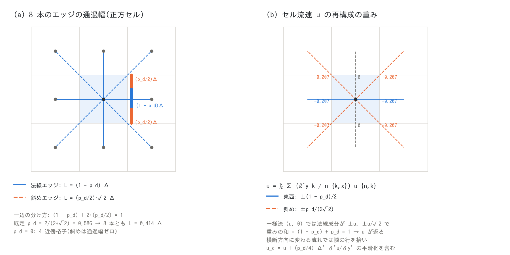

# ENC 格子と時間積分の解説(浅水流計算の補足)

[浅水流計算の章へ](swflow.md) | [ユーザーガイド目次へ](../users_guide.md)

浅水流計算の章([swflow.md](swflow.md))のうち、移流項・拡散項・非静水圧
補正以外の部分 — ENC 格子の幾何、連続式、セル流速の再構成、運動方程式の
圧力・摩擦・抗力項、適応的ルンゲクッタ、クーラン数、数値定数 — を、式と
既定値の根拠つきで解説します。移流項は[移流項のスキーム](advection.md)、
拡散項は[拡散項の解説](diffusion.md)、非静水圧補正は
[非静水圧補正の解説](nonhydrostatic.md)にあります。実装は
`src/m_swflow_enc.f90`(`init_weights`、`calc_kth_momentum`、
`calc_kth_flux`、`continuous`)と `src/m_ffactor.f90` です。

## 1. 方程式

水深 $`h`$、地盤高 $`z`$、水位 $`\eta = z + h`$ の浅水方程式を、セル中心の
$`h`$ と、セルを結ぶ線(エッジ)の法線流速 $`u_n`$ で解きます。

```math
\frac{\partial h}{\partial t} + \nabla\cdot(h\mathbf{u}) = 0,
\qquad
\frac{\partial u_n}{\partial t}
 = -g\frac{\partial \eta}{\partial s}
   - \frac{g n^2 |\mathbf{V}|}{h^{4/3}}u_n
   + A_n + D_n
```

$`s`$ はエッジに沿う座標、$`n`$ は Manning の粗度係数、$`|\mathbf{V}|`$ は
流速の大きさ、$`A_n`$・$`D_n`$ はエッジ法線方向の移流項・拡散項です。
運動方程式を**エッジの法線成分だけ**で持ち、セルの流速ベクトルは
§4 の再構成で作る、という構成が ENC(Eight-Neighbour Connected)格子の
特徴です。これは日本の氾濫解析で標準的な差分モデル[^iwasa80]の
「セル中心の水深とセル境界の流量」の配置を 8 方向に拡張したもので、
スタガード格子の保存形スキーム[^sd03]と同じ系統です。

## 2. ENC 格子の幾何



セル $`(i, j)`$ は軸方向 4 つと対角方向 4 つの近傍 $`k = 1\ldots 8`$ と
エッジで結ばれます。エッジ $`k`$ の長さ $`\Delta s_k`$ は軸方向で
$`\Delta x`$ または $`\Delta y`$、対角方向で
$`\Delta r = \sqrt{\Delta x^2 + \Delta y^2}`$ です。エッジを横切る
流量にはそれぞれ**通過幅** $`L_k`$ を割り当て、セルの一辺を法線エッジ
1 本と斜めエッジ 2 本で分け合います(図 (a))。

```math
L_{\text{axis}} = (1 - p_d)\,\Delta,
\qquad
L_{\text{diag}} = \frac{p_d}{2}\sqrt{2}\,\Delta,
\qquad
(1 - p_d) + 2\cdot\frac{p_d}{2} = 1
```

$`p_d`$ が `p_diagratio` で、正方セルでは一辺のうち $`p_d`$ の割合を
2 本の斜めエッジに、残りを法線エッジに配ります。**既定値
$`p_d = 2/(2+\sqrt 2) \approx 0.586`$ は、8 本の通過幅がすべて等しく
なる値**です(法線 $`(1 - p_d)\Delta`$ と斜め $`p_d\Delta/\sqrt 2`$ が
ともに $`\Delta/(1+\sqrt 2) \approx 0.414\Delta`$)。通過幅の総和はセルの
周長 $`4\Delta`$ ではなく $`8 \times 0.414\Delta = 3.31\Delta`$ ですが、
等方的な流れでは §4 の再構成が流速を正確に返す(重みの和が 1)ため、
通水能が過不足になることはありません。$`p_d = 0`$ は 4 近傍格子
(斜めエッジは通過幅ゼロで運動方程式の対象外)、$`p_d = 1`$ は斜めだけの
格子です。$`\Delta x \ne \Delta y`$ では短い辺を基準に $`p_d`$ を適用し、
長い辺は $`(\Delta_{\min}/\Delta_{\max})^2`$ 倍に縮めた配分にします
(`init_weights`)。

通過幅はサブグリッド河道の幅・堤防壁・家屋占有率で後から縮められます
([河道](channel.md)、[地理情報](geoinfo.md))。拡散項の 9 点ラプラシアンの
重み $`L_k/\Delta s_k`$ も同じ通過幅から作られ、任意の $`p_d`$ で整合な
ラプラシアンになることが[拡散項の解説](diffusion.md) §3 にあります。

## 3. 連続式

セルの水深は、8 本のエッジを通る単位幅流量 $`q_k`$(外向き正)で
更新します。$`g_v`$ は家屋などを除いた平面の空隙率(既定 1)です。

```math
h^{n+1}_{i,j} = h^n_{i,j}
 - \frac{\Delta t}{g_v\,\Delta x\,\Delta y}\sum_{k=1}^{8} L_k\,q_k,
\qquad
q_k = u_{n,k}\,h_{e,k}
```

$`h_{e,k}`$ はエッジ水深で、両側セルの平均を基本に、上流側水深での
頭打ち(`f_hcap_upwind`)と乾燥セルへのエネルギー頭の頭打ち
(`f_dry_head_cap`)を掛けたものです(規則は[移流項のスキーム](advection.md)
§5)。両側のセルがともに限界水深 $`d_d`$(`dd`)未満のエッジは流量を
計算しません。質量はこの形で厳密に保存され、流量 $`q_k`$ はエッジ
ごとに 1 回だけ計算してセル対で反対称に使います。

## 4. セル流速の再構成

セル中心の流速 $`(u, v)`$ は、エッジの法線流速を通過幅で重み付けして
左右(上下)の平均をとった値です。

```math
u_{i,j} = \frac{1}{2}\sum_{k:\,n_{k,x}\ne 0}\frac{\ell^{y}_k}{n_{k,x}}\,u_{n,k},
\qquad
v_{i,j} = \frac{1}{2}\sum_{k:\,n_{k,y}\ne 0}\frac{\ell^{x}_k}{n_{k,y}}\,u_{n,k}
```

$`(n_{k,x}, n_{k,y})`$ はエッジ $`k`$ の単位法線、$`\ell^{y}_k`$ は
通過幅を $`y`$ 軸に投影した辺長比(法線エッジで $`1 - p_d`$、斜めで
$`p_d/2`$)です。一様流 $`(u, 0)`$ を入れると法線成分は東西で $`\pm u`$、
斜めで $`\pm u/\sqrt 2`$ になり、重みの和がちょうど 1 なので
$`u_{i,j} = u`$ が返ります。流速が横断方向に変化するときは斜めエッジが
隣の行の値を拾うため、再構成は 2 次の平滑化
$`u_c = u + (p_d/4)\Delta^2\,\partial^2 u/\partial y^2 + \cdots`$ を含みます。
この量は出力とプローブに現れ、[test/diffusion](../../test/diffusion/README.md)
のガウス形ジェットでは中心の流速が $`\Delta x = 1`$ m で 0.14%
小さく見えます(拡散項の誤差ではありません)。流速の大きさ
$`|\mathbf{V}| = \sqrt{u^2 + v^2}`$ は摩擦項・抗力項・移流の風上判定に
使われます。

## 5. 運動方程式の各項

エッジ $`k`$(中心セル $`c`$ と近傍セル $`n`$ を結ぶ)の法線流速は、
各項をエッジで評価して次の形で更新します(移流項と拡散項は時刻 $`n`$ の
値に固定)。

```math
u^{\,l} = \frac{u^n + \left(A_n + D_n + G^{\,l}\right)\Delta t_l}
               {1 - F^{\,l}\,\Delta t_l},
\qquad
\Delta t_l = \frac{\Delta t}{a_l\,\lambda_m}
```

$`l`$ は §6 のルンゲクッタの段(陽的オイラーは $`l = 4`$ の 1 段だけ)、
$`\lambda_m = g_v + (1 - g_v)\,c_m`$ は家屋の付加質量を含めた有効慣性係数
(家屋なしで 1)です。

**圧力項・底面勾配項 $`G`$ と重力の補正。** 水位差を距離で割った勾配に
有効重力加速度 $`g_e`$ を掛けます。

```math
G = -\,g_e\,g_v\,\frac{\eta_n - \eta_c}{\Delta s_k},
\qquad
g_e = g\,\frac{\Delta s_k^2}{\Delta s_k^2 + (z_n - z_c)^2} = g\cos^2\theta
```

$`\cos^2\theta`$ の補正(`f_gravity_correction = 1`、既定)は急斜面で
水平投影の浅水方程式が駆動力を過大評価するのを正す Ni らの定式化[^ni19]
で、斜面角 $`\theta`$ が 10° で 3%、30° で 25% 駆動力を減らします。
緩勾配では $`g_e \approx g`$ で結果は変わりません。

**摩擦項 $`F`$。** Manning 則を半陰的に扱います。

```math
F = -\,g_e\,g_v\,\frac{n_e^2\,|\mathbf{V}|_e}{h_f^{4/3}},
\qquad
h_f = \max(h_e,\,d_v),\quad
|\mathbf{V}|_e = \max\!\left(\tfrac{|\mathbf{V}|_c + |\mathbf{V}|_n}{2},\,v_v\right)
```

分母に置く半陰解法[^iwasa80]は、摩擦が強い浅い水でも流速が符号を変えて
振動しない(Δt によらず $`|u^{l}| \le |u^n + \ldots|`$)ための標準的な
扱いです。$`d_v`$(`dv`)は摩擦に使う水深の下限、$`v_v`$(`vv`)は
流速の下限で、静止から動き出す瞬間に $`|\mathbf{V}| \approx 0`$ で摩擦が
消えて加速し過ぎるのを防ぎます(§8)。

**家屋の抗力項。** 家屋占有率 $`1 - g_v`$ と平均家屋寸法 $`B`$
(地理情報の `gv`・`bb`)をもつセルでは、抗力を摩擦と同じ半陰形で加えます。

```math
F_{\text{bldg}} = -\,\frac{k\,C_D}{2}\,\frac{h_f}{B}\,(1 - g_v)\,|\mathbf{V}|_e
```

$`C_D`$(`cd`、既定 1.0)は角柱の抗力係数の典型値、$`k`$(`kk`、既定 0.5)は
家屋群の遮蔽による低減係数、$`c_m`$(`cm`、既定 2.0)は付加質量係数です。
これらは文献値の範囲にある**経験的な既定値**で、都市氾濫の再現では
粗度と合わせて校正してください([地理情報](geoinfo.md)の家屋群の扱い)。

**流量と乾湿の規則。** 更新した流速にエッジ水深を掛けて
$`q = u_n h_e`$ とします。乾燥セルへ向かうエッジの $`h_e`$ はエネルギー頭
$`\eta_c + u_n^2/2g - z_n`$ で頭打ち(`f_dry_head_cap`)、送り手が完全に
乾いたエッジは $`u_n = q = 0`$ です。1 ステップの流出がセルの水を使い
切るとき(`f_exflux_reduction = 1`、既定)は、そのエッジの流量を
$`(h_c - d_d)/\Delta h_c`$ 倍に縮めます(画面の **ex_flux 列**はこの
発動回数)。エッジごとに順に判定するため負水深が完全には防げず、
強い乾燥化では $`h`$ がわずかに負になることがあります。

## 6. 時間積分と適応的ルンゲクッタ

既定の時間積分はエッジごとの陽的オイラー(摩擦は半陰)です。これを
全エッジで 4 段にすると計算量が 4 倍になるため、**流量が急変したエッジ
だけ**を 4 段で再計算します(`f_adaptive_runge = 1`、既定)。段は
Jameson–Schmidt–Turkel 型の低記憶ルンゲクッタ[^jst81]で、段 $`l`$ は
時刻 $`n`$ の流速から $`\Delta t_l = \Delta t/a_l`$、
$`a = (4, 3, 2, 1)`$ で進め、段ごとに両側セルの仮の水深
($`\Delta t_l`$ の間の流出入。自エッジは新しい流量、他のエッジは
前ステップの流量)と $`|\mathbf{V}|`$ を更新して圧力項と摩擦項に使います。
移流項は段内で更新しません(比例形・アフィン形の更新を評価して不採用。
developer.md §68.19・§68.23)。

**再計算の判定。** 陽解法の候補 $`q_{\text{new}}`$ を前ステップの
$`q_{\text{old}}`$ と比べ、閾値 $`\theta`$(`p_adprunge_thresh`)で

```math
\text{再計算} \iff
\begin{cases}
 q_{\text{new}}/q_{\text{old}} < 1/\theta \ \text{または}\ > \theta
   & (q_{\text{old}} \ne 0)\\
 q_{\text{new}} \ne 0 & (q_{\text{old}} = 0)
\end{cases}
```

とします(符号の反転は比が負なので含まれます)。堤防壁のエッジは後段で
堰流量に置き換わるため判定しません。画面の **Runge 列**は
$`100 \times`$(再計算したエッジ数)/(有効セル数 × 4)の、表示区間内の
最大値です。初期流速を与える計算では、初期化で $`q = u_n h_e`$ を
エッジ流速と同時に作って初回ステップの判定が整合するようにしています
(2026-10-12 の修正。developer.md §7)。

**閾値の根拠。** 既定 $`\theta = 1.5`$ は、[チュートリアル Step 2](../../tutorials/wave/README.md#step-2-enc-パラメータの設定)
の水槽の波で $`\theta = 1.1`$ にしても波形が dt を半分にした結果には
近づかず、再計算率だけが上がることから決めた経験値です。精度を上げる
手段としては dt を縮める方が確実で、Runge 列が数割に達するなら dt が
大き過ぎると考えてください。1.1 未満は判定帯が狭すぎてほぼ全エッジが
再計算になるため、1.1 以上を指定します。

## 7. クーラン数と時間刻み

画面の **Cn 列**はセルごとの

```math
C_n = \frac{|\mathbf{V}| + \sqrt{g h}}{\min(\Delta x, \Delta y)}\,\Delta t
```

の最大値です(`f_check_cfl = 2` では波速 $`\sqrt{gh}`$ を落とした移流
クーラン数)。陽解法の安定条件 $`C_n \le 1`$[^cfl]は必要条件で、
乾湿前縁・段波・急勾配を含む計算では $`C_n \le 0.5`$ を目安に dt を
決めてください(既定の `f_check_cfl = 1` は $`C_n > 1`$ で停止)。
斜めエッジの距離 $`\Delta r`$ は軸より長いので、安定性は軸方向が決めます。
拡散項を使うときは別に $`\nu \le \Delta x^2/(2.83\,\Delta t)`$ の条件が
あります([拡散項の解説](diffusion.md) §4)。

## 8. 数値定数の根拠

| 定数 | 既定 | 役割 | 根拠・変えたときの影響 |
|---|---:|---|---|
| dd | 0.001 m | 移動限界水深。両側がこれ未満のエッジは流量 0。ex_flux 抑制の残し水深 | 経験値(1 mm)。大きくすると薄い前縁が止まり、過大流出の抑制が増える。小さくすると薄い舌の計算が増えコストと摩擦の感度が上がる |
| dv | 0.001 m | 摩擦項の水深の下限 $`h_f`$ | 経験値。$`h^{-4/3}`$ の発散を抑える。dd と同程度にする |
| vv | 0.01 m/s | 摩擦項の流速の下限 | 経験値。静止からの動き出しで摩擦が消える 1 ステップの加速を抑える。半陰形なので値が小さいほど「動き出し直後」の摩擦が小さい |
| gg | 9.8 m/s² | 重力加速度 | — |
| cm / cd / kk | 2.0 / 1.0 / 0.5 | 家屋の付加質量・抗力・遮蔽係数(§5) | 経験値(文献値の範囲)。都市氾濫では粗度と合わせて校正 |

**摩擦項の高速化(`f_friction_fastmath`)。** $`h^{-4/3}`$ の評価を、
$`\log h`$ で等間隔の表($`d_d`$〜30 m。レベル 1〜5 で 256・128・64・
32・16 点)の区間ごとの折れ線(区間を中点で 2 つに分けた直線)で
置き換えます。レベル 0(既定)は厳密な累乗で、表近似の $`h^{-4/3}`$ の
最大相対誤差はレベル 1・3・5 で $`2\times10^{-4}`$・$`3\times10^{-3}`$・
6% です。回帰テストの reference は
レベル 0 で作られているので、比較は同じレベルで行ってください。

## 9. STG 格子(旧互換)

`f_gridsystem = 1` は 4 近傍のスタガード格子で、水深をセル中心、
$`x`$・$`y`$ 方向の単位幅流量を東西面・南北面に置く従来形の差分モデル
[^iwasa80]です。ENC との比較用に残しており、再開・サブグリッド河道・
内部構造物・非静水圧補正・新しい移流スキームは非対応です。

## 10. パラメータ

| パラメータ | 既定 | 意味 | 根拠 |
|---|---:|---|---|
| p_diagratio | 2/(2+√2) | 斜めエッジへの通過幅の配分比 $`p_d`$(§2) | 8 本の通過幅が等しくなる値。0 で 4 近傍格子 |
| f_gravity_correction | 1 | 急勾配の有効重力 $`g\cos^2\theta`$(§5) | Ni et al.[^ni19]。緩勾配では無効果 |
| f_exflux_reduction | 1 | 過大流出の抑制(§5) | 乾床前縁の負水深を防ぐ。乾床のある計算では on のまま |
| f_hcap_upwind | 1 | エッジ水深の上流側頭打ち(§3) | 1: 平均を上流側水深で頭打ち。2: 上流側水深そのもの = 保存形スキームの連続式[^sd03]。段波・砕波では 2 |
| f_friction_fastmath | 0 | 摩擦項の表近似(§8) | 0: 厳密。回帰テストは 0 |
| f_adaptive_runge | 1 | 適応的ルンゲクッタ(§6) | 急変エッジだけ 4 段 RK[^jst81] |
| p_adprunge_thresh | 1.5 | 再計算の閾値 $`\theta`$(§6) | 経験値(tutorials/wave Step 2)。1.1 以上 |
| f_check_cfl | 1 | クーラン数の監視(§7) | 1: $`C_n > 1`$ で停止。2: 移流クーラン数で判定 |
| dd, dv, vv, gg, cm, cd, kk | §8 | 数値定数(&list_sysparam) | §8 の表 |

移流項・拡散項・非静水圧補正のパラメータは各解説ページの表にあります。

## 11. 検証ケース

| ケース | 内容 | 要点 |
|---|---|---|
| [tutorials/wave](../../tutorials/wave/README.md) | 水槽の波(Step 1〜2) | dt と閾値 $`\theta`$ の効果。Runge 列・Cn 列の読み方 |
| [test/wave](../../test/wave/README.md) | 回帰テストの基本ケース | 既定設定のビット再現(np=1, 2, 4) |
| [test/dambreak](../../test/dambreak/README.md) | Stoker の段波解析解 | 段波速度・中間水深が dt によらず正しい |
| [test/chichibu](../../test/chichibu/README.md) | 実地形の洪水 | 既定設定の格子収束と MPI 一致 |
| [test/diffusion](../../test/diffusion/README.md) | ガウス形ジェット | セル流速の再構成の平滑化 $`(p_d/4)\Delta^2 u''`$ の大きさ(§4)と初期流量の整合(§6) |
| [test/nhwave](../../test/nhwave/README.md) | 閉水槽の定在波 | 静水圧 ENC の数値分散が 1% 未満 |

## 参考文献

[^iwasa80]: 岩佐義朗・井上和也・水鳥雅文 (1980): 氾濫水の水理の数値解析に関する研究. 京都大学防災研究所年報, 23 B-2, 305–317.(セル中心水深・セル境界流量の差分配置と摩擦項の半陰的扱い)
[^sd03]: Stelling, G. S. and Duinmeijer, S. P. A. (2003): A staggered conservative scheme for every Froude number in rapidly varied shallow water flows. *Int. J. Numer. Meth. Fluids*, 43, 1329–1354.(保存形スタガードスキーム。連続式の上流側水深)
[^ni19]: Ni, Y., Cao, Z. and Liu, Q. (2019): Mathematical modeling of shallow-water flows on steep slopes. *J. Hydrol. Hydromech.*, 67(3), 252–259. doi:10.2478/johh-2019-0012.(急斜面の有効重力 $`g\cos^2\theta`$)
[^jst81]: Jameson, A., Schmidt, W. and Turkel, E. (1981): Numerical solution of the Euler equations by finite volume methods using Runge–Kutta time stepping schemes. AIAA Paper 81-1259.(係数 1/4, 1/3, 1/2, 1 の 4 段低記憶ルンゲクッタ)
[^cfl]: Courant, R., Friedrichs, K. and Lewy, H. (1928): Über die partiellen Differenzengleichungen der mathematischen Physik. *Math. Ann.*, 100, 32–74.
