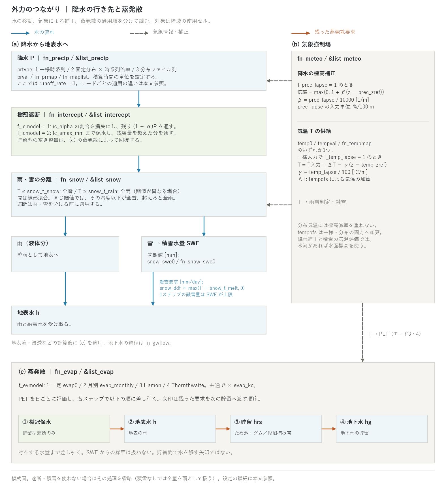

# 降雨・気象(&list_precip / intercept / meteo / evap / snow)

[ユーザーガイド目次へ](../users_guide.md)

水文計算の駆動力となる5つの機能をまとめて説明します。必要な機能を
`fn_*` で有効化し、気温・暦などの依存条件を満たして組み合わせます。

**降水 (`fn_precip`) は水収支への質量入力**、**気象強制場 (`fn_meteo`)
は気温と標高補正の供給元**です。雨だけを与え、標高補正や気温を使う
過程を有効化しなければ、`fn_meteo` は不要です。



(a) 降水は樹冠遮断を経て雨と雪に分かれ、雨は降雨として、雪は積雪水量
(SWE)に蓄えてから融雪水として地表へ届きます。(b) 気象強制場は降水の
標高補正、雨雪判定・融雪、気温からの可能蒸発散(PET)の推算に使います。
(c) 蒸発散は地表流・浸透などの計算後、樹冠保水→地表水→ため池・
ダム／湖沼捕捉帯の貯留→地下水の順に、残った要求を満たす分だけ差し引きます。
青実線は水の経路、灰破線は情報・補正、橙実線は蒸発散要求の適用順です。
橙の矢印は貯留間の水の移送を意味しません。図は陸域の使用セルに対する模式図で、
全過程を含む水収支図ではありません。`runoff_rate=1` を前提とし、
各 `fn_*` が参照するファイルには対応する `&list_*` を記述します。

遮断を使わなければ降水はそのまま次へ渡り、積雪を使わなければ全量を
雨として扱います。蒸発散は有効な場合だけ適用します。
[SVG版](../figs/forcing_chain.svg)も同じ生成コードから出力します。
再生成: `python docs/figs/make_guide_figs.py forcing`。

## 気象入力を1枚のファイルにまとめる(推奨書式)

各 fn_\* には同じファイル名を指定できるので、気象系の入力は1枚に
まとめられます。

```
&list_sysparam
  ...
  fn_precip = "forcing.txt"
  fn_meteo  = "forcing.txt"
  fn_snow   = "forcing.txt"
/
```

```
! ---- forcing.txt ----
&list_precip
  prtype = 1
  prval(:,1) = 0, 10        ! (時刻(min), 雨量強度(mm/h))
  prval(:,2) = 1440, 10
/
&list_meteo
  temp0 = 2.0               ! 一様気温 (℃)
/
&list_snow
  snow_ddf = 3.0            ! 度日係数 (mm/℃/day)
/
```

## 降水(&list_precip)

雨の与え方は `prtype` で選びます。

| prtype | 与え方 | 使うパラメータ |
|---|---|---|
| 0(既定) | 降水なし(一時無効化) | — |
| 1 | 一様な時系列 | prval |
| 2 | 固定の分布 × 時系列倍率 | fn_prmap、prval(倍率) |
| 3 | 時系列の分布ファイル群(レーダー雨量等) | fn_maplist、dt_maplist |

| パラメータ | 既定値 | 意味 |
|---|---|---|
| prval | — | 時系列 `(時刻(min), 値)` の組。値は prtype=1 で雨量強度 (mm/h)、prtype=2 で倍率。最後の時刻以降は最後の値で継続 |
| dt_prupdate | 1 | 降雨の更新間隔 (min)(prtype=1, 2) |
| fn_prmap | "" | 降水分布ファイル(prtype=2) |
| fn_maplist | "" | 分布ファイル名のリスト(1行1ファイル。prtype=3)。**リスト中のパスも dir_data 起点**(リストファイルからの相対ではない) |
| dt_maplist(_c) | 60 | 分布ファイルの時間間隔 (min)(prtype=3) |
| dt_mapunit(_c) | 0 | 分布ファイルの値が「何分間の積算雨量 (mm)」かの指定。0(既定)なら prtype=2 は1日(= mm/day)、prtype=3 はファイル間隔(dt_maplist 間の積算 mm。間隔1時間なら mm/h と同値) |
| runoff_rate | 1.0 | 流出率。現行実装では prtype によって適用先が異なるため、下記参照。地下水計算との併用では 1.0 を使う |

**`runoff_rate` の現行実装**: `prtype=1,2` では出力用雨量 `prh` に掛かり、
水収支へ渡す降水強度 `pre` には掛かりません。`prtype=3` では分布値を
`dt_mapunit` で降水強度へ換算するときに `pre` に掛かります。
したがって、どのモードでも同じように実際の降水を減らす係数としては
扱えません。図のような外力の連携では既定の `1.0` とし、降水量自体を
変えたい場合は入力値を調整してください。

```
&list_precip                ! 例: 10分から24時間、15 mm/h の一様雨
  prtype = 1
  prval(:,1) =    0,  0
  prval(:,2) =   10, 15
  prval(:,3) = 1440, 15
  prval(:,4) = 1450,  0
/
```

書式の実例は [examples/List_samples/list_precip.txt](../../examples/List_samples/list_precip.txt)
に4タイプ分あります。降雨強度の分布は `f_out_pre = 1` で `Pr0001` と
して出力できます。

**降雨の型の目安**(雨量は与件ですが、設定の出発点として。
地域・再現期間で 2 倍程度動きます)

| 型 | 強度 (mm/h) | 継続 | 総雨量 (mm) | 与え方 |
|---|---|---|---|---|
| 梅雨前線の長雨 | 10〜30 | 6〜24 h | 100〜300 | prtype=1 の台形 |
| 台風 | 20〜50(ピーク 50〜80) | 12〜24 h | 200〜600 | prtype=1 の山形、または prtype=3 の解析雨量 |
| 線状降水帯 | 50〜100 | 3〜6 h | 200〜400 | prtype=1 の矩形 |
| 都市の設計降雨(5〜10 年確率、60 分) | 50〜80 | 1 h | 50〜80 | prtype=1 の矩形(内水・下水道) |
| 浸水想定(想定最大規模) | 100 以上(ピーク) | 数時間 | 300〜1000 | prtype=1 のハイエトグラフ |
| 融雪出水 | 0(無雨)〜10 | 日単位 | — | fn_meteo の気温 5〜10 ℃ + fn_snow |

## 降雨遮断(&list_intercept)

樹冠などによる遮断を、雨雪判定より前の降水に適用します。積雪と併用
する場合も、雨と雪を区別する前に同じ遮断モデルが作用します。

| パラメータ | 既定値 | 意味 |
|---|---|---|
| f_icmodel | 0 | 0: なし(一時無効化)、1: 固定遮断率、2: 初期損失(貯留型) |

モデル固有の設定は同じファイル内の専用グループに書きます。

**固定遮断率(f_icmodel = 1、&list_intercept_fixed)** — 降雨の一定
割合 α を損失として取り除き、残り (1−α)P を後続の雨雪判定へ渡します。
積雪を使わない場合はそのまま地表への雨になります。樹冠貯留は持ちません。`ic_alpha`
(一様値。既定 0.15)または `fn_icalpha`(分布。指定時は ic_alpha 不使用)。

**初期損失(f_icmodel = 2、&list_intercept_initloss)** — 降り始めの
雨を最大貯留量まで蓄え、満たされた後は素通しにします。`ic_smax_mm`
(一様値 mm。既定 1.5)または `fn_icsmax`(分布)。毎ステップ、残容量まで
保水して余りを通します。`fn_evap` の蒸発散で樹冠保水が減ると再び遮断
できるようになります。蒸発散を使わなければ空き容量は回復しません。

一様値は未指定なら既定を採用し "(default)" 付きで表示します(最小入力は
f_icmodel と空の固有グループ。根拠は developer.md §66)。植生別の目安
(Crockford & Richardson 2000 のレビュー。校正で変わる量です):

| 型 | ic_alpha(遮断率) | ic_smax_mm(樹冠貯留 mm) |
|---|---|---|
| 針葉樹林(密) | 0.25〜0.4 | 1.5〜3 |
| 広葉樹林・混交林(既定) | 0.1〜0.2 | 0.8〜1.5 |
| 落葉期の広葉樹林 | 0.05〜0.1 | 0.3〜0.8 |
| 草地・農地 | 0.05〜0.1 | 0.3〜0.5 |
| 市街地(窪地貯留としての初期損失) | — | 1〜2.5(不透水面の窪地貯留。SWMM の慣用値) |

## 気象強制場(&list_meteo)

気温を一元管理し、蒸発散・融雪・水質などへ提供します。入力は
**3通りのいずれか1つ**です。

| パラメータ | 既定値 | 意味 |
|---|---|---|
| temp0 | — | 一様な定数 (℃) |
| tempval | — | 一様な時系列 `(経過日数, ℃)`。時刻は t=0 からの経過**日** |
| fn_tempmap | "" | 気温分布ファイルのリスト(1行1ファイル、dt_tempmap_c 間隔で順次適用・終端保持) |
| dt_tempmap_c | "1 day" | 分布ファイルの時間間隔 |
| f_temp_lapse | 0 | 1: 標高による気温減率を有効化(一様入力のみ) |
| temp_lapse | 0.65 | 減率 (℃/100 m) |
| temp_zref | 領域最低標高 | 気温減率の基準標高 (m)。入力単位の換算を含む式は下記 |

一様入力で `f_temp_lapse=1` のとき、標高を m として次の式を使います。

```math
T = T_{\mathrm{input}} + \Delta T - \gamma (z - z_{T,\mathrm{ref}}),
\qquad \gamma = \frac{\mathtt{temp\_lapse}}{100}.
```

ここで `z_T,ref` は `temp_zref`、`ΔT` は `tempofs` の値(省略時0)です。
たとえば減率 `0.65 ℃/100 m`、基準からの標高差 `1000 m` なら気温は
`6.5 ℃` 下がります。分布気温 `fn_tempmap` に標高減率を重ねる設定は
初期化時にエラーとなります。分布気温にも `tempofs` は加算します。
気温減率と積雪を併用すると、標高による雨雪判定・融雪の違いが現れます。

このほか、長期計算([氷河](glacier.md)・長期地形変化)向けの
オプションが2つあります。

| パラメータ | 既定値 | 意味 |
|---|---|---|
| tempofs | — | 長周期の気温オフセット系列 `(経過日数, ΔT ℃)`。気温入力(一様・分布とも)へ加算される。周期強制 t_cycle で折り返されない実時間軸で補間されるため、**代表年の反復に寒冷化・温暖化トレンドや氷期サイクルを重畳**できる |
| f_prec_lapse | 0 | 1: 降水の標高勾配を有効化。単位換算と非負制限を含む倍率は下記(地形性降水・氷河涵養の簡便表現。分布降水入力があればそちらを推奨) |
| prec_lapse | 0.0 | 降水の増率 (%/100 m) |
| prec_zref | 領域最低標高 | 降水勾配の基準標高 (m) |

降水の標高補正は、入力の `prec_lapse` を `%/100 m` から `1/m` に
換算し、降水を更新するときに次の倍率を掛けます。遮断より前の処理です。

```math
F_P = \max\left(0,\,1 + \beta (z-z_{P,\mathrm{ref}})\right),
\qquad \beta = \frac{\mathtt{prec\_lapse}}{10000}.
```

`z_P,ref` は `prec_zref` です。`10 %/100 m`、標高差 `500 m` なら倍率は
`1.5`、負になる場合は `0` に制限されます。降水補正と積雪の気温評価は、
氷河が有効なら氷面 `z + hi` を標高に使います。蒸発散の気温評価は地盤高
`z` を使います。

## 蒸発散(&list_evap)

可能蒸発散(PET)の与え方を `f_evmodel` で選びます。

| f_evmodel | 方法 | 必要なもの |
|---|---|---|
| 0(既定) | なし(一時無効化) | — |
| 1 | 一定速度 evap0 (mm/day) | — |
| 2 | 月別気候値 evap_monthly (mm/day ×12) | 暦(date0_c) |
| 3 | Hamon 式(気温と可照時間から推算) | 暦・気温(fn_meteo)・緯度 lat |
| 4 | Thornthwaite 式 | 3 に加えて月平均気温の平年値 temp_normal(×12) |

| パラメータ | 既定値 | 意味 |
|---|---|---|
| evap0 | 3.0 | モード1: PET (mm/day)。未指定なら既定を採用し "(default)" 付きで表示 |
| evap_monthly | — | モード2: 月別 PET (mm/day)。12ヶ月分 |
| evap_kc | 1.0 | 換算係数(パン係数・校正用。全モード共通) |
| lat | — | 代表緯度 (deg)。モード3, 4 で必須 |
| temp_normal | — | 月平均気温の平年値 (℃)。モード4 で必須 |

PET は `evap_kc` を掛けて日ごとに評価します。mm/day を内部の m/s に
換算し、各計算ステップで `PET × dt` に相当する水深を、**樹冠保水(貯留型遮断のみ)→地表水 `h`→
貯留 `hrs`(ため池・ダム／湖沼捕捉帯)→地下水 `hg`**の順に差し引きます。
各段で存在する水量を上限とし、残った要求だけを次へ渡します。
供給制限以外の乾燥抑制や、SWE からの昇華は扱いません。
地表流と地下水計算の後の状態に作用します。

モード3・4は暦日の先頭時刻の気温を使ってその日のPETを評価し、日内は
一定です(日平均気温の系列を推奨)。樹冠・地表水・貯留・地下水別の累積
蒸発体積と合計を結果ディレクトリの `evap.csv` に出力します。累積は実行
開始からの積算で、リスタート時にはリセットされます。必要条件が揃って
いない設定(暦なしのモード2など)は初期化時に停止します。

モード1 の既定 3 mm/day は温帯湿潤気候の暖候期の
基準蒸発散(FAO-56 の ET₀ で 3〜5 mm/day)の下寄りで、日本の年平均
(2〜2.5 mm/day)より大きく夏季(4〜5)より小さい中庸です。季節を
通す計算ではモード2〜4 を使ってください(月別値・緯度・平年気温は
与件なので既定はありません)。

## 積雪・融雪(&list_snow)

度日法による積雪・融雪です。**気温(fn_meteo)が必須**です。

| パラメータ | 既定値 | 意味 |
|---|---|---|
| f_snow | 1 | 0 でファイルを残したまま一時無効化 |
| snow_t_snow | 0.0 | すべて雪になる気温閾値 (℃) |
| snow_t_rain | 2.0 | すべて雨になる気温閾値 (℃)。間は雨雪が線形に混合 |
| snow_t_melt | 0.0 | 融雪の気温閾値 (℃) |
| snow_ddf | 4.0 | 度日係数 (mm/℃/day)。未指定なら既定を採用し "(default)" 付きで表示(根拠は developer.md §65) |
| snow_swe0 / fn_snow_swe0 | — / "" | 初期積雪水量 (mm)(一様値 / 分布。排他。どちらも省略で無雪から開始) |

遮断後の降水を雨と雪へ分け、雪を積雪水量(SWE)として蓄えます。
`T ≤ snow_t_snow` は全雪、`T ≥ snow_t_rain` は全雨で、その間は線形混合です。
閾値は `snow_t_rain ≥ snow_t_snow` とし、同値の場合はその温度以下が
全雪、超えると全雨です。分離後の雨だけが降雨として地表へ入ります。

雪を加えた後のSWEを上限に、各ステップの融雪水量を次のように計算します。
ここではSWEと融雪量を mm、計算時間刻み `Δt` を秒で表しています。

```math
\Delta W_{\mathrm{melt}} = \min\left(\mathrm{SWE},\,
\mathtt{snow\_ddf}\,\max(T-\mathtt{snow\_t\_melt},0)\,
\frac{\Delta t}{86400}\right).
```

内部では m に換算し、空隙率と有効な河道幅の面積換算を経て地表水 `h` に
直接加えます。融雪水は降雨強度 `pre` には含めません。たとえば
`snow_ddf=4`、融雪閾値より `3 ℃` 高い気温、`Δt=3600 s` なら融雪要求は
`0.5 mm`、SWEが `0.2 mm` しかなければ融雪量は `0.2 mm` です。
再凍結、雪内の雨水保持、昇華は扱いません。初期SWEを与えれば、
新たな降水がなくても気温に応じた融雪を計算できます。

「とりあえず動かしてみる」最小入力は **fn_snow に空の &list_snow**
(+ fn_meteo の気温)です。度日係数の目安(Hock 2003 の集計。校正で
変わる量です):

| 型 | snow_ddf (mm/℃/day) | 備考 |
|---|---|---|
| 森林(針葉樹林の林内) | 2〜3 | 日射が遮られ小さい |
| 開放地・疎林(既定) | 3.5〜5 | 日本の山地流域の融雪出水の実績域 |
| 融雪期後半・高標高の開放地 | 5〜7 | 雪面の汚れ・日射の増加で大きくなる(季節変化は未実装なので期間平均で与える) |
| 氷河上の雪 | 3〜5 | 氷面は gl_ddfi([氷河](glacier.md)) |

## 併用の条件まとめ

| 機能 | 必要な他機能 |
|---|---|
| 降水 | なし(単独で使える) |
| 遮断 | 降水があるときに作用(有効化に他機能の必須条件はない) |
| 気象強制場 | なし(消費側の機能と組で使う) |
| 蒸発散(モード1) | なし |
| 蒸発散(モード2〜4) | 暦 date0_c。3・4は気象強制場と緯度、4は temp_normal も必須 |
| 積雪・融雪 | 気象強制場。降水は新たな積雪の供給に使うが、有効化の必須条件ではない |
| 氷河([専用の章](glacier.md)) | 気象強制場+有効な積雪・融雪。降水は涵養の供給に使うが、有効化の必須条件ではない |

設定書式の実例は [examples/List_samples/](../../examples/List_samples/)
の list_precip / list_intercept / list_meteo / list_evap / list_snow を
参照してください。
