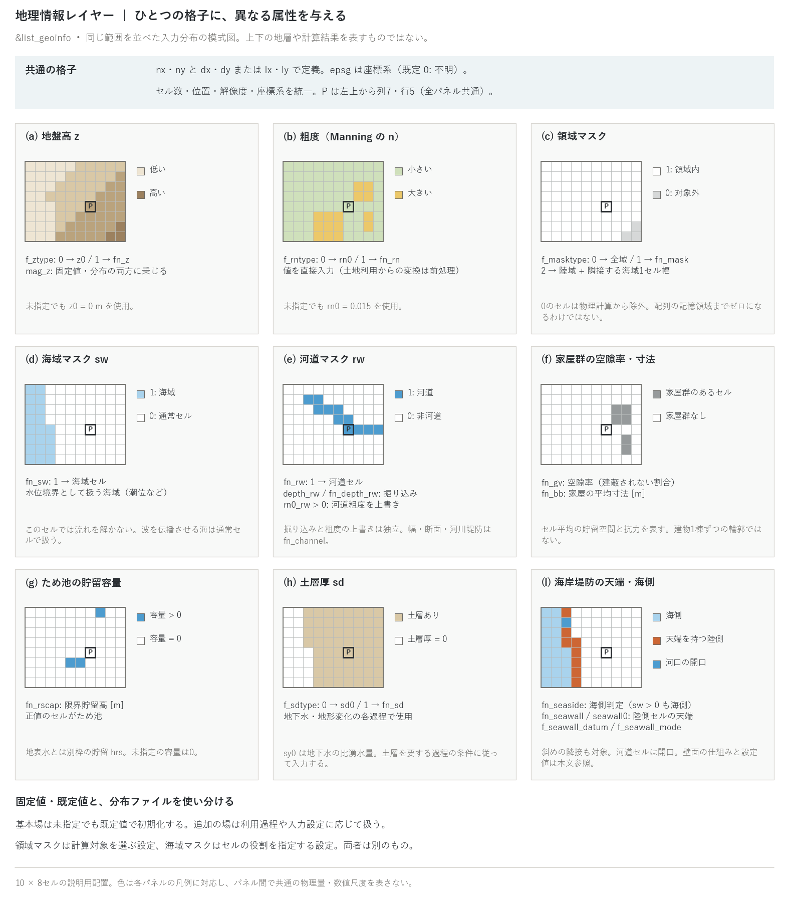

# 地理情報(&list_geoinfo)

[ユーザーガイド目次へ](../users_guide.md)

計算の土台となる格子・地形・粗度・各種マスクの設定です。唯一の
**必須機能**で、`fn_geoinfo`(既定 `"-"` = パラメータファイル内)で
読み込まれます。

最小構成は格子の定義だけです(チュートリアル wave がこの形です)。

```
&list_geoinfo
  lx = 100.0, ly = 100.0    ! 計算領域の大きさ (m)
  nx = 300, ny = 300        ! 計算格子数
/
```

実地形の計算では、ここに地形ファイル・粗度・マスク類を足していきます。



図は、同じ範囲の10 × 8セルに与える属性を並べた模式図です。各パネルの
枠 P は、左上から列7・行5の同じセルを指します。(a)(b)は地盤高と粗度、
(c)は計算対象を選ぶ領域マスク、(d)(e)は海域・河道の役割を指定するマスク、
(f)〜(h)は家屋群・ため池・土層、(i)は海岸堤防の海側判定と天端保持セルです。
色は各パネルの凡例に対応し、パネル間で共通の数値尺度を表しません。
地層の上下関係や計算結果ではなく、入力の位置関係を示しています。

**分布ファイルがなくても、基本場は既定値で初期化されます。** 例えば地盤高は
`z0 = 0 m`、粗度は `rn0 = 0.015`、領域マスクは全域、海域・河道マスクは0、
ため池容量は0です。追加の場は利用する過程や入力設定に応じて扱い、
「未指定の層はすべて存在せず、メモリも使わない」という意味ではありません。
土層の利用条件は[土層の節](#土層地下水地形変化用)を参照してください。

分布ファイルは同じセル数・範囲・位置・解像度・座標系へ前処理でそろえます。
同じ行列サイズでも位置やセル寸法が違えば、同じセルを指しません。
行は北から南、列は西から東の順です([入出力](io.md)・[座標系](coordinates.md))。
日英PNG・SVGは `python docs/figs/make_guide_figs.py geoinfo` で対象だけを再生成できます。

## 格子の定義

| パラメータ | 既定値 | 意味 |
|---|---|---|
| nx, ny | — | 格子数(必須) |
| dx, dy | — | 格子間隔 (m) |
| lx, ly | — | 領域の大きさ (m) |
| epsg | 0 | 格子の座標系の EPSG コード([座標系の章](coordinates.md)) |

メタデータから補完しない場合、x方向は **nx と dx または lx**、y方向は
**ny と dy または ly** を指定します。間隔と領域長の両方を与えた場合は
`lx = nx × dx`、`ly = ny × dy` の整合が検査され、矛盾すると停止します。
`f_ztype = 1` の地盤高ファイルでは、bilの `.hdr` またはGeoTIFFのメタデータから
未指定の格子数を補完できます。m単位の座標参照がある場合は `dx, dy` も補完しますが、
経緯度ラスタでは計算用の `dx, dy` (m) を別に指定します。`epsg` は必須値ではなく、
未指定は0(不明)です。GeoTIFFにCRSがあれば取得し、明示した `epsg` との一致を検査します。

## 地形(地盤高)

| パラメータ | 既定値 | 意味 |
|---|---|---|
| f_ztype | 0 | 0: 固定値 z0、1: ファイル fn_z |
| z0 | 0 | 地盤高固定値 (m) |
| fn_z | "" | 地盤高分布ファイル |
| mag_z | 1 | 地盤高に乗じる倍率(感度実験・単位換算用) |
| f_user_routine | "" | 地形を加工するユーザールーチンの識別名(理想化実験用。[第I部](../users_guide.md#ユーザールーチン)) |

## 粗度(Manning 係数)

| パラメータ | 既定値 | 意味 |
|---|---|---|
| f_rntype | 0 | 0: 固定値 rn0、1: ファイル fn_rn |
| rn0 | 0.015 | 粗度係数固定値 |
| fn_rn | "" | 粗度係数分布ファイル |

粗度係数は直接与えます(固定値または分布ファイル)。河道セルだけ
粗度を変える場合は fn_rn の分布を作らなくても `rn0_rw`(下記)で
上書きできます。土地利用コードから粗度分布を作る場合は、GIS 等の
前処理で値を対応付けたファイルを作成して `f_rntype = 1` で与えて
ください(モデル内での変換 f_rntype=2 は廃止 — developer.md §41)。
BMI 経由で動かす場合は、実行中に粗度分布を上書きできます(パラメータ
探索や累積流量・地形変化に応じた更新。bmi/README.md「粗度の外部上書き」)。

**粗度係数の目安**(土地利用別の Manning の n。浸水想定区域図作成
マニュアル系の慣用値と Chow 1959。校正で変わる量です)

| 土地利用 | rn0 | 備考 |
|---|---|---|
| 道路・舗装面・コンクリート | 0.015〜0.02 | 既定 0.015 は舗装面 |
| 河道(砂床 / 礫床) | 0.025〜0.035 / 0.035〜0.05 | rn0_rw か fn_rn で |
| 宅地(建物を fn_gv/fn_bb で扱うとき) | 0.02〜0.03 | 建物抵抗は空隙率側で表す |
| 宅地(建物込みの等価粗度) | 0.04〜0.07 | 建物占有率 30〜50 % で 0.067 相当 |
| 水田 | 0.06 | 畦の効果込み |
| 畑地 | 0.05 | |
| 草地・公園 | 0.03〜0.05 | |
| 森林 | 0.1〜0.15 | 林床の下草・倒木 |

## 領域マスク(計算対象の限定)

| パラメータ | 既定値 | 意味 |
|---|---|---|
| f_masktype | 0 | 0: 全域を計算、1: ファイル fn_mask、2: 海域マスクから自動生成 |
| fn_mask | "" | 領域マスクファイル(1: 対象、0: 対象外) |

領域マスクが0のセルは物理計算の対象から除かれ、多くの計算ループでスキップ
されます。ただし、配列は矩形の格子・担当帯に対して確保されるため、マスク外の
セルに対応する記憶領域や、マスク判定などの処理までなくなるわけではありません。
画面の `number of valid cells` は、領域マスクが正で、かつ海域マスクが0のセル数です。

`f_masktype = 2` は `fn_sw` が必須で、全陸域と「陸に8近傍(対角を含む)で
接する1セル幅の海域」を対象化し、沖合を除きます。また、`f_masktype = 1` と
`fn_sw` を併用すると、流出先を確保するため入力マスクが海域側へ1セル分拡張
される場合があります。領域マスクは計算範囲を選ぶ設定で、次の海域マスクの
ように水位境界としての役割を指定するものではありません。

## 海域マスク・河道マスク

| パラメータ | 既定値 | 意味 |
|---|---|---|
| fn_sw | "" | 海域マスク(1: 海域)。水位境界として扱う海域を指定し、潮位などの水位を与える([潮位の章](tide.md)) |
| fn_rw | "" | 河道マスク(1: 河道セル) |
| depth_rw / fn_depth_rw | 0 / "" | 河道セルの掘り込み深さ(一様値 / 分布。地形から掘り下げる) |
| rn0_rw | −1 | 河道セルの固定粗度。正値を指定すると、粗度の与え方(rn0 / ファイル)によらず**河道セルの粗度を上書き**します(掘り込み指定の有無と独立) |

**海域マスクのセルでは流れを解きません。** 海域マスクは海の形を示すためだけの
分類ではなく、水理上の役割を指定します。津波などの波を領域内で伝播させる海は
`sw = 0` の通常セルとして扱い、初期水位と[境界条件](boundary.md)を設定します。
その海に防潮堤を設ける場合の海側判定には `fn_seaside` を使います。
`fn_seaside` 自体は流れを解くセルを海域マスクへ変更しません。

河道マスクは「地形データの解像度では表現されない河道」を地形の
掘り込みと粗度の差し替えで表現する簡便法です。より精緻なサブグリッド
河道(断面形・河道幅・堤防)は fn_channel([河道の章](channel.md))へ
段階的に移行できます。

マスクの作成は事前処理で行います。土地利用データがある場合は、
付属の `utils/lu2mask` で「指定した土地利用コードのセルを 1」
とする 0/1 ラスタを生成できます(海域マスク・海側マスク向け。
使い方はソースヘッダを参照)。生成後は GIS 等で目視確認し、必要なら
手を入れてください(例: 流出河川のない湖沼を海域にして排水先にする)。
河道マスクは、湖沼・河川敷を含む土地利用コードからの生成では品質が
確保できないため、河川中心線を GIS でラスタ化して作ることを推奨します
(経緯は developer.md §40)。

## 家屋群の抵抗(市街地の氾濫)

| パラメータ | 既定値 | 意味 |
|---|---|---|
| fn_gv | "" | 家屋の空隙率(建蔽されていない割合)の分布 |
| fn_bb | "" | 家屋の平均寸法 (m) の分布 |
| min_gv / min_bb | 0.001 | それぞれの下限値(ゼロ割り防止) |

市街地の家屋群による貯留の減少と抗力を表現します(抗力係数などの
数値定数は &list_sysparam 側 — [浅水流計算の章](swflow.md))。

## ため池

| パラメータ | 既定値 | 意味 |
|---|---|---|
| fn_rscap | "" | ため池の限界貯留高 (m) の分布(正値のセルがため池。未指定は容量0) |

地表水と別枠の貯留を持たせ、ポンプの取水源([構造物の章](structure.md))
などに使います。水深は `f_out_hrs = 1` で `Hrs0001` として出力できます。
[水質](wq.md)が有効なら、吸収された水の物質量はセル別のため池プールに
蓄積されます(満水後のあふれ水は吸収されません)。

## 土層(地下水・地形変化用)

| パラメータ | 既定値 | 意味 |
|---|---|---|
| f_sdtype | 0 | 0: 固定値 sd0、1: ファイル fn_sd |
| sd0 / fn_sd | 0 / "" | 土層厚 (m)(一様値 / 分布)。[地下水](gwflow.md)が要するとき sd0 未指定なら 1 m を既定として採用し表示(地形変化の f_wthr 等が要するときは従来どおり必須) |
| sy0 | 0.2 | 比湧水量(有効間隙率) |

土層厚は、地下水モデルのGreen-Ampt・側方流動・第2帯水層に加え、
掃流砂・浮遊砂・斜面侵食・土石流・動く底層・風化などの地形変化でも使います
([地下水](gwflow.md)・[地形変化](geomorph.md))。`sy0` は地下水の比湧水量であり、
土砂の空隙率 `fluv_porosity` とは別のパラメータです。

`f_sdtype = 1` の分布は、`fn_gwflow` または `fn_geomorph` が指定されていれば
読み込みます。両方とも未指定なら読み込みを省略し、その旨を表示します。
固定値 `sd0` は土層を要する過程の初期化で確保され、地下水から要求された場合は
未指定値0を1 mへ補完します。一方、地形変化が土層を要求する場合は、正の `sd0`
または土層分布が必要です。地下水より地形変化が先に初期化されるため、併用時も
地下水側の既定値に頼らず指定してください。計算中に変化する土層厚の状態配列は
モジュールの指定に応じて確保されるため、配列の有無と土層入力の要求条件は同一ではありません。

## 海岸堤防

| パラメータ | 既定値 | 意味 |
|---|---|---|
| fn_seaside | "" | 海側マスク(1: 海側扱い。fn_sw の海域は常に海側) |
| fn_seawall / seawall0 | "" / −9999 | 天端高の分布(陸側セル位置)/ 一律値(排他。一律値は海側に接する陸セルへ自動付与。ただし河道セルは開口) |
| f_seawall_datum | 2 | 天端高の基準(1: 自セル地盤からの高さ、2: 絶対標高) |
| f_seawall_mode | 0 | 水理モード(0: 越流のみ、1: フラップ=陸閘・水門、2: 強制排水) |

セルを太らせずに堤防をライン状の仮想壁面として表現します(河川堤防
fn_bank と同じ仕組みの海岸応用)。海側判定は `fn_seaside` と `sw > 0` の和集合です。
潮位ケースでは `fn_sw` から判定できれば `fn_seaside` を省略できます。
津波のように海を通常セルで解く場合は、防潮堤のための海側を `fn_seaside` で指定します。
図(i)の橙色は陸側の天端保持セル、青色は河口の開口を示し、堤防の物理的な幅ではありません。

河道セル (`rw > 0`) は、天端値を与えても海岸堤防を設けず、河口の開口として扱います。
`seawall0` の一律指定でも同様です。

分布ファイル `fn_seawall` で天端を与えるときの注意:

- 天端は**陸側(保護側)セル**の位置に与えます。河川堤防 fn_bank
  (河道セル=水側持ち)と逆にしてあるのは、津波のように海を通常セル
  として波を解くケースでは「水側」が静的なマスクでは定まらないため
  です(設計の経緯は developer.md §17.1)。
- 壁エッジは「天端を持つ陸側セル × 海側セルの間」の全エッジ
  (**対角を含む**)に立ちます。**海側セルと角(対角)だけで接する
  陸セルにも天端を与えてください** — 値のないセルのエッジには壁が
  立たず、対角リンクから内陸へ漏水します。一律値 `seawall0` は
  海側に接する(対角含む)陸セルへ、河道の開口を除いて自動付与されるため、この心配は
  ありません。
- 逆に、**余分に与えるのは無害**です。海側と接していない陸セルの
  天端は壁になりません(該当セル数が起動時に情報表示されるだけで、
  計算には影響しません)。したがって海岸沿いに**バッファ状に広く
  塗っておく**のが安全側で、上記の角接触の漏れも自動的に防げます。

## 例題・制約

- [test/chichibu](../../test/chichibu/): 標高・流域マスク・河道マスク・粗度を組み合わせた実地形の回帰ケース。
- [test/gtif](../../test/gtif/): 型・圧縮・配置・座標系の異なるGeoTIFF入力のテスト資産。
- 全パラメータの注釈付き一覧: [examples/List_samples/list_geoinfo.txt](../../examples/List_samples/list_geoinfo.txt)
- 最小構成: [tutorials/wave](../../tutorials/wave/)(格子のみ+ユーザールーチン)
- 実地形: [tutorials/chichibu](../../tutorials/chichibu/)
- 分布ファイルの形式・座標系は[入出力](io.md)・[座標系](coordinates.md)の章を参照。
- 河道幅・堤防などのサブグリッド河道要素は fn_channel 側の設定です([河道の章](channel.md))。
