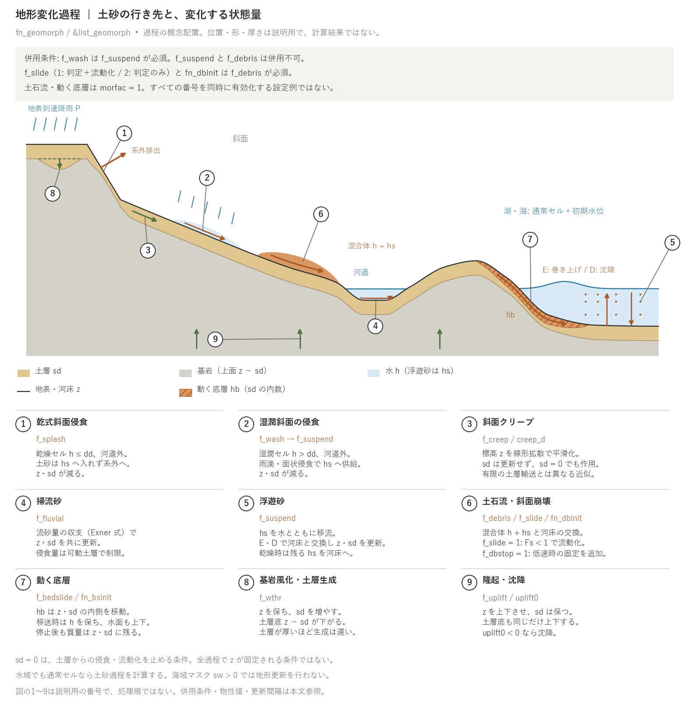
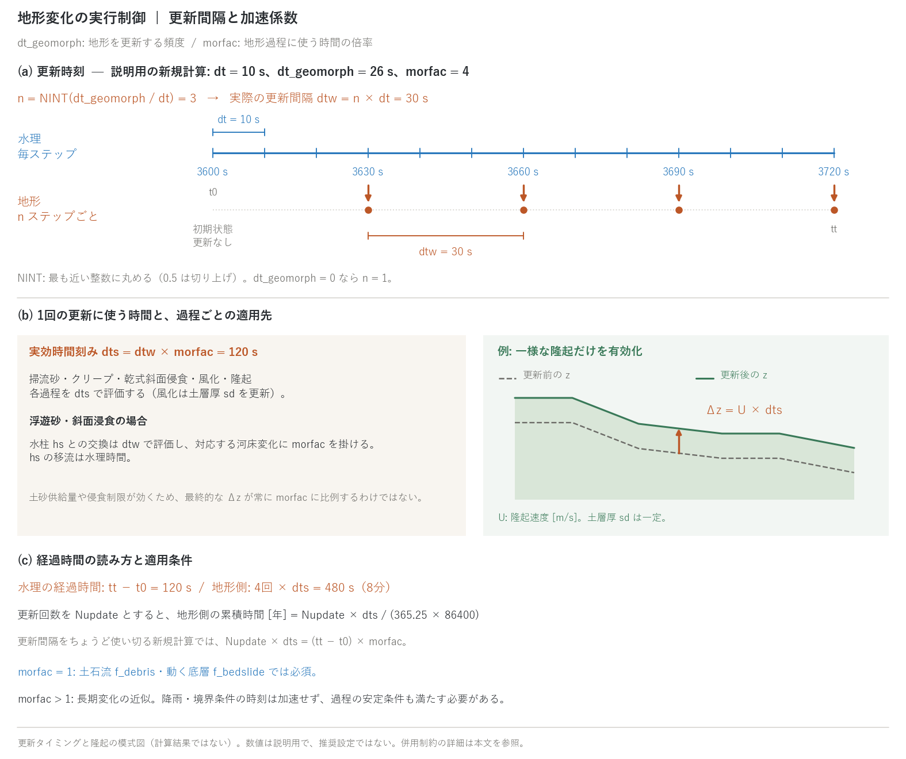

# 土砂・地形変化(&list_geomorph)

[ユーザーガイド目次へ](../users_guide.md)

土砂の輸送と地形の時間変化を扱います。`fn_geomorph` で有効化し、
`&list_geomorph` で過程を選びます。**併用可能な過程を重ね合わせる**方式ですが、
浮遊砂 `f_suspend` と土石流 `f_debris` は併用できません。地形と土層の更新は
流れへフィードバックします。各過程が変える状態量は同じではありません。
式・既定値の根拠・参考文献は 2 つの解説ページにあります:
[土砂輸送と斜面・長期地形過程の解説](sediment.md)(クリープ・掃流砂・
浮遊砂・斜面浸食・乾式侵食・風化隆起・MORFAC)と
[土石流・斜面崩壊・動く底層の解説](massflow.md)(抵抗則・侵食堆積則・
発生条件・底層)。

| プロセス | フラグ | 内容 |
|---|---|---|
| 斜面クリープ | f_creep | 標高 z の線形拡散。土層厚 sd は更新しない |
| 掃流砂 | f_fluvial | 流砂量の収支による侵食・堆積(Exner 式) |
| 浮遊砂 | f_suspend | 土砂柱状量 hs の移流と河床との交換(巻き上げ・沈降) |
| 斜面浸食 | f_wash | 湿潤・非河道セルの雨滴・面状侵食(f_suspend 必須) |
| 乾式斜面侵食 | f_splash | 乾燥・非河道セルの雨滴・サブグリッドリル侵食。土砂は系外へ |
| 土石流・崩壊 | f_debris / f_slide | 水・土砂混合体。侵食・堆積式と抵抗則の選択、斜面安定判定 |
| 動く底層 | f_bedslide | 地形・土層の内側を動く底層 hb と水面変位 |
| 基岩風化・隆起 | f_wthr / f_uplift | 風化は sd を増加、隆起・沈降は z を上下 |
| 崩落と崖錐 | f_rockfall | 限界高さを超えた自由面(崖)の崩落と、落下物の崖錐(厚さ ht)。崖錐は安息角で広がり乾式侵食を抑える |

図は斜面〜河道〜水域に各過程を配置した概念図です。1: 乾式斜面侵食、
2: 湿潤斜面の侵食、3: クリープ、4: 掃流砂、5: 浮遊砂、6: 土石流・斜面崩壊、
7: 動く底層、8: 基岩風化、9: 隆起・沈降を示します。番号は処理順ではなく、
位置・形・厚さは説明用です。実際の計算結果でも、全過程を同時に使う設定例でも
ありません。E は巻き上げ、D は沈降です。水域は海域マスクではなく、海底・湖底
地形と初期水位を与えた通常セルを表します。掃流砂・浮遊砂を計算する場所は
河道に限りません。

| 図中の量 | 意味 |
|---|---|
| z | 地表・河床の計算標高 |
| sd / z − sd | 侵食可能な土層の厚さ / 土層底(基岩上面)の標高 |
| h / dd | 水深 / 乾湿判定に用いる水深閾値。h ≤ dd が乾燥セル |
| hs | 土砂の固体体積を柱状厚に換算した量。浮遊砂では水中の希薄なスカラー、土石流では h + hs が混合体の流動深 |
| hb | 間隙を含む動く底層の厚さ。sd の内数で、上面は z。z の上に追加する厚さではない |

`f_wash` には `f_suspend` が必須です。`f_slide = 1`(判定＋流動化)と
`f_slide = 2`(判定のみ)、崩壊深分布 `fn_dbinit` は、いずれも `f_debris` が
必須です。判定のみでも他の土石流過程は自動では無効になりません。
土石流と動く底層には `morfac = 1` が必要です。`sd = 0` は土層からの侵食・
流動化を制限しますが、クリープや隆起による `z` の更新を止める条件では
ありません。風化による土層生成も継続できます。海域マスク `sw > 0` では
地形更新を行いません。

結果の見方(分布・台帳・計測列・再開)は、このページの[出力・確認](#出力確認)にまとめています。各機能の節末にも、その機能に関係する出力だけを短く記しています。

## 実行制御(全プロセス共通)

| パラメータ | 既定値 | 意味 |
|---|---|---|
| dt_geomorph | 0 | 地形更新の希望間隔 (s)。正値は `n = NINT(dt_geomorph / dt)` ステップに丸め、実際の更新間隔は `dtw = n × dt`。0: 毎ステップ (`n = 1`) |
| morfac | 1.0 | 正の地形加速係数。実効時間刻み `dts = dtw × morfac` を地形過程に適用する。水理・外力の時計は加速しない。適用先と併用制約は下記参照 |

図(a)は、新規計算の説明例です。`dt = 10 s`、`dt_geomorph = 26 s` なら、
`n = NINT(2.6) = 3` となり、地形は30秒ごとに更新されます。`NINT` は最も近い
整数への丸めで、正の半整数は切り上げます。丸めた `n` が0以下になる指定は
エラーです。更新はステップ番号が `n` の倍数のときに行われ、初期状態での
更新はありません。再開時も保存されたステップ番号に基づく更新周期を使います。

図(b)の `morfac = 4` では、1回の更新の実効時間刻みは `dts = 120 s` です。
掃流砂 `f_fluvial`、クリープ `f_creep`、乾式斜面侵食 `f_splash`、風化 `f_wthr`、
隆起 `f_uplift` は、この `dts` で各過程を評価します。一様な隆起だけなら
`Δz = U × dts` (`U`: m/sに換算した隆起速度)となります。風化は標高 `z` を変えずに
土層厚 `sd` を増やします。土砂供給量や侵食制限、非線形な更新があるため、
すべての過程で「計算済みの最終的な `Δz` を一律に `morfac` 倍する」わけではありません。

浮遊砂 `f_suspend` と斜面浸食 `f_wash` も同じ地形更新時刻に実行しますが、
水柱 `hs` との交換量は加速しない `dtw` で評価し、対応する河床変化に `morfac`
を掛けます。侵食可能な土層量の制限にも `morfac` を考慮します。`hs` の移流は
水理の時間刻みで進むため、`morfac > 1` は水柱と河床を異なる時間尺度で扱う近似です。

図(c)では `t0 = 3600 s` から `tt = 3720 s` までの水理の経過時間は120秒で、
4回の地形更新が扱う累積時間は `4 × 120 = 480 s` (8分)です。
`tt` は終了時刻であり、計算期間そのものではありません。地形更新回数を
`Nupdate` とすると、地形側の累積時間は `Nupdate × dts` 秒、年換算は
`Nupdate × dts / (365.25 × 86400)` 年です。更新間隔をちょうど使い切る新規計算では
`Nupdate × dts = (tt − t0) × morfac` となります。終了時に更新間隔の端数が残る場合は
この等式を使わず、実際の更新回数で数えます。

`morfac > 1` は長期地形変化を短い水理計算で近似する設定です。降雨・境界条件の
時刻は伸縮しないので、加速した期間の外力履歴を再現するものではありません。
更新間隔と加速係数は、過程の安定条件も満たす必要があります。例えば陽解法の
クリープは、`creep_d × dts × (1/dx² + 1/dy²) ≤ 0.5` が必要です。

イベントや他モジュールとの併用には次の制約があります。

- 土石流 `f_debris` と動く底層 `f_bedslide` は `morfac = 1` が必須です。
- 地形変化を流木・建物漂流物と併用する場合も `morfac = 1` が必須です。
- 溶岩流との併用では、地形側の `morfac > 1` は拒否されます。
- 氷河との併用では、氷河側の `gl_morfac` と地形側の `morfac` を一致させます。

図の値は更新手順を説明するための例で、推奨設定でも計算結果でもありません。

**パラメータの既定値の方針** — 各プロセスの物性・校正値には「とりあえず
動かす」ための無難な既定値があり、**最小入力はプロセスのスイッチ
(f_xxx = 1)だけ**です。未指定(0)のまま採用された値は実行開始時に
`geomorph: db_phi = 35.0000 deg (default)` のように **(default)** 印付きで
表示されるので、値を見ずに済ませることはできません。事例に合わせて
必ず見直してください(現象の型ごとの目安は本章末尾の
「[パターン別の推奨値](#パターン別の推奨値)」)。値の根拠は
developer.md §62。

時間発展する地形は `f_out_z = 1` で `Z0001...` として出力できます
([入出力の章](io.md))。プローブ CSV には浮遊砂 hs・土層厚 sd の列が
あります([計測の章](record.md))。

## 斜面クリープ(f_creep)

式と既定値の根拠: [解説](sediment.md#2-斜面クリープf_creep)。

| パラメータ | 既定値 | 意味 |
|---|---|---|
| creep_d | 1.6e-10(= 0.005 m²/yr) | クリープ拡散係数 (m²/s)。文献域 0.001〜0.05 m²/yr。地形時間の量なので morfac と組で解釈する |

「とりあえず斜面をなだらかにしてみる」最小入力は `f_creep = 1` だけです
(土層厚は不要。年〜千年の変化を見るには morfac も)。

実装では `z` のみを更新し、`sd` は更新しません。したがって `sd = 0` でも
作用し、土層底 `z − sd` も移動します。有限厚の土層を輸送するモデルとは異なる
地形拡散の近似です。

**この節に関係する出力**: 地形の変化は `Z0001…`(`f_out_z=1`)と `Sd0001…`。ゆっくりした過程なので、地形時間の加速 morfac と `dt_file` を合わせて出します([出力・確認](#出力確認))。

## 掃流砂(f_fluvial)

流砂量式・Exner 式・クランプの解説: [解説](sediment.md#3-掃流砂f_fluvial)。

流砂量式による河床の浸食・堆積です。

| パラメータ | 既定値 | 意味 |
|---|---|---|
| f_qbform | 1 | 流砂量式。1: 芦田・道上、2: MPM |
| fluv_d50 | 0.01 | 代表粒径 (m)。既定は砂礫床の中庸(砂床 0.0005〜山地礫床 0.05) |
| fluv_tausc | 0.05 | 限界無次元掃流力 τ*c |
| fluv_porosity | 0.4 | 河床の空隙率 |
| fluv_sgrav | 1.65 | 土粒子の水中比重 |
| fluv_dzmax | 0.05 | 1更新あたりの河床変動上限 (m)(安定化) |
| fluv_bcfeed | 0 | 開境界(区間流入面を含む)の給砂。0: 流入は無給砂、1: 容量給砂 = 流入面の供給を流入セルの正味流出 × fluv_bcfeed_fac にする(倍率 1 で入口の河床が固定。流出は常に容量輸送) |
| fluv_bcfeed_fac | 1.0 | 容量給砂の倍率。0 = 無給砂、1 = 入口固定。0〜1 の中間は入口の低下を減らすが比例はしない(部分給砂は inflow_qb で) |
| fluv_diagratio | 2/(2+√2) | 斜め方向の配分(通常変更不要) |
| fluv_taufac | 1.0 | 有効掃流力の比 f_τ(流砂量式に渡す τ* = f_τ × 全抵抗の τ*。砂堆・植生の形状抵抗を除く簡略分離。1 = 分離なし) |
| fluv_slope | 0 | 河床勾配による流砂方向補正。1: 長谷川型(q⃗ = q_b(t̂ − γ∇z)、γ = √(τ*c/(μs μk τ*))) |
| fluv_mus / fluv_muk | 1.0 / 0.45 | 静止・動摩擦係数 μs・μk。**文献値**(Asahi ら 2013 式 (22)、Hasegawa 1984。Hasegawa 1989 は概算に μk = 0.7)。下の注意 |
| f_secflow | 0 | 二次流による流砂方向補正。1: 平衡型(河床近傍の横断流速比 r = N* h κ、κ は流速場の流線曲率) |
| sec_nstar | 7.0 | N*。**文献値**(Engelund 1974、Asahi ら 2013 式 (18)。de Vriend 型の係数 2/κ²(1 − √g/(κC)) は C = 50 で約 10)。下の注意 |
| sec_rmax | 1.0 | |r| の上限(急湾曲での h/R 比例則の打ち切り。1 = 45°) |
| sec_vmin | 0.01 | 曲率を評価する最小流速 (m/s) |
| f_berode | 0 | 側岸侵食。1: 湿潤セルの水面より高い隣接セル(河岸面)を脚部の掃流力で後退させ、削った土砂を脚部へ移す(f_fluvial = 1 が必須) |
| berode_kb | (必須) | 河岸の侵食速度係数 K_b (m/s)。E_b = K_b (τ*/τ*c,b − 1)^m。校正値で既定なし |
| berode_tausc | 0.05 | 河岸の限界無次元掃流力 τ*c,b |
| berode_m | 1.0 | 超過掃流力のべき指数 m |
| f_repose | 0 | 安息角崩落。1: 隣接セル間の勾配が tanφ_r を超えた分を高い側から低い側へ移す(乾湿を問わない。掃流砂なしでも使える) |
| repose_phi | 30 | 安息角 φ_r (deg) |
| repose_relax | 0.5 | 1 更新で緩和する超過勾配の割合(0〜1) |
| f_fixation | 0 | 定着。1: 乾いたセルの定着度 a が育ち、そのセルを供給側とする掃流砂と河岸侵食の限界掃流力を τ*c (1 + c_τ a) に上げる(f_fluvial = 1 が必須) |
| fix_tfix | (必須) | 定着時間 T_fix (h。地形時間 = morfac 込み)。乾いている間 a → 1 − exp(−t/T_fix)。文献に標準値なし。出水の回帰時間 T_return との比で選ぶ(Asahi ら 2013: T_Land/T_return = 0.025〜0.5 で蛇行が発達、1 では発達しない) |
| fix_ctau | (必須) | 定着時の限界掃流力の増分比 c_τ。文献に標準値なし(Asahi ら 2013 は陸地化したセルを計算領域から外す = c_τ → ∞ に相当。大きな値ほどそれに近づく) |
| fix_dzreset | 0.1 | 定着面からの累積浸食深がこれを超えると a = 0 に戻る (m) |
| fix_cn | 0 | 定着時の粗度の増分比 c_n。流れの摩擦項の Manning n を n (1 + c_n a) にする(流砂の τ* は変えない)。0 = 粗度に効かせない |
| fix_tdec | 0 | 冠水時の定着の減衰時間 T_dec (h。地形時間)。湿潤(h > dd)の間 a ← a exp(−t/T_dec)。0 = 減衰なし(露出した砂州は浸食でしか定着を失わない) |
| fix_ctau_bank | −1 | 側岸侵食(f_berode)の河岸セルに効かせる定着の増分比 c_τ,b。負 = fix_ctau と同じ、0 = 河岸には効かせない |

「とりあえず河床を動かしてみる」最小入力は `f_fluvial = 1` と、侵食できる
土層の厚さ `sd0`(&list_geoinfo)です。粒径は既定の 1 cm(採用値は実行時に
表示。砂床・礫床の目安は章末の推奨値)。

サブグリッド河道幅(fn_width)と併用すると、掃流砂は河道幅に集中して
河床を変動させます([河道の章](channel.md))。

**湾曲部の横断河床形状(流砂方向補正)。** 既定では流砂は水深平均流向に
運ばれ、湾曲部の外岸洗掘・内岸堆積は生じません。`fluv_slope = 1`(河床
勾配項: 横断斜面を下る向きの流砂)と `f_secflow = 1`(平衡二次流項:
河床近傍の流れが湾曲内側へ向く効果)を入れると、湾曲部で外岸側が深く
内岸側が浅くなる横断形状が形成されます(両方を組で使うのが基本。片方だけ
では横断勾配が平衡しません)。式は[解説](sediment.md#3-掃流砂f_fluvial)。
係数の既定は μs = 1.0、μk = 0.45(Asahi ら 2013 式 (22) が Hasegawa 1984 に
拠って用いる値。Hasegawa 1989 は概算に μk = 0.7 を用いており、γ はその分
1.2 倍小さくなる)、N* = 7.0(Engelund 1974。Asahi ら 2013 式 (18))で、
採用値は起動時に表示されます(developer.md §84.12 の文献照合)。
[test/bendsed](../../test/bendsed/) はこの値で検定しています。掃流砂は
水面より高い隣接セル(河岸面)へは運ばれず、乾いたセルから供給も
されません(§84.2)。

**河岸の後退と崩落(側岸侵食・安息角)。** 河岸面(水面より高い隣接セル)は
`f_berode = 1` で後退します: 脚部セルの掃流力が河岸の限界値を超えた分に
比例する速度 E_b = K_b (τ*/τ*c,b − 1)^m で河岸セルの地盤を下げ、同じ体積を
脚部セルに積みます(以後の掃流砂が運びます。土砂は保存)。`berode_kb` は
校正値で既定がありません(粘着性河岸の侵食係数として、脚部の流れに対する
後退速度を与える量)。堤防エッジ(河道マスク境界の壁)では河岸侵食も
起きないので、護岸・築堤区間は `fn_rw` の壁で表せます。`f_repose = 1` は
安息角 `repose_phi`(既定 30°)を超えた斜面を高い側から低い側へ崩す
保存形の緩和で、河岸脚部の崩落土砂・掘削面・砂州側面の急斜面を扱います
(非粘着性の局所崩落。乾いたセルにも働き、掃流砂なしでも使えます)。
非粘着性の河岸では脚部洗掘+崩落だけで後退が出るので、同じ後退を
`berode_kb` と二重に与えないでください。検証:
[test/berode](../../test/berode/)、[test/repose](../../test/repose/)。

**内岸砂州の定着。** 掃流砂は供給セルの水面までしか堆積しないので、一定流量
では内岸の砂州は水面下に留まり、河道は拡幅するだけで横移動しません。
`f_fixation = 1` は、低水期に露出(h ≤ dd)したセルに植生等の定着が進む過程を
定着度 a ∈ [0, 1](出力 `Fx0001…`)で表します: 乾いている間 a は
1 − exp(−t/T_fix) で 1 に近づき(`fix_tfix`。地形時間 = morfac 込み)、
そのセルを供給側とする掃流砂と、そのセルを河岸とする側岸侵食の限界掃流力が
τ*c (1 + c_τ a) に上がります(`fix_ctau`)。浮遊砂(`f_suspend`)を併用すると、
定着セルでは浸食項(平衡濃度)だけが同じ c_τ で減り、沈降は変わらないので、
出水時に供給された細粒分が定着した砂州の上に積もります(砂州を氾濫原の高さへ
育てる経路)。`fix_cn` > 0 にすると定着セルの流れの粗度が n (1 + c_n a) に
上がって流速が落ち、細粒分の捕捉が進みます(植生の形状抵抗。流砂の τ* には
効かせません。植生の n の目安は草地 0.03〜0.035、低木・樹木の氾濫原 0.05〜
0.15 で、c_n = 1〜3 が相当。文献照合待ちのため既定は 0)。定着面への堆積は
妨げず、標高・体積には触れません。水没中に定着面から `fix_dzreset`(既定
0.1 m)を超えて削られると a = 0 に戻ります(永久不侵食 にはしない)。安息角
崩落には効きません。定着した砂州が水没したまま浸食されない場合(定着が
強いと浸食が閾値に届かず、露出した砂州が事実上恒久化します)は、`fix_tdec`
で冠水中の減衰を入れます(湿潤の間 a ← a exp(−t/T_dec)。植生の枯死・表層の
軟化。出水の継続時間より長い T_dec にすると短い出水では定着が残ります)。
河岸侵食への効きは `fix_ctau_bank` で河床と分けられます(根系は表層を固めても
河岸脚部の洗掘には効きにくいので、河床の c_τ より小さい値、例えば 0.5〜1)。出水と低水を繰り返す流入時系列と組み合わせて使います
([examples/meander](../../examples/meander/) の param_fix.txt、浮遊砂併用は
param_fixsusp.txt)。再開は `geomorph_fixation.dat`(動的粗度は a から作り直す
ので保存しません)。検証: [test/fixation](../../test/fixation/)。

**この節に関係する出力**: 河床変動は `Z0001…`(`f_out_z=1`。Z − Z0000 が洗掘・堆積厚)。河床変動上限 fluv_dzmax が働いた回数は終了時の警告「fluvial dzmax clip fired」で、土層厚による供給量制限の発動セル数は「fluvial supply limiter」で、岩盤床で失われた体積(通常はゼロ)は「bedrock floor clip」で確認します([出力・確認](#出力確認))。

## 浮遊砂(f_suspend)

巻き上げ・沈降・平衡濃度式・Rubey 式の解説: [解説](sediment.md#4-浮遊砂f_suspend)。

濃度場(柱状換算 hs)を流れとともに移流し、巻き上げ(E)と沈降(D)で
河床と交換します。濃度は水の体積あたり(hs を矩形換算水深で割った値)で、
[河道](channel.md)の断面形 σ を使うセルでも水と同じ速度で運ばれます。
σ のセルでは E・D の交換量に湿潤幅率 σ(h) が掛かり、低水時の狭い低水路
では河床との交換が幅相応に減ります。

| パラメータ | 既定値 | 意味 |
|---|---|---|
| f_esform | 1 | 平衡濃度式。1: 超過掃流力線形(簡易)、2: 板倉・岸式 |
| susp_d50 | 0.0002 | 代表粒径 (m)。既定は細砂(浮遊砂の代表) |
| susp_wf | 0 | 沈降速度 (m/s)。0 なら Rubey 式で d50 から導出 |
| susp_tausc | 0.05 | 浮遊の限界無次元掃流力 |
| susp_beta | 1.0 | 沈降の底面濃度係数 |
| susp_esa | 1e-4 | 平衡濃度係数(f_esform=1 で使用。校正パラメータ。板倉・岸式では不使用) |

「とりあえず濁りを流してみる」最小入力は `f_suspend = 1` と `sd0` です
(粒径は既定の細砂 0.2 mm、沈降速度は Rubey 式で自動)。

### 河床の細粒分の帳簿(f_bedfines)

既定では浮遊砂の巻き上げは土層 sd 全体を細粒分とみなします。掃流砂
(fluv_d50)と浮遊砂(susp_d50)を重ねる計算では、粗い河床が細粒分の速さで
削られてしまうので、`f_bedfines = 1` で「河床のうち浮遊砂として動く成分の
厚さ」sf(出力 Sf、0 ≤ sf ≤ sd)を帳簿づけします。巻き上げは在庫 sf の範囲に
限られ(利用可能率 min(1, sf/L_a))、沈降は sf に積み増し、掃流砂・側岸侵食・
崩落で動く土層にはその組成どおりの細粒分が同伴します(等移動度。浮遊砂との
交換は巻き上げ・沈降だけ)。粒径階は増やさず、遮蔽・露出関数もありません
(2 成分の帳簿)。

| パラメータ | 既定値 | 意味 |
|---|---|---|
| f_bedfines | 0 | 1 で有効(f_suspend = 1 が必須) |
| fines_la | (必須) | 交換層厚 L_a (m)。細粒分の利用可能率 min(1, sf/L_a) を決める混合厚。数 cm〜0.1 m |
| fines_frac0 | 0 | 初期の細粒分割合(sf = fines_frac0 × sd)。0 = 粗粒だけの河床、1 = 従来と同じ全層細粒 |

斜面浸食 f_wash も在庫 sf から削ります(斜面の土層が洗い出せる細粒分なら
fines_frac0 = 1)。開境界の容量給砂(fluv_bcfeed = 1)は流入セルと同じ組成で
入ります(入口の河床高と在庫がともに固定)。乾式斜面侵食・動く底層・風化・
掃流砂の流砂量源泉 inflow_qb は粗粒として扱います。鉛直の層序は持たないので、粗粒が厚く積もって
埋没した細粒分も利用可能として扱われます。

境界からの土砂流入(濃度・流砂量の時系列)は
[境界条件](boundary.md)の区間流入(inflow_cs / inflow_qs)で与えます。
浮遊砂は[水質](wq.md)の Kd 二相分配(wq_kd)の相手にもなります
(重金属など吸着性物質の粒子態が浮遊砂濃度に応じて配分されます)。

**津波・高潮による巻き上げと遡上域への堆積(津波堆積物)** —
湾内の底泥・海底砂の巻き上げと遡上域への堆積は f_suspend で表せます。
重要な条件が一つ: **海域マスク(fn_sw)のセルは流れを解かず、地形変化の
全プロセスも海セルには働きません**。巻き上げの対象水域は海域マスクでは
なく、海底地形 z を持つ通常セル+初期水位
([初期条件](initial.md)の f_htype=2)で表し、津波は辺境界の長波放射
(型 2)や水位規定セルで入射させます([境界条件](boundary.md))。
巻き上げ可能な層の厚さ・範囲は土層厚 sd で与えます(sd=0 は不侵食)。

- **砂**: 本来の適用域です。f_esform=2(板倉・岸)+susp_wf=0
  (Rubey 導出)で校正パラメータなしに動きます。掃流砂の寄与が効く
  場合(遡上先端・戻り流れの浅い高流速域)は f_fluvial を重ね合わせます。
- **泥(粘着性)**: 読み替えで対応します。沈降速度はフロックの実効値を
  susp_wf に直接与え(10⁻⁴〜10⁻³ m/s 程度。Rubey 導出は粘土粒径では
  非現実的)、f_esform=1 の E = wf・esa・(τ*/τ*c−1) を Partheniades 型
  E = M(τ/τ_ce−1) と同型とみなして、susp_esa・susp_tausc を泥の
  侵食速度定数・限界せん断応力に合わせて校正します。フロキュレーション・
  圧密は陽には扱いません。

遡上域では流速低下で沈降が卓越し、乾燥したセルでは浮遊分が全量河床に
固定されます。堆積厚は z の前後差分(f_out_z)で得られます
(プローブ CSV にも hs・sd 列)。単一粒径のため守備範囲は堆積厚・
範囲までで、粒度の空間分布(内陸細粒化)は表現できません。hs は
希薄前提の受動スカラーで、高濃度の泥水流(密度流)は対象外です。

**海域マスク(fn_sw)と土砂の行き先** — 海セルは土砂に対して
次の境界として振る舞います: **浮遊砂は海セルへ流出すると系外扱い**
(完全な吸い込み境界。海から陸への流入は常に清水)、
**掃流砂は海セルとの境界エッジを通過しません**(壁。砂が海側前面に
人工的に溜まります)。土石流の固体分(hs)・流木・瓦礫も浮遊砂と同じ
スカラー輸送で運ばれるため、海セルへ流出すると同様に系外扱いです。
海への突入と水面の応答まで解きたい場合は、[動く底層](#動く底層地滑り津波f_bedslide)の
節のとおり海を通常セル+初期水位で表します。海底への堆積・海側の地形変化まで解きたい範囲
(河口テラスの形成、上の津波堆積物など)は通常セル+初期水位で表し、
海域マスクを使う場合は関心域より沖に置いてください。

**河口デルタ** — 河川が静水域に突入して河口砂州・分岐・ローブ・流路の乗り換えを
作る過程は、上の要点どおり海を通常セル+初期水位で表し、砂と泥を両方与えれば
設定だけで計算できます(試行の記録と結果の目安は [docs/delta_plan.md](../delta_plan.md))。
最小構成: 海盆は水深 1.5〜2 m の平坦な通常セル(f_htype=2、e0 = 海面)、遠端の辺は
長波放射(f_bc=2)、河道は両岸を乾いた非侵食の陸地(sd=0)で挟んだ掘り込み水路に
区間流入 Q と泥の濃度 inflow_cs(体積濃度 0.0002〜0.001)。砂は f_fluvial + 容量給砂
fluv_bcfeed=1(上流から平衡量の砂が来る)、泥は f_suspend(沈降速度 susp_wf を
1 mm/s 程度の実効値で直接与える粘着性泥の読み替え)+ f_bedfines=1(堆積した泥だけが
再浮上)。fluv_slope=1(砂州の側面へ砂を広げる)と f_repose=1 は必須で、f_secflow は
使いません。morfac 100〜200 で地形時間 1000〜4000 h を見ます(河道幅 30 m に対して
デルタ幅 1000 m なら 4000 h・供給 1e6 m³ 級。領域は河口から沖へ 1500 m、横に
±1300 m 以上)。期待される挙動: 泥の濃度を上げるほど分流路が少なく細長い鳥趾状、
下げるほど多分流路の扇状。形は実現ごとに違い(分岐の不安定性が丸め誤差を増幅)、
積分量は変わらないので、地盤高に数 cm の擾乱を入れた複数実現の統計で論じます。
分流路の維持を見るなら出水・低水の繰り返しと `f_fixation=1` を組み合わせ、
`fix_tdec`(冠水時の減衰)を出水の継続時間程度に、`fix_ctau_bank` を河床の c_τ より
小さく取ります(減衰がないと露出した砂州が恒久化して分流路が格子幅の水路に落ちる)。
分流路は幅/5 以上のセル数で解像してください。

**この節に関係する出力**: 運搬中の土砂は `Hs0001…`(`f_out_hs=1`)、体積濃度は Hs / (H + Hs)、堆積は `Z0001…`。地点の時系列はプローブの `hs` 列、最大流動深と流体力は `D9999`・`F9999`([出力・確認](#出力確認))。

## 斜面浸食(f_wash)

侵食式の解説: [解説](sediment.md#5-斜面浸食f_wash)。

雨滴侵食と面状侵食で斜面から土砂を剥離し、浮遊砂として流します
(**f_suspend が必須**です)。対象は `h > dd` の湿潤セルのうち河道外
(`rw = 0`)です。剥離分を `hs` に供給し、`z` と `sd` を同じ量だけ減らします。

| パラメータ | 既定値 | 意味 |
|---|---|---|
| wash_kr | 0.01 | 雨滴侵食係数(無次元。E = kr×降雨強度) |
| wash_kf | 1e-5 | 面状侵食係数 (m/s) |
| wash_tausc | 0.05 | 面状侵食の限界無次元掃流力 |
| wet_lw | 0 | 剥離深を横方向に広げる相関長 ℓ_w (m)(0 = 無効)。f_wash の剥離と f_suspend の巻き上げの両方に効く(f_suspend だけでも可) |

kr・kf は経験係数(校正前提)です。両方とも未指定なら両方に既定が
入り、片方だけ指定したときは他方の 0 を「その項なし」と解釈します。

「とりあえず斜面を削ってみる」最小入力は `f_wash = 1` + `f_suspend = 1`
(剥離土砂の運び手)+ `sd0` と、湿潤条件を満たす水です。雨滴項には地表到達降雨
が必要ですが、面状侵食項は降雨がなくても流れのせん断力が閾値を超えると働きます。

**剥離の横方向拡散 `wet_lw`。** 流れが 1 セル幅に集まると、その
セルだけが削れてさらに水を集める正帰還に長さスケールがなく、
ガリーの幅・間隔が格子幅で決まります(格子を細かくすると谷が密に
なり、収束しません)。`wet_lw = ℓ_w` を与えると、各セルで評価した剥離深
(f_wash の剥離と f_suspend の巻き上げ。沈降は対象外)を標準偏差 ℓ_w の
ガウス核で隣接セルに配ってから `z`・`sd` から引きます(浮遊砂 `hs` は
源セルに入る)。「流路の流れは幅 ℓ_w の帯(リル幅)から削り、岸は流路に
崩れ落ちる」の表現で、固体の総量は保存されます。受け側の土層 `sd` が
足りない分は岩盤露出として捨て、終了時に「wet_lw spreading: solid volume
lost to bedrock floor」で報告します(0 なら厳密保存)。Δx ≤ ℓ_w/2 の格子で
谷の間隔が格子に依らなくなります(developer.md §84.16、
[examples/badland_storm](../../examples/badland_storm/) 結果 5)。

**この節に関係する出力**: 剥離した土砂は地表水の `Hs0001…` に乗り、土層の減少は `Sd0001…`・`Z0001…` に現れます([出力・確認](#出力確認))。

## 乾式斜面侵食(f_splash)

侵食式と谷の波長選択の解説: [解説](sediment.md#6-乾式斜面侵食f_splash)。

**表面流のない斜面**の侵食・谷形成です。透水性が高く降雨がすべて
浸透してしまう斜面(バッドランド、火砕丘の崖など)では、雨滴の衝突と、
格子に表現されないサブグリッドスケールのリル・粒子の転動が地形を
刻みます。凹地形(谷)で侵食効率が増大する正のフィードバックを持ち、
**地表流なしに崖の縁から谷が成長する**過程を表せます。

浸食レートは(P: 地表到達降雨強度、S: 勾配、κ: 凹で正の曲率):

E = P・[ spl_kr・(1 + spl_ca・κ) + spl_kt・(1 + spl_cb・κ)・S^spl_h ]

**河道外(rw = 0)の乾燥セル(h ≤ dd)だけ**に働き、湿潤セルの f_wash と相補です
(併用しても二重計上しません)。剥離した土砂は輸送せず**系外へ排出**
します(急崖から海などへ排出される「開いた系」の近似。総排出量は
終了時に表示)。剥離は `z` と `sd` を同じ量だけ減らし、sd=0 で岩盤露出として
停止します。風化 `f_wthr` は土層を再供給できますが、系外への土砂排出は残ります。
崖の固結度による
谷形成の有無(安息角を超えて自立できない斜面では谷が維持されない)は
f_slide との併用で表せます。

| パラメータ | 既定値 | 意味 |
|---|---|---|
| spl_kr | 0.0005 | 雨滴侵食係数(無次元)。台地上(S=0)でも働く加算項。kr・kt とも未指定なら両方に既定、片方だけ指定なら他方は 0 のまま |
| spl_ca | 0 | 雨滴項の凹地形増幅長 (m) |
| spl_kt | 0.05 | サブグリッドリル侵食係数(無次元)。S^h に乗る |
| spl_cb | 0 | リル項の凹地形増幅長 (m)。谷の正のフィードバックの強さ |
| spl_h | 1.0 | リル項の勾配べき指数 |
| spl_dzmax | 0 | 1セル・1更新の侵食上限 (m)(0: 無効)。フィードバック暴走の安全弁 |
| spl_lc | 0 | 曲率 κ を評価する相関長 ℓ (m)(0: 格子の 5 点ラプラシアン)。正なら z を標準偏差 ℓ のガウス核で平滑化してから κ を取る(サブグリッドリルの集水スケール)。谷間隔が ≈ 4.4 ℓ(線形段階。その後は谷の併合で粗くなる)に選択され、格子幅を細かくしても間隔が収束する(ℓ/Δx ≥ 2)。0 では間隔が 2〜3 Δx に張り付く。谷が深くなってからの発達速度は格子依存が残る(examples/badland) |
| spl_zbase | −9999 | 侵食基準面の標高 (m)(−9000 以下: なし)。崖下が海なら海面を与える(z がこれを下回らない。sd の岩盤露出とは独立) |
| spl_sgrad | 1 | 勾配 S の評価。1: 最急降下(8 近傍への下り勾配の最大。既定)、0: 中央差分(2026-10-19 以前の挙動)。中央差分は稜線の頂で左右が打ち消して S ≈ 0 になり 1 セル幅の尾根が削れなくなる。最急降下なら頂のセルも両面の勾配で削れ、格子スケールの市松も減衰する(developer.md §48.4) |
| spl_ksat | 0 | 凹地形増幅の飽和曲率 κ_s (1/m)。正なら増幅項 1 + c κ の κ を有効曲率 κ̃ = κ/(1 + κ/κ_s) に置き換える(κ ≪ κ_s で従来どおり、κ ≫ κ_s で 1 + c κ_s に飽和)。崖の基部(硬層の上面)のような強い凹部で増幅が 100 倍超になって段が消えるのを抑え、ベンチを残す(examples/mesa)。谷間隔の選択則(線形段階、κ 小)は変わらない。0 = 飽和なし(2026-10-22 以前の挙動) |
| spl_strata(1:2,k) | なし | 水平層理(硬軟差)の表。列 k に(層の下端標高 z_k [m], 侵食性倍率 f_k)を標高の昇順で与える(最大 64 層)。地表標高 z が z_k ≤ z < z_{k+1} の層にあるセルの E を f_k 倍する(0 = 削れない硬層 = キャップロック)。最下層より下は 1。層は水平で、侵食が進んで z が下がると下の層が露出する。クリープには掛けない。実例: [examples/badland_round](../../examples/badland_round/)(硬軟互層の縞) |

「とりあえず崖に谷を刻んでみる」最小入力は `f_splash = 1` + `sd0` + 降雨
(fn_precip)です(kr・kt は既定。谷の正のフィードバックが要るなら spl_cb を
数 m〜数十 m に)。谷の**間隔**まで意味を持たせるには `spl_lc`(リルの
集水スケール。谷間隔のおよそ 1/4.4)を与えます(spl_lc = 0 では間隔が
格子幅で決まり、格子を細かくすると谷が増えます)。クリープなどの拡散項は
力学的モデルでないため併用しません(間隔の選択には不要です)。

動く実例: [examples/badland](../../examples/badland/)(台地+急崖への
長期降雨で、表面流ゼロのまま崖縁から谷が成長するデモ。白色雑音からの
谷の自己形成、谷間隔の選択則、格子収束、深い谷と鋭い稜線の長期発達)。固結度による
谷形成の有無の対照は [test/splashslide](../../test/splashslide/)。

**この節に関係する出力**: 地形は `Z0001…`・`Sd0001…`。領域外へ出た体積は終了時の「splash exported sediment volume」で確認します([出力・確認](#出力確認))。

## 土石流・斜面崩壊(f_debris / fn_dbinit / f_slide)

混合体の方程式・抵抗則・侵食堆積則・安全率の式と既定値の根拠: [解説](massflow.md)。

地表水と土砂の単層混合体(流動深 = h + hs)で土石流を扱います。
侵食・堆積(E-D)の式と抵抗則はそれぞれ切り替え式です。
**f_suspend とは排他**(同じ濃度場の二重計上防止)、**morfac=1 必須**
(イベント計算)です。急勾配のケースでは &list_enc の
`f_gravity_correction = 1` の併用を推奨します。

| パラメータ | 既定値 | 意味 |
|---|---|---|
| f_dbed | 1 | E-D 式。0: 交換なし(等価流体。下記火山流動)、1: 平衡濃度への緩和(簡易形)、2: 江頭・芦田1992、3: 高橋・中川1991(db_d50 必須)、4: 速度比例連行 E = δe・|V|(雪崩・岩屑なだれの走路連行。連行のみで堆積は f_dbstop。下記雪崩の項) |
| db_phi | 35 | 土砂の内部摩擦角 (deg)。f_dbed=1〜3 または f_dbres=1,2 で使用。既定は礫質土砂の代表(tanφ≈0.7) |
| db_delte / db_deltd | 0.0007 / 0.05 | 侵食・堆積の速度係数(f_dbed=1,3 の校正パラメータ) |
| f_dbres | 1 | 抵抗則。0: Manning のみ、1: クーロン+Manning 合成、2: 江頭構成則(db_d50・db_erest)、3: 高橋・中川1991 石礫型(db_d50)、4: Voellmy(db_mu・db_xi)、5: 一定停止応力(db_tauy) |
| f_dbcurv | 0 | 曲率項。1 で地形の曲率による遠心加速度を垂直応力に算入し、降伏摩擦を (1 + a_c/g_n) 倍にする(凹地形で減速、凸地形で摩擦低下)。f_dbres=1〜4 で使用可(5 は不可)。RAMMS と同じ扱いで、RAMMS で校正された μ・ξ を持ち込むときは 1 にする |
| f_dbstop / db_vstop / db_wstop | 0 / 0.05 / 0.05 | 低速凝集による停止条件(停止した土砂を河床 z へ固定。天然ダム形成) |
| db_d50 | 0.05 | 代表粒径 (m)。f_dbed=3 / f_dbres=2,3 で使用。既定は石礫型の d_L(数 cm〜dm) |
| db_erest | 0.85 | 粒子の反発係数 e。f_dbres=2 で使用。江頭系の慣用値 |
| db_cmin | 0.02 | 江頭層流則(f_dbres=2)を適用する濃度の下限。これ未満はマニング則(層流則は C→0 で発散するための数値的切替。0 < db_cmin < C*)。既定 2% は高橋・中川 (1991) の泥流域判定と整合 |
| db_mu / db_xi | 0.2 / 1000 | Voellmy の μ・ξ (m/s²)。f_dbres=4 で使用。既定は RAMMS の中庸(雪崩)。岩屑なだれは μ 0.1・ξ 200〜500 と小さめ(下記推奨値) |
| db_tauy | 10000 | 一定停止応力 τ_y (Pa)。f_dbres=5 で使用。火砕流の適用例 5〜50 kPa の下寄り |
| f_dbwet / db_satbed | 0 / 1.0 | 間隙水連行(侵食・堆積に伴う河床間隙水と地表水の授受。侵食卓越では増水(bulking)になる一次効果。地下水計算とは排他) |

「とりあえず土石流を流してみる」最小入力は `f_debris = 1` + `sd0`
(可動層 = 侵食できる土層)+ 発生源です。発生源は次のいずれか:
崩壊深分布 `fn_dbinit`(瞬時流動化)、上流端の区間流入(濃度付き。
[境界条件](boundary.md))、斜面安定判定 `f_slide = 1`(地下水計算と組)。
抵抗則・E-D は既定(f_dbed=1・f_dbres=1・φ=35°)の簡易土石流で動きます。
型が決まっているときは章末の推奨値へ。

**火山流動(岩屑なだれ・火砕流・火山泥流)** — 河床侵食を伴わない
密度流は `f_dbed = 0`(交換なし)+ `f_dbres = 4`(Voellmy)または
`5`(一定停止応力)の「等価流体」構成で概算できます(火山流動の
専用モデルと同じ定式化の水準)。発生は瞬時流動化(下記 fn_dbinit)か
上流端の区間流入(濃度付き。噴火供給率)で与え、停止分は f_dbstop=1
で地形に固定します。堆積 → 天然ダム → 決壊洪水 → 降雨による二次
泥流化までが単一計算でつながります。**走路の堆積物の連行**
(岩屑なだれが崩積土・火砕物を取り込みながら成長する過程)が
必要な場合は `f_dbed = 4`(速度比例連行 E = δe・|V|)にし、
連行可能な層の厚さを土層厚 sd で与えます(機構と設定は下記
「雪崩」の項と同じです — 連行可能層の読み替えが雪か土砂かの
違いだけ)。希薄系(火砕サージ・噴煙・
降灰の大気輸送)は対象外です(設計文書 debris_plan.md §5)。

**ラハール(火山泥流)** — 噴火時の融雪・氷河融解や火口湖の決壊で
生じ、谷を下りながら堆積物と水を取り込んで増水(bulking)し、下流で
希薄化して洪水に移行する流れです。等価流体ではなく、**濃度が変わる
混合体**として扱います(ENCflow を使う意味がここにあります)。

- **設定の型**: `f_debris = 1` に、E-D は `f_dbed = 1`(高橋型緩和。
  δd で堆積の速さを校正)か `f_dbed = 2`(江頭・芦田)、抵抗則は
  **細粒の灰スラリーなら `f_dbres = 4`(Voellmy。μ 0.05〜0.1、ξ 500)**
  か `f_dbres = 1`(クーロン+Manning。φ 30〜35°)。江頭構成則
  (`f_dbres = 2`)の層流抵抗は (h/d)² に反比例するため **d50 が mm 以下
  では抵抗が消えて速度が発散**します(d50 が cm 以上の石礫型向き)。
  岩塊主体(山体崩壊起源・渓流を下る石礫型)なら `f_dbed = 3` +
  `f_dbres = 3`(高橋・中川)。走路の間隙水を取り込む `f_dbwet = 1` を
  推奨(増水の一次効果)。動く例題: [examples/ashfall_lahar](../../examples/ashfall_lahar/)
  (降灰厚分布 → 降雨 → 泥流 → 扇状地堆積)。
- **発生の与え方**: 上流端の**濃度付き区間流入**(供給ハイドログラフ。
  [境界条件](boundary.md)の inflow_cs)か、前段の計算で作った堆積が
  天然ダムとなって決壊する**連鎖**(f_dbstop=1 で固定した堆積 → 越流
  決壊 → 下流堆積物の連行)。崩壊深分布 fn_dbinit は山体崩壊起源のとき。
- **限界**: 高温の火砕物と氷雪の熱的相互作用(融解量)は対象外で、
  融雪水は流入ハイドログラフとして与えます。希薄系(火砕サージ)は
  対象外(debris_plan.md §5)。

**曲率項(f_dbcurv)** — 屈曲部・谷の出口・遷急点では、地形の曲率による
遠心加速度が垂直応力を増減させ、Coulomb 型の摩擦(μ・N)が変わります。
`f_dbcurv = 1` でこの効果を降伏項に入れます(凹地形で減速、凸地形で
摩擦低下。地面から浮く条件では摩擦ゼロに切ります)。RAMMS はこの項を
含むモデルで μ・ξ を校正しているため、その値を使う比較計算では 1 に
します。曲率は DEM の細かな凹凸を拾うので、格子解像度を比較相手と
そろえてください。直線斜面では効果がありません(検定 [test/curvature](../../test/curvature/))。

**雪崩(流れ型)** — 上と同じ等価流体構成が、そのまま流れ型
(密実流)雪崩の標準定式化です。Voellmy 則(μ + gV²/ξ)はもともと
雪崩のために作られた抵抗則で、雪崩実務モデルと同じ「発生区+破断深を
与えてランアウト・堆積を解く」使い方ができます。Voellmy 力学は
密度に依存しない(駆動も抵抗も加速度形で密度が相殺する)ため、
雪が水より軽いことは到達距離の計算では問題になりません。
雪崩は土砂流動モデルの**援用**なので、モデルの「入れ物」を雪の言葉に
読み替えて使います(パラメータ名は土砂の語彙のままです):

| モデル側の量(土砂の名前) | 雪崩での読み替え |
|---|---|
| sd(土層厚 = 可動層) | 走路の連行可能な雪の厚さ |
| hs(土砂柱状量) | 流動中の雪の(実質)体積 |
| z(標高) | 雪面込みの標高(z − sd が地山) |
| fluv_porosity λ | 雪の空隙率解釈(小さめにすれば hs ≈ 雪厚) |
| fn_dbinit の崩壊深 D | 発生区の破断深 |
| f_dbstop の河床固定 | 停止した雪(デブリ)の堆積 |

この援用により、検証済みの保存則機構(固体総量・共動更新)が
そのまま雪にも効きます。密実流雪崩と土砂の密度流は同じ
「粒状体の浅水流」であり、定式化としての同一性に基づく援用です。

- **設定の型**: `f_debris = 1`、`f_dbed = 4`(走路の雪の**速度比例
  連行** E = δe・|V|。連行不要なら 0)、`f_dbres = 4`
  (μ = db_mu ≈ 0.15〜0.3、ξ = db_xi ≈ 1000〜3000 m/s² が雪崩の
  慣用域)、`f_dbstop = 1`(停止分を地形に固定)。発生区と破断深
  (雪の厚さ)は `fn_dbinit` の分布で与え、`db_reltime` で発生時刻を
  指定します。走路の**連行可能な雪の厚さは土層厚 sd**(sd0 / fn_sd)で
  与えます(z は雪面込み標高・z−sd が地山。連行係数 `db_delte` は
  校正パラメータで 0.01〜0.05 程度から)。`fluv_porosity` は小さめ
  (例 0.1)にすると hs ≈ 雪厚の読みになります。`db_relsat` は小さめ
  (例 0.1〜0.15)に — 混合体モデルの近似上、少量の水をキャリアとして
  混ぜて流すためで、停止後にその水が残って流れる癖があります(量が
  小さければ実害は限定的)。急斜面なので `f_gravity_correction = 1` を
  推奨します。
- **できないこと(正直な限界)**: (1) 煙型(粉雪)雪崩は対象外
  (空気中のサスペンション = 浅水近似の外)、(2) 発生の予測は不可
  (発生域・破断深は入力 — これは雪崩の専用モデルも同じで、実務では
  発生はシナリオとして与えるのが標準です)、(3) 衝撃圧の絶対値は
  要換算(F9999 は清水密度基準。雪崩の衝撃圧にするには流動雪密度
  200〜400 kg/m³ で読み替え)、(4) 積雪モジュール(SWE)との自動連成は
  なし(冬季の積雪計算から雪崩へつなぐには、SWE を前処理で sd に
  変換して与える)。
- 検証済みの例題は [test/avalanche](../../test/avalanche/)
  (放出→連行で1.5倍に成長→平坦部で停止。固体台帳は機械精度)。
  Voellmy 定常等流の解析解一致(0.04%)は [test/volcano](../../test/volcano/)
  構成1(同じ抵抗則)で恒常検定しています。雪崩実事例のランアウトとの
  突合は未実施です。氷河モジュールの「雪崩再配分」は涵養のための
  ゆっくりした雪の斜面再配分で、ここでいう動的な雪崩流下とは
  別物です。

**発生のさせ方は2通り**(併用可):

- **瞬時流動化(fn_dbinit)** — 崩壊深の分布ファイルを与え、
  `db_reltime`(s)に土層を流動化させます。`db_relsat` は崩壊土塊の
  飽和度(地下水計算が有効ならそちらの水が使われます)。
- **斜面安定判定(f_slide=1)** — 無限長斜面の安全率 Fs を毎更新評価し、
  Fs < 1 のセルの土層を自動流動化します。`slide_c`(有効粘着力 Pa。既定 0)・
  `slide_phi`(せん断抵抗角 deg。既定 30)・`slide_gamma`(飽和単位体積重量
  N/m³。既定 18000)で強度を与え、間隙水圧は地下水計算の飽和厚から取られます
  (降雨→地下水位上昇→崩壊→土石流、が1つの時間発展でつながります)。
  `f_slide = 2` は**判定のみ**(流動化しない)の診断モードで、地形を
  崩壊流動化で乱さない危険度マップづくりに使います。どちらのモードも
  `f_debris = 1` が必須で、他の有効な地形過程による更新は残ります。

**危険度の出力** — &list_sysparam の出力スイッチで、土砂災害の
危険度を表す統計場を出力できます([入出力](io.md)の表も参照):
`f_out_fs`(安全率 Fs の分布と期間最小 Fs9999 = 斜面崩壊の危険度
マップ。**f_slide = 1 または 2 が必要**)、`f_out_dmax`(最大流動深
h+hs の D9999 = 土石流の浸水深)、`f_out_fmax`(最大流体力
(ρm/ρw)・(h+hs)・V² の F9999 = 家屋被害の判定指標。混合密度込みで、
水のみでは実務慣行の u²h と同一)、`f_out_hs`(土砂柱状量の
フレーム)。危険度マップだけが目的なら **f_slide = 2(判定のみ)+
f_out_fs = 1** の組を推奨します — f_slide = 1 では崩壊が地形・地下水を
変えるため、以後の Fs 場が擾乱後のものになります(Fs9999 には崩壊前の
危険は残ります)。がけ崩れの先行指標となる飽和度は
`f_out_hg` の Hg と Sd 出力から hg/(sy0・sd) を後処理で導出できます。
実務の警戒指標そのもの(気象庁の土壌雨量指数)は専用ランで計算
できます([土壌雨量指数](swi.md))。

**砂防施設(遊砂地・砂防堰堤)の表し方** — 対策施設の効果は
「施設あり/なし」の2ケース比較で検討します。差分は入力(地形と設定)
だけで、結果はランク数・スレッド数によらずビット再現するため、
2ケースの差がそのまま施設の効果として数値誤差と切り分けられます。

- **遊砂地**: 前処理で地形 z に掘り込み・拡幅を与えるだけです。
  勾配緩和・減速による堆積(f_dbstop=1 で地形へ固定)は自動で働き、
  捕捉率(施設内の堆積量/流入土砂量)や下流への通過土砂量は
  Hs・z の時間発展と D9999/F9999 から定量化できます。
- **不透過型砂防堰堤**: 堤体を地形 z に足し、その範囲の土層厚を
  sd=0(不侵食)にします。堆砂 → 満砂 → 天端越流という時間発展が
  自動で出ます(天然ダムの形成・越流と同じ枠組み)。セル幅より
  薄い壁として表したい場合は河道の堤防(bank。[河道](channel.md))が
  使え、越流時は土砂(hs)も実フラックスで一緒に越えます。
- **透過型(スリット・グリッド)堰堤**: 単一粒径のため「粗礫・流木を
  選択捕捉し、細粒と水を通す」という粒径選択性は表現できません。
  堤体(不侵食地形)にカルバート([構造物](structure.md)。清水のみを
  転送し土砂を運ばない)で抜き口を与えると、「水は通し土砂は全量
  捕捉する」近似 = **捕捉の上限側評価**になります。満砂後は天端越流で
  土砂が下流へ通過します。流木の面的な発生・輸送・堆積は
  [流木](driftwood.md)で扱えます(カルバートは流木も運ばないため
  同じく捕捉の上限側評価。部材間隔と流木長の幾何的な選択捕捉は
  流木モジュールでも対象外です)。

**この節に関係する出力**: 混合体の土砂は `Hs0001…`、流動深 h + hs の期間最大は `D9999`、流体力は `F9999`、安全率は `Fs0001…` と期間最小 `Fs9999`(`f_out_fs=1`、f_slide=1 or 2)。崩壊後の地形は `Z0001…`、期間最小の安全率は終了時の「slide min Fs」。危険度マップは f_slide=2 で作ります([出力・確認](#出力確認))。

## 崩落と崖錐(f_rockfall)

キャップロックのメサ・ビュートの崖は、軟層の掘り込みでキャップが崩落し、落下した
岩屑が脚部に崖錐として積もって軟層を保護することで、垂直な自由面を保ったまま
後退します。ラスタ(セルごとに 1 つの z)ではオーバーハングを表せないので、
3 つの規則で近似します(developer.md §48.7):

1. **崩落**: 隣接セル間の高さ差(自由面の高さ)が限界高さ `rf_hc` を超えた分を、
   安息角崩落と同じ数値形(1 更新に relax·超過/2/8 を高い側から低い側へ)で移す(保存形)。
   窓の半径 `rf_rc` を与えると、自由面の高さを「半径 r_c 内(nint(r_c/Δx) セルの正方形窓)の
   最低点との落差」で測り、崖錐の安息角より急なエッジで H_c の超過分(そのエッジの安息角
   超過を上限)を移します。崖が何セルにもまたがる細かい格子でも面全体が対象になり、
   限界高さが Δx に依らなくなります。
2. **崖錐**: 低い側に移った体積は崖錐の厚さ `ht`(出力 `Ht0001…`)として積む。崖錐に
   覆われたセルが供給側のエッジは安息角 `rf_phi` を超えた分も動く(崖錐の分だけ)。
3. **保護**: 崖錐に覆われたセル(ht > 0)の乾式侵食 `f_splash` を `rf_ftalus` 倍(> 0)に
   抑え、剥離分だけ崖錐を先に減らす(崖錐が消えると下の材料が露出する)。落下した岩屑は
   着地セルを覆うとみなします。崖錐の安息角での移動は `rf_hmin` 以上の厚さだけです。

崖錐の除去速度(`rf_ftalus` × 乾式侵食)が崖の後退速度を律します(崖錐に律速される後退)。

| パラメータ | 既定値 | 意味 |
|---|---|---|
| rf_hc | なし(必須) | 自由面(崖)の限界高さ H_c (m)。岩体の強度に対応する構造的な量 |
| rf_phi | 35 | 崖錐の安息角 (deg)(岩屑の崖錐 30〜40°) |
| rf_relax | 0.5 | 1 更新で緩和する超過高さの割合(0〜1) |
| rf_ftalus | 0.3 | 崖錐に覆われたセルの乾式侵食の倍率(> 0。崖錐の除去速度が崖の後退速度を律する。0 は不可: 微量の崖錐が乗ったセルが永久に削れなくなる) |
| rf_hmin | 0.01 | 崖錐が安息角で動く最小厚さ h_min (m)。これより薄い崖錐はその場に留まる(微量の崖錐が斜面中に散らばるのを防ぐ) |
| rf_rc | 0 | 自由面の高さを測る窓の半径 r_c (m)。0 = 隣接セル間の段差(Δx に依存)。正なら窓内の最低点との落差で測る(Δx に依らない。崖高の 1/2〜1 程度を目安に) |

1 エッジ・1 更新の変動は `fluv_dzmax` で頭打ちです(流量段階 = 保存則を保つ。
f_fluvial なしでも `fluv_dzmax` を与えてください)。崖錐の厚さは再開時に私有ファイル
`geomorph_rockfall.dat` で自動的に扱われます。海セル(`fn_sw`)に面した崖は海セルへ
崩落でき、落ちた分は系外へ出ます(海セルの z は変わらない。崖錐が波で除去される
海食崖の極限。終了時の「rockfall exported to sea cells」で量を確認)。窓版の最低点には
海セルの z も入りますが、海セルの z は利用者が置けません(読み込み時に 0 に強制され、
`fn_tide` ありでは毎ステップ潮位 − `hsea0` に置き直される。[tide](tide.md))。`fn_tide` なしで
自由面の下端を海面にしたいときは標高の基準を海面 = 0 に取ります。`fn_tide` ありでは
窓の下端は潮位より `hsea0`(既定 1 m)だけ下になります。検証: [test/rockfall](../../test/rockfall/)
(垂直な台地の崩落: 体積保存・終端の高さ差 ≤ H_c・崖錐の収支)。動く実例:
[examples/mesa](../../examples/mesa/)(キャップロックの崖の後退と崖錐)。

**この節に関係する出力**: 崖錐の厚さ `Ht0001…`、地形 `Z0001…`。終了時の「rockfall moved …」で移した体積と発動エッジ数、「rockfall exported to sea cells …」で海へ出た体積を確認します。

**海域マスクに達した土石流** — 海セル(fn_sw)へ流出した固体分 hs と水は
系外へ消えます([海域マスクと土砂の行き先](#浮遊砂f_suspend))。河床勾配の
計算では海側の近傍を勾配 0 として扱うので、海岸で土石流が海へ落ち込む加速は
起きません。海への突入と水面の応答(津波)まで解くなら、海を通常セル+
初期水位で表し、滞水域で動く底層へ引き渡します(bs_hplunge。次節)。

## 動く底層・地滑り津波(f_bedslide)

駆動水頭・浮力・Voellmy 速度・配分の式: [解説](massflow.md#5-動く底層f_bedslide)。

崩壊土塊を「地形 z(と土層 sd)の内数として動く底層 hb」で表し、
慣性なしの摩擦支配流(Voellmy 則)で陸上から水中まで走らせます。
底層の移送では `hb`・`z`・`sd` を同じ量だけ更新し、水深 `h` は保ちます。
そのため水面 `z + h` が上下し、その変位が水理計算へ渡されます
(移動海底方式。設計は docs/landslide_tsunami_plan.md)。波の伝播・遡上を
計算する水域・境界・初期水位は、対象に合わせて設定します。
上の土石流モデル(水柱と一体の混合体)との違いは、**水面が平らな
水中でも走る**ことです(駆動水頭 Φ = z + (ρw/ρs)·h。浮力で駆動と
摩擦が同時に減る)。岩屑なだれ・山体崩壊の湖・海への突入、海底
地滑りの与件計算に使います。水域は「解く海」(海域マスクを使わず
実海底地形+初期水位 f_htype=2、辺は長波放射 f_bc_*=2)で表します。

| パラメータ | 既定値 | 意味 |
|---|---|---|
| f_bedslide | 0 | 1 で有効(morfac=1 必須) |
| fn_bsinit | — | 崩壊深分布 D (m)。bs_hplunge > 0 の引き渡しだけで発生させる場合は省略可。発火時は hb = min(D, sd) とし、z・sd・h は変えない |
| bs_reltime | 0 | 発火時刻 (s) |
| bs_rho | 2000 | 土塊のかさ密度 (kg/m³。間隙込み。浮力比 r = 1000/ρs)。既定は飽和土塊・岩屑の代表値(r = 0.5)。0 で既定が使われ、init が採用値を "(default)" 付きで表示する |
| f_bsres | 1 | 抵抗則。1: Voellmy(慣性なし。V = √(ξ hb (S − μ b)))。2(Bingham)は予約 |
| bs_mu / bs_xi | 0.15 / 500 | Voellmy の μ・ξ (m/s²)。既定は慣性なし底層の校正値([examples/landslide_tsunami](../../examples/landslide_tsunami/) と同じ)。混合体の db_mu/db_xi とは別名(慣性の有無で校正値が異なる) |
| bs_vstop | 0.05 | 停止判定の速度閾値 (m/s。未満のセルの hb を地形に固定。不可逆) |
| bs_tstop | 0 | 固定に要求する低速の持続時間 (s)。0 = 即時。突入時に汀線帯が一時的に離水して底層が失速する十数秒で誤固定しないよう、水域突入のケースでは 10〜15 s(離水の継続時間以上)を推奨 |
| bs_eps_s | 0.02 | 降伏近傍の線形化幅(無次元勾配。小さいほどサブサイクルが増える) |
| bs_diagratio | 0.5858 | 8 方向配分の対角比(0 で 4 近傍。解析解比較用) |
| bs_cfl / bs_nsubmax | 0.4 / 10000 | サブサイクルの安全係数と上限 |
| bs_hplunge | 0 | 混合体(土石流モデルの hs)から底層への**引き渡し**の滞水深閾値 (m)。0 = なし。f_debris=1 が必要。指定時は fn_bsinit を省略できる(発火は引き渡しのみ) |
| f_bsvplunge | 0 | 引き渡しの速度条件。1 で、混合体の速度が引き渡し後の底層の終端速度以下に落ちてから引き渡す(高速突入の運動量を混合体のまま水柱に渡す。陸上から高速で突入する事例で推奨) |
| f_bsplunge | 0 | 引き渡し判定に使う滞水深。0: 現在の水深 h、1: 静水時の水深(初期水面 − 現在の底面 z。初期に湿潤だったセルのみ)。突入で汀線帯が一時的に離水しても引き渡すには 1 |

「とりあえず崩壊深分布だけを与えて回す」最小入力は `f_bedslide = 1` と
`fn_bsinit` です(物性・校正値は上の既定値。採用値は実行時に表示されるので、
事例に合わせて必ず見直してください。土層厚 sd0 は崩壊深以上に)。

動く実例: [examples/landslide_tsunami](../../examples/landslide_tsunami/)
(岩屑なだれ・土石流→引き渡し・混合体のみ・海底地滑りの 4 パターンを
同じ地形で並べ、図と設定の理由を解説)。

発火時は既存の土層の一部に「動く底層」という状態を与えるだけで、地形に
土塊を上乗せしません。停止判定が成立すると `hb` を0にしますが、`z`・`sd` は
保つため、停止した土塊の質量は地形に残ります。混合体からの引き渡し
(`bs_hplunge`)は別の処理で、移送時の「`h` を保つ」とは区別してください。

出力は Hb(底層厚)と Vb(底層の速度。診断)が自動で加わります。
リスタートは私有ファイル `geomorph_bedslide.dat`。

**計算時間**: 底層は水の時間刻みの中で安定条件(移流と、降伏近傍の
拡散型条件)に合わせた小刻み(サブサイクル)で進むため、有効にすると
土塊が動いている間は**全体の計算時間が 1.5〜2.5 倍程度**になります
([examples/landslide_tsunami](../../examples/landslide_tsunami/) で 2.7 s → 4〜6 s)。異常ではありません。
終了時に「bedslide subcycles total = … (max … per update)」と回数が
表示されます。回数が極端に多い・bs_nsubmax 超過で停止する場合は、
bs_eps_s を大きく(0.02 → 0.05)するのが第一の対処です(仕組みと
対処の順序は developer.md §61.10)。

**崩壊面の与え方**: fn_bsinit は「斜面下端で地表に抜ける平面すべり面」
の形(深さが下端に向かって 0 になる)で与えてください。一定深さの
箱型は下流側に壁のある穴になり、土塊は穴から出られません(表面勾配
駆動の慣性なし流は段差を登れない — 土石流モデルでも同じ)。

**知っておくべき性質(概算の割り切り)**:
- 慣性なし: 発火直後から終端速度で動く(加速期間 10〜20 s を省略)。
  **偏りの向きは事例で逆**: 水中で発火する海底地滑りでは近地波が
  過大側、陸上から高速で突入する事例では、底層がその場で水中の終端
  速度に落ちるため近地波が過小側。後者は「陸上 = 土石流モデル(混合体。
  慣性あり)、水中 = 底層」の引き渡し経路に f_bsvplunge=1 を併用し、
  Log の「plunge speeds」(引き渡し時の混合体速度と底層速度)で偏りの
  大きさを確認する。停止は降伏で即時(bs_tstop で持続時間を要求可)。
- 停止していない底層の表面は、勾配が μ を下回るまで広がる(自重で
  スカーへ逆流もする)。μ が小さいと薄く広がる。
- 水の抗力・付加質量なし(ξ に含める)。非静水圧・分散性なし(SWE)。
- 8 方向配分の壁沿いには通過量の減る境界層が出る(格子沿いの壁で
  行内に閉じ、45° の壁では内側へ広がる)。実地形の領域縁では問題に
  ならないが、狭い理想水路のベンチマークでは断面位置に注意。
- **土石流モデルとの併用(引き渡し)**: 陸上を土石流モデル(混合体 hs)で
  流下させ、滞水深 h ≥ bs_hplunge のセルで hs をかさ体積 hs/(1−λ) に
  換算して底層 hb へ移す(表面高は固体分が保存され、間隙分は f_dbwet=1
  なら水柱から埋没、0 なら表面が上がる)。混合体の運動量は失われる
  (底層は慣性なし)。突入直後には汀線帯の水が沖へ押し出されて一時的に
  離水し、底層が失速する。bs_tstop=0 だとそこで固定されて汀線に
  ローブが残るので、bs_tstop(10〜15 s)を併用する。離水中に到着した
  混合体が bs_hplunge 未満のため手渡されずに置き去りになる分は、
  f_bsplunge=1(静水時の水深で判定)で減らせる。乾いた大規模崩壊は fn_bsinit で最初から底層として
  与えるほうが素直。[test/bedslide](../../test/bedslide/) 構成4 では、引き渡しなし(混合体のみ)
  だと汀線付近に積み上がって湖底に達しないのに対し、引き渡しありでは
  湖底平坦部まで走って堆積する。

**この節に関係する出力**: 底層の厚さ `Hb0001…` と速度 `Vb0001…` は自動出力。終了時に「bedslide plunge speeds」(引き渡し時の混合体速度と底層速度)と「subcycles total」を表示。再開は `geomorph_bedslide.dat`([出力・確認](#出力確認))。

## 波浪による沿岸漂砂(fn_wave)

河川の土砂だけでは、デルタは鳥趾状(ケース単体)か扇状(平均)にしかなりません。
弧状・カスプ状のデルタや汀線の均しを作るのは、砕波帯で波が起こす**沿岸漂砂**です
(河川の供給 Q_r と波が運べる量 Q_w の比 R = Q_r/Q_w で形が決まる。設計の正本は
[docs/wave_plan.md](../wave_plan.md)、決定は developer.md §84.15)。ENCflow は波を
解きません。沖の波(有義波高 H₀・周期 T・進行方向 φ₀)を与件として `fn_wave`
(&list_wave)で与えると、地形更新のたびに次を行います。

1. 砕波水深 h_b/γ(H_b = 0.39 g^{1/5} (T H₀²)^{2/5}、γ = 0.78)を求め、水深 h ≤ h_b/γ の
   湿潤セルを砕波帯とする。
2. 平滑化した水深(半径 `wave_smooth` セル)の勾配から各砕波帯セルの汀線方位を取る
   (汀線をベクトルで持たない)。波が岸から離れる向きのセル、海底勾配が `wave_smin`
   未満の平坦なセルは対象外。
3. 露出度: 砕波帯より深い湿潤セルを源に、波の風上へ 1 更新 1 セルずつ伝える
   (乾いたセルで途切れる)。デルタの陰・入り江・河道の内部には波が入らない
   (回折は扱わない。向きが変わると再収束に数十〜百更新かかる)。
4. 沖波で書いた CERC 式 Q_s = K₂ H₀^{12/5} T^{1/5} cos^{6/5}α sin α(α = 波の進行方向と
   岸向き法線のなす角。Ashton & Murray 2006、K₂ = 0.34)を砕波帯の幅で割って
   岸平行の流束にし、掃流砂と同じエッジ流束として河床に適用する(供給量制限・
   dzmax・保存則は掃流砂と共通。乾いたセルへは運ばない = 乾いた浜の後退は安息角
   崩落 `f_repose` が担う)。

| パラメータ | 既定 | 意味 |
|---|---|---|
| f_wave_longshore | 1 | 汀線帯の沿岸漂砂。0 で不活性(fn_wave を与えても何もしない) |
| wave_h0, wave_t, wave_dir | (必須) | 沖波の有義波高 (m)、周期 (s)、進行方向 (deg。x 軸(東)から反時計回り、北 = 90°)。時系列があればそちらが優先 |
| wave_val(1:4,k) | — | 時系列 (時刻 (min), H₀, T, 方向)。線形補間、範囲外は端値。H₀ = 0 の区間は凪 |
| wave_clock | 1 | 時系列の時計。1 = 地形時間(水理時間 × morfac。年単位の波候を与える)、0 = 水理時間(嵐の継続時間を水理時間で与え、地形には morfac 倍で効く) |
| wave_k2 | 0.34 | 沖波 CERC 式の係数 K₂ (m^{3/5} s^{−6/5})。K = 0.39、γ = 0.78 の換算値 |
| wave_gamma | 0.78 | 砕波指標 γ |
| wave_smooth | 2 | 汀線方位を取る水深の平滑化半径(セル。1 または 2) |
| wave_smin | 1e-3 | 汀線方位を定義する海底勾配の下限 |
| wave_vmax | −1(無効) | 河口の規則。流速 \|V\| がこれ (m/s) を超えるセルは波の源にも砕波帯にもならない(陰)。可動河床の河口では必須 |

**使い方**: 掃流砂 `f_fluvial = 1` が必須(沿岸漂砂は掃流砂の経路に乗る)。海は
通常セル+初期水位で表す(「河口デルタ」の項)。低角の波(|α| < 45°)は汀線の
凹凸を均し(拡散)、高角の波は凸部を育てる(砂嘴・カスプの非対称)。デルタでは
河川の供給と Q_s の比で形が決まり、R = Q_r/Q_w < 1 でカスプ状に近づく
(Nienhuis ら 2015)。嵐の時系列は `wave_val` で、波候は固定値で与えます。

**限界**: 波の遮蔽は露出度の簡易扱い(回折なし)、岸沖輸送(前浜・バリア・砂丘)、
波のセットアップと離岸流、砕波帯内の岸沖分布、多方向スペクトルは扱いません。
砕波帯より深い水域はどこでも波の源になる(湖でも波が立つ)ので、対象外の水域は
海域マスクにするか、波の向きで陰にしてください。海域マスク(fn_sw)のセルは
波の源にも砕波帯にもならず、汀線方位を取る水深の平滑化では陸(水深 0)として
扱われます。海域マスクを使う場合は、その縁が砕波帯の平滑化半径 wave_smooth に
入らないよう、砕波水深 h_b/γ より十分沖に置いてください(縁が汀線として
読まれます)。
**可動河床の河口では `wave_vmax` が必須**です。河川の流下水深が h_b を超えると河道が
波の源になり、河道内の砂州や早瀬に沿岸漂砂が働いて発散します(examples/delta/README.md
「波浪」)。`wave_vmax` を与えると流速がそれを超えるセルは源にも砕波帯にもならず、
波は河道に入りません。値は河川の流下流速と汀線帯の流速の間に置きます(分布出力 V で
確認。例: 河道 0.8 m/s、デルタ前面 0.3 m/s なら 0.5)。出水時は河口前面でも流速が上がって
波が止まり、低水時に戻ります。検定は [test/wave_river](../../test/wave_river/)。

**この節に関係する出力**: 地形変化は `Z0001…`(`f_out_z=1`)。終了時の警告に沿岸漂砂で
エッジを通った固体体積と砕波帯セルの延べ数を表示します。検証:
[test/wave_shore](../../test/wave_shore/)(直線汀線の擾乱の減衰率が Ashton & Murray の
線形理論に一致、高角で成長、無効時ビット一致)。

## 長期地形発達(f_wthr / f_uplift)

土層生成関数と隆起の式: [解説](sediment.md#7-基岩風化と隆起f_wthr--f_uplift)。

千年スケールの地形進化実験のためのプロセスです(morfac・リスタート
連鎖と組み合わせて使います)。

風化は `z` を保って `sd` を増やし、土層底 `z − sd` を下げます。生成速度は
土層が厚いほど低下する指数則で、裸岩だけに作用するわけではありません。
隆起・沈降は `z` を上下させ、`sd` は保つため、土層底も同じ量だけ上下します。

| パラメータ | 既定値 | 意味 |
|---|---|---|
| wthr_p0 | 50 | 裸岩での土層生成速度 (mm/kyr)。文献域 0.01〜0.1 mm/yr の中央 |
| wthr_sdstar | 0.5 | 生成の減衰深 (m)(土層が厚いほど風化が遅い指数則) |
| uplift0 | 1.0 | 隆起速度 (mm/yr)。負で沈降。造山帯の代表値の下限 |

「とりあえず地形を発達させてみる」最小入力は `f_wthr = 1`(+ `sd0`)と
`f_uplift = 1` に、斜面の `f_creep = 1` と河川の `f_fluvial = 1`、そして
`morfac`(地形時間の加速)です。既定値は年〜千年スケールの量なので、
地形側で何年分の変化を扱うかを先に決めてください。更新間隔の端数がない新規計算では、
`(tt − t0) × morfac / (365.25 × 86400)` 年に相当します。実際の更新回数による換算は
「[実行制御](#実行制御全プロセス共通)」を参照してください。

**この節に関係する出力**: 土層厚 `Sd0001…`(風化で増える)と地盤高 `Z0001…`(隆起で上がる)。地形時間で読むため、FILENUMBER.csv の時刻 × morfac が経過年です([出力・確認](#出力確認))。

## 出力・確認

分布出力の 3 通りの有効化(自動 / 指定 / 共用)と柱状量の面積基底の読み方は[入出力の形式](io.md#状態量の分布出力の考え方)に、確認したい量から出力を逆引きする早見表は同じ節の末尾にあります。

**分布**(`result/` のラスタ。`dt_file` 間隔)

| ファイル | 出し方 | 内容 |
|---|---|---|
| Z0001… | f_out_z = 1 | 時間発展する地盤高 (m)。侵食・堆積厚 = Z − Z0000(負が侵食) |
| Sd0001… | 自動 | 土層厚 (m)。侵食で減り、風化(f_wthr)で増える |
| Hs0001… | f_out_hs = 1 | 土砂柱状量 (m。空隙面積基底)。浮遊砂・洗い出し・土石流の運搬中の土砂 |
| D9999 / Dt9999 | f_out_dmax / f_out_dmaxt | 最大流動深 h + hs とその時刻(土石流の「浸水深」) |
| F9999 | f_out_fmax | 最大流体力 (ρm/ρw)(h + hs)V²(家屋被害の判定指標) |
| Fs0001… / Fs9999 | f_out_fs = 1(f_slide = 1 or 2) | 斜面安全率とその期間最小(−1 = 評価対象外) |
| Hb0001… / Vb0001… | 自動(f_bedslide) | 動く底層の厚さ (m) と速度 (m/s。診断) |
| Fx0001… | 自動(f_fixation) | 定着度 a(0〜1) |

**台帳・ログ**(収支の検算)

- Log.txt の S 列は水だけで、土砂の柱状量は含みません。
- 終了時の警告に収支の異常が出ます: 「fluvial dzmax clip fired on …」
  (河床変動上限の作動回数)、「fluvial supply limiter (soil depth) fired
  in …」(土層厚による供給量制限の発動セル数。保存則は保たれる)、
  「bedrock floor clip caused a sediment budget imbalance of …」(岩盤床で
  失われた体積。供給量制限の導入後は丸め誤差分しか出ない)、「slide min Fs = …」(期間
  最小の安全率)、「splash exported sediment volume = …」(乾式侵食で
  系外へ出た体積)、「bedslide plunge speeds … / subcycles total …」。
- 土砂の累積収支 CSV はありません。収支は下の「読み方」の式で
  分布から求めます。

**計測**(プローブ・測線の列)

- プローブ CSV に土砂柱状量 `hs` (m) と土層厚 `sd` (m) の列があります。
  測線に土砂流量の列はありません(水の Q のみ)。

**再開**

- z・hs・sd は本体の状態保存に含まれます。動く底層は私有ファイル
  `geomorph_bedslide.dat`、河床の細粒分の在庫 sf(f_bedfines)は
  `geomorph_fines.dat` で自動的に扱われます(保存時にそのモデルが有効
  だったことが必要)。地形更新の周期は保存
  されたステップ番号から継続します。

**読み方と検算のコツ**

- 土砂の収支: 河床・斜面に残った分は Σ(Z − Z0000) × f_w × A(f_w は
  河道平面積率。河道幅セルでは河床変動が河道底 f_w × A に集中するため。
  幅なしでは 1)、運搬中の分は Σ(Hs × gv × f_w × A)(gv × f_w は A0000
  として出力)。閉領域で系外流出がなければ両者の和は一定です(開境界からの
  流出・砂防施設の捕捉は別途)。河道幅セルの Z・Sd は河道底の値です。
- 地形時間を加速(morfac)した計算の `Z0001…` は「地形の時間」で読みます
  (FILENUMBER.csv の時刻 × morfac)。
- 飽和度 Hg / (sy0 × Sd)(地下水の Hg と Sd から後処理)が崩壊の
  先行指標、Fs9999 が崩壊危険度のマップ、D9999・F9999 が土石流の到達と
  被害の指標です。f_slide = 1 では崩壊後の地形で Fs が変わるため、危険度
  マップだけが目的なら f_slide = 2(判定のみ)で作ります。

## パターン別の推奨値

既定値は「動く」ための中庸です。現象の型が決まっているときは次を
出発点にしてください(校正で変わる量です。出典は developer.md §28・§62)。

| 型 | 抵抗則・E-D | μ | ξ (m/s²) | τ_y (kPa) | d50 (m) | φ (deg) | 備考 |
|---|---|---|---|---|---|---|---|
| 流れ型雪崩 | f_dbed=4 + f_dbres=4 | 0.15〜0.3 | 1000〜3000 | — | — | — | 規模が大きいほど μ 小・ξ 大(スイス指針の表) |
| 岩屑なだれ(山体崩壊) | f_dbed=0 or 4 + f_dbres=4 | 0.05〜0.15 | 200〜500 | — | — | — | 体積が大きいほど見かけ摩擦 H/L が下がる → μ で直接与える |
| dense 火砕流 | f_dbed=0 + f_dbres=5 | — | — | 5〜50 | — | — | VolcFlow 系の適用例 |
| 石礫型土石流(日本型) | f_dbed=3 + f_dbres=3 | — | — | — | 0.05〜0.3 | 35 | 高橋・中川1991。粒径は先頭部の代表礫 |
| 泥流・土砂流(細粒) | f_dbed=2 + f_dbres=2 | — | — | — | 0.001〜0.01 | 30〜35 | 江頭構成則。e ≈ 0.85 |
| ラハール(火山泥流) | f_dbed=1 or 2 + f_dbres=4(細粒)/ 1。岩塊主体は 3+3 | 0.05〜0.1 | 500〜1000 | — | 0.001〜0.01 | 30〜35 | 降灰層の侵食・濃度付き区間流入・決壊連鎖で発生。f_dbwet=1 推奨。江頭層流則は細粒では不可。上の「ラハール」の段落・[examples/ashfall_lahar](../../examples/ashfall_lahar/) |
| 簡易土石流(校正重視) | f_dbed=1 + f_dbres=1 | — | — | — | — | 30〜35 | δe・δd で到達距離を校正 |
| 砂床河川の河床変動 | f_fluvial(+ f_suspend) | — | — | — | 0.0003〜0.001 | — | 浮遊砂の寄与が大きい |
| 河口デルタ | f_fluvial(容量給砂)+ f_suspend(流入濃度)+ f_bedfines + fluv_slope + f_repose(+ f_fixation) | — | — | — | 砂 0.0005、泥は susp_wf = 1e-3 m/s を直接 | 30 | 海は通常セル+初期水位。泥の濃度 0.0002〜0.001 が扇状と鳥趾状を分ける。morfac 100〜200。docs/delta_plan.md |
| 礫床河川の河床変動 | f_fluvial | — | — | — | 0.02〜0.1 | — | 掃流砂が主 |
| 長期地形発達 | f_creep + f_wthr + f_uplift | — | — | — | — | — | creep_d 0.001〜0.05 m²/yr、p0 10〜100 mm/kyr、隆起 0.1〜5 mm/yr。morfac と組で |
| 地滑り津波(底層) | f_bedslide | 0.1〜0.2 | 300〜1000 | — | — | — | 慣性なし底層の μ・ξ(bs_mu/bs_xi)。混合体の値とは別校正 |

## 検証・例題

全パラメータの注釈付き一覧:
[examples/List_samples/list_geomorph.txt](../../examples/List_samples/list_geomorph.txt)。
検証済みのテストケースがプロセスごとにあります:
[test/creep](../../test/creep/)(解析解ベンチマーク)、
[test/fluvial](../../test/fluvial/)、[test/bankface](../../test/bankface/)(河岸面の遮断・供給量制限)、[test/bendsed](../../test/bendsed/)(湾曲部の流砂方向補正)、[test/berode](../../test/berode/)(側岸侵食)、[test/repose](../../test/repose/)(安息角崩落)、例題 [examples/meander](../../examples/meander/)・[examples/meander_cutoff](../../examples/meander_cutoff/)(蛇行河道の変形と頸部短絡)、[test/suspend](../../test/suspend/)、
[test/wash](../../test/wash/)、[test/debris](../../test/debris/)、
[test/slide](../../test/slide/)、[test/avalanche](../../test/avalanche/)、
[test/sedinflow](../../test/sedinflow/)(境界土砂供給)、
[test/bedslide](../../test/bedslide/)(動く底層: 速度の解析解・45° 回転
斜面の格子依存検出・斜面→湖の突入と造波)。
