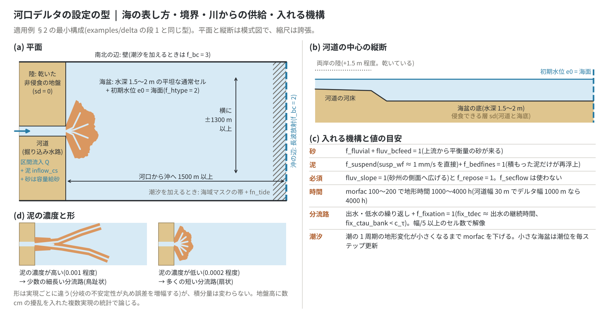
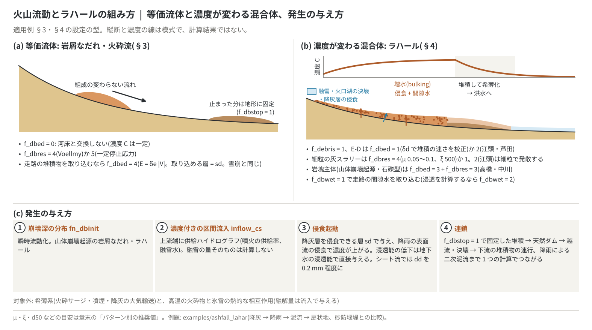
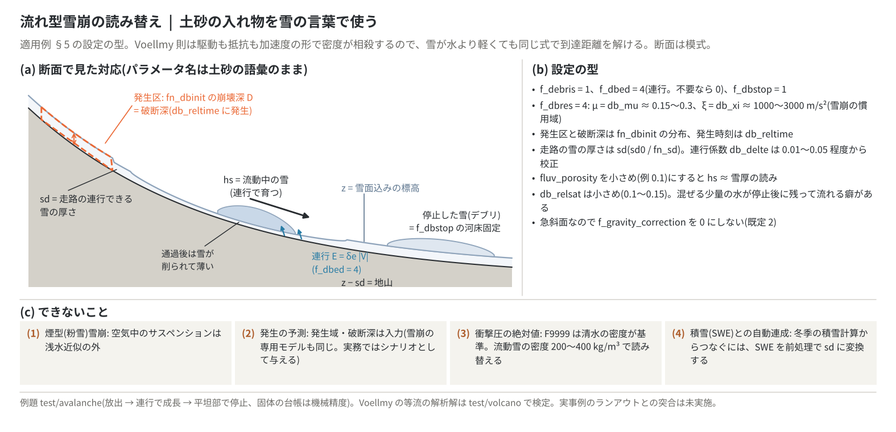
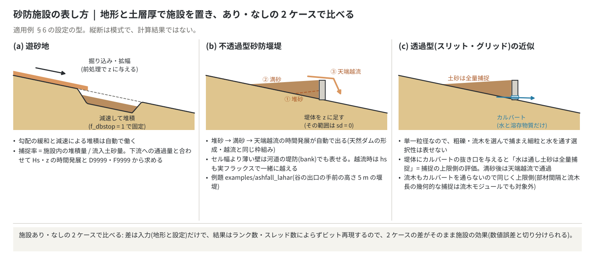

# 土砂・地形変化の適用例(現象別の組み方)

[土砂・地形変化の章へ](geomorph.md) | [ユーザーガイド目次へ](../users_guide.md)

[土砂・地形変化の章](geomorph.md)の過程を組み合わせて、特定の現象を計算するための設定の型を
まとめます。各パラメータの意味と既定値は章の表に、式と既定値の根拠は
[土砂輸送と斜面・長期地形過程の解説](sediment.md)と[土石流・斜面崩壊・動く底層の解説](massflow.md)に
あります。現象の型ごとの数値の目安は章末の[パターン別の推奨値](geomorph.md#パターン別の推奨値)、
現象から章を引く一覧は[用途集](usecases.md)です。

## 1. 津波堆積物(津波・高潮による巻き上げと遡上域への堆積)

湾内の底泥・海底砂の巻き上げと遡上域への堆積は f_suspend で表せます。
重要な条件が一つ: **海域マスク(fn_sw)のセルは流れを解かず、地形変化の
全プロセスも海セルには働きません**。巻き上げの対象水域は海域マスクでは
なく、海底地形 z を持つ通常セル+初期水位
([初期条件](initial.md)の f_htype=2)で表し、津波は辺境界の長波放射
(型 2)や水位規定セルで入射させます([境界条件](boundary.md))。
巻き上げ可能な層の厚さ・範囲は土層厚 sd で与えます(sd=0 は不侵食)。
海の 2 通りの表し方と土砂の行き先の違いは、章の[海域マスクと土砂の行き先](geomorph.md#浮遊砂f_suspend)の図に
あります。

- **砂**: 本来の適用域です。f_esform=2(板倉・岸)+susp_wf=0
  (Rubey 導出)で校正パラメータなしに動きます。掃流砂の寄与が効く
  場合(遡上先端・戻り流れの浅い高流速域)は f_fluvial を重ね合わせます。
- **泥(粘着性)**: 読み替えで対応します。沈降速度はフロックの実効値を
  susp_wf に直接与え(10⁻⁴〜10⁻³ m/s 程度。Rubey 導出は粘土粒径では
  非現実的)、f_esform=1 の E = wf・esa・(τ*/τ*c−1) を Partheniades 型
  E = M(τ/τ_ce−1) と同型とみなして、susp_esa・susp_tausc を泥の
  侵食速度定数・限界せん断応力に合わせて校正します。フロキュレーション・
  圧密は陽には扱いません。

遡上域では流速低下で沈降が卓越し、乾燥したセルでは浮遊分が全量河床に
固定されます。堆積厚は z の前後差分(f_out_z)で得られます
(プローブ CSV にも hs・sd 列)。単一粒径のため守備範囲は堆積厚・
範囲までで、粒度の空間分布(内陸細粒化)は表現できません。hs は
希薄前提の受動スカラーで、高濃度の泥水流(密度流)は対象外です。

## 2. 河口デルタ

河川が静水域に突入して河口砂州・分岐・ローブ・流路の乗り換えを
作る過程は、章の[海域マスクと土砂の行き先](geomorph.md#浮遊砂f_suspend)のとおり海を通常セル+初期水位で表し、砂と泥を両方与えれば
設定だけで計算できます(例題 [examples/delta](../../examples/delta/README.md)。デルタの型ごとに要る機構の
選び方と結果の目安もそこにあります)。
最小構成: 海盆は水深 1.5〜2 m の平坦な通常セル(f_htype=2、e0 = 海面)、遠端の辺は
長波放射(f_bc=2)、河道は両岸を乾いた非侵食の陸地(sd=0)で挟んだ掘り込み水路に
区間流入 Q と泥の濃度 inflow_cs(体積濃度 0.0002〜0.001)。砂は f_fluvial + 容量給砂
fluv_bcfeed=1(上流から平衡量の砂が来る)、泥は f_suspend(沈降速度 susp_wf を
1 mm/s 程度の実効値で直接与える粘着性泥の読み替え)+ f_bedfines=1(堆積した泥だけが
再浮上)。fluv_slope=1(砂州の側面へ砂を広げる)と f_repose=1 は必須で、f_secflow は
使いません。morfac 100〜200 で地形時間 1000〜4000 h を見ます(河道幅 30 m に対して
デルタ幅 1000 m なら 4000 h・供給 1e6 m³ 級。領域は河口から沖へ 1500 m、横に
±1300 m 以上)。期待される挙動: 泥の濃度を上げるほど分流路が少なく細長い鳥趾状、
下げるほど多分流路の扇状。形は実現ごとに違い(分岐の不安定性が丸め誤差を増幅)、
積分量は変わらないので、地盤高に数 cm の擾乱を入れた複数実現の統計で論じます。
分流路の維持を見るなら出水・低水の繰り返しと `f_fixation=1` を組み合わせ、
`fix_tdec`(冠水時の減衰)を出水の継続時間程度に、`fix_ctau_bank` を河床の c_τ より
小さく取ります(減衰がないと露出した砂州が恒久化して分流路が格子幅の水路に落ちる)。
分流路は幅/5 以上のセル数で解像してください。潮汐を加えるときは、沖の辺に海域マスクの帯を置いて
[潮位](tide.md)(fn_tide)を与え、潮の 1 周期の地形変化が小さくなるよう morfac を下げます(例題の
段 6・7 は計算時間との折り合いで潮 5 周期・morfac 24 と 240 にとどめ、この条件を満たしません。段 7 の
morfac を 120・60 に下げると、沖へ伸びる筋や、南北の辺から出る砂の量が大きく変わりました)。海岸に
交わる辺は側方 Neumann(f_bc = 3)にします(干潮の水路が辺に届くと、川の水と一緒に砂も外へ出ます)。小さな海盆では潮位を毎ステップ
更新します(`dt_tiupdate` を計算刻み以下に。既定の 1 分ごとの更新は固有振動を起こすことがある。
[潮位](tide.md#パラメータと既定値の根拠)の「固有周期の短い水域」)。

図の (a)(b) は上の最小構成の平面と縦断で、海は通常セル+初期水位、沖の辺は長波放射、河道は乾いた非侵食の陸地に
挟まれた掘り込み水路です。潮汐を加えるときは沖の辺に海域マスクの帯を置き、南北の辺を f_bc = 3 にします。(c) は
入れる機構と値の目安、(d) は泥の濃度による形の違いです。縮尺を誇張した模式図で、計算結果ではありません(計算
結果は例題 examples/delta)。

## 3. 火山流動(岩屑なだれ・火砕流・火山泥流)

河床侵食を伴わない
密度流は `f_dbed = 0`(交換なし)+ `f_dbres = 4`(Voellmy)または
`5`(一定停止応力)の「等価流体」構成で概算できます(火山流動の
専用モデルと同じ定式化の水準)。発生は瞬時流動化(章の[発生のさせ方](geomorph.md#土石流斜面崩壊f_debris--fn_dbinit--f_slide)の fn_dbinit)か
上流端の区間流入(濃度付き。噴火供給率)で与え、停止分は f_dbstop=1
で地形に固定します。堆積 → 天然ダム → 決壊洪水 → 降雨による二次
泥流化までが単一計算でつながります。**走路の堆積物の連行**
(岩屑なだれが崩積土・火砕物を取り込みながら成長する過程)が
必要な場合は `f_dbed = 4`(速度比例連行 E = δe・|V|)にし、
連行可能な層の厚さを土層厚 sd で与えます(機構と設定は[§5(雪崩)](#5-雪崩流れ型)と同じです — 連行可能層の読み替えが雪か土砂かの
違いだけ)。希薄系(火砕サージ・噴煙・
降灰の大気輸送)は対象外です(設計文書 debris_plan.md §5)。等価流体と、§4 の濃度が変わる混合体の対比は
§4 の末尾の図にあります。

## 4. ラハール(火山泥流)

ラハールは、噴火時の融雪・氷河融解や火口湖の決壊で
生じ、谷を下りながら堆積物と水を取り込んで増水(bulking)し、下流で
希薄化して洪水に移行する流れです。等価流体ではなく、**濃度が変わる
混合体**として扱います(ENCflow を使う意味がここにあります)。

- **設定の型**: `f_debris = 1` に、E-D は `f_dbed = 1`(高橋型緩和。
  δd で堆積の速さを校正)か `f_dbed = 2`(江頭・芦田)、抵抗則は
  **細粒の灰スラリーなら `f_dbres = 4`(Voellmy。μ 0.05〜0.1、ξ 500)**
  か `f_dbres = 1`(クーロン+Manning。φ 30〜35°)。江頭構成則
  (`f_dbres = 2`)の層流抵抗は (h/d)² に反比例するため **d50 が mm 以下
  では抵抗が消えて速度が発散**します(d50 が cm 以上の石礫型向き)。
  岩塊主体(山体崩壊起源・渓流を下る石礫型)なら `f_dbed = 3` +
  `f_dbres = 3`(高橋・中川)。走路の間隙水を取り込む `f_dbwet = 1` を
  推奨(増水の一次効果)。浸透を計算する(`fn_gwflow`)場合は `f_dbwet = 2` に
  します(侵食で削られた層にしみ込んでいた水が地表へ戻り、堆積で増えた
  容量はその場の地表水で満たされる)。動く例題:
  [examples/ashfall_lahar](../../examples/ashfall_lahar/)(降灰で下がった浸透能 →
  降雨 → 泥流 → 扇状地堆積。噴火前・砂防堰堤との比較)。
- **発生の与え方**: 降灰層を侵食できる土層 sd として与え、降雨の表面流の
  侵食で濃度が上がる**侵食起動**(発生源の指定は不要。降灰による浸透能の低下は
  [地下水](gwflow.md)の浸透能で直接与える。examples/ashfall_lahar)、
  上流端の**濃度付き区間流入**(供給ハイドログラフ。
  [境界条件](boundary.md)の inflow_cs)か、前段の計算で作った堆積が
  天然ダムとなって決壊する**連鎖**(f_dbstop=1 で固定した堆積 → 越流
  決壊 → 下流堆積物の連行)。崩壊深分布 fn_dbinit は山体崩壊起源のとき。
  侵食起動で斜面のシート流(深さ 1 mm 前後)を扱うときは、移動限界水深 `dd`
  ([浅水流計算](swflow.md))を流れの深さより十分小さく(0.2 mm 程度)します。
  流れの深さと同程度(既定の 1 mm)だと、セルごとに流れる・止まるが入れ替わり、
  格子 1 つ分の侵食と堆積の縞が育ちます。
- **限界**: 高温の火砕物と氷雪の熱的相互作用(融解量)は対象外で、
  融雪水は流入ハイドログラフとして与えます。希薄系(火砕サージ)は
  対象外(debris_plan.md §5)。

図の (a) は §3 の等価流体で、河床と交換しない(濃度が変わらない)流れが止まって地形に固定されます。(b) は
ラハールで、走路の侵食と間隙水で濃度が上がり(増水)、下流で堆積して希薄化し、洪水へ移ります。濃度の線は
この順序を示す模式で、計算結果ではありません。(c) は発生の与え方の 4 通りです。

## 5. 雪崩(流れ型)

[§3](#3-火山流動岩屑なだれ火砕流火山泥流)と同じ等価流体構成が、そのまま流れ型
(密実流)雪崩の標準定式化です。Voellmy 則(μ + gV²/ξ)はもともと
雪崩のために作られた抵抗則で、雪崩実務モデルと同じ「発生区+破断深を
与えてランアウト・堆積を解く」使い方ができます。Voellmy 力学は
密度に依存しない(駆動も抵抗も加速度形で密度が相殺する)ため、
雪が水より軽いことは到達距離の計算では問題になりません。
雪崩は土砂流動モデルの**援用**なので、モデルの「入れ物」を雪の言葉に
読み替えて使います(パラメータ名は土砂の語彙のままです):

| モデル側の量(土砂の名前) | 雪崩での読み替え |
|---|---|
| sd(土層厚 = 可動層) | 走路の連行可能な雪の厚さ |
| hs(土砂柱状量) | 流動中の雪の(実質)体積 |
| z(標高) | 雪面込みの標高(z − sd が地山) |
| fluv_porosity λ | 雪の空隙率解釈(小さめにすれば hs ≈ 雪厚) |
| fn_dbinit の崩壊深 D | 発生区の破断深 |
| f_dbstop の河床固定 | 停止した雪(デブリ)の堆積 |

この援用により、検証済みの保存則機構(固体総量・共動更新)が
そのまま雪にも効きます。密実流雪崩と土砂の密度流は同じ
「粒状体の浅水流」であり、定式化としての同一性に基づく援用です。

図の (a) は上の表の読み替えを斜面の断面に置いたもので、z は雪面込みの標高、sd は走路の連行できる雪、z − sd が
地山、発生区の破断深は fn_dbinit の崩壊深 D です。流れる雪 hs は走路の雪を連行して育ち、止まった雪は f_dbstop で
地形に固定されます。(b) は下の設定の型、(c) はできないことの要約です。

- **設定の型**: `f_debris = 1`、`f_dbed = 4`(走路の雪の**速度比例
  連行** E = δe・|V|。連行不要なら 0)、`f_dbres = 4`
  (μ = db_mu ≈ 0.15〜0.3、ξ = db_xi ≈ 1000〜3000 m/s² が雪崩の
  慣用域)、`f_dbstop = 1`(停止分を地形に固定)。発生区と破断深
  (雪の厚さ)は `fn_dbinit` の分布で与え、`db_reltime` で発生時刻を
  指定します。走路の**連行可能な雪の厚さは土層厚 sd**(sd0 / fn_sd)で
  与えます(z は雪面込み標高・z−sd が地山。連行係数 `db_delte` は
  校正パラメータで 0.01〜0.05 程度から)。`fluv_porosity` は小さめ
  (例 0.1)にすると hs ≈ 雪厚の読みになります。`db_relsat` は小さめ
  (例 0.1〜0.15)に — 混合体モデルの近似上、少量の水をキャリアとして
  混ぜて流すためで、停止後にその水が残って流れる癖があります(量が
  小さければ実害は限定的)。急斜面なので `f_gravity_correction` を 0 にしない
  ことを推奨します(既定 2)。
- **できないこと(正直な限界)**: (1) 煙型(粉雪)雪崩は対象外
  (空気中のサスペンション = 浅水近似の外)、(2) 発生の予測は不可
  (発生域・破断深は入力 — これは雪崩の専用モデルも同じで、実務では
  発生はシナリオとして与えるのが標準です)、(3) 衝撃圧の絶対値は
  要換算(F9999 は清水密度基準。雪崩の衝撃圧にするには流動雪密度
  200〜400 kg/m³ で読み替え)、(4) 積雪モジュール(SWE)との自動連成は
  なし(冬季の積雪計算から雪崩へつなぐには、SWE を前処理で sd に
  変換して与える)。
- 検証済みの例題は [test/avalanche](../../test/avalanche/)
  (放出→連行で1.5倍に成長→平坦部で停止。固体台帳は機械精度)。
  Voellmy 定常等流の解析解一致(0.04%)は [test/volcano](../../test/volcano/)
  構成1(同じ抵抗則)で恒常検定しています。雪崩実事例のランアウトとの
  突合は未実施です。氷河モジュールの「雪崩再配分」は涵養のための
  ゆっくりした雪の斜面再配分で、ここでいう動的な雪崩流下とは
  別物です。

## 6. 砂防施設(遊砂地・砂防堰堤)

対策施設の効果は
「施設あり/なし」の2ケース比較で検討します。差分は入力(地形と設定)
だけで、結果はランク数・スレッド数によらずビット再現するため、
2ケースの差がそのまま施設の効果として数値誤差と切り分けられます。

図の (a) は遊砂地(地形の掘り込み)、(b) は不透過型堰堤(堤体を地形に足して sd = 0。堆砂 → 満砂 → 天端越流)、
(c) は透過型の近似(カルバートで水だけを通し、土砂は全量捕捉 = 捕捉の上限側)です。縦断は模式で、計算結果では
ありません。

- **遊砂地**: 前処理で地形 z に掘り込み・拡幅を与えるだけです。
  勾配緩和・減速による堆積(f_dbstop=1 で地形へ固定)は自動で働き、
  捕捉率(施設内の堆積量/流入土砂量)や下流への通過土砂量は
  Hs・z の時間発展と D9999/F9999 から定量化できます。
- **不透過型砂防堰堤**: 堤体を地形 z に足し、その範囲の土層厚を
  sd=0(不侵食)にします。堆砂 → 満砂 → 天端越流という時間発展が
  自動で出ます(天然ダムの形成・越流と同じ枠組み)。例題:
  [examples/ashfall_lahar](../../examples/ashfall_lahar/)(谷の出口の手前の高さ 5 m の
  堰堤。斜面の水が堰堤より上流で谷底に集まる地形にしておくと、上流の流れがすべて
  堰堤を通る)。セル幅より
  薄い壁として表したい場合は河道の堤防(bank。[河道](channel.md))が
  使え、越流時は土砂(hs)も実フラックスで一緒に越えます。
- **透過型(スリット・グリッド)堰堤**: 単一粒径のため「粗礫・流木を
  選択捕捉し、細粒と水を通す」という粒径選択性は表現できません。
  堤体(不侵食地形)にカルバート([構造物](structure.md)。水と水質の
  溶存物質だけを転送し土砂を運ばない)で抜き口を与えると、「水は通し土砂は
  全量捕捉する」近似 = **捕捉の上限側評価**になります。満砂後は天端越流で
  土砂が下流へ通過します。流木の面的な発生・輸送・堆積は
  [流木](driftwood.md)で扱えます(カルバートは流木も運ばないため
  同じく捕捉の上限側評価。部材間隔と流木長の幾何的な選択捕捉は
  流木モジュールでも対象外です)。透過部をセルで表せる堰堤(格子型など)では、
  透過部のセルを流木の捕捉セルにすると、捕捉した流木の集積が流れを堰き上げ、
  上流の流速が落ちて土砂も溜まります
  ([流木の「構造物での捕捉と集積」](driftwood.md#構造物での捕捉と集積fn_dwtrap)。
  捕捉率は与件で、単一粒径なので巨礫による閉塞は表せません)。
