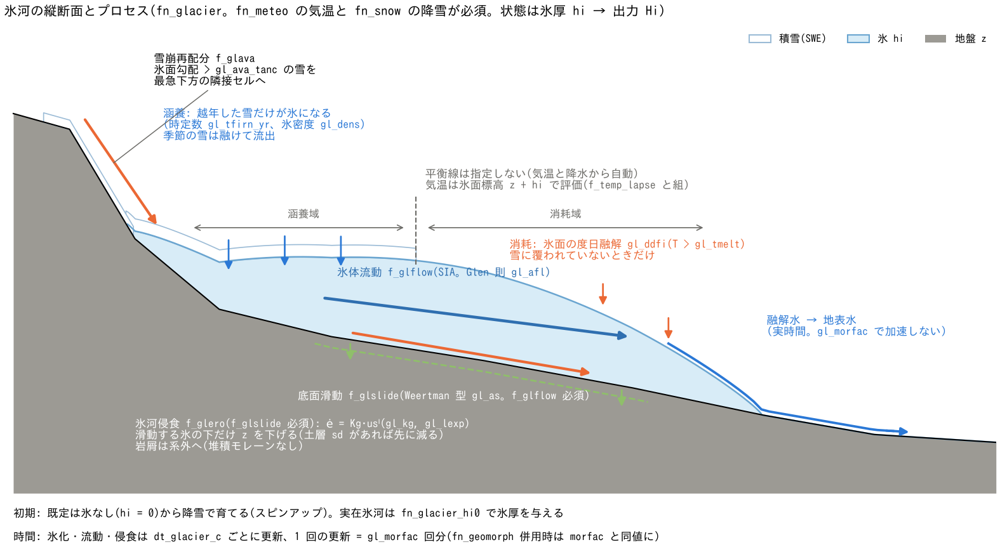

# 氷河(&list_glacier)

[ユーザーガイド目次へ](../users_guide.md)

陸上氷河の涵養・消耗・氷体流動と、氷河流動に伴う地形侵食(カール・
U字谷など)を扱います。`fn_glacier` で有効化します。**気温
(fn_meteo)と積雪・融雪(fn_snow)が必須**です(降雪が涵養の
供給源になります)。プロセスは地形変化と同じ**重ね合わせ方式**で、
必要なものだけを有効化できます。

| プロセス | フラグ | 内容 |
|---|---|---|
| 質量収支 | (常時) | 多年性の雪の氷化(涵養)と氷面の度日融解(消耗) |
| 氷体流動 | f_glflow | 浅氷近似(SIA)による氷の変形流動 |
| 底面滑動 | f_glslide | Weertman 型の底面滑動(f_glflow 必須) |
| 氷河侵食 | f_glero | 滑動速度に比例する基盤の侵食(f_glslide 必須) |
| 雪崩再配分 | f_glava | 急斜面の雪を下方へ移す重力再配分 |



縦断面で見ると、涵養域では越年した雪が時定数 gl_tfirn_yr で氷になり、消耗域では雪に
覆われていない氷面が度日係数 gl_ddfi で融けて融解水が地表水に入ります(平衡線は気温と
降水から自動的に現れます)。氷は f_glflow の SIA 変形と f_glslide の底面滑動で下流へ
流れ、滑動する氷の下だけ f_glero が地盤 z を削り、急崖の雪は f_glava で下方へ再配分
されます。

状態はセル別の氷厚(m)で、分布 `Hi0001...` として毎出力時刻に
書かれます。画面・Log の保存量列 S_total には氷の水当量が算入され、
リスタート([中断と再開](restart.md))は状態保存ディレクトリの
私有ファイル glacier.dat で継続します(save 時に fn_glacier が
有効だったことが必要)。

設計の背景(浅氷近似の定式・時間加速の考え方・既知の妥協)は
開発文書 [docs/glacier_plan.md](../glacier_plan.md) にあります。

「とりあえず動かしてみる」最小入力は **fn_glacier に空の &list_glacier**
(+ fn_meteo・fn_snow。どちらも空のグループでよい)です。度日係数・
滑動係数・侵食係数には既定値があり(表の「既定値」列。根拠は
下の[パラメータと既定値の根拠](#パラメータと既定値の根拠))、未指定なら既定を採用して "(default)" 付きで
表示します。既定の構成は「氷なしから降雪で育てる・SIA 流動あり・
滑動と侵食なし」です。地形時間を稼ぐ gl_morfac・t_cycle は現象に
合わせて指定してください(下の[設定例](#設定例))。

結果の見方(分布・台帳・計測列・再開)は、このページの[出力・確認](#出力確認)にまとめています。各機能の節末にも、その機能に関係する出力だけを短く記しています。

## 実行制御と時間の考え方

氷河は水理(秒〜日)よりはるかに遅い時定数(年〜千年)を持つため、
**間欠実行と時間加速**で地形の時間を稼ぎます。

| パラメータ | 既定値 | 意味 |
|---|---|---|
| f_glacier | 1 | 0 でファイルを残したまま一時無効化 |
| dt_glacier_c | "1 day" | 氷化・流動・侵食の更新間隔("6 hour" 等の時間文字列) |
| gl_morfac | 1.0 | 氷河時間の加速係数。1回の更新 = gl_morfac 回の同一イベントとして氷と地形を進める |

- **融解水は加速されません**: 氷面の融解で生じる水は毎ステップ実時間の
  レートで地表水に入り(洪水計算を駆動)、氷の減少だけが gl_morfac 倍
  されます(地形変化の morfac と同じ考え方)。
- **土砂・地形変化(fn_geomorph)と併用する場合、gl_morfac は
  &list_geomorph の morfac と同じ値にしてください**(「地形の時間」は
  1本、が ENCflow の約束です。不一致は初期化時に停止します)。
- 千年スケールの実験は、代表年の反復(&list_sysparam の t_cycle_c)×
  gl_morfac × リスタート連鎖で構成します(長期地形変化と同じ流儀。
  [土砂・地形変化の章](geomorph.md))。

## 質量収支(涵養と消耗)

| パラメータ | 既定値 | 意味 |
|---|---|---|
| gl_dens | 900.0 | 氷の密度 $`\rho_i`$ (kg/m³)。雪水量⇄氷厚の換算に使用(氷河氷の標準値 900〜917) |
| gl_tfirn_yr | 10.0 | 雪→氷の変換(フィルン化)の時定数 (年)。温暖氷河で数年〜10年程度 |
| gl_ddfi | 8.0 | 氷面の度日係数 $`d_i`$ (mm/℃/day)。雪面(snow_ddf)より大きく(アルベドが低い)、Hock の集計[^hock03]の氷 5.5〜20 の下寄り |
| gl_tmelt | 0.0 | 氷面融解の気温閾値 (℃) |

```math
\Delta h_i = \frac{\rho_w}{\rho_i}\,\mathrm{SWE}\left(1 - e^{-\Delta t_w/\tau_{firn}}\right),
\qquad
\Delta h_{i,melt} = -\frac{\rho_w}{\rho_i}\,\min\!\left(h_i\frac{\rho_i}{\rho_w},\ d_i\max(T - T_{melt}, 0)\frac{\Delta t}{86400}\right)
```

- 降雪は積雪・融雪の機能(SWE)として積もり、**越年した雪だけが**
  時定数 $`\tau_{firn}`$(gl_tfirn_yr)でゆっくり氷になります(季節の雪は
  そのまま融けて流出します)。指数緩和は水文時間 $`\Delta t_w`$ で評価
  するので、季節雪はほとんど変換されません。
- 氷は**雪に覆われていないときだけ**融けます(雪が先に融ける)。
- 気温は**氷面の標高**(地面+氷厚)で評価されるため、気温減率
  (&list_meteo の f_temp_lapse)と併用すると、氷河が厚いほど表面が
  寒くなる現実的なフィードバックが働きます。雪線・平衡線は指定する
  ものではなく、気温と降水から**自動的に現れます**。

**この節に関係する出力**: 氷厚 `Hi0001…`(自動)と積雪 `Sw0001…`、Log の S_total(氷の水当量込み)。涵養・融解の内訳の台帳はないので、Hi の年差と Sw で読みます([出力・確認](#出力確認))。

## 氷体流動(f_glflow)

浅氷近似(SIA)[^hutter83]により、氷は自重で変形しながら氷面の低い方へ
流れます。氷面 $`s = z + h_i`$ の非線形拡散として解きます。

```math
\frac{\partial h_i}{\partial t} = \nabla\cdot\left(D\,\nabla s\right),
\qquad
D = \underbrace{\frac{2A}{5}(\rho_i g)^3\,h_i^{5}\,|\nabla s|^2}_{変形(Glen\ n = 3)}
  + \underbrace{A_s(\rho_i g)^3\,h_i^{4}\,|\nabla s|^2}_{滑動(\texttt{f\_glslide})}
```

第 1 項は Glen の流動則[^glen55] $`\dot\varepsilon = A\tau^3`$ を鉛直積分した
SIA の氷流束、第 2 項は §「底面滑動」の Weertman 滑動を同じ拡散形に
載せたものです。既定 $`A`$ = 1e-16 Pa⁻³ yr⁻¹ は温暖氷(0 ℃)の推奨値
[^cuffey10]です。

| パラメータ | 既定値 | 意味 |
|---|---|---|
| gl_afl | 1.0e-16 | Glen 流動則の係数 A (Pa⁻³ yr⁻¹)。温暖氷で ~1e-16 |
| gl_cfl | 0.4 | 数値安定の安全係数(通常変更不要) |
| gl_nsubmax | 10000 | 1回の更新の内部反復数上限(パラメータ暴走の検出用) |

時間刻みの心配は不要です: 氷の厚さ・勾配に応じた安定条件を
モデルが毎回自動で判定し、必要な回数だけ内部で細分して解きます
(氷体積は厳密に保存されます)。

**この節に関係する出力**: 流動の効果は `Hi0001…` の分布の広がり(谷に沿って下流へ伸びる)で見ます。終了時に「SIA subcycles total」が表示され、極端に多ければ gl_afl・gl_morfac の見直しの合図です([出力・確認](#出力確認))。

## 底面滑動と氷河侵食(f_glslide / f_glero)

| パラメータ | 既定値 | 意味 |
|---|---|---|
| gl_as | 1e-13 | Weertman 滑動係数 As (m yr⁻¹ Pa⁻³)。f_glslide=1 のとき読まれる。既定は底面せん断応力 100 kPa で 100 m/yr(山岳氷河の速い側) |
| gl_kg | 1e-4 | 侵食係数 Kg。f_glero=1 のとき読まれる。滑動速度を m/yr で測った侵食則 ė = Kg・usˡ の係数(l=1 なら無次元。Humphrey & Raymond 1994 の実測 1e-4) |
| gl_lexp | 1.0 | 侵食則のべき指数 l(1〜2) |

```math
u_s = A_s\,\tau_b^3,
\qquad
\tau_b = \rho_i g\,h_i\,|\nabla s|,
\qquad
\dot e = K_g\,u_s^{\,l}\ (u_s\ \text{は m/yr})
```

Weertman 型の滑動則($`m`$ = 3 固定)[^weertman57]と、滑動速度のべき乗に
比例する氷河侵食則[^humphrey94]です。既定 $`A_s`$ = 1e-13 m yr⁻¹ Pa⁻³ は
底面せん断応力 100 kPa(典型 50〜150 kPa[^cuffey10])で 100 m/yr、山岳
氷河の滑動速度の速い側(10〜100 m/yr)に相当します。既定 $`K_g`$ = 1e-4
($`l`$ = 1)は Variegated 氷河の実測(侵食速度 ≈ 1e-4 × 滑動速度)
[^humphrey94]で、$`l`$ = 2 の場合[^herman15]は別校正で 1e-7〜1e-6 です。

- 侵食は**滑動している氷の下だけ**で起き(f_glero は f_glslide が
  前提)、薄い氷はほとんど侵食しません。
- 侵食は計算標高 z を下げ、土層厚 sd があれば共に減らします(土層が
  尽きると基岩の侵食になります)。地形の時間変化は `f_out_z = 1` で
  `Z0001...` として出力できます。
- 削られた岩屑は氷・融氷水が系外へ運び去るものとして扱います
  (堆積モレーンはまだ表現されません。終了時に総量が報告されます)。

**この節に関係する出力**: 侵食は `Z0001…`(`f_out_z=1`)と `Sd0001…` の減少、終了時の「eroded volume exported from the system」(MPI ではランクごと)で確認します([出力・確認](#出力確認))。

## 雪崩再配分(f_glava)

| パラメータ | 既定値 | 意味 |
|---|---|---|
| gl_ava_tanc | 0.6 | 雪崩の限界勾配 tan θc(0.6 ≈ 31°) |

氷面の最急勾配 $`\tan\theta`$ が閾値を超えるセルの雪の割合
$`\min(1, (\tan\theta - \tan\theta_c)/\tan\theta_c)`$ を、最も急な下り方向の隣接
セルへ移します。閾値 0.6(≈ 31°)は乾雪の安息角付近の慣用値です。急崖が雪を保持できず、圏谷(カール)へ雪が集中する
効果の簡便表現です。カール形成実験では有効化を推奨します。

**この節に関係する出力**: 再配分の結果は `Sw0001…`(急崖で 0、圏谷に集中)と、その後の `Hi0001…` の成長位置に現れます([出力・確認](#出力確認))。

## 初期条件

| パラメータ | 既定値 | 意味 |
|---|---|---|
| fn_glacier_hi0 | "" | 初期氷厚の分布ファイル (m) |

- **既定は氷なし**(hi = 0)から始め、降雪の涵養で氷河を育てます
  (スピンアップ)。氷河地形の実験はこの方式が標準です。定常に達した
  状態を保存し、リスタートで気候シナリオを分岐できます。
- 実在氷河の融解水・流出解析では、氷厚推定プロダクト(Farinotti ほか
  のコンセンサス推定等)を GIS で切り出して fn_glacier_hi0 に与えます。
  リスタート時は保存された氷厚が優先されます。

## 設定例

```
&list_meteo
  tempval(:,1) = 0.0, -5.0      ! 代表年の気温(経過日, ℃)
  tempval(:,2) = 182.5, 10.0
  tempval(:,3) = 365.0, -5.0
  f_temp_lapse = 1              ! 標高減率(雪線の標高依存)
  f_prec_lapse = 1              ! 降水の標高勾配(高所ほど涵養が多い)
  prec_lapse = 5.0              ! +5%/100m
/
&list_snow
  snow_ddf = 4.0                ! 既定と同じ(省略可)
/
&list_glacier
  dt_glacier_c = "1 day"
  gl_morfac = 100.0             ! 計算1年 = 氷河・地形の100年
  gl_ddfi = 8.0                 ! 既定と同じ(省略可)
  f_glflow = 1
  f_glslide = 1
  gl_as = 1.0e-13               ! 既定と同じ(省略可)
  f_glero = 1
  gl_kg = 1.0e-4                ! 既定と同じ(省略可)
  f_glava = 1
/
```

**パターン別の推奨値**(校正で変わる量です。出典は下の[パラメータと既定値の根拠](#パラメータと既定値の根拠))

| 型 | gl_ddfi | gl_afl (Pa⁻³ yr⁻¹) | gl_as (m yr⁻¹ Pa⁻³) | gl_kg | 備考 |
|---|---|---|---|---|---|
| 温暖氷河(アルプス・日本の多年性雪渓〜小氷河) | 6〜10 | 1e-16 | 1e-13〜1e-12 | 1e-4 | 底面が融点で滑動が速い。侵食実験は f_glslide+f_glero |
| 寒冷・極地型(高緯度・高標高) | 4〜7 | 1e-17〜1e-16 | 0(滑動なし = f_glslide=0) | — | 底面凍結。変形流動のみ |
| 氷河水文(融解水の流出)のみ | 6〜10 | — | — | — | f_glflow=0(流れない氷河)+ fn_glacier_hi0 で氷厚を与える |
| カール・U字谷の形成実験 | 8 | 1e-16 | 1e-13 | 1e-4(l=1)/ 1e-7〜1e-6(l=2) | gl_morfac × t_cycle で千年〜万年。f_glava=1 |

長周期の気候変化(氷期サイクル・温暖化トレンド)は &list_meteo の
`tempofs`(気温オフセット系列)で代表年に重畳できます
([降雨・気象の章](forcing.md))。

## 出力・確認

分布出力の 3 通りの有効化(自動 / 指定 / 共用)と柱状量の面積基底の読み方は[入出力の形式](io.md#状態量の分布出力の考え方)に、確認したい量から出力を逆引きする早見表は同じ節の末尾にあります。

**分布**(`result/` のラスタ。`dt_file` 間隔)

| ファイル | 出し方 | 内容 |
|---|---|---|
| Hi0001… | 自動 | 氷厚 (m 氷柱。幾何面積基底)。水当量は × ρi/ρw |
| Sw0001… | 自動(fn_snow) | 氷の上の積雪水量 (mm)。越年した分が氷になる |
| Z0001… / Sd0001… | f_out_z = 1 / 自動 | 氷河侵食で下がる地盤高と減る土層厚 |

**台帳・ログ**(収支の検算)

- Log.txt の S 列は S_surf / S_grnd / S_total の 3 列になり、S_total に
  氷の水当量(Hi × ρi/ρw の領域平均)が算入されます。
- 終了時に「glacier: eroded volume exported from the system = … m3 (this
  rank)」(侵食で系外へ運び去った岩屑体積。MPI では**ランクごと**の値)と
  「SIA subcycles total = … over … updates」が表示されます。
- 融解水は地表水として `S_surf`・測線 Q に現れます(氷の減少だけが
  gl_morfac 倍される点に注意)。

**計測**(プローブ・測線の列)

- 氷厚専用の列はありません。地点の氷厚は `Hi0001…` の同一セルを各出力
  時刻で拾います。融解水の流出は測線 Q で測れます。

**再開**

- 私有ファイル `glacier.dat` で自動的に扱われます(保存時に fn_glacier が
  有効だったことが必要。再開時は保存された氷厚が fn_glacier_hi0 より
  優先)。

**読み方と検算のコツ**

- 氷の収支(閉領域): Σ(Hi × A × ρi/ρw) の増分 = 涵養(越年雪の氷化)−
  融解。定常の判定は連続する年の `Hi` の差が小さくなることで行います
  (地形時間は FILENUMBER.csv の時刻 × gl_morfac)。
- 平衡線は `Hi > 0` の下端ではなく、年間の Hi 増分が 0 になる標高です。
  時間加速した計算では `dt_file` を代表年の整数倍に取ると比較が楽です。
- 侵食量は `Z0001… − Z0000`(負)で、終了時の exported volume と
  Σ(ΔZ × A) が(土層の内数を除いて)対応します。

## 併用の条件まとめ

| 使い方 | 必要な他機能 |
|---|---|
| 氷河の質量収支・融解水 | 降水+気象強制場+積雪・融雪 |
| 氷体流動(f_glflow) | 同上 |
| 氷河侵食(f_glero) | f_glslide(+ 長期実験では t_cycle・リスタート連鎖) |
| 地形変化との併用 | fn_geomorph(morfac は同値に) |

## パラメータと既定値の根拠

根拠欄の分類語の意味は[既定値の根拠の読み方](../users_guide.md#既定値の根拠の読み方)を参照してください。

| パラメータ | 既定 | 意味 | 根拠 |
|---|---:|---|---|
| dt_glacier_c / gl_morfac | "1 day" / 1 | 更新間隔 / 氷河時間の加速 | **方式** 間欠実行と時間加速([土砂・地形変化](geomorph.md)の morfac と同じ考え方)。既定は加速なし |
| gl_dens | 900 kg/m³ | 氷の密度 $`\rho_i`$ | **慣用値** 氷河氷 900〜917 の下寄り[^cuffey10] |
| gl_tfirn_yr | 10 yr | フィルン化の時定数 | **文献値** 温暖氷河のフィルン—氷遷移 数年〜10 年[^cuffey10] |
| gl_ddfi | 8 mm/℃/day | 氷面の度日係数 $`d_i`$ | **文献値** Hock の集計[^hock03]の氷 5.5〜20 の下寄り。雪(snow_ddf 4)の 2 倍 |
| gl_tmelt | 0 ℃ | 氷面融解の気温閾値 | **慣用値** 度日法の標準 |
| gl_afl | 1e-16 Pa⁻³ yr⁻¹ | Glen 流動則の係数 $`A`$ | **文献値** 温暖氷(0 ℃)の推奨値[^cuffey10]。Glen の $`n`$ = 3 固定[^glen55] |
| gl_cfl / gl_nsubmax | 0.4 / 10000 | サブサイクルの安全係数と上限 | **数値設定** |
| gl_as | 1e-13 m yr⁻¹ Pa⁻³ | Weertman 滑動係数 $`A_s`$($`m`$ = 3 固定[^weertman57]) | **導出** 底面せん断応力 100 kPa(典型 50〜150 kPa[^cuffey10])で滑動速度 100 m/yr = 山岳氷河の速い側 |
| gl_kg / gl_lexp | 1e-4 / 1 | 侵食係数 $`K_g`$ とべき指数 $`l`$ | **文献値** Variegated 氷河の実測 侵食速度 ≈ 1e-4 × 滑動速度[^humphrey94]。$`l`$ = 2 なら 1e-7〜1e-6[^herman15] |
| gl_ava_tanc | 0.6 | 雪崩の限界勾配 | **慣用値** 乾雪の安息角付近(≈ 31°) |
| fn_glacier_hi0 | "" | 初期氷厚 | **与件** 既定は氷なしから育てる |

**既定値を見直すときの手がかり**

- 度日係数は、対象氷河の消耗域で計測された融解杭(ステーク)の融解量
  と気温から直接求められます。地域別の集計は Hock[^hock03]。
- 流動則の $`A`$ は氷温で桁が変わります(−10 ℃ で 1e-17 程度)。寒冷氷河
  では Cuffey & Paterson[^cuffey10]の温度依存表から引いてください。
- 滑動係数は、観測された表面流速から変形分($`2A(\rho_i g)^3 h^4 \lvert\nabla s\rvert^3/5`$)
  を差し引いた滑動速度と底面せん断応力の関係で逆算します。
- 侵食係数は、氷河前面の融氷水の浮遊砂濃度(土砂流出量)から流域平均
  侵食速度を求め、滑動速度の面積平均で割ると得られます[^humphrey94]。

## 検証・例題

- [test/glacier/](../../test/glacier/): SIA 解析解のベンチマークとカール形成テスト(検証用の理想実験)。
- 設定書式の実例: [examples/List_samples/list_glacier.txt](../../examples/List_samples/list_glacier.txt)。

## 参考文献

[^hock03]: Hock, R. (2003): Temperature index melt modelling in mountain areas. *J. Hydrol.*, 282, 104–115.
[^hutter83]: Hutter, K. (1983): *Theoretical Glaciology*. Reidel, Dordrecht.(浅氷近似)
[^glen55]: Glen, J. W. (1955): The creep of polycrystalline ice. *Proc. R. Soc. Lond. A*, 228, 519–538.
[^cuffey10]: Cuffey, K. M. and Paterson, W. S. B. (2010): *The Physics of Glaciers*, 4th ed. Elsevier.(A の推奨値、底面せん断応力の典型値)
[^weertman57]: Weertman, J. (1957): On the sliding of glaciers. *J. Glaciol.*, 3, 33–38.
[^humphrey94]: Humphrey, N. F. and Raymond, C. F. (1994): Hydrology, erosion and sediment production in a surging glacier: Variegated Glacier, Alaska, 1982–83. *J. Glaciol.*, 40, 539–552.
[^herman15]: Herman, F., Beyssac, O., Brughelli, M., Lane, S. N., Leprince, S., Adatte, T., Lin, J. Y. Y., Avouac, J.-P. and Cox, S. C. (2015): Erosion by an Alpine glacier. *Science*, 350, 193–195.
