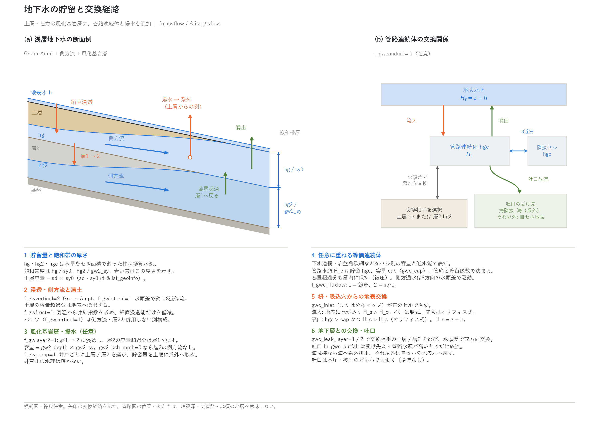

# 地下水(&list_gwflow とモデル固有設定)

[ユーザーガイド目次へ](../users_guide.md)

浅層地下水による浸透・貯留・側方流動・湧出を扱います。`fn_gwflow` で
有効化し、共通設定 `&list_gwflow` でモデルを選び、選んだモデルの
固有設定グループを同じファイルに書きます(使わないモデルのグループが
残っていても無視されます — 選択子の切り替えだけで A/B 比較ができます)。
各モデルの式・既定値の根拠・参考文献は[地下水モデルの解説](gwflow_models.md)に
あります。

ENCflow の地下水は流出解析のための**浅層地下水モデル**です。土層を基本とし、
必要に応じて風化基岩層(第2層)を追加します(天然の被圧帯水層や井戸孔単位の
水理は対象外)。これに加えて、下水道網や
岩盤亀裂網などのサブグリッド管路網を等価な連続体として表す
**管路連続体層**(f_gwconduit)と、**井戸揚水・地下水取水のシンク**
(f_gwpump)を重ねられます。



**(a) 浅層地下水の断面例。** Green-Ampt 浸透、側方流、任意の風化基岩層を
組み合わせた構成です。土層への浸透、各層の水頭差による側方流、層1から層2への
浸透、容量超過分の層1への戻り・地表への湧出を示します。揚水は土層からの例で、
井戸ごとに土層または層2を選択します。凍土は鉛直浸透能の低減として作用し、
凍結層の厚さを直接解くものではありません。

**(b) 任意の管路連続体の交換関係。** 貯留 hgc と、地表水・選択した地下層・
隣接セル・吐口の接続を示す概念図です。配置や寸法は埋設深や実管径を表しません。
地表交換には正の枡・吸込穴密度が必要で、噴出は hgc > cap かつ管路水頭が
地表水頭を上回る場合に起こります。吐口は受け先より管路水頭が高いときだけ
放流し、海に隣接すれば海(系外)、それ以外では自セルの地表水へ戻します。

貯留 hg・hg2・hgc は水量をセル面積で割った**柱状換算水深**です。
断面の青い地下水帯は貯留量そのものの高さではなく、土層では hg / sy0、
層2では hg2 / gw2_sy の**飽和帯厚**を示します。容量はそれぞれ
sd × sy0、gw2_depth × gw2_sy です。バケツモデルは別構成であり、
図(a)の側方流・第2層とは併用できません。

結果の見方(分布・台帳・計測列・再開)は、このページの[出力・確認](#出力確認)にまとめています。各機能の節末にも、その機能に関係する出力だけを短く記しています。

## 全体構成(&list_gwflow)

鉛直(表面⇔地下の交換)と側方(地下の水平移動)を独立に選び、
必要なら第2層・管路連続体層・揚水シンクを重ねます。

| パラメータ | 既定値 | 意味 |
|---|---|---|
| f_gwvertical | 0 | 鉛直モデル。0: なし(一時無効化)、1: バケツ、2: Green-Ampt |
| f_gwlateral | 0 | 側方モデル。0: なし、1: 非線形 Boussinesq |
| f_gwlayer2 | 0 | 1: 風化基岩層(第2層)を有効化 |
| f_gwconduit | 0 | 1: 管路連続体層(下水道網・岩盤亀裂網など)を有効化 |
| f_gwpump | 0 | 1: 井戸揚水・地下水取水(シンク)を有効化 |
| f_gwfrost | 0 | 1: 凍土による浸透抑制を有効化(気温 fn_meteo が必要) |
| f_gwbed | 0 | 1: 河床交換能(河道セルと地下水の交換の上限)を有効化(河道マスク fn_rw が必要) |
| dt_gwflow | 0 | 地下水計算の更新間隔 (s)。0: 毎ステップ。指定するなら dt 以上(実効時間刻みで整合が取られます) |

**土層厚 sd と比湧水量 sy0 は地理情報側**(&list_geoinfo の
f_sdtype/sd0/fn_sd, sy0)の設定です([地理情報の章](geoinfo.md))。
土層厚を必要とするモデル(Green-Ampt・側方)を選んだときだけ読まれます。

**典型的な構成**

| 目的 | 構成 |
|---|---|
| イベント洪水の浸透損失 | f_gwvertical=2(Green-Ampt)のみ |
| 流域水文(中間流まで) | f_gwvertical=2 + f_gwlateral=1 |
| 基底流・低水の逓減まで | 上記 + f_gwlayer2=1 |
| 都市の内水(下水道の排水・噴出) | f_gwconduit=1(不浸透卓越なら単独、浸透も見るなら + f_gwvertical=2) |
| 最簡の損失モデル | f_gwvertical=1(バケツ) |
| 河川と地下水の交換(堤内地湛水の河道への戻り、ライニング水路) | 上のいずれか + f_gwbed=1(fn_rw) |

## とりあえず動かしてみる(最小入力)

物性・校正値には既定値があり(表の「既定値」列。根拠は developer.md
§64)、未指定なら既定を採用して採用値を "(default)" 付きで画面に表示
します。最小入力は **fn_gwflow に &list_gwflow のモデル選択子を書くだけ**
です(固有グループは空でよい。土層厚 sd0 も未指定なら 1 m):

```
&list_gwflow
  f_gwvertical = 2          ! Green-Ampt
  f_gwlateral = 1           ! 側方流動(中間流まで見るなら)
/
&list_gwflow_greenampt
/
&list_gwflow_lateral
/
```

既定値は「動く」ための中庸(砂壌土程度の浸透能・森林斜面程度の土層)
です。現象の型が決まっているときは[パターン別の推奨値](#パターン別の推奨値)
から出発し、観測で校正してください。0 に意味のある値(gw_psif=0 の
一定浸透能、gw2_ksh_mmh=0 の側方なし、gwc_inlet=0 の地表交換なし等)には
既定を置いていません。管路連続体層だけは枡の密度 gwc_inlet(か
fn_gwc_inlet)の指定が必要です。

## バケツモデル(f_gwvertical=1、&list_gwflow_bucket)

式と既定値の根拠: [解説](gwflow_models.md#2-バケツモデルf_gwvertical--1)。

セルごとの地下貯留へ一定浸透能で表面水を移す最簡モデルです。

| パラメータ | 既定値 | 意味 |
|---|---|---|
| gw_infil_mmh | 10 | 浸透能 (mm/h)。砂壌土の飽和透水係数の代表 |
| gw_capacity | 0.2 | 地下貯留容量(柱状換算水深 m)。土層 1 m × 比湧水量 0.2 相当 |

各ステップの浸透量は「浸透能×時間・表面水深・残容量」の最小値です。
**側方モデルとは併用不可**(容量の二重定義になるため停止。土層厚を
容量とする定数浸透能が必要なら Green-Ampt の gw_psif=0 を使います)。

**この節に関係する出力**: 貯留は `Hg0001…`(`f_out_hg=1`。容量比 Hg / gw_capacity で読む)、領域平均は Log の `S_grnd` 列、地点の時系列はプローブの `hg` 列([出力・確認](#出力確認))。

## Green-Ampt(f_gwvertical=2、&list_gwflow_greenampt)

浸透式・正則化・既定値の根拠: [解説](gwflow_models.md#3-green-amptf_gwvertical--2)。

Green-Ampt 式(ピストン近似)f_v = K_sv (1 + ψ_f n_e / F) の浸透能で
表面水を土層へ移します。貯留容量は土層厚×比湧水量です。飽和した
セルは浸透が止まり、超過分は表面水として浅水側が扱います。

| パラメータ | 既定値 | 意味 |
|---|---|---|
| gw_ksv_mmh | 10 | 鉛直飽和透水係数 K_sv (mm/h)。砂壌土の代表(土性別の値は下の推奨値表) |
| gw_psif | 0 | 湿潤前線の毛管圧力水頭 ψ_f (m)。0 で一定浸透能 K_sv に退化(既定 = 退化) |
| fn_gw_ksv | "" | K_sv の分布マップ(mm/h。省略時は gw_ksv_mmh の一様値) |
| fn_gw_psif | "" | ψ_f の分布マップ(m。省略時は gw_psif の一様値) |

K_sv・ψ_f は土地利用に応じた面的分布をマップで与えられます
(透水性舗装・浸透施設・裸地/舗装の区別など)。マップの K_sv は
0 を許し、0 のセルは不浸透(完全舗装)になります。一様指定
(gw_ksv_mmh)は正の値が必要です(未指定なら既定 10 mm/h)。
土層厚 sd0(&list_geoinfo)が未指定なら 1 m を既定とします。

**この節に関係する出力**: 貯留は `Hg0001…`(飽和帯厚 = Hg / sy0)、浸透の総量は `S_grnd` の増分で確認します。浸透能の時間変化そのものは出力されないので、同じ降雨で `S_surf` と `S_grnd` の増え方を比べます([出力・確認](#出力確認))。

## 側方流動(f_gwlateral=1、&list_gwflow_lateral)

全水頭・Darcy 流束・安定条件: [解説](gwflow_models.md#4-側方流動f_gwlateral--1)。

飽和帯の側方 Darcy 流(2次元・8近傍。ENC 本体と同じ対角配分)です。
土層底面標高と飽和帯厚から求める水頭の差に応じて地下水が移動し
(飽和した土層には地表水深の水頭も加算)、飽和容量を超えたセルの
超過分は地表へ湧出します(再帰流=飽和地表流の発生)。

| パラメータ | 既定値 | 意味 |
|---|---|---|
| gw_ksh_mmh | 360 | 側方飽和透水係数 (mm/h)。1e-4 m/s = 基質の 10 倍(マクロポア・パイプ流の実効値) |
| gw_eps | 1e-3 | 乾燥判定・過大流出抑制の正則化厚 (m) |
| gw_diagratio | 2/(2+√2) | 対角方向の配分(通常変更不要。0 で4近傍相当) |
| f_gw_opening | 1 | 塞がれた斜めの配分の振り替え(1: 領域外・海セルで塞がれた斜めの通過幅を軸エッジへ振り替え、壁沿いの通水能を内部と同じにする、0: なし = 2026-10-30 より前の既定。[解説](gwflow_models.md#4-側方流動f_gwlateral--1)) |

陽解法の安定条件が初期化時に検査され、dt が上限を超える場合は上限値を
表示して停止します(dt を下げるか dt_gwflow で間引きます)。

[水質](wq.md)(fn_wq。f_wq_infil=1 が既定)が有効なら、地下水中の
溶存物質も側方流動と一緒に移動し、湧出時に wq_rg に応じた実効濃度で
地表水へ戻ります(R=1 なら地下の濃度のまま。吸着による移動の遅れ R は
水質側で与えます)。質量を同伴するのは層 1 の側方流と飽和湧出だけで、
層 1 から他の経路で抜ける水(層 2 への浸透・揚水・管路への浸入水)は
質量を同伴しません(下の各節と [水質](wq.md)の「地下水経由の輸送」)。

**この節に関係する出力**: 地下水位の形は `Hg0001…` の勾配、湧出(再帰流)は降雨のない時間帯の `H0001…` の湿潤セルで確認します。湧出量そのものの列はなく、`S_grnd` の減少と `S_surf` の増加の対応で読みます([出力・確認](#出力確認))。

## 風化基岩層(f_gwlayer2=1、&list_gwflow_layer2)

式と既定値の根拠: [解説](gwflow_models.md#5-風化基岩層f_gwlayer2--1)。

土層の直下に第2層を挟み、逓減の遅い成分(基底流)と長い滞留時間を
持たせます。層1から下方浸透し、層2内を側方移動し、飽和超過は層1へ
戻り、層1の超過は地表へ湧出します。

| パラメータ | 既定値 | 意味 |
|---|---|---|
| gw2_depth | 3 | 層厚 (m)。花崗岩源流域の風化帯の代表 |
| gw2_sy | 0.05 | 比湧水量(有効間隙率)。風化岩で数 % |
| gw2_infil_mmh | 1 | 層1→2 の浸透能 (mm/h)。風化岩の飽和透水係数の上寄り |
| gw2_ksh_mmh | — | 層2の側方飽和透水係数 (mm/h)。0 で側方なし(容量バッファ) |
| gw2_sat0 | 0 | 初期飽和度 [0,1]。イベント計算では基底流量を決める校正パラメータ |

- **バケツ鉛直モデルとは併用不可**です。
- 長期計算では初期飽和度の指定より**スピンアップ→保存→
  初期条件として利用**([中断と再開](restart.md)の f_state_restore=2)を
  推奨します。
- 蒸発散は層2には触れません。
- [水質](wq.md)の地下質量は層1に留まります。層1→2 の浸透・層2内の
  側方流には同伴せず、層2から層1へ戻る水は清水です(層1の濃度 Cg/Hg は
  見かけ上高くなる方向)。

**この節に関係する出力**: 層2の貯留は `Hg2`(`f_out_hg` と共用)、再開は `gwflow_layer2.dat`。層1と層2の合計が `S_grnd` です([出力・確認](#出力確認))。

## 管路連続体層(f_gwconduit=1、&list_gwflow_conduit)

水頭の折れ線・流束則・地表交換・安定条件・管諸元の換算: [解説](gwflow_models.md#6-管路連続体層f_gwconduit--1)。

下水道網・岩盤亀裂網・カルスト・農地暗渠などの**サブグリッド管路網**を、
セル別の貯留容量と 8 方向の通水能を持つ「人工の被圧帯水層」として
表します(等価連続体近似)。満管(容量超過)になると水頭が急峻に
立ち上がる被圧状態に切り替わり(疑似スロット)、圧力流(サーチャージ)を
表現します。用途はパラメータの組み合わせで表します:

| 用途 | 典型設定 |
|---|---|
| 都市下水道 | 枡密度あり(fn_gwc_inlet)、層間交換なし(浸入水を扱うなら gwc_leak_layer=1) |
| 岩盤・カルスト | 枡密度なし(吸込穴があれば指定)、gwc_leak_layer=2(風化基岩層と交換) |

| パラメータ | 既定値 | 意味 |
|---|---|---|
| f_gwc_fluxlaw | 2 | 側方の流束則。1: 線形、2: sqrt(乱流管路流。q ∝ √勾配) |
| gwc_cnd_m2s / fn_gwc_cnd | 0 / — | 通水能密度 (m2/s。満管時・単位動水勾配の流量/単位幅)。一様値かマップ。0 で側方なし |
| gwc_cap / fn_gwc_cap | 0.01 / — | 貯留容量(柱状換算 m。管路総体積/セル面積)。0 のセルは管路なし。既定は市街地の枝管網程度 |
| gwc_depth / fn_gwc_bot | 3 / — | 水頭底(管底)標高。一様埋設深(z − gwc_depth)か標高マップ(負値可 = 海抜下の管底) |
| gwc_sy | 0.05 | 不圧時の貯留係数(管内充水相当。(0,1])。cap/管高 |
| gwc_slot_sy | gwc_sy/50 | 被圧時の疑似スロット貯留係数(≤ gwc_sy。小さいほど硬い圧力応答)。マップの sy に対してもセル別に 1/50 |
| fn_gwc_sy / fn_gwc_slot_sy | "" | 貯留係数のマップ(指定でスカラーより優先)。断面高の異なる幹線と枝管を同居させるときはセル別に与える(sy = cap/管高) |
| gwc_sat0 | 0 | 初期充満率 [0,1] |
| gwc_inlet / fn_gwc_inlet | 0 / — | 雨水枡・人孔・吸込穴の密度 (個/m2)。指定で地表交換が有効化 |
| gwc_cw | 2.66 | 流入の堰係数(1 個あたり q = cw·h^1.5 m3/s) |
| gwc_co | 0.15 | オリフィス係数 Cd·A (m2)。満管流入と被圧噴出に使用 |
| gwc_leak_layer | 0 | 層間交換の相手。0: なし、1: 土層、2: 風化基岩層 |
| gwc_leak_mmh | 10 | 層間交換能 (mm/h)。水頭の高い側から低い側へ。gwc_leak_layer > 0 のときだけ読まれる |
| fn_gwc_leak | "" | 層間交換能のマップ (mm/h)。指定でスカラーより優先。0 のセルは交換なし(ライニング区間・健全管) |
| fn_gwc_outfall | "" | 吐口のオリフィス係数 Cd·A (m2) のマップ。値のあるセルが吐口(管路あり必須)。海域セル隣接なら海へ放流、なければ自セル地表への自由流出 |
| gwc_nsubmax | 100 | 側方通水のサブサイクル数の上限(自動細分の暴走防止) |
| gwc_eps | 1e-3 | 乾燥判定の正則化量 (m) |
| gwc_eps_h | 1e-2 | sqrt 則の線形化幅(水頭差 m) |
| gwc_diagratio | 2/(2+√2) | 対角方向の配分(通常変更不要) |

- 地表交換は水頭差の向きで自動的に切り替わります: 地表水位が高ければ
  流入(不圧なら堰式、満管ならオリフィス式)、管路水頭が地表水位より
  高く被圧なら**噴出**(マンホールからの吹き上がり)です。
- 陽解法の安定条件は初期化時に検査され、dt(dt_gwflow)が上限を超える
  場合は側方通水を**自動でサブサイクル細分**します(N = ceiling(dt/上限)。
  初期化時に「subcycles = N」と表示。上限 gwc_nsubmax を超える設定は
  停止)。安定上限は疑似スロット gwc_slot_sy が支配するため、N が
  大きすぎて遅い場合は slot_sy・gwc_eps_h を緩めるか通水能を見直します
  (N 倍のコストを払えば小さい slot_sy をそのまま使えます)。
- gwc_leak_layer=1 は土層系(Green-Ampt か側方)の、=2 は f_gwlayer2=1 の
  有効化が前提です。
- **吐口**(fn_gwc_outfall): オリフィス式の開放管端です。逆流防止
  フラップ内蔵(管路水頭 > 受け水頭のときのみ放流)、不圧・被圧を
  問いません。受け先はセルの隣接状況で決まります:
  - **海域セルに隣接**: 受け水頭 = 隣接海域セルの最低水位(潮位)。
    放流水は系外へ除去され(海は水位固定の受け皿)、S_total は放流分
    だけ減少します(累積放流体積は終了時に表示)。潮位より低い水頭の
    水は重力では吐けないため、海抜下の系の排水は排水ポンプの管路取水
    ([構造物](structure.md)の f_pump_src=1)と組み合わせます。
  - **海隣接なし(陸側開放吐口)**: 受け水頭 = 自セルの地表水位。
    坑口・暗渠吐口の daylight で、満管を待たずに自由流出し、放流水は
    地表流として扱われます(域内 = 質量保存)。カナートの出口・
    暗渠排水の吐口はこれを使います(枡密度の噴出 = 被圧時のみ、との
    違いに注意)。
- 模式実験は [test/conduit](../../test/conduit/)(解析平衡の検算つき)を参照してください。

**管諸元からのパラメータ換算(前処理)。** cap・cnd・sy は管網の諸元
(管径・粗度・配置密度)から前処理で換算して与えます(換算式と幹線+枝管の
同居時の注意は[解説](gwflow_models.md) §6。計算例のスクリプトは
[examples/sewer_hybrid/gen_data.py](../../examples/sewer_hybrid/gen_data.py))。

**できること・できないこと(連続体近似の適用範囲)**

- できること: 枝管が密な市街地の**面的な排水能力**、満管後の圧力伝搬と
  **噴出の面的な分布**、下水道と地表氾濫の**双方向のやりとり**
  (二重排水)を、地表水と同じ格子・同じ時間発展の中で扱えます。
- できないこと(原理的な限界。設計文書 gwconduit_plan.md §2 参照):
  - **個別の管路・マンホールの追跡**。噴出が「どの辺りで起きるか」は
    出ますが「どのマンホールか」は特定できません。
  - **運転規則で動く制御構造物**(ポンプ・堰・吐口・CSO)。保存則+
    勾配駆動の外にあるため連続体では扱えません(構造物単体は
    [内部水理構造物](structure.md)、これらが支配する管網は
    1次元管路網の専用モデル(管網モデル)の領域です)。
  - **幹線 1 本が支配する系**(セル寸法より大口径管 1 本の挙動が
    卓越する流域)。連続体化(均質化)の前提が崩れます。
- そのほかの制約:
  - 下水道と岩盤など**複数の管路層を同一ランで併用することはできません**
    (単一インスタンス)。
  - 管底標高は計算開始時に固定され、地形変化(fn_geomorph)に
    追随しません。蒸発散は管路層に触れません。
    海域セルとは交換しません(例外は吐口 fn_gwc_outfall の放流のみ)。
  - 水質([水質](wq.md)の wq_gwc_conc)とは「噴出・陸側吐口の水に
    固定濃度を同伴させる」形で連携できます(下水噴出の衛生リスク
    評価。管内の質量収支・移流は解かない供給側固定濃度近似。海側
    吐口は系外除去で対象外)。枡流入は f_wq_gwc_in=1(既定)で氾濫水の
    負荷を同率で管路側へ除去します(wq.csv の to_gwc_g。0 で地表残留)。
    浸入水(gwc_leak_layer=1)は層1の水だけが管路へ移り、水質の地下
    質量は同伴しません。

**この節に関係する出力**: 管路の貯留は `Hgc`(`f_out_hg` と共用)、終了時に吐口放流の総量「outfall discharge total」を表示。噴出は地表の `H0001…` に、海域吐口からの放流は `S_total` の減少に現れます。再開は `gwflow_conduit.dat`([出力・確認](#出力確認))。

## 井戸揚水・地下水取水(f_gwpump=1、&list_gwflow_pump)

式: [解説](gwflow_models.md#7-井戸揚水f_gwpump--1)。

セル集合+流量で指定した揚水量を地下貯留から汲み上げ、系外へ除去する
シンクです(内部ソース &list_bound_source の地下版。上水・農業用水の
取水、揚水による地下水位低下、揚水誘引の海水浸入の解析に)。井戸は
最大 50 個、番号は 1 から連続で指定します。

| パラメータ | 既定値 | 意味 |
|---|---|---|
| gwp_cell(1:2,k,n) | — | 井戸 n の取水セル (i, j)(複数可 = 井戸群・浅井戸帯) |
| fn_gwp_cell(n) | — | セル一覧ファイル(各行 "i j"。インラインより優先) |
| gwp_q0(n) | — | 一定揚水量 (m3/s。正 = 取水) |
| gwp_val(1:2,k,n) | — | 揚水量時系列 (分, m3/s)(gwp_q0 より優先) |
| fn_gwp_val(n) | — | 時系列ファイル(各行 "分 m3/s"。最優先) |
| gwp_layer(n) | 1 | 取水層。1: 土層、2: 風化基岩層(f_gwlayer2=1 が必要) |

- 需要はセル集合へ**等分配**され、各セルの取水はそのセルの貯留で
  キャップされます(涸れ井戸 = 供給律速。他セルへの再配分はしません)。
  計算終了時に井戸別の需要・実取水の総括が表示されるので、涸れの
  有無を確認できます。
- [淡塩2層](salt.md)(f_salt_gw=1)併用時は**淡水優先**で汲みます
  (浅い井戸スクリーン近似)。淡水厚で足りない分は塩水層から取水され
  (= 塩水の混入)、揚水誘引の海水浸入・アップコーニングは側方流動と
  塩水層の力学が自動的に表します。
- 注入(負の流量)には対応していません(地表への還元・灌漑は
  [境界条件](boundary.md)の &list_bound_source で与えます)。
- 井戸はセル単位のシンクです(井戸孔単位の水理 — 井戸径・スキン・
  部分貫入などは表しません)。
- [水質](wq.md)の地下質量は取水に同伴しません(水だけが系外へ出て
  質量は層1に残るため、層1の濃度 Cg/Hg は見かけ上高くなる方向)。

**この節に関係する出力**: 井戸セル周りの `Hg0001…` の低下(影響圏)と、終了時の井戸ごとの「demand / pumped / %」の表示で、要求量に対する実揚水量を確認します([出力・確認](#出力確認))。

## 凍土による浸透抑制(f_gwfrost=1、&list_gwflow_frost)

凍結指数・低減係数の式と既定値の根拠: [解説](gwflow_models.md#8-凍土による浸透抑制f_gwfrost--1)。

凍った地面の上を融雪水や降雨が流れる現象(融雪期の出水・春先の
流出増大)を表すため、気温([降雨・気象](forcing.md)の fn_meteo。
標高減率込み)から**凍結指数** FI(°C·day)をセルごとに積算し、
鉛直浸透能(Green-Ampt・バケツ)に低減係数を乗じます。

- 凍結指数: 気温がしきい値 fro_tf を下回ると凍結度日を積算し、
  上回ると融解度日(× fro_ct)で減らします(FI ≥ 0)。
- 低減係数(線形): fac = max(fro_fmin, 1 − FI/fro_fifull)。
  FI = fro_fifull で最小値(fro_fmin=0 なら不浸透)に達します。
- 積雪断熱(任意): fro_swe0 > 0 かつ積雪([降雨・気象](forcing.md)の
  fn_snow)有効時、凍結・融解の進行に exp(−swe/fro_swe0) を乗じます
  (雪の下では地面が冷えにくく、解けにくい)。

| パラメータ | 既定値 | 意味 |
|---|---|---|
| fro_fifull | 20 | 低減係数が最小値に達する凍結指数 (°C·day)。実質的な校正点。既定は表層 20〜30 cm の凍結に相当 |
| fro_fmin | 0 | 低減係数の下限 [0,1)。0 = 完全凍結で不浸透 |
| fro_tf | 0 | 凍結・融解のしきい気温 (°C) |
| fro_ct | 1 | 融解効率(融解度日の倍率)。小さいほど春の解凍が遅い |
| fro_swe0 | 0 | 積雪断熱の e-folding 水当量 (m)。0 = 断熱なし |
| fro_fimax | 0 | 凍結指数の上限 (°C·day)。0 = 上限なし。長い厳冬で解凍が非現実的に遅れるのを防ぐには fro_fifull の 1〜2 倍程度を推奨 |
| fro_fi0 | 0 | 初期凍結指数 (°C·day)。融雪期のイベント計算で「凍った状態から」始めるときに指定 |

- 地温・凍結深・不凍水は解かない度日ベースの最簡モデルです(積雪の
  度日法と同じ考え方)。fro_fifull を流出観測から当てるのが実用的です。
- 低減係数の分布は `Ff0001` として出力されます(1 = 非凍結、
  fro_fmin = 完全凍結)。
- 凍結指数は持続する状態で、[中断と再開](restart.md)では私有ファイル
  gwflow_frost.dat で自動的に引き継がれます(保存時に f_gwfrost が
  有効だったことが必要)。

**この節に関係する出力**: 凍結指数の分布出力はありません(状態は `gwflow_frost.dat` に保存)。効果は、同じ降雨・融雪に対して `Hg0001…` の増加が止まり `H0001…` の応答が大きくなることで確認します([出力・確認](#出力確認))。

## 河床交換能(f_gwbed=1、&list_gwflow_bed)

式と MODFLOW RIV との対応、値の目安: [解説](gwflow_models.md#9-河床交換能f_gwbed--1)。

河道マスク(`fn_rw`。[地理情報](geoinfo.md))のセルで、河床・河岸を通る
地表水と土層地下水の交換に**単位面積あたりの上限 k_bed**(mm/h)を
与えます。現実の河川と帯水層のやりとりは河床層の目詰まり(コルマチオン)
やライニングで律速されることが多く、周囲の土の透水係数とは別の値を
持ちます。無指定(f_gwbed=0)では河道セルも他のセルと同じ浸透能・側方
透水係数で地下水とつながります。

作用は二つです。

- **鉛直(失水側)**: 河道セルの鉛直浸透能(バケツの gw_infil_mmh、
  Green-Ampt の K_sv)を k_bed で置き換えます。地下水頭が容量に達するまで
  の片方向浸透で、河床から切り離された(perched)河川に相当します。
  k_bed = 0 なら不浸透(コンクリート水路)。凍土の低減係数は置き換え後の
  値に乗じます。
- **側方(得水・失水の両側)**: 側方流動(f_gwlateral=1)で、河道セルと
  非河道セルの間のエッジ流量を |q| ≤ k_bed × 通過幅 × 界面飽和帯厚 に
  抑えます。向きによらず同じ上限なので、周囲の地下水が河道へ流入して
  湧出する得水河川も k_bed で律速されます。河道同士のエッジは帯水層の
  連続として制限せず、層 2・管路層も対象外です。[淡塩2層](salt.md)の塩水 zone の
  流束には同じ形の上限(交換能 × 通過幅 × 塩水の飽和帯厚)がかかります。

| パラメータ | 既定値 | 意味 |
|---|---|---|
| gwbed_k_mmh | — | 河道セル一律の交換能 (mm/h)。0 を許す(= 不透)。fn_gwbed_k を指定しなければ必須 |
| fn_gwbed_k | "" | 交換能の分布マップ (mm/h)。指定で一律値より優先。河道セルの値だけが使われ、0 のセルは交換なし(ライニング区間) |

- 鉛直か側方のどちらかのモデルが有効であること、河道マスク fn_rw が
  あることが必要です(欠けば初期化で停止)。
- 流量を減らす側の作用だけなので、側方流動の安定条件は変わりません。
- 目安: 自然河床の透水係数は 1e-7〜1e-3 m/s(0.36〜3600 mm/h)に散らばり、
  細粒の目詰まりで周囲の土より 1〜3 桁小さいことが多い。礫床の扇状地
  河川は土より大きく、コンクリート水路は 0(下の推奨値表)。
- 河床変動との連動(細粒分による可変 k_bed)は持ちません。

**この節に関係する出力**: 分布出力はありません。効果は河道セルの `Hg0001…`(k_bed = 0 なら 0 のまま)と、降雨のない時間帯の河道の `H0001…` の増加(得水)で確認します([出力・確認](#出力確認))。


## パターン別の推奨値

既定値は「動く」ための中庸です。対象が決まっているときは次を出発点に
してください(校正で変わる量です。出典は developer.md §64)。

**土性別の Green-Ampt パラメータ**(Rawls, Brakensiek & Miller 1983。
gw_ksv_mmh・gw_psif・sy0 の目安。耕起・圧密・植生で 1 桁動きます)

| 土性 | K_s (mm/h) | ψ_f (m) | 有効間隙率 |
|---|---|---|---|
| 砂 | 118 | 0.05 | 0.42 |
| ローム質砂 | 30 | 0.06 | 0.40 |
| 砂壌土(既定) | 11 | 0.11 | 0.41 |
| 壌土 | 3.4 | 0.09 | 0.43 |
| シルト質壌土 | 6.5 | 0.17 | 0.49 |
| 粘土質壌土 | 1.0 | 0.21 | 0.31 |
| 粘土 | 0.3 | 0.32 | 0.39 |

(sy0 は有効間隙率から初期含水率を引いた「湿潤前線の水分不足量」に
相当するので、湿った土では表の値より小さく 0.1〜0.2 程度)

**対象別の構成と値**

| 型 | 構成 | sd0 (m) | K_sv (mm/h) | K_sh (mm/h) | 層2 | 備考 |
|---|---|---|---|---|---|---|
| 森林流域のイベント洪水 | Green-Ampt + 側方 | 0.5〜1.5 | 50〜300 | 1000〜10000 | — | 森林土壌は浸透能が大きく、流出は側方(中間流)が主。K_sh はパイプ流で基質の 1〜2 桁大 |
| 森林流域の低水・基底流まで | 上記 + 層2 | 同上 | 同上 | 同上 | 厚さ 2〜10 m、sy 0.02〜0.1、浸透 0.1〜1 mm/h、側方 10〜100 mm/h | 層2 の側方は既定 0(容量のみ)。基底流を出すには gw2_ksh_mmh > 0 と gw2_sat0(またはスピンアップ) |
| 農地・草地の浸透損失 | Green-Ampt のみ | 0.5〜1 | 表の土性値 | — | — | ψ_f も土性表から。圧密した畑地は 1/3〜1/10 |
| 都市の内水(下水道) | 管路層(+ Green-Ampt) | 0.5〜1 | 緑地のみ 10(舗装は fn_gw_ksv で 0) | — | — | gwc_inlet 0.005〜0.02 個/m²、cnd・cap は管諸元から前処理で換算(上の「管諸元からのパラメータ換算」) |
| 下水道の浸入水 | 管路層 + Green-Ampt + gwc_leak_layer=1 | 同上 | 同上 | — | — | leak 1〜10 mm/h(老朽管ほど大) |
| 岩盤・カルスト | 管路層 + 層2 + gwc_leak_layer=2 | 0.5〜1 | 10〜50 | — | 厚さ 10〜50 m、sy 0.01〜0.05 | gwc_inlet は吸込穴のみ、cnd は亀裂網の通水能 |
| 融雪期の出水(凍土) | Green-Ampt + 凍土 + fn_snow | 0.5〜1 | 10〜50 | — | — | fifull 10〜40 °C·day(湿った土ほど小)、fro_swe0 0.05〜0.2 m |
| 河川と帯水層の交換(堤内地湛水の戻り・伏流・ライニング水路) | 側方 + 河床交換能(+ Green-Ampt) | 1〜5 | 10〜50 | 360〜36000 | — | k_bed: 目詰まりした砂床 1〜100 mm/h、礫床 100〜3600 mm/h、コンクリート水路 0。既定なし(必須) |
| 海岸帯水層の塩水くさび | 側方 + [淡塩2層](salt.md) | 5〜20 | — | 3600〜36000 | — | 砂質帯水層の K 1e-3〜1e-2 m/s、sy0 0.2〜0.3 |
| 最簡の損失(校正重視) | バケツ | — | 5〜50(infil) | — | — | capacity 0.05〜0.3 m。SCS の S(CN 60〜80 で 0.06〜0.17 m)が目安 |

## 出力・確認

分布出力の 3 通りの有効化(自動 / 指定 / 共用)と柱状量の面積基底の読み方は[入出力の形式](io.md#状態量の分布出力の考え方)に、確認したい量から出力を逆引きする早見表は同じ節の末尾にあります。

**分布**(`result/` のラスタ。`dt_file` 間隔)

| ファイル | 出し方 | 内容 |
|---|---|---|
| Hg0001… | f_out_hg = 1 | 土層の地下貯留水深 (m。水量をセル面積で割った柱状換算) |
| Hg2 | f_out_hg と共用(f_gwlayer2=1) | 風化基岩層の貯留水深 (m) |
| Hgc | f_out_hg と共用(f_gwconduit=1) | 管路連続体層の貯留水量 (m。セル面積当たり) |
| Hgs / Cg | f_out_hg と共用 | [淡塩2層](salt.md)の地下塩水貯留 / [水質](wq.md)の地下質量プール |
| Sd0001… | 自動(土層厚を使うモデル有効時) | 土層厚 (m) |

**台帳・ログ**(収支の検算)

- 地下水有効時は画面・Log.txt の S 列が **S_surf / S_grnd / S_total** の
  3 列になります(領域平均の貯留高 m。S_total には積雪・氷の水当量も
  算入)。S_grnd の増分 = 浸透 − 湧出 − 地下からの蒸発 − 揚水 − 管路への
  漏出、の収支で読みます。
- 管路連続体層は終了時に吐口放流の総量
  「gwflow_conduit: outfall discharge total = … m3」を表示します(海域への
  放流は系外 = S_total の減少)。
- 井戸揚水は終了時に井戸ごとの「demand … m3, pumped … m3 (… %)」
  (要求量・実揚水量・達成率)を表示します。
- 蒸発散([降雨・気象](forcing.md))有効時は `evap.csv` の `ev_gw_m3` 列が
  地下からの累積蒸発です。

**計測**(プローブ・測線の列)

- プローブ CSV に地下貯留水深 `hg` (m) と土層厚 `sd` (m) の列があります
  (常時。地下水無効時は 0)。測線に地下の流量は乗りません。

**再開**

- 土層の hg は本体の状態保存に含まれます。風化基岩層・管路連続体層・
  凍土は私有ファイル `gwflow_layer2.dat`・`gwflow_conduit.dat`・
  `gwflow_frost.dat` で自動的に扱われます。再開時に有効なモデルは保存時にも
  有効だったことが必要で、逆に保存時に有効だったモデル(dir_save に私有ファイルが
  ある)を再開時に無効にした場合も、貯留を黙って捨てないよう初期化で停止します
  (意図して捨てるならファイルを消すか別の dir_save を使う)。

**読み方と検算のコツ**

- Hg は柱状換算水深で、地下水位ではありません。飽和帯厚 = Hg / sy0、
  地下水位 ≈ 地盤高 − 土層厚 + Hg / sy0(側方流動・Green-Ampt 構成。
  バケツモデルは容量比 Hg / gw_capacity で読む)。飽和度 Hg / (sy0 × Sd)
  は斜面崩壊の先行指標として使えます([土砂・地形変化](geomorph.md))。
- 湧出(再帰流)は地表水 H の増加として現れます。降雨のない時間帯に
  H > 0 のセルが Hg の高い谷底に沿って並べば湧出です。
- 閉領域で境界流出がなければ S_total は降水 − 蒸発散だけで変わります。
  S_total が降水量(Pr × dt の総和)と合わないときは、辺境界・海域・
  吐口・揚水の系外への経路を疑ってください。

## 書式の実例

全グループの注釈付き実例:
[examples/List_samples/list_gwflow.txt](../../examples/List_samples/list_gwflow.txt)。
降雨と組み合わせた流出計算の全体像は[降雨・気象の章](forcing.md)へ。

## 検証・例題

- [test/gwdefault](../../test/gwdefault/): バケツ、Green-Ampt・層2、凍土、管路層の最小入力と、既定値を明示した入力の同値を検定。
- [test/pump](../../test/pump/)・[test/frost](../../test/frost/): 井戸揚水の貯留減少、凍結指数に応じた浸透抑制をそれぞれ解析値と比較。
- [test/gwseep](../../test/gwseep/): 浸透・地下側方輸送・湧出還元を、水質の質量収支とともに確認。
- [test/gwbed](../../test/gwbed/): 河床交換能による得水の律速・k_bed = 0 の遮断・鉛直浸透能の置き換えを解析値と比較。
- [test/gwlateral](../../test/gwlateral/): 側方流動を線形化した Boussinesq 方程式の解(ガウス形の小山の広がり 4D)と比較し、塞がれた斜めの配分の振り替え(既定)で壁沿いの通水能が内部と同じになること(振り替えなしでは 0.71 倍)を確かめる。
- [test/gwtani](../../test/gwtani/): 急勾配・薄い土層の斜面に一定の雨を与え、飽和の時刻が鉛直到達時間で決まり(鉛直浸透支配)、定常の飽和域が集水と側方の通水能で決まる(側方流支配)ことを運動学的な予測と比較。側方流を有効にしたリスタート往復も確かめる。
- [examples/sewer_hybrid](../../examples/sewer_hybrid/): 幹線と枝管網を同じ管路層で表す設定・入力生成の例。
- [examples/qanat](../../examples/qanat/): 管路層と層2を組み合わせ、扇状地の地下水を集めるカナート(横坑)の集水・導水・出口湧出と、近くの揚水井による湧出の減少・枯渇を比べる例。

## 参考文献

この章で使うモデル・式・既定値の出典は、[地下水モデルの解説](gwflow_models.md#参考文献)の参考文献にまとめています。
