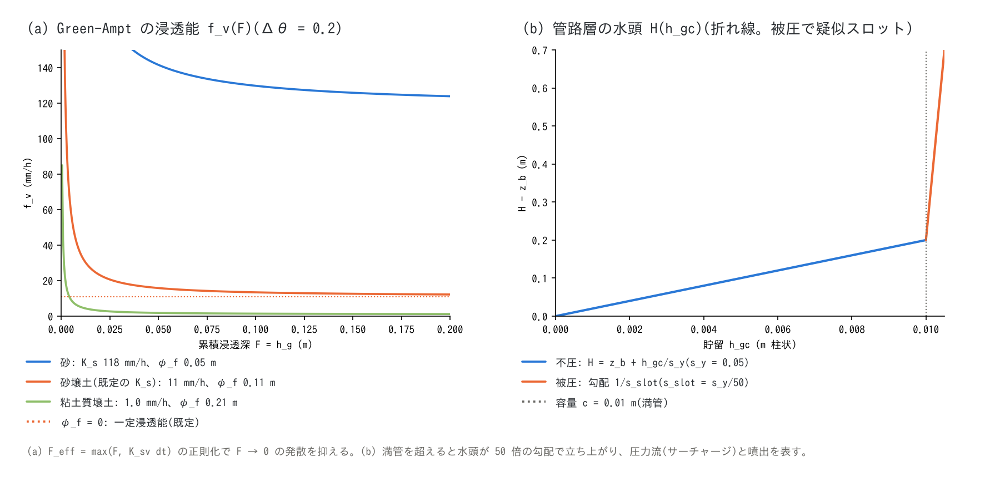

# 地下水モデルの解説(地下水の補足)

[地下水の章へ](gwflow.md) | [ユーザーガイド目次へ](../users_guide.md)

[地下水の章](gwflow.md)の各モデル — バケツ、Green-Ampt、側方流動、
風化基岩層、管路連続体層、井戸揚水、凍土 — の式と既定値の根拠、
参考にした他モデルをまとめます。実装は `src/m_gwflow*.f90`
(モデルごとの submodule)で、設計の経緯は docs/handoff_gwflow_tani.md、
docs/gwconduit_plan.md と developer.md §16・§46・§64 にあります。

## 1. 共通の枠組み

**状態量。** 貯留 $`h_g`$(土層)、$`h_{g2}`$(風化基岩層)、$`h_{gc}`$
(管路層)はいずれも水量をセル面積で割った**柱状換算水深**です。土層の
飽和帯厚は $`h_g/s_y`$、容量は $`s_d\,s_y`$($`s_d`$ = 土層厚 `sd`、
$`s_y`$ = 比湧水量 `sy0`。どちらも[地理情報](geoinfo.md)の所有)で、
容量を超えた分は地表水 $`h`$ へ湧出します。

**更新間隔。** `dt_gwflow` を指定すると $`n = \mathrm{NINT}(\texttt{dt\_gwflow}/\Delta t)`$
ステップごとに実効時間刻み $`\Delta t_s = n\Delta t`$ で各モデルを評価します
(レートは間引きに整合)。モデルの実行順は 凍土 → 鉛直 → 層 1 側方 →
層 2 → 管路層 → 揚水 で、この順序が結合の仕様です。

**位置づけ。** 流出解析のための浅層地下水モデルで、土層厚 $`s_d(x)`$ の
分布が鉛直到達時間 $`T_v = s_d\,n_e/K_s`$ を決め、薄い土層の場所が先に
飽和して流出応答のタイミングを支配する、という谷の機構仮説[^tani97]を
「汎用の鉛直モデル + 汎用の側方モデル」の組合せで創発させる設計です。
土層厚が一様なら側方流支配(TOPMODEL 的)、急に薄くなる分布なら
鉛直浸透支配(谷型)に自然に移ります。

## 2. バケツモデル(f_gwvertical = 1)

```math
\Delta h_g = \min\!\left(K\,\Delta t_s,\ h,\ c - h_g\right)
```

一定浸透能 $`K`$(`gw_infil_mmh`)で表面水を容量 $`c`$(`gw_capacity`)の
貯留へ移す最簡モデルです。既定 $`K`$ = 10 mm/h は砂壌土の飽和透水係数
(§3 の土性表)、$`c`$ = 0.2 m は土層 1 m × 比湧水量 0.2 で Green-Ampt の
既定容量と同じ値です(モデルを切り替えても貯留量が変わらない)。容量を
`gw_capacity` で直接与えるため土層厚を使う側方流動・第 2 層とは併用
できません。

## 3. Green-Ampt(f_gwvertical = 2)

Green & Ampt のピストン浸透[^green11]で、湿潤前線の毛管圧力水頭
$`\psi_f`$ と水分不足量 $`\Delta\theta`$ による吸引が浸透能を上げます。

```math
f_v = K_{sv}\left(1 + \frac{\psi_f\,\Delta\theta}{F_{\text{eff}}}\right),
\qquad
F_{\text{eff}} = \max(F,\ K_{sv}\Delta t_s),
\qquad
\Delta h_g = \min\!\left(f_v\Delta t_s,\ h,\ s_d\Delta\theta - h_g\right)
```

$`\Delta\theta = s_y`$ とし、累積浸透深 $`F`$ は**現在の貯留** $`h_g`$ と
同一視します(側方流動で排水されると浸透能が回復する Green-Ampt の
変種。私有状態を持たずリスタートが $`h_g`$ だけで閉じる、という設計上の
選択です)。$`F \to 0`$ での発散は $`F_{\text{eff}}`$ で正則化します。
`gw_psif` = 0(既定)は一定浸透能 $`K_{sv}`$ に退化します。
$`K_{sv}`$・$`\psi_f`$ は土地利用に応じたマップで与えられ、$`K_{sv} = 0`$ の
セルは不浸透(舗装)です。



**既定値の根拠。** $`K_{sv}`$ = 10 mm/h は Rawls らの土性別 Green-Ampt
パラメータ[^rawls83]の砂壌土(10.9 mm/h)を丸めた値で、日本の森林土壌の
浸透能(100 mm/h 超が普通)より小さく、洪水の浸透損失を過大評価しない
側です。土性別の $`K_s`$・$`\psi_f`$・有効間隙率は
[章の推奨値表](gwflow.md#パターン別の推奨値)にあります。土層厚の既定
1 m は森林斜面の薄い土層(0.5〜1 m)[^tani97]と分布型モデルの慣用値です。

## 4. 側方流動(f_gwlateral = 1)

飽和帯の Darcy 流を、全水頭 $`H`$ の 8 近傍差分で解きます
(非線形 Boussinesq 方程式[^boussinesq04]の保存形)。

```math
h_{gw} = \frac{h_g}{s_y},
\qquad
H = (z - s_d) + h_{gw}\ [+\,h\ \text{(飽和セルのみ)}],
\qquad
q_k = K_{sh}\,h_e\,\frac{H_c - H_n}{\Delta s_k}\,L_k
```

$`h_e`$ は界面の飽和帯厚で、両セル平均を上流側(水頭の高い側)の厚さで
頭打ちにします。拡散係数が $`K_{sh}h_{gw}`$ と状態に依存する形は RRI の
側方流[^sayama12]と同じ関数形で、飽和帯が土層厚 $`s_d`$ を超えられない
ことが分離型の構造で自動的に成り立ちます。不飽和セルの湛水 $`h`$ は
鉛直浸透の駆動力であって側方流の駆動力ではないので、全水頭には飽和した
セルでだけ加えます。通過幅 $`L_k`$ と距離 $`\Delta s_k`$ は ENC 本体と
同じ 8 方向配分([ENC 格子の解説](encgrid.md) §2。`gw_diagratio`)で、
斜めの谷筋の収束流を表せます。海域マスク(fn_sw)の海セルとは交換しません
(海セルは側方流の無流束境界)。帯水層と海の水頭差による交換は
[淡塩 2 層](salt.md)の f_salt_gw=1 が担い、側方流単独では海への地下水流出は
起きません。

**安定条件。** 陽解法なので、$`h_{gw} \le s_d`$ の構造的上界から

```math
\Delta t_s \le \frac{s_y\,\Delta x\,\Delta y}{2\,K_{sh}\,\max(s_d)\sum_k L_k/\Delta s_k}
```

を初期化時に検査し、超えれば上限値を表示して停止します。乾燥判定と
過大流出の抑制は浅水側と同じ機構(正則化厚 `gw_eps`)です。

**既定値の根拠。** $`K_{sh}`$ = 360 mm/h(1e-4 m/s)は基質の
$`K_s`$(砂壌土 1e-5 m/s)の 10 倍で、マクロポア・パイプ流による斜面の
実効側方透水係数が基質より 1〜2 桁大きいという観測[^beven82][^mosley79]
に基づきます。

## 5. 風化基岩層(f_gwlayer2 = 1)

土層の直下に厚さ $`d_2`$・比湧水量 $`s_{y2}`$ の第 2 層を置き、逓減の
遅い基底流と長い滞留時間を与えます。

```math
\Delta h_{g2} = \min\!\left(K_{v2}\Delta t_s,\ h_g,\ d_2 s_{y2} - h_{g2}\right),
\qquad
H_2 = (z - s_d - d_2) + \frac{h_{g2}}{s_{y2}}
```

層 1 → 2 の浸透は定数浸透能 $`K_{v2}`$(`gw2_infil_mmh`)、層 2 内の側方流は
§4 のカーネルを層 2 の係数(`gw2_ksh_mmh`。0 で容量のみ)で呼びます
(地表湛水の結合なし)。層 2 の超過は層 1 へ、層 1 の超過は地表へ、と
同一ステップで連鎖します。**既定値の根拠。** 花崗岩源流域の風化帯の
観測[^kosugi06][^katsura08]: 厚さ数 m、有効間隙率は数 %、飽和透水係数
1e-8〜1e-6 m/s。既定の $`d_2`$ = 3 m、$`s_{y2}`$ = 0.05、$`K_{v2}`$ = 1 mm/h
(2.8e-7 m/s)はこの幅の上寄り(基底流が出る側)です。初期飽和度
`gw2_sat0` はイベント計算では基底流量を決める校正パラメータで、長期
計算ではスピンアップ → 保存 → 再開を初期値にします。

## 6. 管路連続体層(f_gwconduit = 1)

下水道網・岩盤亀裂網などのサブグリッド管路網を、セル別の容量
$`c`$(`gwc_cap`)と 8 方向の通水能をもつ**等価な被圧帯水層**として
表します。カルスト・岩盤水理の分類[^yoshimoto19]でいう EPM(等価多孔
媒体)と管路流の記述(MODFLOW-CFP[^shoemaker08])の融合に当たり、
満管後の圧力流は Preissmann スロット[^cunge64]の連続体版で表します。

**水頭(折れ線)。**

```math
H = z_b + \frac{h_{gc}}{s_y}\ (h_{gc} \le c),
\qquad
H = z_b + \frac{c}{s_y} + \frac{h_{gc} - c}{s_{slot}}\ (h_{gc} > c)
```

$`z_b`$ は管底標高(`gwc_depth` または `fn_gwc_bot`)、$`s_y`$ = `gwc_sy` は
不圧時の貯留係数(= 容量/管高)、$`s_{slot}`$ = `gwc_slot_sy` は被圧時の
疑似スロット貯留係数で、小さいほど硬い圧力応答になります。

**側方流束。**

```math
q_k = C_k\,f_e\,\sqrt{\frac{\lvert H_c - H_n\rvert}{\Delta s_k}}\ \mathrm{sign}(H_c - H_n)
\quad(\texttt{f\_gwc\_fluxlaw} = 2),
\qquad
C_k = \min(c_{nd,c},\,c_{nd,n})\,L_k
```

$`f_e`$ は充満率 $`\min(h_{gc}/c, 1)`$ の平均を上流側で頭打ちにした値、
$`c_{nd}`$ は通水能密度(`gwc_cnd_m2s`。満管・単位動水勾配の流量/単位幅)
です。$`\sqrt{}`$ 則は乱流管路流(Manning/Darcy–Weisbach)の形で、
MODFLOW-CFP の Mode 2 が水頭差の閾値で Darcy 則と Darcy–Weisbach 式を
切り替えるのを連続体化したものです。$`|\Delta H| <`$ `gwc_eps_h` は線形化
します。線形則(`f_gwc_fluxlaw` = 1)は Darcy 型の比較用です。

**地表交換と吐口。** 枡・人孔・吸込穴の密度 $`N`$(`gwc_inlet`、個/m²)
に単孔の式を掛けます。

```math
q_{in} = N\,c_w\,h^{3/2}\ (不圧),
\qquad
q_{in} = N\,c_o\sqrt{2g\,\Delta H}\ (満管),
\qquad
q_{out} = N\,c_o\sqrt{2g\,\Delta H}\ (被圧かつ H > z + h)
```

流入・噴出とも「水頭が等化する量」で制限して交換項の振動を防ぎます。
$`c_w`$(`gwc_cw`、既定 2.66 m^{1/2}/s)は矩形堰の係数 ≈ 1.7 と枡の周長
≈ 1.5 m の積、$`c_o`$(`gwc_co`、既定 0.15 m²)は流量係数 0.6 × 開口
0.25 m² に相当する**経験値**です。吐口(`fn_gwc_outfall`)はオリフィス式の
開放管端で、逆流防止つきです。吐口を海セルに置くと受け水頭は潮位(海セルの
水位)で放流は系外へ除去され、陸側に置くと受け水頭は地表水位で地表へ放流
します。どちらも管路水頭が受け水頭まで下がる貯留量で等化上限を掛けます。層間交換は水頭の高い側から低い側へ定数
交換能 `gwc_leak_mmh` で行い、既定 10 mm/h は管周囲の土の鉛直透水係数
(= Green-Ampt の既定)と同じ値です。

**安定条件とサブサイクル。** $`\sqrt{}`$ 則の最大勾配は線形化枝
$`C_k\sqrt{1/(\Delta s_k\,\varepsilon_h)}`$ なので

```math
\Delta t_s \le \frac{\Delta x\,\Delta y}{2\,\max(1/s_y, 1/s_{slot})\,\max_{cell}\sum_k C_k\sqrt{1/(\Delta s_k\varepsilon_h)}}
```

を初期化時に評価し、超える分は側方通水を自動でサブサイクル
($`N = \lceil \Delta t_s/\Delta t_{\lim}\rceil`$、上限 `gwc_nsubmax`)します。
上限は疑似スロット $`s_{slot}`$(被圧の圧力波の速さ)が支配します。

**管諸元からの換算。** 容量・通水能・貯留係数は前処理で換算して与えます
(計算内では変換しません)。円管(径 $`D`$、粗度 $`n`$)なら

```math
C = \frac{1}{n}A R^{2/3},\quad A = \frac{\pi D^2}{4},\quad R = \frac{D}{4};
\qquad
c_{nd} = C \times \frac{\text{本数}}{\text{セル幅}},
\quad
c = \frac{A \times \text{セル内管長}}{\Delta x\,\Delta y},
\quad
s_y = \frac{c}{D}
```

既定の $`c`$ = 0.01 m、$`z_b = z - 3`$ m、$`s_y`$ = 0.05、$`s_{slot} = s_y/50`$
は市街地の枝管網(D = 0.4 m、土被り 2〜2.5 m)の程度で、
[examples/sewer_hybrid](../../examples/sewer_hybrid/) の換算スクリプトと
[test/conduit](../../test/conduit/README.md)(解析平衡に表示全桁で一致)に
基づきます。

## 7. 井戸揚水(f_gwpump = 1)

井戸 $`n`$ の需要 $`Q_n(t)`$ をセル集合 $`N_n`$ 個に等分配し、各セルの
貯留で頭打ちにします(再配分なし = 涸れ井戸は供給律速)。

```math
\Delta h_g = -\min\!\left(\frac{Q_n\,\Delta t_s}{N_n\,\Delta x\,\Delta y},\ h_g\right)
```

[淡塩 2 層](salt.md)が有効なら淡水を優先して汲み(浅い井戸スクリーンの
近似)、不足分は塩水層から取ります。検証: [test/pump](../../test/pump/README.md)
(全貯留の解析値に 13 桁一致、需要 = 実取水)。

## 8. 凍土による浸透抑制(f_gwfrost = 1)

気温 $`T_a`$ から凍結指数 $`FI`$(°C·day)をセルごとに積算し、鉛直浸透能に
低減係数を掛けます。

```math
\frac{dFI}{dt} = \begin{cases}(T_f - T_a)\,e^{-w/w_0} & (T_a < T_f)\\ -c_t\,(T_a - T_f)\,e^{-w/w_0} & (T_a \ge T_f)\end{cases},
\quad FI \ge 0,
\qquad
f_{ac} = \max\!\left(f_{\min},\ 1 - \frac{FI}{FI_{full}}\right)
```

$`T_f`$ = `fro_tf`、$`c_t`$ = `fro_ct`(融解効率)、$`w`$ は積雪水当量で
$`w_0`$ = `fro_swe0` が積雪断熱の e-folding(0 で断熱なし)、
`fro_fimax` は上限です。地温・凍結深・不凍水は解かない度日法の最簡モデル
です。**既定 $`FI_{full}`$ = 20 °C·day の根拠**: Stefan 式[^andersland04]で
含水率 0.3 程度の土の凍結深 ≈ $`0.06\sqrt{FI}`$ m、$`FI`$ = 20 で 0.25 m
となり、表層 20〜30 cm が凍った湿った土では浸透がほぼ止まる
[^zhao99]ことに対応します。検証: [test/frost](../../test/frost/README.md)
(線形低減の解析値に全 14 桁一致)。

## 9. 河床交換能(f_gwbed = 1)

河川と帯水層の交換は、河床層の透水係数 $`K_b`$ と厚さ $`M`$ で決まる河床
コンダクタンスを通る Darcy 流として表すのが標準です。MODFLOW の RIV
パッケージ[^harbaugh05]は $`Q = C\,(h_{riv} - h_{aq})`$、$`C = K_b W L / M`$
とし、帯水層水頭が河床底より下がれば $`Q = C\,(h_{riv} - z_{bot})`$ で
頭打ちにします。ENCflow は全量が柱状量なので、$`C`$ の代わりに単位面積
あたりの交換能 $`k_{bed}`$ (m/s) を河道マスクのセルに与え、管路層の層間
交換(§6)と同じ「向きは水頭差、流量は上限で頭打ち」の形で表します
(**独自の簡略化**: $`\Delta h / M`$ に比例する Darcy 形は、河床層厚
$`M`$ の追加入力と $`M \to 0`$ の発散回避が要るため採りません。
$`k_{bed}`$ に $`\Delta h / M`$ を掛ければ後から移行できます)。

```math
\text{鉛直(河道セル)}:\quad f_v = \min\!\left(k_{bed}\,\Delta t_s,\ h,\ c - h_g\right),
\qquad
\text{側方(河道・非河道間のエッジ)}:\quad |q_k| \le k_{bed}\, L_k\, h_e
```

鉛直は §2・§3 の浸透能 $`K`$・$`K_{sv}`$ を河道セルで $`k_{bed}`$ に置き
換えたもの、側方は §4 のエッジ流量 $`q_k`$ を、河道側セルの $`k_{bed}`$ と
界面面積(通過幅 $`L_k`$ × 界面飽和帯厚 $`h_e`$)の積で両向きに制限した
ものです。地下水頭が容量に達していない間は鉛直の片方向浸透(RIV の
頭打ち = 河床から切り離された河川)、周囲の地下水が高いときは側方流入が
河道セルを飽和させて地表へ湧出し(得水)、その速度を $`k_{bed}`$ が
律速します。河道同士のエッジは帯水層の連続として制限しません。減らす側
の作用だけなので §4 の安定条件は変わりません。

**値の目安。** 河床の透水係数の集計[^calver01]では 1e-7〜1e-3 m/s
(0.36〜3600 mm/h)に散らばり、細粒の目詰まり(コルマチオン)[^brunke99]で
周囲の帯水層より 1〜3 桁小さいことが多く、洪水の洗掘で回復します。礫床の
扇状地河川は土より大きく、コンクリート水路は 0 です。$`k_{bed}`$ には既定
を置きません(0 に「不透」の意味があるため。与件)。細粒分の帳簿
([土砂・地形変化](geomorph.md)の f_bedfines)と連動した可変 $`k_{bed}`$
は将来の拡張です。検証: [test/gwbed](../../test/gwbed/README.md)
(上限で律速された得水の線形増加・$`k_{bed} = 0`$ の遮断・鉛直浸透能の
置き換えを解析値と比較)。


## 10. パラメータと既定値の根拠

根拠欄の分類語の意味は[既定値の根拠の読み方](../users_guide.md#既定値の根拠の読み方)を参照してください。

| パラメータ | 既定 | 意味 | 根拠 |
|---|---:|---|---|
| gw_infil_mmh / gw_capacity | 10 mm/h / 0.2 m | バケツの浸透能・容量(§2) | **文献値** 砂壌土の $`K_s`$[^rawls83] / **導出** 土層 1 m × $`s_y`$ 0.2 |
| gw_ksv_mmh | 10 mm/h | 鉛直飽和透水係数 $`K_{sv}`$(§3) | **文献値** 砂壌土 10.9 mm/h[^rawls83]。森林土壌より小さい側 |
| gw_psif | 0 m | 湿潤前線の毛管圧力水頭 $`\psi_f`$ | **互換** 0 = 一定浸透能に退化。土性値は推奨値表[^rawls83] |
| sd0 / sy0(地理情報) | 1 m / 0.2 | 土層厚 / 比湧水量 | **文献値** 森林斜面の薄い土層[^tani97]。$`s_y`$ は有効間隙率 − 初期含水率 |
| gw_ksh_mmh | 360 mm/h | 側方飽和透水係数 $`K_{sh}`$(§4) | **文献値** 基質の 10 倍 = マクロポア・パイプ流[^beven82][^mosley79] |
| gw_eps | 1e-3 m | 乾燥判定の正則化厚 | **数値設定** 浅水側の dd と同格 |
| gw_diagratio / gwc_diagratio | 2/(2+√2) | 8 方向配分 | **導出** ENC 本体と同じ([ENC 格子の解説](encgrid.md) §2) |
| gw2_depth / gw2_sy / gw2_infil_mmh | 3 m / 0.05 / 1 mm/h | 風化基岩層の厚さ・比湧水量・浸透能(§5) | **文献値** 花崗岩風化帯の観測[^kosugi06][^katsura08]の上寄り |
| gw2_ksh_mmh / gw2_sat0 | 0 / 0 | 層 2 の側方 $`K`$ / 初期飽和度 | **与件** 0 = 容量のみ / **校正量** 長期はスピンアップ |
| f_gwc_fluxlaw | 2 | 管路の流束則(§6) | **方式** 2: 乱流管路流の $`\sqrt{}`$ 則(CFP Mode 2 の連続体化[^shoemaker08]) |
| gwc_cap / gwc_depth / gwc_sy / gwc_slot_sy | 0.01 m / 3 m / 0.05 / sy/50 | 容量・管底深・貯留係数・疑似スロット | **経験値** 市街地枝管網の諸元(examples/sewer_hybrid、[test/conduit](../../test/conduit/)) |
| gwc_cnd_m2s | 0 | 通水能密度 | **与件** 管諸元から換算。0 = 側方なし |
| gwc_inlet / gwc_cw / gwc_co | 0 / 2.66 / 0.15 | 枡密度・堰係数・オリフィス係数 | **与件** / **導出** 矩形堰 1.7 × 周長 1.5 m / $`C_d`$ 0.6 × 0.25 m² |
| gwc_leak_layer / gwc_leak_mmh | 0 / 10 mm/h | 層間交換の相手と交換能 | **導出** 管周囲の土の $`K_{sv}`$ と同じ |
| gwc_eps_h / gwc_nsubmax | 1e-2 m / 100 | $`\sqrt{}`$ 則の線形化幅 / サブサイクル上限 | **数値設定** |
| fro_fifull / fro_fmin / fro_tf / fro_ct | 20 °C·day / 0 / 0 °C / 1 | 凍土の低減係数(§8) | **文献値** Stefan 式の凍結深 0.25 m に相当[^andersland04][^zhao99] |
| fro_swe0 / fro_fimax / fro_fi0 | 0 / 0 / 0 | 積雪断熱・上限・初期値 | **与件** 0 = なし。融雪期の校正入口 |
| gwbed_k_mmh / fn_gwbed_k | — | 河床交換能 $`k_{bed}`$(§9) | **与件** 0 = 不透。河床 K の集計[^calver01]は 0.36〜3600 mm/h。既定なし |

**既定値を見直すときの手がかり**

- 透水係数・毛管圧力水頭・有効間隙率は**土性**から引くのが出発点です
  (章の推奨値表 = Rawls ら[^rawls83]の土性 11 区分)。土性は土壌図
  (国土数値情報の土壌分類・農研機構の土壌図)から読み、森林土壌では
  マクロポアで $`K`$ が 1 桁大きいことを見込みます[^beven82]。
- 土層厚は、斜面崩壊の調査(簡易貫入試験)やボーリング柱状図があれば
  それを、なければ森林斜面 0.5〜1.5 m[^tani97]を目安にします。
- 側方 $`K_{sh}`$ は、渇水期の基底流出の逓減曲線に合わせて校正するのが
  実務的です(逓減が速ければ大きく)。
- 風化基岩層の諸元は、花崗岩山地の観測[^kosugi06][^katsura08]以外では
  地質により大きく異なります。基底流出の年間量(降水 − 直接流出 −
  蒸発散)から容量と浸透能を逆算してください。

## 11. 検証ケース

| ケース | 内容 | 要点 |
|---|---|---|
| [test/gwdefault](../../test/gwdefault/README.md) | 既定値の同値検定 | 最小入力と明示入力の Log・私有ファイルがバイト一致 |
| [test/conduit](../../test/conduit/README.md) | 管路層の解析平衡と全結合 | 平衡水位・貯留が表示全桁で一致、8 方向の対称性 |
| [test/gwseep](../../test/gwseep/README.md) | 浸透 → 側方 → 湧出の水質台帳 | to_gw − seep = mass_gw で閉合 |
| [test/pump](../../test/pump/README.md) | 井戸揚水の質量収支 | 解析値に 13 桁一致 |
| [test/frost](../../test/frost/README.md) | 凍土の浸透抑制 | 解析値に全 14 桁一致 |
| [test/gwbed](../../test/gwbed/README.md) | 河床交換能の律速・遮断・置き換え | 堤内地の 1 ステップ損失が S_grnd に全 14 桁一致、得水の増分が解析値 |
| [examples/sewer_hybrid](../../examples/sewer_hybrid/) | 幹線 + 枝管網の換算 | セル別 sy マップの実演 |
| [examples/qanat](../../examples/qanat/) | 管路層 + 層 2 + 井戸揚水 | 横坑の集水・導水・出口湧出、揚水井による湧出の減少 |

## 参考文献

[^tani97]: Tani, M. (1997): Runoff generation processes estimated from hydrological observations on a steep forested hillslope with a thin soil layer. *J. Hydrol.*, 200, 84–109.
[^green11]: Green, W. H. and Ampt, G. A. (1911): Studies on soil physics, 1. The flow of air and water through soils. *J. Agric. Sci.*, 4, 1–24.
[^rawls83]: Rawls, W. J., Brakensiek, D. L. and Miller, N. (1983): Green-Ampt infiltration parameters from soils data. *J. Hydraul. Eng. ASCE*, 109, 62–70.
[^boussinesq04]: Boussinesq, J. (1904): Recherches théoriques sur l'écoulement des nappes d'eau infiltrées dans le sol et sur le débit des sources. *J. Math. Pures Appl.*, 10, 5–78.
[^sayama12]: Sayama, T., Ozawa, G., Kawakami, T., Nabesaka, S. and Fukami, K. (2012): Rainfall–runoff–inundation analysis of the 2010 Pakistan flood in the Kabul River basin. *Hydrol. Sci. J.*, 57, 298–312.(RRI モデル)
[^beven82]: Beven, K. and Germann, P. (1982): Macropores and water flow in soils. *Water Resour. Res.*, 18, 1311–1325.
[^mosley79]: Mosley, M. P. (1979): Streamflow generation in a forested watershed, New Zealand. *Water Resour. Res.*, 15, 795–806.
[^kosugi06]: Kosugi, K., Katsura, S., Katsuyama, M. and Mizuyama, T. (2006): Water flow processes in weathered granitic bedrock and their effects on runoff generation in a small headwater catchment. *Water Resour. Res.*, 42, W02414.
[^katsura08]: Katsura, S., Kosugi, K., Mizutani, T., Okunaka, S. and Mizuyama, T. (2008): Effects of bedrock groundwater on spatial and temporal variations in soil mantle groundwater in a steep granitic headwater catchment. *Water Resour. Res.*, 44, W09430.
[^yoshimoto19]: 吉本ほか (2019): 農研機構研究報告 農村工学部門, 3, 13–27.(カルスト帯水層モデルの分類)
[^shoemaker08]: Shoemaker, W. B., Kuniansky, E. L., Birk, S., Bauer, S. and Swain, E. D. (2008): Documentation of a Conduit Flow Process (CFP) for MODFLOW-2005. *USGS Techniques and Methods*, 6-A24.
[^cunge64]: Cunge, J. A. and Wegner, M. (1964): Intégration numérique des équations d'écoulement de Barré de Saint-Venant par un schéma implicite de différences finies. *La Houille Blanche*, 1, 33–39.(Preissmann スロット)
[^andersland04]: Andersland, O. B. and Ladanyi, B. (2004): *Frozen Ground Engineering*, 2nd ed. Wiley.(Stefan 式)
[^zhao99]: Zhao, L. and Gray, D. M. (1999): Estimating snowmelt infiltration into frozen soils. *Hydrol. Process.*, 13, 1827–1842.
[^harbaugh05]: Harbaugh, A. W. (2005): MODFLOW-2005, the U.S. Geological Survey modular ground-water model — the Ground-Water Flow Process. *USGS Techniques and Methods*, 6-A16.(RIV パッケージ)
[^calver01]: Calver, A. (2001): Riverbed permeabilities: information from pooled data. *Ground Water*, 39, 546–553.
[^brunke99]: Brunke, M. (1999): Colmation and depth filtration within streambeds: retention of particles in hyporheic interstices. *Int. Rev. Hydrobiol.*, 84, 99–117.
