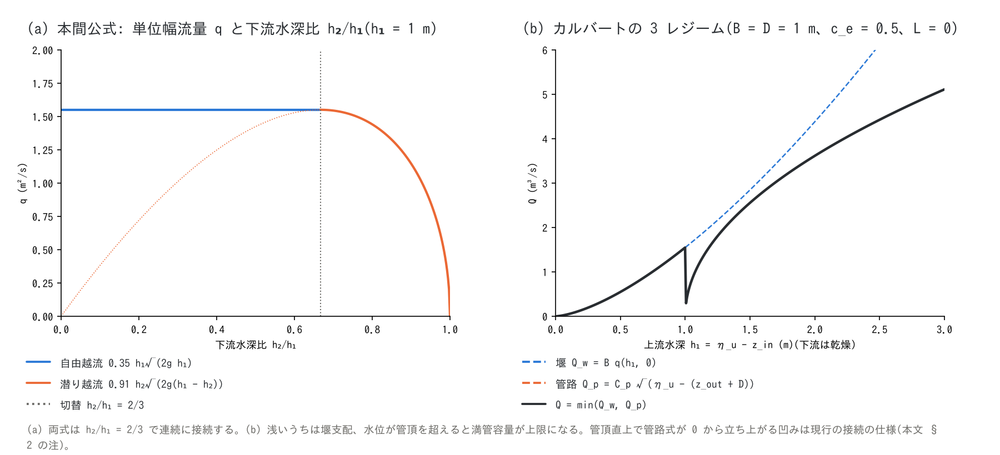

# 構造物と境界の水理則の解説(構造物・境界条件・河道の補足)

[構造物の章へ](structure.md) | [境界条件の章へ](boundary.md) | [河道の章へ](channel.md) | [ユーザーガイド目次へ](../users_guide.md)

[内部水理構造物](structure.md)(ポンプ・カルバート・分水・ダム)、
[境界条件](boundary.md)(自由流出・長波放射・区間流入)、
[河道](channel.md)の堤防越流で使う流量式と係数の根拠をまとめます。
実装は `src/m_boundary_structure.f90`(構造物)、`src/m_swflow_enc_bc.f90`
(辺境界・区間流入)、`src/m_swflow_enc_channel.f90`(堤防越流)で、
設計の経緯は developer.md §17・§22・§68.30・§69.9 にあります。

## 1. 堰の式(本間公式)

堤防の越流、カルバートの自由水面流れ、河口の段落ちに共通して、
本間の堰公式[^honma40]を使います。上流側の越流水深 $`h_1`$、下流側の
越流水深 $`h_2`$(ともに天端または敷高基準)に対し

```math
q = 0.35\,h_1\sqrt{2g\,h_1}\quad\left(\frac{h_2}{h_1} < \frac{2}{3},\ 自由越流\right),
\qquad
q = 0.91\,h_2\sqrt{2g\,(h_1 - h_2)}\quad\left(\frac{h_2}{h_1} \ge \frac{2}{3},\ 潜り越流\right)
```

$`q`$ は単位幅流量で、切替点 $`h_2/h_1 = 2/3`$ で両式は連続です。係数
0.35・0.91 は本間の実験に基づく幅広の堰の値で、日本の河川計画で
堤防越流・破堤流量に標準的に使われます。両側の水位が天端を超えて
水位差が小さい状況で段落ち式(限界流)を使うと過大流量で振動するため、
堤防越流([河道](channel.md))ではこの潜り式が要ります。流向は水位の
高い側から低い側です。



## 2. カルバート(樋管・樋門)

矩形断面 $`B \times D`$、敷高 $`z_{in}`$・$`z_{out}`$、管路長 $`L`$ の暗渠を、
水位の高い側を上流として評価し、3 つのレジームを $`\min`$ で連続に
接続します。

```math
Q_w = B\,q(h_1, h_2)\ (\text{§1 の堰}),
\qquad
Q_p = C_p\sqrt{\eta_u - \max\!\left(\eta_d,\ z_{out} + \tfrac{d_c + D}{2}\right)},
\qquad
C_p = BD\sqrt{\frac{2g}{1 + c_e + f_L}},
\quad
f_L = \frac{2g\,n^2 L}{R^{4/3}},\ R = \frac{BD}{2(B + D)}
```

```math
Q = \begin{cases}
0 & (h_1 \le 0\ \text{または}\ \eta_u \le z_{out})\\
Q_w & (h_1 < D:\ 流入口が水没しない = 堰支配)\\
\min(Q_w,\ Q_p) & (h_1 \ge D:\ 満管容量が上限)
\end{cases}
```

$`h_1 = \eta_u - z_{in}`$、$`h_2 = \max(\eta_d - z_{in}, 0)`$ です。管路の式は
オリフィス(流入損失 $`c_e`$)と Manning 則の管路摩擦 $`f_L`$ を合わせた
エネルギー式で、FHWA の暗渠設計の標準的な扱い[^fhwa12]と同じ構成です。
既定 $`c_e`$ = 0.5 は角の立った流入口の代表値、$`n`$ = 0.02 はコンクリート
管の上寄り(継目・堆積を含む実用値)で、どちらも**経験値**です。
出口が水没していないときの下流側の水頭は、FHWA の出口制御と同じく
出口敷高 + $`(d_c + D)/2`$ を基準にします。$`d_c`$ は堰流量 $`Q_w`$ に対する
矩形断面の限界水深 $`d_c = \min\!\left(D, (Q_w^2/gB^2)^{1/3}\right)`$ で、
反復なしに陽に求まります。満管に近づくと $`d_c \to D`$ で管頂基準に
一致し、流入口が水没した直後(h₁ = D)には $`Q_p \approx Q_w`$ となるので
3 レジームは $`\min`$ で滑らかにつながります(図 (b)。
[test/culvert](../../test/culvert/) で復元流量が単調であることを検定)。
2026-10-12 以前は流入口の水没を問わず出口管頂を基準にしていたため、
上流水位が管頂をわずかに超えた直後に $`Q_p \to 0`$ となって流量が
一時的に落ち込みました(developer.md §22)。ゲート開度
(`culv_gate_rule`)は流量の線形乗率、フラップ(`culv_flap`)は逆流の遮断で、
評価順は 3 レジーム → 開度 → フラップです。加えて 1 ステップの転送量は、
両セル群の代表水位差の半分を埋める体積 $`|Q| \le 0.5\,A_h\,|\eta_u - \eta_d|/\Delta t`$
に制限します($`A_h`$ は両セル群の有効平面積 Σgv·Δx·Δy の調和平均。河道幅
fn_width は含みません。粗い Δt での往復振動を防ぐ上限で、developer.md §22)。

## 3. ポンプ・分水

ポンプと分水は水理則をもたず、基準値(水位 $`\eta`$ または水深 $`h`$)の
折れ線 $`Q(\text{基準値})`$(線形補間、範囲外は端値保持)か一定流量で
与えます。毎ステップ「取水側に実在する水量」でキャップするため、取れない
水を取ることはありません。分水は受動的で、送水先の水位が取水側以上なら
停止します(重力では登れない)。ポンプは域外排水または吐口セルへの
強制転送で、管路取水(`f_pump_src = 1`)では管路連続体層の貯留から
汲みます。吐口を海域マスク(fn_sw)のセルに置くことはできず、海へ出す
ときは吐口省略の域外排水で表します([構造物](structure.md))。都市内水の排水機場の比排水量 1〜3 m³/s/km² は 50 mm/h 降雨の
10〜20 % に相当する**実務の目安**です。

## 4. ダム・湖沼の運転

湖面の捕捉集合が到達水を全量吸収して貯留 $`V`$ に貯め、運転則で
放流します(湛水面の流れは解かないバケツモデル)。水位は HV 曲線
(`dam_hv`)か線形 HV $`V = A(H - H_{\min})`$($`A`$ = 捕捉セル数 × セル
面積)で結びます。

```math
Q = Q_0\ (モード 1),
\qquad
Q = r\,Q_{in}\ (モード 2),
\qquad
Q = Q(H)\ (モード 3:\ 折れ線,\ オリフィス,\ \sqrt{}\,則)
```

```math
Q_{ori} = BD\sqrt{\frac{2g}{1 + c_e}}\sqrt{H - z_b},
\qquad
Q_{\sqrt{}} = Q_{\max}\sqrt{\frac{H - z_b}{H_{sur} - z_b}}
```

モード 1・2 には**但し書き操作**(貯水位が $`H_{tad}`$ を超えるとサーチャージ
水位 $`H_{sur}`$ までの間で放流を流入へ線形に漸増)が付き、サーチャージ
超過分は強制スピル、最低水位以下は死水で引き落とせません。
これは日本のダム操作規則の洪水時の扱い(異常洪水時防災操作)を
貯水量の線形ランプで表した**実務慣行の近似**です。$`H_{tad}`$ の既定
「最低 + 0.9 × (サーチャージ − 最低)」は慣行値がない場合の置き値です。
貯留湖沼の洪水応答は $`A\,dH/dt = Q_{in} - Q(H)`$ の貯留減衰で表れるため、
大湖沼に素通し(r = 1)を使うのは不適切です。完全混合の水質は
[水質モデルの解説](wq_models.md) §6。

## 5. 辺境界

辺境界は、有効な非海域セルが格子の枠に接している辺にだけ働きます。
海域マスク(fn_sw)のセルには働きません(海の水位は[潮位](tide.md)が
強制します)。

**自由流出(型 1)。** 前進してきた流れはセル流速の法線成分で通過させ、
滞留水は限界流の段落ちで抜きます。

```math
u_n = \max\!\left(\mathbf{u}\cdot\mathbf{n},\ u_c\,\max(\hat{\mathbf{d}}\cdot\mathbf{n}, 0)\right),
\qquad
u_c = \left(\frac{2}{3}\right)^{3/2}\sqrt{g\,h},
\qquad
q = u_n h
```

$`u_c h = (2/3)^{3/2}\sqrt{g}\,h^{3/2}`$ は幅広の限界流(自由越流)の単位幅
流量[^chow59]で、段落ち速度は流向 $`\hat{\mathbf{d}}`$ のベクトルとして
3 つの開口面に射影します(ENC の配分 $`\sum L_k \mathbf{n}_k = \Delta x`$ に
より合計が自然幅あたりになる)。$`\max`$ により流入は起きません。

**長波放射(型 2)。** 基準水位 $`\eta_{ref}`$ からの偏差だけを透過します。

```math
u_n = \sqrt{\frac{g}{h}}\,(\eta - \eta_{ref}),
\qquad
u_n = u_{n,e} + \sqrt{\frac{g}{h}}\,(\eta - \eta_e)\ (\text{Flather}:\ ネストの子格子)
```

前者は長波の特性量 $`\eta \pm u\sqrt{h/g}`$ の外向き成分を通す Sommerfeld
型の放射条件、後者は外部の水位と流速を与える Flather 条件[^flather76]で、
[ネスティング](nest.md)の `nest_bc = 3` が使います。静水では流束ゼロ、
引き波の流入も許します。

**側方 Neumann(型 3)。** 枠外の相手のセル $`(i_n, j_n)`$ を、辺の法線方向に
枠内へ寄せた鏡像セル $`(\mathrm{clamp}(i_n), \mathrm{clamp}(j_n))`$ とみなし、
境界面の運動方程式を内部の面と同じ式で解きます(法線方向の水位・地盤の勾配が 0、
境界に沿う成分の勾配は残る)。移流項は、境界面を一つ内側へ平行移動した内部の面の
値を使い、内部の面の移流のステンシルが枠外に出る位置は鏡像を読みます。拡散項は、
辺に接するセルの拡散を枠外の近傍を鏡像に置き換えて求め、境界面には自セルと鏡像
セルの拡散の平均を足します([拡散項](diffusion.md))。岸沿いに
一様な流れで境界の行が内部の行と同じ解になる条件で、波による沿岸流
([沿岸の波浪場](wavefield.md))のために足しました(developer.md §88)。境界面の
流速・流量を一つ内側の面からそのまま写す形は、境界の行の水位と流量の正帰還で
発散するので採りません。

**区間流入(型 D)。** 区間の総流量 $`Q`$ を開口面に配分します。

```math
q_m = \alpha\,\frac{Q\,w(h_m)}{\sum_k w(h_k)L_k} + (1 - \alpha)\frac{Q}{\sum_k L_k},
\qquad
w = 1,\ h,\ h^{5/3}\ (\texttt{inflow\_dist} = 0, 1, 2),
\qquad
\alpha = \mathrm{clamp}\!\left(2(1 - Fr_{\max}),\ 0,\ 1\right)
```

$`h^{5/3}`$ の重みは Manning 則の等勾配断面の通水能配分[^chow59]で、
深いセルほど流速も大きい河道断面らしい分配です。$`Fr_{\max}`$ は重み
配分を最深セルに適用したときのフルード数で、$`Fr \le 0.5`$ で重み配分、
$`Fr \ge 1`$ で均等配分に連続に移ります($`\alpha Fr \le 1/2`$ なので最深
セルの配分流量は常に限界流量の半分以下。乾いた断面での発散を防ぐ
安定化)。配分が $`h`$ の連続関数なので切替の振動も記憶する状態もなく、
リスタートも厳密です。壁の角や nodata に接して流入方向へ渡す内部エッジが
欠けるセルの面は自動で閉じます(developer.md §69.9)。

## 6. パラメータと既定値の根拠

根拠欄の分類語の意味は[既定値の根拠の読み方](../users_guide.md#既定値の根拠の読み方)を参照してください。

| パラメータ | 既定 | 意味 | 根拠 |
|---|---:|---|---|
| culv_width / culv_height / culv_zin / culv_zout | 必須 | 断面と敷高(§2) | **与件** 構造物台帳の諸元 |
| culv_length | 0 | 管路長 $`L`$ | **与件** 0 = 摩擦損失なし |
| culv_manning | 0.02 | 管内粗度 $`n`$ | **慣用値** コンクリート管の上寄りの実用値 |
| culv_ce | 0.5 | 流入損失係数 $`c_e`$ | **文献値** 角の立った流入口の代表値[^fhwa12] |
| culv_flap / culv_gate_rule / culv_gate_ref | 0 / なし / 1 | 逆止弁・開度折れ線・基準側 | **与件** 開度は流量の線形乗率(近似) |
| pump_q0 / pump_rule / f_pump_ref | — | 一定流量 / 運転折れ線 / 基準(§3) | **与件** 運転規則 |
| div_q0 / div_rule | — | 一定流量 / rating(§3) | **与件** |
| dam_hv / dam_hmin / dam_hsur | — | HV 曲線 / 線形 HV の下限・サーチャージ(§4) | **与件** 諸元資料。水深不明の湖は平常水位 −5 m(経験値) |
| f_dam_mode / dam_q0 / dam_rate | — | 運転モードと値 | **与件** |
| dam_hq_rule / dam_ori_* / dam_qmax | — | 自然調節の rating / オリフィス / √則 | **与件** オリフィス $`c_e`$ の既定 0.5 はカルバートと同じ |
| dam_tadashigaki | 最低 + 0.9(サーチャージ − 最低) | 但し書き操作の開始水位 | **慣用値** 実務慣行の置き値 |
| f_bc_w/e/n/s | 0 | 辺境界の型(§5) | **方式** 0: 壁、1: 自由流出(限界流段落ち)、2: 放射、3: 側方 Neumann |
| bc_eta_* | 初期条件から導出 | 放射の基準水位 | **導出** 明示指定 > f_htype=2 の e0 > 境界セルごとの初期水位。後者は t = 0 の放射流束がセルごとに厳密ゼロ。再開時は復元状態から再導出([中断と再開](restart.md)) |
| inflow_dist | 0 | 区間流入の配分(§5) | **方式** 2 = Manning 通水能配分[^chow59]。河道断面では 2 |

**既定値を見直すときの手がかり**

- カルバートの流入損失係数は流入口の形状で 0.2〜0.9 と変わります。
  FHWA の設計便覧[^fhwa12]の表から選んでください。管内粗度はコンクリート
  0.012〜0.015(新設)〜0.02(老朽・堆積あり)、波付き鋼管 0.024。
- ポンプ・ダムの運転規則は管理者の操作規則(放流規則・但し書き操作の
  規定)がそのまま与件になります。HV 曲線は湖沼の水深図か、ダム諸元の
  総貯水容量と有効容量から線形近似(dam_hmin・dam_hsur)で代用できます。

堤防越流([河道](channel.md))の係数 0.35・0.91 は §1 の本間公式の値で、
利用者が変えるパラメータはありません。

## 7. 検証ケース

| ケース | 内容 | 要点 |
|---|---|---|
| [test/damwq](../../test/damwq/README.md) | ダムの一定放流とため池 | 貯留・放流の台帳が解析解に一致 |
| [test/coastal_drain](../../test/coastal_drain/README.md) | 管路取水の機場と海域吐口 | 排水機場の転送 |
| [test/nhcurrent](../../test/nhcurrent/README.md) | 水位規定で与える一様流と正弦波 | 水位規定境界の使い方 |
| [test/sedinflow](../../test/sedinflow/README.md) | 区間流入の総量と土砂 | 流入総量の台帳閉合 |
| [test/nest_identity](../../test/nest_identity/README.md) | Flather 境界と放射境界 | 静水の親格子で両者が一致 |
| [tutorials/wave](../../tutorials/wave/README.md) Step 3 | 放射境界 | 波の透過と反射 |

## 参考文献

[^honma40]: 本間仁 (1940): 低溢流堰堤の流量係数. 土木学会誌, 26(6), 635–645; 26(9), 849–862.(本間公式。係数 0.35・0.91)
[^fhwa12]: Schall, J. D., Thompson, P. L., Zerges, S. M., Kilgore, R. T. and Morris, J. L. (2012): Hydraulic Design of Highway Culverts, 3rd ed. *FHWA Hydraulic Design Series*, 5 (HDS-5), FHWA-HIF-12-026.(暗渠の流入損失係数・管路摩擦)
[^chow59]: Chow, V. T. (1959): *Open-Channel Hydraulics*. McGraw-Hill.(限界流の段落ち、Manning 則の通水能)
[^flather76]: Flather, R. A. (1976): A tidal model of the north-west European continental shelf. *Mém. Soc. R. Sci. Liège*, Ser. 6, 10, 141–164.(Flather 放射条件)
