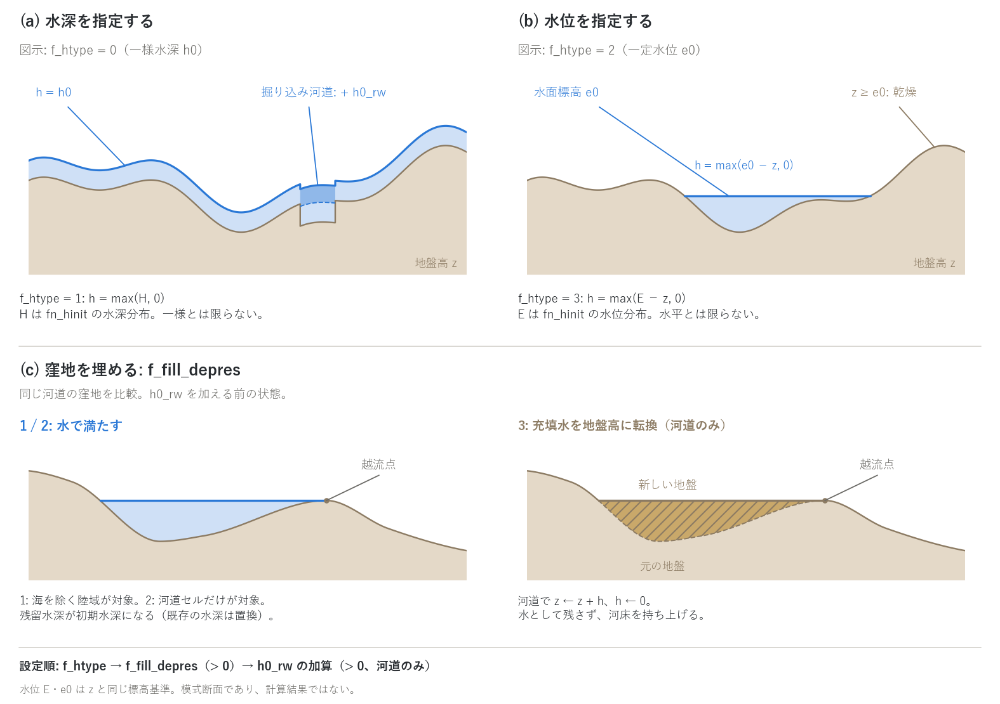

# 初期条件(&list_initial)

[ユーザーガイド目次へ](../users_guide.md)

計算開始時(t = t0)の水深・水位・流速を与えます。`fn_initial` で
有効化します。指定しなければ全域が乾いた状態(h = 0)から始まります —
降雨流出や河川流入で水を入れる計算では、それで十分なことも多いです。

```
&list_initial
  h0 = 1.0                       ! 一様な初期水深 1 m
/
```

## 水深・水位の与え方(f_htype)

| f_htype | 与え方 | 使うパラメータ |
|---|---|---|
| 0(既定) | 水深の固定値 | h0 |
| 1 | 水深の分布ファイル | fn_hinit |
| 2 | 水位の固定値(h = max(e0 − z, 0)) | e0 |
| 3 | 水位の分布ファイル | fn_hinit |

| パラメータ | 既定値 | 意味 |
|---|---|---|
| h0 | 0 | 初期水深 (m) |
| e0 | 0 | 初期水位 (m。z と同じ標高基準) |
| fn_hinit | "" | 初期水深/水位の分布ファイル(f_htype=1, 3) |
| h0_rw | 0 | 河道マスクセルへの初期水深の増分 (m)。正の値を、水深設定・窪地充填の後に加算 |
| u0 / v0 | 0 | 初期流速 (m/s)(f_uvtype=0: 一様値のみ) |
| f_fill_depres | 0 | 窪地の充填。0: なし、1: 海を除く陸域で水充填、2: 河道セルだけで水充填、3: 2 の充填水を地盤高へ転換 |
| f_user_routine | "" | 初期場を加工するユーザールーチン(理想化実験用。作り方は[ユーザールーチンの作り方](user_routines.md)) |

`f_htype=0` は有効セルに一様な水深 `h0` を与えます。起伏のある地形では
水面も地形に沿って起伏するため、水平な静水面を表す設定ではありません。
`f_htype=1` は `fn_hinit` の各セルの値 H を水深として読み、
`h = max(H, 0)` とします。この分布は一様である必要はありません。

「水位」指定は地盤高 z と同じ標高基準で水面標高を与えます。
`f_htype=2` は一定水位 `e0` から `h = max(e0 − z, 0)` を求めるため、
湖・貯水池などの水平な水面を設定できます。`f_htype=3` は `fn_hinit` の
各セルの水位 E から `h = max(E − z, 0)` を求めます。E は空間的に変化して
よく、水平な水面とは限りません。いずれも地盤が指定水位以上のセルは
水深ゼロです。型1・3では `fn_hinit` の指定が必要です。
辺境界の長波放射(型2)で基準水位を明示しない場合、`f_htype=2` なら
`e0` を基準にします([境界条件の章](boundary.md))。

初期水深・水位は海域マスク(fn_sw)のセルにも与えられます。潮位
(fn_tide)が有効なら潮位の初期適用がそれを上書きしますが、fn_tide が
なければ海セルは初期条件の値のまま固定されます(海セルは以後更新されず、
標高は 0 に強制されているため、`f_htype=0` なら海面 = h0、`f_htype=2`
なら海面 = e0 になります。[潮位の章](tide.md))。

## 窪地充填と河道の初期水深

`f_fill_depres` は、周囲の地形より低く水が残る窪地を計算開始前に
満たす処理です。1 は海を除く有効な陸域セル、2 はそのうち河道セル
(`fn_rw`)だけを対象に水深を求めます。2 は、粗い地形データの河道縦断に
残る偽の窪地(ピット)を水で満たす用途に使えます。3 は2と同じ充填後に、
残った水深 h を地盤高へ転換し、`z ← z + h`、`h ← 0` とします。
充填水を初期水量として残さず、河床を持ち上げる方式です。2・3 には
河道マスク `fn_rw` が必要です。

充填では8近傍の地盤高と水位を比較し、水位を下げながら残留水深を
求めます。海に隣接するセルは水深ゼロの排水端として扱います。
2・3 の近傍比較は河道セルに限られます(海に隣接する場合の排水処理を除く)。
海へ向かう経路があっても、途中に高い地盤があれば、その高さまで窪地に
水が残ることがあります。図(c)はこの越流点を持つ窪地の模式断面です。

処理順は **`f_htype` による水深設定 → `f_fill_depres` による充填
→ 河道への `h0_rw` 加算** です。充填を有効にすると、対象セルの既存の
初期水深は充填で求めた水深に置き換わります。`h0_rw > 0` の加算は
すべての `f_htype` に共通で、`f_fill_depres=3` の地盤充填後にも行われます。
したがって、地盤充填後でも `h0_rw` を設定すれば河道に水を載せられます。
`h0_rw` は、入力地形で低くなっている掘り込み河道を濡らしておく用途を
想定した水深の加算です。このパラメータ自体が河床を掘り下げるわけではありません。
この順序は通常のパラメータ初期化についての説明であり、その後に保存状態の
復元またはユーザールーチンによる初期場の変更がある場合は、その結果が優先されます。



(a) 一様水深を指定する `f_htype=0` の例。掘り込み河道に `h0_rw` を
加算し、加算後の河道水位が隣接する非河道部より少し低くなる地形を
示しています。河道内の破線は加算前の水面、濃い青は加算分です。
河床の段差は入力地形の掘り込みを表します。
(b) 一定水位を指定する `f_htype=2` の例。水域だけに水面を描き、地盤と
水面の交点で水深がゼロになります。型1・3の分布入力は、それぞれ図の下の
式で扱い、一様水深・水平水面に限定しません。(c) 同じ河道の窪地を、
水で満たす場合(1・2)と地盤で埋める場合(3)で比較しています。
斜線部が地盤への転換分、破線が元の河床です。1は陸域全体、2・3は河道セルが
対象です。(a)(b)は窪地充填なし、(c)は `h0_rw` 加算前の状態を示す模式図で、
計算結果ではありません。

## パターン別の与え方

| 型 | 設定 | 備考 |
|---|---|---|
| 流域の降雨流出 | 指定なし(乾燥)。粗い地形なら f_fill_depres=2〜3 で河道のピットを埋める | h0_rw 0.1〜0.5 で平水の河道を濡らしておくと立ち上がりが自然 |
| 河川洪水の氾濫 | h0_rw 0.3〜1 m、または平水で流したウォームアップ場(下記) | 流入は[境界条件](boundary.md)の区間流入 |
| 湖・貯水池・感潮域 | f_htype=2、e0 = 水位 | 水面より高い地盤は乾いたまま |
| 津波(海を通常セルとして解く) | f_htype=2、e0 = 平均潮位 | 入射は海側辺の水位規定か fn_hinit の初期波形 |
| ダム崩壊・段波 | fn_hinit(f_htype=1)か f_user_routine | 理想化実験は wave のユーザールーチンが見本 |

## ウォームアップした場を初期条件にする

パラメータで表現できる初期状態より現実的な「流れている場」から
始めたいときは、助走計算の保存状態を初期条件として読み込めます
(`f_state_restore = 2`)。平水で河道を流しておいてから洪水シナリオを
始める、といった使い方です。[中断と再開の章](restart.md)を参照して
ください。

## 出力・確認

分布出力の 3 通りの有効化(自動 / 指定 / 共用)と柱状量の面積基底の読み方は[入出力の形式](io.md#状態量の分布出力の考え方)に、確認したい量から出力を逆引きする早見表は同じ節の末尾にあります。

**分布**(`result/` のラスタ)

| ファイル | 出し方 | 内容 |
|---|---|---|
| H0000 / E0000 | f_out_h(既定 on)/ f_out_e | 開始状態の水深・水位。与えた初期条件と窪地充填の結果がそのまま見える |
| Z0000 | 常時 | 開始状態の地盤高。`f_fill_depres = 3` の充填水を地盤に転換した結果はここに出る |
| X0000 | 常時 | 領域マスク(0: 領域外、1: 陸、2: 海) |

**台帳・ログ**

- Log.txt の最初の行(時刻 0)の S が初期水量(領域平均の貯留高 m。
  海セルを除く)です。初期水位 e0 を与えた場合、S × 有効セル数 × セル面積
  が陸側の貯留体積です。

**計測**(プローブ・測線の列)

- プローブの最初の行が初期状態(時刻 0)の値です。

**再開**

- ウォームアップした場を初期条件に使う方法は
  [中断と再開](restart.md)の f_state_restore = 2 です(その場合 `0000` は
  復元した状態)。

**読み方と検算のコツ**

- 窪地充填(f_fill_depres)の結果は H0000 で確認します。河道の初期水深
  h0_rw は河道マスクのセルだけに乗るので、H0000 を fn_rw と重ねて
  見てください。

## 検証・例題

- 全パラメータの注釈付き一覧: [examples/List_samples/list_initial.txt](../../examples/List_samples/list_initial.txt)
- 静水+ユーザールーチンの水位の山: [tutorials/wave](../../tutorials/wave/)
- 静水上の水の山を初期場に与える回帰ケース: [test/wave](../../test/wave/)
- 乾いた地表+降雨から開始する実地形のケース: [test/chichibu](../../test/chichibu/)
- 海を通常セルとして解き、初期水位を `f_htype=2` で与える例: [examples/tsunami_fault](../../examples/tsunami_fault/)
