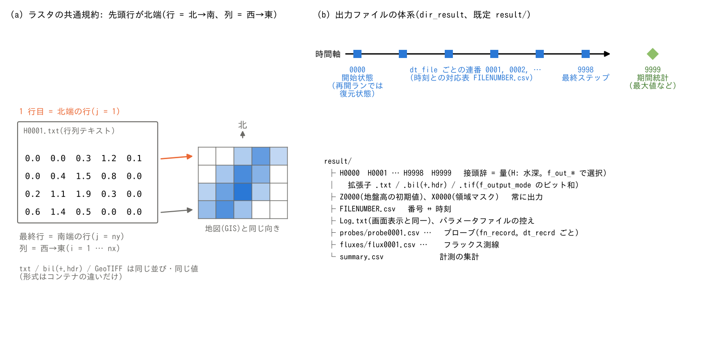

# 入出力の形式

[ユーザーガイド目次へ](../users_guide.md)

分布データ(地形・粗度・結果など)の入出力は3形式に対応しています。
いずれも `&list_sysparam` で選びます。

## ラスタの共通規約

- 行列の並びは**先頭行が北端**(行=y 方向・北→南、列=x 方向・西→東)。
  GIS のラスタや紙の地図と同じ向きです。
- セルと配列の対応は共通です。ただし、形式によって数値の保存精度と
  地理参照情報の持ち方が異なります。

## 入力形式(f_input_mode)

| 値 | 形式 |
|---|---|
| 1(既定) | 行列テキスト(空白区切り) |
| 2 | bil(生バイナリ+ESRI hdr) |
| 4 | GeoTIFF |

- bil は同名の `.hdr` があれば画素型(float32 / int8・int16・int32 と
  符号の有無)を読み分けます(整数型の bil を実数の場へ変換して読む
  こともできます)。hdr がなければ、実数の場は float32、整数の場は
  int32 として読みます。
- 格子諸元の指定: txt・hdr なし bil では `nx, ny` と `dx, dy`(または
  `lx, ly`)の namelist 指定が必須です。hdr あり bil・GeoTIFF では
  基本的に不要です(ファイルの値で補完されます。ただし経緯度格子では
  `dx, dy`(m)の指定が必要 — [座標系の章](coordinates.md))。
- GeoTIFF は無圧縮・LZW・Deflate(predictor 付き含む)、ストリップ・
  タイル配置に対応し、QGIS / ArcGIS / GDAL の実出力で検証済みです。
  外部ライブラリは使っていません(自前実装)。
- 入力形式は1つを選びます(出力と違いビット和ではありません)。
- **大きな全域ラスタに小さな領域マスクを置く運用では bil か GeoTIFF を
  推奨します。** 標高・物性係数・初期場などの実数ラスタは、領域マスクから
  決まる窓(有効セルを含む行・列の範囲±2)の部分だけがメモリに置かれ、
  ファイルからも窓だけが読まれます。bil は窓の行だけを位置指定で読み、
  GeoTIFF は窓に重なるストリップ/タイルだけを復号するので、読み込み時間も
  窓の大きさに比例します。テキストは窓の下端の行まで全列を字句解析する
  必要があるため、全国規模のテキスト入力は読み込みだけで長くかかります
  (GDAL なら `gdal_translate -of EHdr -ot Float32 in.txt out.bil`、
  `gdal_translate -of GTiff in.txt out.tif` で変換できます)。
  マスク類(領域・海域・河道)は窓を決めるために全域を読みます(整数)。

## 出力形式(f_output_mode)

**ビット和**で複数形式を同時に出せます。

| 値 | 出力される形式 |
|---|---|
| 1(既定) | テキストのみ |
| 2 | bil のみ |
| 3 | テキスト+bil |
| 4 | GeoTIFF のみ |
| 5 | テキスト+GeoTIFF |
| 6 | bil+GeoTIFF |
| 7 | テキスト+bil+GeoTIFF |

実数場のテキスト出力は書式 `f12.4`(小数点以下4桁)、bil・GeoTIFF は
float32 です。したがって、異なる形式の値や計算内部の実数値がビット単位で
一致するとは限りません。整数場は整数として出力します。

地理参照が有効な場合、bil には格子の位置・解像度・画素型を記した `.hdr`
が併記されます。GeoTIFF 出力には有効な地理参照が必須で、位置情報と
設定された CRS 情報が埋め込まれます。
テキストには地理参照情報を含みません([座標系の章](coordinates.md))。

> **GeoTIFF 出力は無圧縮です**(1 セル 4 バイト。読み込みと違い
> 圧縮書き出しには対応していません)。アニメーション用に多数の
> 時刻を出力してデータ量が気になる場合は、後処理で圧縮できます
> (要 [GDAL](https://gdal.org/) — QGIS に同梱されているほか、
> apt / conda 等でインストールできます):
>
> ```bash
> for f in result/*.tif; do
>   gdal_translate -q -co COMPRESS=DEFLATE -co PREDICTOR=3 "$f" "${f%.tif}_c.tif"
> done
> ```
>
> 実数場でも概ね 1/2〜1/4 になります。圧縮した GeoTIFF は GIS で
> そのまま開けるだけでなく、**ENCflow の入力(f_input_mode=4)にも
> utils/out2vtk にもそのまま使えます**(Deflate+predictor 3 の
> 読み込みは対応済みで、GDAL 実出力との一致を回帰テストで検査
> しています — [test/gtif](../../test/gtif/))。
> 圧縮後にそのまま out2vtk を実行しても問題ありません(ファイル名を
> 正確に組み立てて読むため `_c` 付きは無視され、原本が使われます)。
> 容量節約で原本を消して `_c` だけ残す場合は、out2vtk の namelist で
> `outfn_suffix = "_c"` を指定すれば圧縮版から直接変換できます。

## 出力ファイルの体系

分布出力は `dir_result`(既定 `result/`)に、
**接頭辞 + 4桁番号 + outfn_suffix + 拡張子**の名前で書き出されます。
接尾辞の既定値は空文字です。例えば `H0001.txt` は水深の通常出力、
`outfn_suffix="_A"` なら `H0001_A.txt` になります。



(a) 4行×5列の数値例を、行列テキストと同じ向きの格子で示します。
数値例は小数点以下1桁に省略表示しています。並びは共通でも、実数の保存精度は
テキストとバイナリで異なります。(b) 分布の4桁番号は開始状態・通常出力・
最終状態・期間統計を区別します。(c) 補助ファイルと計測CSVの例です。
計測CSVの4桁番号は地点・測線の番号で、分布の時刻番号とは別です。
図中のファイル例は接尾辞が空の場合を示します。

**番号の意味**

| 番号 | 意味 |
|---|---|
| 0000 | このランの開始状態(再開ランでは復元された状態) |
| 0001〜 | `dt_file` と分布出力窓の判定に従う連番(時刻との対応表が `FILENUMBER.csv`) |
| 9998 | 最終タイムステップの状態 |
| 9999 | そのラン内の最大値などの統計 |

`0000`・`9998` と終了時の `9999` は通常出力の窓とは別に書かれます。
通常出力の間隔・窓は[計算時間と出力間隔](time.md)を参照してください。
再開モード1は保存した通常出力番号を継続し、モード2は0から数え直します。
どちらも `0000` は再開ランの開始状態です。最大値統計は保存対象外のため、
`9999` は復元した開始状態を含む、そのランの統計です
([中断と再開](restart.md))。

**接頭辞と出力フラグ**(`f_out_XXX = 1` で有効化)。基本の既定出力は
H・H9999 と、常に保存する開始時の地盤高 Z0000・領域マスク X0000 です。
有効な物理過程によっては追加の場も自動出力されます。表は主な出力を示します。

| フラグ | 既定 | ファイル | 内容 |
|---|---|---|---|
| f_out_h | 1 | H | 水深 (m)(淡塩2層有効時は地表塩水層厚 Hss も出力) |
| f_out_e | 0 | E | 水位(標高基準)(m) |
| f_out_z | 0 | Z | 地盤高 (m)(off でも Z0000 は常に出力。地形変化計算の時間発展に) |
| f_out_u / f_out_v | 0 | u / v | x / y 方向流速 (m/s) |
| f_out_vv | 0 | V | 流速絶対値 (m/s) |
| f_out_m / f_out_n | 0 | m / n | x / y 方向線流量 (m²/s) |
| f_out_qq | 0 | Q | 流量絶対値 (m²/s) |
| f_out_qc | 0 | Qc | 積算流量 |
| f_out_qd | 0 | Qd | 流向(utils/rerecord で必要) |
| f_out_ddd / f_out_dda | 0 | Ddd / Dda | 卓越/全流下方向(utils/rmdepress_river で必要) |
| f_out_pre | 0 | Pr | 降雨強度 (mm/h) |
| f_out_fr / f_out_cn | 0 | Fr / Cn | フルード数 / クーラン数 |
| f_out_hg | 0 | Hg | 地下貯留水深 (m)(fn_gwflow 有効時。風化基岩層有効時は Hg2、管路連続体層有効時は Hgc、淡塩2層有効時は Hgs も出力) |
| f_out_hrs | 0 | Hrs | ため池水深 (m)(fn_reservoir 有効時) |
| f_out_hs | 0 | Hs | 土砂柱状量 (m)(土砂プロセス有効時。濃度 C = hs/(h+hs) の可視化に) |
| f_out_hd | 0 | Hd | 流動流木の柱状材積 (m³/m²)([流木](driftwood.md)有効時) |
| f_out_wd | 0 | Wd / Wd9999 | 堆積流木 (m³/m²) と期間最大到達量 max(流動+堆積)(流木ハザードマップ) |
| f_out_hbd | 0 | Bf | 流動瓦礫の柱状材積 (m³/m²)([家屋破壊・瓦礫](bldgdebris.md)有効時) |
| f_out_wbd | 0 | Bd / Bd9999 | 堆積瓦礫 (m³/m²) と期間最大到達量 max(流動+堆積)(瓦礫ハザードマップ) |
| f_out_bds | 0 | Bs | 家屋の破壊率 1 − 残ストック/初期ストック(0〜1。最終フレームが被害率マップ) |
| —(f_bedslide 有効時) | — | Hb / Vb | 動く底層の厚さ (m) と速度 (m/s。診断)([土砂・地形変化](geomorph.md)の f_bedslide。自動出力) |
| f_out_fs | 0 | Fs / Fs9999 | 斜面安全率 Fs の分布と期間最小(f_slide=1 or 2 が必要。-1 = 評価対象外。[土砂・地形変化](geomorph.md)) |
| f_out_hmax | 1 | H9999 | 最大水深 |
| f_out_hmaxt | 0 | Ht9999 | 最大水深の発生時刻 |
| f_out_vvmax | 0 | V9999 | 最大流速 |
| f_out_qqmax / f_out_qqmaxt / f_out_qqmaxd | 0 | Q9999 / Qt9999 / Qd9999 | 最大流量とその発生時刻・流向 |
| f_out_dmax / f_out_dmaxt | 0 | D9999 / Dt9999 | 最大流動深 h+hs とその発生時刻(土砂プロセス有効時。土石流・火山流動の「浸水深」は混合深が実体) |
| f_out_fmax | 0 | F9999 | 最大流体力 (ρm/ρw)・(h+hs)・V² (m³/s²。清水密度で規格化 = 水のみでは実務慣行の u²h と同一。混合流では密度比 1+sC 込み。×ρw(1000)で N/m の単位幅作用力)(家屋被害の判定指標) |
| f_out_fdmax | 0 | Fd9999 | 流木・瓦礫込みの最大流体力 (h+(1+s)hs+sg木·hd+sg瓦礫·hbd)·V² (m³/s²。[家屋破壊・瓦礫](bldgdebris.md)有効時。F9999 の定義は不変) |
| —(fn_swi 有効時) | — | Swi / Swi9999 / Swit9999 | 土壌雨量指数 (mm) の分布・期間最大・発生時刻([土壌雨量指数](swi.md)。自動出力) |
| —(常時) | — | X0000 | 領域マスク(0: 領域外、1: 陸域、2: 海域)。可視化・GIS での使用領域確認用 |

`FILENUMBER.csv` は分布出力番号と暦時刻・秒時刻 `t(s)`・ステップ `it`
の対応表です。`9999` の行は集計を出力した終了時刻を記録し、各セルの最大値が
発生した時刻を表すものではありません。X0000 用の独立した行は追加しません。

`fn_record` に地点・測線を設定すると、それぞれ
`probes/probe0001.csv`・`fluxes/flux0001.csv` などの時系列を作成します。
4桁番号は地点・測線の番号です。初期状態を記録した後、`dt_recrd` と
計測窓の判定時に追記します。地点または測線があれば、終了時に計測集計
`summary.csv` も保存します([流量測線・プローブ](record.md))。

このほか、`fn_log`(既定 `Log.txt`)による状態ログと、使用した設定ファイル
一式の控えを保存します。入力ラスタ一式を複製する機能ではありません。

地理参照付きの bil・GeoTIFF は GIS(QGIS / ArcGIS)で開けるほか、
**utils/out2vtk** で ParaView 用の VTK 形式に変換すると、地形の 3D
表示・水面の時系列アニメーション・衛星写真のドレープができます
(手順は [utils/out2vtk/README.md](../../utils/out2vtk/README.md))。
アニメーション用に GeoTIFF を多数出力するとデータ量が大きくなる
場合は、[出力形式の節](#出力形式f_output_mode)の後処理圧縮を
参照してください。

## 画面・ログの表示列(f_disp_\*)

時刻・保存量 S・Runge・ex_flux は常に表示され、場の最大値の列は
選択できます: `f_disp_h`(h_max。既定 on)・`f_disp_vv`(V_max。
既定 on)・`f_disp_cn`(Cn_max。既定 on)・`f_disp_qq`(Q_max。
既定 off)。`f_disp_debug = 1` は S 列を全有効桁で表示します
(収支のデバッグ・回帰テスト用)。列の読み方は
[チュートリアル Step 1](../../tutorials/wave/README.md#実行) を
参照してください。

## ディレクトリとファイル名の調整

| パラメータ | 既定値 | 意味 |
|---|---|---|
| dir_data | "." | 入力データファイルの基点ディレクトリ |
| dir_result | "result" | 結果出力ディレクトリ |
| dir_save | "save" | 状態保存([中断と再開](restart.md))のディレクトリ |
| fn_log | "Log.txt" | ログファイル名 |
| outfn_suffix | "" | 分布ファイル・計測CSVの拡張子直前に付く文字列 |
| out_fill | 0.0 | 分布ファイルで、領域マスクの外接矩形(計算窓)の外に書く値 |

`out_fill` は、全域格子に小さな領域マスクを置いたときの分布ファイルの
窓外の値です。ENCflow は領域マスクの外接矩形(±ハロ)だけをメモリに
持ち、分布ファイルは入力と同じ全域の形で書きます。窓の外は計算されて
いないので、この値(既定 0。GIS で区別したいときは `-9999` など)で
埋めます。窓の中のマスク外セルは内部値(水深は 0、地盤高は入力値)の
ままです。X0000(領域マスク)だけは常に全域の実際の値です。

`outfn_suffix` は Z0000・X0000、bil の `.hdr`、probes/・fluxes/ のCSV、
summary.csv にも適用されます。`FILENUMBER.csv`・ログ・設定ファイルの
控えには適用されないため、複数ランの結果を保持するときは `dir_result` を
分けてください。
