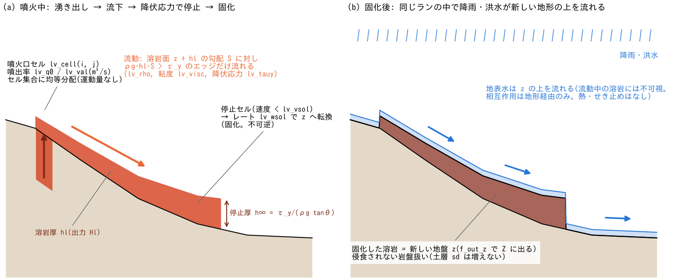

# 溶岩流(&list_lavaflow)

[ユーザーガイド目次へ](../users_guide.md)

噴火口セル群からの溶岩の湧き出しと、その流下・停止・固化による
溶岩原・地形の形成を計算します。力学は深さ平均の Bingham 粘性重力流
(潤滑近似)で、粘度 η と降伏応力 τ_y を直接与えます。停止した溶岩は
一定レートで地盤高 z に転換され(固化)、**固化後の地形の上の降雨・
洪水・土砂流出は同じ計算の中で続けて計算されます**(噴火 → 溶岩原
形成 → 二次的な水文応答、の連鎖を1ランで追えます)。
設計の全文は [docs/lava_plan.md](../lava_plan.md)、実装記録は
developer.md §51。

## 何を計算するか

- 状態はセル別の溶岩厚 `s%hl`(m)。分布 `Hl0001...` として毎出力時刻に
  書かれます。
- 溶岩面 $`s = z + h_l`$ のエッジ勾配 $`S`$ と、両セルの平均溶岩厚 $`h_e`$ に
  対し、基底せん断応力 $`\rho g h_e S`$ が降伏応力 $`\tau_y`$ を超える
  エッジで流動します(下の流動則。$`\tau_y = 0`$ なら Newton 粘性流)。
- `lv_wsol > 0` のとき、周囲のエッジ深さ平均流速の最大値が閾値
  `lv_vsol` を下回った「停止セル」の溶岩を、レート `lv_wsol`(m/s)で
  z へ転換します(固化。不可逆)。固化面は土層厚 sd を増やさない
  「侵食されない岩盤」です。
- 等温モデルです(冷却・温度依存粘度は将来拡張。lava_plan.md §8)。
  粘度・降伏応力は**ラン全体で1組**です。噴火口ごとの粘度指定は
  ありません(粘度差の実体は温度・組成であり、温度拡張で扱う設計)。

**流動則。** エッジの単位幅流量は、Bingham 流体の潤滑近似[^liu89]
(溶岩ドームの粘塑性モデル[^balmforth00]と同じ形)です。

```math
q = \frac{\rho g S}{6\eta}\,(h_e - h_0)^2\,(2h_e + h_0),
\qquad
h_0 = \frac{\tau_y}{\rho g S}
```

$`h_e \le h_0`$ のエッジは流れません。$`\tau_y = 0`$ では Newton 流体の
$`q = \rho g S h_e^3 / 3\eta`$ に戻り、平坦床の定率供給では粘性重力流の
相似解[^huppert82]に従います([test/lava](../../test/lava/) で検定)。
$`\tau_y > 0`$ で溶岩面が勾配 $`\tan\theta`$ の一様斜面と平行な場合、
停止厚は $`h_\infty = \tau_y/(\rho g \tan\theta)`$ です。



(a) 噴火口セルへの供給、溶岩面の勾配による流動、厚さを残した停止を示します。
図中の h∞ は一様斜面での目安であり、この曲がった地形の前縁厚を計算した値ではありません。
(b) 同じ溶岩厚がすべて固化した場合の例です。固化では停止セルの hl を減らした分だけ
地盤 z を上げ、地表水は更新後の z に従います。固化判定は速度閾値と指定レートに基づき、
冷却過程は計算しません。形状・水深・矢印は模式的で、計算結果ではありません。

## 有効化(最小 namelist)

メインパラメータで `fn_lavaflow = "-"`(同じファイルから読む)または
別ファイル名を指定し、`&list_lavaflow` を書きます。

```
&list_lavaflow
  lv_cell(1:2,1,1) = 55, 40 ! 噴火口1のセル (i, j)
  lv_cell(1:2,2,1) = 55, 41
  lv_q0(1) = 10.0           ! 一定噴出率 (m3/s)
/
```

噴火口の位置と噴出率が与件で、レオロジーには既定値があります
(密度 2600 kg/m³、粘度 1e4 Pa s、降伏応力 0 = Newton 流体。未指定なら
"(default)" 付きで表示)。粘度の既定は、エトナの玄武岩質アア溶岩の流下中の
実測 10³〜10⁴ Pa s[^pinkerton95]の上限で、校正前提の中庸です(下の[パラメータと既定値の根拠](#パラメータと既定値の根拠))。溶岩の型が決まって
いるときは次を出発点にしてください(校正で変わる量です):

| 型 | lv_visc (Pa s) | lv_tauy (Pa) | 備考 |
|---|---|---|---|
| 玄武岩質・高温のパホイホイ(ハワイ型) | 1e2〜1e3 | 0〜500 | η が小さいほどサブサイクル数が増える |
| 玄武岩質・アア溶岩(エトナ・伊豆大島型。既定) | 1e3〜1e4 | 1e3〜5e3 | 流下中の結晶化で η は 1 桁上がる |
| 安山岩質(富士・浅間型) | 1e5〜1e7 | 1e4〜1e5 | 厚い流れ。停止厚 τ_y/(ρg tanθ) が数 m〜10 m |
| デイサイト〜流紋岩の溶岩ドーム | ≥1e9 | ≥1e5 | 流動がほぼ止まる領域。本モジュールの適用外(lava_plan.md §2) |

## パラメータ

| パラメータ | 既定値 | 意味 |
|---|---|---|
| f_lavaflow | 1 | 0 でファイルを残したまま一時無効化 |
| dt_lavaflow_c | ""(毎ステップ) | 溶岩更新の間隔("10 s" 等の時間文字列) |
| lv_rho | 2600 | 溶岩の密度 ρ (kg/m³) |
| lv_visc | 1e4 | 粘度 η (Pa s)。玄武岩質 10²〜10⁴、安山岩質以上 ≥10⁵ が目安 |
| lv_tauy | 0 | 降伏応力 τ_y (Pa)。0 = Newton 流体 |
| lv_wsol | 0 | 停止セルの固化レート (m/s)。0 = 固化なし |
| lv_vsol | 5e-4 | 停止判定の速度閾値 (m/s)。目安 10⁻⁴〜10⁻³。lv_wsol>0 のときだけ読まれる |
| lv_cfl | 0.4 | 陽解法サブサイクルの安全係数 (0–1) |
| lv_nsubmax | 10000 | 1回の更新のサブサイクル数上限(暴走ガード) |
| lv_cell(1:2,k,n) | — | 噴火口 n のセル k(i, j)。番号 n は 1 から連続 |
| lv_q0(n) | — | 噴火口 n の一定噴出率 (m³/s) |
| lv_val(1:2,k,n) | — | 噴出率時系列(時刻(分), m³/s)。lv_q0 より優先 |
| fn_lv_cell(n) | "" | セル集合ファイル(i j の行列挙。インラインより優先) |
| fn_lv_val(n) | "" | 噴出率時系列ファイル(分, m³/s。最優先) |

- 噴出率は**セル集合全体の総量**で、各セルへ均等分配されます
  (内部ソース &list_bound_source と同じ規約)。運動量は持ちません。
- 割れ目噴火はセル列挙で、時間差のある複数噴火口は第3添字 n で
  表現します(最大 20 噴火口)。
- 時系列は線形補間です。同じ時刻を2回書くと階段状に切り替わります
  (`(5,0.5),(5,0.0)` = 5分ちょうどで停止)。

## 出力への影響

- 分布出力に `Hl`(溶岩厚 m)が加わります(フラグなし = 有効時は常時)。
- 固化分は地盤高 `Z` の増加として現れます(`f_out_z = 1` で毎時刻出力)。
- 画面・Log の保存量 S_total には算入されません(水柱でないため)。
  噴出・固化・残存の体積台帳は計算終了時に表示されます。
- リスタートは私有ファイル save/lavaflow.dat(save/restore は自動)。

## パラメータと既定値の根拠

根拠欄の分類語の意味は[既定値の根拠の読み方](../users_guide.md#既定値の根拠の読み方)を参照してください。

| パラメータ | 既定 | 意味 | 根拠 |
|---|---:|---|---|
| dt_lavaflow_c | ""(毎ステップ) | 溶岩更新の間隔 | **方式** 既定は水と同じ刻み。粘度が高く遅い流れでは間欠実行で軽くできる |
| lv_rho | 2600 kg/m³ | 溶岩の密度 $`\rho`$ | **慣用値** 玄武岩質溶岩(気泡込み)の代表値 2500〜2700 |
| lv_visc | 1e4 Pa s | 粘度 $`\eta`$ | **文献値** エトナの玄武岩質アア溶岩の流下中の実測 10³〜10⁴ Pa s[^pinkerton95]の上限。校正前提 |
| lv_tauy | 0 | 降伏応力 $`\tau_y`$ | **互換** 0 = Newton 流体(相似解[^huppert82]で検定できる形)。実溶岩は上の型別表の値 |
| lv_wsol / lv_vsol | 0 / 5e-4 m/s | 固化レート / 停止判定の速度閾値 | **与件** 0 = 固化なし / **経験値** 停止の目安 10⁻⁴〜10⁻³ m/s(1 日に 10〜100 m 以下の前進) |
| lv_cfl / lv_nsubmax | 0.4 / 10000 | サブサイクルの安全係数と上限 | **数値設定** |
| lv_cell / lv_q0 / lv_val | — | 噴火口のセルと噴出率 | **与件** 噴火シナリオ(総噴出量と継続時間から) |

**既定値を見直すときの手がかり**

- 粘度と降伏応力は化学組成(SiO₂)・温度・結晶量で決まり、章の型別表が
  出発点です。既往の溶岩流の到達距離・流幅・前縁厚(航空写真・DEM 差分)
  に合わせて校正すると、停止厚 $`h_\infty = \tau_y/(\rho g \tan\theta)`$ から
  $`\tau_y`$ が、前進速度から $`\eta`$ が決まります。
- 噴出率は噴火の観測(溶岩原の体積の時間変化・熱赤外の放射量)から
  時系列で与えるのが望ましく、総量が分かるだけなら矩形波で与えて
  継続時間の感度を見ます。

## 検証・例題

- 検定ケース: [test/lava](../../test/lava/) — Huppert 相似解
  (Newton 極限の軸対称拡がり)と Bingham 停止厚 h∞ の解析解検定。

## 制約・併用関係

- **水との相互作用は地形経由のみ**: 地表水は流動中の溶岩に不可視で、
  地盤 z の上を流れます(氷河と同じ割り切り)。固化した分だけ z が
  上がるため、固化後の降雨・洪水は自動的に新地形に従います。
  溶岩と水の熱的相互作用(水蒸気爆発・急冷)や、流動中の溶岩が水を
  せき止める効果はありません。
- 固化面の粗度・浸透係数は既存分布のままです(必要なら fn_gw_ksv 等の
  マップで別途与える前処理を検討してください)。
- 海セルへは流入しません(海没は対象外)。
- STG(f_gridsystem=1)非対応。geomorph の morfac > 1(地形時間加速)
  とは併用できません(溶岩はイベント時間の現象)。
- **時間刻みの目安**: 拡散係数 ~ρg hl³/3η の陽解法をサブサイクルで
  安定化します。流動性の高い玄武岩質(η ≤ 10² Pa s)ではサブサイクル
  数が大きくなり計算コストが立ちます(lv_nsubmax 超過で停止した場合は
  dt_lavaflow_c を短くするか η を見直してください。lava_plan.md §6)。

## 参考文献

[^liu89]: Liu, K. F. and Mei, C. C. (1989): Slow spreading of a sheet of Bingham fluid on an inclined plane. *J. Fluid Mech.*, 207, 505–529.(Bingham 流体の潤滑近似)
[^balmforth00]: Balmforth, N. J., Burbidge, A. S., Craster, R. V., Salzig, J. and Shen, A. (2000): Visco-plastic models of isothermal lava domes. *J. Fluid Mech.*, 403, 37–65.(等温の粘塑性溶岩モデル)
[^huppert82]: Huppert, H. E. (1982): The propagation of two-dimensional and axisymmetric viscous gravity currents over a rigid horizontal surface. *J. Fluid Mech.*, 121, 43–58.(Newton 極限の相似解。test/lava の検定解)
[^pinkerton95]: Pinkerton, H. and Norton, G. (1995): Rheological properties of basaltic lavas at sub-liquidus temperatures: laboratory and field measurements on lavas from Mount Etna. *J. Volcanol. Geotherm. Res.*, 68, 307–323.(玄武岩質溶岩の粘度の実測)
