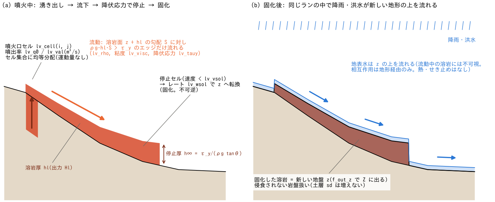

# 溶岩流(&list_lavaflow)

[ユーザーガイド目次へ](../users_guide.md)

噴火口セル群からの溶岩の湧き出しと、その流下・停止・固化による
溶岩原・地形の形成を計算します。力学は深さ平均の Bingham 粘性重力流
(潤滑近似)で、粘度 η と降伏応力 τ_y を直接与えます。停止した溶岩は
一定レートで地盤高 z に転換され(固化)、**固化後の地形の上の降雨・
洪水・土砂流出は同じ計算の中で続けて計算されます**(噴火 → 溶岩原
形成 → 二次的な水文応答、の連鎖を1ランで追えます)。
`f_lvtemp = 1` で溶岩の温度を計算すると、冷えて粘度と降伏応力が上がって止まり、
固化温度で固まる流れになります([温度モード](#温度モードf_lvtemp--1))。
設計の全文は [docs/lava_plan.md](../lava_plan.md)、実装記録は
developer.md §51。

結果の見方(分布・台帳・計測列・再開)は、このページの[出力・確認](#出力確認)にまとめています。

## 何を計算するか

- 状態はセル別の溶岩厚 `s%hl`(m)。分布 `Hl0001...` として毎出力時刻に
  書かれます。
- 溶岩面 $`s = z + h_l`$ の勾配の大きさ $`S`$ と、両セルの平均溶岩厚 $`h_e`$ に
  対し、基底せん断応力 $`\rho g h_e S`$ が降伏応力 $`\tau_y`$ を超える
  エッジで流動します(下の流動則。$`\tau_y = 0`$ なら Newton 粘性流)。
  $`S`$ はエッジを横切る方向とエッジに沿う方向の両方の勾配から求めるので、
  止まった溶岩の形は格子の向きによりません(下の[制約](#制約併用関係))。
- `lv_wsol > 0` のとき、周囲のエッジ深さ平均流速の最大値が閾値
  `lv_vsol` を下回った「停止セル」の溶岩を、レート `lv_wsol`(m/s)で
  z へ転換します(固化。不可逆)。流速を見るのは溶岩が動けるエッジだけで、
  溶岩面の高い側に溶岩がないエッジ(溶岩より高い乾いた地盤へ向かうエッジ)は
  数えません。固化面は土層厚 sd を増やさない「侵食されない岩盤」です。
  固化したセルにあった土層(地形変化・地下水の計算で使う sd)は溶岩の下に
  埋まり、sd = 0 になります。
- 既定は等温モデルです(粘度・降伏応力は一定)。`f_lvtemp = 1` で深さ平均温度を
  計算する温度モードになり、粘度・降伏応力が温度で変わり、固化は温度で判定します
  (下の[温度モード](#温度モードf_lvtemp--1))。粘度・降伏応力(温度モードでは基準温度での
  値)は**ラン全体で1組**です。噴火口ごとの粘度指定はありません(粘度差の実体は温度・
  組成で、温度モードでは噴火口ごとの噴出温度で表します)。

**流動則。** エッジの単位幅流量は、Bingham 流体の潤滑近似[^liu89]
(溶岩ドームの粘塑性モデル[^balmforth00]と同じ形)です。

```math
q = \frac{\rho g S}{6\eta}\,(h_e - h_0)^2\,(2h_e + h_0),
\qquad
h_0 = \frac{\tau_y}{\rho g S}
```

エッジを横切る流量は、この $`q`$ にエッジを横切る方向の勾配の割合 $`S_n/S`$ を
掛けたものです(降伏は勾配の大きさで判定し、向きはエッジへの射影にだけ使います)。
$`h_e \le h_0`$ のエッジは流れません。$`\tau_y = 0`$ では Newton 流体の
$`q = \rho g S h_e^3 / 3\eta`$ に戻り、平坦床の定率供給では粘性重力流の
相似解[^huppert82]に従います([test/lava](../../test/lava/) で検定)。
$`\tau_y > 0`$ で溶岩面が勾配 $`\tan\theta`$ の一様斜面と平行な場合、
停止厚は $`h_\infty = \tau_y/(\rho g \tan\theta)`$ です。



(a) 噴火口セルへの供給、溶岩面の勾配による流動、厚さを残した停止を示します。
図中の h∞ は一様斜面での目安であり、この曲がった地形の前縁厚を計算した値ではありません。
(b) 同じ溶岩厚がすべて固化した場合の例です。固化では停止セルの hl を減らした分だけ
地盤 z を上げ、地表水は更新後の z に従います。図は等温モードの場合で、固化判定は速度閾値と
指定レートに基づき、冷却は計算しません(温度モードでは固化温度で判定します)。形状・水深・
矢印は模式的で、計算結果ではありません。

## 有効化(最小 namelist)

メインパラメータで `fn_lavaflow = "-"`(同じファイルから読む)または
別ファイル名を指定し、`&list_lavaflow` を書きます。

```
&list_lavaflow
  lv_cell(1:2,1,1) = 55, 40 ! 噴火口1のセル (i, j)
  lv_cell(1:2,2,1) = 55, 41
  lv_q0(1) = 10.0           ! 一定噴出率 (m3/s)
/
```

噴火口の位置と噴出率が与件で、レオロジーには既定値があります
(密度 2600 kg/m³、粘度 1e4 Pa s、降伏応力 0 = Newton 流体。未指定なら
"(default)" 付きで表示)。粘度の既定は、エトナの玄武岩質アア溶岩の流下中の
実測 10³〜10⁴ Pa s[^pinkerton95]の上限で、校正前提の中庸です(下の[パラメータと既定値の根拠](#パラメータと既定値の根拠))。溶岩の型が決まって
いるときは次を出発点にしてください(校正で変わる量です):

| 型 | lv_visc (Pa s) | lv_tauy (Pa) | 備考 |
|---|---|---|---|
| 玄武岩質・高温のパホイホイ(ハワイ型) | 1e2〜1e3 | 0〜500 | η が小さいほどサブサイクル数が増える |
| 玄武岩質・アア溶岩(エトナ・伊豆大島型。既定) | 1e3〜1e4 | 1e3〜5e3 | 流下中の結晶化で η は 1 桁上がる |
| 安山岩質(富士・浅間型) | 1e5〜1e7 | 1e4〜1e5 | 厚い流れ。停止厚 τ_y/(ρg tanθ) が数 m〜10 m |
| デイサイト〜流紋岩の溶岩ドーム | ≥1e9 | ≥1e5 | 降伏応力で支えられた静止形(塑性ドーム)の概算まで。崖錐・内側からの膨らみ・崩落は対象外(下の[制約](#制約併用関係)) |

## パラメータ

| パラメータ | 既定値 | 意味 |
|---|---|---|
| f_lavaflow | 1 | 0 でファイルを残したまま一時無効化 |
| dt_lavaflow_c | ""(毎ステップ) | 溶岩更新の間隔("10 s" 等の時間文字列) |
| lv_rho | 2600 | 溶岩の密度 ρ (kg/m³) |
| lv_visc | 1e4 | 粘度 η (Pa s)。玄武岩質 10²〜10⁴、安山岩質以上 ≥10⁵ が目安 |
| lv_tauy | 0 | 降伏応力 τ_y (Pa)。0 = Newton 流体 |
| lv_wsol | 0 | 停止セルの固化レート (m/s)。0 = 固化なし |
| lv_vsol | 5e-4 | 停止判定の速度閾値 (m/s)。目安 10⁻⁴〜10⁻³。lv_wsol>0 のときだけ読まれる |
| lv_cfl | 0.4 | 陽解法サブサイクルの安全係数 (0–1) |
| lv_nsubmax | 10000 | 1回の更新のサブサイクル数上限(暴走ガード) |
| lv_cell(1:2,k,n) | — | 噴火口 n のセル k(i, j)。番号 n は 1 から連続 |
| lv_q0(n) | — | 噴火口 n の一定噴出率 (m³/s) |
| lv_val(1:2,k,n) | — | 噴出率時系列(時刻(分), m³/s)。lv_q0 より優先 |
| fn_lv_cell(n) | "" | セル集合ファイル(i j の行列挙。インラインより優先) |
| fn_lv_val(n) | "" | 噴出率時系列ファイル(分, m³/s。最優先) |

- 噴出率は**セル集合全体の総量**で、各セルへ均等分配されます
  (内部ソース &list_bound_source と同じ規約)。運動量は持ちません。
- 割れ目噴火はセル列挙で、時間差のある複数噴火口は第3添字 n で
  表現します(最大 20 噴火口)。
- 時系列は線形補間です。同じ時刻を2回書くと階段状に切り替わります
  (`(5,0.5),(5,0.0)` = 5分ちょうどで停止)。

## 温度モード(f_lvtemp = 1)

`f_lvtemp = 1` で、溶岩の深さ平均温度 $`T_l`$ を計算します。溶岩は表面からの放射と対流で
冷え、冷えると粘度と降伏応力が上がって止まり、固化温度まで冷えたセルで固まります(冷えて
止まる流れ)。同じ体積でも噴出率が高いほど遠くまで流れる、という溶岩流の長さの傾向
[^walker73]は、等温モードでは出ず(長さは体積と降伏応力で決まる)、温度モードで出ます
([test/lava](../../test/lava/) 構成 9)。設計は lava_plan.md §8、実装記録は developer.md §51.7 です。

**何を計算するか**

- 熱量 $`h_l T_l`$ を溶岩の流れに乗せて運びます(エッジの流量 × 面の温度)。面の温度は、既定では
  エッジの向きに並ぶ 3 セルから再構成した値(MUSCL)、`f_lvtemp_scheme = 1` では送り手の温度
  (1 次風上)です(下の「熱の移流の数値拡散」)。噴火口から注入した溶岩は、注入先の溶岩と熱量で
  混ざります。新しい温度は、自分と流れ込んだ溶岩の温度の間に収まります(MUSCL では、流れ出す
  エッジの反対側の近傍の温度も範囲に含みます)。
- 冷却は表面からの熱流束

  ```math
  F = \varepsilon \sigma \left(T_{l,K}^4 - T_{a,K}^4\right) + h_c \left(T_l - T_a\right)
  ```

  で、溶岩の柱は $`\rho c_p h_l \, dT_l/dt = -F`$ で冷えます($`\varepsilon`$ は有効放射率、
  $`\sigma`$ は Stefan–Boltzmann 定数、$`h_c`$ は対流の熱伝達係数、$`T_a`$ は気温、添字 K は
  絶対温度)。薄い溶岩ほど速く冷えます。更新の間隔 `dt_lavaflow_c` ごとに後退 Euler で解くので
  刻みの制約はなく、気温を下回りません。
- 粘度と降伏応力は温度の指数関数です。

  ```math
  \eta(T) = \eta_r \, e^{-\beta_\eta (T - T_r)}, \qquad
  \tau_y(T) = \tau_r \, e^{-\beta_\tau (T - T_r)}
  ```

  $`\eta_r`$・$`\tau_r`$ は `lv_visc`・`lv_tauy`(基準温度 `lv_tref` での値)、$`\beta`$ は温度
  感度です。粘度を温度の指数関数にするのは、深さ平均の溶岩流モデル[^costa05]と同じ形です
  (降伏応力にも同じ形を使うのは本モデルの簡略化)。各エッジでは、両側の溶岩の熱量で重み付けた
  平均温度で評価します。
- 固化は温度だけで判定します。$`T_l \le`$ `lv_tsol` のセルの溶岩を、柱ごと z へ移します
  (深さ平均温度が固化温度を下回ったら柱全体が固まったとみなす)。止まっても熱いうちは
  固まりません。速度閾値の固化(`lv_wsol`・`lv_vsol`)は使いません(`lv_wsol > 0` と併用すると
  停止します)。固化したセルの土層の埋没は等温モードと同じです。
- 気温は、fn_meteo があればそのセルの気温(標高による減率も効きます)、なければ `lv_tair` の
  一定値です。

**最小 namelist**(値は例で、[test/lava](../../test/lava/) 構成 9 と同じ組。既定値でも推奨値でも
ありません)

```
&list_lavaflow
  lv_visc = 1.0e3           ! 基準温度での粘度 (Pa s)
  lv_tauy = 100.0           ! 基準温度での降伏応力 (Pa)
  lv_cell(1:2,1,1) = 55, 40 ! 噴火口1のセル (i, j)
  lv_q0(1) = 10.0           ! 一定噴出率 (m3/s)
  f_lvtemp = 1              ! 温度を計算する
  lv_temp0(1) = 1150.0      ! 噴出温度 (°C)
  lv_tref = 1150.0          ! 基準温度 (°C)
  lv_bvisc = 0.04           ! 粘度の温度感度 (1/K)
  lv_btau = 0.04            ! 降伏応力の温度感度 (1/K)
  lv_tsol = 1000.0          ! 固化温度 (°C)
  lv_emis = 0.95            ! 有効放射率
  lv_hconv = 70.0           ! 対流の熱伝達係数 (W/m2/K)
  lv_cp = 1150.0            ! 比熱 (J/kg/K)
  lv_tair = 20.0            ! 気温 (°C)。fn_meteo があれば書かない
/
```

**パラメータ**(温度モードの値には既定値がありません。すべて明示してください。未指定なら
停止します)

| パラメータ | 既定値 | 意味 |
|---|---|---|
| f_lvtemp | 0 | 1: 温度を計算する(0 = 等温) |
| f_lvtemp_scheme | 3 | 熱の移流の面の温度。3: MUSCL + van Leer(下の「熱の移流の数値拡散」)、1: 送り手の温度(1 次風上。2026-11-05 より前の既定)。温度モード(`f_lvtemp = 1`)でだけ使い、等温モードでは読みません |
| lv_temp0(n) | なし(必須) | 噴火口 n の噴出温度 (°C)。`lv_tsol` より高いこと |
| lv_tref | なし(必須) | レオロジーの基準温度 $`T_r`$ (°C)。`lv_visc`・`lv_tauy` はこの温度での値 |
| lv_bvisc | なし(必須) | 粘度の温度感度 $`\beta_\eta`$ (1/K)。0 以上 |
| lv_btau | なし(必須) | 降伏応力の温度感度 $`\beta_\tau`$ (1/K)。0 以上 |
| lv_tsol | なし(必須) | 固化温度 $`T_{sol}`$ (°C) |
| lv_emis | なし(必須) | 有効放射率 $`\varepsilon`$ (0〜1)。表面の殻の断熱を含めた有効値 |
| lv_hconv | なし(必須) | 対流の熱伝達係数 $`h_c`$ (W/m²/K)。0 以上 |
| lv_cp | なし(必須) | 溶岩の比熱 $`c_p`$ (J/kg/K)。結晶化の潜熱を含めた有効値でよい |
| lv_tair | なし | 気温 (°C)。fn_meteo がないときに必須、あるときは書かない(併記は停止) |

- 溶岩の種類で桁が変わる値(噴出温度・基準温度・温度感度・固化温度)は、観測や文献から対象の
  溶岩に合わせて与えます。放射率・対流係数・比熱にも既定値を置いていません(既定にする値の
  原典を確かめられていないため)。
- 温度感度は「何度冷えると何倍になるか」から決められます。$`\Delta T`$ 冷えて $`k`$ 倍に
  なるなら $`\beta = \ln k / \Delta T`$ です(例: 100 K で 10 倍なら 0.023 1/K)。
- 結晶化の潜熱 $`L`$ は計算しませんが、結晶化が進む温度幅 $`\Delta T_c`$ で割って比熱に足した
  有効比熱 $`c_p + L/\Delta T_c`$ を `lv_cp` に与えると、その分だけ冷えにくくなります(潜熱が
  その温度幅に一様に出るとみなす近似)。
- 有効放射率は、流れの長さ(到達範囲)が既往の溶岩流に合うように校正する量です。表面の殻が
  熱を遮る効果を、放射率を下げることで表しています。

**出力・台帳・再開**

- 分布 `Tl0001…`(°C。溶岩のないセルは 0)が自動で出ます。
- 終了時に熱の台帳「lavaflow: heat erupted … J, radiated … J, convected … J」
  「heat in solidified lava … J, in molten lava … J」と、その残差
  「heat balance residual … J」が表示されます(0 °C を基準にした顕熱 $`\rho c_p h_l T_l`$。
  リスタートした計算では開始時の溶岩の熱量も表示し、残差に含めます)。残差は丸めの大きさ
  (噴出の 1e-15 程度)です。
- 再開: 温度は私有ファイル `lavaflow_temp.dat` に保存されます(`f_lvtemp = 1` で保存したとき
  だけ)。温度モードで再開するときにこのファイルがなければ停止します。

**熱の移流の数値拡散**

- 1 次風上で熱を運ぶと、温度が格子幅に比例してにじみます(数値拡散)。溶岩の流れは 4 近傍
  なので、格子に斜めの流れでは x・y の両方のエッジから入る熱が送り手の温度の平均になり、流れを
  横切る向きにもにじみます。修正方程式の横断の拡散係数は
  $`D_\perp = (\Delta x/2)(|u_x| \sin^2\theta + |u_y| \cos^2\theta)`$($`u`$ は深さ平均の速さ、$`\theta`$ は
  流れの向き)で、格子軸に沿う流れでは 0、45° で $`0.354\,u\,\Delta x`$ です(式は修正方程式からの
  本書の導出。格子に斜めの流れで 1 次風上が生む偽拡散として古くから知られる現象です[^dvdm76])。
  [test/lava](../../test/lava/) 構成 10 の 45° のシート流($`\Delta x`$ = 5 m、$`u`$ = 0.075 m/s)で
  $`0.357\,u\,\Delta x`$(理論の +1 %)、0° で 0 を計測しています。溶岩の熱拡散率(10⁻⁶ m²/s 程度)の
  10⁵ 倍に当たり、熱い流心と冷えた縁の温度差が流れの向きで違って出ます(この例では 45° の流れの
  温度の境目の幅 σ が、噴火口から 106 m 下流で 19 m になります)。
- 流れに沿う向きの数値拡散 $`(\Delta x/2)|u|`$(格子軸に沿う流れで最大)は、冷えて止まる流れの
  長さと堆積の形を格子幅に依存させます。構成 9 と同じ流れ(格子軸に沿う向き)を格子幅を変えて
  計算すると(developer.md §94)、1 次風上の堆積の最大厚が格子幅 5・2.5・1.25 m で 3.34・3.41・
  3.46 m、長さが 55・52.5・51.2 m(長さは格子幅で量子化されます)と、格子が粗いほど薄く長く出ます。
- `f_lvtemp_scheme = 3` は、エッジの向きに並ぶ送り手・受け手・送り手のさらに風上のセルの 3 点から
  面の温度を再構成します(地表のスカラーの MUSCL と同じ van Leer の限定器。
  [斜めエッジの流束による数値拡散](diagonal_diffusion.md))。温度が線形に変わるところでは
  拡散の主要項が消え、45° の横断の拡散係数が $`0.034\,u\,\Delta x`$(1 次の 0.09 倍)になります。
  同じ構成 9 の流れの堆積の最大厚は格子幅 5・2.5・1.25 m で 3.54・3.53・3.55 m とほぼ変わらず、
  長さは 50・50・48.8 m です(1 次風上は格子を細かくするとこの値へ近づきます)。熱量は同じ保存形で
  運ぶので保存は変わらず、新しい温度は近傍の温度の範囲に収めます(新しい極値を作りません)。
  受け手に溶岩がない前縁と、さらに風上のセルが領域外・壁・海・溶岩なしのエッジは 1 次風上の
  ままです。
- 既定は 3 です(2026-11-05 から。それより前の既定は 1)。`f_lvtemp_scheme = 1` にすると 2026-11-05
  より前の結果を再現できます。1 と 3 では冷えて止まる流れの長さと堆積の形が変わります(構成 9 の
  格子幅 5 m の流れで、長さが 55 → 50 m、堆積の最大厚が 3.34 → 3.54 m)。

**計算時間**

- 冷却は実時間で進むので、等温モードの例題のように粘度を大きくして時間を縮めることは
  できません。実際の粘度で計算してください。サブサイクルの数は、最も熱い(粘度の低い)溶岩の
  粘度にほぼ反比例します。1 回の噴火の到達範囲を求める用途向けで、多数の噴火を重ねる地形の
  実験には等温モードを使ってください。

**できないことと精度の限界**

- 1 つの有効放射率で、動いている溶岩(殻が割れて表面が熱い)と止まった厚い溶岩(殻が厚く
  熱を遮る)の両方を表します。どちらかがずれ、厚い溶岩だまりは実際より早く冷えます。固まる
  時刻は当てになりません。校正の対象は流れの長さ(到達範囲)です。
- 温度は深さ平均の 1 つだけです。表面の殻と内部の区別や、殻の下を溶岩が流れ続ける(溶岩
  チューブ)挙動は出ません。
- 結晶化の潜熱(有効比熱で近似できます)、地面への熱伝導、粘性発熱は計算しません。溶岩と水の
  熱的な相互作用もありません。
- 熱の移流の数値拡散は既定の MUSCL でも 0 にはなりません(限定器が温度の極値の近くで 1 次に戻るため)。
  格子幅に近い幅の温度の構造(数セル幅の熱い流心など)は鈍ります。
- 後退 Euler は 1 次精度なので、更新の間隔が冷却の時定数 $`\rho c_p h_l / (dF/dT)`$ に比べて
  大きいと冷え方が遅めに出ます(test/lava 構成 7 は厚さ 1 m で時定数が約 80 分、10 s 刻みで
  温度の低下の誤差 0.09%)。薄い溶岩では時定数が短くなりますが、陰解法なので不安定には
  なりません。

## 出力・確認

分布出力の 3 通りの有効化(自動 / 指定 / 共用)と柱状量の面積基底の読み方は[入出力の形式](io.md#状態量の分布出力の考え方)に、確認したい量から出力を逆引きする早見表は同じ節の末尾にあります。

**分布**(`result/` のラスタ。`dt_file` 間隔)

| ファイル | 出し方 | 内容 |
|---|---|---|
| Hl0001… | 自動 | 溶岩厚 (m 溶岩柱。幾何面積基底)。流動中+停止中の溶岩 |
| Tl0001… | 自動(温度モード) | 溶岩の深さ平均温度 (°C)。溶岩のないセルは 0 |
| Z0001… | f_out_z = 1 | 固化で上がった地盤高。固化厚 = Z − Z0000 |

**台帳・ログ**(収支の検算)

- 終了時に「lavaflow: erupted … m3, solidified … m3, molten … m3」
  (噴出・固化・残存の体積台帳)と「subcycles total = … over … updates」が
  表示されます。土層があるときは「soil buried under solidified lava … m3,
  groundwater moved to the surface … m3」(溶岩の下に埋めた土層と、そこから
  地表へ移した地下水の量)も表示されます。
- 温度モードでは熱の台帳(噴出・放射・対流・固化・残存と残差)も表示されます
  ([温度モード](#温度モードf_lvtemp--1))。
- 画面・Log.txt の S 列には算入されません(水柱でないため)。

**計測**(プローブ・測線の列)

- 溶岩の列はありません。地点の溶岩厚は `Hl0001…` の同一セルを各出力
  時刻で拾います。固化後の地形の上の水の流れは通常の列で測れます。

**再開**

- 私有ファイル `lavaflow.dat` で自動的に扱われます(保存時に fn_lavaflow が
  有効だったことが必要)。温度モードの温度は `lavaflow_temp.dat` です。

**読み方と検算のコツ**

- 収支: erupted = solidified + molten が閉じます(molten = Σ Hl × A)。
  噴出率の時系列を与えた場合、erupted が Σ(q × Δt) と一致するかで入力を
  検算できます。
- 到達範囲は `Hl > 0` の最終フレーム(9998)で、期間最大の分布はないので
  途中の最大到達が必要なら `dt_file` を細かくします。停止厚は
  前縁の Hl が τ_y/(ρg tanθ) に近いかで確認できます。
- molten(固化せずに残った溶岩)は、計算終了時にまだ動いている溶岩か、止まり
  かけで停止判定(`lv_vsol`)に達していない溶岩です。残っている場所は Hl9998 で
  確認できます。2026-11-03 の変更より前は、溶岩より高い乾いた地盤(谷壁や先に
  固まった溶岩の縁)に接するセルが止まっても固化しない不具合がありました
  (developer.md §51.5)。

## パラメータと既定値の根拠

根拠欄の分類語の意味は[既定値の根拠の読み方](../users_guide.md#既定値の根拠の読み方)を参照してください。

| パラメータ | 既定 | 意味 | 根拠 |
|---|---:|---|---|
| dt_lavaflow_c | ""(毎ステップ) | 溶岩更新の間隔 | **方式** 既定は水と同じ刻み。粘度が高く遅い流れでは間欠実行で軽くできる |
| lv_rho | 2600 kg/m³ | 溶岩の密度 $`\rho`$ | **慣用値** 玄武岩質溶岩(気泡込み)の代表値 2500〜2700 |
| lv_visc | 1e4 Pa s | 粘度 $`\eta`$ | **文献値** エトナの玄武岩質アア溶岩の流下中の実測 10³〜10⁴ Pa s[^pinkerton95]の上限。校正前提 |
| lv_tauy | 0 | 降伏応力 $`\tau_y`$ | **互換** 0 = Newton 流体(相似解[^huppert82]で検定できる形)。実溶岩は上の型別表の値 |
| lv_wsol / lv_vsol | 0 / 5e-4 m/s | 固化レート / 停止判定の速度閾値 | **与件** 0 = 固化なし / **経験値** 停止の目安 10⁻⁴〜10⁻³ m/s(1 日に 10〜100 m 以下の前進) |
| lv_cfl / lv_nsubmax | 0.4 / 10000 | サブサイクルの安全係数と上限 | **数値設定** |
| lv_cell / lv_q0 / lv_val | — | 噴火口のセルと噴出率 | **与件** 噴火シナリオ(総噴出量と継続時間から) |
| f_lvtemp | 0 | 温度を計算するか | **方式** 0 = 等温(従来どおり)。冷えて止まる流れを扱うなら 1 |
| f_lvtemp_scheme | 3 | 熱の移流の面の温度 | **方式** 3 = MUSCL + van Leer。格子に斜めの流れの横断の数値拡散を 1 次風上の約 1/10 にし(構成 10)、冷えて止まる流れの格子幅への依存を小さくする(構成 9 の格子を変えた比較。developer.md §94)。1 = 1 次風上(2026-11-05 より前の既定。それより前の結果の再現用) |
| lv_temp0 / lv_tref / lv_tsol | なし | 噴出温度・基準温度・固化温度 | **与件** 溶岩の種類と観測で決まる(既定なし) |
| lv_bvisc / lv_btau | なし | 粘度・降伏応力の温度感度 | **与件** 溶岩の種類で大きく違う。$`\Delta T`$ 冷えて $`k`$ 倍なら $`\ln k/\Delta T`$ |
| lv_emis | なし | 有効放射率 | **校正量** 殻の断熱を含めた有効値。流れの長さで校正する(既定は原典を確かめてから決める) |
| lv_hconv / lv_cp | なし | 対流の熱伝達係数・比熱 | **与件** 既定は原典を確かめてから決める。比熱は潜熱を含めた有効値でよい |
| lv_tair | なし | 気温 | **与件** fn_meteo があればそちらを使う |

**既定値を見直すときの手がかり**

- 粘度と降伏応力は化学組成(SiO₂)・温度・結晶量で決まり、章の型別表が
  出発点です。既往の溶岩流の到達距離・流幅・前縁厚(航空写真・DEM 差分)
  に合わせて校正すると、停止厚 $`h_\infty = \tau_y/(\rho g \tan\theta)`$ から
  $`\tau_y`$ が、前進速度から $`\eta`$ が決まります。冷却を計算しないので、こうして決めた
  $`\tau_y`$ は冷えて止まる効果を含めた実効値です(examples/shield_volcano では、玄武岩質の
  溶岩の実測の範囲の 2×10³ Pa だと楯状火山が実在より平たく、2×10⁴ Pa で実在と同じ程度の
  勾配になります)。
- 停止判定の閾値 lv_vsol は、止まった厚さを $`h_\infty`$ より厚くします。上振れの割合は
  およそ $`\sqrt{2\,v_{sol}\,\eta\,\rho g S}/\tau_y`$ です(S は勾配。lava_plan.md §5 の式を
  $`h_\infty`$ で割ったもの)。閾値を小さくすると上振れは減りますが、止まったと判定される
  までの時間が長くなります。同じ閾値でも粘度が大きいほど上振れが大きいので、粘度を
  変えたら閾値も見直します。
- 噴出率は噴火の観測(溶岩原の体積の時間変化・熱赤外の放射量)から
  時系列で与えるのが望ましく、総量が分かるだけなら矩形波で与えて
  継続時間の感度を見ます。

## 検証・例題

- 検定ケース: [test/lava](../../test/lava/) — Huppert 相似解
  (Newton 極限の軸対称拡がり)と Bingham 停止厚 h∞ の解析解検定、平坦床の
  1 火口から止まるまで噴出した溶岩の静止形と塑性ドームの解析解[^blake90]の比較
  (格子軸の方向と斜めの方向で同じ形になることの検定)、高さ 10 m の段の前に
  たまった溶岩が壁に接する列まで全量固化することの検定、固化した溶岩の下の
  土層が埋まり、しみ込んでいた水が地表へ移っても水の総量が保たれることの検定。
  温度モードでは、静止した溶岩の層の冷却を後退 Euler の漸化式と冷却の式の厳密解と比べる検定
  (温度で固まる時刻と熱の台帳も)、噴出温度の違う 2 つの火口からの熱の移流(熱量の保存と
  温度の範囲、等温の計算との一致)、冷えて止まる流れの長さが同じ体積で噴出率とともに増える
  こと(等温の対照では変わらない)、リスタートの往復、熱の横断の数値拡散(格子軸に沿う流れでは
  出ず、45° の 1 次風上では修正方程式の値に合い、MUSCL ではその 1/4 未満)の検定。
- 例題: [examples/shield_volcano](../../examples/shield_volcano/) — 火口の位置と噴出量を
  変えた 20 回の噴火で溶岩流が重なり、楯状火山が育つ過程(降伏応力を 10 倍にした比較つき)と、
  粘い溶岩の溶岩ドームの静止形の解析解との比較。冷却を計算しないので、実在の楯状火山の
  勾配に近づけるには降伏応力を冷えて止まる効果を含めた実効値として与える必要があることも
  示します。
- 例題: [examples/stratovolcano](../../examples/stratovolcano/) — 溶岩流 → 降灰 → 豪雨の侵食 を
  繰り返して成層火山を作る(段ごとの計算をつなぐドライバ)。固化した溶岩の下の灰を埋める処理
  (土層があるとき)を、降灰・侵食と組み合わせて使う例です。最後の段で、育った山の凹凸のある地形に
  温度モードの 1 回の溶岩流を流し、火口の位置で流れる谷筋が変わる様子、噴出が終わると冷えて止まる
  様子、同じ体積でも噴出率が高いと遠くまで広く流れる様子を示します。

## 制約・併用関係

- **水との相互作用は地形経由のみ**: 地表水は流動中の溶岩に不可視で、
  地盤 z の上を流れます(氷河と同じ割り切り)。固化した分だけ z が
  上がるため、固化後の降雨・洪水は自動的に新地形に従います。
  溶岩と水の熱的相互作用(水蒸気爆発・急冷)や、流動中の溶岩が水を
  せき止める効果はありません。
- 固化面の粗度は既存分布のままです。**溶岩の下の土層は埋まる**ので
  (sd = 0)、土層を地下水の層とするモデル(Green-Ampt・側方流)では、溶岩が
  固化したセルに雨がしみ込まず、そこにしみ込んでいた地下水は固化のときに
  地表へ移ります(水の総量は保存)。実際の新しい溶岩(とくに玄武岩質)は割れ目が
  多く水を通すことが多いので、溶岩原の浸透は過小になります。灰などが積もって
  土層ができれば、その厚さの分だけしみ込みます。土層は 1 層なので、埋まった土は
  後で侵食で掘り出されても岩盤として扱われます。
- 海セルへは流入しません(海没は対象外)。
- **溶岩ドーム**: 1 つの火口から噴出して止まった溶岩の形は、降伏応力で
  支えられた静止形(塑性ドーム $`h(r)^2 = (2\tau_y/\rho g)(R - r)`$[^blake90])
  になります(test/lava 構成 4 で解析解と 1〜2% で一致)。高さ/直径は
  降伏応力の 0.6 乗に比例し、体積の 0.2 乗に反比例します。実際のドームの急な
  側面は表面が割れて崩れた岩塊の斜面(崖錐)であることが多く、内側から膨らむ
  成長や、崩落して火砕流になる過程も計算しないので、計算できるのは静止形の
  概算までです(崩落は土石流の f_release で別に与えられます)。静止形は粘度に
  よらないので、形だけを見るなら粘度を下げて計算時間を短くできます(噴出の
  時間を同じ比で縮め、固化を使うときは lv_vsol と lv_wsol も同じ比で上げます)。
- **格子の向き**: 4 近傍の格子で計算します。降伏と停止は勾配の大きさで判定するので、
  平坦床のドームの静止形は格子軸の方向と斜めの方向で同じ形になります(test/lava
  構成 4 で、扇形ごとの面積等価半径の差が 1.4%、中心厚の解析解との差が 1.2%)。
  細い流れの縁など、エッジに沿う方向の両隣に溶岩がない所では、エッジを横切る方向の
  勾配だけで判定します。2026-11-03 の変更より前は横切る方向の勾配だけで判定して
  いたため、溶岩原が格子軸の方向に伸びたひし形になりました(developer.md §51.4)。
- STG(f_gridsystem=1)非対応。geomorph の morfac > 1(地形時間加速)
  とは併用できません(溶岩はイベント時間の現象)。
- **温度モード**: 速度閾値の固化(`lv_wsol > 0`)とは併用できません(固化は温度で判定)。
  気温は fn_meteo か `lv_tair` のどちらか一方で与えます。温度モードの限界は
  [温度モード](#温度モードf_lvtemp--1)の「できないことと精度の限界」を見てください。
- **時間刻みの目安**: 拡散係数 ~ρg hl³/3η の陽解法をサブサイクルで
  安定化します。流動性の高い玄武岩質(η ≤ 10² Pa s)ではサブサイクル
  数が大きくなり計算コストが立ちます(lv_nsubmax 超過で停止した場合は
  dt_lavaflow_c を短くするか η を見直してください。lava_plan.md §6)。

## 参考文献

[^liu89]: Liu, K. F. and Mei, C. C. (1989): Slow spreading of a sheet of Bingham fluid on an inclined plane. *J. Fluid Mech.*, 207, 505–529.(Bingham 流体の潤滑近似)
[^balmforth00]: Balmforth, N. J., Burbidge, A. S., Craster, R. V., Salzig, J. and Shen, A. (2000): Visco-plastic models of isothermal lava domes. *J. Fluid Mech.*, 403, 37–65.(等温の粘塑性溶岩モデル)
[^blake90]: Blake, S. (1990): Viscoplastic models of lava domes. In: Fink, J. H. (ed.), *Lava Flows and Domes: Emplacement Mechanisms and Hazard Implications*, IAVCEI Proceedings in Volcanology 2, Springer, Berlin.(降伏応力で支えられた溶岩ドームの静止形。test/lava 構成 4 の解析解)
[^huppert82]: Huppert, H. E. (1982): The propagation of two-dimensional and axisymmetric viscous gravity currents over a rigid horizontal surface. *J. Fluid Mech.*, 121, 43–58.(Newton 極限の相似解。test/lava の検定解)
[^costa05]: Costa, A. and Macedonio, G. (2005): Numerical simulation of lava flows based on depth-averaged equations. *Geophys. Res. Lett.*, 32, L05304.(深さ平均の溶岩流モデルで粘度を温度の指数関数にする)
[^walker73]: Walker, G. P. L. (1973): Lengths of lava flows. *Phil. Trans. R. Soc. Lond. A*, 274, 107–118.(溶岩流の長さと噴出率の関係)
[^dvdm76]: de Vahl Davis, G. and Mallinson, G. D. (1976): An evaluation of upwind and central difference approximations by a study of recirculating flow. *Computers & Fluids*, 4, 29–43. doi:10.1016/0045-7930(76)90010-4(格子に斜めの流れで 1 次風上が生む偽拡散)
[^pinkerton95]: Pinkerton, H. and Norton, G. (1995): Rheological properties of basaltic lavas at sub-liquidus temperatures: laboratory and field measurements on lavas from Mount Etna. *J. Volcanol. Geotherm. Res.*, 68, 307–323.(玄武岩質溶岩の粘度の実測)
