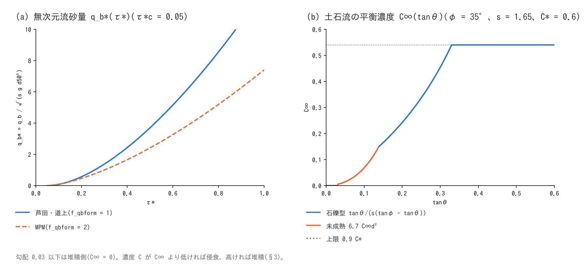

# 土石流・斜面崩壊・動く底層の解説(土砂・地形変化の補足)

[土砂・地形変化の章へ](geomorph.md) | [ユーザーガイド目次へ](../users_guide.md)

[土砂・地形変化の章](geomorph.md)の土石流(`f_debris`)、瞬時流動化
(`fn_dbinit`)、斜面安定判定(`f_slide`)、動く底層(`f_bedslide`)について、
方程式・抵抗則・侵食堆積則・発生条件の式と既定値の根拠、参考にした
他モデルをまとめます。掃流砂・浮遊砂・斜面侵食・長期地形過程は
[土砂輸送と斜面・長期地形過程の解説](sediment.md)にあります。
実装は `src/m_geomorph_debris.f90`、`src/m_geomorph_bedslide.f90` と、
抵抗則を運動方程式に合成する `src/m_swflow_enc.f90`(`calc_kth_flux`)です。
設計の経緯と文献照合の記録は docs/debris_plan.md、
docs/landslide_tsunami_plan.md にあります。

## 1. 単層混合体モデル

土石流は地表水 $`h`$ と土砂柱状量 $`h_s`$(固体体積の厚さ換算)の
**単層混合体**として扱い、固体と水は同じ速度で動くとします。

```math
h_t = h + h_s,
\qquad
C = \frac{h_s}{h + h_s},
\qquad
C_* = 1 - \lambda,
\qquad
\frac{\rho_m}{\rho} = 1 + sC
```

$`h_t`$ が流動深、$`C`$ が混合体積濃度、$`C_*`$ が堆積層の固体濃度
(河床の空隙率 $`\lambda`$ = `fluv_porosity` から導く)、$`s`$ が土粒子の
水中比重(`fluv_sgrav`)です。運動方程式([ENC 格子の解説](encgrid.md) §5)
では、水面を $`z + h + h_s`$、摩擦に使う水深を $`h_t`$ に置き換え、
抵抗則(§2)で摩擦項を置換または合成します。土砂 $`h_s`$ の移流は
浮遊砂と同じステップ内輸送で、河床との交換(§3)が地形更新の時刻に
入ります。この水準は Kanako[^nakatani08]・Morpho2DH[^morpho2dh]と同じ
「SWE + 粒状体の抵抗則 + 侵食堆積則」の構成で、別層の土砂ソルバは
作りません(developer.md §0 の範囲)。

## 2. 抵抗則(f_dbres)

抵抗はすべて減速度の形で半陰的に合成します(速度に依らない降伏項は
$`a_y/|\mathbf{V}|`$ として分母に入れ、低速かつ駆動力 $`\le a_y`$ なら
明示的に静止させます。動き出しと停止が同じ式で表されます)。
$`g_e`$ は急勾配の有効重力 $`g\cos^2\theta`$([ENC 格子の解説](encgrid.md) §5)です。

| f_dbres | 名称 | 降伏減速度 $`a_y`$ と速度依存項 | 追加パラメータ |
|---:|---|---|---|
| 0 | Manning のみ | — | — |
| 1 | クーロン + Manning | $`a_y = g_e\tan\phi\,\dfrac{sC}{1+sC}`$(水中固体重量の底面摩擦。Manning 則はそのまま) | db_phi |
| 2 | 江頭構成則[^egashira93] | $`a_y = g_e\tan\phi\,\dfrac{sC}{1+sC}\left(\dfrac{C}{C_*}\right)^{1/5}`$、速度項 $`\dfrac{f_b\,\lvert\mathbf{V}\rvert^2}{(1+sC)\,h_t}`$ | db_d50、db_erest |
| 3 | 高橋・中川 石礫型[^tn91] | $`a_y = g_e\cdot 0.45\,\dfrac{sC}{1+sC}`$、ダイラタント項 $`4\left(\dfrac{1-C}{C}\right)^{2/3}\left(\dfrac{d_L}{h_t}\right)^2\dfrac{\lvert\mathbf{V}\rvert^2}{(1+sC)h_t}`$ | db_d50 |
| 4 | Voellmy[^voellmy55] | $`a_y = g_e\,\mu + \dfrac{g_e\,\lvert\mathbf{V}\rvert^2}{\xi\,h_t}`$ | db_mu、db_xi |
| 5 | 一定停止応力 | $`a_y = \dfrac{\tau_y}{\rho_m h_t}`$ + Manning | db_tauy |

江頭構成則の抵抗係数は

```math
f_b = \frac{25}{4}\left\{k_f\frac{(1-C)^{5/3}}{C^{2/3}} + k_d\frac{\sigma}{\rho}(1-e^2)\,C^{1/3}\right\}\left(\frac{h_t}{d}\right)^{-2},
\qquad k_f = 0.16,\quad k_d = 0.0828
```

($`e`$ = 粒子の反発係数 `db_erest`、$`d`$ = `db_d50`)で、層流抵抗が
$`(h_t/d)^2`$ に反比例するため **粒径が mm 以下では抵抗が消えて発散**
します(細粒のスラリーには 4 か 1 を使う)。高橋・中川則は濃度
$`C \le 0.4C_*`$ で掃流状集合流動 $`(\rho_T/0.49)(d_L/h_t)|\mathbf{V}|^2`$ に、
$`C < c_{\min}`$(`db_cmin`、既定 2%)または $`h_t/d \ge 30`$ で
Manning 則に切り替わります(原著の泥流域の規定)。2・3・4・5 とも
$`C < c_{\min}`$ の希薄側は Manning 則に退化し、下流の清水域に降伏を
掛けません(数値的な閉じ)。

Voellmy 則は雪崩のために作られた抵抗則で、雪崩実務モデル
RAMMS[^christen10]、火山流動の Titan2D[^pitman03]・VolcFlow[^kelfoun05]が
同じ形(μ-ξ)を使います。駆動も抵抗も加速度形で密度が相殺するため、
雪・岩屑・火砕物に同じ式が使えます。既定 μ = 0.2、ξ = 1000 m/s² は
RAMMS の雪崩の慣用域(0.15〜0.3 / 1000〜3000)の中庸で、岩屑なだれは
μ 0.05〜0.15・ξ 200〜500 と小さめ、一定停止応力の既定 10 kPa は
VolcFlow 系の火砕流適用例 5〜50 kPa の下寄りです(型ごとの値は
[章末の推奨値](geomorph.md#パターン別の推奨値))。

**曲率項(f_dbcurv)。** 地形の曲率による遠心加速度を垂直応力に加え、
降伏項に倍率を掛けます。

```math
a_y \leftarrow a_y\,\max\!\left(0,\ 1 + \frac{a_c}{g_n}\right),
\qquad
a_c = \frac{\mathbf{u}^{\mathsf T}\mathbf{H}\mathbf{u}}{\sqrt{1 + |\nabla z|^2}},
\qquad g_n = \sqrt{g\,g_e}
```

$`\mathbf{H}`$ は $`z`$ の Hessian(3×3 中心差分)で、$`a_c`$ は地表面の
流向法線曲率と表面速度の積です。凹地形で減速、凸地形で摩擦低下、
地面から浮く条件では摩擦ゼロです。RAMMS に Fischer らが入れた
曲率項[^fischer12]と同じ扱いで、RAMMS で校正された μ・ξ を使う比較では
有効にします。検証: [test/curvature](../../test/curvature/README.md)
(定常 1 次元常微分方程式との比較。円弧上の厚化 on − off が ODE の 1.03 倍)。

## 3. 侵食・堆積則(f_dbed)

河床との交換は固体柱状量の増分 $`\Delta h_s`$ とし、
$`\Delta z = -\Delta h_s/C_*`$ を $`z`$・$`s_d`$ に共動適用します。可動層
(侵食 $`\le s_d`$)と浮遊量(堆積 $`\le h_s`$)でクランプし、乾いたセルは
全量を河床に戻します。可動層を剥がした後の岩盤は、この交換では削りません。岩盤の侵食は
`f_rockinc` の土石流の項(`rock_kdb`。[地形変化の章](geomorph.md#土石流による岩盤侵食rock_kdb))で
扱います。



図 (b) が本節の平衡濃度 $`C_\infty(\tan\theta)`$(φ = 35°、s = 1.65、C* = 0.6)、
図 (a) は[土砂輸送の解説](sediment.md) §3 の流砂量式です。

**f_dbed = 1: 平衡濃度への緩和(高橋型)。** 勾配 $`\theta`$(8 近傍の
最急降下)の平衡濃度に向かって、速度に比例する率で侵食・堆積します
[^takahashi07]。

```math
C_\infty = \frac{\tan\theta}{s(\tan\phi - \tan\theta)}\ (\tan\theta > 0.138),
\quad
6.7\,C_\infty^{\,2}\ (0.03 < \tan\theta \le 0.138),
\quad
0\ (\tan\theta \le 0.03),
\qquad C_\infty \le 0.9\,C_*
```

```math
\Delta h_s = C_*\,i\,\Delta t,
\qquad
i = \delta_e\,\frac{C_\infty - C}{C_* - C_\infty}\,|\mathbf{V}|\ (C < C_\infty),
\qquad
i = \delta_d\,\frac{C_\infty - C}{C_*}\,|\mathbf{V}|\ (C > C_\infty)
```

石礫型の $`C_\infty`$ は力の釣り合いからの導出式で、未成熟土石流の
係数 6.7 と勾配の閾値 0.138・0.03、上限 $`0.9C_*`$ は高橋理論の慣用値
(原典照合は debris_plan.md §1 の残作業)。$`\delta_e`$(`db_delte`、既定
0.0007)は Takahashi の一般値、$`\delta_d`$(`db_deltd`、既定 0.05)は
Kanako 系の慣用値で、どちらも**到達距離の校正係数**です。

**f_dbed = 2: 江頭・芦田。** 侵食と堆積が 1 本の式で連続します
(Morpho2DH の式(5)–(7)[^morpho2dh])。追加パラメータはありません。

```math
\frac{E}{|\mathbf{V}|} = C_*\tan(\theta - \theta_e),
\qquad
\tan\theta_e = \frac{sC}{sC + 1}\tan\phi
```

$`\theta`$ は流向の河床勾配で、$`\theta_e`$ は濃度 $`C`$ の平衡勾配です
(その逆関数が石礫型の $`C_\infty`$ と一致します)。$`\theta`$ は各セルで、流向の下流側の
近傍との片側差分で求めます(中央差分は 2 セル周期の凹凸を見ないため。developer.md §89.24)。

**f_dbed = 3: 高橋・中川(1991)。** 単一粒径・飽和床の形で、侵食は
$`\delta_e\,\dfrac{C_\infty - C}{C_* - C_\infty}\,\dfrac{q_T}{d_L}`$、堆積は
慣性係数つきの $`\delta_d\left(1 - \dfrac{|\mathbf{V}|}{p\,v_c}\right)^4\dfrac{C_\infty - C}{C_*}\dfrac{q_T}{d_L}`$
($`q_T = |\mathbf{V}| h_t`$、$`p = 1/3`$、限界速度 $`v_c`$ は原著式(15))です[^tn91]。
流速が $`p\,v_c`$ を超える間は堆積せず慣性で走り、遷緩点で扇状に堆積します。
`db_d50`($`d_L`$)が必須です。

**f_dbed = 4: 速度比例連行。** $`E = \delta_e|\mathbf{V}|`$(連行のみ。堆積は
`f_dbstop` が担う)。雪崩・岩屑なだれが走路の雪や崩積土を取り込んで
成長する過程の簡易則で、連行可能な層は土層厚 $`s_d`$ で与えます。
$`C \ge c_{\min}`$ の密な流動体だけが連行します(希薄な裾の暴走防止)。
土石流の実務で広く使われる Hungr の経験的な連行則[^hungr95]は $`E = E_r\,h\,|\mathbf{V}|`$
(DAN3D など。$`E_r`$ は 1 m 進むごとの体積の増加率で、連行域に入る体積 $`V_0`$ と出る体積
$`V_f`$、連行域の長さ $`L`$ から $`E_r = \ln(V_f/V_0)/L`$ と見積もる[^qiao23])で、流動深の
因子を持ちます。f_dbed = 4 は侵食深が流動深によらず走行距離に比例するのに対し、Hungr の則では
流動深に比例し、体積が走行距離に対して指数的に増えます。f_dbed = 4 で近い連行量を与えるなら
$`\delta_e \approx E_r \times`$(代表の流動深)が目安です。
**f_dbed = 0** は交換なし(等価流体)です。

**停止(f_dbstop = 1)。** $`|\mathbf{V}| < v_{stop}`$ かつ $`C > C_\infty`$ の
セルで、超過濃度分を率 $`w_{stop}`$(m/s、河床深さ換算)で河床に固定
します。停止した土砂は $`z`$ に残り天然ダムの地形になります(数値的な
閉包で文献式ではありません)。

**間隙水の連行(f_dbwet = 1)。** 侵食で $`\Delta z < 0`$ のとき
$`h \mathrel{+}= \lambda\,s_b|\Delta z|`$、堆積で $`h \mathrel{-}= \lambda\,s_b\Delta z`$
($`s_b`$ = `db_satbed`、堆積層の飽和度)。高橋・中川の全容積連続式の
源泉項[^tn91]に相当し、侵食卓越の渓床で正味の増水(bulking)を与える
一次効果です。地下水計算とは排他です。

## 4. 発生条件

**瞬時流動化(fn_dbinit)。** 崩壊深 $`D`$ の分布を与え、`db_reltime` に

```math
h_s \mathrel{+}= (1-\lambda)D,\qquad z \mathrel{-}= D,\qquad s_d \mathrel{-}= D,\qquad
h \mathrel{+}= \lambda\,r_{sat}\,D
```

と転換します($`r_{sat}`$ = `db_relsat`。地下水計算が有効ならその水を
使います)。固体の台帳は構造的に閉じます。

**斜面安定判定(f_slide)。** 無限長斜面の安全率を毎更新評価し、
$`F_s < 1`$ のセルの土層を流動化します(`f_slide = 2` は判定のみ)。

```math
F_s = \frac{c' + (\gamma_t s_d - \gamma_w h_w)\cos^2\theta\,\tan\phi_s}{\gamma_t s_d\sin\theta\cos\theta},
\qquad
h_w = \min\!\left(\frac{h_g}{s_y},\ s_d\right)
```

有効応力と斜面平行浸透の古典的な式で、地下水位 $`h_w`$ は地下水計算の
飽和厚 $`h_g`$ から取ります(降雨 → 地下水位上昇 → 崩壊 → 土石流が
1 つの時間発展でつながる)。セル独立(側方支持なし)・浅層限定の近似は
SHALSTAB[^montgomery94]などの分布型安定解析と同じ水準です。既定
$`\phi_s`$ = 30°、$`\gamma_t`$ = 18 kN/m³ は表層崩壊の安定解析の慣用値、
$`c'`$ = 0 は保守側です。

## 5. 動く底層(f_bedslide)

崩壊土塊を地形 $`z`$ と土層 $`s_d`$ の**内数**として動く底層 $`h_b`$ で表し、
慣性のない Voellmy 流として陸上から水中まで走らせます。底層が動くと
$`z`$ が上下し、水深 $`h`$ を保つので水面 $`z + h`$ が変位します
(**移動海底方式**の津波源[^tinti06][^harbitz06])。水域は海域マスク
(fn_sw)を使わない「解く海」(通常セル+初期水位 f_htype=2、辺は長波放射)で
表します。海域マスクの海セルには底層は入らず、海セルとの間のエッジを
通過しません。

```math
\Phi = z + r\,h,\quad r = \frac{\rho_w}{\rho_s},
\qquad
b = 1 - r\,w,\quad w = \min\!\left(1, \frac{h}{h_b}\right),
\qquad
s_y = S_c - \mu\,b,
\qquad
V = \sqrt{\xi\,h_b\,s_y}\ (s_y > 0)
```

$`\Phi`$ は駆動水頭(乾燥で $`z`$、平らな水面の下では勾配が $`(1-r)\nabla z`$)、
$`S_c`$ はその 8 近傍最急降下勾配、$`b`$ は浸水率 $`w`$ による浮力の係数
(浮力で駆動と摩擦が同時に減る)です。速度は慣性なしの Voellmy 等流解
(§2 の則 4 と同じ $`\tan`$ 形)で、$`0 < s_y < \varepsilon_S`$(`bs_eps_s`)は
線形化、$`s_y \le 0`$ は停止です。流量はエッジへ

```math
q_k = h_b\,V\,\frac{\Delta\Phi_k/\Delta s_k}{S_c}\,L_k
```

と配分します(ENC 本体の「射影速度 × 通過幅」と同じ形。`bs_diagratio`
= 0 で 4 近傍)。速度をセルの勾配で一度だけ決めるので、斜めエッジの
勾配低下が降伏に効く歪みを避けられます。底層は水の時間刻みの中で
安定条件(`bs_cfl`)に従うサブサイクルで進み、$`V < v_{stop}`$ が
`bs_tstop` 秒続いたセルの $`h_b`$ を 0 にして地形に固定します(質量は
既に $`z`$ にあるので不可逆)。

**混合体からの引き渡し(bs_hplunge)。** 陸上を土石流モデルで流下した
$`h_s`$ を、滞水深 $`h \ge`$ `bs_hplunge` のセルでかさ体積
$`h_s/(1-\lambda)`$ として底層に移します(運動量は失われる)。
`f_bsvplunge = 1` は混合体の速度が底層の終端速度以下に落ちてから
渡す条件、`f_bsplunge = 1` は静水時の水深で判定する条件です。

**既定値。** $`\rho_s`$ = 2000 kg/m³(飽和土塊・岩屑の代表値。$`r = 0.5`$)、
μ = 0.15、ξ = 500 m/s²(慣性なし底層の校正値。
[examples/landslide_tsunami](../../examples/landslide_tsunami/) と
[test/bedslide](../../test/bedslide/README.md)の全構成が使う値)、
$`v_{stop}`$ = 0.05 m/s。混合体の μ・ξ とは慣性の有無で校正値が異なる
ため別名です。慣性がないので発火直後から終端速度で動き、近地波は
水中発火で過大側、陸上からの高速突入で過小側に偏ります(引き渡し経路と
`f_bsvplunge = 1` で緩和)。

## 6. パラメータと既定値の根拠

根拠欄の分類語の意味は[既定値の根拠の読み方](../users_guide.md#既定値の根拠の読み方)を参照してください。

| パラメータ | 既定 | 意味 | 根拠 |
|---|---:|---|---|
| f_dbres | 1 | 抵抗則(§2) | **方式** 1: クーロン + Manning(経験定数なし) |
| db_phi | 35° | 内部摩擦角 $`\phi`$ | **文献値** 礫質土砂の代表(tanφ ≈ 0.7)[^takahashi07] |
| db_d50 | 0.05 m | 代表粒径(則 2・3、E-D 3) | **慣用値** 石礫型の $`d_L`$ の代表(数 cm〜dm) |
| db_erest | 0.85 | 反発係数 $`e`$(則 2) | **文献値** 江頭系の慣用値[^egashira93] |
| db_cmin | 0.02 | 粒状体則を適用する濃度下限 | **文献値** 高橋・中川の泥流域の規定[^tn91] |
| db_mu / db_xi | 0.2 / 1000 m/s² | Voellmy の μ・ξ(則 4) | **文献値** RAMMS の雪崩の中庸[^christen10]。岩屑は小さめ |
| db_tauy | 10 kPa | 一定停止応力(則 5) | **文献値** VolcFlow 系の火砕流適用例の下寄り[^kelfoun05] |
| f_dbcurv | 0 | 曲率項(§2) | **方式** Fischer ら[^fischer12]。RAMMS 校正値の比較で 1 |
| f_dbed | 1 | 侵食・堆積則(§3) | **方式** 1: 高橋型緩和、2: 江頭・芦田、3: 高橋・中川、4: 速度比例、0: なし |
| db_delte / db_deltd | 0.0007 / 0.05 | 侵食・堆積の速度係数 | **校正量** Takahashi の一般値 / Kanako 系の慣用値 |
| f_dbstop / db_vstop / db_wstop | 0 / 0.05 m/s / 0.05 m/s | 低速凝集の停止条件 | **数値設定** vstop は降伏判定の閾値も兼ねる |
| f_dbwet / db_satbed | 0 / 1.0 | 間隙水の連行 / 堆積層の飽和度 | **方式** 高橋・中川の全容積連続式[^tn91] |
| db_reltime / db_relsat | 0 / 1.0 | 流動化の時刻 / 土塊の飽和度(§4) | **与件** |
| slide_c / slide_phi / slide_gamma | 0 / 30° / 18 kN/m³ | 安定解析の強度定数(§4) | **慣用値** 表層崩壊の慣用値。c' = 0 は保守側 |
| bs_rho | 2000 kg/m³ | 土塊のかさ密度(§5) | **慣用値** 飽和土塊・岩屑の代表値 |
| bs_mu / bs_xi | 0.15 / 500 m/s² | 底層の Voellmy μ・ξ | **検証ケース** 慣性なし底層の校正値([test/bedslide](../../test/bedslide/)) |
| bs_vstop / bs_tstop | 0.05 m/s / 0 s | 停止判定の速度と持続時間 | **数値設定** 水域突入では tstop 10〜15 s(離水の継続時間以上) |
| bs_eps_s / bs_cfl / bs_nsubmax | 0.02 / 0.4 / 10000 | 線形化幅 / サブサイクルの安全係数と上限 | **数値設定** サブサイクル過多は eps_s を大きく |
| bs_hplunge / f_bsvplunge / f_bsplunge | 0 / 0 / 0 | 引き渡しの滞水深と条件 | **方式** 陸上からの高速突入では vplunge = 1 |

**既定値を見直すときの手がかり**

- 内部摩擦角・粒径は現地の堆積物の粒度試験・安息角から、強度定数
  (c′, φ′, γ)は土質試験か近傍の崩壊事例の逆算から与えます。
- Voellmy の μ・ξ は到達距離と堆積形状の既往事例に合わせて校正する
  のが通例で、RAMMS の校正値集[^christen10]に地形・規模別の表が
  あります。土石流の実務値は高橋[^takahashi07]にまとまっています。
  土石流の校正例として、イタリア・ドロミテの Cancia の 2015 年の土石流
  (初期 4,400 m³ が流下中の連行で 28,850 m³ に。流路 2.2 km、勾配は上流 27°・
  下流 13°)の逆算では、連行を入れた 2 つのモデル(DAN3D と差分法のモデル)で
  同じ μ = 0.11、ξ = 450 m/s² が最良でした(Hungr の連行則で E_r ≈ 0.001 /m。
  連行を入れないと全量を上流から流すことになり、実際にはなかった越流が起きた)
  [^qiao23]。
- 侵食・堆積の係数は、既往の土石流の流下痕跡(侵食深・堆積厚)を
  再現するように動かします(到達距離と堆積量の両方を見ること)。

## 7. 検証ケース

| ケース | 内容 | 要点 |
|---|---|---|
| [test/debris](../../test/debris/README.md) | 4 つの構成則(簡易・江頭・高橋中川・間隙水) | 固体総量 1e-13、np=1,2,4 一致 |
| [test/slide](../../test/slide/README.md) | 瞬時流動化と安定判定 | 保存則・水収支の自己検定 |
| [test/volcano](../../test/volcano/README.md) | Voellmy 定常等流と τ_y ランアウト | 等流深の解析解に 0.04%(4 近傍) |
| [test/curvature](../../test/curvature/README.md) | 曲率項の定常 1 次元検定 | 円弧上の厚化が ODE の 1.03 倍 |
| [test/avalanche](../../test/avalanche/README.md) | 雪崩(Voellmy + 速度比例連行) | 連行で 1.5 倍に成長して停止。台帳は機械精度 |
| [test/bedslide](../../test/bedslide/README.md) | 底層の速度の解析値、45° 斜面、湖への突入 | 内部セルの $`V`$ が解析値に 0.5% |
| [examples/landslide_tsunami](../../examples/landslide_tsunami/) | 岩屑なだれ・引き渡し・海底地滑り | 4 パターンの比較 |
| [examples/ashfall_lahar](../../examples/ashfall_lahar/) | 降灰 → 降雨 → 泥流 | ラハールの設定の型 |

## 参考文献

[^nakatani08]: Nakatani, K., Wada, T., Satofuka, Y. and Mizuyama, T. (2008): Development of "Kanako 2D (Ver.2.00)", a user-friendly one- and two-dimensional debris flow simulator equipped with a graphical user interface. *Int. J. Erosion Control Eng.*, 1(2), 62–72.
[^morpho2dh]: 竹林洋史: Morpho2DH ver.2 Solver Manual. iRIC Project.(江頭モデルの支配方程式と既定値)
[^takahashi07]: Takahashi, T. (2007): *Debris Flow: Mechanics, Prediction and Countermeasures*. Taylor & Francis, Leiden.(平衡濃度・侵食速度係数)
[^tn91]: 高橋保・中川一 (1991): 石礫型土石流の予測法. 新砂防, 44(3), 12–19.
[^egashira93]: 江頭進治 (1993): 土石流の停止・堆積のメカニズム(2). 新砂防, 46(2).(江頭ら(1989)の構成則と降伏応力の原式)
[^voellmy55]: Voellmy, A. (1955): Über die Zerstörungskraft von Lawinen. *Schweizerische Bauzeitung*, 73, 159–165, 212–217, 246–249, 280–285.
[^hungr95]: Hungr, O. (1995): A model for the runout analysis of rapid flow slides, debris flows, and avalanches. *Can. Geotech. J.*, 32, 610–623. doi:10.1139/t95-063(連行則の形は Qiao ら 2023 の式 (14)・(15) による。原論文は未読)
[^qiao23]: Qiao, Z., Li, T., Simoni, A., Gregoretti, C., Bernard, M., Wu, S., Shen, W. and Berti, M. (2023): Numerical modelling of an alpine debris flow by considering bed entrainment. *Front. Earth Sci.*, 10, 1059525. doi:10.3389/feart.2022.1059525(Cancia 2015 の土石流。Voellmy の μ・ξ と連行率の校正値は表 2・表 3)
[^christen10]: Christen, M., Kowalski, J. and Bartelt, P. (2010): RAMMS: Numerical simulation of dense snow avalanches in three-dimensional terrain. *Cold Reg. Sci. Technol.*, 63, 1–14.
[^fischer12]: Fischer, J.-T., Kowalski, J. and Pudasaini, S. P. (2012): Topographic curvature effects in applied avalanche modeling. *Cold Reg. Sci. Technol.*, 74–75, 21–30.
[^pitman03]: Pitman, E. B., Nichita, C. C., Patra, A., Bauer, A., Sheridan, M. and Bursik, M. (2003): Computing granular avalanches and landslides. *Phys. Fluids*, 15, 3638–3646.(Titan2D)
[^kelfoun05]: Kelfoun, K. and Druitt, T. H. (2005): Numerical modeling of the emplacement of Socompa rock avalanche, Chile. *J. Geophys. Res.*, 110, B12202.(VolcFlow)
[^montgomery94]: Montgomery, D. R. and Dietrich, W. E. (1994): A physically based model for the topographic control on shallow landsliding. *Water Resour. Res.*, 30, 1153–1171.(SHALSTAB)
[^tinti06]: Tinti, S., Pagnoni, G. and Zaniboni, F. (2006): The landslides and tsunamis of the 30th of December 2002 in Stromboli analysed through numerical simulations. *Bull. Volcanol.*, 68, 462–479.
[^harbitz06]: Harbitz, C. B., Løvholt, F., Pedersen, G. and Masson, D. G. (2006): Mechanisms of tsunami generation by submarine landslides: a short review. *Norw. J. Geol.*, 86, 255–264.
