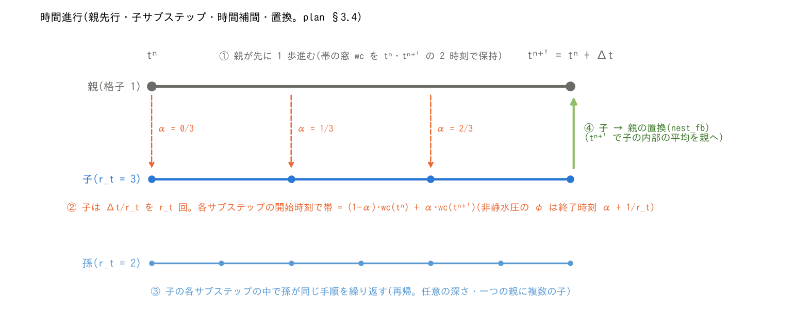
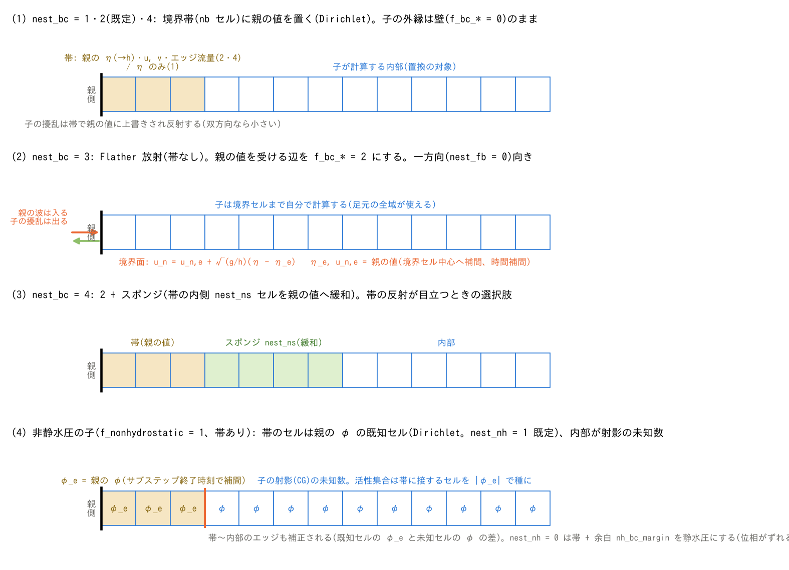

# ネスティング(多段格子)

[ユーザーガイド目次へ](../users_guide.md)

粗い親格子の中に細かい子格子を置き、同じランで同時に解きます(津波の
深海伝播と沿岸の遡上、広域の氾濫と市街地の細部など)。子は任意の深さ・
一つの親に複数置けます。設計の背景は docs/nesting_plan.md。

**現在の対応範囲**: 親→子は境界帯への水位のみ(nest_bc = 1)、
水位・流速・エッジ流量(2。既定)、開いた辺への Flather 放射(3。帯なし)、
2 + 内側のスポンジ(4)。子→親は一方向
(nest_fb = 0)/面積平均(1)/湿潤判定付き平均(2。既定)/2 + 保存修正(3)。
時間比 r_t は任意の整数、任意の深さの多段。浮遊砂・水質・流木・瓦礫・塩水の
水柱量と地下貯留(hg・hg2・hgc)は、親子の両方で有効なら自動的に交換されます。
非静水圧(f_nonhydrostatic = 1)の子格子では、帯のセルが親の非静水圧ポテンシャル
φ の既知セル(Dirichlet)になります(nest_nh。既定)。


(a) 子セル (1,1) の北西角を、一覧ファイルで指定する親セル `(i0, j0)` の
北西角に合わせます。i は西から東、j は北から南に増えます。図は親14×11セル、
子18×18セル、`(i0, j0) = (5, 3)`、空間比 `r = 3` の例です。子の範囲は
親の i = 5…10、j = 3…8 の6×6セル分で、親の外縁には少なくとも1セルを
残します。

黄色は子の外周の**境界帯**です。図は `nest_bc=2`、帯幅 `nb=3` 子セル
(親1セル分の幅)、スポンジなしの例です。帯を使う `nest_bc=1, 2, 4` では
親の値を帯に与え、帯の内側は子の計算で進めます。`nest_nb=0` の自動設定は、
移流スキーム1なら nb=2、2・3なら nb=3です。Flather方式の `nest_bc=3` は
帯を持たず、`nest_nb` の指定を使いません。

(b) 上段は、帯の子セル (1,4) の中心へ周囲の親セル中心から補間する例です。
図の空間補間はセル中心量についてのもので、参照する2×2の親セルがすべて
湿っている場合を示しています。各サブステップの開始時刻に、親の2時刻の値を
時間補間して使います。`nest_bc=2` は水位・流速に加えエッジ流量も渡しますが、
エッジ量の空間補間位置はセル中心とは異なります。

下段は、子の i = 10…12、j = 10…12 の3×3セルから、それと同じ範囲を覆う
親セル (8,6) へ戻す例です。`nest_fb=1`、有効面積率が1の場合の面積平均を
示し、転送先の親セルは説明のため右に別置きしています。この配置での置換対象は
親の i = 6…9、j = 4…7です。境界帯を含む親セルは対象から除き、
`nest_bc=4` ではスポンジを含む親セルも除きます。帯とスポンジを除いた子の内部に
**r×rセル全体が収まる親セル**だけを置換します。`nest_fb=0` なら子→親の
置換はありません。各平均方式の違いは下の「子→親の置換」を参照してください。

日英PNG・SVGは `python docs/figs/make_nest_figs.py layout` で生成します。

## 使い方

1. ルート(最も粗い格子)のパラメータファイルに一覧ファイルを指定します。

```
&list_sysparam
  ...
  fn_nest = "nest.txt"      ! ネスト格子の一覧(空 = ネストなし)
/
```

2. 一覧ファイル(1 行 1 格子。`#` 行は注釈):

```
# id  parent  param_file           r  r_t  i0  j0
1     0       param_root.txt
2     1       bay/param_bay.txt    1  1    133 133
3     2       town/param_town.txt  1  1    40  25
```

| 列 | 意味 |
|---|---|
| id | 格子番号。行番号と一致させる(1 = ルート) |
| parent | 親の格子番号(自分より小さい番号。ルートは 0) |
| param_file | その格子のパラメータファイル(地形・物性・初期条件・出力先は格子ごと) |
| r | 空間比 = 親の dx / 子の dx(正の整数。省略時 1) |
| r_t | 時間比 = 親の dt / 子の dt(正の整数。省略時 1。r_t = r が標準) |
| i0, j0 | 子のセル (1,1) の角が整列する親セルの番号(子は必須)。j はファイルの行順(北から南)に増える |



(a) 親の1歩 Δt に対し、子は `r_t=3` で3歩、孫は子に対する `r_t=2` で
計6歩進む例です。`r_t` は直上の親との時間比であり、空間比 `r` とは別の
指定です。横軸は計算上の時刻を表し、格子を同時並行に進める実行順ではありません。
親が先に1歩進み、子への境界値に必要な親の窓を、1歩の前後の2時刻
`tⁿ`・`tⁿ⁺¹` で保持します。その後、子を `r_t` 回進めます。

(b) 子のサブステップを `k=0…r_t−1` とすると、開始時刻は
`tⁿ + k Δt/r_t`、時間補間係数は `α=k/r_t` です。親の窓に保持した量 Q を
`Q(α)=(1−α)Qⁿ+αQⁿ⁺¹` と時間補間し、境界方式に応じた空間補間・乾湿判定
などを経て子へ渡します。これは水位・流速などに使う**開始時刻**の補間です。
`nest_bc=3` のFlather方式も開始時刻を使い、帯の上書きではなく開いた辺の
外部水位・流速として渡します。図の係数は `0/3, 1/3, 2/3` です。

非静水圧の子で `nest_nh=1` かつ `nest_bc=1, 2, 4` の場合、帯の既知値 φ は
サブステップの**終了時刻**へ補間します。図ではその係数を `β=α+1/r_t`
と表し、`1/3, 2/3, 3/3` になります。通常の境界値と φ は、どちらも子の1歩を
進める前に準備しますが、参照する時刻が異なります。`r_t=1` の場合も、通常の
境界値は親の `tⁿ`、φ は `tⁿ⁺¹` を使います。親が非静水圧を使わない場合、
親から渡す φ は0です。

孫があれば、子の各1歩の中で同じ手順を再帰的に行います。孫の補間元は
直上の子の2時刻です。緑矢印は `nest_fb=1〜3` での同期時の置換を表し、
この例の実行順は、親1歩 → [子1歩 → 孫2歩 → 孫から子へ置換]×3 →
子から親へ置換です。補間に使う終了時刻の窓は、その格子の1歩を進めた直後、
その子孫からの置換より前に保存した値です。一つの親に複数の子がある場合は、
それぞれの子について全サブステップと子→親の置換を終えてから、次の子へ進みます。

`nest_fb=0` では子→親の置換を行いません。1〜3では対象内部を平均して親へ
戻し、3ではさらに界面流束の保存修正を行います。帯・スポンジを含む親セルは
置換対象から除きます。各方式の平均・乾湿処理は下の「子→親の置換」を参照してください。
図は時間進行の模式図で、計算結果の時系列ではありません。

日英PNG・SVGは `python docs/figs/make_nest_figs.py time` で生成します。

3. 子のパラメータファイルに `&list_nest` を書きます(省略すると既定値):

```
&list_nest
  nest_bc = 2        ! 親→子: 1 = 水位のみ(TUNAMI 型), 2 = 水位+流速+エッジ量(既定。界面の整合が良い),
                     !        3 = 開いた辺(f_bc_* = 2)への Flather 放射(帯なし。一方向で子の擾乱を外へ抜く),
                     !        4 = 2 + 帯の内側 nest_ns セルを親の値へ緩和するスポンジ
  nest_fb = 2        ! 子→親: 0 = なし(一方向), 1 = h/m/n の面積平均(体積厳密), 2 = 湿潤判定付き平均(既定。海岸線向き),
                     !        3 = 2 + 保存修正(界面を横切る流量を子に合わせて親の外側を補正。体積保存)
  nest_ns = 4        ! スポンジの幅(セル。nest_bc = 4 のとき帯の内側に置く緩和帯)
  nest_nb = 0        ! 境界帯の幅(セル)。0 = 自動(移流スキーム 1 は 2、2・3 は 3)
  nest_nh = 1        ! 非静水圧の子: 1 = 帯を親の φ の Dirichlet 既知セルに(既定), 0 = 帯 + 余白を静水圧に
/
```



図は子格子の西端付近の一列を示し、右側へ内部が続きます。(a)〜(c) は
`nest_bc` による境界方式の比較、(d) は帯を持つ非静水圧計算に追加する
`nest_nh` の設定です。例の帯幅は nb=3 子セル、スポンジ幅は nest_ns=4 子セルです。

- (a) `nest_bc=1` は帯に水位を与え、流速・流量は子が計算します。
  `nest_bc=2`（既定）は水位・流速・エッジ流量を親から与えます。
  黒い実線は子の外縁の壁（西端では `f_bc_w=0`）です。
- (b) `nest_bc=3` は帯なしのFlather放射です。橙の破線は開いた辺
  （西端では `f_bc_w=2`）、矢印は親の波の入射と子の擾乱の放射を示します。
  式の法線流速は**子から外向きが正**で、西端では左向きです。
- (c) `nest_bc=4` は2と同じ帯の内側にスポンジを加えます。緑セル内の
  数値は親の値へ緩和する重み w で、内側ほど小さくなります。
  帯とスポンジを含む親セルは、子→親の置換対象から除外します。
- (d) `nest_nh=1`（既定）は帯の φ を親から与える既知値にします。
  図は内部が湿潤・射影対象である例で、橙線の帯〜内部のエッジも補正します。
  通常の境界値はサブステップ**開始時刻**、φ は**終了時刻**へ時間補間します。
  `nest_nh` は `nest_bc` とは別の設定で、帯のない3には適用しません。

日英PNG・SVGは `python docs/figs/make_nest_figs.py bc` で生成します。
各方式の誤差を一様細格子と比較した例は [examples/nest_reflect](../../examples/nest_reflect/) のREADME
（図付き）を参照してください。

## 子格子の条件(初期化で検査し、満たさなければ停止します)

- 子の dx × r = 親の dx、子の dt × r_t = 親の dt、t0 と計算時間が親と同じ。
  各格子の dt は自分の CFL 条件で決め、r_t = r が標準です(r_t = 1 にすると
  親の dt も子の CFL で決まります)。
- 子の nx, ny は r の倍数。子の全体が親の内側に収まり、親の外縁から
  親セル 1 個以上離れていること(足元の外側 1 セルを補間に使う)。
- 子の外縁の境界条件は壁(`&list_bound_edge` の f_bc_* = 0。既定)で、流入
  区間を置かない。境界帯(外周 nb セル)の値は親が与えるので、子の境界
  条件は設定しない。**nest_bc = 3 だけは逆**で、親の値を受ける辺を
  `f_bc_* = 2`(長波放射)にします(下記)。
- 子の格子は帯より十分大きいこと(nx, ny > 2·nb + 2)。
- 計算方式は ENC(f_gridsystem = 0)。

## 出力と再開

- 各格子は自分の `dir_result` に通常どおり出力します(分布・プローブ・
  測線・Log.txt)。格子ごとに別のディレクトリを与えてください。
- 状態保存・再開(f_state_save / f_state_restore)も格子ごとに動きます。
  `dir_save` を格子ごとに別にしてください。ルートの再開は全格子の再開です。
- 画面表示は格子の進行が交互に出ます(ルートの 1 歩ごとに子が続く)。

## 非静水圧の子格子(nest_nh)

帯を持つ子が非静水圧(f_nonhydrostatic = 1)のとき、帯のセルは子の射影
(φ の楕円型方程式)の未知数から外れ、φ の既知セル(Dirichlet)になります。
既定(nest_nh = 1)では
親の φ(サブステップ終了時刻で補間)を置くので、親から来る分散波の非静水圧
圧力が界面で連続になり、比 1:1 の自己ネストでは子の内部が親と一致します
(CG の許容残差の精度。[test/nest_identity](../../test/nest_identity/) の nh ケースで最大差 2e-13 m)。
nest_nh = 0 は帯とその内側 nh_bc_margin セル(他の強制境界と同じ余白)を
静水圧にする選択肢で、界面で分散波の位相がずれます(同ケースで最大差
1.4e-2 m)。親が非静水圧でなければ既定でも φ = 0 が入ります。

- 子は nest_bc = 1・2・4(帯あり)で使えます。Flather(nest_bc = 3)には適用
  されず、開いた面の近くは nh_bc_margin の静水圧の余白のままです。
- 活性集合(f_nh_adaptive = 1)もそのまま使えます。|φ_e| が種の下限以上の帯セルに
  8近傍で接する内部候補セルも種に加わります。ネストのための追加設定はありません。
- 動く底面(f_nh_bottom)の平滑化の補助解は帯 φ = 0 のまま解きます(近似)。

## Flather 放射(nest_bc = 3)

帯の代わりに、子の開いた辺の境界面に長波の特性線条件[^flather76]

```math
u_n = u_{n,e} + \sqrt{\frac{g}{h}}\,(\eta - \eta_e)
```

を置きます。η_e・u_{n,e} は
親の水位と辺の外向き法線流速(境界セル中心で補間、サブステップ開始時刻で
時間補間)。既存の長波放射境界(`f_bc_* = 2`。η_e = 基準水位・u_e = 0)の
一般化で、親から来る波を通しつつ、子の内部で生じた擾乱(細かい海岸の
反射・遡上の戻り)を外へ放射します。u_n と u_n,e はともに子から外向きが正で、
h は子の境界セルの水深です。実装では係数の分母を max(h, dv) とし、得られた
辺法線流速をENCの各境界面へ射影して流量を計算します。

- 用途は**一方向**(nest_fb = 0)で、子の反射を親に戻さず子に閉じ込めたくない
  とき。帯 Dirichlet(nest_bc = 2)では子の擾乱が親の値で上書きされることが、
  反射の原因になり得ます。双方向(nest_fb ≥ 1)の置換で軽減される場合もあります。
  通常は既定の 2 を使い、一方向のときに 3 を検討してください。
- 子の param の `&list_bound_edge` で、親の値を受ける辺を `f_bc_* = 2` に
  します(`fn_boundary = '-'` でそのファイル内に書けます)。0(壁)の辺は
  壁のまま(陸側境界を最大遡上高より上に置く運用)。1(自由流出)と流入区間は
  不可。少なくとも 1 辺は 2 であること。
- 帯はありません(nest_nb は無視)。スポンジは不可。子→親の置換(双方向)
  と併用する場合、境界セルを含む親セルは置換しません。浮遊砂・水質・地下水
  などの追加の場は交換しません(境界面からの流入は清水)。
- 開いた辺は**恒常に湿った水域**に置いてください。親の補間点が乾いている
  サブステップはその面を閉じ、子の境界セルが乾いていれば流束は 0 です
  (境界からの再湿潤はしません)。
- 親が静水(η 一定・u = 0)なら現行の放射境界と同一ビットです
  ([test/nest_identity](../../test/nest_identity/) の flather ケース)。一方向 r3t3 の界面通過での
  帯との比較は [examples/nest_reflect](../../examples/nest_reflect/)(README)。

## スポンジ(nest_bc = 4)

`nest_bc=2` と同じ境界帯の内側に、幅 `nest_ns` 子セルの緩和領域を置きます。
各サブステップの開始時に、セル量 q を親の補間値 q_parent へ混合します。
帯から内側への最短セル数を d = 1…nest_ns として

```math
q \leftarrow (1-w)\,q + w\,q_{\mathrm{parent}},\qquad
w = \left(1 - \frac{d}{n_s+1}\right)^2
```

です(n_s = nest_ns)。図の nest_ns=4 では帯側から 0.64、0.36、0.16、0.04 と
なります。2 乗の重みは、境界で 1 に近く内側へ滑らかに 0 に落ちる緩和
(Davies 型のスポンジ層[^davies83])の最も単純な形で、幅 nest_ns は
校正値ではなく「子の波長の数分の一」程度を目安に選びます(経験値)。

対象は水深・流速・セル流量と、親子で交換が有効な追加の場です。エッジ量を
この重みで緩和する処理ではありません。帯は親の値で置換し、スポンジは
親の値に近づけてから子の計算を進めます。帯とスポンジの両方を除いた
内部の完全な r×r 子セルだけを、子→親の置換に使います。

## 子→親の置換(nest_fb)

- 境界帯とスポンジを除く子の内部に r×r セル全体が収まる親セルを、
  親の1歩の終わりに子の平均で置き換えます。Flather方式では帯はありませんが、
  子の外縁に対応する親1セル分は置換対象から除きます。
  nest_fb = 2 は湿った子セルだけで水位と水深を平均し、
  親の地盤が平均水位より高ければ親セルを乾かします(海岸線をまたぐ領域
  向き。水柱体積は厳密には保存しません)。nest_fb = 1 は水深・流量の単純
  平均で体積が厳密に保存されます(全域が水域のとき向き)。
- サブグリッド河道幅や空隙率で有効面積率が 1 でない親セルは、子の真の水量を
  親の有効面積率で矩形換算の水深に戻します(河道水位の整合)。
- nest_fb = 3 は、置換領域の外周で親と子の界面流量の差を親の水深に戻し、
  系全体の体積を保存します(AMR の reflux[^berger98] に相当。GeoClaw が
  同じ修正を使います[^berger11])。
- 終了時に画面へ要約(帯の置換で子に加わった水柱体積、置換回数と親の水柱
  体積の変化の累計、保存修正の量)を出します。陸上では帯に降った雨が
  親の値で上書きされるので、子の水収支はこの帯の置換体積を加えて照合します。

## BMI から使う

ネスト系はそのまま BMI の 1 つのモデルです(bmi/README.md)。`initialize` に
ルートのパラメータファイルを渡すと全格子が初期化され、`update` はルートの
1 歩(子はその中で進みます)、時刻はルートのものです。格子は grid id で
区別します: 0 = ルート、k = 一覧の k+1 行目。非ルート格子の変数は名前の
object 部に `~grid<k>` を付けます(`surface_water~grid1__depth` = 格子 1 の
水深)。Python では `var_on_grid(VAR_DEPTH, 1)` が名前を作り、`model.grids`・
`model.shape_of(k)`・`model.origin_of(k)` が格子の情報を返します。子格子の
原点は、georef がなければ親の原点と整列位置から導かれ、全格子がルートの
座標系で表されます。set(水深・地形・降水)も格子ごとに同じ条件で使えます。
受け入れ試験は [test/bmi_nest](../../test/bmi_nest/)。

## 注意

- 一方向(nest_fb = 0)では子の反射・遡上は親に戻りません。親の粗い海岸の
  反射が帯から子に入り、子の擾乱は帯で反射します(双方向で解消。または
  nest_bc = 3 で子の擾乱を外へ放射)。
- 子の境界帯の近く(nb × r セル程度)の陸上の遡上は近似が粗いので、注目
  地点から離してください。陸側の境界は最大遡上高より上に置き、水が届か
  ないようにします。
- 比 1:1 の自己ネスト(子 = 親の部分領域)では、子の内部は親の同領域と
  ビット一致し、双方向ではルート全体が単独ランとビット一致します
  ([test/nest_identity](../../test/nest_identity/)。帯と置換の設計の検証に使えます)。
- 比 3・5 の双方向ネストで界面を横切る波の検証例は [examples/nest_reflect](../../examples/nest_reflect/)
  (一様細格子との比較。水位・誤差・一方向の帯と Flather・非静水圧の帯の
  図は同 README)。[test/nest_identity](../../test/nest_identity/) の README に恒等ケースの一覧があります。

## 検証・例題

- [test/nest_identity](../../test/nest_identity/): 比 1:1 の自己ネストの恒等テスト(帯の置換・双方向・Flather・非静水圧の各構成)。
- [test/bmi_nest](../../test/bmi_nest/): BMI からのネスト系の受け入れ試験。
- [examples/nest_reflect](../../examples/nest_reflect/): 比 3・5 の双方向ネストで界面を横切る波の検証(一様細格子との比較。README に図)。

## 参考文献

[^flather76]: Flather, R. A. (1976): A tidal model of the north-west European continental shelf. *Mém. Soc. R. Sci. Liège*, 6(10), 141–164.
[^davies83]: Davies, H. C. (1983): Limitations of some common lateral boundary schemes used in regional NWP models. *Mon. Wea. Rev.*, 111, 1002–1012.
[^berger98]: Berger, M. J. and LeVeque, R. J. (1998): Adaptive mesh refinement using wave-propagation algorithms for hyperbolic systems. *SIAM J. Numer. Anal.*, 35(6), 2298–2316.
[^berger11]: Berger, M. J., George, D. L., LeVeque, R. J. and Mandli, K. T. (2011): The GeoClaw software for depth-averaged flows with adaptive refinement. *Adv. Water Resour.*, 34, 1195–1206.
