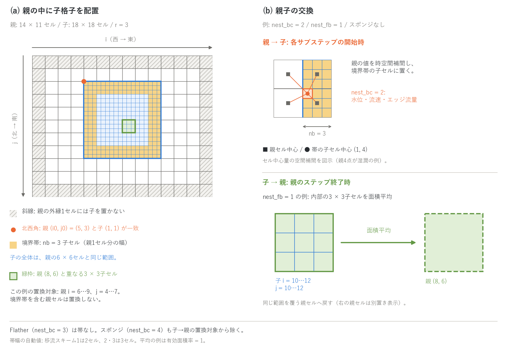

# ネスティング(多段格子)

[ユーザーガイド目次へ](../users_guide.md)

粗い親格子の中に細かい子格子を置き、同じランで同時に解きます(津波の
深海伝播と沿岸の遡上、広域の氾濫と市街地の細部など)。子は任意の深さ・
一つの親に複数置けます。設計の背景は docs/nesting_plan.md。

**現在の対応範囲**: 親→子は境界帯への水位のみ(nest_bc = 1)、
水位・流速・エッジ流量(2。既定)、開いた辺への Flather 放射(3。帯なし)、
2 + 内側のスポンジ(4)。子→親は一方向
(nest_fb = 0)/面積平均(1)/湿潤判定付き平均(2。既定)/2 + 保存修正(3)。
時間比 r_t は任意の整数、任意の深さの多段。浮遊砂・水質・流木・瓦礫・塩水の
水柱量と地下貯留(hg・hg2・hgc)は、親子の両方で有効なら自動的に交換されます。
非静水圧(f_nonhydrostatic = 1)の子格子では、帯のセルが親の非静水圧ポテンシャル
φ の既知セル(Dirichlet)になります(nest_nh。既定)。交換されるのは
これらの量と φ だけです(nest_bc = 3 では追加の場は交換しません)。地形 z
(地盤変動・河床変動を含む)、積雪・氷・溶岩、各モジュールの内部状態は
格子ごとに独立で、親子で揃える仕組みはありません。地盤変動などの強制は
各格子のパラメータに与えてください。各方式の定式・
時間補間・既定値の根拠は[ネスティングの解説](nest_models.md)にあります。



(a) 子セル (1,1) の北西角を、一覧ファイルで指定する親セル `(i0, j0)` の
北西角に合わせます。i は西から東、j は北から南に増えます。図は親14×11セル、
子18×18セル、`(i0, j0) = (5, 3)`、空間比 `r = 3` の例です。子の範囲は
親の i = 5…10、j = 3…8 の6×6セル分で、親の外縁には少なくとも1セルを
残します。

黄色は子の外周の**境界帯**です。図は `nest_bc=2`、帯幅 `nb=3` 子セル
(親1セル分の幅)、スポンジなしの例です。帯を使う `nest_bc=1, 2, 4` では
親の値を帯に与え、帯の内側は子の計算で進めます。`nest_nb=0` の自動設定は、
移流スキーム1なら nb=2、2・3なら nb=3です。Flather方式の `nest_bc=3` は
帯を持たず、`nest_nb` の指定を使いません。

(b) 上段は、帯の子セル (1,4) の中心へ周囲の親セル中心から補間する例です。
図の空間補間はセル中心量についてのもので、参照する2×2の親セルがすべて
湿っている場合を示しています。各サブステップの開始時刻に、親の2時刻の値を
時間補間して使います。`nest_bc=2` は水位・流速に加えエッジ流量も渡しますが、
エッジ量の空間補間位置はセル中心とは異なります。

下段は、子の i = 10…12、j = 10…12 の3×3セルから、それと同じ範囲を覆う
親セル (8,6) へ戻す例です。`nest_fb=1`、有効面積率が1の場合の面積平均を
示し、転送先の親セルは説明のため右に別置きしています。この配置での置換対象は
親の i = 6…9、j = 4…7です。境界帯を含む親セルは対象から除き、
`nest_bc=4` ではスポンジを含む親セルも除きます。帯とスポンジを除いた子の内部に
**r×rセル全体が収まる親セル**だけを置換します。`nest_fb=0` なら子→親の
置換はありません。各平均方式の違いは[解説](nest_models.md) §6 を参照してください。

## 使い方

1. ルート(最も粗い格子)のパラメータファイルに一覧ファイルを指定します。

```
&list_sysparam
  ...
  fn_nest = "nest.txt"      ! ネスト格子の一覧(空 = ネストなし)
/
```

2. 一覧ファイル(1 行 1 格子。`#` 行は注釈):

```
# id  parent  param_file           r  r_t  i0  j0
1     0       param_root.txt
2     1       bay/param_bay.txt    1  1    133 133
3     2       town/param_town.txt  1  1    40  25
```

| 列 | 意味 |
|---|---|
| id | 格子番号。行番号と一致させる(1 = ルート) |
| parent | 親の格子番号(自分より小さい番号。ルートは 0) |
| param_file | その格子のパラメータファイル(地形・物性・初期条件・出力先は格子ごと) |
| r | 空間比 = 親の dx / 子の dx(正の整数。省略時 1) |
| r_t | 時間比 = 親の dt / 子の dt(正の整数。省略時 1。r_t = r が標準) |
| i0, j0 | 子のセル (1,1) の角が整列する親セルの番号(子は必須)。j はファイルの行順(北から南)に増える |

親が 1 歩進んでから子が r_t 歩進み、子の境界値は親の 2 時刻を時間補間して
与えます(時間進行と補間の詳細は[解説](nest_models.md) §1)。

3. 子のパラメータファイルに `&list_nest` を書きます(省略すると既定値):

```
&list_nest
  nest_bc = 2        ! 親→子: 1 = 水位のみ(TUNAMI 型), 2 = 水位+流速+エッジ量(既定。界面の整合が良い),
                     !        3 = 開いた辺(f_bc_* = 2)への Flather 放射(帯なし。一方向で子の擾乱を外へ抜く),
                     !        4 = 2 + 帯の内側 nest_ns セルを親の値へ緩和するスポンジ
  nest_fb = 2        ! 子→親: 0 = なし(一方向), 1 = h/m/n の面積平均(体積厳密), 2 = 湿潤判定付き平均(既定。海岸線向き),
                     !        3 = 2 + 保存修正(界面を横切る流量を子に合わせて親の外側を補正。体積保存)
  nest_ns = 4        ! スポンジの幅(セル。nest_bc = 4 のとき帯の内側に置く緩和帯)
  nest_nb = 0        ! 境界帯の幅(セル)。0 = 自動(移流スキーム 1 は 2、2・3 は 3)
  nest_nh = 1        ! 非静水圧の子: 1 = 帯を親の φ の Dirichlet 既知セルに(既定), 0 = 帯 + 余白を静水圧に
/
```

方式の選び方の目安:

| 目的 | nest_bc | nest_fb | 補足 |
|---|---|---|---|
| 通常(津波・氾濫の細部を親に戻す) | 2(既定) | 2(既定) | 海岸線をまたぐ領域向き。全域が水域なら 1 で体積厳密 |
| 系全体の体積保存を厳密に | 2 | 3 | 界面流量の差を親に戻す保存修正 |
| 一方向で、子の擾乱を外へ逃がす | 3(Flather) | 0 | 開いた辺を `f_bc_* = 2` に。帯なし |
| 帯での反射を弱める | 4(2+スポンジ) | 0〜3 | 幅 nest_ns の緩和帯 |
| 非静水圧の子 | 1・2・4 | — | nest_nh = 1(既定)で帯を親の φ の既知セルに |

各方式の式と性質(帯の補間、Flather 条件、スポンジの重み、子→親の
平均と保存修正、非静水圧の帯)は[解説](nest_models.md) §2〜§6 にあります。

## 子格子の条件(初期化で検査し、満たさなければ停止します)

- 子の dx × r = 親の dx、子の dt × r_t = 親の dt、t0 と計算時間が親と同じ。
  各格子の dt は自分の CFL 条件で決め、r_t = r が標準です(r_t = 1 にすると
  親の dt も子の CFL で決まります)。
- 子の nx, ny は r の倍数。子の全体が親の内側に収まり、親の外縁から
  親セル 1 個以上離れていること(足元の外側 1 セルを補間に使う)。
- 子の外縁の境界条件は壁(`&list_bound_edge` の f_bc_* = 0。既定)で、流入
  区間を置かない。境界帯(外周 nb セル)の値は親が与えるので、子の境界
  条件は設定しない。**nest_bc = 3 だけは逆**で、親の値を受ける辺を
  `f_bc_* = 2`(長波放射)にします(下記)。
- 子の格子は帯(とスポンジ)より十分大きいこと(nx, ny > 2·(nb + nest_ns) + 2)。
  nest_fb > 0 では、帯・スポンジを除いた内部に r×r 全体が収まる親セルが
  1 個以上必要です。
- 計算方式は ENC(f_gridsystem = 0)。
- 海域マスク(fn_sw)のセルは親子の交換で考慮されません(帯への書き込みと
  子→親の置換が海セルの h・流速も上書きします)。**子の境界帯と、子の
  内部に対応する置換対象の親セル(nest_fb > 0 のとき)に海域マスクの
  セルを置かない**こと(初期化で検査し、あればエラーで停止)。津波は海を
  通常セル(sw=0)で解く構成が前提で、潮位境界(fn_tide)を使う高潮の
  ネストは現状未対応です。

## 出力・確認

分布出力の 3 通りの有効化(自動 / 指定 / 共用)と柱状量の面積基底の読み方は[入出力の形式](io.md#状態量の分布出力の考え方)に、確認したい量から出力を逆引きする早見表は同じ節の末尾にあります。

**分布**

- 各格子は自分の `dir_result` に通常どおり分布を出力します(H・E・9999
  統計など。FILENUMBER.csv も格子ごと)。格子ごとに別のディレクトリを
  与えてください。子格子の分布は子の格子幅・範囲で書かれます。

**台帳・ログ**

- 画面表示は格子の進行が交互に出ます(ルートの 1 歩ごとに子が続く)。
  各格子の Log.txt の S 列はその格子の貯留で、親の S には子で置換した
  領域の値が入ります(双方向)。
- 終了時に「nest: summary」として子格子ごとに、帯の置換で子に加わった
  水柱体積、置換方式と置換回数、置換による親の水柱体積の変化の累計(和と
  絶対値和)、nest_fb = 3 のときは保存修正の量 Σ|Δh|·A が表示されます
  (境界方式はパラメータ読み込み時に表示)。双方向ではこの体積変化が
  親の S × 面積に比べて無視できることを確認します。

**計測**(プローブ・測線の列)

- プローブ・測線も格子ごとに設定し、その格子の `dir_result` に書かれます。
  同じ地点を親と子の両方に置くと、界面の整合の確認に使えます。

**再開**

- 状態保存・再開(f_state_save / f_state_restore)は格子ごとに動きます。
  f_state_restore と `dir_save` は**全格子のパラメータファイルに**それぞれ
  指定してください(ルートの指定は子に伝わりません)。片方だけの再開、再開
  ステップの不一致(子の it0 ≠ 親の it0 × r_t)、親子で同じ `dir_save` は
  初期化で停止します。ネストの終了時集計(置換体積など)は保存されないため、
  再開後の集計は再開区間のみです。

**読み方と検算のコツ**

- 親子の整合は、境界帯をまたぐ親と子の H・E を同時刻で重ねて確認します
  (1:1 の自己ネストはビット一致 = [test/nest_identity](../../test/nest_identity/))。
  界面の反射は子の境界近くのプローブで見ます([解説](nest_models.md) §5)。

## BMI から使う

ネスト系はそのまま BMI の 1 つのモデルです(bmi/README.md)。`initialize` に
ルートのパラメータファイルを渡すと全格子が初期化され、`update` はルートの
1 歩(子はその中で進みます)、時刻はルートのものです。格子は grid id で
区別します: 0 = ルート、k = 一覧の k+1 行目。非ルート格子の変数は名前の
object 部に `~grid<k>` を付けます(`surface_water~grid1__depth` = 格子 1 の
水深)。Python では `var_on_grid(VAR_DEPTH, 1)` が名前を作り、`model.grids`・
`model.shape_of(k)`・`model.origin_of(k)` が格子の情報を返します。子格子の
原点は、georef がなければ親の原点と整列位置から導かれ、全格子がルートの
座標系で表されます。set(水深・地形・降水)も格子ごとに同じ条件で使えます。
受け入れ試験は [test/bmi_nest](../../test/bmi_nest/)。

## 注意

- 一方向(nest_fb = 0)では子の反射・遡上は親に戻りません。親の粗い海岸の
  反射が帯から子に入り、子の擾乱は帯で反射します(双方向で解消。または
  nest_bc = 3 で子の擾乱を外へ放射)。
- 海域マスク(fn_sw)と潮位(fn_tide)は格子ごとに独立で、親子で揃える
  仕組みはありません。海セルを帯や置換対象に含めた構成は初期化で
  停止します(上の「子格子の条件」)。
- 子の境界帯の近く(nb × r セル程度)の陸上の遡上は近似が粗いので、注目
  地点から離してください。陸側の境界は最大遡上高より上に置き、水が届か
  ないようにします。
- 比 1:1 の自己ネスト(子 = 親の部分領域)では、子の内部は親の同領域と
  ビット一致し、双方向ではルート全体が単独ランとビット一致します
  ([test/nest_identity](../../test/nest_identity/)。帯と置換の設計の検証に使えます)。
- 比 3・5 の双方向ネストで界面を横切る波の検証例は [examples/nest_reflect](../../examples/nest_reflect/)
  (一様細格子との比較。水位・誤差・一方向の帯と Flather・非静水圧の帯の
  図は同 README)。[test/nest_identity](../../test/nest_identity/) の README に恒等ケースの一覧があります。

## 検証・例題

- [test/nest_identity](../../test/nest_identity/): 比 1:1 の自己ネストの恒等テスト(帯の置換・双方向・Flather・非静水圧の各構成)。
- [test/bmi_nest](../../test/bmi_nest/): BMI からのネスト系の受け入れ試験。
- [examples/nest_reflect](../../examples/nest_reflect/): 比 3・5 の双方向ネストで界面を横切る波の検証(一様細格子との比較。README に図)。

## 参考文献

この章で使うモデル・式・既定値の出典は、[ネスティングの解説](nest_models.md#参考文献)の参考文献にまとめています。
