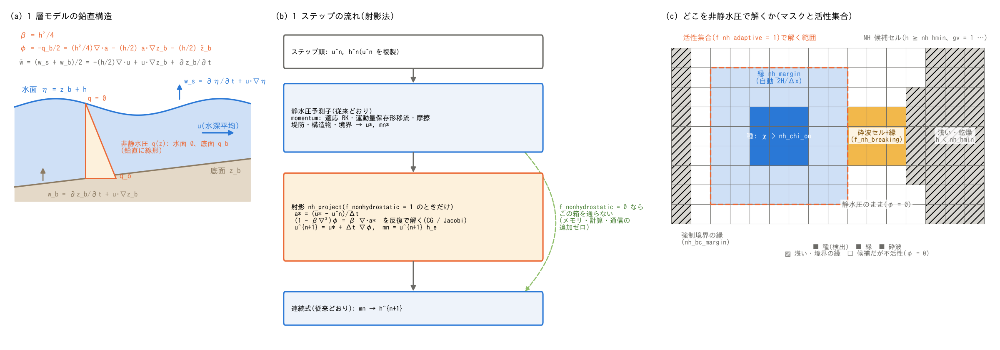
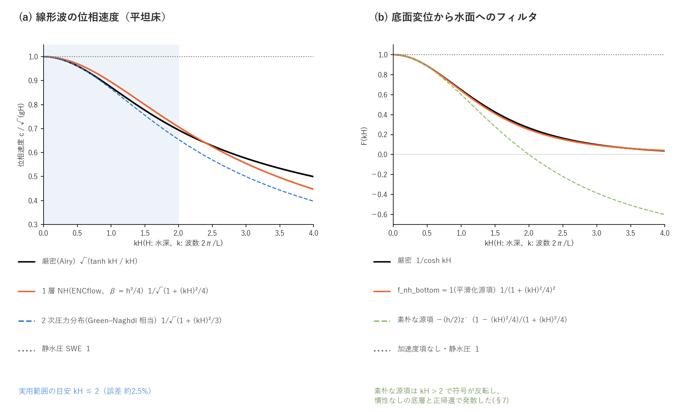

# 非静水圧補正(1 層モデル)の解説(浅水流計算の補足)

[浅水流計算の章へ](swflow.md) / [ユーザーガイド目次へ](../users_guide.md)

浅水流計算の研究用オプション「1 層非静水圧補正」(`f_nonhydrostatic = 1`)
の方程式・アルゴリズム・適用範囲の解説です。[浅水流計算の章](swflow.md)
の「非静水圧補正(研究用)」の表にあるパラメータ(`nh_*`、`f_nh_*`)の
背後にある考え方を、設定の意味がわかる程度に説明します。設計の経緯・
代替案の比較・数値実験の記録(開発者向け)は docs/nonhydrostatic_plan.md
と docs/developer.md §69 にあります。実装にあたって参考にした他モデルと
文献は §9 にまとめました。

数式は GitHub の Markdown が描画する LaTeX 記法で書いています。図は
`python3 docs/figs/make_guide_figs.py nonhydro` で日英の PNG を生成します
(`docs/figs/guide/fig_nonhydro.py`)。

## 1. なぜ非静水圧か — 周波数分散

静水圧の浅水方程式(SWE)は、圧力が水面からの深さに比例する(鉛直加速度を
無視する)仮定のもとで導かれ、平坦床・微小振幅の線形波の位相速度は
波長によらず $`\sqrt{gH}`$ です。実際の水面波の分散関係は

```math
\omega^2 = g\,k\,\tanh(kH)
```

で、浅水展開 $`\omega^2 = gHk^2\,[1 - (kH)^2/3 + \cdots]`$ のとおり、
**短い波ほど遅く**進みます(周波数分散)。この性質が本質的に効く現象は
SWE では原理的に再現できません。

- 河川を遡上する津波のソリトン分裂・undular bore(非線形の急峻化と
  分散の競合)
- 地滑り津波の造波と近地伝播(発生源の水平スケールが水深に比べて
  十分大きくない)
- 貯水池・ため池の孤立波、弱い段波

一方、降雨流出・河川洪水・氾濫・高潮・一般的な長波津波には不要です。
既定は静水圧 ENC で、無効時は配列を確保せず何も呼ばないので、既存の
計算結果とビット単位で一致します。

**数値分散と物理分散。** 差分格子にも「数値分散」があり、1 次元の
C 格子では長波展開が $`\omega^2 = gHk^2\,[1 - (k\Delta x)^2/12 + \cdots]`$
です。1 層非静水圧モデルの物理分散 $`[1 - (kH)^2/4 + \cdots]`$ と比べると、
**$`\Delta x = \sqrt{3}\,H \approx 1.7H`$ で両者が同じ大きさ**になります。

| $`\Delta x / H`$ | 数値分散 / 物理分散 |
|---:|---:|
| 2.0 | 1.33 |
| 1.0 | 0.33 |
| 0.5 | 0.083 |
| 0.25 | 0.021 |

格子が $`\Delta x > 1.7H`$ では非静水圧補正を入れても数値分散に埋もれて
意味がなく、**実用は $`\Delta x \lesssim H/2`$ が前提**です(深さ 10 m の
河川遡上津波なら $`\Delta x \approx`$ 2.5〜5 m)。計算コストはソルバより
この解像度要件で決まります。ENC 格子の数値分散の実測([test/nhwave](../../test/nhwave/README.md))は
0.3〜0.8%($`k\Delta x`$ = 0.13〜0.18)で、1 層モデルの目標($`kH = 1`$ で
12%)と明確に区別できます。

## 2. 1 層非静水圧モデルの方程式



図 (a) の変数で書きます。$`h`$: 水深、$`z_b`$: 底面、$`\eta = z_b + h`$: 水面、
$`\mathbf{u}`$: 水深平均の水平流速、$`q(z)`$: 静水圧からのずれ(非静水圧)。
1 層モデルは **$`q`$ を鉛直に線形**(水面で 0、底面で $`q_b`$)と仮定し、
鉛直速度を水面 $`w_s`$ と底面 $`w_b`$ の平均で代表させます
(Stelling & Zijlema 2003 の Keller-box 型 1 層と同じ近似)。

**鉛直の運動量。** 層平均の鉛直加速度は底面の非静水圧で駆動されます
(密度 1、移流は省略)。

```math
h\,\frac{\partial \bar w}{\partial t} = q_b,
\qquad
\bar w = \frac{w_s + w_b}{2}
```

**運動学条件と層内の連続式。** $`w_s = \partial\eta/\partial t + \mathbf{u}\cdot\nabla\eta`$、$`w_b = \partial z_b/\partial t + \mathbf{u}\cdot\nabla z_b`$、および $`w_s - w_b = -h\,\nabla\cdot\mathbf{u}`$
から

```math
\bar w = -\frac{h}{2}\,\nabla\cdot\mathbf{u}
+ \mathbf{u}\cdot\nabla z_b + \frac{\partial z_b}{\partial t}
```

**水平の運動量。** 非静水圧の水平勾配を水深方向に平均すると(Leibniz 則、
$`q`$ は水面で 0)

```math
\frac{\partial \mathbf{u}}{\partial t} + \cdots
= \underbrace{-\,g\nabla\eta - \cdots}_{\text{静水圧部 } \mathbf{a}^{*}}
\;-\;\frac{1}{2}\nabla q_b \;-\; \frac{q_b}{2h}\,\nabla\bigl(h + 2 z_b\bigr)
```

**ポテンシャル φ。** $`\phi := -q_b/2`$ と置き、$`h`$ をステップ内で固定して
鉛直運動量を加速度 $`\mathbf{a} = \partial\mathbf{u}/\partial t`$ で書くと

```math
\boxed{\;
\mathbf{a} = \mathbf{a}^{*} + \nabla\phi + \frac{\phi}{h}\nabla(h + 2z_b),
\qquad
\phi = \frac{h^2}{4}\,\nabla\cdot\mathbf{a}
\;-\;\frac{h}{2}\,\mathbf{a}\cdot\nabla z_b
\;-\;\frac{h}{2}\,\ddot z_b
\;}
```

右辺の 3 項が、それぞれ **Version 1(平坦床。既定)**、**底面勾配項
(`f_nh_slope = 1`)**、**動く底面の加速度項(`f_nh_bottom = 1`)**に
対応します(§7)。平坦床では $`\beta := h^2/4`$ として

```math
\phi = \beta\,\nabla\cdot\mathbf{a},
\qquad
\mathbf{a} = \mathbf{a}^{*} + \nabla\phi
\;\;\Longrightarrow\;\;
\bigl(1 - \beta\nabla^2\bigr)\,\phi = \beta\,\nabla\cdot\mathbf{a}^{*}
```

すなわち非静水圧補正は、静水圧の加速度 $`\mathbf{a}^{*}`$ に**陰的な
分散フィルタ**を掛ける操作です。Fourier モードでは
$`\hat a = \hat a^{*}/(1 + (kH)^2/4)`$ で、高波数側の加速度を抑える
(増幅しない)フィルタなので、新しい速い波を生まず CFL 条件は変わりません。

**分散関係。** 平坦床・線形化で $`\partial u/\partial t = -g\,\partial\eta/\partial x + \partial\phi/\partial x`$、$`\phi = (H^2/4)\,\partial^2 u/\partial x\partial t`$、
$`\partial\eta/\partial t = -H\,\partial u/\partial x`$ から

```math
\omega^2 = \frac{gHk^2}{1 + (kH)^2/4}
```



図 (a) が厳密解との比較です。位相速度の誤差は $`kH = 0.5 / 1 / 2 / 3`$ で
+0.9 / +2.5 / +1.8 / −3.7%。2 次の圧力分布(Green–Naghdi 相当、
$`1/(1 + (kH)^2/3)`$。Jeschke et al. 2017)は $`kH \le 1`$ では精度が高い
(−0.1%)ものの $`kH = 2 / 3`$ で −5.7 / −13% と悪化し、射影法では時間微分の
扱いに曖昧さが出ます。ソリトン分裂の後続波($`kH`$ = 1〜2)で線形分布が
劣らず、スカラー 1 個で済むため、**線形分布 $`\beta = h^2/4`$ を採って
います**。一様流 $`U_0`$ の上では $`(\omega - U_0 k)^2 = gHk^2/(1 + (kH)^2/4)`$
となり、移流を含む全加速度にフィルタを掛ける方針と整合します
([test/nhcurrent](../../test/nhcurrent/README.md) で数値確認)。

## 3. アルゴリズム — ステップ末尾の射影(fractional step)

図 (b) のとおり、1 ステップを 3 段に分けます。

1. **静水圧予測子(従来どおり)。** 運動方程式(適応的ルンゲクッタ・
   運動量保存形移流・摩擦・堤防・構造物・境界条件)をそのまま解き、
   エッジ流速 $`u^{*}_e`$ と流量を得ます。
2. **射影(`nh_project`。有効時のみ)。** ステップの静水圧全加速度
   $`a^{*}_e = (u^{*}_e - u^{n}_e)/\Delta t`$(移流・摩擦・RK の効果を含む)
   から、セルごとのポテンシャル $`\phi`$ を反復で解き、エッジ流速を補正して
   流量を作り直します。
3. **連続式(従来どおり)。** 補正後の流量で水深を更新します。両側セルが
   同じ流量を見るので質量保存は厳密なままです。

**離散式。** ENC の重み規約で、エッジ → セルの発散 $`D`$ は連続式と同じ
重み($`l_k`$: エッジ $`k`$ の通過幅、$`A = \Delta x\Delta y`$)、セル →
エッジの勾配 $`G`$ は圧力項と同じ差分(セル中心間距離 $`L_k`$)です。

```math
(D\,a)_i = \sum_{k=1}^{8} \pm\,a_k\,\frac{l_k}{A},
\qquad
(G\,\phi)_e = \frac{\phi_n - \phi_c}{L_k}
```

解くべき方程式はセル $`i`$ ごとに 9 点の線形系です($`\beta_i = (h_i^n)^2/4`$
はステップ内で固定、和は非静水圧エッジだけ)。

```math
\phi_i - \beta_i \sum_{k} w_k\,(\phi_{n_k} - \phi_i) = \beta_i\,(D a^{*})_i,
\qquad
w_k = \frac{l_k}{A\,L_k}
```

$`A/\beta_i`$ を掛けた形 $`\phi_i/\beta_i + \sum_k w_k(\phi_i - \phi_{n_k}) = (Da^{*})_i`$
は対称正定値なので共役勾配法(CG)が使えます。補正は

```math
u^{n+1}_e = u^{*}_e + \Delta t\,\frac{\phi_n - \phi_c}{L_k},
\qquad
mn_e = u^{n+1}_e\,h_e
```

$`h_e`$ は運動方程式が面流束に使ったエッジ水深そのものです。1 次元・
平坦床の線形解析では、半離散の分散関係が $`\omega^2 = gH\Lambda/(1 + \beta\Lambda)`$
($`\Lambda`$: 離散ラプラシアンの固有値)に**厳密に**一致します
([test/nhwave_nh](../../test/nhwave_nh/README.md) で $`kH`$ = 0.25〜2 の周期が理論に ±0.2%)。

**ソルバ。** `nh_solver = 2`(CG。既定)と 1(Jacobi)。恒等項があるため
条件数は $`\kappa \approx 1 + 2\varepsilon`$($`\varepsilon = \beta\Lambda_{\max} \approx 2.83\,\beta/\Delta x^2`$)で格子数に依存せず、CG は 10〜80 反復で
収束します。Jacobi は $`\Delta x \ll H`$ で収束が遅く($`\Delta x = H/8`$ で
500 掃引でも未収束)比較用です。内積は行ごとの部分和を決まった順序で
足す決定的総和、収束判定の最大値は順序不変なので、**スレッド数・MPI
ランク数によらず結果はビット単位で同一**です([並列実行](parallel.md))。
反復内の通信は CG の行列ベクトル積ごとのハロ交換 1 回と内積の集約です。

**なぜステップ末尾に 1 回か。** (1) ルンゲクッタの各段に入れると反復解を
段ごとに解くことになり、全エッジの予測子を先に完成させる 2 パス構造が
要る。(2) 「エッジ局所の陰的補正(近傍の寄与を固定してスカラーで解く)」
は楕円型方程式の Jacobi 反復の 1 回目に過ぎず、必要解像度
$`\Delta x \lesssim H/2`$ では目標の補正量の 1/3〜1/9 しか出ない(線形解析。
developer.md §69、plan §4)。楕円型の補正は 1 点の変化が近傍に同時に
効くため、反復で解くしかありません。

**コスト。** 全域で解く場合、定在波の試験([test/nhwave_nh](../../test/nhwave_nh/README.md)。$`10^4`$ セル、CG 45 反復/
ステップ)で壁時計は静水圧の約 3 倍です。活性集合(§5)で解く範囲を
限ると、長波・定常流・氾濫の領域にはコストが乗りません。

## 4. 静水圧に退化させる場所(マスク)

図 (c) のとおり、非静水圧で解くのは次の条件を満たす**候補セル**だけで、
それ以外は $`\phi = 0`$(静水圧)です。マスク外に接するエッジは補正しません
(エッジの有効度は両セルの min)。

| 条件 | 理由 |
|---|---|
| 有効セル($`x > 0`$)で海域マスク(`sw`)でない | 潮位強制の対象は静水圧のまま |
| $`h \ge`$ `nh_hmin`(既定 0.1 m) | 乾湿前縁・極浅水・砕波後の段波は静水圧で扱う(段波として運動量保存形移流に散逸させる) |
| 家屋占有なし(`gv = 1`)、サブグリッド河道幅・断面形 σ なし | Version 1 はこれらを作用素に入れない |
| 砕波セルとその縁でない(§6) | 1 層モデルは砕波を表せないため静水圧へ切り替える |
| 強制境界(水位規定セル群・区間流入・自由流出・放射の面)から `nh_bc_margin` 以内でない | 規定流束・規定水位と射影の補正が干渉して境界から発散する |
| ネストの子格子では帯のセルでない | 帯は親の $`\phi`$ の既知(Dirichlet)セル([ネスティング](nest.md) `nest_nh`) |
| エッジ: 両セルが候補で、堤防壁・通過幅ゼロでない | 壁は流束を持たない |

想定する空間構造は「沖・河川内 = 非静水圧 → 浅水化・砕波・極浅水 =
静水圧 → 遡上・氾濫」です。

## 5. 活性集合 — 必要な場所だけで解く(`f_nh_adaptive = 1`)

適応的ルンゲクッタと同じ発想で、「分散が効くセル」だけで反復します。
楕円型の補正 $`(1 - \beta\nabla^2)\phi = s`$ の Green 関数は
$`\exp(-r/\sqrt{\beta}) = \exp(-2r/H)`$、すなわち **e 倍減衰距離が $`H/2`$**
なので、数水深より遠くは事実上無関係です。

**検出量。** 静水圧の加速度に対する補正の比

```math
\chi_i = \frac{|\beta_i (D a^{*})_i|}{\bar a^{*}_i + |\beta_i (D a^{*})_i|}
\;\approx\; \frac{(kH)^2/4}{1 + (kH)^2/4}
```

($`\bar a^{*}_i`$ は 8 エッジの $`|a^{*}|`$ の RMS)。振幅によらず、長波・
定常流では 0 になります。$`\chi >`$ `nh_chi_on`(既定 0.06 = 静水圧との
位相速度差 3% の水準)のセルを**種**にします。比の検出量は丸め誤差
レベルの短波まで拾うため、補正量の絶対下限 `nh_amin` と領域最大に
対する相対下限 `nh_arel` を併用します。`nh_detector = 2` は絶対型
$`|\beta Da^{*}|/g`$(比較用)。

**縁。** 種を 8 近傍で `nh_margin` 回膨張します(0 なら $`2H/\Delta x`$
= 減衰距離の 4 倍から自動)。

**反復。** 種+縁だけで反復し、外は $`\phi = 0`$。ステップ間に状態を持たないので
リスタートの往復はビット一致します。

全域解との差は縁幅で指数的に減り、盛り上がり波の試験(developer.md §69.2)では縁 4 / 8 / 16
セルで 9.4e-4 / 4.0e-4 / 1.0e-4 m(補正量 0.47 m の 0.02〜0.2%)でした。

## 6. 砕波の扱い(`f_nh_breaking`、`nh_break_visc`)

1 層モデルは波を砕きません。斜面を遡上する砕波性の孤立波
(Synolakis 1987 の $`a/H = 0.28`$、[test/nhbreak](../../test/nhbreak/README.md))をスイッチなしで走らせると、
波は形を保って汀線に達した後、薄い舌として遡上し、遡上高 $`R/H`$ が 1.59
(非砕波の遡上則に近い値。実験則 0.42)になります。そこで
hybrid Boussinesq 系や SWASH と同じく、**砕波と判定した場所を静水圧に
落とし、段波として運動量保存形移流に散逸させます**([移流項の
スキーム](advection.md))。

**判定(`nh_break_type`)。**

| 型 | 判定量 | 備考 |
|---|---|---|
| 1 | 水面上昇速度 $`\partial\eta/\partial t > \alpha\sqrt{gh}`$($`\alpha`$ = 0.6、接するセルは $`\beta`$ = 0.3、波頂通過まで維持) | SWASH 型(Smit et al. 2013)。この格子($`\Delta x = H/4`$)では砕波の開始に間に合わなかった |
| 2 | フルード数 $`\lvert V\rvert/\sqrt{gh} >`$ `nh_break_fr`(0.6) | 局所・状態なし |
| 3 | 水面勾配 $`\lvert\nabla\eta\rvert >`$ `nh_break_slope`(0.3。8 近傍の最大) | **既定**。局所・Galilean 不変・状態なし |

砕波セルの周り `nh_break_margin` セル(0 なら $`2H/\Delta x`$ から自動)も
静水圧にし、波の前面だけでなく波頂まで含めて非静水圧の圧力が砕波前線を
押し続けないようにします。段波先端の 1 セル幅スパイク(両側平均の
エッジ水深が前線で小さくなる。[移流項のスキーム](advection.md) §5)が
非静水圧との切替で発散に化けるため、**砕波・段波を含む非静水圧ケースは
`f_hcap_upwind = 2` が必須**です。

**砕波域の散逸(`nh_break_visc`)。** スイッチだけでは段波の跳躍条件の
散逸しか働かず、プランジング砕波が失うエネルギーを表せません(収束値で
実験則の +50%、摩擦 $`n = 0.01`$ 込みで +10〜20%)。砕波セル(縁を含む)に
渦粘性

```math
\nu_b = \texttt{nh\_break\_visc}\;B\;h\sqrt{gh}\;|\nabla\eta|,
\qquad
B = \mathrm{clip}\!\left(\frac{|\nabla\eta| - s}{s},\,0,\,1\right),
\quad s = \texttt{nh\_break\_slope}
```

を与え、運動方程式の拡散項 $`\nabla\cdot(\nu\nabla\mathbf{u})`$
([拡散項の解説](diffusion.md))で散逸させます。Kennedy et al. (2000) の $`\nu = B\,\delta_b^2\,h\,\partial\eta/\partial t`$
を、進行波の運動学 $`\partial\eta/\partial t \approx c\,|\partial\eta/\partial x|`$
で局所・状態なしの形にしたもので、文献の定数 $`\delta_b = 1.2`$ に相当する
1.44 が目安です(既定 0 = 無効)。

**遡上高の到達点**([test/nhbreak](../../test/nhbreak/README.md)、$`R/H`$。実験則 0.42):

| 構成 | $`\Delta x = H/4`$、dt 0.02 | $`\Delta x = H/8`$、Cr 0.07、$`n`$ = 0.01 |
|---|---:|---:|
| 静水圧 | 0.39(平坦部で早期に段波化) | 0.34 |
| 非静水圧、スイッチなし | 0.81 | — |
| 非静水圧+スイッチ | 0.62 | 0.51(無摩擦 0.63) |
| 同+渦粘性 1.44 | — | **0.45**(+8%) |

試験設定の 0.62 は時間刻みの誤差(+22%)と平坦部の数値散逸(−18%)が
打ち消し合った値です。**砕波・遡上を定量評価するときは Cr ≲ 0.1、
$`\Delta x \lesssim H/8`$ で収束を確認し、摩擦 $`n \approx 0.01`$ と渦粘性
1.44 を併用**してください。それでも砕波を含む遡上高には ±10〜20% の
不確かさがあります。

## 7. 底面勾配項(`f_nh_slope`)と動く底面(`f_nh_bottom`)

**底面勾配項(Version 2)。** §2 の $`-(h/2)\,\mathbf{a}\cdot\nabla z_b`$ と
$`(\phi/h)\nabla(h + 2z_b)`$ を加えます。ENC の 8 方向重みが
$`\sum_k l_k d_k\,\mathbf{n}_k\mathbf{n}_k^{\mathsf T}/(2A) = I`$ を満たすことを
使って $`\mathbf{a}\cdot\nabla z_b`$ をセルで離散化し、

```math
\phi_i = \frac{h_i}{4}\sum_k w^d_k\,(h_i - \Delta z_k)\,a_k^{\rm out},
\qquad
a_e = a^{*}_e + \frac{\phi_n - \phi_c}{L_k} + (\phi_c + \phi_n)\,\sigma_e,
\quad
\sigma_e = \frac{\Delta(h + 2z_b)}{2 h_e L_k}
```

とします(平坦なら $`\beta D a`$ に戻る)。作用素が非対称になるため、CG は
平坦部分を解いて勾配項を Picard 反復で回し、反復回数が約 2 倍になります。
1:20 の斜面と棚([test/nhshelf](../../test/nhshelf/README.md))では Version 1 との差が数%(先頭ソリトンで
2%)で、既定は 0。急な地形変化(棚の段差、海底地滑り)向けの研究
オプションです。

**動く底面の加速度項。** 底面が動くとき(地滑り津波 `f_bedslide`、
[規定底面運動](bedmotion.md)、地形変化、API による $`z`$ の更新)、
$`\partial z_b/\partial t`$ 自体は静水圧部が既に扱っています(「$`h`$ を変えず
$`z`$ を動かす → 水面がそのまま持ち上がる」)。非静水圧が付け加えるのは
水柱を鉛直に加速することへの慣性反力で、これが底面変位を水面へ写すときの
短波の減衰(Kajiura 1963 のフィルタ $`1/\cosh kH`$)を与えます。素朴に
$`-(h/2)\ddot z_b`$ を源項に入れると、底面変位 → 水面のフィルタは

```math
F_{\rm naive}(k) = \frac{1 - \beta k^2}{1 + \beta k^2}
```

で $`kH > 2`$ で符号が反転し、格子スケールでは −1 になります。慣性のない
底層(Voellmy 型)と結合すると、水面の格子スケールの乱れ → 底層の応答 →
$`\ddot z_b`$ → 水面、という 1 ステップの正帰還で発散しました。そこで
源項の半分を同じ Helmholtz 作用素で平滑化した

```math
S_i = -\frac{h_i}{4}\bigl(\ddot z_{b,i} + \ddot z_{s,i}\bigr),
\qquad
(1 + \beta L)\,\ddot z_s = \ddot z_b
\;\;\Longrightarrow\;\;
F(k) = \frac{1}{(1 + \beta k^2)^2}
```

を使います(図 (b))。$`1/\cosh kH`$ に $`k^4`$ の係数まで近く、全波数で非負、
格子スケールで 0 です。$`\ddot z_b`$ はモジュールが私有する前ステップの
$`z`$ との 2 階差分(1 ステップ遅れ。$`z`$ を動かすすべてのプロセスに効く)で、
底面が動くステップだけ余分に 1 回解きます。Hammack 型の規定隆起
([test/nhbottom](../../test/nhbottom/README.md) 構成 1)では先頭波高が厳密解(ポテンシャル流)に +3.9%
(静水圧 +40%、加速度項なし +16%)。慣性なしの底層との結合(同 構成 2、
[examples/landslide_tsunami](../../examples/landslide_tsunami/README.md) の C)では斜面下端に
1 層モデルの遮断周波数 $`\sqrt{4g/H}`$ に捕捉された自励振動が残るため、
堆積域直上の水位は使わないでください。

## 8. 適用範囲と使い方の要点

- **解像度**: $`\Delta x \le H/2`$、検証では $`H/4`$〜$`H/8`$。粗い格子では
  数値分散に埋もれます(§1)。
- **既定の組合せ**: `f_nonhydrostatic = 1` だけで Version 1・CG・全域。
  `f_nh_adaptive = 1` で活性集合。砕波・段波を含むなら
  `f_nh_breaking = 1` + `f_hcap_upwind = 2`(+ `nh_break_visc = 1.44`)。
  急な地形変化で `f_nh_slope = 1`、地滑り津波の近地で `f_nh_bottom = 1`。
- **制約**: 土石流(`f_debris`)とは併用不可。NH の私有状態は保存しない
  (再開は cold start。砕波判定 1 は復元直後の 1 ステップだけ履歴なし)。
- **ネスティング**: 子格子の帯は親の $`\phi`$ を Dirichlet 既知値として
  受け取ります([ネスティング](nest.md)。親子の一致の検定は
  [test/nest_identity](../../test/nest_identity/README.md) の nh 構成、帯の扱いの比較は
  [examples/nest_reflect](../../examples/nest_reflect/README.md))。

**検証ケース**(README に図表と派生ケースの一覧):

| ケース | 内容 | 要点 |
|---|---|---|
| [nhwave](../../test/nhwave/README.md) / [nhwave_nh](../../test/nhwave_nh/README.md) | 閉水槽の定在波 | 静水圧の数値分散 < 1%。非静水圧の周期が理論に ±0.2%($`kH`$ = 0.25〜2) |
| [nhsolitary](../../test/nhsolitary/README.md) | 孤立波の伝播 | 60 s で波形 RMS 2.7%、速度 −0.9%。静水圧は段波化 |
| [nhbore](../../test/nhbore/README.md) | 段差から分裂する undular bore | 先頭波が KdV の漸近値 $`2a`$ に単調に近づく(Gurevich & Pitaevskii 1974)。$`a/H = 0.2`$ では 2 を超える(El et al. 2006 と整合) |
| [nhshelf](../../test/nhshelf/README.md) | 棚に乗り上げる孤立波 | 先頭ソリトン+後続 6 山に分裂。静水圧は段波 2 山 |
| [nhcurrent](../../test/nhcurrent/README.md) | 一様流上の線形波 | $`(\omega - U_0k)^2`$ 型の分散関係を順流・逆流で確認(+1.4〜2.7%) |
| [nhbreak](../../test/nhbreak/README.md) | 砕波性孤立波の遡上 | §6 の表 |
| [nhbottom](../../test/nhbottom/README.md) | 規定隆起と海底地滑り | 先頭波高が厳密解に +3.9%。地滑りの近地波形で加速度項の効果が大きい |
| [nest_identity](../../test/nest_identity/README.md) | ネストの親子一致 | 非静水圧の子(帯 = 親の $`\phi`$ の既知セル)の内部が親と 1e-10 以内で一致 |

**参考になる例題**(非静水圧補正を実地形・理想地形で使う設定例):

- [examples/landslide_tsunami](../../examples/landslide_tsunami/README.md) — 斜面崩壊(A)と海底地滑り(C)に
  `f_nh_slope = 1`、さらに `f_nh_bottom = 1` を重ねた param_*_nh0 / param_*_nh。
  静水圧との近地波形の比較と計算時間の目安。
- [examples/tsunami_fault](../../examples/tsunami_fault/README.md) — 断層津波(規定底面運動)に非静水圧+
  加速度項を重ねた param_nh.txt。水深 2000 m・幅 30 km の隆起($`kH`$ ≈ 0.4〜0.8)
  でも伝播中の分散で先頭波高が 13〜24% 下がり、加速度項の寄与は震源直上で
  −2% と小さい。
- [examples/nest_reflect](../../examples/nest_reflect/README.md) — 非静水圧の親子格子で、帯を親の $`\phi`$ の
  既知セルにする既定(`nest_nh = 1`)と静水圧にする場合の界面の違い。

## 9. 参考にした他モデルと文献

本機能の概念に新規性は主張していません。設計は既存の 1 層非静水圧
モデルと局所適応の先行研究の実用路線に乗せたもので、ENCflow 固有なのは
8 方向 ENC 格子・運動量保存形移流・適応的ルンゲクッタとの組合せ、分散性に
基づく検出量 $`\chi`$ と減衰距離から決めた縁幅、ビット再現性のある決定的
ソルバ、無効時ゼロ追加の組込み方です。

| モデル・研究 | 本実装が参考にした点 | 違い |
|---|---|---|
| **SWASH**(Stelling & Zijlema 2003; Zijlema, Stelling & Smit 2011) | 線形圧力分布(Keller-box)の 1 層近似と分散関係 $`\omega^2 = gHk^2/(1 + (kH)^2/4)`$。砕波を局所的に静水圧へ切り替える考え方と判定 1 の閾値 $`\alpha`$ = 0.6、$`\beta`$ = 0.3(Smit, Zijlema & Stelling 2013) | SWASH は多層・半陰解法。ENCflow は 1 層のみ、陽的な静水圧予測子、8 方向格子。砕波判定の既定は水面勾配 |
| **NEOWAVE**(Yamazaki, Kowalik & Cheung 2009; Yamazaki, Cheung & Kowalik 2011) | 1 層・スタガード格子・保存形移流+ステップ末尾の圧力補正という構成そのもの。砕波後を段波として扱う発想 | NEOWAVE はネスト格子で非静水圧領域を限る。ENCflow は単一格子+活性集合 |
| 半陰的な静水圧予測子+非静水圧補正の分割(Casulli & Stelling 1998; Casulli 1999) | 「静水圧ステップをそのまま予測子にし、圧力ポアソン型の補正で流速を射影する」fractional step の原型 | 3 次元・半陰解法向け。本実装は水深平均 1 層・陽解法の予測子 |
| **Firdaus & Behrens**(2026, IJNMF; arXiv 2606.27562) | 局所適応の非静水圧拡張 = 「判定した領域だけで楕円型問題を解き、砕波は SWE へ切り替える」。§5 の活性集合の最も近い先行研究 | 判定量は水位比 $`\lvert\eta/d\rvert`$ と流速(閾値 0.001、1 要素の拡張)、離散化は RK-DG、鉛直は 2 次分布。ENCflow は分散比 $`\chi`$、Green 関数の減衰距離に基づく縁幅 |
| 2 次圧力分布(Jeschke, Pedersen, Vater & Behrens 2017; Firdaus et al. 2025) | Green–Naghdi 相当の分散関係との比較(§2) | **不採用**: $`kH`$ = 1〜2 で劣り、射影法で時間微分の扱いが曖昧になる |
| **GeoClaw-Bouss**(Berger & LeVeque 2024) | 分散項を解く領域を限る発想 | AMR の細分化パッチ単位。ENCflow は単一格子 |
| hybrid Boussinesq/NSWE(Tonelli & Petti 2009; Tissier et al. 2012; Kazolea & Ricchiuto 2018)、**FUNWAVE-TVD**(Shi et al. 2012) | 砕波域で分散項を切って浅水方程式の段波に散逸させる機構(§6)。切替の安定性・格子依存が難点という知見 | — |
| 砕波の渦粘性(Kennedy, Chen, Kirby & Dalrymple 2000; Zelt 1991) | $`\nu = B\,\delta_b^2\,h\,\partial\eta/\partial t`$ と定数 $`\delta_b = 1.2`$(§6) | 進行波の運動学で $`\partial\eta/\partial t`$ を $`\lvert\nabla\eta\rvert`$ に置き換え、状態を持たない形 |
| 双曲型緩和(Escalante, Dumbser & Castro 2019; Muñoz-Moncayo & Ketcheson 2026) | 楕円型解を避ける代替案として検討 | **不採用**: 人工圧力波速で dt が 3〜10 分の 1 になり、統合モデルでは全プロセスがその dt を払う |

書誌(設計文書 docs/nonhydrostatic_plan.md §13 の一覧に基づく。原典との
照合は利用時に行ってください):

- Stelling, G. S. and Zijlema, M. (2003): An accurate and efficient
  finite-difference algorithm for non-hydrostatic free-surface flow with
  application to wave propagation. *Int. J. Numer. Meth. Fluids*, 43, 1–23.
- Zijlema, M., Stelling, G. and Smit, P. (2011): SWASH: An operational public
  domain code for simulating wave fields and rapidly varied flows in coastal
  waters. *Coastal Eng.*, 58, 992–1012.
- Smit, P., Zijlema, M. and Stelling, G. (2013): Depth-induced wave breaking
  in a non-hydrostatic, near-shore wave model. *Coastal Eng.*, 76, 1–16.
- Yamazaki, Y., Kowalik, Z. and Cheung, K. F. (2009): Depth-integrated,
  non-hydrostatic model for wave breaking and run-up. *Int. J. Numer. Meth.
  Fluids*, 61, 473–497.
- Yamazaki, Y., Cheung, K. F. and Kowalik, Z. (2011): Depth-integrated,
  non-hydrostatic model with grid nesting for tsunami generation,
  propagation, and run-up. *Int. J. Numer. Meth. Fluids*, 67, 2081–2107.
- Casulli, V. and Stelling, G. S. (1998): Numerical simulation of 3D
  quasi-hydrostatic, free-surface flows. *J. Hydraul. Eng.*, 124, 678–686.
- Casulli, V. (1999): A semi-implicit finite difference method for
  non-hydrostatic, free-surface flows. *Int. J. Numer. Meth. Fluids*, 30,
  425–440.
- Firdaus, K. and Behrens, J. (2026): Locally adaptive non-hydrostatic shallow
  water extension for moving bottom-generated waves. *Int. J. Numer. Meth.
  Fluids*, doi:10.1002/fld.70021. 同: Two-dimensional locally adaptive
  non-hydrostatic extension of shallow water equations. arXiv:2606.27562.
- Firdaus, K. et al. (2025): Non-hydrostatic model for simulating moving
  bottom-generated waves: a shallow water extension with quadratic vertical
  pressure profile. *Int. J. Numer. Meth. Fluids*, doi:10.1002/fld.5393.
- Jeschke, A., Pedersen, G. K., Vater, S. and Behrens, J. (2017):
  Depth-averaged non-hydrostatic extension for shallow water equations with
  quadratic vertical pressure profile: equivalence to Boussinesq-type
  equations. *Int. J. Numer. Meth. Fluids*, 84, 569–583.
- Berger, M. J. and LeVeque, R. J. (2024): Implicit adaptive mesh refinement
  for dispersive tsunami propagation. *SIAM J. Sci. Comput.*, 46, B554–B578.
- Tonelli, M. and Petti, M. (2009): Hybrid finite volume – finite difference
  scheme for 2DH improved Boussinesq equations. *Coastal Eng.*, 56, 609–620.
- Tissier, M., Bonneton, P., Marche, F., Chazel, F. and Lannes, D. (2012):
  A new approach to handle wave breaking in fully non-linear Boussinesq
  models. *Coastal Eng.*, 67, 54–66.
- Kazolea, M. and Ricchiuto, M. (2018): On wave breaking for Boussinesq-type
  models. *Ocean Modelling*, 123, 16–39.
- Shi, F., Kirby, J. T., Harris, J. C., Geiman, J. D. and Grilli, S. T.
  (2012): A high-order adaptive time-stepping TVD solver for Boussinesq
  modeling of breaking waves and coastal inundation. *Ocean Modelling*,
  43–44, 36–51.
- Kennedy, A. B., Chen, Q., Kirby, J. T. and Dalrymple, R. A. (2000):
  Boussinesq modeling of wave transformation, breaking, and runup. I: 1D.
  *J. Waterw. Port Coast. Ocean Eng.*, 126, 39–47.
- Zelt, J. A. (1991): The run-up of nonbreaking and breaking solitary waves.
  *Coastal Eng.*, 15, 205–246.
- Escalante, C., Dumbser, M. and Castro, M. J. (2019): An efficient
  hyperbolic relaxation system for dispersive non-hydrostatic water waves
  and its solution with high order discontinuous Galerkin schemes.
  *J. Comput. Phys.*, 394, 385–416.
- Muñoz-Moncayo, C. and Ketcheson, D. I. (2026): Adaptive, efficient, and
  scalable water wave modeling with dispersive hyperbolic systems.
  arXiv:2606.12162.
- Kajiura, K. (1963): The leading wave of a tsunami. *Bull. Earthq. Res.
  Inst.*, 41, 535–571.
- Hammack, J. L. (1973): A note on tsunamis: their generation and propagation
  in an ocean of uniform depth. *J. Fluid Mech.*, 60, 769–799.
- Synolakis, C. E. (1987): The runup of solitary waves. *J. Fluid Mech.*,
  185, 523–545.
- Gurevich, A. V. and Pitaevskii, L. P. (1974): Nonstationary structure of a
  collisionless shock wave. *Sov. Phys. JETP*, 38, 291–297.
- El, G. A., Grimshaw, R. H. J. and Smyth, N. F. (2006): Unsteady undular
  bores in fully nonlinear shallow-water theory. *Phys. Fluids*, 18, 027104.
- Stelling, G. S. and Duinmeijer, S. P. A. (2003): A staggered conservative
  scheme for every Froude number in rapidly varied shallow water flows.
  *Int. J. Numer. Meth. Fluids*, 43, 1329–1354(運動量保存形移流。
  [移流項のスキーム](advection.md))。
