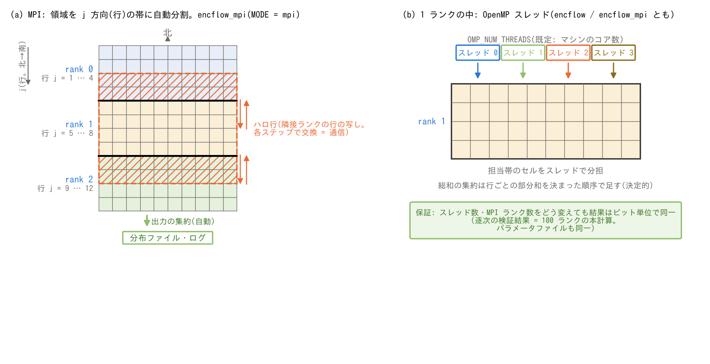

# 並列実行

[ユーザーガイド目次へ](../users_guide.md)

ENCflow はノート PC からスーパーコンピューターまで単一ソースで動く
ように設計されています。並列化の作法は2層です。

## OpenMP(ランク内のスレッド並列)

通常ビルドの `encflow` とMPI版の `encflow_mpi` は、OpenMPスレッド並列が
有効です。明示指定がなければOpenMP実行環境の既定値を使い、利用できる
CPUはジョブの割当やバインドにも依存します。数を指定するには環境変数を使います。

```bash
OMP_NUM_THREADS=8 ./encflow param.txt
```

## MPI(複数ノード・大規模計算)

`src/make.inc` の1行を切り替えてビルドすると、OpenMP×MPI ハイブリッド
並列の `encflow_mpi` が作られます。

```
MODE	= mpi        # make.inc(既定は serial)
```

```bash
cd src && make install
mpirun -np 4 ./encflow_mpi param.txt
```

- **パラメータファイルは逐次版とまったく同じ**です。領域分割
  (j 方向の帯分割)・通信・出力の集約はすべて自動で行われます。
- ノード内はスレッド・ノード間は MPI という配置が基本です(ランク数×
  スレッド数の割り付けはジョブスケジューラ・mpirun の設定に従います。
  Open MPI の既定バインドの落とし穴を含め、環境別の注意は
  [インストールガイド](../install.md) を参照)。
- `encflow` と `encflow_mpi` は共存できます(bin/ に両方置かれ、
  ケースの Makefile は両方へのリンクを張ります)。



**(a) MPIの所有範囲とハロ。** 10列×12行を3ランクで分担する説明例です。
各行の有効セル数が同じなので、rank 0は1–4行、rank 1は5–8行、rank 2は
9–12行を担当します。実際には有効窓の各行の有効セル数を重みとして帯境界を
決め、各ランクに最低2行を確保します。子ネストでは親セルに対応する行の
まとまりに境界を揃えます。図の行数・ランク数は推奨設定ではありません。

右側はrank 1のセル配列です。担当行 `js..je = 5..8` の前後に2行ずつの
ハロを持ち、確保範囲は `jsh..jeh = 3..10` です。3–4行はrank 0、9–10行は
rank 2の値の写しで、所有ランクは変わりません。逆向きには5–6行をrank 0へ、
7–8行をrank 2へ送ります。全域端では確保範囲を `1..ny` に収めます。
セルのハロは時間ステップの先頭や、各過程で隣接値が必要になる前に更新します。
エッジ配列には別の交換手順があり、この図ではセル配列だけを示しています。
`j` は北から南へ、`i` は西から東へ増えます([座標系](coordinates.md))。

**(b) ランク内のOpenMP。** 各スレッドは同じランクのメモリを共有し、
行ループなどの反復を分担します。図の1行1スレッドは説明用で、MPIの担当帯の
ような恒久的な所有分割ではありません。割り当ては各ループのスケジュールに
従います。`OMP_NUM_THREADS` は各MPIランクで使うスレッド数を指定します。

**(c) 決定的な総和と出力。** 貯水量などの総和は、まず担当行ごとの部分和
`S_j` を作り、`par_sum_rows` がrank 0に `j` 昇順で並べて `sum(buf)` を
一括評価します。結果は全ランクへ共有します。これは「ランクごとの合計を
任意の順で足す」手順とは異なり、ランク数を変えても同じ行配列を集約する
仕組みです。部分和・集約バッファは `PREC` によらず `real64` です。
分布ファイルの出力も担当行をrank 0へ集約して書き込み、ハロの写しは重複して
含めません。最大値・整数カウントの集約は別の手続きで行います。

## 結果の再現性とビルド条件

**同じ実行ファイル・実数精度・入力・計算環境で、スレッド数やMPIランク数を
変えても数値結果がビット単位で一致する**ことがENCflowの並列化の規律です。
例えば、同一の `encflow_mpi` で1ランクと複数ランクを比較する場合です。
ランク数・スレッド数などの実行情報が違うため、画面ログ全体が同じになる
という意味ではありません。

`encflow` と `encflow_mpi` は別のビルドです。`-Ofast` のfast-math最適化では、
両者の間に最終桁(ULP)レベルの差が出る場合があります。ビルド間の厳密な
ビット比較では、コンパイラ・実数精度・計算環境を揃え、`-O2` の厳密数学条件
(fast-mathを使わない設定)でビルドします。`-Ofast` の単一ビルド内の
ランク数不変性と、この別ビルド間の差を混同しないでください。
根拠と検証履歴は `developer.md` §11・§28.5を参照してください。

`FFLAGS` の変更はビルドのスタンプ機構では検出しません。最適化フラグを
切り替えて比較する場合は `make clean` を挟みます。コンパイラ・精度・
最適化条件の異なる計算を無条件にビット一致とはみなしません。
[再開](restart.md)の一致も、対応する保存・復元条件を満たすことが前提です。

## 実数精度

既定は倍精度です。メモリの厳しい環境向けに単精度ビルドがあります
(`make.inc` の `PREC = single`)。単精度は結果の値そのものが変わる
ので、倍精度と混ぜて比較しないでください。モード・精度の切り替えは
ビルドシステムが検出して不整合を防ぎます。

## 検証・例題

- [test/wave](../../test/wave/): 最小構成の逐次・MPI回帰テスト。`Run.sh` と `Run_MPI.sh N` の実行例を掲載。
- [test/chichibu](../../test/chichibu/): 地形・流域マスク・河道マスクを読む実地形ケースの逐次・MPI実行。
- [test/README.md](../../test/README.md): 共通の実行手順と比較方法。比較対象・許容誤差は各ケースのREADMEとスクリプトも確認してください。
