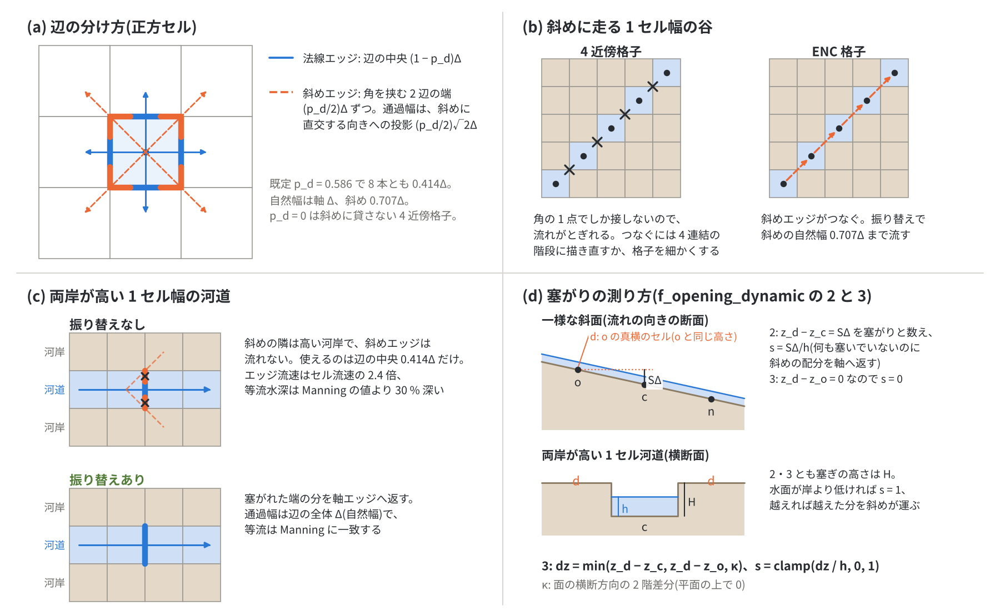

# 通過幅の調整 — 8 方向の通過幅を状況に合わせる理由と効用(浅水流計算の補足)

[浅水流計算の章へ](swflow.md) | [ユーザーガイド目次へ](../users_guide.md) | [ENC 格子と時間積分の解説](encgrid.md)

ENC 格子は、長方形のラスタの上に、軸方向 4 本と斜め方向 4 本のエッジの
**通過幅**を仮想的に設定します。周りがすべて開いている所では
この配分のままで正しく流れますが、壁・乾いた高い河岸・計算領域の端・
1 セル幅の河道のように一部の方向が塞がれる所では、塞がれた方向の配分を
開いた方向へ返す**振り替え**が要ります。どこがどれだけ塞がっているかを
測る規則は、`f_opening_dynamic` の既定が 3 に落ち着くまで何度か改めて
きました。

この調整が ENCflow で特に重要なのは、河道を 1 次元河道モデルで別に解かず、
ラスタのまま表しているからです。セルより狭い川は 1 セル幅の河道になり、両岸で
斜めの開口が塞がるので、その通水能は通過幅の扱いで決まります(§3.1)。ラスタで
表すことには利点があります。川幅がセルより狭いサブグリッド河道([河道](channel.md)
の `fn_width`)から、セルより広い解像河道まで、モデルを切り替えずに同じ定式で
切れ目なく扱えます。河道の位置や形そのものが変わる地形変化 — 蛇行河道の発達や
河口デルタの形成 — も、ラスタの地形と流れの帰結としてそのまま計算できます
([examples/meander](../../examples/meander/README.md)、
[examples/delta](../../examples/delta/README.md))。一方で代償もあります。1 次元
河道モデルなら明示できる、セルより細かい河道網(合流・分派のつながりや、近接・
並行する河道の分離)は、正確には表せません([河道の解説](channel_models.md) §2 の
精度の限界)。また、ラスタの河道を正しく流すには、通過幅の振り替えのような
状況ごとの補正の仕組みが要ります。その判定は、§5 の経緯のとおり、問題が
見つかるたびに改めてきたものです。

このページは、通過幅の調整をめぐる議論 — なぜ調整が要るのか、どう測るのか、何が
分かったのか — を利用者向けにまとめます。そのうえで、方向ごとに通過幅を
調整できることを「4 近傍格子にはない手間」ではなく「セルより小さい
地形を流れに伝える手段」として捉え、**粗い格子でも 1 セル幅の地形を
正しい通水能で表せる、つまり実質的な解像度が高い**という見方を、検証の
数値と限界とともに示します。

式の詳細は[ENC 格子と時間積分の解説](encgrid.md) §2・§4、設定の一覧は
[浅水流計算の章](swflow.md)、堤防と河道幅の側は[河道の解説](channel_models.md)
にあります。設計と検証の記録の正本は developer.md(§18、§68.8〜§68.44、
§84.7、§89.4)と [docs/opening_plan.md](../opening_plan.md) です。中級〜上級の
利用者と開発者向けで、既定のまま計算するなら §1 と §8 だけで足ります。

<a id="summary"></a>

## 1. 要点

- ENC 格子は、セルの各辺を 3 つに分け、中央を法線(軸)エッジ、両端を
  2 本の斜めエッジの通過幅にします。既定では 8 本とも $`0.414\Delta`$ です(§2)。
- 8 方向がすべて開いていれば、この配分で任意の向きの一様流が正しく
  流れ、調整は要りません。塞がった方向があると、その配分の分だけ
  通水能が失われます(1 セル幅の河道で Manning の 64 %。§3)。
- 塞がれた配分を、同じ辺を分け合う開いたエッジへ自然な幅まで返すのが
  振り替えです(§4)。堤防は静的に(`f_bank_opening`)、地形と水位は
  毎ステップ動的に(`f_opening_dynamic`)扱います。
- 難しいのは「塞がり」の測り方でした。両岸が高い河道と、一様な斜面の
  上流側(平面の一部で、何も塞いでいない)を区別する必要があります。
  既定の 3 は、塞ぎうるセルの地盤の**局所の平面からの盛り上がり**で
  測ります(§5)。
- この調整によって、1 セル幅の河道・壁際の行・急斜面の薄い流れ・破堤口
  などを、向きによらず正しい通水能で表せます。4 近傍格子では、格子を
  細かくしないと表せない(斜めに走る 1 セル幅の河道はつながらない)
  ものです(§6)。
- 振り替えは ENCflow 独自のサブグリッドの規則で、一様な海浜に沿う
  沿岸流などの既知の偏りがあります(§7)。使い分けは §8 にあります。

<a id="virtual-widths"></a>

## 2. 8 方向の仮想的な通過幅



*(a) 辺の分け方: 中央を法線エッジ、両端を斜めエッジへ。(b) 斜めに走る 1 セル幅の谷: 4 近傍格子ではセルが角でしか接せず流れがとぎれ、ENC では斜めエッジがつなぐ。(c) 1 セル幅の河道: 両岸が高いと斜めエッジが流れを運べず、軸エッジの $`0.414\Delta`$ だけになる。振り替えで辺全体(自然幅 $`\Delta`$)に戻す。(d) 塞がりの測り方: 2 は塞ぎうるセルが自セルより高い分を数えるので、一様な斜面の上流側も壁と数える。3 は局所の平面からの盛り上がりで測り、斜面では 0、河岸では 2 と同じ。*

### 2.1 辺を 3 つに分ける

ラスタのセルが隣と接する面は 4 つの辺だけで、斜めの隣とは角の 1 点で
しか接しません。ENC 格子は各辺を 3 つに分け、中央の $`(1 - p_d)`$ を
その辺の法線エッジに、両端の $`p_d/2`$ ずつを、その角を回り込む斜め
エッジに割り当てます(図 (a))[^tada26]。

```math
L_{\text{axis}} = (1 - p_d)\,\Delta,
\qquad
L_{\text{diag}} = \frac{p_d}{2}\sqrt{2}\,\Delta
```

$`p_d`$ は `p_diagratio` で、既定値 $`2/(2+\sqrt2) \approx 0.586`$ では 8 本とも
$`0.414\Delta`$ になります。斜めエッジの通過幅は、角を挟む 2 辺の端の部分を、
斜めの向きに直交する方向へ投影した長さです。つまり斜めの通過幅は、
ラスタに実在する面ではなく、**辺の一部を斜めの流れに貸し出した仮想的な
幅**です。$`p_d = 0`$ は斜めに何も貸さない 4 近傍格子にあたります。

原著[^tada26]は、セルを角を切り落とした仮想の八角形とみなし、$`L_k`$ をその
辺の長さ(side length)と呼んでいます。斜めの辺は切り落とした角にあたり、その
x・y 軸への投影 $`L_{k,x}`$・$`L_{k,y}`$ が、上の両端の $`(p_d/2)\Delta`$ の部分です。
本書はこの量を**通過幅**と呼び、河道幅・水面幅のような物理の幅や、河川実務で
いう有効な通水幅と区別します(用語の対応は[ENC 格子と時間積分の解説](encgrid.md) §2)。

8 本の合計は $`3.31\Delta`$ で、周長 $`4\Delta`$ とは一致しません。それでも
セル流速の再構成の重みの和が 1 になるので、周りがすべて開いた一様な流れは
向きによらず正しく流れます([ENC 格子の解説](encgrid.md) §4)。周りがすべて
開いた平坦な開水面では、塞がり率(§4.3)が 0 なので振り替えは働かず、
振り替えなしの計算とビット一致します。

### 2.2 自然幅

ある向きの流れがセルを通るときの本来の通過幅を、このページでは
**自然幅**と呼びます。セルの面積を、その向きにセルを横切る路の長さで
割ったものです。

| 向き | 自然幅 | 既定の通過幅 | 通過幅 / 自然幅 |
|---|---|---|---|
| 軸(東西・南北) | $`\Delta`$(辺の長さ) | $`0.414\Delta`$ | 0.41 |
| 斜め | $`\Delta x\,\Delta y/\Delta r = 0.707\Delta`$ | $`0.414\Delta`$ | 0.59 |

周りが開いていれば、ある向きの流れは、その向きのエッジと、同じ辺(斜めでは
同じ角)を分け合う隣の向きのエッジが一緒に運び、合わせて自然幅になります
(軸の向きの一様流では、辺の割合で $`0.414 + 2 \times 0.293 = 1`$)。分け合う
相手が塞がれると、その分がそのまま通水能の不足になります。

<a id="why-adjust"></a>

## 3. 方向が塞がると — 調整が要る理由

### 3.1 1 セル幅の河道

軸方向に走る 1 セル幅の河道で、両岸が乾いた高い地盤だとします。斜めの
隣は河岸なので斜めエッジは流れを運べず、辺のうち中央の $`0.414\Delta`$ しか
使えません(図 (c) の左)。同じ流量を 0.414 倍の幅で通すので、エッジの
流速はセル流速の $`1/0.414 = 2.4`$ 倍になり、摩擦が過大になります。

- 等流水深は Manning の値より 30 % 深く(1.789 m 対 1.373 m)、通水能は
  Manning の 64 % です([test/bendloss](../../test/bendloss/README.md)、
  [test/uniflow](../../test/uniflow/README.md))。
- 斜め向きの 1 セル河道(8 連結)では軸の隣が塞がれ、通過幅が自然幅の
  0.59 倍になって、等流水深は 17 % 深くなります(test/bendloss)。
- 運動量保存形の移流(既定のスキーム 3)は、エッジの流速の差で運動量を
  運びます。2.4 倍の流速は加減速を増幅し、1 セル幅の水路のダム破壊では
  段波の位置が Stoker の解析解[^stoker57]より 36 % 遅れました(振り替えると
  +1.1 % で、広い水路とほぼ同じ。[test/dambreak](../../test/dambreak/README.md))。

### 3.2 壁際の行

幅が数セルの水路でも、河岸に接する行は片側の斜めエッジを失います。
幅 5 セルの水路では、河岸の行の流速が内部の行の 0.80 倍、水深が等流水深の
1.04 倍でした(test/uniflow)。蛇行河道の例題では河岸脚部の流れが弱く出て、
外岸の侵食が進みにくくなっていました(developer.md §84.7)。

### 3.3 4 近傍格子との違い

4 近傍格子では、セルの各辺はただ 1 つの隣のものです。隣が塞がればその辺は
閉じ、開いていれば辺の全体が流れます。辺の貸し借りがないので、このような
調整の問題は起きません。その代わり、角でしか接しないセルはつながりません。
斜めに走る 1 セル幅の谷はセルの角でとぎれます(図 (b))。つなぐには、谷を
4 連結の階段に描き直す(1 セルごとに 90° 曲がり、路長は $`\sqrt2`$ 倍に
なる)か、格子を細かくする必要があります。

ENC 格子は、辺の一部を斜めに貸し出すことで 8 方向をつなぎます。その代わり、
貸した先が塞がれたときに、その分をどこへ返すかを決めなければなりません。
**調整が必要になったのは、8 方向につながることの裏返しです。**

<a id="reassignment"></a>

## 4. 振り替え — 塞がれた配分を開いた方向へ返す

### 4.1 規則

塞がれた配分は、同じ辺を分け合う開いたエッジへ、自然幅を上限に返します
(図 (c) の右)。

- **軸エッジ**: その辺の両端の斜め分が塞がれた割合 $`n_b`$(0〜2。エッジの
  両端のセルから見た平均)に応じて、通過幅を
  $`L_{\text{axis}} + n_b\,(p_d/2)\,\Delta`$ にします。両岸とも塞がれた
  1 セル河道では $`n_b = 2`$ で、通過幅は辺の全体 $`\Delta`$(自然幅)です。
- **斜めエッジ**: 両端のセルが共有する側方の 2 セルが塞がれた割合
  $`m_b`$(0〜2)に応じて、通過幅を
  $`L_{\text{diag}} + m_b\,(0.707\Delta - L_{\text{diag}})/2`$ にします。両側とも
  塞がれた斜めの 1 セル河道では、斜めの自然幅 $`0.707\Delta`$ になります。

返すのは塞がれた分だけで、自然幅を超えることはありません。重みの和が 1 の
まま保たれるので、セル流速の再構成に追加の補正は要りません。この規則は
ENCflow 独自のものです(developer.md §18・§68.11・§68.14)。

### 4.2 仕組みの使い分け

| 仕組み | 対象 | 塞がりの判定 | 設定 |
|---|---|---|---|
| 静的な開口補正 | 堤防(仮想壁面)で塞がれた開口 | 壁の有無(初期化時に 1 回) | `f_bank_opening`(&list_channel。既定 1) |
| 動的振り替え | 地形と水位で塞がれた開口(乾いた高い河岸、計算領域の外、無効セル) | 毎ステップの水深と地盤から塞がり率 $`s`$(0〜1) | `f_opening_dynamic`(&list_enc。既定 3) |
| サブグリッド河道幅 | セルより狭い河道 | 幅 $`W`$ から通水の上限と貯留の面積率 | `fn_width`(&list_channel)。幅のセルが絡むエッジの動的振り替えは河道セル同士に限る(二重の補正を避ける) |
| 破堤の斜めの連動 | 破堤口の両端の斜めの開口 | 破堤サイトの天端の低下に連動 | `f_br_diag`(&list_channel_breach。既定 0) |

地形による塞がりを静的な表にしないのは、堤内地が浸水すると斜めの流れが
復活し、静的に振り替えた分と二重に数えてしまうからです(developer.md §18)。
動的振り替えは、水位の変化に合わせて塞がり率を連続的に変えます。

### 4.3 塞がり率

塞ぎうるセル(軸エッジでは辺の両端の斜めの隣、斜めエッジでは側方のセル)を
$`d`$、自セルを $`c`$ とします。塞がり率は、自セルの水柱のうち $`d`$ の地盤
より下にある割合です(値 2 の定義)。

```math
s = \mathrm{clamp}\!\left(\frac{z_d - z_c}{h_c},\ 0,\ 1\right)
```

水面が $`d`$ の地盤より低ければ 1(全部塞がる)、水面が地盤を越えれば、
越えた分は斜めのエッジが運ぶので部分的に塞がり、$`d`$ の方が低ければ 0 です。
水位の連続関数なので、閾値でのちらつき・履歴・追加のパラメータがありません。
計算領域の外と無効セルは 1、海のセルは 0 です。堤防で静的に振り替えた開口は、
二重に返さないよう数えません。

<a id="history"></a>

## 5. 「塞がり」をどう測るか — 既定が 3 になるまで

### 5.1 経緯

| 時期 | 既定 | できたこと・分かったこと | 記録 |
|---|---|---|---|
| 2026-08 | (静的のみ) | 堤防壁で塞がれた斜めの開口を軸エッジへ返す開口補正。1 セル河道の通過幅が $`0.414\Delta`$ に縮む問題への対処 | developer.md §18 |
| 2026-10-02 | 0 | 斜め向きの河道にも対称に返す規則。スキーム 3 で実地形の洪水波が過大に減衰する原因の一つが 1 セル河道のエッジ流速 2.4 倍にあると分かり、堤防のない河道のための動的振り替えを導入(1: 河道マスクのエッジだけ、2: 全エッジ) | §68.8〜§68.14 |
| 2026-10-03 | 1 | 移流スキーム 3 の既定化と同時に、河道マスクのエッジを既定で振り替える | §68.19 |
| 2026-10-18 | 2 | 河道マスクのない掘り込み水路と壁際では 1 が効かないと分かった(幅 1 セルで通水能 64 %、幅 5 セルの河岸の行 0.80)。2 で幅 1〜10 セルが Manning に 1e-3 で一致 | §84.7・§68.38 |
| 2026-10-27 | 2 | 急勾配の等流の検定で、2 が一様な斜面の上流側の地盤を部分的な壁と数えると分かった(勾配 0.2、格子幅 1 m、水深 0.3 m で底面せん断応力が 29 % 大きい) | §89.4・§89.10 |
| 2026-10-29 | 2 | 局所の平面からの盛り上がりで測る 3 を追加 | §68.41、opening_plan.md |
| 2026-10-31 | **3** | 全検定 86 件と例題の比較を見て、既定を 3 に切り替えた | §68.41、opening_plan.md §8 |
| 2026-10-31〜11-01 | 3 | 切り替え後の発見: 一様な海浜に沿う沿岸流は 2 を明示する(§7)。教材の深い湛水で計算が止まった原因は振り替えではなく移流項の側方面の流束の不整合で、修正した | §68.41〜§68.43 |

振り返ると、どの段階も「仮想の通過幅が、実際の流れの形と合う状況」を
広げてきました。堤防の壁 → 河道マスクの河岸 → すべての河岸と壁際 →
河岸と斜面の区別、の順です。

### 5.2 2 が斜面でつまずいた理由

2 の塞がり率は、塞ぎうるセルの地盤が自セルより高い分 $`z_d - z_c`$ を
数えます。勾配 $`S`$ の一様な斜面では、上流側の斜めの隣が $`S\Delta`$ だけ
高いので、何も塞いでいないのに $`s = S\Delta/h`$ と数えて、斜めの配分を
軸へ返してしまいます。通水能が過大になり、流速と底面せん断応力が大きく
出ます。2 の判定は両岸が高い河道を念頭に置いて作ったもので、斜面での
振る舞いは検討の外でした。

$`s \approx S\Delta/h`$ なので、急勾配・浅い流れ・粗い格子ほど強く出ます
([docs/opening_plan.md](../opening_plan.md) §1.3)。

| 場面 | 目安 | $`S\Delta/h`$ |
|---|---|---|
| 緩い勾配の河川 | $`S \approx 10^{-3}`$、$`\Delta \approx 10`$ m、$`h \approx 1`$ m | 0.01(影響は小さい) |
| 山地渓流 | $`S \approx 0.02`$〜$`0.2`$、$`h \approx 0.1`$〜$`0.5`$ m、格子幅数 m | 0.1〜1 |
| 降雨中の斜面の面状流 | $`h`$ が数 mm | 1 に飽和 |

面状流では、格子を細かくしても $`s`$ が 1 に飽和したままなので、2 の偏りは
格子を細かくしても減りません(§5.4 の V 字流域)。

### 5.3 3 の測り方

3 は、塞ぎうるセルの地盤が局所の平面からどれだけ盛り上がっているかで
測ります(図 (d))。面のもう一方の端のセルを $`o`$ として、次の 3 つの
最小を塞ぎの高さにします。

```math
dz = \min\left(z_d - z_c,\ \ z_d - z_o,\ \ \kappa\right),
\qquad
s = \mathrm{clamp}\!\left(\frac{dz}{h_c},\ 0,\ 1\right)
```

- $`z_d - z_c`$: 2 と同じ量です。両岸が高い河道ではこれが最小になり、2 と
  同じ値が残ります。
- $`z_d - z_o`$: 面のもう一方の端 $`o`$ から見た高さです。$`d`$ は $`o`$ の横に
  並ぶので、一様な縦断勾配はこれで 0 になります。
- $`\kappa`$: 面の横断方向の 2 階差分です(軸エッジでは
  $`z(o+b) + z(o-b) - 2z(o)`$、$`b`$ は横断方向の隣。斜めエッジでは側方の
  2 セル $`p, q`$ で $`z_p + z_q - z_c - z_o`$)。平面の上では 0 なので、横断に
  傾いた平面や斜め向きの平面でも塞がりは 0 になります。

| 地形 | 2 の塞ぎの高さ | 3 の塞ぎの高さ |
|---|---|---|
| 平坦 | 0 | 0 |
| 流れの向きの一様な斜面(上流側の斜めの隣) | $`S\Delta`$ | 0 |
| 横断に傾いた平面(上り側の斜めの隣) | $`S_y\Delta`$ | 0 |
| 高さ $`H`$ の河岸に挟まれた 1 セル河道 | $`H`$ | $`H`$ |
| 片側だけ高さ $`H`$ の河岸(壁際の行) | $`H`$ | $`H`$ |
| 計算領域の外・無効セル | 塞がり率 1 | 塞がり率 1 |

$`\kappa`$ に使うセルが計算領域の外・無効・海のときは $`\kappa`$ を使わず、
2 と同じ判定に戻します。追加の状態・通信・パラメータはありません。この判定も
ENCflow 独自です(developer.md §68.41、[docs/opening_plan.md](../opening_plan.md) §3)。

### 5.4 2 と 3 の比較

| 検定 | 量 | 2 | 3 |
|---|---|---|---|
| 急勾配の等流(T9。幅 5 セル、格子幅 1 m、水深 0.3 m) | 水路中央の $`\tau_b/\rho g h S`$(勾配 0.01・0.05・0.1・0.2) | 1.014・1.070・1.141・1.291 | 1.0000〜1.0001 |
| 同上 | 壁際の列の $`\tau_b/\rho g h S`$ | 1.006〜1.124 | 0.9999 |
| 面状流(T10。勾配 0.05、雨 100 mm/h) | 局所の釣り合い $`\tau_b/\rho g h S`$(格子に沿う 0° / 対角の 45°) | 1.34〜1.38 / 1.29〜1.34 | 0.96〜0.99 / 0.95〜0.99 |
| 幅 1・5 セルの水路の等流([test/uniflow](../../test/uniflow/README.md)) | 水深・流速の Manning との差 | 1e-3 以下 | 2e-4 以下 |
| V 字流域の降雨流出([examples/benchmark](../../examples/benchmark/) の v-shaped) | 出口流量の理論値からの誤差(格子幅 20・10・5 m) | 0.018・0.025・0.028 | 0.024・0.020・0.016 |

T9・T10 は [test/rockinc](../../test/rockinc/README.md) の構成です。V 字流域の
誤差は、最大流量で割った二乗平均平方根誤差です。

- 3 は、等流と局所の釣り合いに、勾配と格子の向きによらず一致します。
- V 字流域では、3 は格子を細かくすると誤差が減り、立ち上がりの時刻が理論と
  一致します(2 は斜面の流れが速すぎて 2〜3 分早い)。最も粗い 20 m では 2 の
  方が誤差が小さく、3 は「いつも近い」のではなく「細かくすれば近づく」
  性質です。
- 両岸が高い河道では、3 は 2 とほぼ同じです。

### 5.5 切り替えで変わったこと

全検定 86 件のうち 40 件は出力が完全に一致しました(平坦な地形・深い流れ・
値を明示した検定)。変わったのは、斜面を流れる浅い水が効く計算です。
急斜面を流れ下る土砂の到達は短くなりました(崩壊の検定 test/slide の
崩壊域の外の堆積の最大 0.61 → 0.24 m、土石流の検定 test/debris の遷緩点の
下の堆積 5.5 → 2.5 mm など。[docs/opening_plan.md](../opening_plan.md) §8)。
計算時間は 8〜12 % 長くなります。2 で合わせた粗度や土砂の係数は見直しが
要ります。2026-10-18〜31 の既定で校正した計算は、2 を明示すれば再現できます。

<a id="effective-resolution"></a>

## 6. 調整できることの意味 — 実質的な解像度という見方

4 近傍格子と比べると、通過幅の調整は ENC 格子だけが負う手間に見えます。
このページでは逆の見方をとります。ENC 格子は、各セルの周囲のどこが
どれだけ流れに開いているかを、方向ごとに、水位に応じて連続的に表せます。
河岸が水面より高いか、堤防の天端はどこか、河道はセルより狭いか、破堤口は
どこまで開いたか — こうしたセルより小さい地形の情報が、通過幅を通して
流れに伝わります。4 近傍格子で同じ情報を流れに伝えるには、格子を細かく
するしかありません。その意味で、**ENC 格子の実質的な解像度は、セル幅が
示すより高い**と考えます。

この見方を支える計算例を挙げます。

1. **8 方向につながる**。[chichibu チュートリアルの補足](../../tutorials/chichibu/README.md#補足-解像度の影響と-enc-格子の特性)で、
   同じ流域を ENC 格子と 4 近傍(`p_diagratio = 0`)で計算すると、流域出口
   近くの測線のピーク流量は、ENC の 200 m 格子で 5,425 m³/s、4 近傍では
   200 m で 4、100 m で 30、50 m で 402 m³/s でした。4 近傍では、格子を 4 倍
   細かくしても、斜めに走る区間でとぎれた河道網がつながりません。
2. **1 セル幅の河道を向きによらず正しく流す**。既定の振り替えでは、乾いた
   地盤に挟まれた 1 セル幅の水路の等流が Manning に 2e-4 で一致します
   (test/uniflow)。斜め向きの 1 セル河道(test/bendloss の対角水路
   `param_diag.txt`)も、等流水深が Manning の値の 0.9999 倍になります
   (振り替えなしでは 1.17 倍。developer.md §68.44)。1 セル幅の水路の
   ダム破壊の段波は、振り替えなしの −36 % から +1.1 %(広い水路とほぼ同じ)に
   戻ります(test/dambreak)。格子が正しい通水能で流せる最小の河道が、
   8 方向のどの向きでも 1 セル幅になります。
3. **壁際の行が自分の分を流す**。幅 5 セルの水路では、河岸の行の流速が
   内部の行の 0.80 倍から 1.00 倍になります(test/uniflow)。蛇行河道の
   例題では、外岸の河岸脚部の流速が水路中央の 0.56 倍から 0.82 倍になり、
   外岸の後退が数倍速く進むようになりました(developer.md §84.7)。河道が
   数セルの幅しかない格子で、河岸脚部の過程が現れます。
4. **セルより小さい起伏を見分ける**。3 では、急斜面を流れる数 mm〜数十 cm
   の流れの底面せん断応力が、格子幅が水深の数百倍あっても等流と局所の
   釣り合いに 5 % 以内で一致し、格子の向き(0°・45°)によりません(§5.4 の
   T9・T10)。2 では同じ構成で 30 % 前後大きく出ていました。
5. **堤防・破堤口・河道幅を格子より細かく与える**。破堤口の斜めの連動
   (`f_br_diag = 1`)では、幅 3〜5 セルの破堤の流量が、DEM で堤防を解像した
   計算の 0.98〜1.03 倍になります([河道の解説](channel_models.md) §4)。
   サブグリッド河道幅は、幅がセル幅に等しいときには解像した河道に退化し
   (chichibu の 50 m 格子でピークの差 0.001 % 以内)、セルより狭い河道の
   通水と貯留を粗い格子に持ち込みます。

ただし、これは「どんな現象も粗い格子で解ける」という意味ではありません。

- 振り替えが合わせるのは、セル単位の通水能です。セルの中の流速の分布
  (河道の横断分布や二次流)や、河岸の形そのものは解けません。
- 谷底と斜面の形が流れを決める所では、格子を細かくしたときの差が残り
  ます。chichibu の補足では、200 → 100 m で上流のピークが 9〜12 %、
  100 → 50 m で下流のピークが 13〜16 % 変わりました。粗い格子に河道幅を
  与えても、50 m 格子の結果には届きませんでした。
- 調整そのものが ENCflow 独自のモデルで、§7 の偏りがあります。

使い方としては、chichibu の補足が勧めるとおり、**まず粗い格子で全体を
つかみ、必要な場所と目的に応じて細かくする**のが実務的です。通過幅の調整は、
その粗い格子の段階で 1 セル幅の地形をとぎれさせず、正しい通水能で流す
ための仕組みです。

<a id="limits"></a>

## 7. 調整の限界と既知の偏り

- **一様な斜面に沿う流れ**: 3 は一様な斜面の上で斜めの開口をすべて開きます。
  斜面に沿う流れ(海浜の沿岸流)では、開いた斜めの開口が $`\Delta z/h`$ に
  一次の摩擦の偏りを持ち、2 の斜面上側の塞がりがそれをたまたま打ち消して
  いました。勾配 1/80 の海浜で、沿岸流の運動量の釣り合いの比は、3 で
  0.899・0.953・0.976(格子幅 20・10・5 m。格子幅に一次で 1 に近づく)、
  2 で 0.993・1.000・0.999 です([test/wfcurrent](../../test/wfcurrent/README.md))。
  原因の特定と対策は未着手です。この構成では 2 を明示してください。
- **壁際の行の段波**: 壁の隣の行では、振り替えで軸と斜めの配分が
  0.414 : 0.586 から 0.707 : 0.293 に変わります。段波のような非定常の流れで
  軸と斜めのエッジの流速がずれると、壁の隣の行の段波が 1 セル遅れ、壁に
  近い行で段波直後の流速の山が最大 3.4 % 低く出ます(test/dambreak。
  developer.md §68.43)。幅が数セルの水路では全行がこの「壁際の行」になり、
  段波が 0.25 % ほど遅く、段波直後の流速の山が数 % 低く出ます。2 セル幅の
  水路のダム破壊では、振り替えた後も段波が 4 % 遅れます(未解析)。
- **ラスタの階段の河道の近道**: 階段状に並んだ河道セルでは、角を挟む
  2 セルが斜めにつながり、近道として流れます。実際の河道が階段より滑らか
  なら近道は実際の流路に近い働きをしますが、直角に曲がる水路では屈曲の
  損失が過小に、通水が過大になります。屈曲部では横断の通過幅の合計が
  河道幅を 25 % ほど超える側が出ます([河道の解説](channel_models.md) §2 の
  精度の限界、[docs/channel_model.md](../channel_model.md) §1・§3)。
- **粗い格子の面状流**: V 字流域の 20 m 格子では、3 の誤差(0.024)が 2 の
  誤差(0.018)より大きくなりました(§5.4)。また、斜面を対角に流れる面状流
  では、水深と流速から求めた単位幅流量が降雨から求めた値の 0.91〜0.93 倍に
  なる性質が、2・3 とも残っています(test/rockinc の T10。未調査)。
- **掃流砂の配分**: 掃流砂は水の振り替えの表をそのまま使います。
  `fluv_diagratio` を `p_diagratio` と違う値にすると配分が食い違い、1 セル幅の
  水路で掃流砂を運ぶ能力が 2.41 倍になります。`fluv_diagratio` は既定
  (`p_diagratio` と同じ値)のまま使ってください(developer.md §89.4)。
- **校正値の持ち越し**: 振り替えの設定を変えると、流速・底面せん断応力・
  土砂の到達が変わります。別の設定で校正した粗度や土砂の係数は、そのまま
  では使えません(§5.5)。
- **実測との照合**: 判定と規則の妥当性は、Manning の等流、Stoker の
  解析解、V 字流域の理論値などで確かめたもので、実際の河川・斜面の観測との
  照合はまだありません。

<a id="usage"></a>

## 8. 使い分けと確かめ方

### 8.1 設定の選び方

| 状況 | 設定 | 理由 |
|---|---|---|
| ほとんどの計算 | 既定(`f_opening_dynamic = 3`。`p_diagratio`・`f_bank_opening` も既定) | §5.4 |
| 一様勾配の海浜に沿う沿岸流(波・風による) | `f_opening_dynamic = 2` | §7 の 1 つ目 |
| 2026-10-18〜31 の既定で校正した計算の再現 | `f_opening_dynamic = 2` | その間の既定の判定 |
| 河道マスクのある区間だけ振り替える | `f_opening_dynamic = 1` | 2026-10-18 までの既定。河道マスク(`fn_rw`)がなければ働かない |
| 2026-10-03 以前の版の再現 | `f_opening_dynamic = 0`(`f_advection_scheme = 1`、`f_dry_head_cap = 0` と組で) | 当時の既定 |
| 4 近傍格子との比較 | `p_diagratio = 0` | 斜めの交換を閉じる(chichibu の補足) |
| 破堤口の幅が 3 セル以上 | `f_br_diag = 1` | 解像した堤防の流量の 0.98〜1.03 倍([河道の解説](channel_models.md) §4) |
| セルより狭い河道 | `fn_width`(堤防がなければ壁なしの幅モード)+ 既定の振り替え | 幅のセルと斜面の間の二重の補正は自動で避ける |

### 8.2 自分の計算で効くかを見積もる

- **$`S\Delta/h`$ を見積もる**: 0.01 程度より小さければ、2 と 3 の結果は
  ほぼ同じです。0.1 を超える急勾配・浅い流れ・粗い格子では違いが出ます。
- **1 セル幅の河道と壁際を見る**: 等流が期待できる直線の区間で、水深と
  流速を Manning の値と比べます。河岸の行の流速が内部の行と揃っているかも
  見ます。
- **感度を見る**: 2 と 3(必要なら 0)で計算し、注目する量(ピーク流量・
  到達時刻・最大流速・土砂の到達)の差を見ます。差が目的に対して小さければ、
  既定のままで構いません。
- **土砂を含む計算**: 振り替えは掃流砂の通過幅にも掛かります。底面せん断
  応力と流砂量の校正は、使う設定のまま行ってください。

<a id="parameters"></a>

## 9. 関係するパラメータ

既定値と根拠の正本は各リンク先の表です。

| パラメータ | 既定 | このページでの役割 | 詳細 |
|---|---|---|---|
| f_opening_dynamic | 3 | 地形と水位で塞がれた開口の動的振り替え(0: なし、1: 河道マスクのエッジ、2: 全エッジで自セル基準、3: 全エッジで局所の平面基準) | [浅水流計算](swflow.md)、[移流項](advection.md) §5 |
| p_diagratio | 2/(2+√2) | 辺の斜めへの配分比 $`p_d`$(0 で 4 近傍) | [ENC 格子の解説](encgrid.md) §2 |
| f_bank_opening | 1 | 堤防壁で塞がれた開口の静的な振り替え | [河道の解説](channel_models.md) §1 |
| f_br_diag | 0 | 破堤口の両端の斜めの開口の連動 | [河道の解説](channel_models.md) §4 |
| fn_width | — | サブグリッド河道幅(通水の上限と貯留の面積率) | [河道の解説](channel_models.md) §2 |
| f_dry_head_cap | 1 | 乾いた高い地盤へ向かうエッジの水深をエネルギー頭で頭打ち(乾いた河岸を壁と同じに扱う) | [移流項](advection.md) §5 |
| fluv_diagratio | 2/(2+√2) | 掃流砂の斜めの配分(`p_diagratio` と同じ値のまま使う) | [土砂・地形変化](geomorph.md) |

<a id="verification"></a>

## 10. 検証ケース

| ケース | 内容 | 要点 |
|---|---|---|
| [test/uniflow](../../test/uniflow/README.md) | 乾いた地盤に挟まれた幅 1・5 セルの水路の等流 | 振り替えなしで通水能 64 %・河岸の行 0.80。2・3 で Manning に 1 ± 0.5 % |
| [test/bendloss](../../test/bendloss/README.md) | 1 セル幅の直線・屈曲・斜め向きの水路、開口補正、河道幅 | 軸・斜めとも Manning に一致し、屈曲の損失がない。斜め向きの水路は既定の振り替えで等流水深が Manning の 0.9999 倍(振り替えなしで 1.17 倍) |
| [test/dambreak](../../test/dambreak/README.md) | 1・2 セル幅の水路のダム破壊(`Make_incised.py`) | 1 セル幅で段波の誤差が −36 % から +1.1 % に |
| [test/rockinc](../../test/rockinc/README.md) | 急勾配の等流(T9)と面状流の向き(T10) | 3 で底面せん断応力が等流と局所の釣り合いに一致 |
| [test/hillslope](../../test/hillslope/README.md) | 平面斜面・階段斜面・V 字集水域の降雨流出 | 平面斜面の到達時刻を運動学的波と比べる |
| [test/wfcurrent](../../test/wfcurrent/README.md) | 一様勾配の海浜の沿岸流 | 3 の一次の摩擦の偏り(海浜の構成は 2 を明示) |
| [examples/benchmark](../../examples/benchmark/) の v-shaped | V 字流域の降雨流出の理論値 | 3 は格子を細かくすると誤差が減る |
| [examples/levee_breach](../../examples/levee_breach/README.md) | 破堤口の斜めの連動 | 幅 3〜5 セルで解像した堤防の流量に一致 |
| [tutorials/chichibu](../../tutorials/chichibu/README.md) の補足 | ENC と 4 近傍、200・100・50 m 格子 | 4 近傍は格子を 4 倍細かくしても河道網がつながらない |

## 参考文献

[^tada26]: Tada, T. (2026): An eight-neighborhood connected collocated grid scheme for overland flow simulation. *Hydrological Research Letters*, 20(2), 113–118. doi:10.3178/hrl.25-00052.(ENC 格子の原論文: 八近傍連結コロケート格子と通過幅の配分)
[^stoker57]: Stoker, J. J. (1957): *Water Waves*. Interscience, New York.(湿潤床ダム破壊の解析解)
