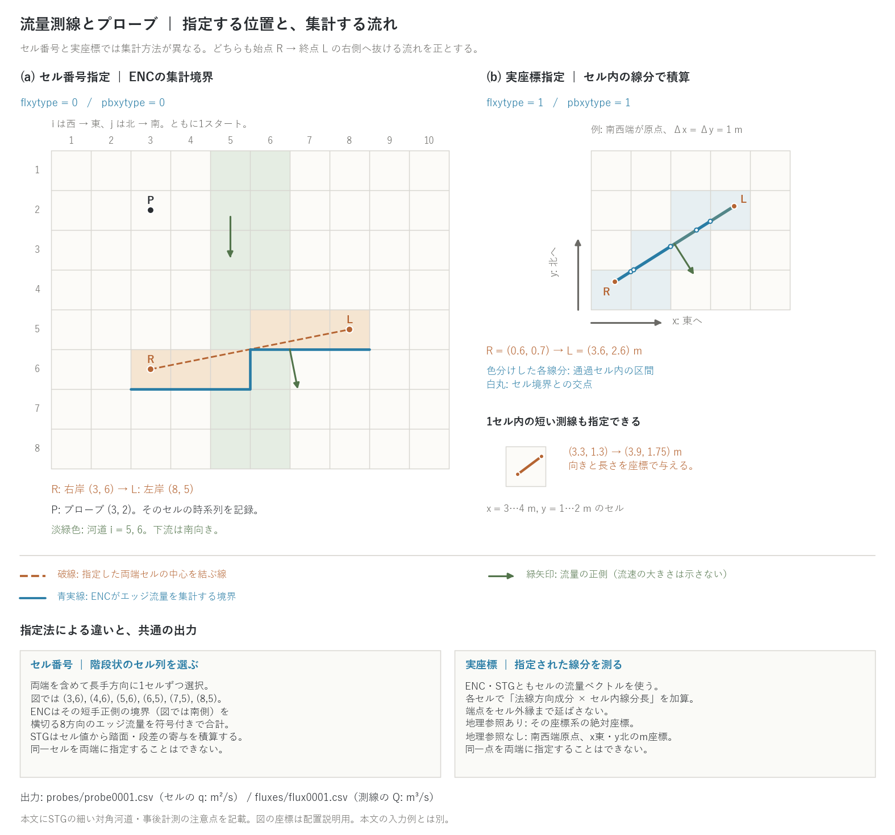

# 計測(&list_record)

[ユーザーガイド目次へ](../users_guide.md)

観測点との比較や流量ハイドログラフの取得のために、**プローブ**
(点の時系列)と**フラックス測線**(線を横切る流量の時系列)を
設定します。`fn_record` で有効化し、出力間隔は `&list_sysparam` の
`dt_recrd`(と時間窓 st_recrd/et_recrd。[時刻の章](time.md))で
制御します。

```
&list_record
  ! プローブ(セル番号指定)
  pbxy(:,1) = 150, 150           ! 1本目: (ix, iy)
  pbxy(:,2) = 200, 120           ! 2本目
  ! フラックス測線(セル番号指定): 右岸から左岸へ
  flxy(:,1) = 100, 50, 100, 60   ! 1本目: (右岸ix, iy, 左岸ix, iy)
/
```

**セル番号は 1 スタート**です(西端の列・北端の行が 1)。QGIS など
GIS のラスタは 0 から数えるので、GIS 上で拾った番号は行・列とも +1
してください([座標系の章](coordinates.md))。

最小入力はプローブ 1 点(`pbxy(:,1) = ix, iy`)です。実在の観測所と
比較するときは pbxytype=1 で実座標を与え、流量は河道を右岸から左岸へ
横切る測線を河道幅より 2〜3 セル長めに引きます(氾濫時の河道外流量も
拾う)。

## プローブ(点の時系列)

| パラメータ | 既定値 | 意味 |
|---|---|---|
| pbxytype | 0 | 0: セル番号 (ix, iy)、1: 実座標。実座標は x 東・y 北が正。地理参照があればその座標系の絶対座標、なければ南西端原点のローカル座標(m)。[座標系の章](coordinates.md)参照 |
| pbxy | — | n番目の位置を `pbxy(:,n) = x, y` で指定。番号 n は配列の添字であり、3つ目の入力値ではない |

実座標指定でも、記録するのは**その点を含むセルの値**です。周囲の
セルから点の値を補間する処理はありません。

出力は `result/probes/probe0001.csv` などに1点1ファイルで書かれます。
列は時刻(hour/min)・地盤高 z・水深 h・流速 u, v, |V|・**単位幅流量
q (m²/s)**・地下貯留 hg・浮遊砂 hs・土層厚 sd です。水質有効時は
濃度 C (mg/L)・地表負荷 cq (g/m²) も加わります。q はセルの値で、
測線を横切る総流量 Q (m³/s) とは異なります。

## フラックス測線(通過流量の時系列)

| パラメータ | 既定値 | 意味 |
|---|---|---|
| flxytype | 0 | 0: 両端セルを指定してDDAでセル列を選択、1: 実座標で指定した線分を通過セル内の区間に分割して積算。実座標の解釈はプローブと同じ |
| flxyfile | 0 | 0: flxy で直接指定、1: 測線情報ファイル fn_flxy から読み込み |
| flxy | — | n番目の始点・終点を `flxy(:,n) = xR, yR, xL, yL` で指定。番号 n は配列の添字であり、5つ目の入力値ではない |
| fn_flxy | — | 測線情報ファイル。1行1測線、カンマまたは空白区切りで「xR yR xL yL」の4値を記載 |

流量の符号は、両指定法とも**始点 R から終点 L に向かって右側へ
抜ける流れが正**です。河川では、下流を向いて右の岸を R、左の岸を L
とすれば下流向きが正になります。

### セル番号指定 (flxytype=0)

両端セルの中心を結ぶ線に沿って、列番号差・行番号差の大きい方向
(同じなら列方向)に1セルずつ進み、もう一方のセル番号を最近傍に
丸めて選択します(DDA)。両端セルも含むため、長手方向の集計範囲は
両端セルの外縁まであります。**同一セルを両端には指定できません**。

- **ENC:** 選んだセル列の短手正側の境界を横切る、8方向のセル間
  エッジ流量を符号付きで合計します。列方向に進む図(a)では、
  短手は行番号 j なので南側のセル境界が集計面です。行方向に進む
  場合は東側です。集計はセル列の長手範囲内で行い、その範囲外へ
  出るエッジは数えません。
- **STG:** セル値を使い、各踏面の短手方向流量成分×セル幅と、
  段差を挟む2セルの長手方向流量成分の平均×段差幅を、法線方向の
  符号付きで加算します。セル中心を通る積算面なので、図(a)のENCの
  青いセル境界とは位置が異なります。
- STGで1セル幅の対角河道を流れに直交する斜め測線で測ると、
  踏面・段差が同じセルの流れを数え、2倍の流量を読む配置があります。
  この場合は縦または横の測線を使ってください。ENCのセル番号指定は
  各エッジを1回ずつ数えるため、この重複を避けます。

### 実座標指定 (flxytype=1)

指定された線分をセル境界で区切り、各セルの流量ベクトルについて
**線分に直交する成分×セル内線分長**を符号付きで積算します。
ENC・STGともこの方法を使います。セル間エッジ流量の直接集計では
ないため、ENCでもセル番号指定と常に同じ値になるとは限りません。

端点をセル外縁まで延長せず、指定した線分だけを測ります。
**1セル内に収まる短い測線も指定できます**が、始点・終点を同一点に
するとエラーになります。一様な流量ベクトルに対しては、任意の位置・
傾き・長さで、その線分を横切る積分値と一致します。

### 出力と対象外の流れ

出力は `result/fluxes/flux0001.csv` などに1測線1ファイルです。
列は時刻(hour/min)、Q (m³/s)、計測対象セルの Hmax (m)・Vmax (m/s)、
B (m) です。B は `abs(Q / Hmax / Vmax)` で、Hmax・Vmax の積が0なら
0です。実際の河道幅を直接出力するものではありません。水質有効時は
負荷流量 L (g/s)・累積負荷 Lcum (kg) が加わります。

カルバートなど構造物の転送流量は測線には乗りません
([構造物の章](structure.md))。上記のファイル名は既定の結果フォルダと
接尾辞なしの場合です。



(a) 10列×8行の配置例。P=(3,2) はセルの時系列を記録するプローブ。
R=(3,6) から L=(8,5) へ引いた橙破線から、薄橙色の6セルを選びます。
青実線はENCで集計する南側の境界で、STGのセル中心を通る積算面とは
区別しています。河道は i=5,6、下流は南向きです。(b) 5列×4行、
南西端原点・セル幅1 mの例。R=(0.6,0.7) から L=(3.6,2.6) m への
線分を通過セルごとに分割し、白丸で分割位置を示します。下の小図は
(3.3,1.3) から (3.9,1.75) m への1セル内の測線です。両パネルの
セル表示寸法は同じで、緑矢印は流量の正側を示します。いずれも配置の
説明用で、本文の入力例や計算結果ではありません。

## 集計サマリ

計測を有効にすると、`result/summary.csv` に全プローブ・全測線の
集計(最大値等)がまとめて出力されます。

## 書式の実例

全パラメータの注釈付き一覧:
[examples/List_samples/list_record.txt](../../examples/List_samples/list_record.txt)。

## 検証・例題

- [test/chichibu](../../test/chichibu/): 本流の複数測線とプローブで流量・水深を記録。`record_reach.txt` は河道縦断の12測線の設定例です。
- [test/bendloss](../../test/bendloss/): 直線・折れ線・対角水路の測線記録と洪水波の減衰比較。

## 分布データからの事後計測(utils/rerecord)

`utils/rerecord` は、計算時のパラメータファイル、流向分布
`QdXXXX.bil`、計測したい流量分布 `QXXXX.bil` の3つを引数に取り、
その分布1組に対するプローブ・測線の計測値を接尾辞 `_re` のCSVへ
書きます。事前に流向 `f_out_qd` と流量 `f_out_qq` を出力してください
([入出力の章](io.md))。

流量・流向からセルの流量ベクトルを再構成する方法なので、計算中の
ENCエッジ流量は復元しません。セル番号指定もセル値による積算になり、
細い対角河道の注意点が当てはまります。現実装は時刻を0として記録し、
水深・流速など他の状態量も復元しないため、計算中の計測CSV全体を
再現するものではありません。複数時刻の時系列として使う場合は、
各分布を個別に計測して、元の出力時刻と対応付けてください。
