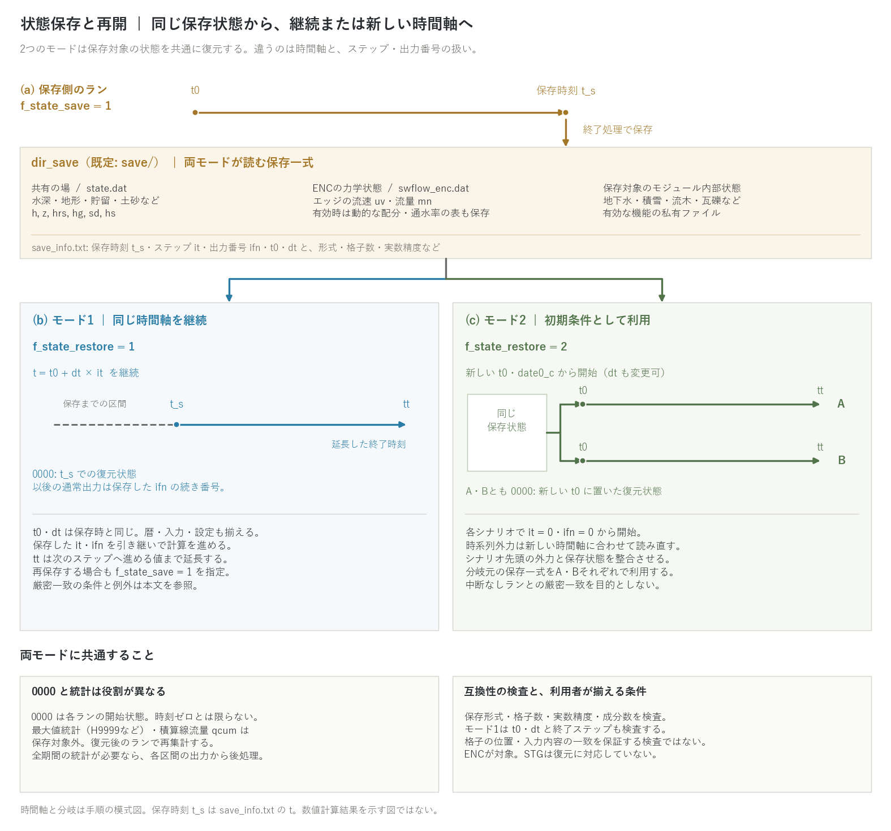

# 中断と再開

[ユーザーガイド目次へ](../users_guide.md)

長時間の計算を区切って実行する、助走後の状態から複数のシナリオを
始めるための状態保存(save)・復元(restore)機能です。
`&list_sysparam` で保存先と復元モードを指定します。

| パラメータ | 既定値 | 意味 |
|---|---|---|
| f_state_save | 0 | 1: 終了処理で状態を dir_save へ保存する |
| f_state_restore | 0 | 0: 復元なし / 1: 同じ時間軸で再開 / 2: 保存状態を新しい時間軸の初期条件にする |
| dir_save | "save" | 保存・復元に使うディレクトリ |

## 保存する内容と2つの復元モード

両モードとも、**共有の場に加えて、ENCの力学状態と保存対象のモジュール
内部状態を復元**します。モード2でも水深・地形だけに限定されません。

| ファイル | 保存内容 |
|---|---|
| `state.dat` | 共有状態の6成分: `h, z, hrs, hg, sd, hs`（水深・地形・貯留・土砂など） |
| `swflow_enc.dat` | エッジ流速 `uv`・流量 `mn`。有効時は動的振り替え・動的通水率の表も保存 |
| 機能ごとの私有ファイル | 地下水・積雪・流木・瓦礫など、各機能が保存する内部状態 |
| `save_info.txt` | 形式の版・格子数・実数精度・成分数、保存時刻 `t`・ステップ `it`・出力番号 `ifn`・`t0`・`dt` |

セルの流速・流量などの導出量は、復元した状態から再計算します。
配列はゼロ抑制の可逆圧縮で保存します。すべての作業配列や履歴が保存される
わけではありません。統計と一部機能の例外は後述します。



図: (a) 保存側のランが終了処理で `dir_save` に状態を書き、そこから
(b) モード1の時刻継続、または(c) モード2のシナリオA・Bへ分岐します。
`t_s` は `save_info.txt` の `t`、すなわち実際の保存時刻です。
時間軸は手順の模式図であり、数値計算結果ではありません。
モード1は保存したステップ・出力番号を継続し、モード2は新しい時間軸で
両番号を0から始めます。**どちらも `0000` はそのランの開始状態**です。
最大値統計・積算線流量は保存対象外で、そのラン内で再集計します。

## 再開する(f_state_restore = 1)

保存されたステップから、**同じ時間軸** `t = t0 + dt × it` で続きを
実行します。元のパラメータに `f_state_restore = 1` を指定し、
`tt` を保存時刻より先へ延長します。実装上は
`ceiling((tt - t0) / dt)` が保存ステップ `it` より大きいことが必要です。
`tt` は追加する計算時間ではなく、同じ時間軸上の終了時刻です。

```
  f_state_save = 1          ! 保存側のラン: 終了時に save/ へ保存
```
```
  f_state_restore = 1       ! 再開側のラン: save/ から継続
  tt = 172800.0             ! (延長するなら終了時刻を伸ばす)
```

- `t0` と `dt` は保存時と同じ値を指定します。不一致は停止します。
  `date0_c`、入力、物理設定、出力間隔も元の計算に揃えます。
- 保存した `it` と `ifn` を引き継ぎます。通常の分布出力は続き番号を使い、
  出力設定が同じなら中断なしランの番号に対応します。
  `0000` は固定の開始状態スロットで、再開時には保存時刻の状態を書きます。
- 再開ランでも `f_state_save = 1` なら終了時に同じ `dir_save` へ再保存します。
  保存→再開→保存を繰り返す際は、各回の `tt` を先へ進めます。

### 中断なしランとの一致

同じ実行ファイル・実数精度・計算環境と、同じ格子・入力・物理設定を使い、
必要な状態が保存・復元される構成では、モード1は中断なしランとの
ビット一致を意図した再開です。コンパイラや最適化条件の異なるビルド間の
比較条件は[並列実行](parallel.md)を参照してください。
統計・ログ全体や、すべての機能の組合せを無条件に一致とはみなしません。

- 動的振り替え・動的通水率を保存時には無効、復元時には有効にすると、
  表を復元後の水深から作り直すため、導出量に最終桁の差が出る場合があります。
- 非静水圧の底面加速度項 `f_nh_bottom = 1` では、その差分履歴を保存しません。
  再開後最初の射影は底面加速度を0とするので、底面が動く場合の
  中断なしランとの厳密一致は保証されません。

根拠は [developer.md](../developer.md) §7・§69.10 と
`m_state.f90`、`m_swflow_enc.f90`、`m_swflow_enc_nh.f90` です。

## 初期条件として利用する(f_state_restore = 2)

同じ保存一式を復元し、新しい `t0`・暦 `date0_c` で
**`it = 0`・`ifn = 0` から開始**します。`dt` も変更できます。
モード1のように保存時の `t0`・`dt`・終了ステップとの一致は検査しません。
典型的な用途は助走(ウォームアップ)後のシナリオ分岐です。

1. 平水流量などで場を整えて保存する。
2. その保存一式を、シナリオA・Bそれぞれの初期状態として読む。
3. 新しい時間軸と外力を設定して本計算を行う。

潮位・境界流入・降雨などの時系列外力は、**新しい時間軸に基づいて
読み直されます**。シナリオ先頭の外力を保存状態と整合させてください。
大きな食い違いは計算開始時の擾乱になります。
モード2は初期条件を作るための機能で、中断なしランとの厳密一致は対象外です。

地形変位 `bedmotion` を併用する場合、モード2では適用済み変位の履歴も
0から始まります。保存地形に既に含まれる変位を再び与えないよう、
新しい変位系列の基準を揃えます。

シナリオ別に `dir_result` を分け、再保存するなら `dir_save` のコピーも
各シナリオに用意します。保存先と読込元は同じなので、分岐元の状態を
一方のシナリオの再保存で上書きしないようにします。

## 両モードに共通する統計と制約

**最大値統計(H9999系など)と積算線流量 `qcum` は保存対象外**です。
復元後のランで再集計し、最大値には開始時の復元状態も含まれます。
`9999` はそのランの統計であり、保存前からの通し統計ではありません。
全期間の統計が必要なら、各区間の出力から後処理してください。
同じ `dir_result` を再利用する場合、`0000`・`9998`・`9999` などの固定番号は
新しいランの出力で置き換わるため、前区間の出力を残しておきます。

復元時は保存形式の版・格子数・実数精度・成分数を検査し、必要な私有ファイルも
確認します。**同じ格子数の別ケースや、格子の位置・入力内容の違いまで
検出する検査ではありません**。利用者がケースと設定を揃える必要があります。

状態復元は ENC が対象です。旧 STG では `f_state_restore > 0` を指定すると
停止します。スレッド数・MPIランク数は、上記と[並列実行](parallel.md)の
再現性条件を満たす範囲で変更できます。

## 検証・例題

- [test/nest_identity](../../test/nest_identity/): `restart` 構成で親子格子を保存・再開し、再開後の恒等性と中断なしランのログとの一致を確認。
- [test/driftwood](../../test/driftwood/)・[test/bldgdebris](../../test/bldgdebris/): `param_rt1.txt` → `param_rt2.txt` の分割継続と通し計算の保存状態をバイト比較。各モジュールの内部状態を含む再開の設定例です。
