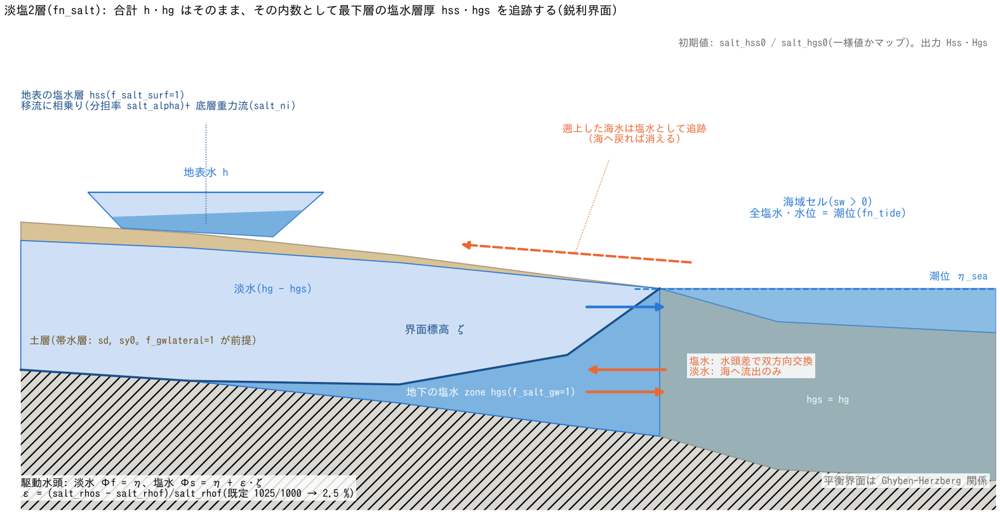

# 淡塩2層(&list_salt)

[ユーザーガイド目次へ](../users_guide.md)

地表水と浅層地下水(土層)に**塩水層**を導入し、塩水くさび・海水浸入・
淡水レンズなどの淡水・塩水の相互作用を近似的に扱います。`fn_salt` で
有効化します。

モデルは地下水解析で実績のある鋭利界面法(2 zone。MODFLOW の SWI2
パッケージ[^bakker13]と同じ考え方)と同型の**準静的・鋭利界面近似**です:
水深・地下貯留(h・Hg)は淡塩の**合計**のまま変わらず、その内数として
「塩水層厚」(常に最下層)を追跡します。密度差 $`\varepsilon`$ は
塩水層の駆動水頭 $`\Phi_s`$ にだけ現れ、浅水流の運動方程式は変わりません
($`\eta`$: 水位、$`\zeta`$: 界面標高)。

```math
\varepsilon = \frac{\rho_s - \rho_f}{\rho_f},
\qquad
\Phi_s = \eta + \varepsilon\,\zeta
```
水位が水平でも、界面が傾いていれば低層の静水圧差が
塩水を動かします(プールの仕切りを外すと最終的に上下に成層する挙動を
再現します)。



海岸の断面です。地表水 h の最下層に塩水層 hss、土層の地下貯留 hg の最下層に塩水 zone hgs を置き、界面標高 ζ を通して塩水の駆動水頭 Φs = η + ε·ζ が決まります。海域セルは全塩水・水位=潮位の境界で、地下では塩水が双方向・淡水が流出のみ、地表では遡上した海水が塩水として追跡されます。

結果の見方(分布・台帳・計測列・再開)は、このページの[出力・確認](#出力確認)にまとめています。

## 何ができるか

- **海水浸入**: 海域セル(潮位つき)を塩水の規定水頭として、帯水層への
  塩水の浸入・後退。平衡界面は Ghyben–Herzberg 関係[^bear79]
  $`z_s = h_f/\varepsilon`$(海面下の界面深さは海面上の淡水頭の
  $`1/\varepsilon`$ 倍。海水では約 40 倍)に従います。
- **淡水レンズ**(涵養があるとき)、**塩水くさび**の準定常位置。
- **高潮・津波の遡上と塩水の行き先**: 遡上した海水は塩水として地表を
  流れます(浅水流の移流に相乗り)。
- **河川・地表から帯水層への塩水の侵入と湧出**: 地表と地下の両方の塩水層が
  有効なとき(f_salt_exch の既定)、河床・地表からの浸透は底層の塩水から先に、
  帯水層からの湧出は上部の淡水から先に、淡塩を分けてやり取りします。感潮河川を
  遡上した塩水くさびが河床から帯水層へ入る経路、遡上した海水が農地に浸透する
  塩害の経路を表します([地表と地下の塩水のやり取り](#地表と地下の塩水のやり取りf_salt_exch))。
- **揚水誘引の海水浸入**: 井戸揚水([地下水](gwflow.md)の f_gwpump)は
  淡水優先で汲み、淡水厚で足りない分を塩水 zone から取ります(塩水の
  混入)。揚水による塩水面の上昇(アップコーニングの近似)は側方流動と
  塩水 zone の力学が自動的に表します。
- 混合・連行(汽水の生成)、内部波の慣性、濃度の連続分布は
  **扱いません**(界面は鋭利なまま)。

## とりあえず動かしてみる(最小入力)

全パラメータに既定値があるので、**fn_salt に空の &list_salt** を書くだけで
動きます(海水 1025・淡水 1000 kg/m³ = 密度差 2.5 %)。組で必要なのは、
海を塩水の規定水頭にする海域マスク fn_sw と潮位 fn_tide
([潮位の章](tide.md))、地下の塩水 zone(f_salt_gw=1)を使うなら
f_gwlateral=1([地下水の章](gwflow.md)。側方 K と比湧水量を共有)です。

```
&list_salt
/
```

## 全体構成(&list_salt)

| パラメータ | 既定値 | 意味 |
|---|---|---|
| f_salt_surf | 1 | 1: 地表の塩水層(移流+底層重力流) |
| f_salt_gw | 1 | 1: 地下(土層)の塩水 zone。**f_gwlateral=1 が前提** |
| f_salt_exch | 両方有効なら 1 | 1: 地表と地下の交換(浸透・飽和湧出)の淡塩配分(湧出は淡水から先)。2: 同じく、ただし湧出は湧出前の塩水の割合で混ぜる(下限側の感度ケース)。1・2 は f_salt_surf=1 と f_salt_gw=1 が前提。0 で配分なし(浸透・湧出する水を淡水として扱う。河川経由の塩水化を切った比較用) |
| salt_rhof / salt_rhos | 1000 / 1025 | 淡水・塩水の密度 (kg/m3)。ε を決める |
| salt_alpha | 1.0 | 塩水層のバロトロピック移流分担率 α(底層は流れの分担が小さい効果。1 = 濃度比例) |
| salt_ni | 0.025 | 底層重力流の界面 Manning 粗度 |
| salt_hss0 / fn_salt_hss0 | 0 / — | 初期の地表塩水層厚(既存 h の内数として指定。一様値かマップ) |
| salt_hgs0 / fn_salt_hgs0 | 0 / — | 初期の地下塩水貯留(**塩水の追加投入** = Hg にも加算。一様値かマップ) |
| salt_eps | 1e-3 | 乾燥判定の正則化量 (m) |
| salt_eps_h | 1e-2 | 重力流 sqrt 則の線形化幅(水頭差 m) |
| salt_diagratio | 2/(2+√2) | 対角方向の配分(通常変更不要) |
| salt_nsubmax | 200 | 地表重力流の適応サブサイクル上限 |

## パターン別の推奨値

既定値は海水と淡水の 2 層が「動く」ための中庸です。対象が決まって
いるときは次を出発点にしてください(校正で変わる量です)。

| 型 | f_salt_surf / f_salt_gw | salt_rhos (kg/m³) | 初期塩水 | 組で使う機能 | 備考 |
|---|---|---|---|---|---|
| 海岸帯水層の塩水くさび(Ghyben-Herzberg) | 0 / 1 | 1025 | fn_salt_hgs0 で海岸沿いに既往の塩水面、または無塩から浸入を待つ | f_gwlateral=1、K_sh 3600〜36000 mm/h(砂質帯水層 1e-3〜1e-2 m/s)、sy0 0.2〜0.3、sd0 = 帯水層厚 5〜20 m | 涵養(降雨+Green-Ampt)があれば淡水レンズが現れる |
| 河口・感潮河川の塩水くさび | 1 / 0 | 1025(湾奥の汽水 1005〜1015) | 0 | fn_tide + 区間流入(河川流量) | salt_ni 0.02〜0.03、salt_alpha 0.5〜1 でくさびの位置を校正 |
| 河口堰と周辺地盤の塩水化 | 1 / 1(f_salt_exch は既定の 1) | 1025 | 海底下の帯水層に fn_salt_hgs0 | fn_tide + 区間流入 + Green-Ampt + f_gwlateral=1。堰は地形の段(天端を満潮位より高く) | 例題 [examples/estuary_barrage](../../examples/estuary_barrage/)。陸の帯水層は空から始まるので、出水と降雨で淡水を満たす前段を置く |
| 高潮・津波の遡上海水の行き先 | 1 / 0 | 1025 | 0 | 潮位(高潮)か境界入射(津波)+ 海岸堤防 | 混合は解かない = 塩水の遡上範囲と排水先の把握 |
| 干拓地・低平地の塩害(浸入と排水) | 1 / 1 | 1025 | fn_salt_hgs0 で既往の塩水面 | 排水ポンプ([構造物](structure.md)) | 遡上・湛水した海水は浸透で帯水層へ入り、塩水を含む地下水は湧出で地表へ戻る(f_salt_exch。下の節)。蒸発による濃縮は表さない |
| 汽水湖・貯水池の成層(躍層の位置) | 1 / 0 | 1010〜1020 | salt_hss0 = 下層厚 | — | 鋭利界面なので混合層・連行は出ない |

## 海との接続

海域セル([潮位・海面](tide.md) の海域マスク)は自動的に「全塩水・
水位 = 潮位」の境界になります:

- **地下**: 帯水層と海の間で塩水が水頭差に応じて双方向に交換され、
  淡水は海へ流出だけします(海に淡水はありません)。潮位変動は
  そのまま境界水頭に反映されます。
- **地表**: 満潮・高潮で海水が陸へ遡上すると、その水は塩水として
  追跡されます(逆に引き潮で海に戻った塩水は消えます)。海セルの塩水層は
  開始状態から潮位適用後の水柱 hsea0 に揃えられ、常に全塩水です。

## 地表と地下の塩水のやり取り(f_salt_exch)

地表(河道・湛水)と土層の帯水層の間の水のやり取り — 鉛直浸透
([地下水](gwflow.md)の Green-Ampt・バケツ。河床交換能 f_gwbed の置き換えを含む)と
飽和超過の湧出 — は、合計の水量を地下水の計算が動かし、その内訳を本モジュールが
鋭利界面の考え方で淡塩に分けます(独自の簡略化。developer.md §47.5)。

- **浸透は底層の塩水から先**: 地表の塩水層は常に最下部にあり、河床・地表に接して
  いるのは塩水なので、浸透する水は塩水層から先に取ります(塩水層より多く浸透する
  ときだけ淡水が続く)。地下に入った塩水は帯水層の最下部に置かれます(即時入替)。
- **湧出は上部の淡水から先**: 帯水層からあふれる水は上部の淡水から出し、淡水で
  足りない分だけ塩水が地表の底層へ出ます。帯水層が全層塩水なら湧き出るのは塩水です。

これで感潮河川の塩水くさびが河床から帯水層へ入り、岸の地盤へ広がる経路、遡上した
海水が農地に浸透する塩害の経路が表せます。地表と地下の両方の塩水層を使うときは
既定で有効(f_salt_exch=1)で、0 にすると浸透・湧出する水を淡水として扱い
(浸透した分の塩水は地表で整合クランプにより消え、湧出した塩水も消える)、河川経由の
塩水化を「なし」にした比較ができます。

結果の読み方の注意:

- **河床直下の塩水化は上限側(f_salt_exch=1)**: 即時入替と組み合わさると、満潮で
  河床から塩水が入り、干潮で帯水層の上部の淡水が出る片方向のやり取りになります
  (実際には浸透した塩水の一部は沈む前に戻る)。くさびが乗る河床の直下は数日〜
  数十日で全層塩水になりえます。
- **下限側の感度ケース(f_salt_exch=2)**: 湧出する水を、湧出前の帯水層の塩水の
  割合 Hgs/Hg で混ぜて出します(浸透した塩水が沈む前に混ざって戻る極限。浸透の
  配分は 1 と同じ)。1 と 2 の両方を計算すると、河川経由の塩水化の大きさを幅で
  示せます([examples/estuary_barrage](../../examples/estuary_barrage/))。
- 交換の配分は塩水の体積を保存します(閉領域の検定で相対 1e-13。
  [test/salt](../../test/salt/) の模式実験 C1〜C4)。
- 蒸発散・層 2 への浸透(f_gwlayer2)・管路層との交換は対象外で、引き続き暗黙に
  淡水扱いです。

## 出力・確認

分布出力の 3 通りの有効化(自動 / 指定 / 共用)と柱状量の面積基底の読み方は[入出力の形式](io.md#状態量の分布出力の考え方)に、確認したい量から出力を逆引きする早見表は同じ節の末尾にあります。

**分布**(`result/` のラスタ。`dt_file` 間隔)

| ファイル | 出し方 | 内容 |
|---|---|---|
| Hss0001… | f_out_h と共用(f_salt_surf=1) | 地表の塩水層厚 (m)。水深 H の内数(最下層) |
| Hgs0001… | f_out_hg と共用(f_salt_gw=1) | 地下の塩水貯留 (m 柱状換算)。Hg の内数 |

**台帳・ログ**(収支の検算)

- 塩水も水なので、Log.txt の S 列(S_surf / S_grnd / S_total)は淡塩の
  合計を示します。塩水だけの収支台帳はありません。

**計測**(プローブ・測線の列)

- 塩水専用の列はありません。地点の塩水層厚は `Hss0001…` の同一セルを
  各出力時刻で拾います。

**再開**

- 私有ファイル `saltwater.dat` で自動的に扱われます(保存時に fn_salt が
  有効だったことが必要)。

**読み方と検算のコツ**

- 淡水層厚 = H − Hss、地下の淡水 = Hg − Hgs。地下の界面標高は
  地盤高 − 土層厚 + Hgs / sy0 です。
- 海水浸入の準定常は、海岸からの距離に対する界面深さが Ghyben–Herzberg
  関係 $`z_s = h_f/\varepsilon`$(淡水頭の約 40 倍)に乗るかで検算できます
  ([test/salt](../../test/salt/) の手順)。
- 遡上した海水の行き先は `Hss0001…` の最終フレーム(排水後に残った
  塩水)で確認します。

## 制約・注意

- f_salt_gw=1 は土層の側方流([地下水](gwflow.md) の f_gwlateral=1)の
  有効化が前提です(K_sh・比湧水量を共有します)。
- 塩水 zone が追従するのは層 1 の側方流・海側境界・揚水と、f_salt_exch=1 の
  ときの浸透・飽和湧出(上の節)です。蒸発散・層 2 への浸透(f_gwlayer2)・
  管路層への浸入水(gwc_leak_layer=1)は暗黙に淡水扱いです(f_salt_exch=0 なら
  浸透・湧出も)。淡水が尽きて Hg < Hgs になると整合クランプ(Hgs ≤ Hg)で
  塩水が減るため、塩水の体積は保存量ではありません。
- [河床交換能](gwflow.md)(f_gwbed)の上限は、河道と河道外の境で塩水 zone の
  流束にも同じ形(交換能 × 通過幅 × 塩水の飽和帯厚)でかかります。
- 地表の塩水層の重力流(底を這う塩水の拡がり)は、各セル境界の**敷居**より上の
  塩水だけが越えます。敷居は両側の高い方の地盤高で、[河道](channel.md)の堤防
  (fn_bank / bank0)や海岸堤防(fn_seawall)の仮想壁があればその天端です
  (壁で隔てた両側に塩水と淡水があっても、界面が天端より低ければ塩水は越えない)。
  浅水流の移流(越流・満潮の流れが運ぶ塩水)も壁を守ります。破堤(&list_channel_breach)による天端の時間低下は
  重力流では追いません(破堤口の水が運ぶ塩水は移流で通るので、止まるのは底を
  這う分だけ)。河道を横断する河口堰・水門の天端は、仮想壁ではなく地形
  (地盤高の段)で与えます([examples/estuary_barrage](../../examples/estuary_barrage/))。
- 地下の塩水 zone の流束は、層1の側方流の直前の状態で評価し、合計と同じ向きに
  流れるときはセルから出る水の組成を上流側セルの塩水割合にそろえます(合計と塩水の
  流束が食い違わないため、浸入前線や湧出面でも塩水の体積が保たれる。developer.md
  §47.7)。地下水の更新間隔
  dt_gwflow を dt より長くしたときは、地下の塩水の処理も同じ間隔・同じ実効刻みで
  行われます。

## パラメータと既定値の根拠

根拠欄の分類語の意味は[既定値の根拠の読み方](../users_guide.md#既定値の根拠の読み方)を参照してください。

| パラメータ | 既定 | 意味 | 根拠 |
|---|---:|---|---|
| f_salt_surf / f_salt_gw | 1 / 1 | 地表・地下の塩水層の有効化 | **方式** 既定は両方。用途別の組合せは「パターン別の推奨値」 |
| f_salt_exch | 両方有効なら 1 | 地表—地下の交換の淡塩配分 | **方式** 鋭利界面では河床に接するのは底層の塩水、帯水層の上部は淡水(独自の簡略化。developer.md §47.5)。両層が有効なら物理的に一貫する側を既定にし、2 は下限側の感度ケース(§47.9)、0 は比較用 |
| salt_rhof / salt_rhos | 1000 / 1025 kg/m³ | 淡水・海水の密度(密度差 $`\varepsilon`$ = 2.5 %) | **慣用値** 標準海水(塩分 35)の密度。Ghyben–Herzberg の 1/ε ≈ 40[^bear79] |
| salt_alpha | 1.0 | 塩水層のバロトロピック移流分担率 | **経験値** 1 = 濃度(層厚)比例。底層が流れを分担しにくい効果を 0.5〜1 で校正 |
| salt_ni | 0.025 | 底層重力流の界面 Manning 粗度 | **経験値** 河床粗度と同程度の置き値。実測の塩水くさび位置で校正 |
| salt_hss0 / salt_hgs0 | 0 / 0 | 初期の塩水層厚・地下塩水貯留 | **与件** 既往の塩水面(電気探査・観測井の塩分)があれば与える |
| salt_eps / salt_eps_h | 1e-3 / 1e-2 m | 乾燥判定の正則化量 / √則の線形化幅 | **数値設定** 浅水側の dd、管路層の gwc_eps_h と同格 |
| salt_diagratio | 2/(2+√2) | 対角配分 | **導出** ENC 本体と同じ([ENC 格子の解説](encgrid.md) §2) |
| salt_nsubmax | 200 | 重力流のサブサイクル上限 | **数値設定** |

**既定値を見直すときの手がかり**

- 塩水の密度は塩分と水温から海水の状態方程式で求まります(塩分 35・
  15 ℃ で 1026、湾奥の汽水では 1005〜1015)。鋭利界面近似の基礎と
  Ghyben–Herzberg 関係は Bear[^bear79]、同型の実用実装は MODFLOW SWI2[^bakker13]。
- 地下の塩水面の初期値は、観測井の塩分プロファイルや電気探査断面を
  GIS で内挿して fn_salt_hgs0 に与えます。無ければ無塩から浸入の準定常
  到達を待ちます(スピンアップ)。

## 検証・例題

- [test/salt](../../test/salt/): プール仕切り実験(上下成層への到達)と海水浸入の解析検算、
  地表—地下の交換の淡塩配分(模式実験 C1: 浸透の解析終状態、C2・C3: 全層塩水の帯水層からの湧出と
  dt_gwflow での同期、C4: 一部が塩水の帯水層からの湧出の f_salt_exch=1・2)、重力流と仮想壁
  (D1: 堤防、D2: 海岸堤防)。
- [examples/estuary_barrage](../../examples/estuary_barrage/): 河口堰の有無が、河川を遡上する
  塩水くさびと周辺の帯水層への塩水の侵入に与える影響(堰あり・なし × 交換の配分なし・あり・混合比・
  目詰まりした河床の 8 ケース)。
- 書式の実例: [examples/List_samples/list_salt.txt](../../examples/List_samples/list_salt.txt)。

## 参考文献

[^bear79]: Bear, J. (1979): *Hydraulics of Groundwater*. McGraw-Hill, New York.(鋭利界面近似と Ghyben–Herzberg 関係)
[^bakker13]: Bakker, M., Schaars, F., Hughes, J. D., Langevin, C. D. and Dausman, A. M. (2013): Documentation of the Seawater Intrusion (SWI2) Package for MODFLOW. *U.S. Geological Survey Techniques and Methods*, 6-A46.(2 zone 鋭利界面法の実用実装)
