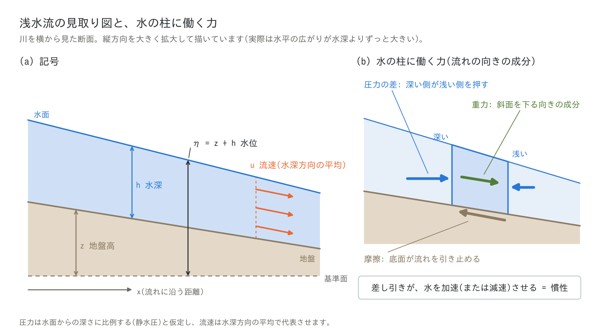
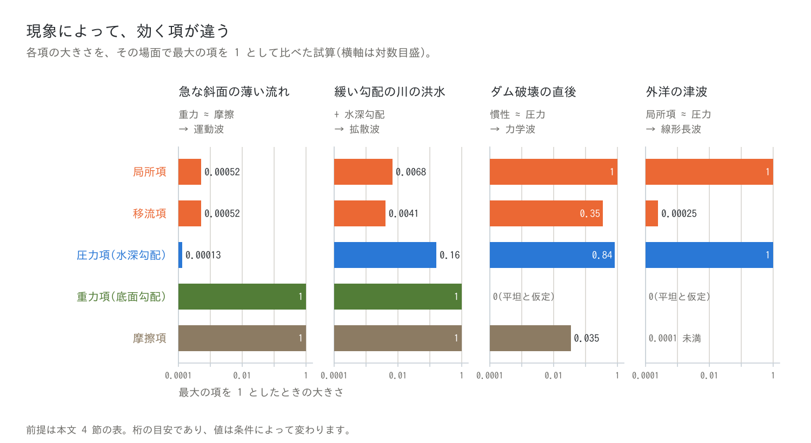
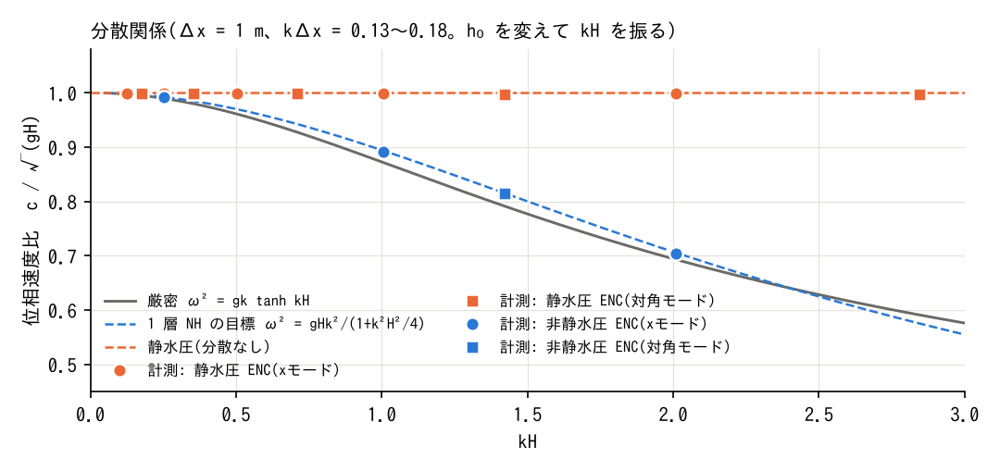
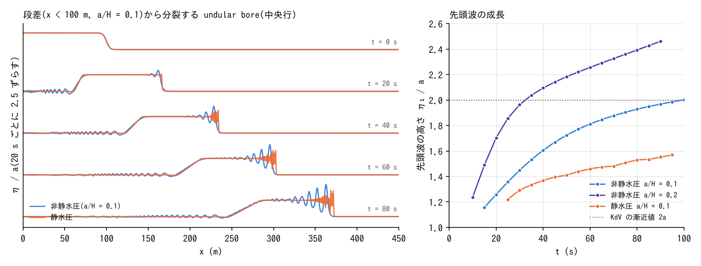

# 浅水方程式と力学波・拡散波・運動波(浅水流計算の入門)

[浅水流計算の章へ](swflow.md) | [ユーザーガイド目次へ](../users_guide.md) | [式の解き方(ENC 格子と時間積分の解説)](encgrid.md)

**「いま、この流れを動かしているのは、どの力の釣り合いか」を、浅水方程式の項を一つずつ見ながら考えます。**

このページは、流れの計算に初めて触れる人のための入門です。チュートリアルや
例題には「力学波」「拡散波」「運動波」「移流項」「圧力項」といった言葉が
何度も出てきます。それらが式のどの部分を指し、どんな現象で効き、なぜ
ENCflow が力学波を既定にしているのかを、順に説明します。式は出てきますが、
記号の読み方から書くので、流体力学の知識は前提にしません。式を格子の上で
どう解いているかは、[ENC 格子と時間積分の解説](encgrid.md)と
[移流項のスキーム](advection.md)にあります。

急ぐ人は、[3 節の図](#terms)と [6 節の表](#wave-models)、
[9 節](#encflow)だけで足ります。

[各項の名前と意味](#terms) · [力学波・拡散波・運動波](#wave-models) · [どの現象にどの式か](#phenomena) · [ENCflow の設定との対応](#encflow) · [静水圧近似の限界](#hydrostatic) · [追補: サンブナン式・不定流の式](#names)

<a id="shallow"></a>

## 1. 「浅水」とは — 広がりに比べて水深が浅い流れ

川、氾濫した水、斜面を流れる雨水、湾の潮の動き。これらに共通するのは、
**水平方向の広がりに比べて、水深がずっと小さい**ことです。幅 100 m・水深
3 m の川も、数 km に広がる水深 1 m の浸水もそうです。この「薄い水の層」の
流れを**浅水流**と呼びます。

「浅い」は、深さそのものの話ではありません。外洋の津波は水深 4,000 m の
海を進みますが、波長が 100 km を超えるので、水深は波長の数十分の一しかなく、
やはり「浅水」です。

薄い層の流れでは、二つの単純化ができます。

1. **圧力は、水面からの深さだけで決まる(静水圧)。** 水はほぼ水平に動き、
   上下方向の加速はごく小さいので、ある点の圧力は「その上に載っている水の
   重さ」で決まります。
2. **流速は、水深方向の平均で代表させる。** 底から水面までの流速の違いは
   追わず、平均の流速 1 つで層全体の動きを表します。

こうすると、未知数は各地点の**水深**と**流速**だけになり、3 次元の流れを
平面 2 次元の問題として解けます。この単純化で得られる式が**浅水方程式**
です。[^vreug]



| 記号 | 意味 | 単位 | ENCflow の出力 |
|---|---|---|---|
| $`x,\ y`$ | 水平の位置 | m | — |
| $`t`$ | 時刻 | s | — |
| $`z`$ | 地盤高(基準面からの地面の高さ) | m | Z |
| $`h`$ | 水深 | m | H |
| $`\eta = z + h`$ | 水位(水面の高さ) | m | E |
| $`u,\ v`$ | 流速($`x`$・$`y`$ 方向。水深方向の平均) | m/s | u, v |
| $`q = hu`$ | 単位幅流量(幅 1 m あたりの流量) | m²/s | Q(大きさ) |
| $`g`$ | 重力加速度 | m/s² | — |
| $`n`$ | マニングの粗度係数(地表の粗さ) | s/m^(1/3) | — |

<a id="equations"></a>

## 2. 浅水方程式 — 水の量の式と、動きの式

浅水方程式は 2 本の式の組です。見やすくするため、流れに沿う 1 方向
($`x`$)だけで書きます。

**連続式(水の量の保存)**

```math
\frac{\partial h}{\partial t} + \frac{\partial (hu)}{\partial x} = r
```

「ある場所の水深の増減は、流れ込む量と流れ出る量の差(と、雨などの
出入り $`r`$)で決まる」という式です。

**運動方程式(水の動き)**

```math
\frac{\partial u}{\partial t} + u\,\frac{\partial u}{\partial x}
 = -\,g\,\frac{\partial h}{\partial x} \;-\; g\,\frac{\partial z}{\partial x}
 \;-\; g\,\frac{n^2\,u\,|u|}{h^{4/3}}
```

こちらは「加速度 = 力 ÷ 質量」(ニュートンの運動の法則)を、水の柱に
当てはめたものです。左辺が水の加速、右辺が水に働く力(質量 1 kg あたり)
です。

**記号の読み方。** $`\partial/\partial t`$ は「同じ場所で見たときの、時間に
よる変化の割合」、$`\partial/\partial x`$ は「同じ時刻に見たときの、場所に
よる変化の割合(勾配)」です。たとえば $`\partial h/\partial x`$ は水深の
勾配で、100 m 先で水深が 0.1 m 深くなるなら 0.001 です。

平面 2 次元では、流速がベクトル $`\mathbf{u} = (u, v)`$ になります。

```math
\frac{\partial h}{\partial t} + \nabla\cdot(h\mathbf{u}) = r,
\qquad
\frac{\partial \mathbf{u}}{\partial t} + (\mathbf{u}\cdot\nabla)\,\mathbf{u}
 = -\,g\,\nabla(z + h) \;-\; \frac{g\,n^2\,|\mathbf{u}|}{h^{4/3}}\,\mathbf{u}
```

ENCflow が解くのは、この 2 次元の式です。項の顔ぶれと意味は 1 次元と同じ
なので、以下は 1 次元の式で説明します。

<a id="terms"></a>

## 3. 各項の名前と意味


運動方程式の 5 つの項には、それぞれ名前があります。分野や文献によって
呼び名が違うので、別名も並べます。[^chow88]

| 項 | 呼び名(別名) | 意味 | 大きくなる場面 |
|---|---|---|---|
| $`\dfrac{\partial u}{\partial t}`$ | **局所項**(局所加速度項、非定常項、時間微分項) | その場所の流速が、時間とともに変わる | 流れが急に変わるとき。ダム破壊、津波、ゲートの開閉 |
| $`u\,\dfrac{\partial u}{\partial x}`$ | **移流項**(対流項、移流加速度項) | 水が、流速の違う場所へ移動していく。流れが自分の勢い(運動量)を運ぶ | 流速が場所によって変わる所。急な狭まりと広がり、段差、屈曲、合流、跳水 |
| $`-g\,\dfrac{\partial h}{\partial x}`$ | **圧力項**(水深勾配項) | 深い側の水が、浅い側の水を押す | 水深が場所によって変わる所。堰上げ(背水)、波の前面、湛水の縁 |
| $`-g\,\dfrac{\partial z}{\partial x}`$ | **重力項**(底面勾配項、河床勾配項) | 傾いた地面の上で、重力が水を低い方へ引く | 勾配の急な斜面や河道 |
| $`-g\,\dfrac{n^2 u\lvert u\rvert}{h^{4/3}}`$ | **摩擦項**(底面摩擦項、抵抗項) | 底面が流れを引き止める。向きは流れと逆 | 浅くて速い流れ、粗い地表 |

項をまとめた呼び名もあります。

- **慣性項**(加速度項) = 局所項 + 移流項。水のかたまりを追いかけて見た
  ときの加速度です。「慣性」は、水が急には動き出さず、急には止まらない
  性質のことです。
- **水面勾配項** = 圧力項 + 重力項。二つの和は
  $`-g\,\partial(z + h)/\partial x = -g\,\partial\eta/\partial x`$ で、
  「水は、水面の高い方から低い方へ押される」ことを表します。
- 摩擦項は、ここではマニングの式で書いています。ほかの抵抗則でも役割は
  同じです。

### 勾配の言葉で言い換える

運動方程式の全体を $`g`$ で割ると、どの項も「勾配」(単位のない数)に
なります。

```math
S_f = S_0 \;-\; \frac{\partial h}{\partial x}
 \;-\; \frac{u}{g}\frac{\partial u}{\partial x}
 \;-\; \frac{1}{g}\frac{\partial u}{\partial t},
\qquad
S_0 = -\frac{\partial z}{\partial x},
\quad
S_f = \frac{n^2\,u\,|u|}{h^{4/3}}
```

$`S_0`$ は**底面勾配**(河床勾配)、$`S_f`$ は**摩擦勾配**(エネルギー勾配)
です。「摩擦が受け持つ勾配は、底面勾配から、水深勾配と慣性の分を引いた
残り」と読めます。水理学の教科書はこの形で書くことが多く、6 節の近似も
この形で見ると分かりやすくなります。

### 圧力項と重力項 — 分けて書くか、まとめて書くか

圧力項と重力項は、水面勾配項 $`-g\,\partial\eta/\partial x`$ の 1 つに
まとめられます。数式としてはどちらも同じですが、書き方には流儀があります。

- **分けて書く(分離型)** $`g\,(S_0 - \partial h/\partial x)`$。河道の勾配
  $`S_0`$ を与えられた値とみなす、1 次元の河川の水理で自然な形です。
  重力と摩擦が釣り合った流れ($`S_0 = S_f`$。等流)からのずれを、水深勾配
  として読めます。6 節の運動波は、慣性項に加えて水深勾配も省き、底面勾配
  だけを残すので、この形で考えます。
- **まとめて書く(一体型)** $`-g\,\partial\eta/\partial x`$。起伏のある
  地形の上の平面 2 次元の計算で自然な形です。水面が水平なら力は 0 なので、
  「静止した水は、底の形によらず静止したまま」であることが式からすぐに
  分かります。

計算機の上では、この違いが結果に現れることがあります。圧力項と重力項を
別々のやり方で計算すると、起伏のある底の上で静止しているはずの水に、
打ち消し残りの力が生じ、偽の流れができます。静止した水を静止したまま
保てる計算法は well-balanced なスキームと呼ばれ、圧力と底面勾配を別の形で
持つ計算法では、そのための工夫が要ります。[^bv94][^audusse04]

ENCflow は、隣り合う 2 つのセルの地盤高の差と水深の差を、同じ 2 点の
差で求めて足します。和は水位の差そのものになるので(一体型)、水面が
水平なら駆動力は 0 です([ENC 格子と時間積分の解説](encgrid.md) §5)。

### この 5 項のほかに

ENCflow では、設定に応じて次の項が運動方程式に加わります。

- 拡散項(乱れによる運動量の混合。[拡散項の解説](diffusion.md))
- 家屋群の抗力([地理情報](geoinfo.md))
- 非静水圧補正([10 節](#hydrostatic))
- 沿岸の波浪場による外力([沿岸の波浪場](wavefield.md))

急な斜面では、重力項と摩擦項に補正が掛かります
([急勾配の重力補正の解説](steep_slope.md))。一方、地球の自転の効果
(コリオリ力)と風の応力の項はありません。対象は、投影座標系で解ける
範囲までです。

<a id="which-terms"></a>

## 4. 現象によって、効く項が違う

5 つの項は、いつも同じ大きさではありません。現象によっては、ほとんど
効かない項があります。4 つの典型的な場面で、各項の大きさを概算して
比べます。



図は、それぞれの場面で最大の項を 1 としたときの大きさです。元の値
(各項を $`g`$ で割った勾配)と、想定した条件を表にします。

| 場面 | 想定 | 局所項 | 移流項 | 圧力項(水深勾配) | 重力項(底面勾配) | 摩擦項 |
|---|---|---:|---:|---:|---:|---:|
| 急な斜面の薄い流れ | 勾配 0.05、$`n`$ = 0.015 の斜面 800 m に 10.8 mm/h の雨。水深 5 mm、流速 0.45 m/s、流量が落ち着くまで 29 分 | 3×10⁻⁵ | 3×10⁻⁵ | 7×10⁻⁶ | 5×10⁻² | 5×10⁻² |
| 緩い勾配の川の洪水 | 勾配 1/5000、$`n`$ = 0.03。水深が 12 時間で 3 m から 6 m に上がる | 1×10⁻⁶ | 8×10⁻⁷ | 3×10⁻⁵ | 2×10⁻⁴ | 2×10⁻⁴ |
| ダム破壊の直後 | 平坦な底。300 m の区間、30 秒の間に、水深 10 → 4 m、流速 0 → 7 m/s。$`n`$ = 0.03 | 2×10⁻² | 8×10⁻³ | 2×10⁻² | 0 | 8×10⁻⁴ |
| 外洋の津波 | 水深 4,000 m、振幅 1 m、周期 20 分。底は平坦と仮定 | 3×10⁻⁵ | 7×10⁻⁹ | 3×10⁻⁵ | 0 | 2×10⁻¹¹ |

*このページのための試算です。流速の変化を $`\Delta U`$、変化に要する時間と
距離を $`T`$・$`L`$ として、局所項を $`\Delta U/(gT)`$、移流項を
$`U\Delta U/(gL)`$、水深勾配を $`\Delta h/L`$、摩擦項を
$`n^2U^2/h^{4/3}`$ で見積もりました(津波は正弦波として計算)。1 行目は
[examples/benchmark/v-shaped](../../examples/benchmark/v-shaped/README.md)
の斜面の条件です。計算は図のスクリプト
`docs/figs/guide/fig_shallow_water.py` にあります。桁の目安であり、
値は条件によって変わります。*

表から、次のことが読み取れます。

- **急な斜面の薄い流れ**では、重力と摩擦が釣り合い、ほかの 3 項はその
  1/1000 以下です。重力項と摩擦項だけ残せば足ります(→ 運動波)。
- **緩い勾配の川の洪水**でも主役は重力と摩擦ですが、水深勾配が 1〜2 割
  あります。これは省けません(→ 拡散波)。慣性項は 1 % 未満です。
- **ダム破壊の直後**は、慣性項と圧力項が主役で、摩擦は脇役です。全部の
  項が要ります(→ 力学波)。
- **外洋の津波**は、局所項と圧力項だけの釣り合いです。移流項も摩擦項も
  無視できます(→ 線形長波。[追補](#names))。

**どの項が効くかは現象ごとに違い、同じ流域の中でも、場所と時刻によって
変わります。** 浅水方程式に何種類もの近似があるのは、このためです。

<a id="froude"></a>

## 5. フルード数 — 常流と射流

流れの性質を分ける数に、**フルード数**があります。流速と、水面の波が
水に対して進む速さ $`\sqrt{gh}`$ の比です。

```math
Fr = \frac{u}{\sqrt{g h}}
```

| フルード数 | 呼び名 | 性質 |
|---|---|---|
| $`Fr < 1`$ | **常流** | 波は上流へも進める。下流の状態(堰、合流、潮位)が上流に及ぶ(背水) |
| $`Fr = 1`$ | **限界流** | 常流と射流の境目 |
| $`Fr > 1`$ | **射流** | 波は上流へ進めない。流れは上流の状態だけで決まる |

射流が常流に戻る所では、水面が急に立ち上がる**跳水**が起き、流れの勢い
(運動エネルギー)の一部が渦になって失われます。

フルード数は、3 節の項の大きさとも結び付いています。流量が一定の流れでは、
**移流項と圧力項の大きさの比が、およそ $`Fr^2`$** になります。

- $`Fr`$ が小さい流れ(ゆっくりした常流)では、移流項は圧力項に比べて
  小さく、省いても結果はあまり変わりません。
- $`Fr`$ が 1 に近い流れや射流では、移流項は圧力項と同じ大きさです。
  射流と常流の切り替わりや跳水は、移流項なしには表せません。

ただし、フルード数だけでは決まりません。4 節の「急な斜面の薄い流れ」は
$`Fr \approx 2`$ の射流ですが、慣性項も圧力項も重力項・摩擦項の 1/1000
以下で、運動波で表せます。フルード数が教えるのは「慣性と圧力のどちらが
大きいか」で、「その二つが重力や摩擦に比べて効くか」は別の問いです。

ENCflow はフルード数の分布を出力できます(`f_out_fr`。
[入出力の形式](io.md))。

<a id="wave-models"></a>

## 6. 力学波・拡散波・運動波 — どの項を残すか

運動方程式の項をすべて残すか、小さい項を省くかで、式に名前が付いて
います。「波」は洪水波、つまり水面の盛り上がりが伝わっていく様子を
指しています。[^chow88]

| 名前(別名・英語) | 局所項 | 移流項 | 圧力項 | 重力項 | 摩擦項 | 運動方程式 |
|---|:---:|:---:|:---:|:---:|:---:|---|
| **力学波**(動的波、ダイナミックウェーブ。dynamic wave) | ○ | ○ | ○ | ○ | ○ | 2 節の式そのまま |
| **局所慣性**(局所慣性方程式。local inertia) | ○ | — | ○ | ○ | ○ | $`\dfrac{1}{g}\dfrac{\partial u}{\partial t} = -\dfrac{\partial \eta}{\partial x} - S_f`$ |
| **拡散波**(ディフュージョンウェーブ。diffusion wave、diffusive wave) | — | — | ○ | ○ | ○ | $`S_f = -\dfrac{\partial \eta}{\partial x}`$ |
| **運動波**(運動学的波、キネマティックウェーブ。kinematic wave) | — | — | — | ○ | ○ | $`S_f = S_0`$ |

○ は残す項、— は省く項です。**連続式は、どれも同じ**です。違うのは
運動方程式だけです。

### 6.1 運動波 — 重力と摩擦の釣り合い

慣性項と水深勾配を省くと、残るのは $`S_f = S_0`$、つまり「重力と摩擦が
いつも釣り合っている」という関係です。これを流速について解くと、
マニングの等流の式になります。

```math
u = \frac{1}{n}\,h^{2/3}\,\sqrt{S_0}
```

流速は、その場の水深と地面の勾配だけで決まります。

- 洪水波は**下流へだけ**進みます(速さは流速の約 5/3 倍)。
- 下流の状態は上流に伝わりません。堰上げ(背水)や湛水は表せません。
- 平坦な所では、駆動力(底面勾配)がないので水が動きません。窪地に入った
  水は、そこから出られません。
- 波は、理論の上では低くならずに進みます(減衰しません)。

名前は Lighthill と Whitham によります。運動の法則(力学)を使わず、
連続式という量の勘定(運動学)だけで波の伝わり方が決まるので
「kinematic(運動学的)」と呼び、運動の法則が要る波を「dynamic(力学的)」
と呼んで区別しました。[^lw55]

**使われる場面:** 急な斜面の雨水の流れ、急勾配の山地河川の流出計算。

### 6.2 拡散波 — 水深勾配を加える

慣性項だけを省くと、$`S_f = -\partial\eta/\partial x`$、つまり「水面勾配と
摩擦が釣り合っている」という関係になります。

```math
u = \frac{1}{n}\,h^{2/3}\,\sqrt{\left|\frac{\partial \eta}{\partial x}\right|}
\qquad(\text{向きは水面の低い方})
```

これを連続式に入れると、水深が「拡散」の式(熱が広がるのと同じ形の式)に
従うことが分かります。名前はここから来ています。

- 洪水波は、進みながら**低く、なだらかに**なります(減衰)。
- 下流の水位の影響が上流へ伝わります(背水)。
- 平坦な所や窪地でも、水面に勾配があれば流れます。
- 慣性が効く現象は表せません。波の振動と反射、段波、跳水、射流、勢いで
  進む噴流や渦がそうです。

**使われる場面:** 緩い勾配の河川の洪水の伝わり、氾濫原のゆっくりした浸水、
流域の降雨流出。

> **「拡散波」と「拡散項」は別のものです。** 拡散波の「拡散」は、水面の
> 盛り上がりがなだらかに広がることを指します。ENCflow の拡散項
> (`f_diffusion_term`)は、乱れによる運動量の混合を表す項で、どの式にも
> 追加できる別の機能です([拡散項の解説](diffusion.md))。

### 6.3 局所慣性方程式 — 移流項だけを省く

慣性項のうち、移流項だけを省き、局所項は残した式です。Bates らが、2 次元の
氾濫計算のために提案しました。[^bates10]

きっかけは計算の速さです。拡散波を、次の時刻の値を今の値から直接求める
方法(陽解法)で解くと、安定に計算できる時間刻みが格子幅の 2 乗に比例して
小さくなり、細かい格子では計算が極端に遅くなります。局所項を残すと、
時間刻みの上限が格子幅に比例する形(クーラン数の条件)に変わり、細かい
格子でも速く計算できます。

- 水面の波が $`\sqrt{gh}`$ の速さで両方向に伝わります。
- ゆっくりした常流の氾濫では、力学波に近い結果になります。フルード数が
  0.5 より小さい範囲でよく一致し、それより大きくなると精度が落ちると報告
  されています。[^dab13]
- 移流項が担う現象は表せません。射流、跳水、段波の正しい速さ、狭まり・
  屈曲・段差での勢いのやりとりがそうです。

**使われる場面:** 低平地や沿岸の、広い範囲の氾濫計算。

### 6.4 力学波 — すべての項

項を省かない、浅水方程式そのものです。ほかの 3 つは、力学波のうち小さい
項を省いた特別な場合なので、**近似の式で表せる現象は、原則としてすべて
力学波でも表せます**。そのうえで、近似の式では表せない現象を扱えます。

- 段波、跳水、射流と常流の切り替わり
- ダム破壊、津波の遡上、潮の満ち引きによる往復の流れ
- 狭い所から広がる噴流、物の背後の渦

**使われる場面:** 上の現象を含む計算の全般。河川と氾濫の詳細な計算、
津波・高潮の浸水計算。

ただし、力学波も万能ではありません。浅水方程式そのものの前提(静水圧と
水深平均)は残ります([10 節](#hydrostatic))。

<a id="phenomena"></a>

## 7. どの現象に、どの式が使われるか

| 式 | 表せること | 表せないこと | 主な用途と、採用しているモデルの例 |
|---|---|---|---|
| 運動波 | 重力と摩擦で決まる、下流へ向かう流れ | 背水、湛水、平坦地と窪地の流れ、波の減衰、慣性が効く現象 | 急な斜面の雨水流、山地河川の流出計算(日本の流出解析で使われてきた等価粗度法など) |
| 拡散波 | 上に加えて、背水、湛水、洪水波の減衰 | 慣性が効く現象(波の振動と反射、段波、跳水、射流) | 流域の降雨流出と氾濫(RRI、GSSHA)、氾濫原の浸水(HEC-RAS 2D の選択肢の一つ) |
| 局所慣性 | 上に加えて、水面の波の伝播(ゆっくりした常流) | 移流項が担う現象(射流、跳水、段波の速さ、勢いのやりとり) | 低平地・沿岸の広域の氾濫(LISFLOOD-FP、CAESAR-Lisflood、SFINCS) |
| 力学波 | 上に加えて、射流、跳水、段波、津波の遡上、噴流と渦 | 浅水方程式の前提の外([10 節](#hydrostatic)) | 河川と氾濫の詳細な計算、津波・高潮(TELEMAC-2D、Delft3D、TUFLOW、Iber、iRIC Nays2DH、HEC-RAS 2D の選択肢の一つ、ENCflow) |

*モデルの例は代表的なものです。版によって選べる式が増えていることがあるので、
各モデルの文書と[他モデルとの比較](../comparison.md)で確かめてください。*

### 使い分けの目安

近似の式が使えるかどうかを見積もる、簡単な目安が知られています。
$`S_0`$ は底面勾配、$`h`$・$`u`$ は代表的な水深と流速、$`L`$ は斜面の
長さ、$`T`$ は洪水波の周期(増水から減水までの時間)です。1 行目の
$`h`$ と $`Fr`$ は、流れが落ち着いたときの斜面の下端の値を使います。

| 式 | 目安 | 出典 |
|---|---|---|
| 運動波 | $`k = \dfrac{S_0 L}{h\,Fr^2} > 20`$ | Woolhiser と Liggett[^wl67] |
| 運動波 | $`T\,S_0\,\dfrac{u}{h} \ge 171`$ | Ponce ら[^ponce78] |
| 拡散波 | $`T\,S_0\,\sqrt{\dfrac{g}{h}} \ge 30`$ | Ponce ら[^ponce78] |
| 局所慣性 | $`Fr \lesssim 0.5`$ | de Almeida と Bates[^dab13] |

**勾配が急なほど、また波の変化がゆっくりなほど、近似がよく成り立つ**と
読めます。4 節の斜面の流れは $`k \approx 1900`$ で、運動波で十分です。
4 節の緩い勾配の川は、周期を 1 日とすると $`T S_0 u/h \approx 5`$ で運動波の
目安に遠く届かず、$`T S_0 \sqrt{g/h} \approx 26`$ で拡散波の目安の境目に
あります。

これらは、流れを**区間の大きさで滑らかに**見たときの、洪水波の伝わり方に
ついての目安です。格子の大きさで現れる段差、急な広がり、合流といった
局所の現象には当てはまりません。この区別は
[chichibu チュートリアルの補足](../../tutorials/chichibu/README.md#結果-3-移流項と解像度依存)
で詳しく見ています。

<a id="why-not-dynamic"></a>

## 8. 力学波は、なぜいつも使われるわけではないのか

力学波がすべてを含むなら、いつも力学波で解けばよさそうです。それでも
近似の式が広く使われてきたのには、理由があります。

1. **移流項の計算が難しい。** 移流項は流速どうしの掛け算で、流れの前面を
   切り立たせ、段波や跳水のような不連続を作ります。不連続をまたいで素朴に
   計算すると、振動が出たり、運動量が保たれずに段波の速さが狂ったりします。
   不連続を正しく扱う計算法が要ります([移流項のスキーム](advection.md))。
2. **安定に計算するための制約が厳しい。** 陽解法では、時間刻みを「流速 +
   波速 $`\sqrt{gh}`$ で 1 セル進む時間」より短くする必要があります
   ([クーラン数と時間刻みの決め方](courant.md))。深い水があると波速が
   大きく、時間刻みは小さくなります。乾いた地面と濡れた地面の境(水際)や、
   薄い水の強い摩擦にも工夫が要ります。
3. **計算の手間が大きい。** 計算する項が多く、時間刻みも小さいためです。
   流域全体を長い期間にわたって計算する水文の分野では、斜面と河道を
   1 次元の運動波でつなぐ方法が、計算機の能力に見合う現実的な選択でした。
4. **省いても結果が変わらない場面が多い。** 4 節のとおり、急な斜面の雨水の
   流れでは、慣性項は重力項の 1/1000 です。入れても入れなくても同じ答えなら、
   簡単な式で十分です(9 節の「実例で見る」の V 字流域がその例です)。地形や
   粗度の不確かさの方が大きいことも多くあります。

ただし、近似すれば必ず速くなるわけではありません(6.3 節の、陽解法の
拡散波の例)。また、近似の式を適用できる範囲の外(射流、跳水、段波、
慣性の効く急な河道)で使えば、もっともらしく見えて誤った結果になります。
計算する前に、その範囲の内か外かを、場所ごと・時刻ごとに見極めるのは
簡単ではありません。

<a id="encflow"></a>

## 9. ENCflow は力学波を既定にしている

ENCflow は、地表面上のあらゆる水の流れを、ひとつのモデルで切れ目なく解く
ことを目指しています([developer.md §0](../developer.md) の基本方針)。
山地の斜面の薄い流れ、急な河道の射流、氾濫原の湛水、津波の遡上が、同じ
計算の中に同時に現れます。どの近似が成り立つかは場所と時刻で変わるので、
近似を選ぶのではなく、**すべての項を持つ力学波を既定**にしています。

利用者は「この現象に慣性項は要るか」を前もって判断しなくて済みます。
効かない場所では、その項が小さくなるだけです。

8 節の難しさには、次のように対処しています。

| 難しさ | ENCflow の対処 | 解説 |
|---|---|---|
| 移流項と不連続 | 運動量を保存する形の移流項(既定の `f_advection_scheme = 3`) | [移流項のスキーム](advection.md) |
| 時間刻みの制約 | 陽解法のまま、流量が急変した所だけを多段で計算し直す(適応的ルンゲクッタ)。クーラン数を監視する | [ENC 格子と時間積分の解説](encgrid.md) §6〜7、[クーラン数と時間刻みの決め方](courant.md) |
| 薄い水の強い摩擦 | 摩擦項を半陰的に扱う | [ENC 格子と時間積分の解説](encgrid.md) §5 |
| 水際 | 水を使い切る流出の抑制、エッジの水深の頭打ち | [ENC 格子と時間積分の解説](encgrid.md) §3・§5 |
| 計算の手間 | 単純な陽解法を OpenMP と MPI で並列化する | [並列実行](parallel.md) |

### 設定との対応(`f_govequation`)

基礎式は `&list_sysparam` の `f_govequation` で切り替えられます
([浅水流計算の章](swflow.md))。

| `f_govequation` | 呼び名 | 計算する項 | 6 節の分類では |
|---|---|---|---|
| 0(既定) | 力学波 | すべての項 | 力学波 |
| 1 | 局所慣性(移流項なし)。従来の表記は「拡散波」 | 移流項を省く。局所項・圧力項・重力項・摩擦項は残る | 局所慣性方程式 |
| 2 | 運動波 | 移流項と圧力項(水深勾配)を省く。局所項・重力項・摩擦項は残る | 運動波に局所項を残した形 |

`f_govequation = 1` は、力学波の計算の手順をそのまま使い、移流項だけを
0 にしたものです。局所項が残るので、6 節の分類では拡散波ではなく
**局所慣性方程式**に当たります。この設定は長く「拡散波」と呼ばれてきた
ため、例題やチュートリアルの本文と図、設定例のコメント(DifWE)には、
その表記が残っています。「拡散波(`f_govequation = 1`)」とあれば、
この局所慣性の計算のことです。

流れの変化がゆっくりなら局所項は小さく、局所慣性と拡散波は同じ結果に
なります(降雨流出がそうです)。波が行き来する場面では違いが出ます。
局所慣性では水面の波が伝わり、拡散波では伝わりません(下の表の「水槽の
波」)。`f_govequation = 2` も同じく局所項が残り、流速は等流の値に
向かって、摩擦で決まる速さで近づきます。

1 と 2 は、感度を調べる実験と、他のモデルとの比較のための設定です。項の
計算を省くだけで、時間刻みの上限(クーラン数の監視)は力学波と同じなので、
計算はあまり速くなりません(tutorials/wave の Step 1 で、計算時間の短縮は
1 が 4 %、2 が 10 %)。乾いた地面への氾濫や遡上を含む計算は、力学波のまま
使ってください。

### 実例で見る

| 例 | 基礎式を変えると | 分かること |
|---|---|---|
| V 字流域の降雨流出([examples/benchmark/v-shaped](../../examples/benchmark/v-shaped/README.md#基礎式の比較補足10-m)) | **差が出ない例。** 力学波・局所慣性・運動波の出口の流量の差は、最大でピークの 2 %。立ち上がりの時刻は同じ | 薄く遅い斜面の流れは、重力と摩擦の釣り合いで決まる。どの式でも同じ |
| 階段状の斜面の降雨流出([test/hillslope](../../test/hillslope/README.md)) | **差が出ない例。** 力学波と局所慣性の出口の流量が重なる(ピーク 210.69 と 210.68 m³/s) | 10 m の段差があっても、流れが薄く遅ければ慣性は効かない |
| 実地形の急な河道([tutorials/chichibu の補足](../../tutorials/chichibu/README.md#結果-3-移流項と解像度依存)) | **差が出る例。** 移流項を省くと、流域出口近くのピーク流量が力学波の 1.5〜2.3 倍になり、格子を細かくするほど大きく早くなる | 河床の段差での加速を抑える働き(跳水に当たる損失、勢いのやりとり)は、移流項にある |
| 水槽の波([tutorials/wave](../../tutorials/wave/README.md) の Step 1 の `&list_sysparam` に `f_govequation` を 1 行足す) | 運動波(2)では、水の山がまったく動かない(8 秒後も流速 0)。局所慣性(1)では波は広がり、裾の位置は力学波と同じだが、前面の切り立ちが弱い(前面の水位 1.1 m の位置は中心から 36.7 m。力学波は 38.1 m) | 平坦な底では底面勾配が 0 なので、運動波には駆動力がない。高さのある波では移流項も効く |
| ダム破壊の段波([test/dambreak](../../test/dambreak/README.md) の `f_govequation` を 1 にする) | 移流項を省くと、30 秒間に段波が進む距離が解析解より 22 % 短く、背後の水深が 37 % 深い(力学波は +1.3 %、−1.4 %) | 段波の速さと高さは運動量の保存で決まる。移流項が要る |

上の 3 行は各例題の README の値です(README では局所慣性を「拡散波」
「移流項なし」と書いています)。下の 2 行はこのページのために計算した
値です(回帰テストの対象ではありません)。

### 力学波を選んでも残る限界

- **浅水方程式の前提の外は表せません**([10 節](#hydrostatic))。
- **格子で解像できない流れの結果は、計算法の細部に左右されます。** 格子の
  幅と同じくらいの河道では、移流項の計算の細部だけで洪水のピークが 1〜2 割
  変わる例があります
  ([1 セル幅の河道と移流項の風上供給元](advection_donor.md))。
- **式が正しく解けていることと、現実に合うことは別です。** 項をすべて
  持つことは、結果が観測に合うことの保証ではありません
  ([時間刻みの設計方針](timestep_policy.md) §5)。

<a id="hydrostatic"></a>

## 10. 静水圧近似の限界 — 浅水方程式そのものが表せないもの

力学波は「浅水方程式の範囲で」すべてを含みます。その浅水方程式は、1 節の
二つの単純化の上に立っています。ここでは、その一つ目の**静水圧**の限界を
見ます。

静水圧の仮定が崩れるのは、**水の上下方向の加速が無視できなくなるとき**
です。それは、流れが変化する水平の長さが、水深と同じくらいまで短くなった
ときに起こります。

### 短い波は遅く進む(分散)

浅水方程式では、どんな波長の波も同じ速さ $`\sqrt{gh}`$ で進みます。実際の
水面の波は、波長が短いほど遅く進みます。この性質を**分散**と呼びます。
波長を $`\lambda`$ とすると、実際の波の速さ $`c`$ は次の式で表されます。[^dd91]

```math
c = \sqrt{\frac{g\lambda}{2\pi}\tanh\!\left(\frac{2\pi h}{\lambda}\right)}
```

| 波長 ÷ 水深 | 実際の波の速さ ÷ $`\sqrt{gh}`$ | 浅水方程式の波の速さの過大 |
|---:|---:|---:|
| 100 | 0.999 | 0.1 % |
| 50 | 0.997 | 0.3 % |
| 20 | 0.984 | 1.6 % |
| 10 | 0.941 | 6 % |
| 5 | 0.82 | 22 % |
| 2 | 0.56 | 78 % |

波長が水深の 20 倍より長ければ、誤差は 2 % 以下です。これが「浅水」
「長波」と呼べる目安です。洪水や氾濫の水面の変化、潮の満ち引き、外洋の
津波は、この範囲に十分入ります。風でできる波やうねりは、岸のごく近くを
除いて、この範囲に入りません。



*閉じた水槽の定在波で測った波の速さ([test/nhwave](../../test/nhwave/README.md)
の図)。横軸の kH は $`2\pi \times`$ 水深 ÷ 波長で、右へ行くほど短い波です。
静水圧の ENCflow(橙)は波長によらず 1、つまり分散がありません。灰色の
実線が実際の水面の波の理論で、非静水圧補正(青。後述)を入れると理論に
近づきます。*

### 切り立った前面は、波の列に分かれる

浅水方程式では、高さのある波の前面は進むにつれて切り立ち、段波(不連続)に
なります。実際には、前面の幅が水深の数倍まで縮むと分散が効きはじめ、
段波の代わりに波の列(波状段波、ソリトン分裂)ができることがあります。
河川を遡上する津波で見られる現象です。



*水位の段差が進む様子([test/nhbore](../../test/nhbore/README.md) の図)。
静水圧(橙)では段波のまま進み、非静水圧補正を入れた計算(青)では、
先頭から波の列に分かれていきます。*

### そのほか、静水圧の仮定が崩れる所

- **堰、落差、急な段差を越える流れ。** 流れが大きく曲がり、上下方向の
  加速が効きます。
- **跳水の内部。** 浅水方程式は跳水を「不連続」として扱い、前後の水深と
  流速の関係は正しく与えますが、跳水の長さや内部の渦は表しません。
- **砕ける波。** 波が砕ける過程そのものは表せません。
- **水深に比べて短い発生源による津波。** 海底地滑りなどがそうです。
- **急な斜面。** 浅水方程式は緩い勾配を前提にしています(ENCflow の
  [急勾配の重力補正](steep_slope.md)が、その一部を補います)。

### 水深平均の限界

もう一つの単純化、「流速を水深方向の平均で代表させる」にも限界が
あります。次のものは、式に現れません。

- 流速の上下方向の分布(底の近くで遅く、水面の近くで速い)
- 湾曲部の二次流(らせん状の流れ)
- 重さの違う水の層(淡水の下に入り込む塩水)
- 風波のような短い波の、一つ一つの水の動き

ENCflow では、必要に応じて別のモデルで補います(流砂の向きへの二次流の
補正 — [土砂・地形変化](geomorph.md)、淡水と塩水の 2 層 —
[淡塩2層](salt.md)、短い波の平均的な働き —
[沿岸の波浪場](wavefield.md))。

### ENCflow の非静水圧補正

ENCflow には、上下方向の加速を 1 層で近似して圧力を補正する
**1 層非静水圧補正**(`f_nonhydrostatic = 1`。研究用)があります。分散が
本質の現象、つまり河川を遡上する津波の波状段波、海底地滑りによる津波の
発生域、貯水池の孤立波のためのものです
([非静水圧補正の解説](nonhydrostatic.md))。

- 既定は静水圧です。降雨流出、洪水氾濫、高潮、ふつうの長波の津波には
  要りません。
- 格子幅を水深の半分以下にする必要があり、計算時間は静水圧の 1.5〜3 倍に
  なります。
- 格子が粗いと、静水圧の計算でも切り立った前面に細かい振動が出ます。
  これは計算の誤差(数値分散)で、物理の分散ではありません。非静水圧補正を
  足すのではなく、格子と時間刻みで消すものです
  ([wave チュートリアルの補足](../../tutorials/wave/README.md#補足-波面の振動の正体--格子の細分と物理分散))。

静水圧と非静水圧の違いは、次の検証ケースで確かめられます。

| ケース | 見えること |
|---|---|
| [tutorials/wave の補足](../../tutorials/wave/README.md#補足-波面の振動の正体--格子の細分と物理分散) | 同じ水槽の波を、静水圧と非静水圧で解いた違い。数値分散と物理の分散の区別 |
| [test/nhwave](../../test/nhwave/README.md)・[test/nhwave_nh](../../test/nhwave_nh/README.md) | 定在波の周期。波長が水深の約 6 倍(kH = 1)のとき、静水圧の 5.65 秒に対して非静水圧は 6.33 秒(12 % 長い) |
| [test/nhsolitary](../../test/nhsolitary/README.md) | 孤立波。非静水圧では形を保って進み、静水圧では前面が切り立って段波になり、低くなる |
| [test/nhbore](../../test/nhbore/README.md) | 段差が波の列に分かれる様子(上の図) |
| [test/nhshelf](../../test/nhshelf/README.md) | 浅い棚に乗り上げた孤立波が、複数の波に分かれる様子 |
| [test/nhbreak](../../test/nhbreak/README.md) | 砕ける波の海浜への遡上。砕けた後を静水圧の段波として扱う切り替え |
| [test/nhbottom](../../test/nhbottom/README.md) | 動く底面(海底地滑りに当たる)が作る波 |

<a id="summary"></a>

## 11. まとめ

- 浅水方程式は、薄い水の層の流れを、**連続式**(水の量)と**運動方程式**
  (水の動き)で表します。
- 運動方程式の項は、**局所項・移流項**(慣性)、**圧力項・重力項**
  (水面勾配)、**摩擦項**の 5 つです。
- どの項が効くかは現象で違います。全部残すのが**力学波**、移流項を省くのが
  **局所慣性**、慣性項を省くのが**拡散波**、水深勾配も省くのが**運動波**
  です。
- 近似の式は、成り立つ範囲では速く簡単ですが、範囲の外では誤った結果に
  なります。
- ENCflow は、地表面上のあらゆる流れを切れ目なく解くために、**力学波を
  既定**にしています。
- 力学波でも、**静水圧と水深平均**という浅水方程式の前提は残ります。

[各項の名前と意味へ戻る](#terms) · [浅水流計算の章](swflow.md) · [wave チュートリアル](../../tutorials/wave/README.md) · [chichibu チュートリアル](../../tutorials/chichibu/README.md)

---

<a id="names"></a>

## 追補: 同じ式の別の呼び名 — サンブナン式・不定流の式・長波の式

浅水方程式は、分野ごとに別の名前で呼ばれてきました。名前が違っても、
中身は 2 節の式と同じか、その 1 次元の形や近似の形です。

### A.1 サンブナン式

**サンブナン式**(サン・ブナン方程式。Saint-Venant equations)は、1871 年に
フランスの Barré de Saint-Venant が導いた、川の流れの時間変化を表す
1 次元の式です。[^sv1871] 川を、流れに直角な「断面」で表します。

```math
\frac{\partial A}{\partial t} + \frac{\partial Q}{\partial x} = q_L,
\qquad
\frac{\partial Q}{\partial t}
 + \frac{\partial}{\partial x}\!\left(\frac{\beta\,Q^2}{A}\right)
 + g A\,\frac{\partial \eta}{\partial x}
 + g A\,S_f = 0,
\qquad
S_f = \frac{n^2\,Q\,|Q|}{A^2\,R^{4/3}}
```

$`A`$ は水の流れている断面の面積、$`Q`$ は流量、$`R`$ は径深(断面積を、
水が底と岸に触れている長さで割った値)、$`q_L`$ は横からの流入、
$`\beta`$ は断面の中の流速の偏りを補う係数(1 に近い値)です。

| サンブナン式の項 | このページの呼び名 |
|---|---|
| $`\partial Q/\partial t`$ | 局所項 |
| $`\partial(\beta Q^2/A)/\partial x`$ | 移流項 |
| $`gA\,\partial\eta/\partial x`$ | 圧力項 + 重力項(水面勾配項)。分けて $`gA\,(\partial h/\partial x - S_0)`$ とも書く |
| $`gA\,S_f`$ | 摩擦項 |

幅 $`B`$ の広い長方形の断面では $`A = Bh`$、$`Q = Bhu`$、$`R \approx h`$ です。
式を $`B`$ で割ると、単位幅流量 $`q = hu`$ で書いた浅水方程式になり、
連続式を使って整理すると 2 節の流速の式に一致します。つまり
**サンブナン式は、1 次元の浅水方程式**です。違いは、任意の断面の形と、
岸の摩擦を含む径深を扱える点にあります。6 節の運動波・拡散波・力学波と
いう分類も、もともとはこの 1 次元の式について作られたものです。

平面 2 次元の浅水方程式を「2 次元のサンブナン方程式」と呼ぶ文献も
あります。

ENCflow は、河道も平面 2 次元の格子のセルで表し、1 次元の河道の式は
使いません。摩擦は水深 $`h`$ で計算し(広い断面の近似 $`R \approx h`$)、
岸の摩擦は含みません。格子の幅より狭い河道は、河道の幅と断面の形を
セルに与えて表します([河道](channel.md))。

### A.2 等流・不等流・不定流

日本の水理学と河川工学では、水路の流れを、時間による変化と場所による
変化の有無で 3 つに分けます。[^jsce]

| 呼び名 | 時間による変化 | 場所による変化 | 基礎式 | このページとの対応 |
|---|---|---|---|---|
| **等流** | なし | なし | $`S_0 = S_f`$(マニングの式) | 運動波は、どの場所・どの時刻でもこの関係が成り立つとみなす |
| **不等流** | なし | あり | $`\dfrac{d}{dx}\!\left(z + h + \dfrac{u^2}{2g}\right) = -S_f`$ | 力学波から局所項だけを除いた式。水面の形(背水)の計算に使う |
| **不定流** | あり | あり | サンブナン式 | 力学波 |

- 時間で変わらない流れを定流(定常流)、変わる流れを**不定流**(非定常流)
  と呼びます。**「不定流の式」「不定流の基礎式」は、サンブナン式、つまり
  力学波の式**のことです。
- 「一次元不定流計算」は、河道についてサンブナン式を解く計算です。
  「平面二次元不定流モデル」は、2 節の平面 2 次元の浅水方程式を解く氾濫の
  計算で、ENCflow はこれに当たります。
- 不等流の式の微分を開くと
  $`(u/g)\,du/dx + dh/dx = S_0 - S_f`$ になり、3 節の式から局所項を除いた
  ものと同じです。
- 不等流の式は、エネルギーの勘定の形で書かれています。滑らかな流れでは
  運動量の式と同じ結果になりますが、跳水をまたぐとエネルギーが失われる
  ので、そこでは運動量の式を使います([移流項のスキーム](advection.md) §1)。

### A.3 分野ごとの呼び名

| 呼び名 | 主な分野 | 中身 |
|---|---|---|
| 浅水方程式(浅水流方程式、浅水波方程式。shallow water equations、SWE) | 流体力学、数値計算 | 2 節の式 |
| サンブナン式(Saint-Venant equations) | 河川の水理(1 次元)。2 次元の式にも使う | 同じ。1 次元は断面でまとめた形 |
| 不定流の式(一次元不定流、平面二次元不定流) | 日本の水理学、河川工学、氾濫解析 | 同じ(力学波) |
| 非線形長波理論(浅水理論)の式 | 津波、海岸工学 | 同じ。水位と流量で書くことが多い |
| 線形長波理論の式 | 津波(外洋の伝播) | 移流項と摩擦項を省き、連続式も簡単にした形(4 節の「外洋の津波」) |
| 力学波(動的波、ダイナミックウェーブ)の式 | 水文学 | 同じ。運動波・拡散波と区別するための呼び名 |
| 水深平均モデル(水深積分モデル)、平面 2 次元モデル | 河川と海岸の数値計算 | 同じ。乱れによる拡散項を加えることが多い |

**似ているが、別のもの**もあります。

- **ブシネスク方程式、非静水圧モデル**は、浅水方程式に分散の効果を加えた
  ものです([10 節](#hydrostatic))。
- **3 次元の静水圧モデル**は、上下方向の流速の分布を解きますが、圧力は
  静水圧のままです。

**保存形と非保存形**という区別もあります。水深と流量($`h`$、$`hu`$)で
書いた式を保存形、水深と流速($`h`$、$`u`$)で書いた 2 節の形を非保存形と
呼びます。滑らかな流れでは同じ式ですが、段波や跳水をまたぐときは、
保存形に基づく計算が正しい速さと高さを与えます
([移流項のスキーム](advection.md) §1)。

### A.4 ENCflow の文書の表記

ENCflow の文書と設定例では、同じものを次のように書いています。

| このページの呼び名 | ほかの表記 |
|---|---|
| 力学波 | 動的波、DynWE(設定例のコメント) |
| 局所慣性(`f_govequation = 1`) | 拡散波、移流項なし、DifWE(設定例のコメント)。いずれも従来の表記([9 節](#encflow)) |
| 運動波 | 運動学的波、キネマティックウェーブ、KinWE(設定例のコメント) |

設定(`f_govequation`)を指すときは「運動波」、理論解を指すときは
「運動学的波」と書いている所が多くあります。

## 参考文献

[^vreug]: Vreugdenhil, C. B. (1994): *Numerical Methods for Shallow-Water Flow*. Kluwer Academic Publishers, Dordrecht.(浅水方程式の導出と前提)
[^chow88]: Chow, V. T., Maidment, D. R. and Mays, L. W. (1988): *Applied Hydrology*. McGraw-Hill, New York.(サンブナン式の各項の名称と、運動波・拡散波・力学波の分類)
[^lw55]: Lighthill, M. J. and Whitham, G. B. (1955): On kinematic waves. I. Flood movement in long rivers. *Proceedings of the Royal Society of London, Series A*, 229(1178), 281–316.(kinematic wave と dynamic wave の名称)
[^wl67]: Woolhiser, D. A. and Liggett, J. A. (1967): Unsteady, one-dimensional flow over a plane — the rising hydrograph. *Water Resources Research*, 3(3), 753–771.(斜面流の kinematic flow number。判定値 20 は後年の文献の引用による。原論文は未照合)
[^ponce78]: Ponce, V. M., Li, R. M. and Simons, D. B. (1978): Applicability of kinematic and diffusion models. *Journal of the Hydraulics Division*, ASCE, 104(HY3), 353–360.(1 周期の伝播で 95 % の精度を保つ条件。判定値は著者の後年の解説による。原論文は未照合)
[^bates10]: Bates, P. D., Horritt, M. S. and Fewtrell, T. J. (2010): A simple inertial formulation of the shallow water equations for efficient two-dimensional flood inundation modelling. *Journal of Hydrology*, 387(1–2), 33–45. doi:10.1016/j.jhydrol.2010.03.027.(局所慣性方程式。陽解法の時間刻みが、拡散波では格子幅の 2 乗、局所慣性では格子幅に比例する)
[^dab13]: de Almeida, G. A. M. and Bates, P. (2013): Applicability of the local inertial approximation of the shallow water equations to flood modeling. *Water Resources Research*, 49(8), 4833–4844. doi:10.1002/wrcr.20366.(局所慣性の適用範囲。フルード数 0.5 未満で力学波とよく一致)
[^bv94]: Bermúdez, A. and Vázquez, M. E. (1994): Upwind methods for hyperbolic conservation laws with source terms. *Computers & Fluids*, 23(8), 1049–1071.(静止した水を保つ条件)
[^audusse04]: Audusse, E., Bouchut, F., Bristeau, M.-O., Klein, R. and Perthame, B. (2004): A fast and stable well-balanced scheme with hydrostatic reconstruction for shallow water flows. *SIAM Journal on Scientific Computing*, 25(6), 2050–2065.(well-balanced なスキームの例)
[^dd91]: Dean, R. G. and Dalrymple, R. A. (1991): *Water Wave Mechanics for Engineers and Scientists*. World Scientific, Singapore.(水面の波の分散関係と、浅水・深水の区分)
[^sv1871]: de Saint-Venant, A. J. C. Barré (1871): Théorie du mouvement non permanent des eaux, avec application aux crues des rivières et à l'introduction des marées dans leurs lits. *Comptes Rendus de l'Académie des Sciences*, 73, 147–154, 237–240.
[^jsce]: 土木学会 水工学委員会 水理公式集編集小委員会 編 (2019): 水理公式集[2018 年版]. 土木学会(発売 丸善出版).(開水路の等流・不等流・不定流の基礎式)
