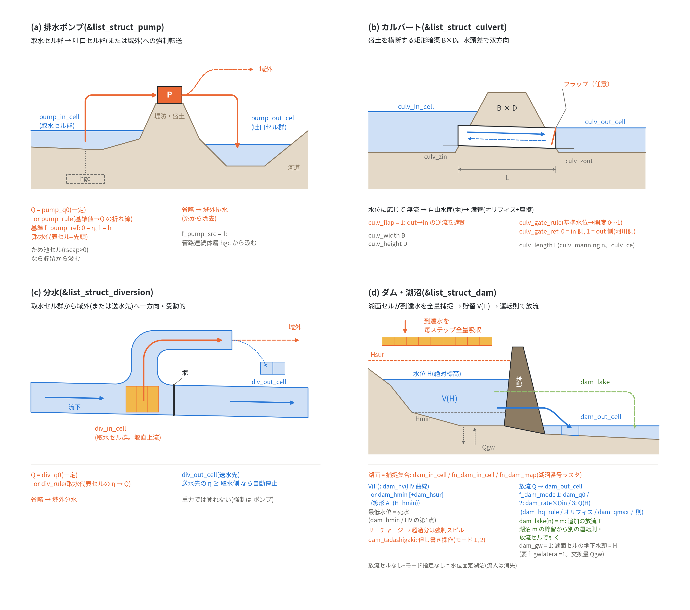

# 内部水理構造物(&list_struct_pump / culvert / diversion / dam)

[ユーザーガイド目次へ](../users_guide.md)

排水ポンプ・カルバート(樋管・樋門)・分水・ダム・湖沼を扱います。
`fn_structure` で有効化し、型ごとの namelist グループで設定します
(グループ不在=その型なし)。流量式と係数の根拠は
[構造物と境界の水理則の解説](hydraulics.md)にあります。

4つの型は共通の骨格を持ちます: **2つのセル集合(取水側→吐口側
または域外)+水理則 Q(基準値の関数)+質量保存的な転送**。転送には
毎ステップ「取水側に実在する水量まで」の制限がかかるので、取れない
水を取ることはありません。セル集合はいずれもファイル指定
(`fn_*_cell`。各行 "i j")ができ、折れ線ルールは線形補間・範囲外は
端値保持です。セル座標 (i, j) は**1 スタート**です(QGIS など GIS の
0 スタートの番号から拾うときは +1。[座標系の章](coordinates.md))。
セル集合は 4 型とも取水側・吐口側(送水先・放流セル・湖面セルを含む)の
どれも**海域マスク(fn_sw)のセルには置けません**(起動時にエラーで
停止)。海へ出す水は吐口を省略した域外排水(系から除去)で表します。

**転送が運ぶもの**: ポンプ・カルバート・分水は、汲んだ水と同じ割合の
[水質](wq.md)の物質を取水セルの濃度で運びます(Kd 分配が有効なら溶存分
だけで、粒子態は浮遊砂と一緒に取水側に残ります)。浮遊砂などの土砂・
塩水層(底層の塩水)・流木・瓦礫は運ばず、取水側に残ります(取水側に溜まった流木は、既定では
カルバートの通水を妨げません。`culv_jam = 1` を付けたカルバートだけが、流入口に溜まった流木の
損失を流量則に入れます — 下の[カルバート](#カルバートlist_struct_culvert)の節。格子の流れへの
作用は、[流木](driftwood.md)の捕捉セルの抵抗です)。ため池から
汲むポンプはため池の物質を、管路から汲むポンプ(`f_pump_src=1`)は管路の
水の固定濃度 `wq_gwc_conc` の物質を運びます。吐口のないポンプ・域外分水が
系外へ持ち出した物質は、水質の台帳 `wq.csv` の `out_intake_g` 列に入ります
(2026-11-04 から。それまでは水だけを運び、物質は取水側に残っていました)。
ダム・湖沼の放流は湖沼プールの完全混合の濃度で運びます([水質](wq.md)の
ダムの節)。



4つの型の模式図です。(a) 排水ポンプは取水セル群から吐口セル群(または域外)へ運転則 Q で強制転送し、(b) カルバートは盛土を横断する B×D の暗渠を水頭差で双方向に通し、(c) 分水は取水セル群から域外(または送水先)へ一方向・受動的に取水し、(d) ダム・湖沼は湖面セルが到達水を全量捕捉して V(H) に貯留し運転モードで放流セル群へ放流します(追加の放流工 dam_lake と地下水頭強制 dam_gw も示しています)。

**書式の共通事項**: 構造物は型ごとに番号 n で識別し、パラメータは
`名前(n)`(構造物あたり1値)または `名前(:,k,n)`(セル・折れ線の
第 k 要素)の形で与えます。番号は型ごとに **1 からの連番**(飛び番は
エラー停止)、型別最大 50 基・1基あたりセル最大 999・折れ線最大
999 点です。各節末尾の表に全パラメータを載せます —「必須」は省略
するとエラー停止する項目、それ以外は省略可能で、省略時の挙動を
「既定」欄に記します。

結果の見方(分布・台帳・計測列・再開)は、このページの[出力・確認](#出力確認)にまとめています。各機能の節末にも、その機能に関係する出力だけを短く記しています。

## とりあえず動かしてみる(最小入力)

最小入力は排水ポンプ 1 基(取水セル + 一定流量。吐口を省略すると
域外排水)です:

```
&list_struct_pump
  pump_in_cell(:,1,1) = 120, 45  ! 取水セル (i, j)
  pump_q0(1) = 5.0               ! 排水量 (m3/s)
/
```

**型別の目安**(諸元は与件ですが、設定の出発点として)

| 型 | 使う型 | 目安 |
|---|---|---|
| 都市内水の排水機場 | ポンプ(吐口省略 = 域外、または河道セルへ) | 比排水量 1〜3 m³/s/km²(50 mm/h 降雨の 10〜20 %。残りは貯留・下水道)。起動水位は pump_rule で |
| 樋門・樋管(河川水位との双方向) | カルバート | 内径 0.6〜1.5 m、逆流防止はフラップ |
| 放水路・分水 | 分水 | 分派比か固定流量。ルールは折れ線 |
| ダム・貯水池 | ダム(下の「パターン別ガイド」) | 諸元資料の HV 曲線と運転ルール |
| ため池 | [地理情報](geoinfo.md)の fn_rscap | 限界貯留高 1〜3 m |

## 排水ポンプ(&list_struct_pump)

取水セル群から吐口セル群への強制転送(機械排水)です。取水と吐口は
隣接不要・距離無制限で、**吐口を省略すると域外排水**(下水道・他流域・
海への圧送=系から除去)になります。吐口を海域マスクのセルに置くことは
できない(起動時にエラー停止)ので、海へ出すときは吐口を省略します。

```
&list_struct_pump
  ! ポンプ1: 内水を本川へ。前池水深 0.5 m から起動、1.0 m で定格
  pump_in_cell(:,1,1)  = 120, 45
  pump_out_cell(:,1,1) = 95, 12
  f_pump_ref(1) = 1                 ! 基準 = 取水代表セルの水深 h
  pump_rule(:,1,1) = 0.5, 0.0      ! (水深 m, 流量 m3/s)
  pump_rule(:,2,1) = 1.0, 5.0
  ! ポンプ2: 常時一定 2 m3/s を域外へ
  pump_in_cell(:,1,2) = 200, 80
  pump_q0(2) = 2.0
/
```

- 運転は `pump_q0(n)`(常時一定)か `pump_rule`(基準値—流量の折れ線)
  のどちらか一方。閾値 ON/OFF は近接2点の急なランプで、多段運転は
  階段状の折れ線で表します(現在値の関数なので履歴なし=再開に影響
  しません)。
- 基準は `f_pump_ref(n)` = 0: 取水代表セル(先頭)の水位 η、
  1: 同セルの水深 h。
- **ため池取水**: 取水セルがため池(geoinfo の rscap > 0)なら地表水で
  なくため池貯留から汲みます(前池排水)。この場合の基準は水深
  (=ため池水深)のみ使えます。
- **管路取水(機場)**: `f_pump_src(n) = 1` で、地表水でなく管路連続体層
  ([地下水](gwflow.md)の f_gwconduit)の貯留 hgc から直接汲みます
  (下水道・幹線の排水機場。要 f_gwconduit=1、取水セルは管路あり
  cap > 0)。基準の意味は読み替わり、`f_pump_ref` = 0: 取水代表セルの
  **管路水頭**、1: **貯留量 hgc**(m 柱状)です。吐口セルへの放流
  (域内還元)・域外排水は通常どおり。潮位より低い水頭からの排水は
  重力吐口(gwflow.md の fn_gwc_outfall)では吐けないため、本機能と
  組み合わせます。

| パラメータ | 既定値 | 意味 |
|---|---|---|
| pump_in_cell(:,k,n) | —(必須) | 取水セル (i, j) の集合(fn_pump_in_cell とどちらか一方) |
| pump_out_cell(:,k,n) | なし | 吐口セル (i, j) の集合。省略=域外排水(系から除去) |
| pump_q0(n) | — | 常時一定の流量 (m3/s)。pump_rule とどちらか一方が必須 |
| pump_rule(:,k,n) | — | 運転ルール折れ線 (基準値 m, 流量 m3/s)。pump_q0 とどちらか一方が必須 |
| f_pump_ref(n) | 0 | 運転ルールの基準。0: 取水代表セル(先頭)の水位 η、1: 同セルの水深 h(ため池取水では 1 のみ可。管路取水では 0: 管路水頭、1: 貯留量 hgc) |
| f_pump_src(n) | 0 | 取水源。0: 地表水(ため池セルは自動でため池貯留)、1: 管路連続体層 hgc(機場。要 f_gwconduit=1) |
| fn_pump_in_cell(n) / fn_pump_out_cell(n) | "" | セル集合のファイル指定(dir_data 起点。各行 "i j") |

**この節に関係する出力**: ポンプの流量台帳はなく、転送量は測線に乗りません。効果は上流側の `H0001…` の低下と、域外排水なら Log の S の減少で確認します([出力・確認](#出力確認))。

## カルバート(&list_struct_culvert)

3 レジームの流量式と係数の根拠: [解説](hydraulics.md#2-カルバート樋管樋門)。

盛土・道路・堤防を横断する矩形断面 B×D の暗渠です。**双方向**で、
水位の高い側から低い側へ流れ、逆転すれば自動で逆流します。樋管・
樋門はゲート拡張で表します。

```
&list_struct_culvert
  culv_in_cell(:,1,1)  = 150, 60    ! 上流側セル
  culv_out_cell(:,1,1) = 152, 60    ! 下流側セル
  culv_width(1)  = 2.0              ! 断面幅 B (m)(必須)
  culv_height(1) = 2.0              ! 断面高 D (m)(必須)
  culv_zin(1)  = 12.50              ! 上流側敷高 (m)(必須)
  culv_zout(1) = 12.30              ! 下流側敷高 (m)(必須)
  culv_length(1) = 25.0             ! 管路長 (m)(既定 0 = 摩擦損失なし)
/
```

流量則は水位に応じて無流 → 自由水面(本間公式の堰)→ 満管
(オリフィス+管路摩擦)の3レジームを連続に切り替えます。

**樋管・樋門(ゲート拡張)**

```
  culv_flap(2) = 1                  ! フラップゲート(無動力の逆流防止弁)
  culv_gate_ref(2) = 1              ! 開度ルールの基準(0: in側, 1: out側=河川側)
  culv_gate_rule(:,1,2) = 8.0, 1.0  ! (基準水位 m, 開度 0〜1)
  culv_gate_rule(:,2,2) = 8.5, 0.0  ! 河川水位 8.0〜8.5 m で閉鎖
/
```

**流入口の流木の集積(culv_jam)**

```
  culv_jam(1) = 1                   ! 流入口の集積流木の損失を流量則に入れる
/
```

[流木](driftwood.md)モジュールと併用するとき、`culv_jam(n) = 1` を付けたカルバートは、
流入口に溜まった流木で流量が減ります。カルバートは流木を通さないので、取水している側の
セル群(順流なら `culv_in_cell`、逆流なら `culv_out_cell`)の流動流木のうち、カルバートが
引いた水と同じ割合が、集積流木 `wj` になります。水位の高い側のセル群の集積の実材積 $`V_j`$ (m³) から損失係数
$`C_A = 2\kappa_0 V_j/(BD)`$ を作り、自由水面(堰)の流量を $`(1 + C_A/3)^{-3/2}`$ 倍にし、
満管の損失の和に $`C_A`$ を足します($`\kappa_0`$ は流木の集積の抵抗の係数で、流木の
`dw_dlog`・`dw_jamcd`・`dw_jamphi` から決まります。式と大きさの目安、できないことは
[流木の章](driftwood.md#構造物での捕捉と集積fn_dwtrap)、流量則は
[解説](hydraulics.md#2-カルバート樋管樋門))。

- 流木モジュール(`fn_driftwood`)が有効でないと使えません(起動時にエラーで停止)。流木の
  `f_dwjam = 0` では、集積は台帳だけになり、流量は減りません。
- 集積がなければ(`culv_jam = 0` を含む)、流量は従来とビット同一です。
- 流入口に集積するのは、取水セル群の流木のうち、カルバートが引いた水の割合です。セルの水が
  全部カルバートへ向かうとき(スリット堰堤の抜き口の直上流、暗渠の呑口)は届いた流木の全量が、
  本流の水の一部を引くとき(樋管・取水口)は引いた水の割合だけが集積します。

制約: ため池セルには接続不可。下流側の省略(域外)は不可(域外排水は
ポンプを使用)。転送は土砂を運ばず(水と水質の溶存物質だけを通します)、
流束測線(record)には乗りません(この「土砂を通さない」性質は、透過型
砂防堰堤の抜き口の近似に使えます — [土砂・地形変化](geomorph.md)の
砂防施設の項)。
セル寸法に対して大きすぎる断面(通水量がセル面積×水深の規模)は
受け側で発散します — 現実的な規模で使ってください。

| パラメータ | 既定値 | 意味 |
|---|---|---|
| culv_in_cell(:,k,n) | —(必須) | 上流側セル (i, j) の集合(fn_culv_in_cell とどちらか一方) |
| culv_out_cell(:,k,n) | —(必須) | 下流側セル (i, j) の集合。省略(域外)は不可 |
| culv_width(n) | —(必須) | 断面幅 B (m) |
| culv_height(n) | —(必須) | 断面高 D (m) |
| culv_zin(n) / culv_zout(n) | —(必須) | 上流側・下流側の敷高(標高 m) |
| culv_length(n) | 0 | 管路長 L (m)。0 = 管路摩擦損失なし |
| culv_manning(n) | 0.02 | 管内粗度係数 n |
| culv_ce(n) | 0.5 | 流入損失係数 |
| culv_flap(n) | 0 | 1: フラップゲート(out→in の逆流を遮断する無動力の逆止弁) |
| culv_gate_rule(:,k,n) | なし | ゲート開度折れ線 (基準水位 η m, 開度 0〜1)。省略=常時全開。開度は流量の線形乗率 |
| culv_gate_ref(n) | 1 | 開度ルールの基準セル(0: in 側代表、1: out 側代表=河川側) |
| culv_jam(n) | 0 | 1: 流入口の集積流木の損失を流量則に入れる([流木](driftwood.md)モジュールが必要) |
| fn_culv_in_cell(n) / fn_culv_out_cell(n) | "" | セル集合のファイル指定(dir_data 起点。各行 "i j") |

**この節に関係する出力**: 通過流量の台帳はなく、測線にも乗りません。上下流に置いた測線 Q の差、またはプローブの上下流水位差で 3 レジームの挙動を確認します([出力・確認](#出力確認))。`culv_jam = 1` の流入口の集積は、流木の `Wj0001…`(`f_out_wj = 1`)と `driftwood.csv` の `trap_m3`・`vol_jam_m3` で読みます。

## 分水(&list_struct_diversion)

取水セル群から域外(流域外分水=主用途)または送水先セル群への
**一方向・受動的**な取水です(取水堰・分水路)。

```
&list_struct_diversion
  div_in_cell(:,1,1) = 80, 30       ! 取水セル(堰直上流)
  div_rule(:,1,1) = 10.2, 0.0       ! (水位η m, 流量 m3/s)の rating
  div_rule(:,2,1) = 10.8, 20.0
/
```

- 運転は `div_q0(n)`(一定)か `div_rule`(取水代表セルの水位 η の
  rating)のどちらか一方。基準は水位 η のみです。
- ポンプとの違いは**受動性**: 送水先を指定した場合、送水先の水位が
  取水側以上なら自動停止します(重力では登れない)。強制的に送りたい
  ならポンプを使います。

| パラメータ | 既定値 | 意味 |
|---|---|---|
| div_in_cell(:,k,n) | —(必須) | 取水セル (i, j) の集合(fn_div_in_cell とどちらか一方) |
| div_out_cell(:,k,n) | なし | 送水先セル (i, j) の集合。省略=域外分水。指定時は送水先水位が取水側以上で自動停止 |
| div_q0(n) | — | 常時一定の流量 (m3/s)。div_rule とどちらか一方が必須 |
| div_rule(:,k,n) | — | 取水 rating 折れ線 (取水代表セルの水位 η m, 流量 m3/s)。div_q0 とどちらか一方が必須 |
| fn_div_in_cell(n) / fn_div_out_cell(n) | "" | セル集合のファイル指定(dir_data 起点。各行 "i j") |

**この節に関係する出力**: 分水量の台帳はなく、測線にも乗りません。分水先と取水元の下流に測線を置き、Q の増減で確認します([出力・確認](#出力確認))。

## ダム・湖沼(&list_struct_dam)

運転則(一定量・一定率・rating・オリフィス・√則・但し書き・制限水位・洪水調節開始流量・実績の時系列)の式: [解説](hydraulics.md#4-ダム湖沼の運転)。

**湖面(捕捉集合)**のセル群が到達水を毎ステップ全量吸収して貯留し、
運転ルールで放流セル群へ放流するバケツモデルです(湛水面の流れ・
背水は解きません)。ダム湖に限らず、**一般の湖沼**(自然湖・潟湖・
調整池、水位を共有する湖沼群)も同じ機構で扱います。
[水質](wq.md)が有効なら、貯留湖沼は完全混合池として扱われ、放流水に
貯水量比の濃度 M/V が同伴します(wq 章「貯水池・ため池の扱い」)。

**湖面の指定は3方式の択一**(番号 n ごと):

- `dam_in_cell`(namelist)/ `fn_dam_in_cell`(ファイル)—
  ダムの捕捉帯(堤体直上流を横断するライン)向き。
- **`fn_dam_map`(湖沼番号ラスタ。全湖沼共通1枚)** — ラスタで
  解像した湖面向き。値 0 以下=湖沼なし(GIS の nodata 負値は無視)、
  値 n = 構造物 n の湖面。飛び地の水面に同じ番号を塗れば
  **水位を共有する湖沼群**になります。

**斜め透過の注意**: ENC 格子は対角リンクでも水をやり取りするため、
捕捉集合が対角接続だけでつながる箇所(斜め1セル幅のライン等)は、
両端とも集合外のセルを結ぶ対角リンクにすり抜けられます。捕捉ラインは
**4近傍連結**(斜め接続の角を作らない)で指定してください
(プログラムは検査しません=利用者の責任)。

```
&list_struct_dam
  fn_dam_map = "lake_map.txt"       ! 湖沼番号ラスタ(番号 2 の湖沼が使用)
  ! ダム1: HV 曲線+一定率カット(捕捉ラインは namelist 指定)
  dam_in_cell(:,1,1) = 120, 44      ! 捕捉帯(川を横断する列。湿潤幅に余裕を)
  dam_in_cell(:,2,1) = 120, 45
  dam_in_cell(:,3,1) = 120, 46
  dam_out_cell(:,1,1) = 123, 45     ! 放流セル(堤体直下流の河道)
  dam_hv(:,1,1) = 320.0, 0.0        ! HV 曲線: (水位 m, 貯水量 m3)
  dam_hv(:,2,1) = 355.0, 1.5e7      !   最低水位とサーチャージの最低2点
  f_dam_mode(1) = 2
  dam_rate(1) = 0.3                 ! 一定率カット(放流率 30%)
  dam_h_init(1) = 340.0             ! 初期水位(省略時=最低水位=空虚)
  ! 湖沼2: ラスタ湖面+自然調節(H-Q rating)。HV は自動線形
  dam_hmin(2) = 81.0                ! 計算下限水位(平常水位より低ければ結果は無感度)
  f_dam_mode(2) = 3
  dam_hq_rule(:,1,2) = 84.0, 0.0    ! (水位 m, 放流量 m3/s)。Q=0 の水位
  dam_hq_rule(:,2,2) = 86.0, 400.0  !   =流出河川の敷高≒平常水位
  dam_h_init(2) = 84.2              ! 初期水位=平常水位
  dam_out_cell(:,1,2) = 210, 95     ! 流出河川の最上流セル
/
```

**運転モード(f_dam_mode)**

| 値 | 運転 | パラメータ |
|---|---|---|
| 1 | 一定量放流 | dam_q0 (m3/s)。制限水位 dam_hlim を付けると一定量放流方式(下の[実務の操作規則](#実務の操作規則モード-12)) |
| 2 | 一定率放流(流入×r) | dam_rate (0〜1)。**r=1.0 は素通し**(貯留を動かさず流入=放流。HV 不要)。洪水調節開始流量 dam_qon・放流量の上限 dam_qmax・制限水位 dam_hlim を付けると、一定率一定量放流方式のピークまでの形(同) |
| 3 | 自然調節(水位—放流 rating) | 次のいずれか(優先順): (a) dam_hq_rule の折れ線 (b) オリフィス諸元 dam_ori_width/height/zbase (c) 計画最大放流量 dam_qmax(√則で自動構成。要サーチャージ水位) |
| 4 | 放流量の時系列(実績の再生) | dam_qout_val(:,k,n) = 時刻 (分), 放流量 (m3/s)、またはファイル fn_dam_qout_val(n)(下の[実績の再生](#実績の再生モード-45)) |
| 5 | 貯水位の時系列(実績の再生) | dam_h_val(:,k,n) = 時刻 (分), 水位 (m)、またはファイル fn_dam_h_val(n)(同) |
| 6 | 外部運転(BMI) | 放流量を BMI の目標放流量で外から与える。dam_q0 = 最初の目標(省略時 0)(下の[外部運転](#外部運転モード-6)) |
| 指定しない(放流セルもなし) | **水位固定湖沼**: 流入は全量消失、水位は dam_h_init で一定(蒸発でも減らない)。「解かない大水面」= 海域マスクの内陸版 | dam_h_init(必須) |

**HV(水位—貯水量)の与え方**

| 指定 | 挙動 |
|---|---|
| dam_hv(折れ線) | 資料の HV 曲線をそのまま使用(ダム向き)。最低2点=最低水位とサーチャージ |
| dam_hmin(+任意 dam_hsur) | **線形 HV を自動構成**: V(H) = A×(H−dam_hmin)、A = 捕捉セル数×セル面積。ラスタで湖面を塗った湖沼向き(湖盆・水深の資料は不要)。dam_hsur 省略時は上限なし=スピルなし(モード 1, 2 と √則では必須) |
| どちらもなし | 素通し(f_dam_mode=2, dam_rate=1.0)と水位固定湖沼のみ受理。それ以外はエラー停止 |

水位はすべて**絶対標高**です。線形 HV の水位変化は湖面積 A と H だけで
決まり、dam_hmin は「放流で引き落とせない床」の位置を決める定数シフト
にすぎないため、**水深不明の湖沼は平常水位より確実に低い値(例:
平常水位 −5 m)で十分**です(床に当たらない限り結果は無感度)。

- **但し書き操作**(モード 1, 2): 貯水位が `dam_tadashigaki`(省略時
  =最低+0.9×(サーチャージ−最低))を超えるとサーチャージまでの間で
  放流を流入へ漸増します。サーチャージ超過分は自動で強制スピル。
- 初期水位は `dam_h_init`(省略時=最低水位=空虚。多目的ダムは制限
  水位を明示。モード 5 の省略時は水位の時系列の計算開始時刻の値)。
  最低水位以下は死水で引き落とせません。モード 1 と、`dam_qon` を
  付けたモード 2 は、流入が少ない間も放流して床まで下げます。初期水位を
  最低水位より高くして `dam_hlim`(制限水位)を書かないと、洪水の前に
  最低水位まで下げます(起動時に `note:` を表示します)。
- 記録時刻ごとに `result/dams/dam0001.csv` へ (t, H, V, Qin, Qout,
  Qspill, Qgw) が出力されます(水位固定湖沼は Qin=消失量を記録。
  Qgw は地下水頭強制 dam_gw の交換量で、未使用なら 0)。
- **蒸発**: 蒸発散([fn_evap](forcing.md))有効時、捕捉集合の貯留
  (hrs)からため池と同様にセル面積分ずつ蒸発します。湖面をラスタで
  塗れば湛水面積=セル数×セル面積となり実面積で評価されます
  (捕捉ライン型のダムで貯水面蒸発を評価したい場合も湖面を塗る方式に)。
- 制約: 湖面・放流セルともため池・河道幅指定セルとは併用不可。
  放流が複数セルの場合はセル数で等分配(離れた場所でも可)。

### 実務の操作規則(モード 1・2)

日本のダムの洪水調節方式(国土交通省の河川砂防技術基準 計画編 技術資料。
[解説](hydraulics.md#4-ダム湖沼の運転)の参考文献)のうち、一定量放流方式と
一定率一定量放流方式を、過去の状態(履歴)を持たない形で表します。

- `dam_hlim(n)`(制限水位。標高 m): 運転の放流はこの水位より下げません
  (床)。洪水調節容量の下端(洪水貯留準備水位)にあたります。省略時は
  最低水位(従来どおり死水まで下げる)。但し書きの開始水位より低くします。
- `dam_qon(n)`(洪水調節開始流量 Qon。m3/s。モード 2): 流入がこれ以下の
  間は Qon を目標にします — 床にいれば流入をそのまま流して水位を保ち、
  床より上なら Qon で床まで戻します。
- `dam_qmax(n)`(モード 2 では放流量の上限 Qmax。m3/s。要サーチャージ水位)。

| 設定 | 床より上の放流 Q | 床にいるときの放流 |
|---|---|---|
| モード 1 + dam_hlim(一定量放流方式) | Q0 = dam_q0 | min(流入, Q0)。流入が Q0 未満なら流入をそのまま流す |
| モード 2 + dam_qon(+ dam_qmax)(一定率一定量放流方式のピークまで) | 流入 ≤ Qon なら Qon、流入 > Qon なら min(Qon + r(流入 − Qon), Qmax) | min(流入, 左の値) |

```
  ! 多目的ダム: 制限水位 345 m を保ち、流入が 300 m3/s を超えたら
  ! 超過分の 40% を加えて放流(最大 600 m3/s)
  f_dam_mode(1) = 2
  dam_rate(1) = 0.4
  dam_qon(1) = 300.0
  dam_qmax(1) = 600.0
  dam_hlim(1) = 345.0
  dam_h_init(1) = 345.0
```

**できないこと(限界)**

- 一定率一定量放流方式の「ピーク流量に達した後は一定量を放流」は表しません
  (ピークの判定に履歴が要るため)。ピーク後も式のまま放流が下がるので、
  実際の規則より多く貯めます(貯水位は高めに出ます)。
- 洪水後に制限水位へ戻す放流は、Qon(モード 2)・Q0(モード 1)で戻す近似
  です。放流量の増加の速さの制限、ゲート操作の間隔、下流の基準点の水位を
  見た操作は表しません。
- 洪水期と非洪水期の制限水位の切り替え、予備放流・事前放流(洪水の予測に
  基づく事前の放流)、不定率調節方式は持ちません。
- 但し書き(異常洪水時防災操作)は従来どおり貯水量の線形ランプの近似です。
- 式の形(開始流量を超えた分に率を掛け、開始流量で連続にする)、ピーク後の
  一定量を持たない簡略化、洪水後に Qon で戻す扱い、上限 Qmax は本プロジェクトの
  選択(独自)です。出典は方式を言葉で定めています。

### 実績の再生(モード 4・5)

過去の出水の再現計算で、管理記録の放流量か貯水位をそのまま与えます。
時系列は境界条件と同じ書式です: namelist の (時刻 (分), 値) の折れ線か、
ファイル(各行 "時刻(分) 値"。dir_data 起点。ファイルが優先)。時刻は
計算の時刻 t の分(暦の日時からの換算は前処理で)で、各ステップの終わりの
時刻の値を線形補間で使います(範囲外は端の値)。同じ時刻の点を重ねると、
その時刻で値が段に変わります(ゲート操作の段の変化)。

- **モード 4**(`dam_qout_val` / `fn_dam_qout_val`): 各ステップの放流 = その
  時刻の放流量。下流へは記録どおりの放流を与えます。貯水位は計算の結果で、
  記録との差はモデルの流入量の誤差の累積を表します(上流側の検算になります)。
  初期水位 `dam_h_init` は記録の値を書いてください(省略すると空虚から
  始まり、起動時に `note:` を表示します)。
- **モード 5**(`dam_h_val` / `fn_dam_h_val`): 各ステップの終わりの貯水量が
  目標水位の貯水量になるよう放流します(放流 = 流入 − 目標の貯水量の変化)。
  貯水池の状態は記録に合い、上流側の誤差は放流を通して下流へ出ます。流入が
  目標の上昇に足りないときは放流 0 で、水位は目標を下回ります。`dam_h_init`
  を省略すると時系列の計算開始時刻の値から始めます。水位は最低水位〜
  サーチャージの範囲で与えます(範囲外はエラー停止)。

```
  ! ダム 1: 管理記録の放流量(ファイルの各行 "分 m3/s")
  f_dam_mode(1) = 4
  fn_dam_qout_val(1) = 'dam1_qout.txt'
  dam_h_init(1) = 352.4             ! 記録の初期水位
```

- 記録どおりに放流できなかった区間(死水に達した)は、CSV の Qout が
  与えた値を下回ることで分かります。サーチャージを超える分は強制スピル
  (Qspill)になります。
- 但し書きのランプは掛けません(記録に含まれるため。`dam_tadashigaki` を
  書くとエラー停止)。
- `dam_lake` の追加の放流工にもモード 4 を使えます(取水量の記録など)。
  モード 5 の湖沼は追加の放流工から参照できません(2 つの運転が同じ水位を
  決め合うため。記録の全放流量を湖沼本体に与えてください)。
- モデルの流入量が記録とずれる限り、モード 4 では貯水位が、モード 5 では
  放流量が記録から離れます。どちらを記録に合わせるかは、再現したいもの
  (下流の流れか、貯水池の状態か)で選びます。

### 外部運転(モード 6)

放流量を、モデルの運転則ではなく外から与えます。Python などの呼び出し側が
BMI の目標放流量を set します([BMI のダム](../../bmi/README.md#ダム貯水池の量と外部運転))。
組み込みの運転則では表せない規則 — 前の状態を覚える規則(放流量の増減の速さの
制限など)、予測降雨を使う事前放流、他モデルとの結合、操作の最適化の試行 — は、
呼び出し側のプログラムに書きます。

- 目標放流量 (m3/s) は次の set まで続きます。最初の set までは `dam_q0`
  (省略時 0)を放流します。
- 実際の放流は、そのステップの貯水量(流入を含む)のうち死水より上の分までです。
  サーチャージを超える分は強制スピル(Qspill)になります。目標どおりに放流
  できたかは CSV(または BMI)の Qout で確かめます。
- 但し書きのランプは掛けません(`dam_tadashigaki` を書くとエラー停止)。
  `dam_h_init` を省略すると空虚から始まります(起動時に `note:` を表示します)。
- 目標は保存されません。再開すると `dam_q0` から始まるので、呼び出し側が再開の
  直後に set し直してください。BMI を使わずに `encflow` で実行すると、`dam_q0`
  の一定量放流になります(起動時に `note:` を表示します)。
- `dam_lake` の追加の放流工にもモード 6 を使えます。外から運転できるのは
  ルート格子(ネストの親)のダムだけです。子格子のダムは BMI に公開しません。

```
  ! ダム 1: 外から運転する(BMI。最初の目標までは 5 m3/s)
  f_dam_mode(1) = 6
  dam_q0(1) = 5.0
  dam_h_init(1) = 352.4
```

見本の制御器 [bmi/python/dam_control.py](../../bmi/python/dam_control.py) は、
貯水量を初期値へ戻す放流を、上限と変化の速さの制限(前の目標を覚える)付きで
与えます。見本であり、実際のダムの操作規則を表すものではありません。外から
与えた放流の決め方は ENCflow の出力に残らないので、規則のプログラムは結果と
一緒に保存してください。

### どの型をどう指定するか(パターン別ガイド)

| パターン | 湖面 | HV | 運転 | 水位 |
|---|---|---|---|---|
| **ダム**(諸元資料あり) | 捕捉ライン(dam_in_cell 等) | dam_hv(資料の HV 曲線) | f_dam_mode = 1 / 2 / 3(多目的ダムのモード 1・2 は dam_hlim = 制限水位を添える) | dam_h_init = 初期水位(多目的ダムは制限水位。省略=空虚) |
| **過去の出水の再現**(管理記録あり) | 捕捉ライン | dam_hv | f_dam_mode = 4(放流量の記録)/ 5(貯水位の記録) | モード 4: dam_h_init = 記録の初期水位。モード 5: 省略可(記録の開始値) |
| **外の規則で運転**(Python の制御器・他モデルとの結合) | 捕捉ライン | dam_hv | f_dam_mode = 6 + BMI の目標放流量 | dam_h_init = 初期水位 |
| **貯留湖沼**(水深不明でよい) | fn_dam_map で湖面を塗る | dam_hmin = 平常水位 −5 m 程度 | f_dam_mode = 3 + dam_hq_rule(Q=0 の水位=流出河川の敷高)等 | dam_h_init = 平常水位 |
| **素通し湖沼**(滞留の無視できる小湖・遊水地の連絡水面) | どちらでも | 不要 | f_dam_mode = 2, dam_rate = 1.0 | 不要(水位という状態を持たない) |
| **水位固定湖沼**(解かない大水面・終末湖) | fn_dam_map | 不要 | 指定しない(放流セルなし) | dam_h_init = 固定水位 |
| **水位共有の湖沼群**(潟湖群・連結調整池) | 同じ番号を複数の水面に塗る | 上のいずれか | 上のいずれか | 上のいずれか |
| **複数の放流工**(洗堰+疏水+取水) | 湖沼本体に1つ(主放流) | 湖沼本体に1つ | 追加分は dam_lake(n)=湖沼番号+各自のモード | 湖沼本体で指定 |

平常水位は「拘束条件」ではなく**初期値(dam_h_init)+維持機構
(rating)**です: rating の Q=0 となる水位を平常水位付近に置けば、
平水時にそこへ落ち着きます。貯留湖沼の洪水応答は
A·dH/dt = Qin − Q(H) の貯留減衰として自然に表現されるため、
**大湖沼に素通し(rate=1.0)を使うのは不適切**です(減衰なしで洪水波が
透過してしまいます)。

### 複数の放流工(dam_lake)

1つの湖沼に運転の異なる複数の放流(例: 琵琶湖の洗堰+疏水+取水)を
設定するには、`dam_lake(n) = m` の**参照構造物**を使います: 構造物 n は
自前の湖面を持たず、湖沼 m の貯留から **n 自身の運転モードと放流セル群**
で引き落とします。

```
  ! 湖沼2(上の例)の追加放流工: 疏水への一定量取水
  dam_lake(5) = 2                   ! 湖沼2の貯留から引く
  f_dam_mode(5) = 1
  dam_q0(5) = 15.0                  ! 一定 15 m3/s
  dam_out_cell(:,1,5) = 150, 120    ! 疏水の流入セル
/
```

- 参照先 m は**主放流(モード+放流セル)を持つ、より小さい番号**の
  湖沼に限ります(水位固定湖沼・素通し湖沼・参照構造物は参照不可)。
  引き落としは番号順の逐次適用(先の構造物が先に取る)で、
  サーチャージ超過のスピルは主放流側から出ます。
- HV・水位は湖沼 m のものを共有します(参照構造物側に dam_hv /
  dam_hmin / dam_h_init は書けません)。`dam_tadashigaki(n)` は
  放流工ごとに指定できます(省略時は湖沼の既定)。
- CSV(`result/dams/dam0005.csv` 等)には参照構造物自身の Qout と、
  引き落とし後の湖沼の H・V が記録されます(Qin 列は 0。ヘッダに
  `# lake =` として参照先番号が入ります)。

### 湖水位の地下水頭強制(dam_gw)

`dam_gw(n) = 1` を指定すると、湖沼 n の湖面セルで**地下水頭を湖水位に
固定**します(Dirichlet 境界)。湖岸低地の地下水位・干拓地の浸出など、
湖と帯水層のやり取りを解きたい場合に使います。
地下水(fn_gwflow)の**側方流 f_gwlateral = 1 が必須**です。

- 貯留湖沼では交換量が湖の貯水量 V と自動でやり取りされます
  (湖→地下水の漏出で V が減り、地下水位が高ければ逆に V が増える。
  湖が枯れたら強制は自動で弱まります)。水位固定湖沼では水位一定の
  まま交換量だけが記録されます(海域マスクと同じ意味論)。
- 交換量は CSV の `Qgw` 列(m3/s。正=湖→地下水)に出ます
  (この列は全ダム・湖沼に常に出力され、dam_gw なしでは 0)。
- 近似: 地下水頭は「地表面まで」で頭打ちします(湖水深分の過圧は
  表現しない)。また計算開始時に湖面セルの土層を湖水で飽和させる
  初期充填が入ります(貯留湖沼では V から差し引かれる実水量)。
- 蒸発散併用時は、湖面セルの地下水蒸発が次の強制で湖から補給される
  ため、実質的に湖が地下水経由の蒸発散を供給します。

| パラメータ | 既定値 | 意味 |
|---|---|---|
| dam_in_cell(:,k,n) | — | 湖面(捕捉集合)セル (i, j)。3方式(fn_dam_in_cell / fn_dam_map)のいずれかで必須 |
| fn_dam_map | "" | 湖沼番号ラスタ(全湖沼共通1枚。dir_data 起点)。0 以下=なし、値 n = 構造物 n の湖面 |
| dam_out_cell(:,k,n) | なし | 放流セル (i, j) の集合。**省略=水位固定湖沼**(流入消失・水位一定) |
| dam_hv(:,k,n) | — | HV 曲線 (水位 m, 貯水量 m3)。最低2点(最低水位・サーチャージ)。水位・貯水量とも単調増加。dam_hmin と排他 |
| dam_hmin(n) | — | 自動線形 HV の下限水位(標高 m)。dam_hv の代替。湖面積=捕捉セル数×セル面積 |
| dam_hsur(n) | なし | 自動線形 HV のサーチャージ水位(標高 m)。省略=上限なし(スピルなし)。モード 1, 2(素通し除く)と √則では必須 |
| f_dam_mode(n) | — | 運転モード。1: 一定量、2: 一定率カット、3: 自然調節、4: 放流量の時系列、5: 貯水位の時系列、6: 外部運転(BMI)。指定なし+放流セルなし=水位固定湖沼 |
| dam_lake(n) | 0 | >0: 湖沼参照(構造物 n は湖沼 m=dam_lake(n) の貯留から自分の運転則・放流セルで引く追加の放流工)。参照先は主放流を持つ小さい番号の湖沼。参照構造物側に湖面・dam_hv/dam_hmin/dam_h_init は書けない |
| dam_gw(n) | 0 | 1: 湖面セルの地下水頭を湖水位に固定(上の「地下水頭強制」参照)。fn_gwflow の f_gwlateral=1 が必須。素通し湖沼・参照構造物には指定不可 |
| dam_q0(n) | — | モード1の一定放流量 (m3/s)。モード1で必須。モード6では、外から目標を与えるまでの放流量(0 以上。省略時 0) |
| dam_rate(n) | — | モード2の放流率 r (0〜1)。モード2で必須。1.0 = 素通し |
| dam_qon(n) | なし | モード2の洪水調節開始流量 (m3/s。0 以上)。流入がこれ以下なら dam_qon を目標(床では流入をそのまま流す)、超えたら dam_qon + r(流入 − dam_qon)。モード2 以外に書くとエラー停止 |
| dam_hlim(n) | 最低水位 | 制限水位 (標高 m。モード1, 2)。運転の放流はこの水位より下げない。最低水位以上で、但し書きの開始水位より低いこと。モード1, 2 以外に書くとエラー停止 |
| dam_qout_val(:,k,n) | — | モード4: 放流量の時系列 (時刻 min, m3/s)。0 以上。時刻は減らない(同じ時刻を重ねると段)。fn_dam_qout_val と択一でモード4 に必須 |
| fn_dam_qout_val(n) | "" | モード4: 放流量の時系列ファイル(dir_data 起点。各行 "時刻(min) 放流量(m3/s)")。dam_qout_val より優先 |
| dam_h_val(:,k,n) | — | モード5: 貯水位の時系列 (時刻 min, 標高 m)。最低水位〜サーチャージの範囲。fn_dam_h_val と択一でモード5 に必須 |
| fn_dam_h_val(n) | "" | モード5: 貯水位の時系列ファイル(dir_data 起点。各行 "時刻(min) 水位(m)")。dam_h_val より優先 |
| dam_hq_rule(:,k,n) | — | モード3(a): 水位—放流量の折れ線 (m, m3/s)。水位は単調増加 |
| dam_ori_width(n) / dam_ori_height(n) / dam_ori_zbase(n) | — | モード3(b): オリフィスの幅 B (m)・高さ D (m)・敷高 (m)。3つ一組で指定 |
| dam_ori_ce(n) | 0.5 | モード3(b) の流入損失係数 |
| dam_qmax(n) | — | 計画最大放流量 (m3/s)。モード3(c): サーチャージ時の放流量で、Q(H)=Qmax·√((H−敷高)/(Hsur−敷高)) の √則を自動構成(要サーチャージ水位)。モード2: 放流量の上限(dam_qon 以上。要サーチャージ水位) |
| dam_zbase(n) | 最低水位 | モード3(c) の √則の敷高 (m)。サーチャージ未満 |
| dam_tadashigaki(n) | 最低+0.9×(サーチャージ−最低) | 但し書き操作の開始水位 (m。モード 1, 2)。最低水位とサーチャージの間(両端は不可)。モード 4, 5, 6 に書くとエラー停止 |
| dam_h_init(n) | 最低水位(空虚)。モード5 は時系列の計算開始時刻の値 | 初期水位 (m)。最低水位〜サーチャージの範囲。水位固定湖沼では固定水位(必須) |
| fn_dam_in_cell(n) / fn_dam_out_cell(n) | "" | セル集合のファイル指定(dir_data 起点。各行 "i j") |

旧 `dam_area`(湛水面積の直接指定)は 2026-08-20 に廃止されました
(蒸発はセル面積評価に一本化。指定すると namelist 読込エラーで
停止します — 削除してください)。

**この節に関係する出力**: 構造物ごとの `result/dams/dam000n.csv`(H, V, Qin, Qout, Qspill, Qgw)と、捕捉帯の貯留 `Hrs0001…`(`f_out_hrs=1`)。収支は ΔV = (Qin − Qout − Qspill − Qgw) × Δt − 蒸発で検算します([出力・確認](#出力確認))。

## 出力・確認

分布出力の 3 通りの有効化(自動 / 指定 / 共用)と柱状量の面積基底の読み方は[入出力の形式](io.md#状態量の分布出力の考え方)に、確認したい量から出力を逆引きする早見表は同じ節の末尾にあります。

**分布**(`result/` のラスタ)

| ファイル | 出し方 | 内容 |
|---|---|---|
| Hrs0001… | f_out_hrs = 1 | ため池とダム・湖沼の捕捉帯の貯留水深 (m)。湖水位 H ではなく、捕捉集合に配った貯留 |
| H0001… / E0001… | f_out_h / f_out_e | 構造物の効果(排水・通水・分水・放流)は地表の水深・水位に現れる |

構造物そのものの分布出力はありません。

**台帳・ログ**(収支の検算)

- ダム・湖沼は構造物ごとに `result/dams/dam0001.csv` などへ、記録時刻ごとに
  `t(hour), t(min), H(m), V(m3), Qin(m3/s), Qout(m3/s), Qspill(m3/s),
  Qgw(m3/s)` を書きます(ヘッダに番号・運転モード・Vmin/Vmax。参照
  構造物は `# lake =` に参照先番号。水位固定湖沼は Qin = 消失量。Qgw は
  dam_gw の交換量で未使用なら 0)。
- ポンプ・カルバート・分水の流量台帳はありません。域外排水ポンプと
  水位固定湖沼は水を系外へ出すため Log.txt の S が減ります。域内の転送は
  S を変えません。
- 水質が有効なら、吐口のないポンプ・域外分水が持ち出した物質(と内部
  ソースの吸い込み・井戸揚水の分)が `wq.csv` の `out_intake_g` に累積
  されます(構造物ごとの内訳はありません。[水質](wq.md)の台帳)。

**計測**(プローブ・測線の列)

- **構造物の転送流量は測線に乗りません**(カルバート・分水・ポンプは
  セル間を直接移す転送で、運ぶ水質の負荷も測線の L に乗りません)。
  通過流量は、構造物の上下流に置いた測線の Q の差か、ダムなら CSV の
  Qout で読みます。

**再開**

- ため池・捕捉帯の貯留(hrs)は本体の状態保存に含まれます。運転規則は
  現在値(と時系列モードでは時刻)の関数で履歴を持たないため、再開に影響
  しません(時系列は再開時に読み直します)。
- 外部運転(モード 6)の目標放流量は保存されません。再開すると `dam_q0` から
  始まるので、呼び出し側が set し直します。

**読み方と検算のコツ**

- ダムの収支: V の増分 = (Qin − Qout − Qspill − Qgw) × Δt − 蒸発。
  `Qspill` はサーチャージ超過の強制スピル、`Qout` は運転規則の放流です。
- 排水ポンプの効果は、ポンプ下流(域外なら S の減少)と上流の水位で、
  カルバートの 3 レジーム(自由・潜り・満管)の切替は上下流の水位差と
  流量の関係で確認します([解説](hydraulics.md) §2)。

## 書式の実例

全4型の注釈付き実例:
[examples/List_samples/list_structure.txt](../../examples/List_samples/list_structure.txt)。
堤防の越流・破堤や河道の通水は [河道の章](channel.md) を参照して
ください。

## 検証・例題

- [test/coastal_drain](../../test/coastal_drain/): 管路から直接取水する機場(`f_pump_src=1`)と海域吐口を組み合わせた排水の検証ケース。
- [examples/coastal_compound_flood](../../examples/coastal_compound_flood/): 高潮で吐口が閉じる沿岸の町で、管路から汲む機場(`f_pump_src=1`。域外へ排水)がある・ないを比べる例。
- [test/damwq](../../test/damwq/): ダムの捕捉・一定放流とため池への貯留を水質と結合し、質量収支と完全混合の解析値を検定。
- [test/damops](../../test/damops/): ダムの運転則の検定。一定量放流方式・一定率一定量(制限水位・洪水調節開始流量・放流量の上限)・放流量と貯水位の時系列・追加の放流工の放流が、記録行ごとに式・時系列と一致すること、閉じた系の体積保存、リスタートの継続が通し計算と一致すること、モードと合わない設定が起動時に止まること。
- [test/bmi_dam](../../test/bmi_dam/): 外部運転(モード 6)の検定。BMI で放流量の時系列と同じ放流量を与えたダムが時系列のダム(モード 4)と全行一致すること、見本の制御器で運転したダムの目標・水位・放流、外部運転でないダムへの set が無視されること、閉じた系の体積保存。
- [test/driftwood](../../test/driftwood/)(構成 6): `culv_jam = 1` のカルバートの流量が、流入口の集積流木の損失を入れた流量則に一致すること(堰と満管の両方のレジーム)、流入口に集積する割合がカルバートの引いた水の割合に一致すること、`culv_jam = 0` と `f_dwjam = 0` の流れが流木なしの計算とバイト一致することの検定。
- [test/wqstruct](../../test/wqstruct/): ポンプ(域内・域外・ため池から・管路から)・カルバート(順流・逆流)・分水(域内・域外)・内部ソースの吸い込み・井戸揚水が、水と一緒に水質の物質を運ぶことの検定(濃度 1 mg/L の水がどこへ移っても 1 のまま・台帳の閉合・`out_intake_g` = 系外へ出た水の体積 × 濃度)。

## 参考文献

この章で使うモデル・式・既定値の出典は、[構造物と境界の水理則の解説](hydraulics.md#参考文献)の参考文献にまとめています。
