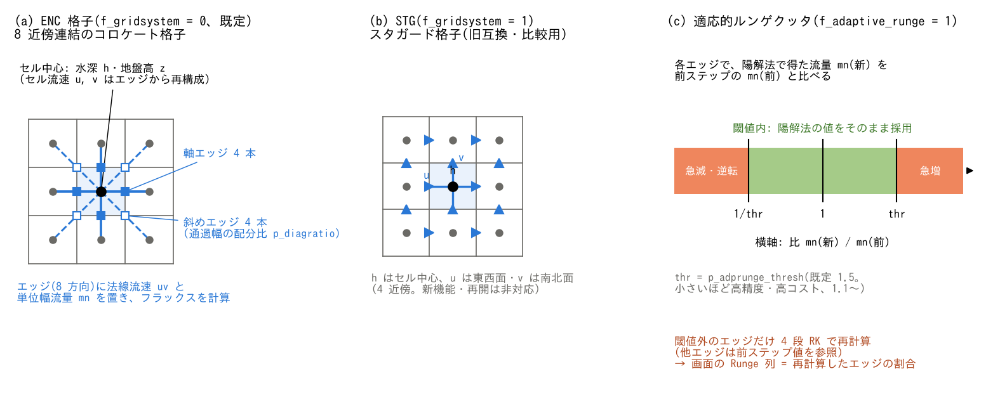

# 浅水流計算(&list_enc と数値定数)

[ユーザーガイド目次へ](../users_guide.md)

コアの地表水計算(ENC 格子上の浅水方程式)の調整パラメータです。
**既定値のままで妥当に動くように設定されています** — この章の設定は
精度・コストの調整や数値実験のためのもので、通常の計算で触る必要が
あるのは適応的ルンゲクッタの閾値くらいです。



**(a) ENC 格子。** 水深 h と地盤高 z はセル中心に置き、周囲8セル
(軸4方向・対角4方向)へのエッジで法線流速 uv と単位幅流量 mn を扱います。
塗りつぶしの四角は軸方向、白抜きの四角は対角方向のエッジ量の位置です。
セル中心の流速 u, v はエッジ流速を幾何重みで合成して再構成します。
p_diagratio は対角方向の通過幅の配分を調整する係数です。

**(b) STG 格子。** 旧互換・比較用の4近傍スタガード格子です。水深と地盤高は
セル中心(内部配列名 D・H)、x 方向の単位幅流量 M は東西面(四角)、
y 方向の単位幅流量 N は南北面(菱形)に置きます。出力用のセル流速 u, v は、
対向する2面の流量の平均をセル水深で割って求めます(限界水深未満では0)。
再開、サブグリッド河道・堤防、内部水理構造物は STG では非対応です。

(a)(b)は正方セルの模式図で、中央セルに関わる接続と量の位置を強調しています。
**(c) 適応的ルンゲクッタの判定帯。** 陽解法で得たエッジの単位幅流量を
前ステップ値と比較し、閾値の範囲外ならそのエッジを4段RKで再計算します。
前ステップ流量が0の場合や堤防壁の除外、Runge 列の集計方法は下記の
「時間積分」で補足します。
図は `python docs/figs/make_guide_figs.py swflow` で日英の PNG・SVG を生成します。

## 方式の選択(&list_sysparam)

| パラメータ | 既定値 | 意味 |
|---|---|---|
| f_gridsystem | 0 | 0: ENC 格子(既定)、1: STG(スタガード格子。旧互換の比較用。新機能・再開は非対応) |
| f_govequation | 0 | 0: 力学波(移流+圧力。既定)、1: 拡散波(圧力のみ)、2: 運動波 |
| f_check_cfl | 1 | クーラン数の監視。0: 監視のみ(停止しない)、1: Cn > 1 で状態を表示して停止(既定)、2: 波速を無視した移流クーラン数で判定・停止(Cn 列・Cn 出力の定義も移流 Cn に変わる) |

拡散波・運動波は感度実験・他モデルとの比較用です。乾湿を含む氾濫・
遡上は力学波のまま使ってください。

## 数値定数(&list_sysparam)

| パラメータ | 既定値 | 意味 |
|---|---|---|
| dd | 0.001 | 限界水深 (m)。この水深以上のセルで水の移動を計算 |
| dv | 0.001 | 仮想水深 (m)。これ以下の水深の計算上の下限 |
| vv | 0.01 | 摩擦項計算の流速下限 (m/s) |
| gg | 9.8 | 重力加速度 (m/s²) |
| cm / cd / kk | 2.0 / 1.0 / 0.5 | 家屋群の付加質量係数・抗力係数・抗力補正係数(地理情報の gv/bb とセットで使用。[地理情報の章](geoinfo.md)) |

## ENC 計算の調整(&list_enc)

`fn_enc` で有効化します(未指定でもコアは既定値で動きます)。

```
&list_enc
  p_adprunge_thresh = 1.1        ! 適応的ルンゲクッタの閾値 (1.1 ~)
/
```

**時間積分(適応的ルンゲクッタ)**

| パラメータ | 既定値 | 意味 |
|---|---|---|
| f_adaptive_runge | 1 | 適応的ルンゲクッタ(単位幅流量 mn の変化が判定帯を外れた対象エッジを4段RKで再計算。移流項は再計算段でも時刻 n の値に固定します。少数の極端なセルのために全域の dt を縮めないための機構で、Runge 列の割合が数割に達するなら dt を小さくする方が本筋です) |
| p_adprunge_thresh | 1.5 | 単位幅流量の変化による再計算の閾値 thr(1.1以上。小さいほど判定帯が狭くなり、再計算の対象が増えます) |

f_adaptive_runge が有効なとき、堤防壁を除く対象エッジで、陽解法の候補値
mn(新)を前ステップ値 mn(前)と比較します。mn(前) ≠ 0 なら、
比 r = mn(新) / mn(前) が **r < 1/thr または r > thr** のとき再計算します。
反転(r < 0)もこの条件に含まれ、境界値 r = 1/thr, thr は帯内です。
mn(前) = 0 のときは比を取らず、mn(新) ≠ 0 なら再計算し、両方0なら
再計算しません。実装は符号別の乗算比較で、この判定を行っています。

堤防の仮想壁面エッジは後段で堰流量を設定するため、このRK判定から除外します。
RK段内で仮の水深を更新するとき、他エッジの流量は前ステップ値を参照し、
移流項も時刻 n の値を保持します。画面の **Runge 列**は
`100 × 再計算したエッジ数 / (有効セル数 × 4)` の、画面出力区間内の最大値です。
判定帯は流量変化による切替条件を示しており、時間刻み dt と合わせて精度を確認します。

閾値の意味と効果は[チュートリアル Step 2](../../tutorials/wave/README.md#step-2-enc-パラメータの設定)
が実演しています。画面の Runge 列が適用率です。

**フラックス・安定化**

| パラメータ | 既定値 | 意味 |
|---|---|---|
| f_gravity_correction | 1 | 重力の補正(急勾配地形での斜面方向重力の誤差を補正) |
| f_exflux_reduction | 1 | 過大な流出フラックスの抑制。乾いた地表を進む前縁の負水深を防ぐ(乾床のある計算では on のまま推奨) |
| f_hcap_upwind | 1 | セル境界(質量流束)の水深。0: 両側セルの平均、1: 平均を上流側水深で頭打ち(既定)、2: 上流側水深そのもの(Stelling & Duinmeijer の連続式と同じ。段波先端で前線の 1 セルに水が積み上がるスパイクを防ぐ。乾いた地表への前縁の流出が増えるため、氾濫計算では ex_flux と前縁の進み方を確認して使う) |
| f_friction_fastmath | 0 | 摩擦項計算の高速化。0: 厳密(既定)、1〜5: テーブル近似(数字が大きいほど粗く速い) |
| p_diagratio | 2/(2+√2) | 8方向フラックスの対角成分の配分比(通常変更不要) |

**移流項・拡散項**

移流項のスキーム(方程式・運動量保存形の検査体積・ステンシル・限定器)の
解説は別ページ[移流項のスキーム](advection.md)にあります。

| パラメータ | 既定値 | 意味 |
|---|---|---|
| f_advection_scheme | 3 | 移流項のスキーム。1: セル中心勾配(旧既定。非保存形で、段波が遅れ、実地形では格子を細かくするほど流出が速く大きくなり収束しない。3×3 の重み付き勾配を両側セル平均でエッジへ投影)、2: 運動量保存形・1次風上、3: 運動量保存形+MUSCL(van Leer。既定)。2・3 は Stelling & Duinmeijer (2003) のスタガード格子向け定式化を ENC の 8 方向エッジに拡張したもので、段波・跳水の速度が正しく出る(湿潤床ダム破壊で段波位置誤差 1%、旧既定の 1 は 15% 遅れ)。p_adv_upwind_index はスキーム 1 だけに作用する |
| f_advection_donor | 0 | 運動量保存形移流(f_advection_scheme 2・3)の風上供給元の制限。0: 湿潤セルすべて(既定)、1: 河道セル(fn_rw の河道マスク、rw > 0)同士のエッジでは流下方向の供給元を河道セルに限る(非河道セルが供給元になる流下方向の面は ū = u_e。側方面は対象外で、斜面からの横流入による減速は残る)。屈曲・合流・不規則な 2 セル幅で、検査体積の線上の風上エッジが浸水した谷底・斜面セルに落ちると、その遅い水が運動量の供給元になって流下方向に減速が積み重なる人工損失を防ぎます(developer.md §68.18)。実地形の試験(chichibu 100 m)では出口ピークが +16%、到達が 0.5 h 早くなり、非保存形(スキーム 1)との差の約 4 割を埋めます。本流と浸水した谷底セルの間の運動量交換を切る操作でもあるため、妥当性は実測との照合で判断してください。河道マスクが必須で、スキーム 1 では効果なし |
| f_dry_head_cap | 1 | 乾燥セルへ向かうエッジ水深のエネルギー頭による頭打ち。0: なし、1: 有効(既定)。受け手セルが乾燥(h < dd)のとき、そのエッジが運べる水深を送り手のエネルギー頭 η + u_n²/2g が受け手の地盤を超える分 max(η + u_n²/2g − z_受け手, 0) で頭打ちし、超えられないエッジは流速も 0 にします(Bernoulli。堰越流の越流水深と同じ考え方)。既定では圧力項だけが「水面より高い乾いた地盤へ水が登る」ことを止めているため、段波先端や 1〜2 セル幅の掘込水路で移流項が勝つと水が堤内地へ漏れて発散することがあります(developer.md §68.15)。地盤が水面より低い通常の乾湿前縁では頭打ちが効かず既定と同一で、wave の reference にも一致します |
| f_opening_dynamic | 1 | 塞がれた開口の動的振り替え。0: なし、1: 河道セル間のエッジのみ(既定。fn_rw の河道マスクがなければ対象エッジがなく無効)、2: 全エッジ。ENC の 8 方向配分では、斜め先のセルの地盤が水面より高いと(谷底の 1 セル幅河道、壁沿い)その方向の通過幅が使えず、軸エッジの流速がセル流速の約 2.4 倍になって摩擦が過大(等流水深 +30%)になり、移流項(特にスキーム 3)の加減速も増幅されます。有効にすると、塞がり率 s = clamp((z_隣 − z)/h, 0, 1)(水面が隣接地盤より低ければ 1)に応じて、塞がれた通過幅シェアを開いた軸・斜めエッジへ毎ステップ振り替えます(堤防の開口補正 f_bank_opening と同じ規則の動的版。平坦な開水面では係数 1 で既定と同一)。1 セル河道の等流水深が Manning に一致し、スキーム 1 と 3 の洪水波の差が消えます。2(全域)は斜面の薄い表面流にも作用して流出が速くなるため、粗度の校正と合わせて評価してください。費用はステップあたり 1 パス(数%)、メモリは 4 実数/セル。リスタート直後の u,v,m,n は復元した水深から再導出するため保存時と最終桁で異なりえます |
| p_adv_upwind_index | 0.5 | 移流項の風上化指数(0〜1。スキーム 1 のみ。既定のスキーム 3 では使われない)。0: 中心差分、1: 1次精度の風上差分 |
| f_diffusion_term | 0 | 拡散項。0: なし(既定)、1: 定数粘性、2: ゼロ方程式モデル(ν = ν0 + α·u*·h) |
| p_diffusion_nu | — | 動粘性係数 ν0 (m²/s)。**モデル 1 では正値の明示が必須**(未指定はエラー停止)。モデル 2 では省略可のバックグラウンド粘性 |
| p_diffusion_alpha | 0.41/6 | ゼロ方程式の係数 α(既定は Elder 型) |

「とりあえず拡散項を入れてみたい」ときは**モデル 2 を推奨**します —
係数を1つも指定せずに、流れに応じて物理的にスケールした粘性
ν = α·u\*·h(α の既定は Elder 型)が働きます。モデル 1 の定数粘性は
格子幅・流れの規模に依存するため普遍的な推奨値がなく、値の明示が
必須です(指定し忘れは初期化時に停止するので、黙って無効になる
ことはありません)。方程式・渦動粘性モデル・離散化・安定条件の解説は
別ページ[拡散項の解説](diffusion.md)にあります。

**その他**

| パラメータ | 既定値 | 意味 |
|---|---|---|
| f_rivermouth_drop | 0 | 河口から海への段落ち(旧方式。潮位機能 fn_tide とは併用不可 — 現在は[潮位](tide.md)+[境界条件](boundary.md)の利用を推奨) |

**非静水圧補正(研究用)**

1 層非静水圧補正は、周波数分散(短い波ほど遅い)が本質の現象 — 河川を
遡上する津波のソリトン分裂・undular bore、地滑り津波の近地造波、貯水池の
孤立波 — のための研究オプションです。降雨流出・洪水氾濫・高潮・一般的な
長波津波には不要で、既定は静水圧です(無効時は計算・メモリ・通信の追加が
なく、従来とビット一致)。方程式・射影アルゴリズム・活性集合・砕波・底面項
と、参考にした他モデル・文献の解説は別ページ
[非静水圧補正の解説](nonhydrostatic.md)にあります。

まず使ってみるなら、指定は 1 行です(ソルバ CG・全域解・平坦床の 1 層
モデル)。

```
&list_enc
  f_nonhydrostatic = 1    ! 1 層非静水圧補正(他は既定)
/
```

**使い方の要点**(詳しくは[解説の §8](nonhydrostatic.md#8-適用範囲と使い方の要点))

- **格子は水深の半分以下**(Δx ≲ H/2。検証は H/4〜H/8)。それより粗いと
  格子の数値分散に埋もれて補正の意味がありません。コストはソルバより
  この解像度要件で決まります。
- **必要に応じて段階的に足す**: コストを抑えるなら `f_nh_adaptive = 1`
  (分散が効く場所だけで解く)。砕波・段波を含むなら `f_nh_breaking = 1`
  + `f_hcap_upwind = 2`(必須)、遡上高の定量評価には `nh_break_visc = 1.44`
  と摩擦 n ≈ 0.01 を併せ、Courant ≲ 0.1・Δx ≲ H/8 で収束を確認する。
  急な地形変化(棚・海底地滑り)で `f_nh_slope = 1`、地滑り津波の近地で
  `f_nh_bottom = 1`。
- **自動で静水圧に退化する場所**: 水深 nh_hmin 未満、海域マスク、堤防壁、
  サブグリッド河道幅・断面形、家屋占有セル、砕波セル、強制境界の近傍
  (nh_bc_margin)。
- **制約**: 土石流(f_debris)とは併用不可。再開は cold start(非静水圧の
  私有状態は保存しない)。ネストの子格子は帯で親の φ を受け取る
  ([ネスティング](nest.md) nest_nh)。
- **コスト**: 全域で解くと静水圧の 2〜3 倍(CG で 1 ステップ 10〜90 反復)。
  活性集合で解く範囲を限ると長波・定常流・氾濫の領域には乗りません。
- **検証ケース**: 定在波の分散関係 [test/nhwave_nh](../../test/nhwave_nh/README.md)、
  孤立波 [test/nhsolitary](../../test/nhsolitary/README.md)、undular bore
  [test/nhbore](../../test/nhbore/README.md)、棚のソリトン分裂
  [test/nhshelf](../../test/nhshelf/README.md)、砕波遡上
  [test/nhbreak](../../test/nhbreak/README.md)、動く底面
  [test/nhbottom](../../test/nhbottom/README.md)(結果の要約は解説の §8)。

| パラメータ | 既定値 | 意味(詳細は[解説](nonhydrostatic.md)の §) |
|---|---|---|
| f_nonhydrostatic | 0 | 0: 静水圧(既定)、1: 1 層非静水圧補正(β = h²/4、ステップ末尾の射影。§2〜3) |
| nh_hmin | 0.1 | この水深 (m) 未満のセルは静水圧のまま。dd より大きい値(§4) |
| nh_solver | 2 | 反復ソルバ。2: CG(既定)、1: Jacobi(比較用。Δx ≪ H で遅い)(§3) |
| nh_itmax | 500 | 反復回数の上限(超えると警告して続行) |
| nh_tol | 1e-6 | 相対収束判定 |
| nh_bc_margin | 0 | 強制境界(水位規定・区間流入・自由流出・放射)から静水圧のままにする縁(セル。0: 2H/Δx から自動)(§4) |
| f_nh_adaptive | 0 | 活性集合。1: 検出セル+縁だけで解く(§5) |
| nh_detector | 1 | 検出量。1: 分散比 χ(既定)、2: 絶対型(比較用)(§5) |
| nh_chi_on | 0.06 | 検出の閾値(位相速度差 3% の水準)(§5) |
| nh_margin | 0 | 縁の幅(セル。0: 2H/Δx から自動)(§5) |
| nh_amin | 1e-5 | 検出の絶対下限 (m/s²)(§5) |
| nh_arel | 1e-3 | 検出の相対下限(領域最大に対する比)(§5) |
| f_nh_breaking | 0 | 砕波スイッチ。1: 砕波セルとその縁を静水圧にして段波として散逸。斜面を遡上する砕波性の波では必須、f_hcap_upwind=2 と併用(§6) |
| nh_break_type | 3 | 砕波の判定。1: 水面上昇速度(SWASH 型)、2: フルード数、3: 水面勾配(既定)(§6) |
| nh_break_alpha | 0.6 | 判定 1 の開始閾値 α |
| nh_break_beta | 0.3 | 判定 1 の、砕波セルに接するセルの閾値 β |
| nh_break_fr | 0.6 | 判定 2 のフルード数の閾値 |
| nh_break_slope | 0.3 | 判定 3 の水面勾配の閾値 |
| nh_break_margin | 0 | 砕波セルの周りを静水圧にする縁(セル。0: 2H/Δx から自動)(§6) |
| nh_break_visc | 0 | 砕波域の渦粘性係数 δ_b²(0: なし。1.44 が文献相当)。[拡散項](diffusion.md)の経路で散逸(§6) |
| f_nh_slope | 0 | 底面勾配項(Version 2)。1: 斜面・棚・急な地形変化の上の波で使う。反復回数が約 2 倍(§7) |
| f_nh_bottom | 0 | 動く底面の加速度項。1: 地滑り津波の近地波形で使う(Kajiura フィルタの 1 層近似)。f_bedslide・fn_bedmotion・地形変化・API の z 更新に効く(§7) |

## とりあえず動かしてみる(最小入力)

この章の設定は**すべて既定値で動きます** — fn_enc を書かなくて構いません。
既定は「乾床前縁の安定(f_exflux_reduction)・急勾配の重力補正
(f_gravity_correction)・適応的ルンゲクッタ(閾値 1.5)」が有効の、
津波・氾濫・出水のどれにも無難な組です。

## パターン別の推奨値

| 型 | 推奨する設定 | 理由 |
|---|---|---|
| 津波・高潮の遡上 | 既定(p_adprunge_thresh 1.2〜1.5)。f_check_cfl=1 で Cn 監視 | 乾床を進む前縁と反射波の両方を既定の安定化が扱う |
| 急勾配山地の出水・土石流 | f_gravity_correction=1(既定)、dt は Cn_max 0.5 以下を目安 | 斜面方向の重力項の誤差補正。土砂は[地形変化](geomorph.md) |
| 河川の低水・緩流の流速分布 | f_diffusion_term=2(係数指定不要) | 流れに応じた渦粘性で横断方向の流速分布が滑らかになる |
| 都市氾濫(家屋群あり) | 既定 + fn_gv/fn_bb([地理情報](geoinfo.md))。cm/cd/kk は既定 | 貯留減少と抗力は地理情報側で表す |
| 広域・長期(コスト優先) | p_adprunge_thresh 2〜3、f_friction_fastmath 3〜5、必要なら f_govequation=1(拡散波) | 再計算率と摩擦項のコストを落とす。拡散波は慣性を無視するので氾濫の前縁・津波には使わない |
| 精度検証・数値実験 | p_adprunge_thresh 1.1、f_friction_fastmath 0、dt は Cn_max 0.5 以下 | 高精度側。コストは数割増。閾値を下げるより dt を縮める方が確実(dt 0.01 と 0.05 の差は閾値では埋まらない。tutorials/wave Step 2) |
| 段波・跳水・津波の遡上(不連続を含む流れ) | 既定(f_advection_scheme 3) | 運動量保存形移流。段波速度が正しく、段波背後の振動が出ない。旧既定の 1 は段波が遅れ背後に振動が出る |
| 河道マスクのない氾濫・掘込地形・ダム破壊 | f_opening_dynamic 2 | 既定の 1 は河道セル間のエッジにしか効かない。壁沿い・掘込水路の通水能を全エッジで補正する |
| 旧バージョンで校正したケースの再現 | f_advection_scheme 1、f_opening_dynamic 0、f_dry_head_cap 0 | 2026-10-03 以前の既定。3 への移行では粗度の再校正が要る(運動量保存形は跳水の損失と谷底との運動量交換を解くぶん遅く小さい) |

## 書式の実例

全パラメータの注釈付き一覧(既定値の明示):
[examples/List_samples/list_enc.txt](../../examples/List_samples/list_enc.txt)。

## 検証との関係

これらのスイッチの多くは計算結果を変えます。回帰テスト
(test/ の reference)は既定値で作られているので、変更した設定での
結果比較は自前の基準で行ってください。
