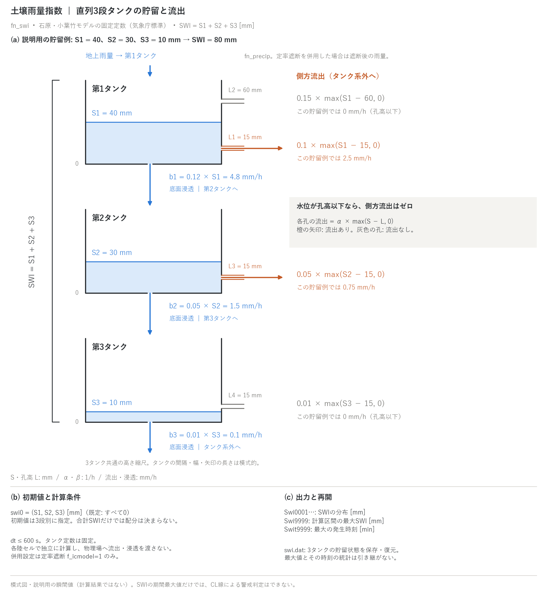

# 土壌雨量指数(fn_swi)

[ユーザーガイド目次へ](../users_guide.md)

土砂災害警戒の実務で使われる**土壌雨量指数**(SWI)をセル別に
計算します。気象庁が運用する石原・小葉竹の直列3段タンクモデル[^ishihara79]を、**全国一律の標準定数のまま**(変更不可)実装したものです。
降った雨がタンクを満たし、時間とともに流出・浸透で抜けていく様子を
指数化した「先行降雨込みの土中水分量の目安」です。単位は mm で、
物理モデルの含水率・飽和度や実測の土層厚とは異なります。
全国一律の定数を用いることと、気象庁の公式プロダクトを再現することは
別です。公式値との比較には、入力雨量の処理・初期状態・時間積分等の
条件も確認してください。



(a) 各孔の側方流出は `α × max(S − L, 0)` です。図の貯留は説明用の
瞬間値 `(S1,S2,S3)=(40,30,10)` mm で、計算結果や推奨初期値ではありません。
水面と孔高は3タンク共通の高さ縮尺です。第1タンクの上孔と第3タンクの
孔は水面より高いため、流出は0で矢印を描いていません。底面浸透 `βS` は
第1・2タンクから次段へ、第3タンクからタンク系外へ移ります。
幅・間隔・矢印の長さは模式的です。

(b) タンク定数は固定で、`swi0(1:3)` に初期貯留を与えます。
(c) 分布・最大値・最大時刻の出力と、再開時に引き継ぐ状態を示します。
日英PNG・SVGは `python docs/figs/make_guide_figs.py swi` で生成します。

## 流出式と単位

各段の貯留 `S1,S2,S3` と孔高 `L` は mm、係数 α・β は 1/h です。
側方流出 `q` と底面浸透 `b` は mm/h で、1ステップの移動量はこれらに
`Δt_h = dt / 3600` [h] を掛けます。流量 [m³/s] ではありません。
タンク $`i`$ の側方流出と底面浸透の一般形は

```math
q_i = \sum_j \alpha_{ij}\,\max(S_i - L_{ij},\ 0),
\qquad
b_i = \beta_i\,S_i
```

で、定数を入れると次の表になります。

| タンク | 側方流出 q [mm/h]（タンク系外へ） | 底面浸透 b [mm/h] |
|---|---|---|
| 1 | `q1 = 0.1 max(S1−15,0) + 0.15 max(S1−60,0)` | `b1 = 0.12 S1` → 第2タンク |
| 2 | `q2 = 0.05 max(S2−15,0)` | `b2 = 0.05 S2` → 第3タンク |
| 3 | `q3 = 0.01 max(S3−15,0)` | `b3 = 0.01 S3` → タンク系外 |

孔高以下では側方流出は0です。底面浸透には孔高のしきい値がないため、
第3タンクの図のように側方流出がなくても、貯留が正なら底面から抜けます。
この例の側方流出は `q1=2.5, q2=0.75, q3=0` mm/h、底面浸透は
`b1=4.8, b2=1.5, b3=0.1` mm/h、貯留の合計は `SWI=80` mm です。
固定の孔高・係数は[気象庁「土壌雨量指数」の表1](https://www.jma.go.jp/jma/kishou/know/bosai/dojoshisu.html)と一致します。

ENCflowは各有効陸セルで独立に計算します。タンク系外への流出は、
隣接セル・河道・地下水などの物理場への水量転送を意味しません。
実装は地上雨量 `s%pre` [m/s] から1ステップの雨量
`R_step = 1000 × s%pre × dt` [mm] を作り、まず第1タンクへ加えます。
この降雨加算後の第1タンクと、更新前の第2・3タンクから上表の q・b を評価し、
次の陽的更新を行います（右辺の S1 は降雨加算後）:

- `S1_new = S1 − (q1 + b1) Δt_h`
- `S2_new = S2 + (b1 − q2 − b2) Δt_h`
- `S3_new = S3 + (b2 − q3 − b3) Δt_h`

更新後の和が出力SWIです。第1タンクの流出を降雨加算前の貯留から評価する
式とは離散化が異なるため、公式の定数と格子をそろえただけでは公式値との
一致は保証されません。

## 有効化と設定

`&list_sysparam` で `fn_swi` を指定します。設定はほぼありません
(タンク定数は公式定義を守るため固定です):

```
&list_swi
  f_swi = 1                 ! 0 で一時無効化
  swi0 = 0.0, 0.0, 0.0      ! 各タンクの初期貯留 (mm)(先行降雨の効果)
/
```

「とりあえず動かしてみる」最小入力は **fn_swi = "-" と空の &list_swi**
(f_swi=1・swi0=0 が既定)に、降雨([降雨・気象](forcing.md))を
足すだけです。

**使い方の型**

| 型 | 降雨の与え方 | 設定 | 見るもの |
|---|---|---|---|
| 公式プロダクトとの比較 | prtype=3 の 1 km 解析雨量 | dx=dy=1 km、dt ≤ 600 s。雨量処理・初期状態・積分法の違いも確認 | 同時刻のSWIを比較。警戒基準の検討には60分雨量等も必要 |
| 設計降雨・想定雨量の確認 | prtype=1 の矩形波(終端は二重打ち) | 既定 | Swi分布の同一セルを追った時系列と最大値 |
| 先行降雨の反映 | 上記いずれか | 先行計算の3段別貯留を swi0 に与えるか、swi.dat を含めて再開 | 立ち上がりの差。合計SWIだけでは3段への配分は決まらない |
| 物理モデルとの比較 | 同じ降雨 | 別ラン(地下水の飽和度 Hg/(sy0·sd)、土層厚など)と並べる | 指数と飽和度の対応 |

## 計算の約束(専用計算)

**土壌雨量指数の計算は専用ランで行います**。地上雨量を読む診断計算と
物理状態を区別するため、次の設定制約があります:

- 併用できるのは**定率遮断**(&list_intercept の f_icmodel=1)だけ
  です。地下水・蒸発散・積雪・氷河・地形変化・水質など他の
  プロセス（`fn_gwflow`, `fn_evap`, `fn_snow`, `fn_glacier`,
  `fn_geomorph`, `fn_wq`, `fn_salt`, `fn_meteo`）を指定すると停止します。
  定率遮断を併用すると、入力は**遮断後の雨量**になります。元の降水量を
  そのまま使う比較では `fn_intercept` を指定しません。
- `dt` は **600 s 以下**(気象庁の計算間隔 10 分)。超えると停止します。
- 格子は任意です(指数はセル面積に依存しません)が、`dx,dy` が
  1 km でない場合は「公式の 1km プロダクトと同条件ではない」旨の
  警告が出ます。1 km 格子と解析雨量は比較条件の一部であり、それだけで
  公式プロダクトと同一の計算になるわけではありません。

物理モデル(地下水の飽和度など)との比較をしたい場合は、同じ降雨で
別ランを回してください。

## 出力

有効化すると自動で出力されます(スイッチはありません):

| ファイル | 内容 |
|---|---|
| Swi0001… | 土壌雨量指数 SWI (mm) の分布(dt_file 間隔) |
| Swi9999 | 各更新後のSWIから求めた**計算区間の最大値** (mm) |
| Swit9999 | 最大の発生時刻 (min) |

現在のプローブCSVにはSWI列がありません。地点の時系列は `Swi0001…` の
同一セルを各出力時刻で抽出します。最大値統計は毎ステップ更新されるため、
`dt_file` 間隔の分布出力から拾った最大とは異なる場合があります。

中断・再開(save/restore)では3タンクの状態を `swi.dat` に保存・復元し、
その和から現在SWIを再構成します。一方、**最大値とその発生時刻の統計は
保存対象外**で、再開後の計算区間で改めて更新します。分割した全期間の
最大値が必要な場合は、各区間の最大値と対応する時刻を別途集約します。

## 警戒基準との関係

CL線による評価は、同時刻の土壌雨量指数と60分雨量の組み合わせを用います。
`Swi9999` の期間最大値だけをCL線と比較して警戒判定することはできません。
ENCflowのSWI出力は指数の計算結果であり、地域別基準との比較や予測値を含む
気象庁の危険度判定処理を実装したものではありません。
[気象庁「土砂キキクル」の判定の仕組み](https://www.jma.go.jp/jma/kishou/know/bosai/doshakeikai.html)も参照してください。

## 注意

- 降雨時系列(prtype=1)のテーブルは**線形補間**です。矩形波の
  降雨を与えるときは終端を二重に打ってください(例:
  `(0,30),(180,30),(181,0)`)。
- モデル・定数の典拠: 石原・小葉竹[^ishihara79]、岡田ほか[^okada01]、
  [気象庁「土壌雨量指数」](https://www.jma.go.jp/jma/kishou/know/bosai/dojoshisu.html)。実装仕様は
  developer.md §49。

## 検証・例題

- [test/swi](../../test/swi/): 3段タンクを細かい刻みのRK4で積分した参照解と比較し、最終値・期間最大・発生時刻・空間一様性を検定。降雨テーブルの短いランプと `Check_swi.py` の判定方法も確認できます。

## 参考文献

[^ishihara79]: Ishihara, Y. and Kobatake, S. (1979): Runoff model for flood forecasting. *Bull. Disaster Prev. Res. Inst., Kyoto Univ.*, 29, 27–43.(直列 3 段タンクモデル)
[^okada01]: 岡田憲治ほか (2001): 土壌雨量指数. 測候時報, 68(5), 29–47.(気象庁の標準定数と運用)
