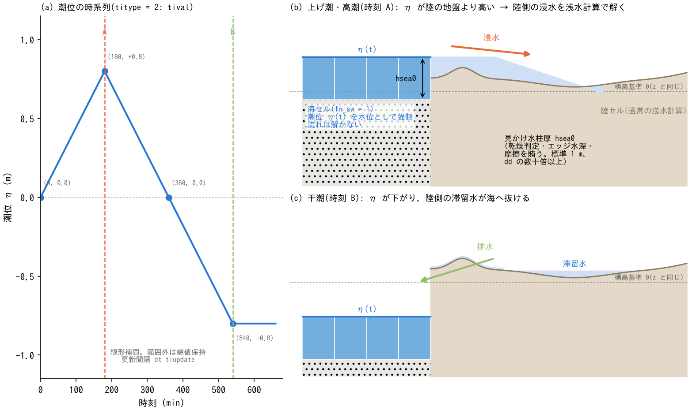

# 潮位・海面(&list_tide)

[ユーザーガイド目次へ](../users_guide.md)

海域セルに潮位(海面水位)の時系列を与え、高潮・上げ潮による沿岸
浸水や、干潮に向けた排水を計算します。`fn_tide` で有効化します。

**前提**: 海域は地理情報の海域マスク `fn_sw` で指定されている必要が
あります([地理情報の章](geoinfo.md))。潮位は海域セルへ水位として
強制されます。海セルの水深・セル流速は通常の陸セルのようには更新せず、
海を水位規定の境界として扱います。ただし、**海と陸の間の流量は通常の
ENCエッジ計算で求めます**。この流量によって陸側の水深が変わり、
陸側の流れとともに浸水・排水が計算されます。

```
&list_tide
  titype = 2                     ! 一様時系列
  hsea0 = 1.0                    ! 海セルの見かけ水柱厚 (m)
  tival(1:2,1) = 0,    0.0       ! (時刻(min), 潮位(m))
  tival(1:2,2) = 180,  0.8
  tival(1:2,3) = 360,  0.0
  tival(1:2,4) = 540, -0.8
/
```

## 潮位の与え方(titype)

| titype | 与え方 | 使うパラメータ |
|---|---|---|
| 1 | 一様な固定値 | ti0 |
| 2 | 一様な時系列(線形補間) | tival |
| 3 | 分布1枚 × 倍率時系列 | fn_timap、tival(倍率) |
| 4 | 分布ファイルのリスト(隣接2枚を線形補間) | fn_timaplist、dt_timaplist |

| パラメータ | 既定値 | 意味 |
|---|---|---|
| titype | 1 | 潮位タイプ(上表)。未指定なら 1(一様固定潮位 ti0)を採用し "(default)" 付きで表示 |
| ti0 | 0 | titype=1: 一様固定潮位 (m。z と同じ標高基準)。既定 0 = 平均潮位 |
| tival | — | titype=2, 3: 時系列 `(時刻(min), 潮位(m) または倍率)` |
| fn_timap | "" | titype=3: 潮位分布ファイル (m) |
| fn_timaplist / dt_timaplist(_c) | "" / 60 | titype=4: 分布ファイルリストと時間間隔 (min)。フレーム i の時刻は (i−1)×間隔、範囲外は端値保持 |
| dt_tiupdate | 1 | 潮位の更新間隔 (min) |
| hsea0 | 1.0 | 海セルの見かけ水柱厚 (m)(下記) |

## hsea0 — 海セルの見かけ水柱厚

海域マスクが有効な領域内セルでは、潮位の更新時に `z = η − hsea0`、
`h = hsea0` として、水面 `z + h` を指定潮位 η に合わせます。
`hsea0` はこの境界表現に使う一定の水柱厚であり、実際の海の水深や
海底地形を与える値ではありません。潮位が変わると計算上の z が変わり、
水柱の厚さ h は一定に保たれます。η と陸側の地盤高は同じ標高基準で
与えてください。

海が供給側になる浸水(高潮・上げ潮)では、海セルのこの水柱が乾燥
判定・セル境界の水深・摩擦を賄います。**限界水深 dd の数十倍以上**を
推奨します(小さすぎると海から陸への浸水流量が過小になります。
dd 以下はエラー)。標準的には 1 m 程度から始め、浸水流量の hsea0
感度が気になる場合は値を変えて確認してください。



(a) は上の tival 入力例を示す潮位時系列で、線形補間し、範囲外では
端値を保持します。(b) は時刻 A の高潮位を与えたときの浸水の模式図です。
海セルでは η = +0.8 m、h = hsea0 とし、海陸境界の流量によって陸側へ
水が入ります。陸側の水面は浅水計算で決まるため、全域が海と同じ水位に
なると仮定しません。水域の先端は陸の地盤との交点で閉じています。
(c) は時刻 B の低潮位(η = −0.8 m)での排水と滞留を示します。
海へ通じる流路があり、水位差等の条件を満たす水は排水されますが、
地形の高まりで隔てられた低地には水が残る場合があります。

(b)(c) の地形・陸側の水面・流向矢印は仕組みを説明する模式表現で、
(a) の時系列を入力して得た数値計算結果ではありません。日英のPNG・SVGは
`python docs/figs/make_guide_figs.py tide` で生成します。(a) は掲載済みPNGの
領域を元の位置・解像度のまま保持し、SVGにも同じ画像を埋め込みます。
(b)(c) はベクター描画です。

## とりあえず動かしてみる(最小入力)

最小入力は fn_sw の海域マスクと **fn_tide に空の &list_tide**(= 潮位 0 m の
固定・hsea0 1 m。海を「水位 0 の排水先」にする最簡の使い方。
developer.md §67)です。

```
&list_tide
/
```

## 使い方の型

- **高潮・上げ潮の浸水**: titype=2 の時系列で潮位を上げる。
  海岸堤防([地理情報の章](geoinfo.md))と併用すると越流・破堤前の
  防護が表現されます。
- **干潮への排水**: 潮位を下げ、海への流路と水位差等の条件に応じた
  排水を計算します。地形の高まりや堤防で隔てられた低地は、潮位を
  下げるだけでは排水できない場合があります。
- **警戒潮位での定常運転**: titype=1 の固定値。
- **津波(境界からの入射)**: 潮位機能ではなく、辺境界の長波放射
  (型 2)と水位規定セル・初期水位の組み合わせが基本です
  ([境界条件の章](boundary.md))。領域内に海域がある場合の海面の
  初期化・防潮堤の海側判定には fn_sw・fn_seaside を使います。

## パターン別の推奨値

潮位の値は与件ですが、型ごとの目安を示します。

| 型 | titype | 潮位の与え方の目安 | 組で使う機能 |
|---|---|---|---|
| 天文潮(感潮域の往復) | 2 | 半日周 12.42 h の正弦。振幅は日本の太平洋岸 0.5〜1 m、瀬戸内・有明海 1.5〜3 m | 区間流入(河川)、淡塩 2 層 |
| 高潮 | 2 | 天文潮に台風の偏差 1〜3 m を 3〜6 時間の山で重畳 | 海岸堤防 fn_seawall、家屋群 fn_gv |
| 干潮への排水 | 2 または 1 | 低潮位(−1 m 程度)へ下げる・固定 | 排水ポンプ・樋門 |
| 警戒潮位の定常 | 1 | ti0 = 計画高潮位 | 海岸堤防 |
| 津波 | — | 潮位機能ではなく境界入射([境界条件](boundary.md)) | fn_seaside |

hsea0 は限界水深 dd の数十倍以上(標準 1 m)から始めてください。

## 制約・注意

- ENC 格子系専用です(旧 STG では使えません)。
- 海域マスクのセルは流れを解かず、**地形変化(土砂)の全プロセスも
  海セルには働きません**。津波・高潮による海底の泥・砂の巻き上げと
  堆積を扱う場合は、水域を通常セル+初期水位で表します
  ([土砂・地形変化](geomorph.md)の浮遊砂の項)。
- 潮位の更新位相は絶対ステップ番号基準なので、[再開](restart.md)後も
  中断なしランと同じタイミングで更新されます(潮位有効の再開往復も
  ビット一致します)。
## 検証・例題

- 動く例題: [test/tide](../../test/tide/)(排水→上げ潮浸水)。
  書式の実例: [examples/List_samples/list_tide.txt](../../examples/List_samples/list_tide.txt)。
- 管路層の海域吐口・排水機場と潮位の結合: [test/coastal_drain](../../test/coastal_drain/)。
- 高潮による材木の流入・堆積の設定例: [examples/timberyard](../../examples/timberyard/)。
