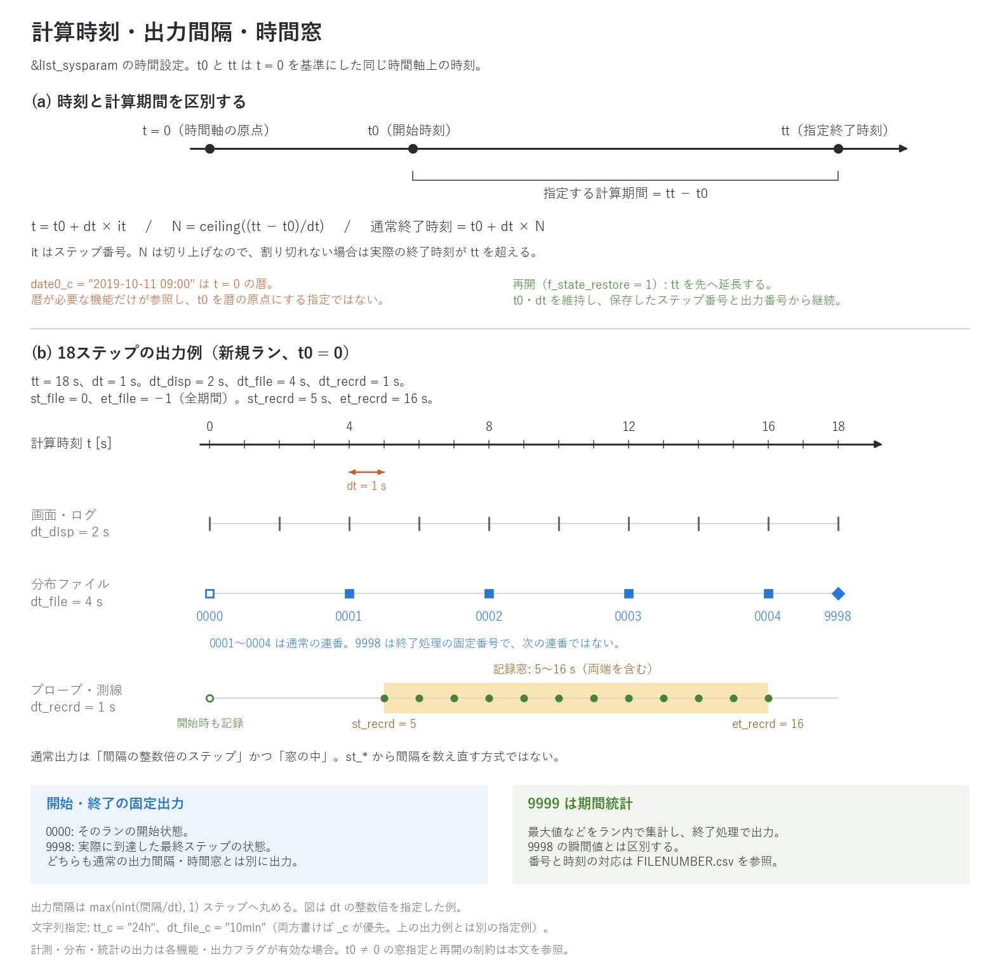

# 時刻の管理

[ユーザーガイド目次へ](../users_guide.md)

ENCflow の時刻 t は、共通の原点 t=0 から測る秒数です。これに、必要な機能だけが使う
「暦(カレンダー日時)」を重ねられます。時刻に関するパラメータは
すべて `&list_sysparam` にあります。

## 時間軸と時間刻み

| パラメータ | 既定値 | 意味 |
|---|---|---|
| t0 | 0 | 計算開始時刻 (s) |
| tt | 0 | 指定終了時刻 (s)。t0 と同じ時間軸上の値。計算期間は **tt − t0** |
| dt | 0 | 時間刻み (s)。指定必須 |

新規ランはステップ番号 `it=0`、時刻 `t=t0` から始まります。
総ステップ数は `N = ceiling((tt − t0)/dt)`、各ステップの時刻は
`t = t0 + dt×it` です。時刻を毎回足し込むのではなく、この式で求めます。
`ceiling` は切り上げなので、期間が dt の整数倍でないと、通常終了時刻
`t0 + dt×N` は指定した tt を超えます。例えば `t0=0, tt=18.2, dt=1`
なら19ステップで、通常終了は `t=19` です。入力を作る際は、指定終了時刻と
実際の最終ステップを区別してください。エラーによる早期終了では、到達時刻が
これより前になる場合があります。画面・ログの time 列は、この計算内時刻の表示です。

時間刻み dt は計算の安定性と精度を支配します。目安は画面の Cn_max 列
(クーラン数)で、1 を大きく超える設定は不安定になります。精度と
計算コストの実際の関係は
[チュートリアル Step 1〜2](../../tutorials/wave/README.md#時間刻みを粗くすると)
を参照してください。クーラン数とは何か、`dt` を格子幅と流速・水深からどう
見積もるかは[クーラン数と時間刻みの決め方](courant.md)(入門)に、
ENCflow が `dt` を固定し陽解法を主体とする理由と、可変刻み・サブサイクル
との関係は[時間刻みの設計方針](timestep_policy.md)にまとめてあります。

## 文字列での時間指定(`*_c`)

秒数の代わりに「数値+単位」の文字列でも指定できます。対応する
パラメータ名は末尾に `_c` が付き、**両方書いた場合は `_c` が優先**
されます。

```
  tt_c = "24h"              ! tt = 86400.0 と同じ
  dt_file_c = "10min"       ! dt_file = 600.0 と同じ
```

単位は `d`(`day`)・`h`(`hour`)・`m`(`min`)・`s`(`sec`)の
いずれか1つで、`"1.5d"` のような小数も使えます(`"1h30m"` のような
複合表記は不可)。長時間の計算では秒数の手計算を避けられるので、
`t0/tt/dt/dt_disp/dt_file/dt_recrd/st_file/et_file/st_recrd/et_recrd`
のすべてに `_c` 版があります。

## 表示と出力の間隔

| パラメータ | 既定値 | 意味 |
|---|---|---|
| dt_disp | 60 | 画面・ログ表示の間隔 (s) |
| dt_file | 3600 | 分布ファイル出力の間隔 (s) |
| dt_recrd | 60 | プローブ・測線(fn_record)出力の間隔 (s) |
| st_file / et_file | 0 / −1 | 分布ファイル出力の窓指定 (s)。et < 0 は tt に置換。判定方法は下記 |
| st_recrd / et_recrd | 0 / −1 | プローブ・測線出力の窓指定 (s)。et < 0 は tt に置換 |

実装は秒数を**整数ステップに変換**して出力を判定します。
間隔 D（`dt_disp`・`dt_file`・`dt_recrd`）は
`I = max(nint(D/dt), 1)` ステップに丸め、`it` が I の倍数のときに
出力します。`nint` は最近接整数への丸めで、正の半整数は上側になります。
例えば `dt=1, dt_file=2.5` なら、通常の分布出力間隔は3ステップです。
間隔を0にしても出力無効にはならず、少なくとも1ステップ間隔になります。

分布・計測の通常出力は、さらに
`L=max(nint(st_*/dt),1)`、`U=max(nint(et_*/dt),1)` に対して
`L ≤ it ≤ U` を満たす必要があります（et_* が負なら先に tt に置換）。
**窓の先頭から間隔を数え直すのではなく、ステップ番号の倍数で判定**します。
例えば `dt=1, dt_recrd=3, st_recrd=5, et_recrd=16` の通常記録は
`it=6,9,12,15` です。

`st_*`・`et_*` の換算時に t0 は差し引かれません。現在の実装では、
明示した非負の窓指定は **t0 からの経過秒**に対応します。例えば
`t0=100, dt=1, st_recrd=5, et_recrd=16` なら、窓は計算時刻
`t=105…116` に対応します。t0=0 の場合だけ計算時刻と窓の指定秒が一致します。
再開モード1も保存した it を継続するため、窓の基準を再開時刻へ移しません。
終了窓を既定の −1 にしても、tt の丸めと終了ステップの切り上げは別なので、
最後のステップで通常出力が出るとは限りません。

開始時には画面表示、`0000` の分布出力、有効なプローブ・測線の記録を、
上記の間隔・窓判定とは別に行います。終了処理では `9998`（到達した最終状態）と
`9999`（ラン内の最大値などの統計）を別に出力します。通常の分布出力が
最終ステップにある場合も `9998` を併記します。一方、プローブ・測線には
終了処理で必ず最終行を追加する処理はありません。各分布・統計のファイルは
対応する出力フラグが有効な場合に書かれます。番号と時刻は
`FILENUMBER.csv` で確認できます（詳細は[入出力ファイル](io.md)）。

長時間計算で特定のイベント期間だけ細かく出力したいときは、
st/et の窓と[再開機能](restart.md)による分割実行を組み合わせるのが
実用的です。



(a) t0 と tt は共通の原点から測る時刻で、指定する計算期間は tt−t0 です。
暦 `date0_c` の原点も t=0 にあります。(b) は新規ランで `t0=0, tt=18,
dt=1` とした18ステップの例です。画面・ログは2秒ごと、通常の分布出力は
4秒ごと（`0001…0004` は t=4,8,12,16）、プローブ・測線は窓内の
t=5…16に1秒ごとです。記録列の白抜き丸は窓の外でも行う開始時の記録です。
`0000` は t=0 の開始状態、`9998` は t=18 の最終状態を表します。
`9999` は期間統計で、時間軸上の次の瞬間を表す番号ではありません。
図は出力手順の模式図であり、計算結果の時系列ではありません。

## 暦(カレンダー日時)

季節・日付に依存する機能(蒸発散の月別係数、積雪・融雪の日界処理、
水質の温度補正など)のために、シミュレーション時刻 t=0 の暦を
指定できます。

```
  date0_c = "2019-10-11"          ! または "2019-10-11 09:00"
```

- 暦を使う機能を有効化しているのに date0_c が無い場合は、初期化時に
  その旨を示して停止します。暦を使う機能がなければ指定不要です。
- 分布気温ファイルなど時系列入力の時間アンカーはシミュレーション
  時刻(t=0 起点の経過時間)です。date0_c は「t=0 が暦の何時か」を
  与えるだけで、入力系列の解釈をずらすことはありません。

## 再開時の時刻

`f_state_restore=1` は保存したステップ番号・通常出力番号を引き継ぎ、
同じ `t = t0 + dt×it` の時間軸を続けます。t0 と dt は保存時に揃え、
tt を先へ延長します。`0000` はこの場合も「そのランの開始状態」なので、
復元時刻の状態を書きます。`9999` の統計は再開ラン内で再集計します。
中断なしランとの一致条件や保存対象外の履歴は[中断と再開](restart.md)を
参照してください。`f_state_restore=2` は保存状態を新しい時間軸の初期条件に
する別モードで、`it=0`・通常出力番号0から始まります。

## 周期強制(長期計算向け)

`t_cycle_c` に周期(例 `"365d"`)を指定すると、時系列強制を周期的に
反復して千年スケールの地形発達実験などに使えます(対象は開発文書
[developer.md §32.4](../developer.md) を参照)。通常の計算では
使いません。

## 検証・例題

- [test/wave](../../test/wave/): 時間刻み・計算終了時刻・分布出力間隔を指定する最小構成。
- [test/nest_identity](../../test/nest_identity/): `restart` 構成で、同じ時間軸上の保存・再開を中断なしランと比較。
- [examples/List_samples/list_sysparam.txt](../../examples/List_samples/list_sysparam.txt): 時刻・出力間隔・暦・周期強制を含む設定書式の注釈付き見本。
