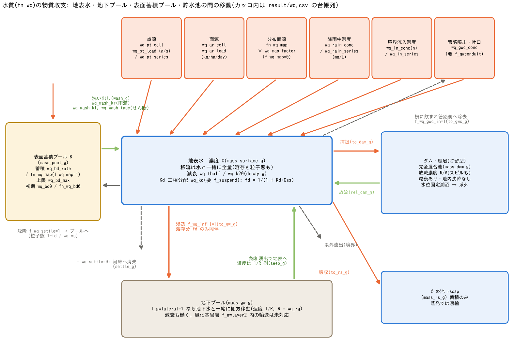

# 水質・負荷流出(&list_wq)

[ユーザーガイド目次へ](../users_guide.md)

単一物質の負荷投入・移流輸送・減衰・沈降・浸透同伴・Kd 二相分配・
地下水経由の輸送を扱います。汚濁負荷の流出解析、放射性核種の移動、
重金属の流域輸送、トレーサ実験などに使えます。
`fn_wq` で有効化します。各過程の式と代表値の根拠は[水質モデルの解説](wq_models.md)に
あります。

```
&list_wq
  wq_c0 = 0.0                    ! 初期濃度 (mg/L)
  wq_thalf = 8.0                 ! 半減期 8 日(例: I-131)
  ! 点源: セル (50,60) から 2 g/s
  wq_pt_cell(:,1,1) = 50, 60
  wq_pt_load(1) = 2.0
/
```

「とりあえず動かしてみる」最小入力は **fn_wq に初期濃度か負荷 1 つ**です
(減衰・沈降・分配を書かなければ保存性トレーサ = 到達範囲と希釈率の
把握)。

結果の見方は、このページ末尾の[出力・確認](#出力確認)にまとめてあります
(濃度分布 C・地下プール分布 Cg・表面蓄積プール分布 B、質量収支台帳
`result/wq.csv`、プローブ・測線の列)。以下の各機能の節末にも、その
機能に関係する出力だけを短く記しています。

```
&list_wq
  wq_c0 = 100.0                  ! 全域 100 mg/L のトレーサを初期水に乗せる
/
```



(a) 単一物質が地表水へ入り、表面蓄積プール・地下プール・貯留型ダム／湖沼・
ため池へ移る主な経路です。橙は外部からの入力、青は地表から各プールへの移動、
緑は地表への戻り、灰色の破線は地表から追跡対象外への除去を示します。
管路からの噴出は固定濃度の入力であり、枡に入った物質を管内輸送して戻す経路ではありません。
一次減衰は図の5つの貯留すべてに働きます。

(b) `wq_vs` の単相沈降と、`wq_kd` による溶存態・粒子態の分配を伴う沈降は
同時に指定できません。Kdは入力の L/kg から m³/kg に換算して使います。
どちらの方式でも沈降先は `f_wq_settle` で選びます。(c) は台帳の読み方です。
`settle_g` は沈降先がプールの場合も計上され、`to_dam_g` は貯留型と水位固定型の
捕捉を合算します。内部移動を全体系の損失として二重に数えないでください。

図中の `_g` は `result/wq.csv` の質量列 [g] です。濃度 `C` [mg/L] と
`mass_surface_g`（地表の現在質量 [g]）は別の量です。現行CSVには境界流入・
境界流出・収支残差の独立列はありません（下の「出力・確認」を参照）。

## 物質の性質

減衰・沈降・分配の式と代表値の出典: [解説](wq_models.md) §2〜§4・§7。

| パラメータ | 既定値 | 意味 |
|---|---|---|
| f_wq | 1 | 0 でファイルを残したまま一時無効化 |
| wq_c0 | 0 | 初期濃度 (mg/L。一様) |
| wq_thalf / wq_k20 | — | 減衰: 半減期 (day) または一次減衰係数 (1/day)。排他 |
| wq_vs | — | 沈降速度 (m/day)。全量を対象とする単相近似。wq_kd と排他で、沈降先は f_wq_settle で選択 |
| wq_kd | — | 平衡分配係数 (L/kg)。溶存⇄粒子態の二相分配(下記。要 f_suspend) |
| f_wq_settle | 0 | 沈降の行き先。0: 河床へ消失、1: 表面蓄積プールへ(再懸濁サイクル) |
| f_wq_infil | 1 | 浸透時の挙動。0: 地表に残留(粒子態向け)、1: 濃度同伴で地下プールへ(溶存態向け) |
| wq_rg | 1 | 地下輸送の遅延化係数 R(≥1)。地下水中の移流・湧出の実効濃度を 1/R に落とす(下記「地下水経由の輸送」)。明示指定には f_wq_infil=1 が必要(0 との同時指定はエラー停止) |

**物質別の代表値(設定の出発点)** — 水質の物性は物質ごとに桁で異なる
ため、ENCflow は既定値を置かず(減衰・沈降・分配を書かなければ
「保存性トレーサ」として動きます)、代表値を次に示します。いずれも
1〜2 桁の幅がある量なので上下限の 2 ケースで挟むのが実務的です
(出典は developer.md §66)。

| 物質の型 | 減衰 | 沈降・分配 | 地下 | 備考 |
|---|---|---|---|---|
| 保存性トレーサ(塩分・染料・濁度指標) | なし | なし | f_wq_infil=1, wq_rg=1 | 到達範囲・希釈率の把握。最初に動かす設定 |
| 大腸菌・病原指標(下水噴出・合流式越流) | wq_k20 1〜5 /day(T90 0.5〜2 日。晴天夏は速く、曇雨天・冬は遅い) | なし(濁質付着を見るなら wq_kd 1e3〜1e4) | f_wq_infil=0(地表に残す) | 濃度は下の「下水噴出の衛生リスク評価」 |
| 有機汚濁(BOD)・アンモニア | wq_k20 0.1〜0.5 /day(Streeter-Phelps の脱酸素係数) | なし | f_wq_infil=1 | 溶存酸素は解かない |
| 栄養塩(硝酸)・溶存塩 | なし〜0.01 /day | なし | f_wq_infil=1, wq_rg=1 | 地下水経由で湧出に出る |
| 濁質・SS(粒子態) | なし | wq_vs 0.5〜10 m/day(粘土 2 µm 0.3、シルト 10 µm 8。Stokes 則) | f_wq_infil=0 | f_wq_settle=1 で再懸濁サイクル |
| 重金属(Zn・Cu・Pb。粒子態主体) | なし | wq_kd 1e3〜1e5 L/kg(Zn 1e3、Cu 3e3、Pb 1e4〜1e5。要 f_suspend) | f_wq_infil=1, wq_rg 1e2〜1e4 | 二相分配(下記) |
| 放射性セシウム(Cs-137) | wq_thalf 11019 day(30.17 年) | wq_kd 1e3〜1e4 L/kg(粘土に強く吸着。要 f_suspend) | f_wq_infil=1, wq_rg 1e3〜1e4(R = 1 + ρ_b·Kd/θ) | 流域の長期挙動 |
| 農薬・溶存有機物 | wq_thalf 10〜60 day | wq_kd 1〜100 L/kg(Koc × 有機炭素率) | f_wq_infil=1, wq_rg 2〜100 | 分解速度は温度・日射で変わる |

**この節に関係する出力**: 減衰で失われた累積質量は `wq.csv` の `decay_g`、沈降は `settle_g` 列です。濃度分布 `C0001…`(mg/L)は減衰・沈降後の値で、Kd 分配時は溶存態+粒子態の合計です ([出力・確認](#出力確認))。

## 負荷の与え方(重ね合わせ可)

投入経路は排他ではなく**重ね合わせ**です(背景負荷+特定源のように
組み合わせられます)。各群のセル集合はファイル指定(`fn_wq_pt_cell`・`fn_wq_ar_cell`。
1 行 1 セルの「i j」。直接記入と排他)もでき、セル座標 (i, j) は**1 スタート**です(GIS の 0 スタートに注意。
[座標系の章](coordinates.md))。負荷・濃度の時系列の時刻は t=0 からの
**経過日**です。

**点源(排水口など)** — セル群+負荷 (g/s。群合計)

```
  wq_pt_cell(:,1,1) = 50, 60          ! 群1のセル
  wq_pt_load(1) = 2.0                 ! 一定負荷 (g/s)
  !wq_pt_series(:,1,1) = 0.0, 2.0     ! または時系列 (経過日, g/s)
```

**面源(農地など)** — セル群+原単位 (kg/ha/day)

```
  wq_ar_cell(:,1,1) = ...
  wq_ar_load(1) = 0.5                 ! 一定原単位 (kg/ha/day)
  !wq_ar_series(:,1,1) = 0.0, 0.5     ! または時系列 (経過日, kg/ha/day)
```

**分布面源(土地利用別原単位)** — 全域のセル別分布

| パラメータ | 既定値 | 意味 |
|---|---|---|
| fn_wq_map | "" | 原単位の分布ファイル (kg/ha/day) |
| wq_map_factor | 1 | 分布への倍率(校正用) |
| f_wq_map | 0 | 分布の解釈。0: 地表水へ直接投入、1: 表面蓄積プールへの蓄積レート |

**降雨中濃度(湿性沈着)** — 地表到達雨量×濃度で全域投入:
`wq_rain_conc`(一定 mg/L)または `wq_rain_series`(経過日, mg/L)。

**境界流入濃度** — [境界条件](boundary.md)の区間流入の番号ごとに
`wq_in_conc(n)`(一定)または `wq_in_series(:,:,n)`(時系列)。

**この節に関係する出力**: 投入経路ごとの累積投入質量が `wq.csv` の `in_point_g`(点源)・`in_area_g`(面源)・`in_map_g`(分布面源)・`in_rain_g`(降雨中濃度)列に記録されます。境界流入濃度による投入には独立列がないため、収支検算では測線の負荷列(`L`・`Lcum`)で別途押さえてください。投入後の広がりは濃度分布 `C0001…` で確認します ([出力・確認](#出力確認))。

## 単相の沈降(wq_vs)

式: [解説](wq_models.md#3-沈降)。

`wq_vs` [m/day] を指定すると、地表水の全物質量を対象に沈降させます。
実装では速度を `v_s = wq_vs / 86400` [m/s] に換算し、1ステップで
柱状量 cq の `min(v_s × Δt / v_h, 1)` の割合を取り除きます。
v_h は断面形状を考慮した矩形換算水深で、これが乾燥判定値以下なら沈降しません。

`f_wq_settle=0` は追跡対象外の河床へ消失、`1` は表面蓄積プールへ移動します。
`settle_g` はどちらの行き先でも累積沈降量を記録します。行き先1なら内部移動なので、
地表・地下・プール等を合わせた全貯留の収支に、系外損失として加えません。
`wq_kd` との同時指定はエラーです。

**この節に関係する出力**: 累積沈降量は `wq.csv` の `settle_g` 列です。`f_wq_settle=1` のときは沈んだ分が表面蓄積プールに移るので、プール分布 `B0001…`(kg/ha)と `mass_pool_g` 列にも現れます ([出力・確認](#出力確認))。

## 吸着性物質の二相分配(Kd。重金属など)

溶存率と粒子態沈降の式・Kd の出典: [解説](wq_models.md#3-沈降)。

重金属のように浮遊土砂に強く吸着する物質は、`wq_kd`(平衡分配係数、
L/kg)を与えると**溶存態と粒子態の平衡二相**として扱われます。
[浮遊砂](geomorph.md)(`f_suspend`)が必須です(浮遊砂濃度が分配の
相手なので、なければエラーで止まります)。

毎ステップ・セルごとに、`Kd_SI = 10⁻³ × wq_kd` [m³/kg] と
浮遊砂の質量濃度 `Css = ρs × hs / v_h` [kg/m³] から、
溶存率 `fd = 1/(1 + Kd_SI × Css)` を求めます。Kd_SI × Css は無次元です。
入力値 [L/kg] を換算せずこの式に代入しないでください。
浮遊砂がないセルでは fd=1（全量溶存）です。

- **浸透**は `f_wq_infil=1` のとき溶存分 fd のみが地下へ同伴し(粒子態は土中に入らず、地表で
  濾し取られて残留)、
- **沈降**は粒子態 (1 − fd) 分が**浮遊砂と同じ沈降速度**で沈みます
  (`wq_vs` は不要になり、同時指定はエラー)。行き先は `f_wq_settle` で、
  **1(表面蓄積プール)を推奨**します — せん断洗い出し(`wq_wash_kf`)と
  組み合わせると、出水時の再懸濁↔平水時の河床蓄積のサイクルが閉じます。
- 移流は全量が水と一緒に動きます(溶存も懸濁粒子も流速は同じ。
  相の差が出るのは鉛直方向だけです)。

Kd は物質・土砂・水質(pH 等)で桁が変わる量です。文献値の目安
(オーダー)は Pb: 10⁴〜10⁶、Cu・Zn・Cd: 10³〜10⁵、As: 10¹〜10³ L/kg
程度ですが、**対象流域の実測(懸濁態/溶存態比)から逆算するのが
確実**です。地下水中の吸着遅延は別係数 `wq_rg`(下記)で与えます。

例題: [test/kdpart](../../test/kdpart/)(浮遊砂ダムブレイク+点源 —
閉合と Kd 増加時の単調性の検定つき)。

**この節に関係する出力**: 濃度分布 `C0001…` は溶存態+粒子態の合計です(相別の分布出力はありません)。粒子態の沈降は `settle_g` 列、溶存態のみが浸透同伴するので地下への移動は `to_gw_g` 列と地下プール分布 `Cg0001…`(要 `f_out_hg=1`)で追えます ([出力・確認](#出力確認))。

## 地下水経由の輸送(浸透 → 地下水流動 → 湧出)

同伴輸送と遅延化係数の式: [解説](wq_models.md#4-浸透同伴と地下水経由の輸送)。

`f_wq_infil=1`(既定)で浸透水に同伴して地下プールへ入った物質は、
[地下水の側方流動](gwflow.md)(`f_gwlateral=1`)が有効なら**地下水と
一緒に流域内を移動し、飽和湧出(地下水が地表へ湧き出す場所)で
wq_rg に応じた実効濃度で地表水へ戻ります**(R=1 なら地下の濃度と同じ)。
設定は不要で、水質と側方流動を
両方有効にすれば自動で働きます。これにより、晴天時に基底流出が
支配する河川の水質(地下水経由の負荷)まで一連で扱えます。

**遅延化係数 `wq_rg`**(R ≥ 1。既定 1 = 遅延なし)は、土中での平衡
吸着による移動の遅れをまとめて表す係数です。地下水そのものの速度に
対して物質は 1/R の速度で動きます(湧出水の濃度も 1/R 側の溶存分)。
線形平衡吸着なら R = 1 + ρb·Kd/θ(ρb: 乾燥かさ密度、θ: 有効間隙率、
Kd: 分配係数)で見積もれます。重金属のように吸着の強い物質は
R が 10〜10⁴ のオーダーになり、実質的に地下水経由の輸送が効かなく
なります(その判断ごと R に込めて与えてください)。

- 対象は溶存態(`f_wq_infil=1`)のみです。減衰(wq_thalf / wq_k20)は
  地下プールにも同様に働きます。
- 地下の質量収支の検算には `result/wq.csv` の `to_gw_g`(浸透で地下へ)、
  `seep_g`(湧出で地表へ戻った累積)、`mass_gw_g`(地下の現在貯留)に
  記録された値が使えます。初期地下質量が0、地下での減衰と他の出入りがない場合には
  `to_gw_g − seep_g = mass_gw_g` です。減衰がある場合は地下で失われた分も
  含める必要があります。`decay_g` は全貯留の合計で、地下分だけの独立列ではありません。
- 質量を同伴するのは層 1(土層)の側方流と飽和湧出だけです。層 1 から
  水が抜ける次の経路は水だけが動き、質量は層 1 に残ります: 風化基岩層
  (f_gwlayer2)への浸透、揚水(f_gwpump)、管路層への浸入水(gwc_leak_layer=1)。
  蒸発散も純水だけを抜きます(これは物理的に正しい挙動)。帰結は、
  (a) 層 1 の濃度 Cg/Hg が見かけ上高くなる方向に働くこと、(b) 層 2 や
  管路を経由して地表へ戻る水が清水になることの 2 つで、f_gwlayer2 で
  基底流を再現する構成では地下水経由の負荷を過小評価しえます。台帳の
  閉合(上の式)はこれらの経路でも破れません。

例題: [test/gwseep](../../test/gwseep/)(閉領域の斜面で浸透→地下側方→
湧出→再浸透の循環 — 台帳の閉合と wq_rg=1e12 の不動化の検定つき)。

**この節に関係する出力**: 地下プール分布 `Cg0001…`(g/m²。`f_out_hg=1` で Hg と一緒に出力)、`wq.csv` の `to_gw_g`・`seep_g`・`mass_gw_g` 列 ([出力・確認](#出力確認))。

## 貯水池・ため池の扱い

設定は不要で、[構造物](structure.md)のダム・湖沼と
[地理情報](geoinfo.md)のため池(rscap)があれば自動で働きます。

- **ダム・湖沼(貯留型)**は**完全混合池**として扱われます。捕捉水と
  一緒に入った質量は湖沼のプールに貯まり、放流水には貯水量比の濃度
  M/V が同伴します(スピルも同濃度)。タンクカスケードのような
  貯水池群を通過する負荷の減衰・遅延がこれで表現できます。
  減衰(wq_thalf / wq_k20)はプール内にも働きます。
  **池内の沈降は未実装**なので、沈降性物質では放流濃度が安全側
  (高め)に出ることに注意してください。
- **水位固定湖沼**(放流セルなし)に入った質量は、水と同じく系外へ
  消えます(台帳 to_dam_g に計上)。
- **ため池(rscap)**が吸収した水の質量はセル別のため池プールに
  貯まります。地表への戻り経路はなく、満水後のあふれ水は吸収されません。
  プール内でも一次減衰が働きます。蒸発では水だけが抜けて質量は残ります（濃縮）。

例題: [test/damwq](../../test/damwq/)(斜面+ため池パッチ+一定量放流
ダム — 台帳の閉合と一様濃度の端到端保存の検定つき)。

**この節に関係する出力**: ダム・湖沼の完全混合プールとため池プールは集中(ランプ)量なので分布出力はなく、`wq.csv` の `to_dam_g`(捕捉)・`rel_dam_g`(放流)・`mass_dam_g`(湖沼プールの現在質量)・`to_rs_g`(ため池吸収)・`mass_rs_g`(ため池プールの現在質量)列で追います。放流水の濃度は放流セル下流のプローブ C 列で見ます ([出力・確認](#出力確認))。

## 表面蓄積+洗い出し(L-Q 非線形)

蓄積・洗い出しの式と SWMM との対応: [解説](wq_models.md#5-表面蓄積と洗い出しbuildupwashoff)。

晴天時に地表へ蓄積した負荷が降雨で洗い出される buildup-washoff 機構
です。流量と負荷の非線形な L-Q 関係・ファーストフラッシュを表現
できます。

| パラメータ | 既定値 | 意味 |
|---|---|---|
| wq_bd_rate | — | 一様蓄積レート (kg/ha/day)(f_wq_map=1 の分布指定と排他) |
| wq_bd_max | —(無限) | 蓄積上限 (kg/ha)。省略で線形無限 |
| wq_bd0 / fn_wq_bd0 | — / "" | 初期プール (kg/ha)(一様値 / 分布。排他) |
| wq_wash_kr | — | 雨滴洗い出し係数 (1/m。都市排水モデルで慣用の指数型洗い出し係数 c1 [1/mm] の 1000 倍に相当) |
| wq_wash_kf / wq_wash_tauc | — / — | せん断洗い出し係数 (1/s)と限界せん断応力 (N/m²)(kf に必須) |

**この節に関係する出力**: 表面蓄積プールの分布 `B0001…`(kg/ha。プール有効時に自動出力)で「まだ地表に残っている負荷」が、`wq.csv` の `in_bldup_g`(累積蓄積)・`wash_g`(累積洗い出し)・`mass_pool_g`(プールの現在質量)列で収支が追えます。ファーストフラッシュの確認は測線の負荷列 `L`(g/s)と流量の時系列を重ねます ([出力・確認](#出力確認))。

## 下水噴出の衛生リスク評価(管路連続体層との連携)

内水氾濫でマンホール・吐口から溢れた下水が、氾濫水と一緒に市街地へ
広がる — その**衛生リスク(大腸菌などのふん便性指標)の空間分布**を
評価する機能です。浸水後の消毒・広報・避難誘導の優先度づけや、
貯留管・吐口改善などの対策比較に使えます。

仕組みは「**供給側固定濃度近似**」です: 管の中の菌の収支は解かず、
「下水道から地表へ出てくる水(噴出・陸側吐口の放流)は一定濃度の
下水である」とみなして、その水量×濃度の負荷を地表に投入します。
地表に出た後は通常の水質計算(氾濫流と一緒に移流し、一次減衰で
死滅していく)です。管の中の希釈・輸送を解かない割り切りですが、
下水濃度そのものが 1〜2 桁の幅で変動する評価なので、「どこが・いつ・
どのオーダーで汚染されるか」という実務の問いにはこの近似で足ります。

### 設定手順

**Step 1 — 下水道網を管路連続体層で組む**([地下水の章](gwflow.md)の
管路連続体層。都市プリセット: 枡密度あり・層間交換なし)。まず水質
なしで走らせて、噴出の位置・規模が妥当かを確認しておくことを
勧めます(水理が結果を支配します)。

**Step 2 — 水質を有効化し、下水濃度を与える**:

```
&list_sysparam
  fn_wq = '-'               ! 水質を有効化(設定は同じファイル内)
/
&list_wq
  wq_gwc_conc = 1.0e4       ! 噴出・吐口水の濃度(下記の単位の読み替え参照)
  f_wq_gwc_in = 1           ! 枡に飲まれた氾濫水の負荷は管路側へ除去(既定)
  wq_k20 = 2.303            ! 一次減衰 = ln(10)/T90(T90 = 1 日の例)
/
```

これだけで、噴出・陸側吐口の水に濃度が同伴されます(管路連続体層が
無効のままだとエラーで止まります)。

### 単位の読み替え(大腸菌の場合)

水質モジュールの単位系は名目上「g」「mg/L」ですが、単一物質の線形
輸送なので**任意の量に読み替えられます**。大腸菌では「g = 10⁶ CFU」と
読むのが扱いやすい取り決めです:

| 実際の量 | 読み替え | wq_gwc_conc の値 |
|---|---|---|
| 下水 10⁶ CFU/100mL | = 10¹⁰ CFU/m³ = 10⁴ 単位/m³ | 1.0e4 |
| 下水 10⁵ CFU/100mL | | 1.0e3 |
| 下水 10⁷ CFU/100mL | | 1.0e5 |

出力の濃度場 C(名目 mg/L = 単位/m³)を CFU/100mL に戻すときは
**C × 100** です(1 単位/m³ = 10⁶ CFU/m³ = 100 CFU/100mL)。
たとえば C = 50 なら 5×10³ CFU/100mL — 水浴場基準(ふん便性大腸菌群
100 CFU/100mL 以下等)と比べれば「接触を避けるべき水」と読めます。

### 代表値の目安(設定の出発点)

| 量 | 目安 | 備考 |
|---|---|---|
| 晴天時汚水の大腸菌 | 10⁵〜10⁷ CFU/100mL | 生下水。分流式の汚水管はこの範囲の上側 |
| 雨天時(合流式の越流水) | 10⁴〜10⁶ CFU/100mL | 雨水希釈で 1 桁程度下がる。合流式の評価ではこちらを使う |
| T90(90% 死滅時間) | 晴天・夏の日中: 数時間〜1 日 / 曇雨天・冬: 1〜数日 | 日射・水温・濁りで大きく変わる。氾濫評価は安全側に長め(1〜2 日)を推奨 |
| 減衰係数への換算 | k (1/day) = ln(10) / T90 (day) | T90=1 日 → wq_k20 = 2.303 |

濃度・T90 とも 1〜2 桁の不確かさがある量なので、**1 本の値で断定せず
上下限の 2 ケースで挟む**のが実務的です(結果はほぼ濃度に線形)。

### 出力の読み方

- **濃度分布 C0001…**(名目 mg/L): 汚染の空間分布。上の換算で
  CFU/100mL に読み替えてリスク区分に対応づけます。氾濫が引いた後も
  期間最大の分布(H9999 と同様の使い方をするなら dt_file を細かく)で
  「一度でも汚染水に浸かった範囲」を押さえます。
- **result/wq.csv**: 質量収支の台帳。`in_gwc_g` = 下水道からの投入
  (噴出・吐口)、`to_gwc_g` = 枡に飲まれて管路側へ除去された分、
  `decay_g` = 死滅による質量減少。初期質量・他の入力や出入り・現在貯留を
  含めて収支を検算します。CSVに残差の独立列はなく、境界輸送があれば別途考慮が必要です。
- プローブ CSV の濃度 C 列で、特定地点(避難所・井戸など)の時系列を
  監視できます。

### この近似でできないこと

- **管内の輸送・希釈**: 「上流の枡で飲まれた汚水が下流の吐口から
  出る」は表現しません(飲まれた負荷は台帳に除去されるだけ)。
  雨天時の管内希釈も解かないので、合流式では雨天時越流水の濃度を
  wq_gwc_conc に直接与えてください。
- **減衰係数の環境依存**: 日射・水温による T90 の時間変化は一定係数の
  近似です(上下限ケースで挟む運用を推奨)。
- 濃度は完全混合(鉛直分布なし)、単一物質です(ウイルス等を併算する
  場合は物質ごとに別ランで)。

例題: [test/sewer_wq](../../test/sewer_wq/)(幹線+枝管の市街地に
降雨 100 mm/h × 30 min — 噴出→氾濫→拡散→減衰の一連と、wq.csv の
収支検算。管路網の作り方は [examples/sewer_hybrid](../../examples/sewer_hybrid/))。

## 出力・確認

分布出力の 3 通りの有効化(自動 / 指定 / 共用)と柱状量の面積基底の読み方は[入出力の形式](io.md#状態量の分布出力の考え方)に、確認したい量から出力を逆引きする早見表は同じ節の末尾にあります。

**分布**(`result/` のラスタ。`dt_file` 間隔)

| ファイル | 出し方 | 内容 |
|---|---|---|
| C0001… | 自動 | 体積平均濃度 (mg/L = g/m³)。湿潤セルだけ意味を持ち、乾いたセルは 0 |
| B0001… | 自動(蓄積プール有効時) | 表面蓄積プール (kg/ha。幾何面積基底) |
| Cg0001… | f_out_hg と共用(浸透同伴 f_wq_infil=1 のとき) | 地下質量プール (g/m²。幾何面積基底 = セル内質量 Cg × A)。地下水中の濃度は Cg / Hg(mg/L。Hg は柱状換算水深なので θ で割らない。建物空隙率 gv < 1 のセルでは gv 分の近似が乗る) |

**台帳・ログ**(収支の検算)

- `result/wq.csv`: 時間 `time_s` [s] と下表の質量列 [g]。`mass_*_g` は
  記録時点の現在貯留、それ以外は累積量です(`dt_recrd` 間隔)。
- 画面・Log.txt に水質の列はありません(水収支の S 列は変わりません)。
- 海域マスク(fn_sw)の海セルと辺境界から系外へ出た質量には列がありません。
  系外流出 = 入力の累積 − 内部移動 − 現在質量の残差として求めます。
- 海セルは質量を持ちません(初期濃度 wq_c0 の海域はゼロ化。減衰・台帳の
  対象外)。海から陸へ流入する水は清水(濃度 0)です。海水の濃度を与えたい
  場合は、海に接する陸セルへの点源・区間流入の境界流入濃度で表します。

| 列 | 内容 |
|---|---|
| in_point_g, in_area_g, in_map_g, in_rain_g, in_gwc_g | 地表への点源・面源・分布・降雨・管路噴出／吐口の累積入力 |
| in_bldup_g | 表面蓄積プールへの累積蓄積入力(初期量を除く) |
| wash_g, to_gw_g, seep_g | 洗い出し、浸透、湧出による内部移動 |
| to_dam_g, rel_dam_g, to_rs_g | ダム／湖沼捕捉、放流、ため池吸収。to_dam_g は水位固定湖沼への系外移動も含む |
| to_gwc_g | 枡流入による管路側への除去(管内物質プールは持たない) |
| decay_g | 地表・地下・表面プール・ダム・ため池での累積減衰の合計 |
| settle_g | 地表からの累積沈降。f_wq_settle=0 は消失、1 はプールへの内部移動 |
| mass_surface_g, mass_gw_g, mass_pool_g, mass_dam_g, mass_rs_g | 地表・地下・表面プール・貯留型ダム／湖沼・ため池の現在質量 |

**計測**(プローブ・測線の列)

- プローブ CSV に濃度 `C` (mg/L) と地表負荷 `cq` (g/m²) の列が加わります。
- 測線 CSV に負荷流量 `L` (g/s) と累積負荷 `Lcum` (kg) の列が加わります
  ([計測の章](record.md))。構造物の転送流量と同様、管路経由の移動は
  測線に乗りません。

**再開**

- 地表・地下・プールの質量は私有ファイル `wq.dat` に保存され、
  save/restore は自動です(保存時に fn_wq が有効だったことが必要)。

**読み方と検算のコツ**

- 濃度 `C = cq / v_h` [mg/L = g/m³] は湿潤セルごとの量です。cq は水柱の
  柱状物質量 [g/m²] で、地表の総質量は `Σ(cq × gv × wfrac × A)` [g] です
  (A はセル幾何面積、gv は有効面積率、wfrac は河道幅の係数。幅機能なしでは 1)。
  濃度を足し合わせても総質量にはなりません。乾燥セルの出力 C は 0 ですが、
  残留質量の有無は貯留台帳で確認します。
- 全体系の現在質量は 5 つの `mass_*_g` の合計です。収支検算では初期質量と
  外部入力を加え、系外への除去・減衰を差し引きます。内部移動は二重に計上
  しません。境界流入・境界流出・収支残差の独立列はないため、開いた境界や
  区間流入を使う場合は、その物質輸送(測線の L・Lcum)を別途含めて検算
  してください。
- 期間最大濃度の分布はないので、必要なら `dt_file` を細かくして C の連番
  から後処理で求めます。

## 検証・例題

- [test/kdpart](../../test/kdpart/): 浮遊砂ダムブレイクと点源による Kd 二相分配の検定。
- [test/gwseep](../../test/gwseep/): 浸透同伴と地下側方流を経由した物質輸送の収支検算。
- [test/damwq](../../test/damwq/): ダム完全混合放流とため池同伴の恒常検定。
- [test/sewer_wq](../../test/sewer_wq/): 管路網をもつ市街地の下水噴出の収支検算(管路網の作り方は [examples/sewer_hybrid](../../examples/sewer_hybrid/))。
- 書式の実例: [examples/List_samples/list_wq.txt](../../examples/List_samples/list_wq.txt)
- 地下水と併用すると浸透同伴・地下プールの追跡ができます
  ([地下水の章](gwflow.md))。
