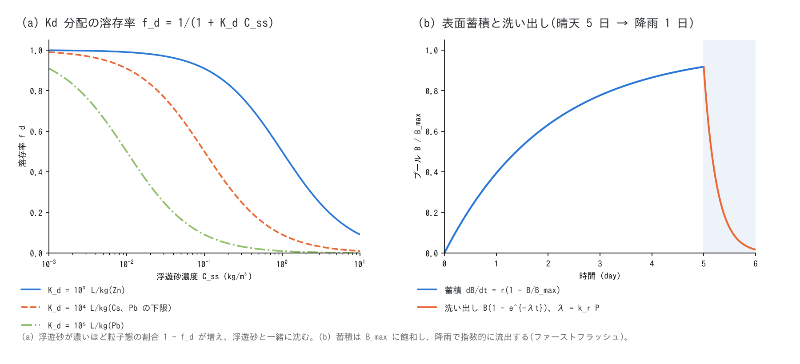

# 水質モデルの解説(水質・負荷流出の補足)

[水質の章へ](wq.md) | [ユーザーガイド目次へ](../users_guide.md)

[水質・負荷流出の章](wq.md)の各過程 — 輸送、発生源、一次減衰、沈降、
Kd 二相分配、浸透同伴と地下水経由の輸送、表面蓄積と洗い出し、貯水池、
下水噴出 — の式と代表値の根拠をまとめます。実装は `src/m_wq.f90`
(発生源・鉛直交換・台帳)と、輸送を担う `src/m_swflow_enc.f90`
(`advect_scalar`)・`src/m_gwflow_lateral.f90`(地下の同伴輸送)で、
設計の経緯は developer.md §30 と docs/wq_metal_plan.md にあります。

図は `python3 docs/figs/make_guide_figs.py wq_models` で日英の PNG・SVG を生成します
(`docs/figs/guide/fig_wq_models.py`)。

## 1. 状態量と輸送

地表水の物質は**柱状量** $`c_q`$(g/m²。セル内質量 = $`c_q\,g_v\,w\,A`$)で
持ち、濃度は $`C = c_q/v_h`$(mg/L = g/m³。$`v_h`$ は断面形 σ を考慮した
矩形換算水深)です。水平輸送は浮遊砂と同じ保存輸送カーネルで、
浅水流計算のステップ内に水と同じエッジ流量で風上輸送します
([ENC 格子の解説](encgrid.md) §3)。一様濃度は一様のまま、質量は
機械精度で保存されます。1 次風上なので数値拡散があり、縦断に
$`D \approx u\,\Delta x\,(1 - Cr)/2`$(浅水流の dt では Cr = uΔt/Δx が
0.1〜0.2 なので実質 $`u\Delta x/2`$。u = 1 m/s・Δx = 10 m で 4 m²/s)、
横断には流れがなくても 8 方向リンクの斜め配分による
$`D_y \approx 0.29\,u\,\Delta y`$ が生じます([test/tracer](../../test/tracer/README.md)
で計測。理論値と 5 % 以内)。濃度フロントの到達時刻やピーク濃度を見る
用途では格子幅を細かくしてください。総量・積分量には効きません。地下の質量プール $`c_g`$(幾何面積基底)、
表面蓄積プール $`B`$(g/m²)、貯水池プール、ため池プールが地表水と
やりとりします。発生源(点源 g/s、面源・分布 kg/ha/day、降雨中濃度
mg/L、境界流入濃度)はすべて加算的で重ね合わせられます。

## 2. 一次減衰

```math
c^{\,n+1} = c^{\,n}\,e^{-k\,\Delta t},
\qquad
k = \frac{\ln 2}{T_{1/2}}\ (\texttt{wq\_thalf})
\quad\text{または}\quad
k = \texttt{wq\_k20}
```

指数の厳密係数を毎ステップ、地表 $`c_q`$・地下 $`c_g`$・表面プール
$`B`$・貯水池・ため池のすべてに掛けます(無条件安定)。温度補正
$`k(T) = k_{20}\,\theta^{T-20}`$ は未実装で、20 ℃ 基準の値を与えます。
代表値の根拠: BOD の脱酸素係数 0.1〜0.5 /day は Streeter–Phelps 系
[^streeter25][^chapra97]、大腸菌の死滅は $`k = \ln 10/T_{90}`$ で
$`T_{90}`$ 0.5〜2 日(日射・水温に依存)、Cs-137 の半減期 30.17 年、
農薬の半減期は農薬物性データベース[^wauchope92]によります。

## 3. 沈降

**単相(wq_vs)。** 地表水の全物質量を速度 $`v_s`$ で沈めます。

```math
\Delta c_q = -\,c_q\,\min\!\left(\frac{v_s\,\Delta t}{v_h},\ 1\right),
\qquad v_s = \frac{\texttt{wq\_vs}}{86400}
```

$`v_h \le d_d`$(乾燥)のセルでは沈みません。行き先は `f_wq_settle`
(0: 河床へ消失、1: 表面蓄積プールへ)で、どちらでも台帳 `settle_g` に
計上します。粒子の代表値は Stokes 則 $`v_s = (\rho_s - \rho)g d^2/(18\mu)`$
から(粘土 2 µm で 0.3 m/day、シルト 10 µm で 8 m/day)。

**Kd 二相分配(wq_kd)。** 浮遊砂(`f_suspend`)の質量濃度
$`C_{ss} = \rho_s h_s/v_h`$(kg/m³)と平衡分配係数 $`K_d`$ から溶存率を
毎ステップ求め、粒子態だけを浮遊砂の沈降速度 $`w_f`$ で沈めます。

```math
f_d = \frac{1}{1 + K_d\,C_{ss}},
\qquad K_d\,[\mathrm{m^3/kg}] = 10^{-3}\,\texttt{wq\_kd}\,[\mathrm{L/kg}],
\qquad
\Delta c_q = -\,(1 - f_d)\,c_q\,\min\!\left(\frac{w_f\,\Delta t}{v_h},\ 1\right)
```

輸送する状態は $`c_q`$ 一本のまま(両相とも水と同じ速度で動き、差は
鉛直交換だけに現れる)という最小構成です。$`(1 - f_d)c_q w_f/v_h`$ は
「金属/砂の質量比 × 砂の沈着フラックス $`w_f C_{ss}`$」と恒等で、
粒子態のグロス沈着を表します。河床からの再懸濁は表面蓄積プール +
せん断洗い出し(§5)が担うので、`f_wq_settle = 1` を推奨します。
$`K_d`$ の文献値(Pb 10⁴〜10⁶、Cu・Zn・Cd 10³〜10⁵、As 10¹〜10³ L/kg、
Cs 10³〜10⁴)は Sheppard & Thibault[^sheppard90]、IAEA TRS-472[^iaea10]、
US EPA[^epa99]の編集値で、対象流域の懸濁態/溶存態比から逆算するのが
確実です。



## 4. 浸透同伴と地下水経由の輸送

**浸透同伴(f_wq_infil = 1)。** 地下水モデルの浸透量 $`f_x`$ に
柱状量を同率で同伴させます(Kd 有効時は溶存分 $`f_d`$ だけ)。

```math
\Delta c_q = -\,f_d\,c_q\,\frac{f_x}{h + f_x},
\qquad c_g \mathrel{+}= -\Delta c_q\,g_v\,w
```

**地下の輸送と湧出(f_gwlateral = 1 のとき自動)。** 地下水の側方流量
$`q`$ に風上の体積濃度を掛けた質量フラックスを同時に運び、飽和超過の
湧出 $`f_s`$ に同率で同伴して地表へ戻します。遅延化係数 $`R`$(`wq_rg`)は
土中の平衡吸着による遅れをまとめた係数で、物質は地下水の $`1/R`$ の
速度で動きます。

```math
q_m = \frac{1}{R}\,\frac{c_{g,up}}{h_{g,up}}\,q,
\qquad
\Delta c_g^{\,seep} = -\frac{1}{R}\,c_g\,\frac{f_s}{h_g + f_s},
\qquad
R = 1 + \frac{\rho_b K_d}{\theta}
```

$`R`$ の式は線形平衡吸着の遅延係数の標準形[^freeze79]で、乾燥かさ密度
$`\rho_b`$、有効間隙率 $`\theta`$ から前処理で見積もって与えます
(重金属・Cs では 10²〜10⁴)。減衰は地下プールにも働きます。
風化基岩層・管路層の中の輸送は未対応です。検証:
[test/gwseep](../../test/gwseep/README.md)(浸透 → 側方 → 湧出 → 再浸透の
循環で台帳 to_gw − seep = mass_gw が閉合、$`R`$ = 1e12 で不動)。

## 5. 表面蓄積と洗い出し(buildup–washoff)

晴天時の蓄積と降雨時の洗い出しで、流量と負荷の非線形な L–Q 関係と
ファーストフラッシュを機構的に表します(都市排水モデル SWMM の
buildup–washoff[^rossman15]と同じ枠組み)。

```math
\frac{dB}{dt} = r\left(1 - \frac{B}{B_{\max}}\right)
\quad(\texttt{wq\_bd\_max} 省略で\ dB/dt = r),
\qquad
\lambda = k_r\,P + k_f\,\max\!\left(\frac{\tau}{\tau_c} - 1,\ 0\right),
\qquad
\Delta B = B\left(1 - e^{-\lambda\Delta t}\right) \to c_q
```

$`r`$ は蓄積レート(`wq_bd_rate` または分布 `fn_wq_map` の `f_wq_map = 1`)、
$`P`$ は地表到達降雨強度、$`\tau = \rho g n^2 |\mathbf{V}|^2/h^{1/3}`$ は
Manning 則で閉じた河床せん断応力(N/m²)です。蓄積の更新は指数の
厳密形で無条件安定、洗い出しは湿潤セルだけに働きます。雨滴項は SWMM の
指数型洗い出し(指数 1)と $`k_r\,[1/\mathrm{m}] = 1000\,c_1\,[1/\mathrm{mm}]`$
で互換で、超線形性(指数 > 1 相当)はせん断項が担います。
放射性核種の沈着マップは「レート 0 + 初期プール `fn_wq_bd0` + 洗い出し +
減衰」で表せます。

## 6. 貯水池・ため池・下水噴出

**貯水池(完全混合)。** [構造物](structure.md)のダム・湖沼に捕捉された
質量 $`M`$ は貯水量 $`V`$ の完全混合プールに貯まり、放流水(スピルを含む)
には $`M/V`$ の濃度が同伴します。池内の沈降は未実装です。水位固定湖沼に
入った質量は水と同じく系外へ出ます(台帳 `to_dam_g`)。ため池
(`rscap`)が吸収した質量はセル別プールに貯まり、戻り経路はありません
(蒸発では水だけが抜けて濃縮)。検証: [test/damwq](../../test/damwq/README.md)
(解析解との全桁一致)。

**下水噴出(wq_gwc_conc)。** [管路連続体層](gwflow_models.md#6-管路連続体層f_gwconduit--1)
からの噴出・陸側吐口の放流量 $`q_{out}`$ に固定濃度 $`C_{sew}`$ を掛けた
負荷 $`q_{out}C_{sew}`$ を地表に投入する**供給側固定濃度近似**です。
管内の収支・希釈は解きません。枡に飲まれた負荷は `f_wq_gwc_in = 1` で
管路側へ除去されます(台帳 `to_gwc_g`)。大腸菌は「g = 10⁶ CFU」と
読み替えて $`C`$ [単位/m³] × 100 = CFU/100 mL です。下水の大腸菌
10⁵〜10⁷ CFU/100 mL、合流式越流で 1 桁低い値、$`T_{90}`$ 数時間〜数日は
[章の代表値表](wq.md#代表値の目安設定の出発点)にあり、ふん便性指標の
死滅速度の水準は水浴場・衛生工学の標準教科書[^chapra97]の範囲です。
検証: [test/sewer_wq](../../test/sewer_wq/README.md)。

## 7. パラメータと代表値の根拠

水質は物質ごとに物性が桁で異なるため**既定値を置きません**(減衰・沈降・
分配を書かなければ保存性トレーサ)。根拠欄は代表値の出典です。

| パラメータ | 既定 | 意味 | 根拠 |
|---|---:|---|---|
| wq_c0 | 0 | 初期濃度 (mg/L) | 与件 |
| wq_thalf / wq_k20 | — | 半減期 (day) / 一次減衰係数 (1/day)(§2) | BOD 0.1〜0.5 /day[^streeter25][^chapra97]、大腸菌 $`\ln 10/T_{90}`$、Cs-137 11019 day、農薬 10〜60 day[^wauchope92] |
| wq_vs | — | 単相の沈降速度 (m/day)(§3) | Stokes 則: 粘土 2 µm 0.3、シルト 10 µm 8 m/day |
| wq_kd | — | 平衡分配係数 (L/kg)(§3。要 f_suspend) | Pb 10⁴〜10⁶、Cu・Zn・Cd 10³〜10⁵、Cs 10³〜10⁴[^sheppard90][^iaea10][^epa99] |
| f_wq_settle | 0 | 沈降先。0: 消失、1: 表面プール | Kd と洗い出しを併用するなら 1 |
| f_wq_infil | 1 | 浸透同伴。1: 溶存態、0: 地表残留(§4) | 粒子態・病原指標は 0 |
| wq_rg | 1 | 地下輸送の遅延化係数 $`R`$(§4) | $`1 + \rho_b K_d/\theta`$[^freeze79]。重金属・Cs 10²〜10⁴ |
| wq_bd_rate / wq_bd_max / wq_bd0 | — | 蓄積レート (kg/ha/day)・上限・初期プール (kg/ha)(§5) | SWMM の buildup[^rossman15]。核種の沈着量マップは bd0 |
| wq_wash_kr | — | 雨滴洗い出し係数 (1/m) | SWMM の指数型洗い出し $`c_1`$ [1/mm] × 1000[^rossman15] |
| wq_wash_kf / wq_wash_tauc | — | せん断洗い出し係数 (1/s)・限界せん断応力 (N/m²) | 経験値(校正前提) |
| wq_gwc_conc / f_wq_gwc_in | — / 1 | 噴出水の固定濃度 (mg/L)・枡流入の除去(§6) | 下水 10⁵〜10⁷ CFU/100 mL(章の表) |
| wq_rain_conc / wq_in_conc | — | 降雨中濃度・境界流入濃度 (mg/L) | 与件 |

## 8. 検証ケース

| ケース | 内容 | 要点 |
|---|---|---|
| [test/damwq](../../test/damwq/README.md) | ダム(完全混合)とため池 | 台帳が解析解に全桁一致 |
| [test/kdpart](../../test/kdpart/README.md) | Kd 分配と粒子態沈降 | 台帳の閉合と Kd 増加時の単調性 |
| [test/gwseep](../../test/gwseep/README.md) | 浸透 → 地下側方 → 湧出 | to_gw − seep = mass_gw、$`R`$ = 1e12 で不動 |
| [test/sewer_wq](../../test/sewer_wq/README.md) | 下水噴出の衛生リスク | 噴出 → 氾濫 → 拡散 → 減衰の台帳検算 |
| [test/tracer](../../test/tracer/README.md) | 1 次風上の数値拡散 | 清水前線の広がり D = u·Δx·(1−Cr)/2、定常プルームの横断分散 Dy = 0.29·u·Δy が理論値の 5 % 以内 |

## 参考文献

[^streeter25]: Streeter, H. W. and Phelps, E. B. (1925): A study of the pollution and natural purification of the Ohio River. *Public Health Bulletin*, 146, U.S. Public Health Service.
[^chapra97]: Chapra, S. C. (1997): *Surface Water-Quality Modeling*. McGraw-Hill.(減衰係数・死滅速度・沈降の標準教科書)
[^wauchope92]: Wauchope, R. D., Buttler, T. M., Hornsby, A. G., Augustijn-Beckers, P. W. M. and Burt, J. P. (1992): The SCS/ARS/CES pesticide properties database for environmental decision-making. *Rev. Environ. Contam. Toxicol.*, 123, 1–155.
[^sheppard90]: Sheppard, M. I. and Thibault, D. H. (1990): Default soil solid/liquid partition coefficients, Kds, for four major soil types: a compendium. *Health Phys.*, 59, 471–482.
[^iaea10]: IAEA (2010): Handbook of Parameter Values for the Prediction of Radionuclide Transfer in Terrestrial and Freshwater Environments. *Technical Reports Series*, 472.
[^epa99]: US EPA (1999): Understanding Variation in Partition Coefficient, Kd, Values. EPA 402-R-99-004A.
[^freeze79]: Freeze, R. A. and Cherry, J. A. (1979): *Groundwater*. Prentice-Hall.(線形平衡吸着の遅延係数)
[^rossman15]: Rossman, L. A. (2015): Storm Water Management Model User's Manual Version 5.1. US EPA, EPA/600/R-14/413b.(buildup–washoff)
