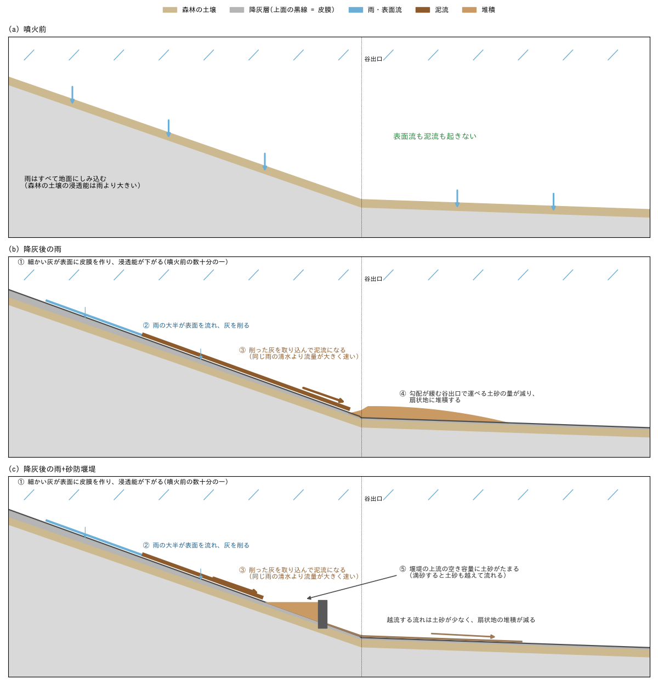
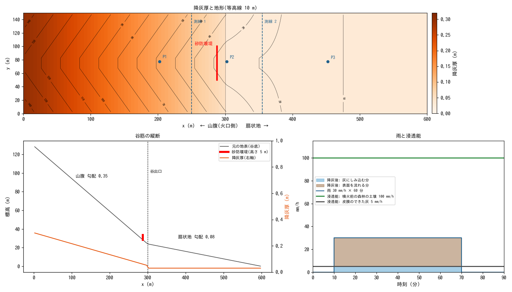
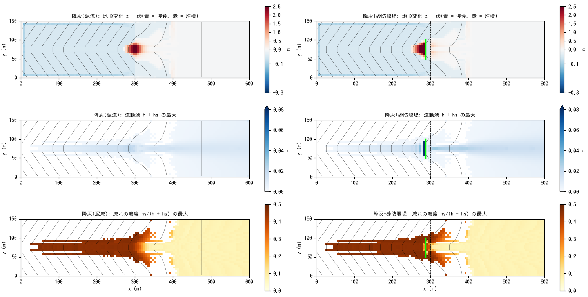
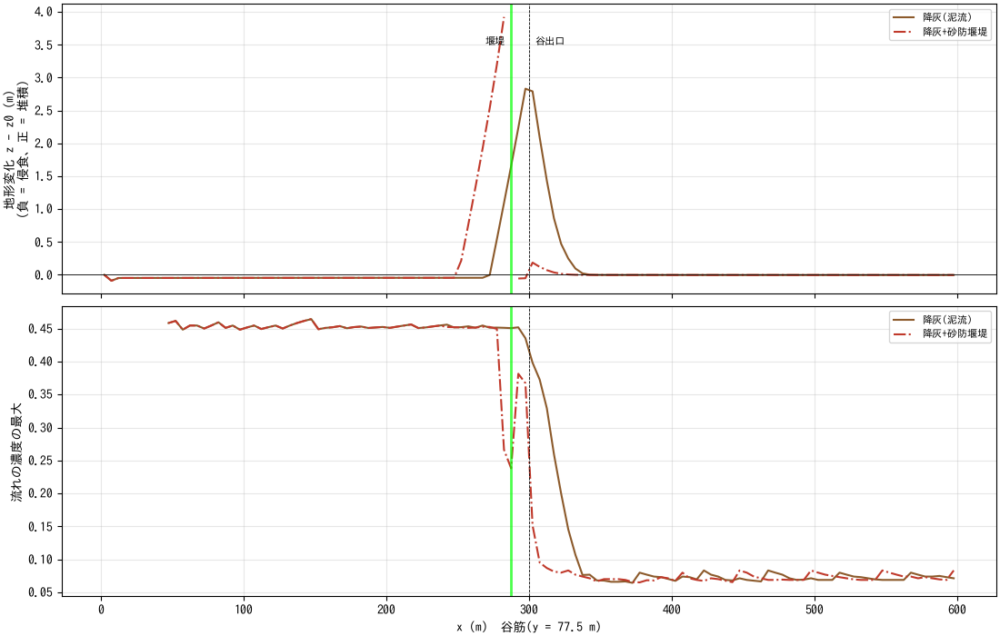
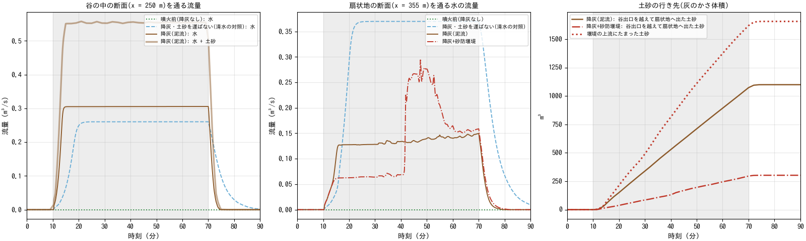
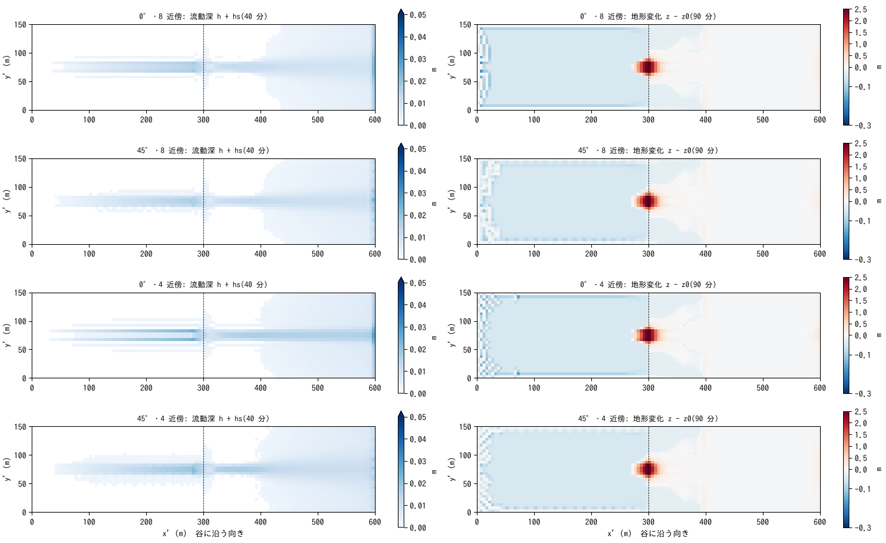
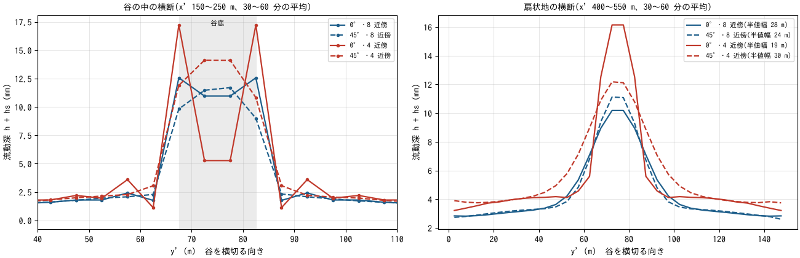

# ashfall_lahar — 降灰後の雨で起きる泥流(ラハール)と砂防堰堤

[English](en/README.md)

噴火で山腹に積もった火山灰は、雨をしみ込みにくくします。この例題は、噴火前なら
すべて地面にしみ込む雨が、降灰後には斜面を流れて灰を削り、泥流(ラハール)になって
谷の出口の扇状地に堆積するまでを、一つの計算で追います。さらに谷の出口の手前に
砂防堰堤を置いた場合と比べ、堰堤が泥流の土砂をどれだけ受け止めるかを見ます。
発生源(崩壊の深さや流入のハイドログラフ)は与えず、降灰厚・浸透能・雨だけから
泥流が生まれます。値は現象を見やすくするための模式値で、特定の火山の再現ではありません。

## 実際の火山で起きていること

- **降灰で地面が雨を通さなくなる**: 爆発的な噴火では、細かい火山灰が山腹を覆います。
  細かい灰は雨滴に打たれて表面に緻密な皮膜(クラスト)を作り、噴火前は森林の土壌が
  ほとんど吸い込んでいた雨を通さなくなります。1980 年のセントヘレンズ山(米国)の
  噴火では、斜面の浸透能が最大で 50 分の 1 に下がりました(Major & Yamakoshi 2005)。
  粗い灰や軽石は水を通しやすく、効き方は灰の粒径によります(Pierson & Major 2014)。
- **弱い雨でも泥流が起きる**: しみ込めない雨は斜面を薄く流れ、緩い灰を削ります。
  削った灰を取り込んだ流れは土砂の濃度が高い泥流になり、流量も水だけのときより
  膨らみます。噴火後の数年間は、噴火前なら土砂がほとんど動かない程度の雨で泥流が
  繰り返し起きます(1991 年以降のピナツボ山、1991〜1995 年の雲仙普賢岳、桜島など。
  Pierson & Major 2014)。浸透能が 100 mm/h から 10 mm/h に下がると、泥流(土石流)の
  発生に要る累積雨量が噴火前の数 % になるという数値実験もあります(Iwai et al. 2025)。
- **谷を出ると止まって積もる**: 泥流は急な谷の中では止まらずに流れ下り、勾配が緩む
  谷の出口(扇頂)で運べる土砂の量が減って、扇状地に厚く堆積します。扇状地の家屋や
  道路が埋まるのはここです。
- **砂防堰堤**: 谷の中に堰堤を置き、堰堤の上流の空き容量に土砂をためて、扇状地へ
  出る土砂を減らします。満砂すると土砂も堰堤を越えて流れるので、空き容量を保つために
  たまった土砂を取り除きます(除石)。

## 再現に必要な機構



| 実際の現象 | ENCflow での表し方 | 設定 |
|---|---|---|
| 降灰で浸透能が下がる | 浸透能を直接与える(Green-Ampt の定数浸透能。しみ込んだ水は層の容量 = 層厚 × 間隙率まで貯まる) | `fn_gwflow`、`f_gwvertical = 2`、`gw_ksv_mmh`、`gw_psif = 0` |
| しみ込めない雨が斜面を流れる | 浅水流(雨 − 浸透が表面水になる) | `fn_precip` |
| 表面流が灰を削り、濃い泥流になる | 侵食できる層 = 降灰厚。流れの濃度が勾配で決まる平衡濃度へ近づくように侵食・堆積する混合体(高橋型) | `fn_sd`、`f_debris = 1`、`f_dbed = 1` |
| 細かい灰の泥流は摩擦が小さく、緩い扇状地まで流れる | 混合体の抵抗則(Voellmy 型: 見かけ摩擦 + 乱流抵抗) | `f_dbres = 4`、`db_mu`、`db_xi` |
| 灰を削り切ると侵食が止まる | 侵食は土層厚(降灰厚)の範囲だけ | `fn_sd` |
| 勾配が緩む所で堆積して地形になる | 平衡濃度の低下による堆積と、止まった土砂の地形への固定 | `f_dbstop = 1` |
| 削られた灰の水は流れに加わり、積もった土砂は間隙に水を含む | 侵食で削られた層にしみ込んでいた水を地表へ戻し、堆積で増えた層の間隙をその場の流れの水で満たす | `f_dbwet = 2`(地下水計算と併用する間隙水) |
| 砂防堰堤(不透過型) | 堤体を地形に足し、堤体の土層厚を 0(侵食されない)にする | `fn_z`・`fn_sd`(make_init.py が作る) |

## 幾何と設定



上: 降灰厚(色)と地形(等高線)、砂防堰堤(赤)、流量を測る 2 本の測線(破線。谷の中
x = 250 m と扇状地 x = 355 m)。P1〜P3 はプローブ(時系列は result_*/probes/)。
下左: 谷筋の縦断と降灰厚。下右: 雨と浸透能(降灰後は 5 mm/h 分だけしみ込み、残りの
25 mm/h が表面を流れる。噴火前の土壌は雨より速くしみ込む)。

600 m × 150 m、dx = dy = 5 m(120 × 30 セル)。西半分は勾配 0.35 の山腹を刻む谷で、
谷底は幅 15 m、谷壁の横断勾配は 0.25(高さ最大 17 m)です。谷壁に降った雨は 100 m ほど
流れる間に谷底へ集まり、堰堤より上流の流れのほとんどは堰堤を通ります。x = 300 m の谷出口
から東は勾配 0.08 の扇状地で、谷壁は 100 m で消えます。東辺は自由流出、南北は壁です。

- **降灰**: 火口側(西)で 0.30 m、谷出口で 0.05 m、扇状地で 0.03 m の一方向の分布。
  降灰層を土層厚 sd(侵食できる層)として与え、同じ厚さを地表 z にも上乗せします
  (z − sd が元の地表。灰を削り切ると侵食が止まる)。
- **雨**: 10 分から 70 分まで 30 mm/h(1 時間に 30 mm。気象庁の区分で「激しい雨」の
  下限)。計算は 90 分、dt = 0.1 s。斜面を流れる水は深さ 1 mm 前後の薄いシート流なので、
  浅水流の移動限界水深 `dd` を既定の 1 mm から 0.2 mm に下げています(注意の節)。
- **浸透能**: 噴火前の森林の土壌 100 mm/h、降灰後 5 mm/h(その 20 分の 1。皮膜の
  できた細かい灰の模式値。実測の低下は最大 50 分の 1)。しみ込んだ水は層の容量
  (層厚 × 間隙率。灰は 0.5、土壌は厚さ 1 m・0.3)まで貯まります。
- **泥流のモデル**: 侵食・堆積は高橋型の平衡濃度緩和(`f_dbed = 1`、堆積係数
  `db_deltd = 0.01`)、抵抗則は Voellmy 型(`f_dbres = 4`、見かけ摩擦 μ = 0.05、
  乱流係数 ξ = 500 m/s²)。灰の粒径 1 mm、内部摩擦角 30°、堆積層の空隙率 0.5。
  止まった土砂は地形に固定します(`f_dbstop = 1`)。
- **砂防堰堤**: 谷出口の 12.5 m 上流(x = 285〜290 m の 1 列)に、谷底から高さ 5 m、
  天端が水平で幅 50 m の不透過型の堤体(make_init.py の `I_DAM`・`DAM_H`)。

| ケース | 設定ファイル | 降灰 | 浸透能 | 土砂の運搬 | 砂防堰堤 |
|---|---|---|---|---|---|
| 噴火前 | param_preeruption.txt | なし | 100 mm/h | — | なし |
| 降灰・清水の対照 | param_water.txt | あり | 5 mm/h | なし(侵食しない) | なし |
| 降灰(泥流) | param.txt | あり | 5 mm/h | あり | なし |
| 降灰+砂防堰堤 | param_dam.txt | あり | 5 mm/h | あり | あり |

清水の対照は、泥流と同じ地形・雨・浸透で土砂を運ばない場合です。泥流になったことに
よる違い(流量・速さ)を見るために並べます。

## 実行方法

```
cd examples/ashfall_lahar
make                    # リンクと入力(make_init.py)
make run                # 4 ケースを順に計算(1 ケース数分)
python3 plot_results.py # figs/*.png と数表(引数 en で英語版を en/figs/ に)
make rotated            # 補足(谷の向きと格子)の 4 ケース
python3 plot_rotated.py # figs/rotated*.png と数表(引数 en で英語版)
```

## 結果



左: 降灰(泥流)、右: 降灰+砂防堰堤(緑線)。上から 90 分後の地形変化、流動深の最大、
流れの濃度の最大(2 分ごとの出力の最大。濃度は流動深 2 mm 以上の時刻だけ)。



谷筋の縦断。上: 90 分後の地形変化、下: 流れの濃度の最大。



左: 谷の中の断面(x = 250 m。堰堤と堆積域の上流)を通る流量(細線 = 水、太い薄線 =
泥流の水 + 土砂)。中: 扇状地の断面(x = 355 m。扇頂の堆積域の下流)を通る水の流量。
右: 谷出口を越えて扇状地へ出た土砂と、堰堤の上流にたまった土砂(灰のかさ体積)。
灰色の帯 = 雨の期間。

| ケース | 地下へ入った水 | 谷出口より上流で削られた灰 | 谷出口を越えて扇状地へ出た土砂 | 堰堤の上流にたまった土砂 | 扇頂(x 300〜350 m)の堆積 / 最大厚 | 谷の断面の流量(40〜60 分) | 扇状地の断面を通った水(90 分間) |
|---|---:|---:|---:|---:|---:|---:|---:|
| 噴火前 | 2,700 m³(雨の 100 %) | — | — | — | — | 0 | 0 |
| 降灰・清水の対照 | 540 m³(20 %) | — | — | — | — | 水 0.26 m³/s | 1,289 m³ |
| 降灰(泥流) | 1,341 m³(50 %) | 2,093 m³(27 %) | 1,099 m³ | — | 1,091 m³ / 2.8 m | 水 0.31、水 + 土砂 0.55 m³/s | 477 m³ |
| 降灰+砂防堰堤 | 1,332 m³(49 %) | 2,071 m³(26 %) | 302 m³ | 1,656 m³ | 293 m³ / 0.6 m | (同上) | 487 m³ |

(表と図は 2026-10-31 に既定 f_opening_dynamic = 3 で再計算した値。developer.md §68.41)

雨は 10 分から 70 分までに合計 2,700 m³ です。地下へ入った水は、浸透した雨と、積もった
土砂の間隙に入った水の合計です。

- **噴火前は何も起きない**: 雨はすべて森林の土壌にしみ込み、表面流は出ません。
- **降灰後は雨の大半が表面を流れる**: 浸透能 5 mm/h を超える 25 mm/h 分が斜面を流れ、
  清水の対照では谷の断面に 0.26 m³/s、扇状地の断面に 0.37 m³/s(どちらも上流の面積 ×
  25 mm/h)が流れます。
- **流れが灰を削って泥流になる**: 谷出口より上流の灰の 27 %(2,093 m³)が削られ、谷の
  中の流れは土砂の濃度 0.45(運べる上限)の泥流になります。谷の断面を通る量は、水と土砂を
  合わせて清水の対照の約 2 倍(0.55 m³/s)で、流れが届くのも 2.8 分早くなります(11.7 分と
  14.5 分)。斜面全体がほぼ一様に 4〜5 cm 削られます。
- **谷を出ると止まって積もる**: 勾配が 0.35 から 0.08 に折れる谷出口で運べる土砂の量が
  下がり、扇頂に 1,091 m³、最大 2.8 m の堆積ができます。その下流の扇状地を流れるのは濃度
  0.07 程度の薄い流れです。濃い泥流が積もると、その間隙に流れの水の大半が取られる
  (固体 0.45・水 0.55 の泥流が空隙率 0.5 で積もると、水の 8 割ほどが間隙に残る)ので、
  扇状地の断面を通る水は清水の対照の 4 割ほど(477 m³)です。
- **砂防堰堤が土砂を受け止める**: 堰堤の上流に 1,656 m³ がたまり、谷出口を越えて扇状地
  へ出た土砂は 1,099 → 302 m³(7 割減)、扇頂の堆積は最大 2.8 → 0.6 m になります。堰堤の
  上流がまず水で満たされる 42 分ごろまで谷からの流れは扇状地へ出ず、越流が始まると濃度の
  低い流れが出ます。堰堤の直上流の堆積は 52 分ごろ天端の高さに達し(満砂)、その後は土砂も
  堰堤を越えます。扇状地へ出た 302 m³ のうち 134 m³ は越流が始まる前に出た分で、堰堤より
  下流の谷壁と堰堤の両端の谷壁を流れ下った水が運んだもの(堰堤を通らない)です。

## 補足: 谷の向きと格子(ENC 格子の 8 近傍)

ENCflow の ENC 格子は、軸方向の 4 近傍に加えて斜めの 4 近傍とも流れをやり取りします
([浅水流計算](../../docs/users_guide/swflow.md))。谷が格子に対して斜めでも流れ方が
変わらないかを、同じ谷(堰堤なし)を格子に沿わせた場合(0°)と 45° 傾けた場合で比べます。
比較のため、斜めのエッジの通過幅を 0 にした 4 近傍(`p_diagratio = 0`)も並べます。
45° の格子は谷を収める 555 m 四方で、谷の外は領域外、谷の下流端の外側は水位 0 m の
海域マスク(吸い込み)です(0° も同じ扱い。make_rotated.py)。45° の結果は谷沿いの
座標 (x', y') に戻して描きます。



上から 0°・8 近傍、45°・8 近傍、0°・4 近傍、45°・4 近傍。左: 40 分の流動深、右: 90 分後の
地形変化。



30〜60 分の平均の流動深の横断。左: 谷の中(x' 150〜250 m。灰色 = 谷底)、右: 扇状地
(x' 400〜550 m)。

| | 8 近傍(ENC の既定) | 4 近傍 |
|---|---:|---:|
| 流動深(30〜60 分平均)の 0° と 45° の差(L1 の相対差) | 8 % | 25 % |
| 地形変化の 0° と 45° の差 | 9 % | 17 % |
| 谷底の流れ(0°。横断 4 セル) | ほぼ一様(13〜14 mm) | 両端に分かれる(17 mm と 5 mm) |
| 扇状地の中央の流れ: ピーク / 半値幅(0° → 45°) | 12 → 13 mm / 32 → 28 m | 16 → 12 mm / 19 → 30 m |
| 谷出口を越えて扇状地へ出た土砂(0° → 45°) | 1,099 → 1,073 m³ | 1,056 → 1,004 m³ |
| 扇頂の堆積(0° → 45°) | 1,091 → 1,069 m³ | 1,047 → 1,023 m³ |

- **4 近傍は流れが格子の向きに縛られる**: 4 近傍では水が軸の向きにしか動けないので、谷が
  格子に沿う 0° では、谷壁から来た水が谷底の両端の列に沿って流れ、谷底の中央が浅くなり
  ます(谷筋の縞)。45° では流れが階段状に進み、谷底の流れが 1 本にまとまります。扇状地
  でも、0° では中央の流れが横に広がりにくく(半値幅 19 m)、45° では広がります(30 m)。
- **8 近傍は谷の向きによらない**: 斜めの近傍とも流れをやり取りする 8 近傍では、0° と 45°
  の流れの分布の差が 4 近傍の 3 分の 1 程度で、谷底の流れも扇状地の流れも同じ形になります。
- **土砂の量にはほとんど響かない**: 侵食量・谷出口を越えた土砂・扇頂の堆積は、8 近傍と
  4 近傍でほぼ同じです(0° と 45° の差は 2〜5 % で、近傍の数によらず小さい)。
  この例題の泥流は急な谷と勾配の折れで決まるためで、流れの向きと広がりそのものが問われる
  計算(氾濫原の浸水域や、格子に斜めの水路など)で 8 近傍の違いが大きく出ます。

## このモデルで表せないこと(実際の現象との違い)

- **浸透能は一定**: 実際の皮膜は雨滴に打たれて発達し、侵食で剥がれ、植生の回復とともに
  壊れて、浸透能は年々戻っていきます(セントヘレンズ山では 20 年で最大 10 倍に回復。
  Major & Yamakoshi 2005)。この例題の浸透能は与えた一定値で、灰が削られても変わりません。
- **リル・ガリー**: 実際の侵食は斜面の細い溝(リル・ガリー)に集中します。5 m のセルより
  細い溝は解かず、セルの中で平均した面的な侵食として表します。
- **崩壊からの泥流**: 水を含んだ灰の層が滑り落ちて泥流になる起動(表層崩壊)は扱いません。
  この例題は表面流による侵食からの起動だけです(崩壊からの起動は
  [土砂・地形変化](../../docs/users_guide/geomorph.md)の斜面安定判定 f_slide)。
- **積もった土砂の飽和**: 流れの下に積もった土砂は、その場の水で直ちに飽和するとして
  います(`f_dbwet = 2` の簡略化)。間隙に水がしみ込むのにかかる時間や、乾いた所に
  積もった土砂が不飽和のまま残ることは表しません。
- **粒径**: 灰は 1 種類の粒径です。礫・岩塊の分級や、スリット型の堰堤による粒径を選んだ
  捕捉は表せません。
- **堰堤の水抜き**: 堤体は水を通さない地形の段です。実際の堰堤は水抜き穴から水を抜くので、
  上流に水がたまって越流が遅れる時間は、この例題より短くなります。
- **雨の繰り返し**: 1 回の雨だけです。雨のたびに堰堤の空き容量が減っていくこと、除石で
  空き容量を戻すことは、ケースをつないで計算する必要があります
  ([中断と再開](../../docs/users_guide/restart.md))。

## 注意

- **移動限界水深 dd**: 斜面のシート流は深さ 1 mm 前後です。`dd` が流れの深さと同程度
  (既定の 1 mm)だと、セルごとに「流れる・止まる」が入れ替わり、止まったセルは運んで
  いた土砂をその場に置きます。少し低い行に横から水が集まって削り続け、水を取られた
  隣の行が土砂を置いて高くなる、という正のフィードバックが格子 1 つ分の縞を作ります
  (この急斜面では流れが運べる土砂の濃度が上限に張り付き、勾配の変化で埋め戻す働きも
  ない)。`dd` は流れの深さより十分小さくしてください(この例題は 0.2 mm)。
- **流れは薄い**: 集水域が 0.045 km² と小さいので、谷底の流れも数 cm です。規模を
  変えるには領域(lx・ly)と雨を大きくします(dt は CFL に合わせる)。
- **領域の縁**: 上流端と南北の壁際の 1 列は流れが細く、侵食と堆積がやや強く出ます
  (境界の影響。地形変化の図の縁の筋)。
- **扇状地の灰も動く**: 扇状地に積もった灰(0.03 m)も扇状地に降る雨で削られ、勾配の
  折れ(谷壁が消える x = 400 m)で薄く積もります。谷から出た土砂は「谷出口を越えて
  扇状地へ出た土砂」(谷出口より上流の土砂の収支)で数えています。
- **自由流出の東辺**: 東端の列でも、流れの土砂の平衡濃度を内部と同じ勾配(辺の外の地形を
  勾配のまま延ばした値)で求めます。2026-10-30 の修正(developer.md §28.15)の前は東端の列の
  勾配が 0 になり、東端の数列に人工的な堆積(東端の列で最大 0.2 m、合わせて約 160 m³)ができて
  いました。その間隙に入っていた水のぶん、表の「地下へ入った水」は修正前より約 90 m³ 少なく
  なっています(ほかの値は変わりません)。

## 設定の選び方(抵抗則と侵食則)

- **江頭の構成則(`f_dbres = 2`)は細かい灰には使えない**: 層流の抵抗が (d/h)² に比例する
  ため、粒径 1 mm・流動深数 cm では抵抗がほとんど消え、速度が発散します。江頭則は粒径が
  cm 以上の石礫型の抵抗則です。
- **クーロン摩擦(`f_dbres = 1`)では扇状地を流れ下れない**: φ = 30° では、濃度 0.45 の
  混合体が止まらずに流れる勾配が tanφ·sC/(1 + sC) ≈ 0.25 になり、勾配 0.08 の扇状地の
  手前で止まります。間隙水圧の高い細かい泥の見かけ摩擦として Voellmy 型(μ = 0.05)を
  使います。
- **侵食の速さ**: 江頭・芦田の侵食・堆積(`f_dbed = 2`)は侵食の速さが流速に比例し、急な
  斜面の速い流れでは灰が短時間で剥がれます。高橋型の緩和(`f_dbed = 1`)は侵食の速さを
  係数で調整できます。
- **谷の形**: 谷底が 1 セルの V 字谷では土砂が 1 列に集まって非現実的に厚く積もるため、
  谷底 15 m の台形の谷にしています。

## 感度実験の入口

- `gw_ksv_mmh`(5 → 15 mm/h): 雨との差が表面を流れる量を決めます。雨(30 mm/h)に
  近づくほど表面流が減り、泥流は小さくなります。
- `prval`(雨の強さ): 強いほど侵食が深くなり、灰を削り切る範囲が広がります。
- `DAM_H`(make_init.py。堰堤の高さ): 空き容量が増え、捕捉する土砂が増えます。
- `db_mu`(0.05 → 0.1): 扇状地で止まる位置が手前に移ります。
- `db_deltd`(0.01 → 0.05): 谷出口のすぐ下流へより集中して積もります。

## 参考文献

- Iwai, Miyata and Yamanoi (2025): Changes in the debris flow threshold owing to volcanic
  eruptions: evaluation with numerical simulations. Journal of Disaster Research, 20(6),
  1054–1061.
- Major, J. J. and Yamakoshi, T. (2005): Decadal-scale change of infiltration characteristics
  of a tephra-mantled hillslope at Mount St Helens, Washington. Hydrological Processes, 19(18),
  3621–3630.
- Pierson, T. C. and Major, J. J. (2014): Hydrogeomorphic effects of explosive volcanic
  eruptions on drainage basins. Annual Review of Earth and Planetary Sciences, 42, 469–507.
